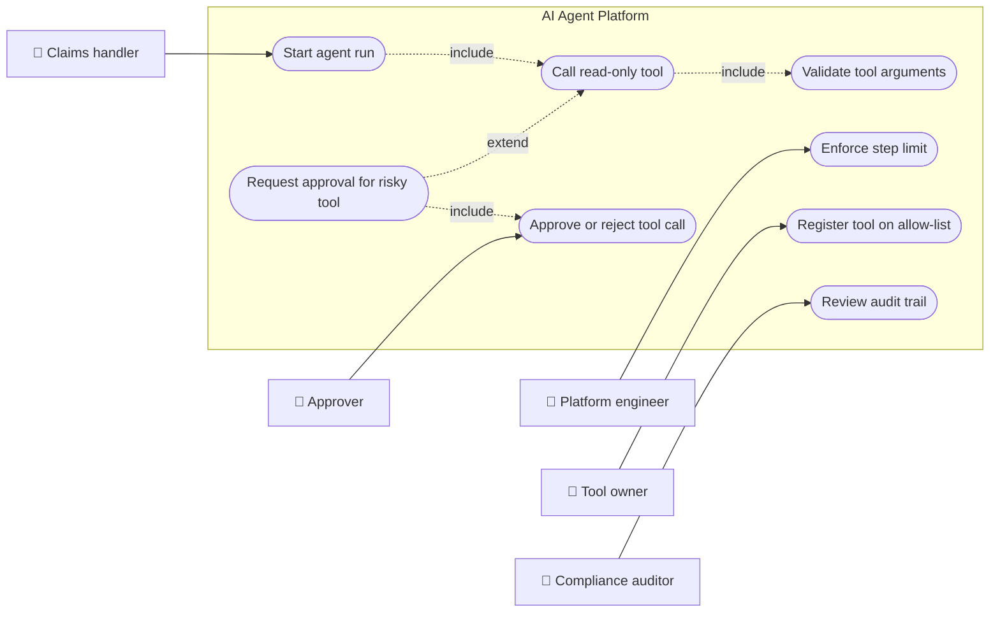
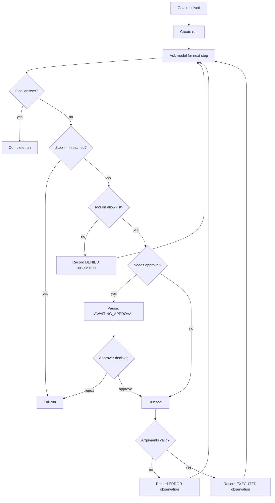
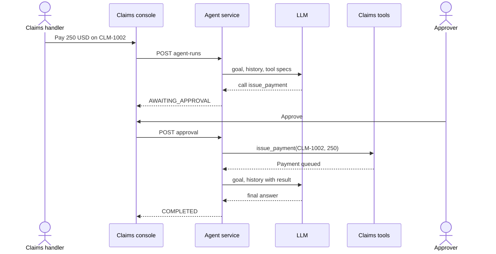
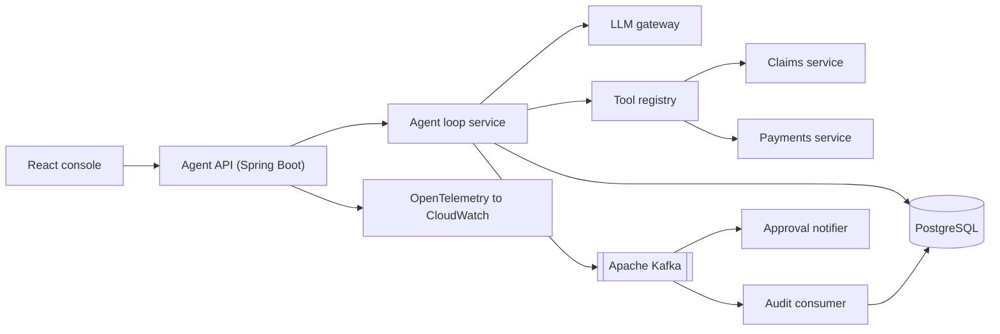
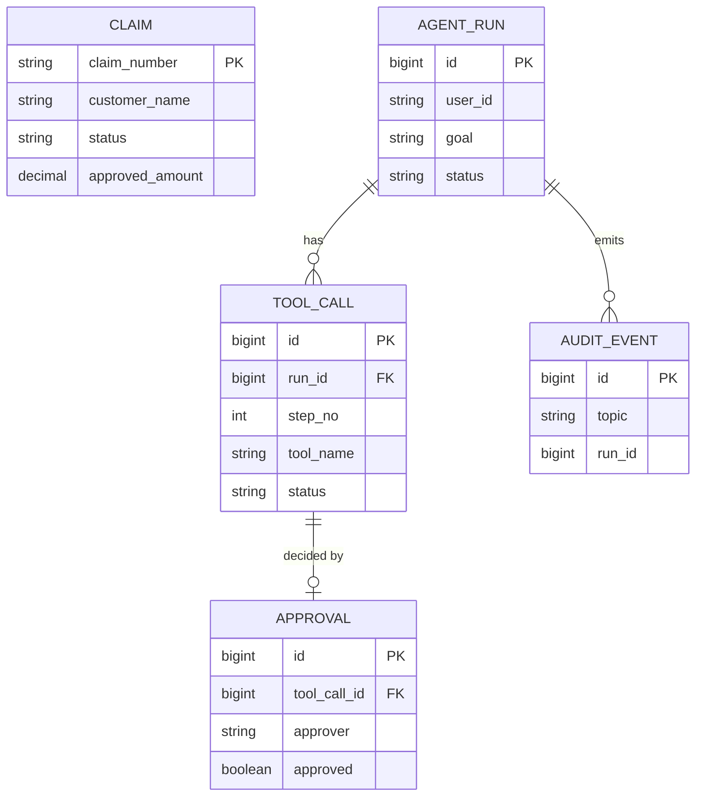
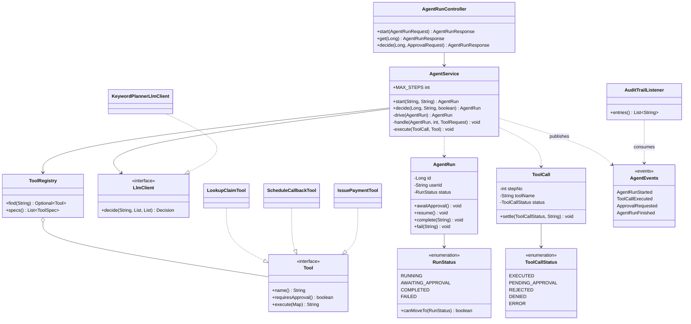
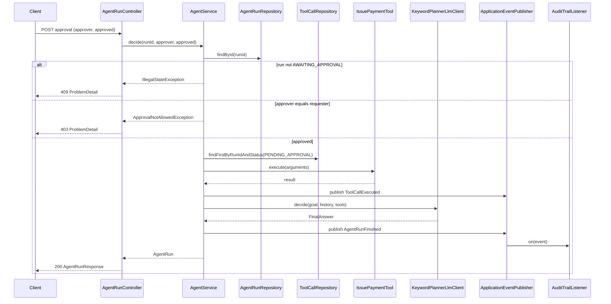
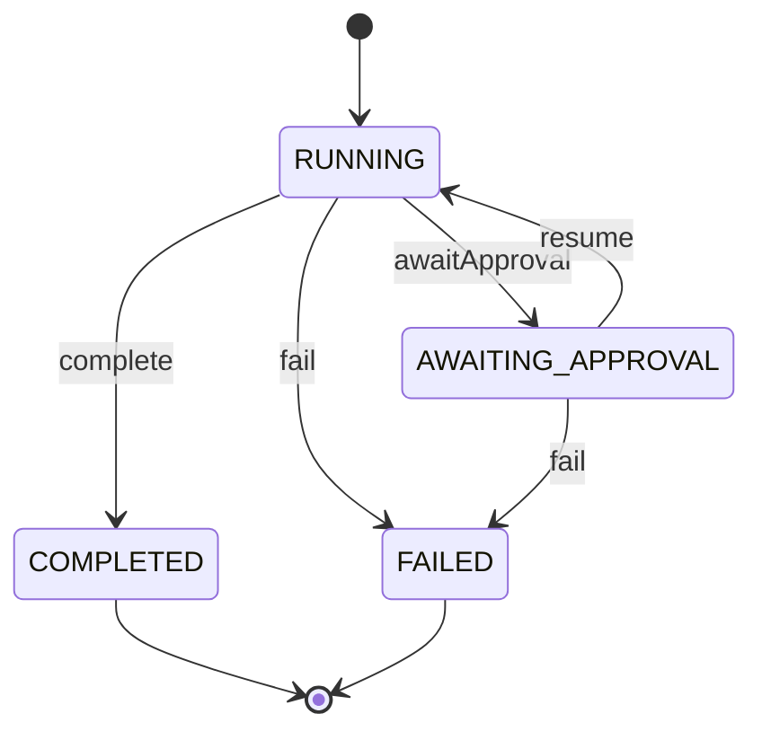
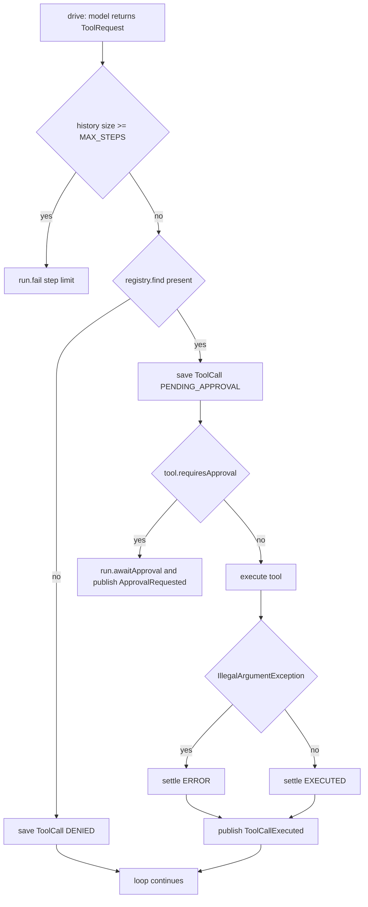

# AI Agents with Tool Calling

> **Domain:** AI and LLM Engineering · **Author:** [@dhulipalla599](https://github.com/dhulipalla599) · **Published:** November 06, 2026

> **Runnable code:** [`examples/ai-engineering/ai-agents-with-tool-calling`](https://github.com/dhulipalla599/domain-knowledge-engineering/tree/main/examples/ai-engineering/ai-agents-with-tool-calling)

## Explain It Like I'm Five

Imagine a very clever helper who can talk and think but has no hands. You ask, "Is my parcel at the post office yet?" The helper cannot walk there, so it writes a note: "Please phone the post office and ask." A grown-up reads the note, makes the call, and gives the answer back. The helper reads the answer and decides what to do next, maybe writing another note. For anything big, like spending money, the grown-up says, "Wait, I must ask the boss first."

In a company, an AI agent is that helper, the tools are the things the grown-up is allowed to do on its behalf, and the rules about the boss are what keep the agent safe.

## Business Overview

**Tool calling** lets a language model ask the surrounding application to run a named function with arguments, such as "look up claim CLM-1001". The model never runs anything itself. The application decides whether the call is allowed, runs it, and returns the result to the model. An **agent** is a loop built on this: the model plans, calls a tool, reads the result, and repeats until it can answer or must stop.

Why the business cares:

- **Customer experience and cost to serve:** an agent can combine several systems (claims, scheduling, payments) in one conversation instead of handing the customer between teams.
- **Risk:** an agent that can act is more dangerous than one that can only talk. Wrong arguments, runaway loops, prompt injection from retrieved text, and unauthorised payments are all new failure modes.
- **Regulation and audit:** who or what took an action, on whose authority, and with what inputs must be reconstructable. Specific rules (consumer-protection, data-protection, model-risk) differ by country and company.
- **Control:** human approval for high-impact actions is usually a policy decision, not a technical one.

In the AI and LLM Engineering value chain, agents sit above the model provider and the LLM gateway, and alongside retrieval (RAG). They depend on guardrails, evaluation and observability, and they are where AI output turns into real side effects.

## Real-World Example

**Harbor Mutual** is a fictional insurer. Its claims assistant is an agent that adjusters use from the claims console.

1. Ana Torres, a claims handler, types: "What is the status of CLM-1001 and book a callback."
2. The platform creates an **agent run** owned by Ana's user ID and publishes `agent.run.started`.
3. The model asks for `lookup_claim` with `claimNumber = CLM-1001`. The platform checks the tool is on the allow-list, validates the arguments, runs it, and stores the result: the claim is `UNDER_REVIEW`.
4. The model asks for `schedule_callback`. It runs and a callback is booked for the next business day.
5. The model has what it needs and returns a final answer. The run is `COMPLETED` and `agent.run.finished` is published.
6. Later Ana asks, "Pay 250 USD on CLM-1002." The model requests `issue_payment`, which moves money. The platform does **not** run it. The run moves to `AWAITING_APPROVAL` and `agent.approval.requested` is published.
7. Ana tries to approve her own request and is refused. Supervisor Raj Patel approves it. The payment tool runs, validates the amount against the approved amount, and the run completes.

If a goal made the model repeat the same lookup forever, the platform would stop it after four tool calls and mark the run `FAILED`.

## Stakeholders

| Stakeholder | What they need | What they fear |
|---|---|---|
| Claims handler (end user) | Quick, correct answers and actions from one place | Wrong data, actions taken that they did not intend |
| Approver / supervisor | Clear view of what the agent wants to do and why | Rubber-stamping, being bypassed, approving without context |
| Agent platform engineer | Predictable loop, tool registry, good traces | Runaway loops, flaky tools, hard-to-debug runs |
| Tool owner (claims or payments team) | Their API called only with valid, authorised input | An agent hammering or misusing their service |
| Security and privacy officer | Least-privilege tools, audit trail, injection defences | Data leakage, unauthorised actions, no evidence |
| Compliance / internal audit | Reconstructable record of every action and approval | Unexplainable decisions, missing approvals |
| Model provider | Well-formed requests within agreed limits | Abuse or traffic spikes (outside the company's direct control) |

## Use Case Diagram



| Use Case | Primary Actor | Goal | Main success outcome |
|---|---|---|---|
| Start agent run | Claims handler | Get a task done by describing it | Run created, loop executes, final answer returned |
| Call read-only tool | Agent (for the handler) | Fetch or schedule something low-risk | Tool result recorded and fed back to the model |
| Validate tool arguments | Platform | Never trust model-produced arguments | Bad arguments become an error observation, not a bad action |
| Request approval for risky tool | Agent | Do something high-impact safely | Run pauses in `AWAITING_APPROVAL` |
| Approve or reject tool call | Approver | Decide on the pending action | Tool runs and run resumes, or run fails as rejected |
| Enforce step limit | Platform engineer | Stop runaway loops | Run ends `FAILED` with a clear reason |
| Register tool on allow-list | Tool owner | Expose a capability deliberately | Only registered tools can ever be called |
| Review audit trail | Compliance auditor | Reconstruct what happened | Ordered events per run |

## Key Terms

| Term | Plain-English meaning |
|---|---|
| Tool calling (function calling) | The model returns a structured request to run a named function; the application runs it |
| Agent | A loop in which the model repeatedly chooses tool calls until it can answer |
| Tool spec / schema | The name, description and argument schema shown to the model |
| Observation | The result of a tool call, fed back to the model |
| Allow-list | The fixed set of tools an agent may call; anything else is refused |
| Human in the loop (HITL) | A person must approve certain actions before they run |
| Step limit | Hard cap on tool calls per run |
| Prompt injection | Text in data (an email, a web page) that tries to give the model new instructions |
| Idempotency key | A token that makes a repeated write safe to retry |
| Least privilege | Each tool gets only the permissions it needs |
| Trace | A recorded timeline of model calls and tool calls for one run |
| Guardrail | A check before or after the model that blocks unsafe input or output |

## Process Flow

A user states a goal. The platform opens a run and asks the model what to do. If the model requests a tool, the platform checks the allow-list, then whether the tool needs approval. Safe tools run immediately and their result goes back to the model. Risky tools pause the run until a different person decides. The loop ends when the model gives a final answer, the step limit is reached, or an approver rejects the action. Every step publishes an event.





## Business Rules and Edge Cases

- **Allow-list only.** The model may name any tool, including ones that do not exist or that you never meant to expose. Unregistered names are refused and the refusal is returned to the model.
- **Arguments are untrusted.** Validate type, format, existence and limits inside the tool (for example, payment amount must be positive and not exceed the approved amount). Do not rely on the prompt to constrain them.
- **High-impact tools need a different person.** The requester must not approve their own run. Whether approval is needed, and by whom, is company policy and varies.
- **Step limit.** Cap tool calls per run so a confused model cannot loop and burn cost or hammer a downstream service.
- **Pause must be durable.** An approval can arrive minutes or days later. Persist the pending call and resume from storage, not from memory.
- **Double decisions.** Approving a run that is no longer awaiting approval must fail clearly (conflict) rather than run the tool twice.
- **Idempotent writes.** Retries after a timeout must not pay twice. Write tools should accept an idempotency key.
- **Partial failure.** A multi-step run can succeed at step one and fail at step two. Record each step so the outcome is explainable and compensating action is possible.
- **Prompt injection.** Text returned by tools (notes, emails) can contain instructions. Treat it as data, and keep authorisation outside the model.
- **Authority.** The agent acts on behalf of a user. Tools should enforce that user's permissions, not the agent's blanket access.

## From Business to System

| Business concept / step | System component | Data entity | Event |
|---|---|---|---|
| Goal submitted | `AgentRunController`, `AgentService.start` | `agent_run` | `agent.run.started` |
| Model proposes an action | `LlmClient` adapter | `tool_call` | n/a |
| Allow-list check | `ToolRegistry` | n/a | `agent.toolcall.executed` (status `DENIED`) |
| Run a read-only tool | `Tool` implementations | `tool_call` | `agent.toolcall.executed` |
| Pause for approval | `AgentService.handle` | `agent_run.status`, `tool_call` | `agent.approval.requested` |
| Approver decides | `AgentService.decide` | `approval`, `tool_call` | `agent.toolcall.executed` |
| Finish or fail | `AgentService.drive` | `agent_run` | `agent.run.finished` |
| Audit | `AuditTrailListener` (Kafka consumer in production) | `audit_event` | consumes all topics |

## Architecture



The **agent API and loop** own run state and the rules: allow-list, approval gate, step limit. They are one deployable because the loop must read and write run state transactionally. The **LLM gateway** is separate so model choice, budgets and redaction are shared across applications. **Tools** are thin adapters over the owning teams' services, so each tool owner keeps control of its own validation and permissions. **Kafka** decouples audit and notification from the loop so a slow consumer never slows a run. PostgreSQL is the system of record; the model's memory is never trusted as state.

## Data Model

```sql
CREATE TABLE claim (
    claim_number    VARCHAR(20) PRIMARY KEY,
    customer_name   VARCHAR(120) NOT NULL,
    status          VARCHAR(30)  NOT NULL,
    approved_amount NUMERIC(12,2) NOT NULL DEFAULT 0
);

CREATE TABLE agent_run (
    id             BIGSERIAL PRIMARY KEY,
    user_id        VARCHAR(80)  NOT NULL,
    goal           VARCHAR(1000) NOT NULL,
    status         VARCHAR(30)  NOT NULL
        CHECK (status IN ('RUNNING','AWAITING_APPROVAL','COMPLETED','FAILED')),
    final_answer   VARCHAR(2000),
    failure_reason VARCHAR(255),
    created_at     TIMESTAMPTZ  NOT NULL DEFAULT now()
);

CREATE TABLE tool_call (
    id         BIGSERIAL PRIMARY KEY,
    run_id     BIGINT NOT NULL REFERENCES agent_run(id),
    step_no    INT    NOT NULL,
    tool_name  VARCHAR(60) NOT NULL,
    arguments  VARCHAR(1000) NOT NULL,
    status     VARCHAR(30) NOT NULL
        CHECK (status IN ('EXECUTED','PENDING_APPROVAL','REJECTED','DENIED','ERROR')),
    result     VARCHAR(1000),
    UNIQUE (run_id, step_no)
);

CREATE TABLE approval (
    id         BIGSERIAL PRIMARY KEY,
    run_id     BIGINT NOT NULL REFERENCES agent_run(id),
    tool_call_id BIGINT NOT NULL REFERENCES tool_call(id),
    approver   VARCHAR(80) NOT NULL,
    approved   BOOLEAN NOT NULL,
    decided_at TIMESTAMPTZ NOT NULL DEFAULT now()
);

CREATE TABLE audit_event (
    id        BIGSERIAL PRIMARY KEY,
    topic     VARCHAR(60) NOT NULL,
    run_id    BIGINT NOT NULL,
    payload   JSONB NOT NULL,
    occurred_at TIMESTAMPTZ NOT NULL DEFAULT now()
);
```

The runnable example implements `claim`, `agent_run` and `tool_call`; `approval` and `audit_event` are the production additions (the example keeps the audit trail in memory and does not persist the approver).



## APIs

| Method | Path | Purpose |
|---|---|---|
| POST | `/api/agent-runs` | Start a run and drive it until it finishes or needs approval |
| GET | `/api/agent-runs/{id}` | Read a run with its tool calls |
| POST | `/api/agent-runs/{id}/approval` | Approve or reject the pending tool call |

Errors use RFC 7807 `ProblemDetail`: 400 invalid body, 403 requester approving their own run, 404 unknown run, 409 run not awaiting approval.

Request `POST /api/agent-runs`:

```json
{ "userId": "ana-agent", "goal": "Pay 250 USD on CLM-1002" }
```

Response `201 Created`:

```json
{
  "id": 2,
  "userId": "ana-agent",
  "goal": "Pay 250 USD on CLM-1002",
  "status": "AWAITING_APPROVAL",
  "finalAnswer": null,
  "failureReason": null,
  "toolCalls": [
    { "step": 1, "tool": "issue_payment",
      "arguments": "{\"claimNumber\":\"CLM-1002\",\"amount\":\"250\"}",
      "status": "PENDING_APPROVAL", "result": null }
  ]
}
```

## Events

| Event (Kafka topic) | Producer | Consumers | Key fields |
|---|---|---|---|
| `agent.run.started` | Agent service | Audit, analytics | `runId`, `userId`, `goal` |
| `agent.toolcall.executed` | Agent service | Audit, cost and quality dashboards | `runId`, `tool`, `status` |
| `agent.approval.requested` | Agent service | Approval notifier, audit | `runId`, `tool`, `arguments` |
| `agent.run.finished` | Agent service | Audit, analytics, UI push | `runId`, `status` |

Use `runId` as the Kafka message key so all events of one run land on one partition and stay ordered. Consumers must be idempotent (events are delivered at least once): deduplicate on `runId` plus event type plus step number. Publish through a transactional outbox so an event is never sent for a transaction that rolled back, and never lost after a commit. The example publishes in-process with Spring events, which are synchronous and not durable.

## Backend Implementation

> The Java tab is the exact code from the runnable example (Spring Boot 3). The Python tab uses FastAPI with SQLAlchemy and the Node.js tab uses Express with TypeScript; they show the same logic, names and rules.

The core rules are in `AgentService`: the allow-list and approval gate in `handle`, and the four-eyes check in `decide`.

=== "Java"

    ```java
    private void handle(AgentRun run, int stepNo, ToolRequest request) {
        String args = write(request.arguments());
        Optional<Tool> tool = registry.find(request.tool());
        if (tool.isEmpty()) {
            record(run, new ToolCall(run.getId(), stepNo, request.tool(), args, ToolCallStatus.DENIED,
                    "Tool '" + request.tool() + "' is not on the allow-list"));
            return;
        }
        ToolCall call = calls.save(new ToolCall(run.getId(), stepNo, request.tool(), args,
                ToolCallStatus.PENDING_APPROVAL, null));
        if (tool.get().requiresApproval()) {
            run.awaitApproval();
            events.publishEvent(new ApprovalRequested(run.getId(), request.tool(), args));
        } else {
            execute(call, tool.get());
        }
    }

    @Transactional
    public AgentRun decide(Long runId, String approver, boolean approved) {
        AgentRun run = get(runId);
        if (run.getStatus() != RunStatus.AWAITING_APPROVAL) {
            throw new IllegalStateException("Run " + runId + " is " + run.getStatus() + ", not awaiting approval");
        }
        if (approver.equals(run.getUserId())) {
            throw new ApprovalNotAllowedException("The requester cannot approve their own agent run");
        }
        ToolCall pending = calls.findFirstByRunIdAndStatus(runId, ToolCallStatus.PENDING_APPROVAL).orElseThrow();
        if (!approved) {
            pending.settle(ToolCallStatus.REJECTED, "Rejected by " + approver);
            events.publishEvent(new ToolCallExecuted(runId, pending.getToolName(), ToolCallStatus.REJECTED));
            run.fail("Rejected by " + approver);
            return finish(run);
        }
        execute(pending, registry.find(pending.getToolName()).orElseThrow());
        run.resume();
        return drive(run);
    }
    ```

=== "Python"

    ```python
    def handle(db, run, step_no, request):
        args = json.dumps(request.arguments)
        tool = registry.get(request.tool)
        if tool is None:
            record(db, run, ToolCall(run_id=run.id, step_no=step_no, tool_name=request.tool,
                   arguments=args, status="DENIED",
                   result=f"Tool '{request.tool}' is not on the allow-list"))
            return
        call = ToolCall(run_id=run.id, step_no=step_no, tool_name=request.tool,
                        arguments=args, status="PENDING_APPROVAL")
        db.add(call)
        if tool.requires_approval:
            run.await_approval()
            publish("agent.approval.requested", run.id, tool=request.tool, arguments=args)
        else:
            execute(db, call, tool)


    def decide(db, run_id: int, approver: str, approved: bool) -> AgentRun:
        run = db.get(AgentRun, run_id) or raise_not_found(run_id)
        if run.status != "AWAITING_APPROVAL":
            raise HTTPException(409, f"Run {run_id} is {run.status}, not awaiting approval")
        if approver == run.user_id:
            raise HTTPException(403, "The requester cannot approve their own agent run")
        pending = db.scalars(select(ToolCall).where(
            ToolCall.run_id == run_id, ToolCall.status == "PENDING_APPROVAL")).first()
        if not approved:
            pending.settle("REJECTED", f"Rejected by {approver}")
            publish("agent.toolcall.executed", run_id, tool=pending.tool_name, status="REJECTED")
            run.fail(f"Rejected by {approver}")
            return finish(run)
        execute(db, pending, registry[pending.tool_name])
        run.resume()
        return drive(db, run)
    ```

=== "Node.js"

    ```typescript
    async function handle(run: AgentRun, stepNo: number, request: ToolRequest) {
      const args = JSON.stringify(request.arguments);
      const tool = registry.get(request.tool);
      if (!tool) {
        await record(run, { runId: run.id, stepNo, toolName: request.tool, arguments: args,
          status: "DENIED", result: `Tool '${request.tool}' is not on the allow-list` });
        return;
      }
      const call = await calls.save({ runId: run.id, stepNo, toolName: request.tool,
        arguments: args, status: "PENDING_APPROVAL" });
      if (tool.requiresApproval) {
        run.awaitApproval();
        publish("agent.approval.requested", { runId: run.id, tool: request.tool, arguments: args });
      } else {
        await execute(call, tool);
      }
    }

    async function decide(runId: number, approver: string, approved: boolean) {
      const run = await runs.get(runId);
      if (run.status !== "AWAITING_APPROVAL") {
        throw new HttpError(409, `Run ${runId} is ${run.status}, not awaiting approval`);
      }
      if (approver === run.userId) {
        throw new HttpError(403, "The requester cannot approve their own agent run");
      }
      const pending = await calls.findPending(runId);
      if (!approved) {
        pending.settle("REJECTED", `Rejected by ${approver}`);
        publish("agent.toolcall.executed", { runId, tool: pending.toolName, status: "REJECTED" });
        run.fail(`Rejected by ${approver}`);
        return finish(run);
      }
      await execute(pending, registry.get(pending.toolName)!);
      run.resume();
      return drive(run);
    }
    ```

The controller endpoint that calls it:

=== "Java"

    ```java
    @PostMapping("/{id}/approval")
    public AgentRunResponse decide(@PathVariable Long id, @Valid @RequestBody ApprovalRequest request) {
        return view(service.decide(id, request.approver(), request.approved()));
    }
    ```

=== "Python"

    ```python
    @router.post("/agent-runs/{run_id}/approval")
    def approval(run_id: int, body: ApprovalRequest, db: Session = Depends(get_db)):
        return view(db, decide(db, run_id, body.approver, body.approved))
    ```

=== "Node.js"

    ```typescript
    router.post("/agent-runs/:id/approval", async (req, res) => {
      const body = approvalSchema.parse(req.body);
      res.json(await view(await decide(Number(req.params.id), body.approver, body.approved)));
    });
    ```

Full source: [`examples/ai-engineering/ai-agents-with-tool-calling`](https://github.com/dhulipalla599/domain-knowledge-engineering/tree/main/examples/ai-engineering/ai-agents-with-tool-calling).

## Frontend Screen

```tsx
import { useState } from "react";

type ToolCall = { step: number; tool: string; status: string; result: string | null };
type Run = { id: number; status: string; finalAnswer: string | null; toolCalls: ToolCall[] };

export function AgentConsole({ userId }: { userId: string }) {
  const [goal, setGoal] = useState("");
  const [run, setRun] = useState<Run | null>(null);
  const [error, setError] = useState<string | null>(null);

  async function send(path: string, body: unknown) {
    const res = await fetch(path, {
      method: "POST",
      headers: { "Content-Type": "application/json" },
      body: JSON.stringify(body),
    });
    const data = await res.json();
    if (!res.ok) { setError(data.detail ?? "Request failed"); return; }
    setError(null);
    setRun(data);
  }

  return (
    <section>
      <form onSubmit={(e) => { e.preventDefault(); send("/api/agent-runs", { userId, goal }); }}>
        <input value={goal} onChange={(e) => setGoal(e.target.value)} placeholder="Ask the claims assistant" />
        <button disabled={!goal.trim()}>Run</button>
      </form>
      {error && <p role="alert">{error}</p>}
      {run && (
        <>
          <h2>Run {run.id}: {run.status}</h2>
          <ol>
            {run.toolCalls.map((c) => (
              <li key={c.step}>{c.tool} - {c.status}{c.result ? `: ${c.result}` : ""}</li>
            ))}
          </ol>
          {run.finalAnswer && <p>{run.finalAnswer}</p>}
          {run.status === "AWAITING_APPROVAL" && (
            <p>
              Waiting for a supervisor. A supervisor's console calls
              <code> POST /api/agent-runs/{run.id}/approval</code>.
            </p>
          )}
        </>
      )}
    </section>
  );
}
```

## Cloud Deployment

The agent API runs as a Deployment on **Amazon EKS** behind an Application Load Balancer. **Amazon RDS for PostgreSQL** (or Aurora) holds run state. **Amazon MSK** provides Kafka. Secrets (model gateway credentials, tool service tokens) live in **AWS Secrets Manager**, read through IAM roles for service accounts. Model calls go through the LLM gateway; if Amazon Bedrock is the provider, reach it through a VPC endpoint.

```hcl
resource "aws_db_instance" "agent" {
  identifier                  = "agent-platform"
  engine                      = "postgres"
  instance_class              = "db.m6g.large"
  allocated_storage           = 50
  multi_az                    = true
  storage_encrypted           = true
  backup_retention_period     = 14
  deletion_protection         = true
  manage_master_user_password = true
  db_subnet_group_name        = aws_db_subnet_group.private.name
  vpc_security_group_ids      = [aws_security_group.agent_db.id]
}
```

- **Security:** one IAM role and one downstream credential per tool, scoped to that tool's needs. Network policies restrict which pods can reach claims and payments services. Encrypt data at rest and in transit. Redact personal data before it reaches the model where policy requires.
- **Scaling:** the API is stateless; scale pods on CPU and in-flight runs. Approval waits cost no compute because state is in PostgreSQL. Apply per-user and per-tool rate limits.
- **Observability:** OpenTelemetry traces with one span per model call and per tool call, tagged with `runId`; export to CloudWatch (and X-Ray if used). Alarms on step-limit failures, `DENIED` rate, tool error rate, approval wait time and model latency.

## Non-Functional Requirements

| Concern | Expectation | How the design meets it |
|---|---|---|
| Availability | Console usable during model or tool outages | Fail the run with a clear reason; gateway failover; read-only tools degrade independently |
| Latency | Seconds, dominated by model calls | Step limit bounds worst case; stream partial output; no blocking on approvals |
| Consistency | A write tool never runs twice | Single `PENDING_APPROVAL` call per pause, status checks, idempotency keys downstream |
| Audit | Every step and decision reconstructable | `tool_call` rows plus Kafka events keyed by `runId`; approver recorded |
| Compliance | Evidence of human approval for high-impact actions | Approval gate enforced in code, requester cannot self-approve; retention rules set by company and jurisdiction |
| Security | No action beyond the user's authority | Allow-list, argument validation inside tools, per-tool least privilege |
| Cost | Predictable spend | Step limit, per-team budgets in the gateway, token metrics per run |

## Runnable Example

The example is a Spring Boot 3 / Java 21 implementation of the claims assistant. A deterministic `KeywordPlannerLlmClient` stands in for the model behind the `LlmClient` interface, so it needs no API key or network. It implements the agent loop, a tool allow-list, argument validation, an approval gate with a four-eyes rule, a step limit, a run lifecycle enum, and four Spring events named after Kafka topics. It uses the in-memory H2 database and seeds three claims.

Source: [`examples/ai-engineering/ai-agents-with-tool-calling`](https://github.com/dhulipalla599/domain-knowledge-engineering/tree/main/examples/ai-engineering/ai-agents-with-tool-calling)

```bash
cd examples/ai-engineering/ai-agents-with-tool-calling
mvn -B -ntp verify          # build and run the tests
mvn spring-boot:run         # start on http://localhost:8080
```

Happy path:

```bash
curl -s -X POST localhost:8080/api/agent-runs -H 'Content-Type: application/json' \
  -d '{"userId":"ana-agent","goal":"What is the status of CLM-1001 and book a callback"}'
```

Expected: `201`, `"status":"COMPLETED"`, and a `finalAnswer` of `Claim CLM-1001 for Ana Torres is UNDER_REVIEW, approved amount 0.00; Callback booked for CLM-1001 on the next business day at 09:00`.

Rule violation (run 2 is the pending payment `Pay 250 USD on CLM-1002`, and the requester tries to approve it):

```bash
curl -s -X POST localhost:8080/api/agent-runs/2/approval -H 'Content-Type: application/json' \
  -d '{"approver":"ana-agent","approved":true}'
```

Expected: `403` with `"detail":"The requester cannot approve their own agent run"`.

| Class | Package | Responsibility |
|---|---|---|
| `AgentRun` | domain | Run entity; enforces legal state transitions |
| `RunStatus` | domain | Lifecycle enum with `canMoveTo` |
| `ToolCall` / `ToolCallStatus` | domain | One tool invocation and its outcome |
| `Claim` | domain | Seeded data read by tools |
| `AgentEvents` | domain | Records named after Kafka topics |
| `AgentRunRepository`, `ToolCallRepository`, `ClaimRepository` | repository | Spring Data JPA access |
| `AgentService` | service | Agent loop, allow-list, approval gate, step limit |
| `Tool`, `LlmClient`, `ToolRegistry` | service | Ports and the allow-list of registered tools |
| `AgentRunController`, `AgentRunRequest`, `ApprovalRequest`, `AgentRunResponse` | api | REST endpoints and DTO records |
| `ApiExceptionHandler` | api | Maps rule violations to `ProblemDetail` |
| `KeywordPlannerLlmClient` | integration | Deterministic stub model |
| `LookupClaimTool`, `ScheduleCallbackTool`, `IssuePaymentTool`, `ClaimArguments` | integration | Tool adapters and argument validation |
| `AuditTrailListener` | integration | `@EventListener` stand-in for Kafka consumers |

## UML Diagrams

### Class Diagram

The service depends on the ports `LlmClient` and `Tool` (via `ToolRegistry`); adapters in `integration` implement them. Events are published from the service and consumed by the listener.



### Sequence Diagram (control flow)

One approval request: the client posts the decision, the controller delegates to `AgentService.decide`, which rejects the requester or runs the tool, resumes the loop, and publishes events.



### State Diagram

The `RunStatus` enum and `canMoveTo` define the legal moves. `COMPLETED` and `FAILED` are terminal.



### Activity Diagram

The decision logic inside `AgentService.handle`, called from `drive` after the step-limit check.



## AI Opportunities

- **Claims triage assistant.** The agent gathers claim status, policy details and recent notes and drafts a next-step recommendation. Needs read access to claims and policy data under the user's permissions. Risk: wrong or stale facts and over-trust; mitigate with citations to the source records, read-only tools by default and human sign-off before any decision.
- **Self-service customer agent.** Customers ask about claim progress and book callbacks. Needs a narrow tool set and identity verification. Risk: data leakage and prompt injection; mitigate with per-customer authorisation inside tools, output filtering and clear escalation to a person.
- **Payment and settlement preparation.** The agent assembles a payment request for a human to approve. Needs approved-amount and payee data. Risk: financial error and fraud; mitigate with approval gates, amount limits, idempotency keys and dual control where policy requires it.
- **Agent quality evaluation.** An LLM or rules-based judge replays recorded runs to score tool choice and detect loops. Needs stored traces. Risk: judge bias and drift; mitigate with a human-labelled sample and tracking agreement over time.
- **Anomaly detection on agent behaviour.** ML flags unusual tool-use patterns (spikes in `DENIED` calls, unusual amounts). Needs event streams from Kafka. Risk: false positives and unexplained alerts; mitigate with simple, explainable features and analyst review.

## Common Pitfalls

- **Trusting model arguments.** Validate inside every tool; the prompt is not a security boundary.
- **Authorisation in the prompt.** "Only pay approved claims" in a prompt is a wish. Enforce limits in code, with the user's identity.
- **No step limit or timeouts.** A confused loop becomes an outage and an invoice.
- **Keeping run state in memory.** Approvals arrive later; persist and resume from the database.
- **Letting the requester approve.** Without separation of duties the approval gate is theatre.
- **Non-idempotent write tools.** Retries and double clicks will pay twice.
- **Treating tool output as instructions.** Notes and emails can carry injected text; treat them as data.
- **Giving the agent a super-user credential.** Scope credentials per tool and act on behalf of the user.
- **Testing only with a live model.** Put the model behind an interface and test the loop and rules with a deterministic stub, then evaluate the real model separately.
- **No traces.** Without per-step records you cannot explain or debug a run.

## Interview Questions

### Junior

1. **What is tool calling?** The model returns a structured request naming a function and arguments. The application decides whether to run it, runs it, and sends the result back to the model. The model does not execute code itself.
2. **Why validate tool arguments even though the model produced them?** Model output is untrusted input. It can be malformed, hallucinated or influenced by injected text, so each tool must check format, existence and limits.
3. **What is a step limit for?** It caps tool calls per run so a looping or confused model cannot run up cost or overload downstream services; the run ends with a clear failure.

### Mid-Level

1. **How do you pause an agent for human approval and resume it later?** Persist the pending tool call and move the run to an `AWAITING_APPROVAL` state; return to the caller. When a decision arrives, load the run, check its state, check the approver is allowed, run or reject the call, and continue the loop from stored history. Nothing is kept in memory.
2. **How would you prevent a write tool from executing twice?** Guard state transitions (only run when pending), reject repeat decisions with a conflict, and pass an idempotency key to the downstream service so retries are safe.
3. **How do you test an agent without a live model?** Put the model behind an interface and use a deterministic stub that plans from the goal. Unit test the loop, allow-list, approval and step-limit rules; run a separate evaluation set against the real model to measure tool-choice quality.

### Senior / Architect

1. **Design the authorisation model for agents that act for many users and call many internal services.** Key points: act on behalf of the user with propagated identity (for example a token exchange), least-privilege per-tool credentials, policy decisions in code or a policy engine rather than prompts, risk tiers that decide which tools need approval, separation of duties, and audit of both the agent and the human.
2. **How do you defend against prompt injection through tool results?** Key points: treat retrieved content as untrusted data; keep authority and policy outside the model; limit tool capabilities and require approval for high-impact actions; sanitise or label content; restrict data egress; monitor for anomalous tool sequences; accept that no filter is complete, so design for containment.
3. **Single agent loop versus multiple specialised agents or a workflow engine: how do you choose?** Key points: deterministic, well-understood processes belong in a workflow engine with the model at specific steps; open-ended tasks suit an agent loop; multiple agents add coordination, cost and failure modes, so justify each; consider evaluation, traceability, latency, cost and team ownership of each tool.

## Further Learning

- OWASP Top 10 for LLM Applications
- NIST AI Risk Management Framework
- ISO/IEC 42001 (AI management systems)
- Model Context Protocol (MCP)
- OpenTelemetry semantic conventions for generative AI
- Transactional outbox and idempotent consumer patterns
- OAuth 2.0 token exchange (RFC 8693)
- LLM evaluation methods (golden sets, LLM-as-judge, trace replay)

## Practitioner Notes

> _Reviewer: add real-world experience, corrections or gotchas here before approving._
