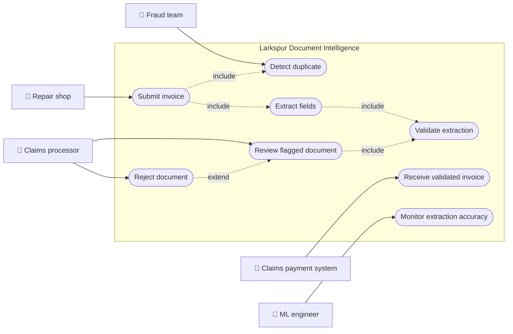
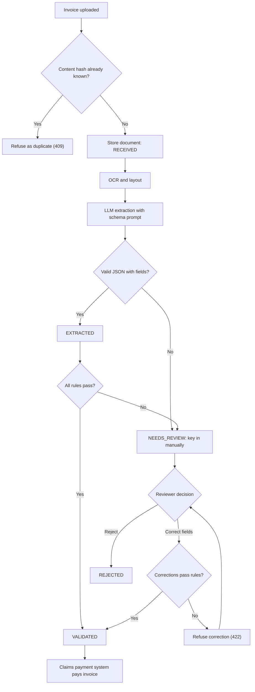
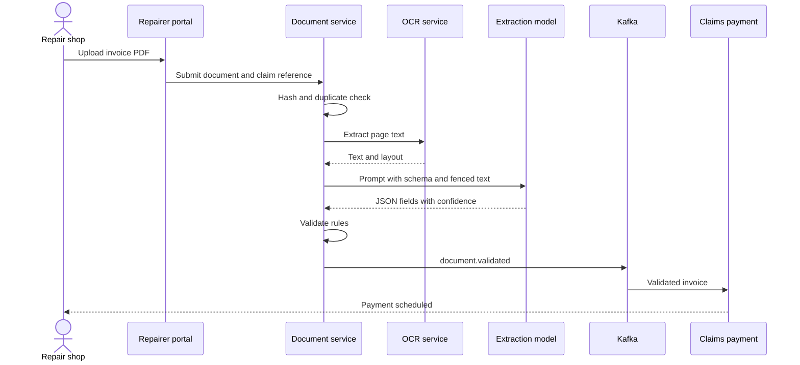
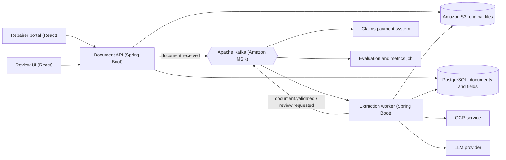
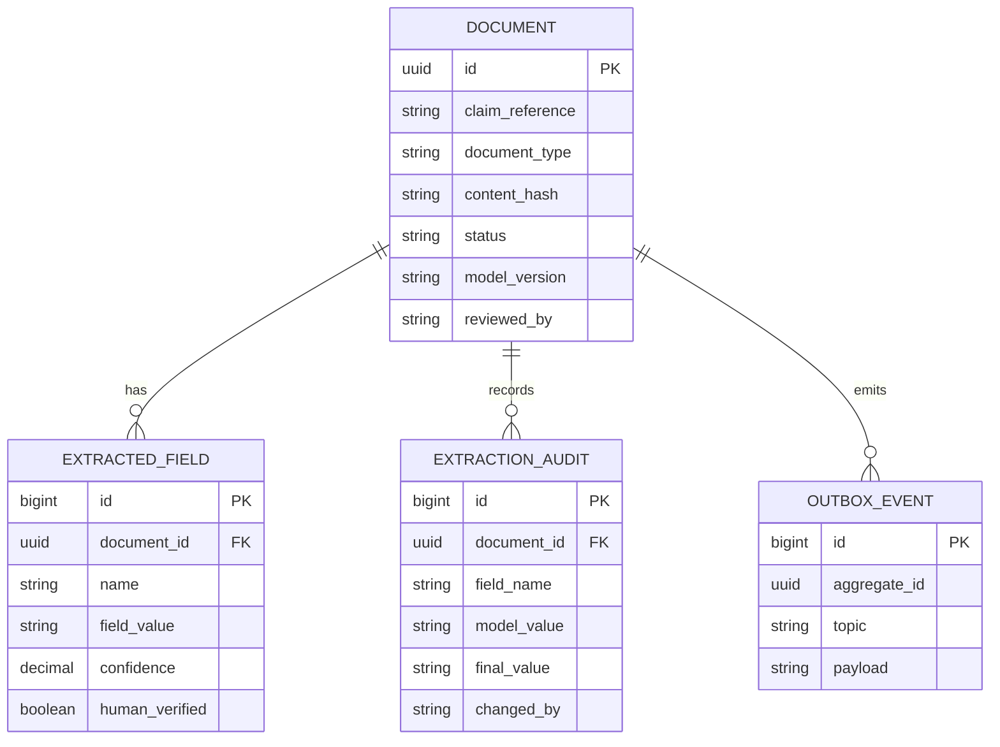
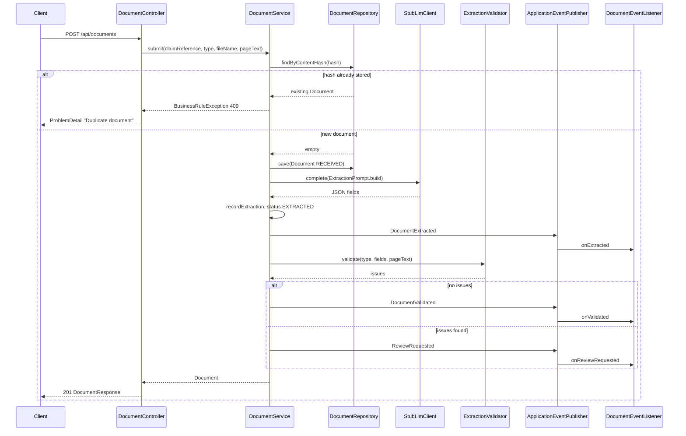
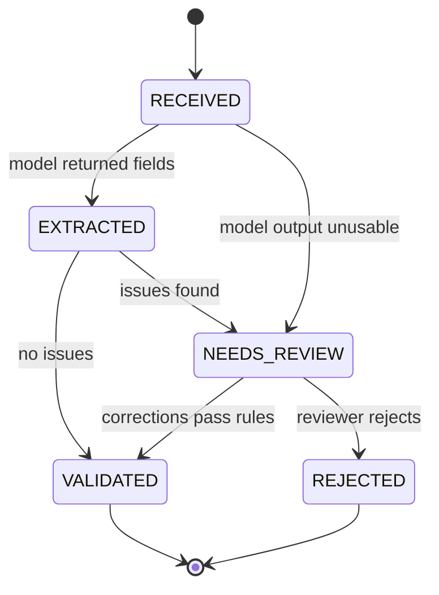
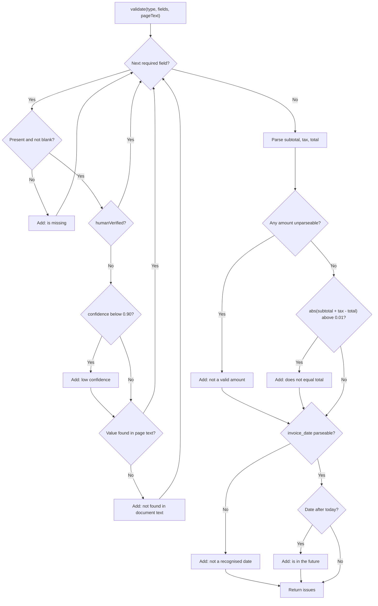

# Document Intelligence and Data Extraction

> **Domain:** AI and LLM Engineering · **Author:** [@naveenks720](https://github.com/naveenks720) · **Published:** November 23, 2026

> **Runnable code:** [`examples/ai-engineering/document-intelligence-and-data-extraction`](https://github.com/dhulipalla599/domain-knowledge-engineering/tree/main/examples/ai-engineering/document-intelligence-and-data-extraction)

## Explain It Like I'm Five

Imagine a big pile of birthday cards, and your job is to write down who each card is from and how much money is inside. A helper robot reads each card very fast and fills in a little form for you. Sometimes the handwriting is messy, so the robot says "I'm not sure about this one" and puts it in a basket for a grown-up to check. The grown-up also adds up the money to make sure the robot didn't make up a number. Cards the robot is sure about go straight into the thank-you list.

Document intelligence is that robot plus the grown-up: software reads business documents, turns them into clean data, and sends only the doubtful ones to a person.

## Business Overview

Document intelligence (also called intelligent document processing, IDP) turns unstructured documents such as invoices, bank statements, ID cards, medical bills and contracts into structured, validated data that downstream systems can act on. A modern pipeline combines:

- **Capture**: receiving files from email, portals, scanners and APIs.
- **OCR and layout analysis**: turning pixels into text, tables and key-value pairs.
- **Classification**: deciding what kind of document it is.
- **Extraction**: pulling named fields, today often with a large language model (LLM) or multimodal model guided by a schema.
- **Validation**: business rules, cross-field checks and lookups against reference data.
- **Human-in-the-loop (HITL) review**: people correct what the machine is unsure about.
- **Export**: posting validated data to the system of record.

Why the business cares:

| Driver | Effect |
|---|---|
| Cost | Manual keying is slow and expensive; every document that passes straight through saves handling time. |
| Speed and customer experience | Claims, loans and refunds are paid faster when documents do not wait in a keying queue. |
| Risk | Wrong amounts or duplicate invoices lead to overpayment and fraud losses. |
| Regulation and audit | Many industries must show where a number came from and who approved it (for example in insurance claims files or KYC records). Exact obligations differ by country and regulator. |

In the AI and LLM Engineering value chain, document intelligence sits at the **ingestion edge**: it feeds structured data into workflows, analytics, retrieval-augmented generation (RAG) indexes and agents. Its quality bar is higher than a chatbot's, because its outputs move money.

This page follows one concrete use case throughout: **Larkspur Insurance**, a fictional motor insurer, extracting data from repair-shop invoices attached to claims.

## Real-World Example

1. **Submission.** Ridgeway Auto Body repairs the rear bumper of a car insured by Larkspur under claim `CLM-2026-00412`. The shop uploads invoice `RAB-55821` (a PDF) through Larkspur's repairer portal.
2. **Capture.** The portal stores the file, computes a content hash, checks that the same invoice has not already been received, and creates a document record in state `RECEIVED`.
3. **OCR and extraction.** The OCR step produces the page text. The extraction service sends that text to a model with a versioned prompt asking for six fields: invoice number, vendor name, invoice date, subtotal, tax and total. The model replies with JSON and a confidence per field.
4. **Validation.** The service checks that every field is present, that each value really appears in the document, that confidence is at least 0.90, that subtotal 2,150.00 plus tax 172.00 equals total 2,322.00, and that the invoice date is not in the future. All checks pass, so the document is `VALIDATED`.
5. **Straight-through.** A `document.validated` event reaches the claims payment system, which schedules payment to Ridgeway against the claim. No human touched it.
6. **A doubtful case.** A week later, Cobalt Glass sends invoice `CG-10293` for claim `CLM-2026-00419`, but its total is labelled "Amount Due" and the model reports only 0.82 confidence. The document goes to `NEEDS_REVIEW` and appears in the review queue.
7. **Human review.** Claims processor Amara Okafor opens the invoice image beside the extracted fields, confirms 1,274.40 and submits. Her first attempt mistyped 1,300.00; the system refused it because 1,180.00 + 94.40 does not equal 1,300.00. After the correction, the document is `VALIDATED` with `reviewedBy = amara.okafor`, and payment proceeds.
8. **Learning.** Corrections are stored, so the data science team can measure field-level accuracy and decide whether to adjust prompts or thresholds.

## Stakeholders

| Stakeholder | What they need | What they fear |
|---|---|---|
| Repair shop (submitter) | Easy upload and fast payment | Invoices lost, rejected without reason, or paid late |
| Claims processor (reviewer) | A short queue, clear reasons why a document needs review, side-by-side view | Rubber-stamping machine errors and being accountable for them |
| Claims operations manager | High straight-through rate, low backlog, predictable cost per document | Hidden errors that surface as overpayments months later |
| Claims payment system | Clean, validated, de-duplicated invoice data exactly once | Duplicate or malformed messages causing double payment |
| Fraud and special investigations team | Duplicate detection, anomalous totals, audit trail | Altered or recycled invoices slipping through |
| Data science / ML engineers | Labelled corrections, versioned prompts and models, accuracy metrics | Silent drift when vendors change invoice layouts |
| Compliance and audit | Provenance of every value and who approved it, retention rules | Decisions that cannot be explained or reproduced |

## Use Case Diagram



| Use Case | Primary Actor | Goal | Main success outcome |
|---|---|---|---|
| Submit invoice | Repair shop | Get an invoice into the claim file | Document stored as `RECEIVED` and processed |
| Detect duplicate | Fraud team | Stop the same invoice being paid twice | Resubmission refused with a reference to the original |
| Extract fields | System (on submit) | Turn page text into named fields | Six fields with confidence scores |
| Validate extraction | System | Decide straight-through or review | `VALIDATED` or `NEEDS_REVIEW` with listed issues |
| Review flagged document | Claims processor | Correct or confirm doubtful fields | Document `VALIDATED`, corrections recorded |
| Reject document | Claims processor | Remove an invalid or fraudulent invoice | Document `REJECTED` with a reason |
| Receive validated invoice | Claims payment system | Pay the right amount once | One `document.validated` event per invoice |
| Monitor extraction accuracy | ML engineer | Keep quality from drifting | Field-level accuracy and review rate tracked |

## Key Terms

| Term | Plain-English meaning |
|---|---|
| IDP (intelligent document processing) | The whole pipeline from file to validated data, not just OCR. |
| OCR | Optical character recognition: turning an image of text into machine text. |
| Layout analysis | Finding structure on the page: tables, key-value pairs, reading order. |
| Classification | Deciding the document type (invoice, ID card, statement) so the right schema is used. |
| Extraction schema | The list of fields, types and rules expected for a document type. |
| Confidence score | The model's own estimate (0 to 1) that a value is right. Useful, but not a guaranteed probability. |
| Straight-through processing (STP) | A document completes with no human touch. The STP rate is a headline KPI. |
| Human-in-the-loop (HITL) | People review and correct what the machine flags. |
| Grounding | Checking that an extracted value actually appears in the source, so the model did not invent it. |
| Cross-field validation | Checks across fields, such as subtotal + tax = total. |
| Ground truth / golden set | Documents with known correct answers, used to measure accuracy. |
| Prompt injection | Text inside a document that tries to give the model instructions ("ignore previous rules"). |

## Process Flow

A file arrives and is hashed. A known hash is refused as a duplicate. Otherwise the document is stored, OCR'd and sent to the model with the schema for its type. The model's JSON is parsed and checked against the schema; unusable output sends the document to manual keying. Validation rules then decide: clean documents go straight to claims payment, the rest go to the review queue with a list of reasons. Reviewers correct or reject. Corrections are re-validated before the document is released.





## Business Rules and Edge Cases

- **Duplicates are money.** The same invoice arrives twice by email retry, by portal re-upload, or deliberately. Hash the normalised content, enforce a unique constraint in the database (two uploads can race past a read-then-insert check), and also match on business keys such as vendor plus invoice number, because a rescanned copy has a different file hash.
- **Never trust the model's numbers blindly.** LLMs can produce plausible values that are not on the page. Require every value to be grounded in the source text, and check arithmetic across fields.
- **Money needs exact arithmetic.** Use decimal types, not floating point. Allow a tolerance (for example 0.01) because invoices round per line. Currency symbols, thousands separators and decimal commas differ by country (1.234,50 in much of Europe); parse according to the vendor's locale.
- **Dates are ambiguous.** 03/04/2026 is 3 April in the UK and 4 March in the US. Use the vendor's country or supported formats explicitly, and flag what cannot be resolved instead of guessing. Future-dated invoices are a common fraud and data-entry signal.
- **Confidence is a signal, not a guarantee.** Thresholds must be set per field from measured accuracy on a golden set, and rechecked when models or vendors change.
- **Missing is better than invented.** The prompt must say "return null if absent"; a null goes to review, an invented value might be paid.
- **Human corrections are trusted but still checked.** A reviewer reads the original image, so grounding against OCR text is skipped for their values, but cross-field rules still apply; typos happen.
- **Partial failure.** OCR or model timeouts, or unparseable JSON, must not lose the document. Route it to manual keying and keep the original file.
- **Idempotent downstream delivery.** The payment system may receive `document.validated` more than once (Kafka is at-least-once in most configurations). It must deduplicate by document id.
- **Prompt injection.** Text on a document can contain instructions. Fence document content as data, ignore instructions inside it, and constrain output to a schema.
- **Privacy and retention.** Invoices and especially medical bills or ID documents contain personal data. Retention periods and lawful basis depend on jurisdiction (for example GDPR in the EU/UK, HIPAA for US health data). Mask data in logs and prompts where possible.

## From Business to System

| Business concept / step | System component | Data entity | Event |
|---|---|---|---|
| Invoice uploaded | Intake API (`DocumentController`) | `document` (status `RECEIVED`) | `document.received` (production only) |
| Duplicate detection | `DocumentService.submit` + unique index | `document.content_hash` | none (409 response) |
| OCR and extraction | Extraction worker, `LlmClient` adapter | `extracted_field` | `document.extracted` |
| Validation | `ExtractionValidator` | `document.issues`, `extracted_field.confidence` | `document.validated` or `document.review.requested` |
| Human review | Review UI + `DocumentService.review` | `extracted_field.human_verified`, `document.reviewed_by` | `document.validated` |
| Rejection | `DocumentService.reject` | `document.status = REJECTED` | `document.rejected` |
| Payment of invoice | Claims payment system (consumer) | its own payable record | consumes `document.validated` |
| Accuracy monitoring | Evaluation job | `extraction_audit` | consumes all document events |

## Architecture



**Service boundaries.**

- **Document API** owns intake, duplicate checks, the review workflow and read models. It is user-facing and must stay fast, so it never waits on OCR or the model.
- **Extraction worker** owns calls to OCR and the LLM. These are slow, rate-limited and occasionally fail; isolating them lets the worker scale and retry independently, and keeps provider credentials out of the user-facing service.
- **Claims payment** is a separate system of record that only trusts `document.validated`. It never reads the extraction tables directly.
- **Evaluation** is a consumer, so measuring quality cannot slow down or break the main flow.

The runnable example collapses API and worker into one process and calls the model synchronously, so the whole flow fits in one request.

## Data Model

```sql
CREATE TABLE document (
    id              UUID PRIMARY KEY,
    claim_reference VARCHAR(40)  NOT NULL,
    document_type   VARCHAR(40)  NOT NULL,
    file_name       VARCHAR(255) NOT NULL,
    storage_key     VARCHAR(512),                 -- S3 object key of the original
    content_hash    CHAR(64)     NOT NULL UNIQUE, -- duplicate key
    page_text       TEXT         NOT NULL,
    status          VARCHAR(20)  NOT NULL
        CHECK (status IN ('RECEIVED','EXTRACTED','NEEDS_REVIEW','VALIDATED','REJECTED')),
    model_version   VARCHAR(100),                 -- model + prompt version
    issues          VARCHAR(2000),
    reviewed_by     VARCHAR(100),
    received_at     TIMESTAMPTZ  NOT NULL
);
CREATE INDEX idx_document_status ON document (status, received_at);
CREATE INDEX idx_document_claim  ON document (claim_reference);

CREATE TABLE extracted_field (
    id             BIGSERIAL PRIMARY KEY,
    document_id    UUID         NOT NULL REFERENCES document(id),
    name           VARCHAR(60)  NOT NULL,
    field_value    VARCHAR(500),
    confidence     NUMERIC(4,3) NOT NULL,
    human_verified BOOLEAN      NOT NULL DEFAULT FALSE,
    UNIQUE (document_id, name)
);

CREATE TABLE extraction_audit (
    id             BIGSERIAL PRIMARY KEY,
    document_id    UUID        NOT NULL REFERENCES document(id),
    field_name     VARCHAR(60) NOT NULL,
    model_value    VARCHAR(500),
    final_value    VARCHAR(500),
    changed_by     VARCHAR(100) NOT NULL,
    changed_at     TIMESTAMPTZ NOT NULL
);

CREATE TABLE outbox_event (
    id             BIGSERIAL PRIMARY KEY,
    aggregate_id   UUID         NOT NULL,
    topic          VARCHAR(100) NOT NULL,
    payload        JSONB        NOT NULL,
    created_at     TIMESTAMPTZ  NOT NULL,
    published_at   TIMESTAMPTZ
);
```



The example implements `document` and `extracted_field`; `extraction_audit` and `outbox_event` are the production additions.

## APIs

| Method | Path | Purpose |
|---|---|---|
| POST | `/api/documents` | Submit a document; returns it with extracted fields and status |
| GET | `/api/documents/{id}` | Get one document with fields and issues |
| GET | `/api/documents?status=NEEDS_REVIEW` | Review queue (oldest first) |
| POST | `/api/documents/{id}/review` | Apply reviewer corrections and validate |
| POST | `/api/documents/{id}/reject` | Reject a document with a reason |

Example: `POST /api/documents`

```json
{
  "claimReference": "CLM-2026-00430",
  "documentType": "REPAIR_INVOICE",
  "fileName": "northgate-ng-7781.pdf",
  "pageText": "Northgate Motors\nInvoice No: NG-7781\nVendor: Northgate Motors\nInvoice Date: 2026-11-18\nSubtotal: 640.00\nTax: 51.20\nTotal: 691.20"
}
```

Response `201 Created`:

```json
{
  "id": "066a0846-ea20-4c09-8dc5-eae296e8285a",
  "claimReference": "CLM-2026-00430",
  "documentType": "REPAIR_INVOICE",
  "fileName": "northgate-ng-7781.pdf",
  "status": "VALIDATED",
  "modelVersion": "stub-extractor-1.0/repair-invoice-v3",
  "issues": [],
  "reviewedBy": null,
  "fields": [
    {"name": "invoice_date", "value": "2026-11-18", "confidence": 0.97, "humanVerified": false},
    {"name": "invoice_number", "value": "NG-7781", "confidence": 0.97, "humanVerified": false},
    {"name": "subtotal", "value": "640.00", "confidence": 0.97, "humanVerified": false},
    {"name": "tax", "value": "51.20", "confidence": 0.97, "humanVerified": false},
    {"name": "total", "value": "691.20", "confidence": 0.97, "humanVerified": false},
    {"name": "vendor_name", "value": "Northgate Motors", "confidence": 0.97, "humanVerified": false}
  ]
}
```

In production the upload would be a multipart file or a pre-signed S3 upload, and the API would return `202 Accepted` with status `RECEIVED` while the worker processes it.

## Events

| Event | Producer | Consumers | Key fields |
|---|---|---|---|
| `document.received` | Document API | Extraction worker | documentId, claimReference, documentType, storageKey |
| `document.extracted` | Extraction worker | Evaluation job | documentId, claimReference, modelVersion, fieldCount |
| `document.review.requested` | Extraction worker / API | Review work queue, ops dashboards | documentId, claimReference, issues |
| `document.validated` | Extraction worker / API | Claims payment, fraud analytics, evaluation | documentId, claimReference, invoiceNumber, total, humanReviewed |
| `document.rejected` | Document API | Claims system, repairer notifications | documentId, claimReference, reason |

**Ordering.** Key every topic by `documentId` so all events for one document land on one partition and are read in order. There is no ordering guarantee across documents, and none is needed.

**Idempotency.** Publish through a transactional outbox so the status change and the event commit together. Consumers must deduplicate on `documentId` (plus event type), because redelivery after a consumer restart is normal. The payment system should also enforce its own uniqueness on vendor plus invoice number.

## Backend Implementation

> The Java tab is the runnable example's code; the Python tab uses FastAPI with SQLAlchemy and the Node.js tab uses NestJS with TypeScript.

The key business rule: `ExtractionValidator.validate` decides whether a document can go straight through. Full source: [`ExtractionValidator.java`](https://github.com/dhulipalla599/domain-knowledge-engineering/tree/main/examples/ai-engineering/document-intelligence-and-data-extraction/src/main/java/com/dke/ai_engineering/document_intelligence_and_data_extraction/service/ExtractionValidator.java).

=== "Java"

    ```java
    public List<String> validate(DocumentType type, List<ExtractedField> fields, String pageText) {
        Map<String, ExtractedField> byName = fields.stream()
                .collect(Collectors.toMap(ExtractedField::getName, Function.identity()));
        String haystack = normalise(pageText);
        List<String> issues = new ArrayList<>();

        for (String name : type.requiredFields()) {
            ExtractedField f = byName.get(name);
            if (f == null || f.getFieldValue() == null || f.getFieldValue().isBlank()) {
                issues.add(name + " is missing");
                continue;
            }
            if (f.isHumanVerified()) {
                continue; // a reviewer read the original image; trust their value
            }
            if (f.getConfidence() < MIN_CONFIDENCE) {
                issues.add(name + " has low confidence " + f.getConfidence());
            }
            if (!haystack.contains(normalise(f.getFieldValue()))) {
                issues.add(name + " is not found in the document text");
            }
        }

        Optional<BigDecimal> subtotal = amount(byName, "subtotal", issues);
        Optional<BigDecimal> tax = amount(byName, "tax", issues);
        Optional<BigDecimal> total = amount(byName, "total", issues);
        if (subtotal.isPresent() && tax.isPresent() && total.isPresent()) {
            BigDecimal sum = subtotal.get().add(tax.get());
            if (sum.subtract(total.get()).abs().compareTo(TOLERANCE) > 0) {
                issues.add("subtotal + tax (" + sum + ") does not equal total (" + total.get() + ")");
            }
        }

        ExtractedField invoiceDate = byName.get("invoice_date");
        if (invoiceDate != null && invoiceDate.getFieldValue() != null && !invoiceDate.getFieldValue().isBlank()) {
            Optional<LocalDate> d = date(invoiceDate.getFieldValue());
            if (d.isEmpty()) {
                issues.add("invoice_date is not a recognised date: " + invoiceDate.getFieldValue());
            } else if (d.get().isAfter(LocalDate.now(clock))) {
                issues.add("invoice_date " + d.get() + " is in the future");
            }
        }
        return issues;
    }
    ```

=== "Python"

    ```python
    MIN_CONFIDENCE = 0.90
    TOLERANCE = Decimal("0.01")

    def validate(doc_type: DocumentType, fields: list[ExtractedField], page_text: str,
                 today: date) -> list[str]:
        by_name = {f.name: f for f in fields}
        haystack = normalise(page_text)
        issues: list[str] = []

        for name in doc_type.required_fields:
            f = by_name.get(name)
            if f is None or not (f.field_value or "").strip():
                issues.append(f"{name} is missing")
                continue
            if f.human_verified:
                continue  # a reviewer read the original image; trust their value
            if f.confidence < MIN_CONFIDENCE:
                issues.append(f"{name} has low confidence {f.confidence}")
            if normalise(f.field_value) not in haystack:
                issues.append(f"{name} is not found in the document text")

        subtotal = amount(by_name, "subtotal", issues)
        tax = amount(by_name, "tax", issues)
        total = amount(by_name, "total", issues)
        if None not in (subtotal, tax, total):
            total_sum = subtotal + tax
            if abs(total_sum - total) > TOLERANCE:
                issues.append(f"subtotal + tax ({total_sum}) does not equal total ({total})")

        invoice_date = by_name.get("invoice_date")
        if invoice_date and (invoice_date.field_value or "").strip():
            d = parse_date(invoice_date.field_value)
            if d is None:
                issues.append(f"invoice_date is not a recognised date: {invoice_date.field_value}")
            elif d > today:
                issues.append(f"invoice_date {d} is in the future")
        return issues
    ```

=== "Node.js"

    ```typescript
    const MIN_CONFIDENCE = 0.9;
    const TOLERANCE = new Decimal('0.01');

    @Injectable()
    export class ExtractionValidator {
      constructor(private readonly clock: Clock) {}

      validate(type: DocumentType, fields: ExtractedField[], pageText: string): string[] {
        const byName = new Map(fields.map((f) => [f.name, f]));
        const haystack = normalise(pageText);
        const issues: string[] = [];

        for (const name of REQUIRED_FIELDS[type]) {
          const f = byName.get(name);
          if (!f || !f.fieldValue?.trim()) {
            issues.push(`${name} is missing`);
            continue;
          }
          if (f.humanVerified) continue; // a reviewer read the original image; trust their value
          if (f.confidence < MIN_CONFIDENCE) issues.push(`${name} has low confidence ${f.confidence}`);
          if (!haystack.includes(normalise(f.fieldValue))) issues.push(`${name} is not found in the document text`);
        }

        const subtotal = amount(byName, 'subtotal', issues);
        const tax = amount(byName, 'tax', issues);
        const total = amount(byName, 'total', issues);
        if (subtotal && tax && total) {
          const sum = subtotal.plus(tax);
          if (sum.minus(total).abs().greaterThan(TOLERANCE)) {
            issues.push(`subtotal + tax (${sum.toFixed(2)}) does not equal total (${total.toFixed(2)})`);
          }
        }

        const invoiceDate = byName.get('invoice_date');
        if (invoiceDate?.fieldValue?.trim()) {
          const d = parseDate(invoiceDate.fieldValue); // ISO or "9 Nov 2026"
          if (!d) issues.push(`invoice_date is not a recognised date: ${invoiceDate.fieldValue}`);
          else if (d > this.clock.today()) issues.push(`invoice_date ${d} is in the future`);
        }
        return issues;
      }
    }
    ```

The controller endpoint that triggers it (through `DocumentService.submit`, which runs the duplicate check, the model call and then routes on the validator's result). Full source: [`DocumentController.java`](https://github.com/dhulipalla599/domain-knowledge-engineering/tree/main/examples/ai-engineering/document-intelligence-and-data-extraction/src/main/java/com/dke/ai_engineering/document_intelligence_and_data_extraction/api/DocumentController.java).

=== "Java"

    ```java
    @PostMapping
    @ResponseStatus(HttpStatus.CREATED)
    public DocumentResponse submit(@Valid @RequestBody SubmitDocumentRequest request) {
        return DocumentResponse.from(service.submit(request.claimReference(), request.documentType(),
                request.fileName(), request.pageText()));
    }
    ```

=== "Python"

    ```python
    @router.post("/api/documents", status_code=201, response_model=DocumentResponse)
    def submit(request: SubmitDocumentRequest, service: DocumentService = Depends(get_service)):
        doc = service.submit(request.claim_reference, request.document_type,
                             request.file_name, request.page_text)
        return DocumentResponse.from_entity(doc)
    ```

=== "Node.js"

    ```typescript
    @Post()
    @HttpCode(201)
    async submit(@Body() request: SubmitDocumentRequest): Promise<DocumentResponse> {
      const doc = await this.service.submit(request.claimReference, request.documentType,
        request.fileName, request.pageText);
      return DocumentResponse.from(doc);
    }
    ```

## Frontend Screen

The review screen is where people spend their time, so it shows the reasons first and only lets the reviewer edit the schema's fields.

```tsx
import { useState } from "react";

type Field = { name: string; value: string | null; confidence: number; humanVerified: boolean };
type Doc = { id: string; claimReference: string; fileName: string; status: string; issues: string[]; fields: Field[] };
type Problem = { title: string; detail: string };

export function ReviewPanel({ doc, reviewer, onDone }: { doc: Doc; reviewer: string; onDone: (d: Doc) => void }) {
  const [edits, setEdits] = useState<Record<string, string>>({});
  const [error, setError] = useState<Problem | null>(null);
  const [saving, setSaving] = useState(false);

  async function submit() {
    setSaving(true);
    setError(null);
    const res = await fetch(`/api/documents/${doc.id}/review`, {
      method: "POST",
      headers: { "Content-Type": "application/json" },
      body: JSON.stringify({ reviewer, corrections: edits }),
    });
    setSaving(false);
    if (res.ok) onDone(await res.json());
    else setError(await res.json());
  }

  return (
    <section aria-labelledby="review-title">
      <h2 id="review-title">{doc.fileName} · claim {doc.claimReference}</h2>
      <ul role="list" aria-label="Why this needs review">
        {doc.issues.map((i) => <li key={i}>{i}</li>)}
      </ul>
      <table>
        <thead><tr><th>Field</th><th>Extracted</th><th>Confidence</th><th>Correction</th></tr></thead>
        <tbody>
          {doc.fields.map((f) => (
            <tr key={f.name} className={f.confidence < 0.9 ? "low-confidence" : undefined}>
              <td>{f.name}</td>
              <td>{f.value ?? "—"}</td>
              <td>{Math.round(f.confidence * 100)}%</td>
              <td>
                <input
                  aria-label={`Correct ${f.name}`}
                  defaultValue={f.value ?? ""}
                  onChange={(e) => setEdits((prev) => ({ ...prev, [f.name]: e.target.value }))}
                />
              </td>
            </tr>
          ))}
        </tbody>
      </table>
      {error && <p role="alert"><strong>{error.title}:</strong> {error.detail}</p>}
      <button onClick={submit} disabled={saving}>{saving ? "Saving…" : "Confirm and validate"}</button>
    </section>
  );
}
```

In a real review UI the original page image sits beside this table, with the source region of each value highlighted using OCR bounding boxes.

## Cloud Deployment

**Managed services on AWS.**

| Concern | Service |
|---|---|
| Compute | Amazon EKS: `document-api` and `extraction-worker` deployments |
| Original files | Amazon S3 with SSE-KMS, versioning, lifecycle rules for retention |
| Database | Amazon RDS for PostgreSQL or Aurora PostgreSQL, Multi-AZ |
| Events | Amazon MSK (managed Kafka) |
| OCR | Amazon Textract, or a multimodal model reading page images |
| LLM | A hosted model via Amazon Bedrock or another provider, reached through an LLM gateway |
| Secrets | AWS Secrets Manager via IAM Roles for Service Accounts (IRSA) |
| Observability | OpenTelemetry Collector (for example AWS Distro for OpenTelemetry) exporting to CloudWatch |

The most important resource is the document bucket, because it holds the evidence:

```hcl
resource "aws_s3_bucket" "documents" {
  bucket = "larkspur-claims-documents-prod"
}

resource "aws_s3_bucket_versioning" "documents" {
  bucket = aws_s3_bucket.documents.id
  versioning_configuration { status = "Enabled" }
}

resource "aws_s3_bucket_server_side_encryption_configuration" "documents" {
  bucket = aws_s3_bucket.documents.id
  rule {
    apply_server_side_encryption_by_default {
      sse_algorithm     = "aws:kms"
      kms_master_key_id = aws_kms_key.documents.arn
    }
  }
}

resource "aws_s3_bucket_public_access_block" "documents" {
  bucket                  = aws_s3_bucket.documents.id
  block_public_acls       = true
  block_public_policy     = true
  ignore_public_acls      = true
  restrict_public_buckets = true
}

resource "aws_s3_bucket_lifecycle_configuration" "documents" {
  bucket = aws_s3_bucket.documents.id
  rule {
    id     = "archive-closed-claims"
    status = "Enabled"
    filter {}
    transition {
      days          = 365
      storage_class = "GLACIER"
    }
  }
}
```

The retention period is a business and legal decision; set expiry only after compliance confirms it.

**Security.** Uploads go through pre-signed URLs, so files never pass through the API pods. The worker's IAM role can read the bucket and call OCR and the model; the API role cannot call the model. Scan uploads for malware before processing. Mask personal data in logs, and check the model provider's data-retention and region terms before sending documents.

**Scaling.** The API scales on CPU and request rate with the Horizontal Pod Autoscaler. The worker scales on Kafka consumer lag (for example with KEDA), capped by the model provider's rate limits; a bigger backlog is better than a storm of throttled calls.

**Observability.** Trace each document from upload to validation with OpenTelemetry, propagating context through Kafka headers. Publish to CloudWatch: straight-through rate, review backlog and age, model latency and error rate, tokens per document, and field-level correction rate per model version. Alarm on a sudden drop in straight-through rate; it usually means a vendor changed its invoice layout or a model or prompt version regressed.

## Non-Functional Requirements

| Area | Expectation | How the design meets it |
|---|---|---|
| Availability | Intake accepts uploads even when OCR or the model is down | Upload only writes S3 + DB + outbox; extraction is asynchronous and retries from Kafka |
| Latency | Upload acknowledged in well under a second; extraction within minutes, not seconds | API does no model calls in production; worker throughput tuned to provider quotas |
| Consistency | A document's status and its event never disagree; payment happens once | Transactional outbox; state machine in the domain class; consumers deduplicate on document id |
| Accuracy | Values sent to payment are grounded and arithmetically consistent | `ExtractionValidator` rules; per-field thresholds measured on a golden set |
| Audit | Every value traceable to the source, the model + prompt version and any human change | `model_version`, `extraction_audit`, original file kept in versioned S3 |
| Compliance | Personal data protected and retained only as long as required | KMS encryption, least-privilege IAM, lifecycle rules, masking in logs; specifics depend on jurisdiction |
| Cost | Predictable cost per document | Tokens per document tracked; cheaper model first, larger model only for hard cases |

## Runnable Example

The example implements Larkspur's invoice flow in one Spring Boot service: submit an invoice's page text, refuse duplicates by content hash, build a versioned prompt, call a deterministic stub model behind the `LlmClient` interface, parse and schema-check its JSON, and validate the fields (presence, confidence, grounding, arithmetic, date). Clean documents become `VALIDATED`; others go to `NEEDS_REVIEW`, where a reviewer's corrections are re-validated before release. Domain events stand in for the Kafka topics on this page. It needs no external services.

Source: [`examples/ai-engineering/document-intelligence-and-data-extraction`](https://github.com/dhulipalla599/domain-knowledge-engineering/tree/main/examples/ai-engineering/document-intelligence-and-data-extraction)

```bash
cd examples/ai-engineering/document-intelligence-and-data-extraction
mvn spring-boot:run          # http://localhost:8080
mvn verify                   # unit + API tests
```

Submit a clean invoice:

```bash
curl -s -X POST localhost:8080/api/documents -H 'Content-Type: application/json' \
  -d '{"claimReference":"CLM-2026-00430","documentType":"REPAIR_INVOICE","fileName":"northgate-ng-7781.pdf","pageText":"Northgate Motors\nInvoice No: NG-7781\nVendor: Northgate Motors\nInvoice Date: 2026-11-18\nSubtotal: 640.00\nTax: 51.20\nTotal: 691.20"}'
```

Expected (the id is random): status `VALIDATED`, `issues: []` and six fields, as in the APIs section above. Sending the same command a second time returns:

```json
{"type":"about:blank","title":"Duplicate document","status":409,"detail":"This document was already received as 066a0846-ea20-4c09-8dc5-eae296e8285a for claim CLM-2026-00430","instance":"/api/documents"}
```

Try a correction that breaks the arithmetic on the seeded review-queue document:

```bash
curl -s -X POST localhost:8080/api/documents/c4a9f0d3-6b2e-4c8a-8f17-5e0b7d2a9c02/review \
  -H 'Content-Type: application/json' -d '{"reviewer":"amara.okafor","corrections":{"total":"1,300.00"}}'
```

```json
{"type":"about:blank","title":"Review does not resolve all issues","status":422,"detail":"subtotal + tax (1274.40) does not equal total (1300.00)","instance":"/api/documents/c4a9f0d3-6b2e-4c8a-8f17-5e0b7d2a9c02/review"}
```

| Class | Package | Responsibility |
|---|---|---|
| `DocumentController` | `api` | REST endpoints: submit, get, review queue, review, reject |
| `ApiModels` | `api` | Request and response records |
| `ApiExceptionHandler` | `api` | Maps rule violations to `ProblemDetail` (400, 404, 409, 422) |
| `DocumentService` | `service` | Duplicate check, prompt, model call, JSON parsing, routing, review, reject |
| `ExtractionValidator` | `service` | Business rules: presence, confidence, grounding, arithmetic, date |
| `ExtractionPrompt` | `service` | Versioned prompt that fences the document as data |
| `BusinessRuleException` | `service` | Rule violation carrying an HTTP status |
| `Document` | `domain` | Aggregate; enforces legal status transitions |
| `DocumentStatus`, `DocumentType` | `domain` | Lifecycle enum; document types and their required fields |
| `ExtractedField` | `domain` | Value, confidence and human-verified flag |
| `DocumentExtracted`, `ReviewRequested`, `DocumentValidated`, `DocumentRejected` | `domain` | Domain events named after Kafka topics |
| `DocumentRepository` | `repository` | Spring Data JPA repository |
| `LlmClient`, `StubLlmClient` | `integration` | Model port and deterministic stub |
| `DocumentEventListener` | `integration` | Consumes events (stand-in for Kafka consumers) |

## UML Diagrams

### Class Diagram

The controller delegates to `DocumentService`, which uses the repository, the `LlmClient` port and `ExtractionValidator`, and publishes events that `DocumentEventListener` consumes. `Document` owns its `ExtractedField`s and guards its `DocumentStatus` transitions.

```mermaid
classDiagram
    class DocumentController {
        +submit(SubmitDocumentRequest) DocumentResponse
        +get(UUID) DocumentResponse
        +byStatus(DocumentStatus) List
        +review(UUID, ReviewRequest) DocumentResponse
        +reject(UUID, RejectRequest) DocumentResponse
    }
    class DocumentService {
        +submit(String, DocumentType, String, String) Document
        +review(UUID, String, Map) Document
        +reject(UUID, String, String) Document
        -route(Document, List, boolean)
        -extract(DocumentType, String) List
        ~contentHash(String) String
    }
    class ExtractionValidator {
        +MIN_CONFIDENCE double
        +validate(DocumentType, List, String) List
    }
    class ExtractionPrompt {
        +VERSION String
        +build(DocumentType, String) String
    }
    class DocumentRepository {
        <<interface>>
        +findByContentHash(String) Optional
        +findByStatusOrderByReceivedAtAsc(DocumentStatus) List
    }
    class LlmClient {
        <<interface>>
        +modelVersion() String
        +complete(String) String
    }
    class StubLlmClient
    class Document {
        -UUID id
        -String claimReference
        -String contentHash
        -DocumentStatus status
        -String modelVersion
        -String issues
        -String reviewedBy
        +moveTo(DocumentStatus)
        +recordExtraction(String, List)
        +correctField(String, String)
        +recordIssues(List)
    }
    class ExtractedField {
        -String name
        -String fieldValue
        -double confidence
        -boolean humanVerified
        +correct(String)
    }
    class DocumentStatus {
        <<enumeration>>
        RECEIVED
        EXTRACTED
        NEEDS_REVIEW
        VALIDATED
        REJECTED
        +canMoveTo(DocumentStatus) boolean
    }
    class DocumentType {
        <<enumeration>>
        REPAIR_INVOICE
        +requiredFields() List
    }
    class DocumentExtracted {
        <<record>>
    }
    class ReviewRequested {
        <<record>>
    }
    class DocumentValidated {
        <<record>>
    }
    class DocumentRejected {
        <<record>>
    }
    class DocumentEventListener {
        +onExtracted(DocumentExtracted)
        +onReviewRequested(ReviewRequested)
        +onValidated(DocumentValidated)
        +onRejected(DocumentRejected)
    }
    DocumentController --> DocumentService
    DocumentService --> DocumentRepository
    DocumentService --> LlmClient
    DocumentService --> ExtractionValidator
    DocumentService ..> ExtractionPrompt
    StubLlmClient ..|> LlmClient
    Document "1" *-- "many" ExtractedField
    Document --> DocumentStatus
    Document --> DocumentType
    DocumentService ..> DocumentExtracted : publishes
    DocumentService ..> ReviewRequested : publishes
    DocumentService ..> DocumentValidated : publishes
    DocumentService ..> DocumentRejected : publishes
    DocumentEventListener ..> DocumentExtracted
    DocumentEventListener ..> ReviewRequested
    DocumentEventListener ..> DocumentValidated
    DocumentEventListener ..> DocumentRejected
```



### Sequence Diagram (control flow)

One `POST /api/documents` through the code. The duplicate rule is the main violation branch; otherwise the validator's result chooses which event is published.



### State Diagram

The lifecycle exactly as `DocumentStatus.allowedNext()` defines it; `Document.moveTo` throws on anything else, which the API returns as 409.



### Activity Diagram

The decision logic inside `ExtractionValidator.validate`. Every check adds an issue rather than stopping, so the reviewer sees all problems at once.



## AI Opportunities

| Use case | Data it needs | Main risk / control |
|---|---|---|
| **Multimodal extraction from page images** (handwriting, stamps, tables) instead of OCR text only | Page images, schemas, a labelled golden set per document type | Values the model "sees" may not be in OCR text, so grounding needs bounding boxes or a second check; measure accuracy per field before raising automation |
| **Document classification and splitting** of mixed uploads (invoice + photos + estimate in one PDF) | Labelled page-level examples of each type | Misclassification sends a document through the wrong schema; route low-confidence classes to review |
| **Confidence calibration and active learning** using reviewer corrections | `extraction_audit` history: model value vs final value | Feedback loops and label noise; keep a held-out set, version every prompt and model, and review metrics before promotion |
| **Fraud signals**: altered PDFs, recycled invoices, unusual line prices for the repair type | Document metadata, historic invoices per vendor, repair cost benchmarks | False positives delay honest repairers; keep the model advisory and explainable, with a human deciding |
| **Reviewer copilot** that explains why a field was flagged and points to the region on the page | Issues list, OCR coordinates, document image | Automation bias (reviewers accept suggestions without looking); show the source image, track agreement rates |

## Common Pitfalls

- **Treating the LLM output as the answer.** Always parse against a schema, reject unknown fields, and validate values with deterministic rules.
- **Using confidence as probability.** Model-reported confidence is often poorly calibrated. Set thresholds from measured accuracy, per field.
- **Floating-point money.** Use decimal types and explicit tolerances.
- **Ignoring locale.** Decimal commas and day/month order differ by country; parse per vendor or region and flag ambiguity.
- **Duplicate check only on file hash.** Rescans and re-exports change bytes. Add business-key checks (vendor + invoice number + amount).
- **Read-then-insert without a unique constraint.** Concurrent uploads race. Let the database enforce uniqueness and map the violation to 409.
- **Calling the model inside the user request in production.** Latency and provider outages leak into the UI. Accept, store and process asynchronously.
- **No version on prompts and models.** When accuracy changes you cannot tell why. Record model and prompt version on every document.
- **Logging full documents.** Logs become an unmanaged copy of personal data. Log ids and metrics, not content.
- **No golden set.** Without labelled examples, "it looks good" is the only quality signal. Build an evaluation set before going live and re-run it on every change.
- **Letting reviewers skip validation.** Human corrections need the same cross-field checks; typos are common.

## Interview Questions

### Junior

**1. Why not just use OCR output directly?**
OCR gives text, not meaning. You still need to find which number is the total, normalise formats, and validate it. Extraction maps text to a schema; validation decides if it is safe to use.

**2. What does "straight-through processing" mean and why does it matter?**
A document that completes with no human touch. It is the main driver of cost and speed, but it must never come at the expense of accuracy, so it is tracked together with error rates.

**3. How would you stop the same invoice being paid twice?**
Hash the normalised content and enforce a unique constraint; also check business keys like vendor and invoice number; and make the payment consumer deduplicate on document id.

### Mid-Level

**1. How do you detect that a model invented a value?**
Ground every value against the source: check it appears in the OCR text or within the referenced bounding box. Add cross-field checks such as subtotal + tax = total, and require nulls for absent fields in the prompt.

**2. How would you choose the confidence threshold for sending a field to review?**
Use a labelled golden set to plot accuracy against confidence per field, pick the threshold that meets the target error rate, and monitor the correction rate in production by model version. Re-tune when the model, prompt or document mix changes.

**3. The extraction step times out for 5% of documents. What do you do?**
Make extraction asynchronous with retries and backoff from Kafka, cap concurrency to the provider's rate limits, send documents that exhaust retries to a manual queue (never drop them), and alert on retry and dead-letter counts.

### Senior / Architect

**1. Design document intelligence for an insurer handling many document types across several countries.**
Key points: intake with S3 and outbox events; classification before extraction; schema registry per type and country; locale-aware parsing; separate API and worker services; human review queue with SLAs; versioned prompts and models with golden-set evaluation gates; data residency and retention per jurisdiction; idempotent consumers; metrics on STP rate and field accuracy.

**2. Build vs buy: a cloud IDP service, a general LLM, or a custom model?**
Key points: accuracy on your own golden set, not demos; cost per page at expected volume; data residency and provider retention terms; latency and rate limits; ability to explain and audit outputs; lock-in and portability through an adapter interface; hybrid designs (cloud OCR plus LLM for hard fields) are common.

**3. How do you safely raise automation from 60% to 85% straight-through?**
Key points: measure per field and per vendor where errors occur; target the biggest review reasons first; shadow-run new models and compare against reviewer outcomes; raise thresholds gradually with rollback; keep sampling a small percentage of auto-approved documents for human audit; watch downstream overpayment and fraud metrics, not just review rate.

## Further Learning

- OCR and document layout analysis (reading order, table structure recognition)
- Structured output and JSON Schema-constrained generation for LLMs
- Evaluation methodology: precision, recall and field-level accuracy on golden sets
- Confidence calibration and selective prediction
- OWASP Top 10 for Large Language Model Applications (prompt injection and insecure output handling)
- Transactional outbox and idempotent consumer patterns
- ISO 20022 and e-invoicing standards such as UBL and EN 16931
- Data protection regimes relevant to your market, such as GDPR and HIPAA

## Practitioner Notes

> _Reviewer: add real-world experience, corrections or gotchas here before approving._
