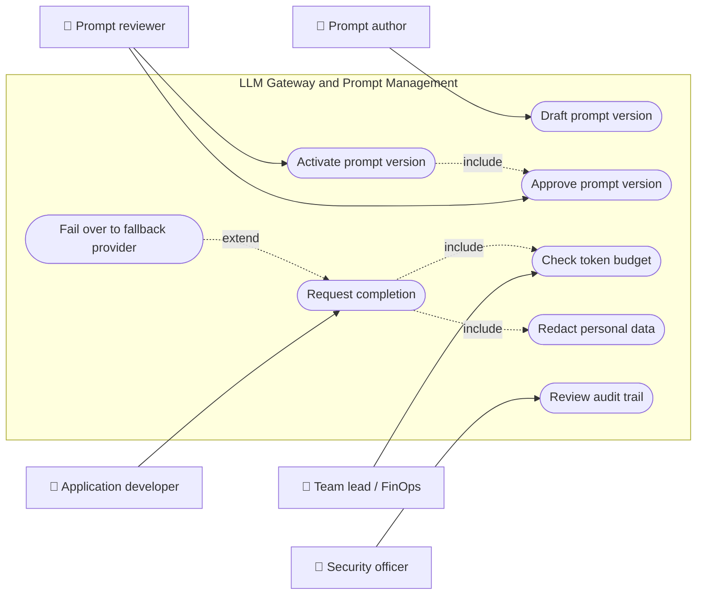
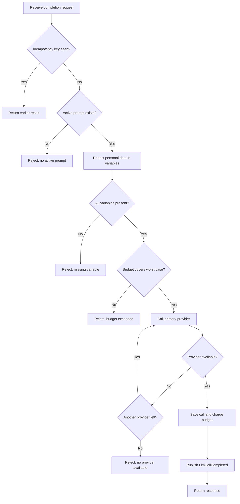
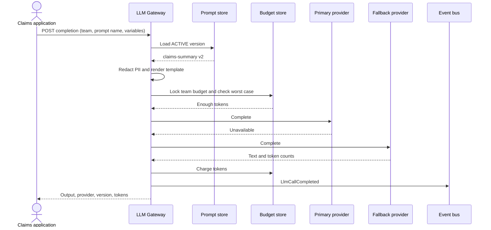
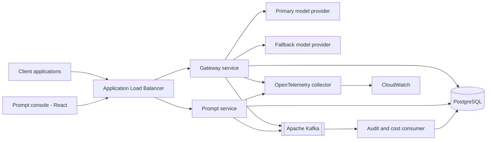
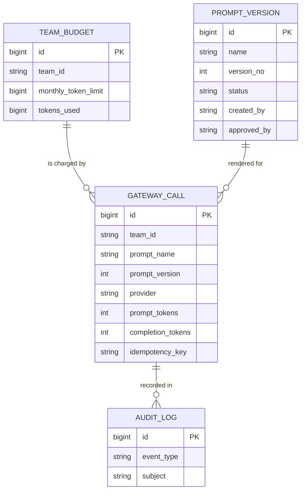
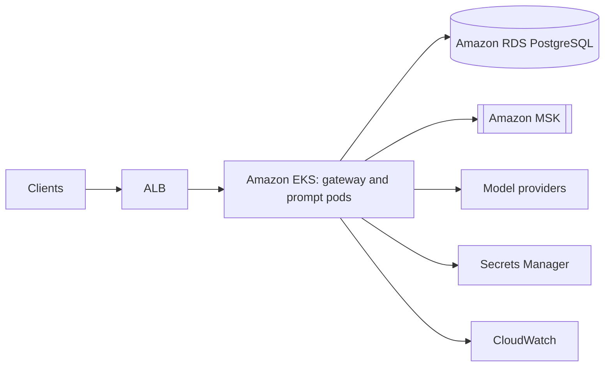
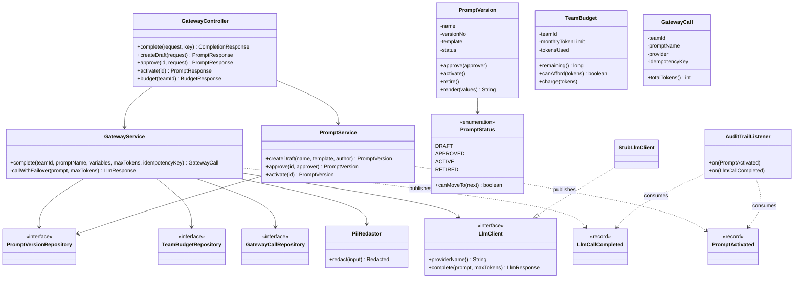
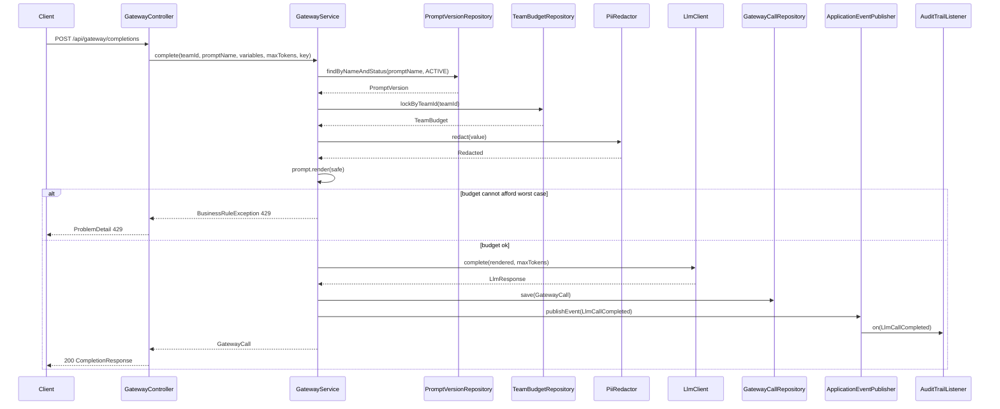
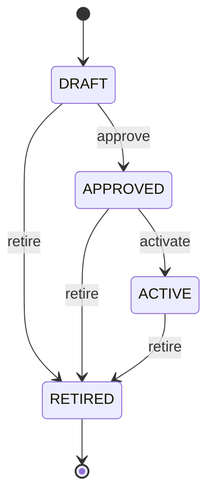
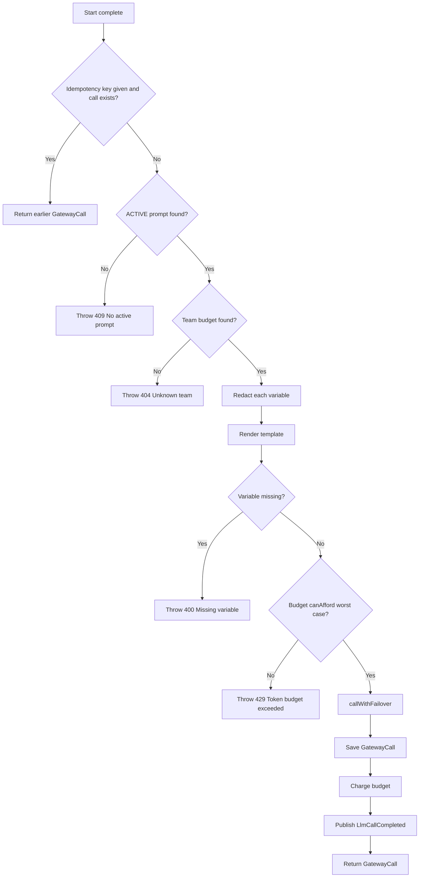

# LLM Gateway and Prompt Management

> **Domain:** AI and LLM Engineering · **Author:** [@dhulipalla599](https://github.com/dhulipalla599) · **Published:** October 23, 2026

> **Runnable code:** [`examples/ai-engineering/llm-gateway-and-prompt-management`](https://github.com/dhulipalla599/domain-knowledge-engineering/tree/main/examples/ai-engineering/llm-gateway-and-prompt-management)

## Explain It Like I'm Five

Imagine a school with one front office. Every teacher who wants a message sent to the town hall does not walk there alone. They write the message on an official form, hand it to the office, and the office checks the form is the approved one, blacks out any private phone numbers, makes sure the class has not used up its stamp allowance, and then sends it by the best road. If one road is closed, the office quietly uses another. The office also writes down who sent what and how many stamps it cost.

In a company, the LLM gateway is that front office and prompt management is the shelf of approved forms: every team reaches AI models through one controlled door, using reviewed, versioned prompts, with privacy, spending limits and backup routes handled for them.

## Business Overview

An **LLM gateway** is a service that sits between applications and model providers. Applications call the gateway; the gateway applies policy and forwards the request to one of several models. **Prompt management** is the practice of treating prompts as versioned, reviewed, deployable assets rather than strings buried in application code.

Why the business cares:

- **Cost control:** token spend is usage-based and can grow quickly. Per-team budgets, caching and model choice keep it predictable and attributable.
- **Risk and compliance:** personal data must not leak to providers it should not reach, and a changed prompt can change customer-facing behaviour. Approval workflows and audit trails give evidence of who changed what and when. Specific obligations (data residency, retention, model-risk rules) differ by country, regulator and company.
- **Reliability:** providers have outages and rate limits. A gateway can fail over so that a claims or support tool keeps working.
- **Speed of change:** a prompt fix should not require redeploying five applications.

In the AI and LLM Engineering value chain, the gateway is shared platform infrastructure. It sits below applications such as RAG assistants and agents, and above the model providers. Evaluation, guardrails and observability plug into it.

## Real-World Example

**Harbor Mutual** is a fictional insurer. Its AI platform team runs the gateway. The claims team has a prompt called `claims-summary` that turns an adjuster's notes into a short summary.

1. Priya Shah (prompt author) writes `claims-summary` v2, which asks for three bullet points. It is saved as a **draft**.
2. Her colleague Marcus Lee (reviewer) tests it against a set of sample claims and **approves** it. The system refuses to let Priya approve her own prompt.
3. Marcus **activates** v2. The previous active version, v1, is retired automatically and a `PromptActivated` event is published so caches and dashboards update.
4. An adjuster opens a claim. The claims application calls the gateway with `teamId = claims-team`, `promptName = claims-summary` and the claim notes.
5. The notes contain a customer e-mail address. The gateway masks it as `[EMAIL]`, renders the active prompt, and checks that the claims team has enough monthly tokens left.
6. The primary provider is having an outage. The gateway retries on the fallback provider and returns the summary, recording which provider answered.
7. The token usage is charged to the claims team and an `LlmCallCompleted` event is published for cost dashboards and audit.

If the marketing team, which has almost used its allowance, makes a call, the gateway refuses with a clear "budget exceeded" error instead of silently running up cost.

## Stakeholders

| Stakeholder | What they need | What they fear |
|---|---|---|
| Application developer | One stable API, clear errors, fast responses | Provider-specific code, surprise behaviour changes |
| Prompt author | Safe way to draft, test and ship prompt changes | A bad edit reaching customers; no history to roll back to |
| Prompt reviewer | Visibility of what changes and an enforced approval step | Approving without evidence; being bypassed |
| AI platform engineer | Reliable routing, failover, observability | Provider outages, noisy neighbours, hard-to-debug incidents |
| Team lead / FinOps | Spend per team and hard limits | Unexpected invoices, unattributed cost |
| Security and privacy officer | Personal data masked, audit trail, provider allow-list | Data leakage, unreviewed prompts, no evidence for auditors |
| Model provider | Valid, well-formed requests within agreed limits | Abuse or traffic spikes (outside the company's direct control) |

## Use Case Diagram



| Use Case | Primary Actor | Goal | Main success outcome |
|---|---|---|---|
| Request completion | Application developer | Get a model answer through a governed path | Response returned with provider, prompt version and token counts |
| Draft prompt version | Prompt author | Propose a change to a prompt | New version saved in `DRAFT` with the next version number |
| Approve prompt version | Prompt reviewer | Confirm the change is safe | Version moves to `APPROVED`, approver recorded (never the author) |
| Activate prompt version | Prompt reviewer | Release the change | Version is `ACTIVE`, previous one `RETIRED`, event published |
| Check token budget | Team lead / FinOps | Keep spend within the allowance | Calls that would exceed the limit are refused |
| Redact personal data | Security officer | Keep personal data away from providers | E-mails and card-like numbers masked before sending |
| Fail over to fallback provider | AI platform engineer | Stay available during an outage | Answer produced by the next provider in order |
| Review audit trail | Security officer | Prove who changed and used what | Audit entries for activations and calls |

## Key Terms

| Term | Plain-English meaning |
|---|---|
| LLM gateway | A single service through which applications reach model providers, applying policy on the way |
| Prompt template | Reusable prompt text with placeholders such as `{{notes}}` |
| Prompt version | One immutable-in-spirit revision of a template with its own lifecycle state |
| Token | The unit models read and bill by; roughly a short word fragment |
| Token budget / quota | The number of tokens a team may use in a period |
| Provider failover | Retrying on another model or vendor when the first is unavailable |
| Guardrail | A check that blocks or modifies unsafe input or output |
| PII redaction | Masking personal data (e-mail, card numbers) before it leaves your control |
| Idempotency key | A client-supplied value so a retried request is processed once |
| Semantic cache | Reusing an earlier answer for a similar prompt to save cost and latency |
| Four-eyes principle | A change needs a second person to approve it |
| Prompt regression test | Running a prompt against saved examples to detect quality drops |

## Process Flow

An application sends a completion request naming a prompt, not the prompt text. The gateway first returns the earlier result if the idempotency key was already used. It then loads the active prompt version, masks personal data in the variables, renders the template, and estimates the worst-case token cost. If the team cannot afford it, the call is refused. Otherwise the gateway tries providers in order, records the call, charges the budget and publishes an event. Separately, authors and reviewers move prompt versions through draft, approved and active states.





## Business Rules and Edge Cases

- **Only the active version is callable.** Draft, approved and retired versions must never serve traffic. A name with no active version is a clear error, not a fallback to "latest".
- **One active version per prompt name.** Activating a new version retires the old one in the same transaction, otherwise two versions may serve traffic.
- **Four-eyes approval.** The author cannot approve their own prompt. In practice the identity comes from the authentication token, not from the request body.
- **Legal lifecycle only.** `DRAFT -> APPROVED -> ACTIVE -> RETIRED`; skipping steps (draft straight to active) or reviving a retired version is rejected.
- **Budget check uses the worst case.** Prompt tokens plus the maximum output tokens must fit in the remaining budget, because the real output length is unknown until after the call. Real usage is charged afterwards.
- **Concurrency.** Two simultaneous calls can both see "enough budget". Lock the budget row (or use an atomic conditional update) so the last tokens are spent once.
- **Idempotency.** A client retry after a timeout must not double-charge or double-call the model. Scope the key to the team.
- **Redact before logging and before sending.** Masking must happen before the text is stored, logged or forwarded; masking only the response is too late.
- **Missing variables are errors.** Silently rendering an empty string produces confusing prompts that still "work".
- **Partial failure.** A provider may time out after doing work (and billing). Decide whether timeouts are retried on the next provider, and record which provider answered for cost attribution.
- **Token counts are estimates until the provider reports usage.** Different models tokenise differently, so keep a safety margin.
- **Retention and residency** of stored prompts and outputs depend on country and company policy; do not assume one rule.

## From Business to System

| Business concept / step | System component | Data entity | Event |
|---|---|---|---|
| Draft a prompt change | Prompt service | `prompt_version` (`DRAFT`) | `prompt.version.created` |
| Approve a prompt (four-eyes) | Prompt service | `prompt_version.approved_by` | `prompt.version.approved` |
| Activate a prompt | Prompt service | `prompt_version` (`ACTIVE`) | `prompt.version.activated` |
| Request a completion | Gateway service | `gateway_call` | `llm.call.completed` |
| Redact personal data | Guardrail component in gateway | none (transient) | none |
| Enforce team budget | Gateway service + budget store | `team_budget` | `llm.budget.exceeded` |
| Provider failover | Provider router | `gateway_call.provider` | none |
| Audit and cost reporting | Audit consumer / analytics | `audit_log` | consumes all of the above |

## Architecture



The **gateway service** handles the hot path (render, redact, budget, route) and must stay fast and stateless. The **prompt service** handles the slower authoring workflow and approvals; keeping it separate means a bulk prompt edit cannot slow customer-facing calls, and the two can scale and be permissioned independently. Both share one PostgreSQL schema in the simplest deployment; a larger platform would let the gateway read prompts through a cache fed by `prompt.version.activated`. The **audit consumer** is asynchronous so reporting never blocks a call. Providers are behind a port so adding one does not touch business rules.

## Data Model

```sql
CREATE TABLE prompt_version (
    id          BIGSERIAL PRIMARY KEY,
    name        VARCHAR(100)  NOT NULL,
    version_no  INT           NOT NULL,
    template    VARCHAR(2000) NOT NULL,
    status      VARCHAR(20)   NOT NULL CHECK (status IN ('DRAFT','APPROVED','ACTIVE','RETIRED')),
    created_by  VARCHAR(100)  NOT NULL,
    approved_by VARCHAR(100),
    UNIQUE (name, version_no)
);
-- At most one ACTIVE version per prompt name
CREATE UNIQUE INDEX one_active_per_prompt ON prompt_version (name) WHERE status = 'ACTIVE';

CREATE TABLE team_budget (
    id                  BIGSERIAL PRIMARY KEY,
    team_id             VARCHAR(100) NOT NULL UNIQUE,
    monthly_token_limit BIGINT NOT NULL,
    tokens_used         BIGINT NOT NULL DEFAULT 0 CHECK (tokens_used >= 0)
);

CREATE TABLE gateway_call (
    id                BIGSERIAL PRIMARY KEY,
    team_id           VARCHAR(100) NOT NULL,
    prompt_name       VARCHAR(100) NOT NULL,
    prompt_version    INT NOT NULL,
    provider          VARCHAR(50),
    prompt_tokens     INT NOT NULL,
    completion_tokens INT NOT NULL,
    redactions        INT NOT NULL DEFAULT 0,
    idempotency_key   VARCHAR(100),
    output            VARCHAR(4000),
    created_at        TIMESTAMPTZ NOT NULL DEFAULT now(),
    UNIQUE (team_id, idempotency_key)
);

CREATE TABLE audit_log (
    id         BIGSERIAL PRIMARY KEY,
    event_type VARCHAR(60) NOT NULL,
    subject    VARCHAR(200) NOT NULL,
    created_at TIMESTAMPTZ NOT NULL DEFAULT now()
);
```



`gateway_call` stores the team and prompt name and version as values (not foreign keys) so history survives later changes. The example project implements the first three tables; `audit_log` is represented by an in-memory listener.

## APIs

| Method | Path | Purpose |
|---|---|---|
| POST | `/api/gateway/completions` | Run an active prompt through the gateway (optional `Idempotency-Key` header) |
| POST | `/api/prompts` | Create a draft prompt version |
| POST | `/api/prompts/{id}/approve` | Approve a draft (approver must differ from author) |
| POST | `/api/prompts/{id}/activate` | Activate an approved version and retire the current one |
| GET | `/api/prompts?name=` | Version history of a prompt |
| GET | `/api/budgets/{teamId}` | Budget limit, used and remaining tokens |

Request to `POST /api/gateway/completions`:

```json
{
  "teamId": "claims-team",
  "promptName": "claims-summary",
  "maxTokens": 60,
  "variables": { "notes": "Hail damage to roof, contact jo@example.com" }
}
```

Response `200 OK`:

```json
{
  "callId": 1,
  "provider": "primary-stub",
  "promptName": "claims-summary",
  "promptVersion": 1,
  "output": "[primary-stub] Summarise this insurance claim for an adjuster. Claim notes: Hail damage to",
  "promptTokens": 25,
  "completionTokens": 23,
  "redactions": 1
}
```

Errors use RFC 9457 `ProblemDetail`: `400` missing variable, `403` author approving own prompt, `409` no active prompt or illegal transition, `429` budget exceeded, `503` all providers down.

## Events

| Event (Kafka topic) | Producer | Consumers | Key fields |
|---|---|---|---|
| `prompt.version.activated` | Prompt service | Gateway cache, audit consumer | `promptId`, `name`, `versionNo` |
| `llm.call.completed` | Gateway service | Cost dashboard, audit consumer, evaluation sampler | `callId`, `teamId`, `promptName`, `promptVersion`, `provider`, `totalTokens` |
| `llm.budget.exceeded` | Gateway service | FinOps alerts, team notifications | `teamId`, `remaining`, `requested` |

- **Ordering:** key `prompt.version.activated` by prompt name so activations of one prompt are consumed in order; key `llm.call.completed` by `teamId`.
- **Idempotency:** consumers may see duplicates (at-least-once delivery). Use `callId` or `promptId` plus version as a de-duplication key when updating counters.
- **Atomic publish:** write the event to an outbox table in the same transaction as the state change, and relay it to Kafka, so a crash cannot save a call without announcing it.
- The example publishes the first two events with Spring's `ApplicationEventPublisher`; `llm.budget.exceeded` is described here but not implemented there.

## Backend Implementation

> The Java tab is the exact code from the runnable example (Spring Boot 3). The Python tab uses FastAPI with SQLAlchemy and the Node.js tab uses Express with TypeScript.

Full source: [`examples/ai-engineering/llm-gateway-and-prompt-management`](https://github.com/dhulipalla599/domain-knowledge-engineering/tree/main/examples/ai-engineering/llm-gateway-and-prompt-management/src/main/java/com/dke/ai_engineering/llm_gateway_and_prompt_management).

The business rules live in `GatewayService.complete`: active-prompt only, redaction, worst-case budget check under a row lock, failover, and an idempotent replay.

=== "Java"

    ```java
    @Transactional
    public GatewayCall complete(String teamId, String promptName, Map<String, String> variables,
                                int maxTokens, String idempotencyKey) {
        if (idempotencyKey != null) {
            var earlier = calls.findByTeamIdAndIdempotencyKey(teamId, idempotencyKey);
            if (earlier.isPresent()) {
                return earlier.get();
            }
        }
        PromptVersion prompt = prompts.findByNameAndStatus(promptName, PromptStatus.ACTIVE)
                .orElseThrow(() -> new BusinessRuleException(HttpStatus.CONFLICT, "No active prompt",
                        "Prompt '%s' has no ACTIVE version".formatted(promptName)));
        TeamBudget budget = budgets.lockByTeamId(teamId)
                .orElseThrow(() -> new BusinessRuleException(HttpStatus.NOT_FOUND, "Unknown team",
                        "No token budget for team " + teamId));

        int redactions = 0;
        Map<String, String> safe = new LinkedHashMap<>();
        for (var entry : variables.entrySet()) {
            PiiRedactor.Redacted redacted = redactor.redact(entry.getValue());
            safe.put(entry.getKey(), redacted.text());
            redactions += redacted.count();
        }
        String rendered = prompt.render(safe);

        long worstCase = LlmClient.estimateTokens(rendered) + maxTokens;
        if (!budget.canAfford(worstCase)) {
            throw new BusinessRuleException(HttpStatus.TOO_MANY_REQUESTS, "Token budget exceeded",
                    "Team %s has %d tokens left but this call may need %d"
                            .formatted(teamId, budget.remaining(), worstCase));
        }

        LlmResponse response = callWithFailover(rendered, maxTokens);
        GatewayCall call = calls.save(new GatewayCall(teamId, promptName, prompt.getVersionNo(),
                response.provider(), response.promptTokens(), response.completionTokens(),
                redactions, idempotencyKey, response.text()));
        budget.charge(call.totalTokens());
        events.publishEvent(new LlmCallCompleted(call.getId(), teamId, promptName,
                call.getPromptVersion(), call.getProvider(), call.totalTokens()));
        return call;
    }
    ```

=== "Python"

    ```python
    def complete(db: Session, team_id: str, prompt_name: str, variables: dict[str, str],
                 max_tokens: int, idempotency_key: str | None) -> GatewayCall:
        if idempotency_key:
            earlier = db.scalar(select(GatewayCall).where(
                GatewayCall.team_id == team_id, GatewayCall.idempotency_key == idempotency_key))
            if earlier:
                return earlier
        prompt = db.scalar(select(PromptVersion).where(
            PromptVersion.name == prompt_name, PromptVersion.status == "ACTIVE"))
        if prompt is None:
            raise BusinessRuleError(409, "No active prompt", f"Prompt '{prompt_name}' has no ACTIVE version")
        budget = db.scalar(select(TeamBudget).where(TeamBudget.team_id == team_id).with_for_update())
        if budget is None:
            raise BusinessRuleError(404, "Unknown team", f"No token budget for team {team_id}")

        redactions = 0
        safe: dict[str, str] = {}
        for key, value in variables.items():
            text, count = redact(value)
            safe[key] = text
            redactions += count
        rendered = prompt.render(safe)

        worst_case = estimate_tokens(rendered) + max_tokens
        if not budget.can_afford(worst_case):
            raise BusinessRuleError(429, "Token budget exceeded",
                f"Team {team_id} has {budget.remaining()} tokens left but this call may need {worst_case}")

        response = call_with_failover(rendered, max_tokens)
        call = GatewayCall(team_id=team_id, prompt_name=prompt_name, prompt_version=prompt.version_no,
                           provider=response.provider, prompt_tokens=response.prompt_tokens,
                           completion_tokens=response.completion_tokens, redactions=redactions,
                           idempotency_key=idempotency_key, output=response.text)
        db.add(call)
        db.flush()
        budget.charge(call.total_tokens())
        publish(LlmCallCompleted(call.id, team_id, prompt_name, call.prompt_version,
                                 call.provider, call.total_tokens()))
        return call
    ```

=== "Node.js"

    ```typescript
    export async function complete(
      tx: Tx, teamId: string, promptName: string, variables: Record<string, string>,
      maxTokens: number, idempotencyKey?: string,
    ): Promise<GatewayCall> {
      if (idempotencyKey) {
        const earlier = await tx.gatewayCalls.findByTeamAndKey(teamId, idempotencyKey);
        if (earlier) return earlier;
      }
      const prompt = await tx.prompts.findByNameAndStatus(promptName, "ACTIVE");
      if (!prompt) {
        throw new BusinessRuleError(409, "No active prompt", `Prompt '${promptName}' has no ACTIVE version`);
      }
      const budget = await tx.budgets.lockByTeamId(teamId); // SELECT ... FOR UPDATE
      if (!budget) throw new BusinessRuleError(404, "Unknown team", `No token budget for team ${teamId}`);

      let redactions = 0;
      const safe: Record<string, string> = {};
      for (const [key, value] of Object.entries(variables)) {
        const { text, count } = redact(value);
        safe[key] = text;
        redactions += count;
      }
      const rendered = prompt.render(safe);

      const worstCase = estimateTokens(rendered) + maxTokens;
      if (!budget.canAfford(worstCase)) {
        throw new BusinessRuleError(429, "Token budget exceeded",
          `Team ${teamId} has ${budget.remaining()} tokens left but this call may need ${worstCase}`);
      }

      const response = await callWithFailover(rendered, maxTokens);
      const call = await tx.gatewayCalls.save({
        teamId, promptName, promptVersion: prompt.versionNo, provider: response.provider,
        promptTokens: response.promptTokens, completionTokens: response.completionTokens,
        redactions, idempotencyKey, output: response.text,
      });
      budget.charge(call.promptTokens + call.completionTokens);
      await tx.budgets.save(budget);
      events.emit("llm.call.completed", { callId: call.id, teamId, promptName, provider: call.provider });
      return call;
    }
    ```

The controller endpoint that calls it:

=== "Java"

    ```java
    @PostMapping("/gateway/completions")
    public CompletionResponse complete(@Valid @RequestBody CompletionRequest request,
                                       @RequestHeader(value = "Idempotency-Key", required = false) String key) {
        int maxTokens = request.maxTokens() == null ? DEFAULT_MAX_TOKENS : request.maxTokens();
        return CompletionResponse.of(gateway.complete(request.teamId(), request.promptName(),
                request.variables(), maxTokens, key));
    }
    ```

=== "Python"

    ```python
    @router.post("/api/gateway/completions", response_model=CompletionResponse)
    def post_completion(body: CompletionRequest, db: Session = Depends(get_db),
                        idempotency_key: str | None = Header(default=None)):
        max_tokens = body.max_tokens or DEFAULT_MAX_TOKENS
        with db.begin_nested():
            call = complete(db, body.team_id, body.prompt_name, body.variables, max_tokens, idempotency_key)
        return CompletionResponse.of(call)
    ```

=== "Node.js"

    ```typescript
    router.post("/api/gateway/completions", async (req, res, next) => {
      try {
        const body = CompletionRequest.parse(req.body);
        const maxTokens = body.maxTokens ?? DEFAULT_MAX_TOKENS;
        const call = await db.transaction((tx) =>
          complete(tx, body.teamId, body.promptName, body.variables, maxTokens, req.header("Idempotency-Key")));
        res.json(toCompletionResponse(call));
      } catch (err) {
        next(err); // error middleware renders a problem+json body
      }
    });
    ```

## Frontend Screen

A prompt console where a reviewer sees versions of a prompt and can approve or activate them.

```tsx
import { useEffect, useState } from "react";

interface Prompt {
  id: number;
  name: string;
  version: number;
  status: "DRAFT" | "APPROVED" | "ACTIVE" | "RETIRED";
  createdBy: string;
  approvedBy: string | null;
}

export function PromptConsole({ name, me }: { name: string; me: string }) {
  const [versions, setVersions] = useState<Prompt[]>([]);
  const [error, setError] = useState<string | null>(null);

  const load = () =>
    fetch(`/api/prompts?name=${encodeURIComponent(name)}`)
      .then((r) => r.json())
      .then(setVersions);

  useEffect(() => { load(); }, [name]);

  async function act(id: number, action: "approve" | "activate") {
    const res = await fetch(`/api/prompts/${id}/${action}`, {
      method: "POST",
      headers: { "Content-Type": "application/json" },
      body: action === "approve" ? JSON.stringify({ approver: me }) : undefined,
    });
    if (!res.ok) {
      const problem = await res.json();
      setError(problem.detail ?? problem.title);
      return;
    }
    setError(null);
    load();
  }

  return (
    <section>
      <h2>Prompt: {name}</h2>
      {error && <p role="alert">{error}</p>}
      <table>
        <thead><tr><th>Version</th><th>Status</th><th>Author</th><th>Approver</th><th /></tr></thead>
        <tbody>
          {versions.map((v) => (
            <tr key={v.id}>
              <td>v{v.version}</td>
              <td>{v.status}</td>
              <td>{v.createdBy}</td>
              <td>{v.approvedBy ?? "-"}</td>
              <td>
                {v.status === "DRAFT" && v.createdBy !== me && (
                  <button onClick={() => act(v.id, "approve")}>Approve</button>
                )}
                {v.status === "APPROVED" && (
                  <button onClick={() => act(v.id, "activate")}>Activate</button>
                )}
              </td>
            </tr>
          ))}
        </tbody>
      </table>
    </section>
  );
}
```

The UI hides the approve button from the author for convenience only; the server enforces the rule.

## Cloud Deployment



Main services: **Amazon EKS** for the stateless gateway and prompt services, **Amazon RDS for PostgreSQL** (Multi-AZ) for prompts, budgets and call records, **Amazon MSK** for Kafka, **AWS Secrets Manager** for provider keys, **Application Load Balancer** in front, and **CloudWatch** for logs and metrics. Which model providers are allowed (for example Amazon Bedrock or an external vendor) is a company and regional compliance decision.

```hcl
resource "aws_db_instance" "gateway" {
  identifier              = "llm-gateway"
  engine                  = "postgres"
  engine_version          = "16"
  instance_class          = "db.m6g.large"
  allocated_storage       = 100
  multi_az                = true
  storage_encrypted       = true
  kms_key_id              = aws_kms_key.gateway.arn
  backup_retention_period = 14
  db_subnet_group_name    = aws_db_subnet_group.private.name
  vpc_security_group_ids  = [aws_security_group.db.id]
  username                = "gateway"
  manage_master_user_password = true
  deletion_protection     = true
}
```

- **Security:** pods use IAM roles for service accounts, not static keys. Provider keys sit in Secrets Manager. The database is in private subnets and encrypted. Callers authenticate with OIDC/JWT and the team comes from the token. Egress to providers goes through an allow-listed path.
- **Scaling:** the gateway is stateless; scale with a Horizontal Pod Autoscaler on CPU and in-flight requests. Model latency dominates, so use generous timeouts, bulkheads per provider and circuit breakers.
- **Observability:** OpenTelemetry traces for every call (prompt name and version, provider, token counts as attributes, never raw prompt text), metrics exported to CloudWatch (latency, error rate, failover count, tokens per team) and alarms on budget exhaustion and provider error spikes.

## Non-Functional Requirements

| Concern | Expectation | How the design meets it |
|---|---|---|
| Availability | Calls keep working during one provider outage | Ordered provider failover, multiple pods across zones, Multi-AZ database |
| Latency | Gateway overhead small relative to model time | Stateless hot path, cached active prompts, async events |
| Consistency | Budget never overspent; one active version per prompt | Row lock on budget, partial unique index, single transaction for activation |
| Audit | Who changed and who used which prompt version | Events plus audit table; approver recorded; call rows hold prompt version |
| Privacy / compliance | Personal data minimised toward providers | Redaction before send, no raw prompts in traces, retention and residency set by policy |
| Cost | Predictable and attributable | Per-team budgets, token metrics, optional caching |
| Security | Only authorised callers and reviewers | OIDC, role checks for approve/activate, secrets in Secrets Manager |

Targets such as exact availability percentages or latency numbers are company decisions and should be agreed with stakeholders rather than copied from a template.

## Runnable Example

The example is a Spring Boot 3 / Java 21 gateway for the fictional insurer. It implements prompt versioning with a legal lifecycle and four-eyes approval, PII redaction, per-team token budgets with a locked row, ordered provider failover with a deterministic stub model, idempotent replay, and two domain events consumed by an audit listener. It runs on H2 with no external services.

Source: [`examples/ai-engineering/llm-gateway-and-prompt-management`](https://github.com/dhulipalla599/domain-knowledge-engineering/tree/main/examples/ai-engineering/llm-gateway-and-prompt-management)

```bash
cd examples/ai-engineering/llm-gateway-and-prompt-management
mvn spring-boot:run     # http://localhost:8080
mvn verify              # unit and API tests
```

Happy path:

```bash
curl -s -X POST localhost:8080/api/gateway/completions -H 'Content-Type: application/json' \
  -d '{"teamId":"claims-team","promptName":"claims-summary","maxTokens":60,"variables":{"notes":"Hail damage to roof, contact jo@example.com"}}'
```

```json
{"callId":1,"provider":"primary-stub","promptName":"claims-summary","promptVersion":1,"output":"[primary-stub] Summarise this insurance claim for an adjuster. Claim notes: Hail damage to","promptTokens":25,"completionTokens":23,"redactions":1}
```

Rule violation (budget):

```bash
curl -s -X POST localhost:8080/api/gateway/completions -H 'Content-Type: application/json' \
  -d '{"teamId":"marketing-team","promptName":"claims-summary","variables":{"notes":"Campaign"}}'
```

```json
{"type":"about:blank","title":"Token budget exceeded","status":429,"detail":"Team marketing-team has 50 tokens left but this call may need 274","instance":"/api/gateway/completions"}
```

| Class | Package | Responsibility |
|---|---|---|
| `GatewayController` | `api` | REST endpoints for completions, prompts and budgets |
| `ApiModels` | `api` | Request and response records |
| `ApiExceptionHandler` | `api` | Turns exceptions into `ProblemDetail` responses |
| `GatewayService` | `service` | Core completion flow and business rules |
| `PromptService` | `service` | Draft, approve and activate prompts |
| `PiiRedactor` | `service` | Masks e-mails and card-like numbers |
| `BusinessRuleException` | `service` | Rule violation with an HTTP status |
| `PromptVersion` / `PromptStatus` | `domain` | Versioned template, rendering and lifecycle |
| `TeamBudget` | `domain` | Token allowance and charging |
| `GatewayCall` | `domain` | Record of one completion |
| `PromptActivated` / `LlmCallCompleted` | `domain` | Domain events |
| `PromptVersionRepository` / `TeamBudgetRepository` / `GatewayCallRepository` | `repository` | Spring Data JPA access (budget lookup with pessimistic lock) |
| `LlmClient` / `StubLlmClient` / `LlmClientConfig` | `integration` | Model port, deterministic stub, provider order |
| `AuditTrailListener` | `integration` | `@EventListener` consumer of both events |

## UML Diagrams

### Class Diagram

The service layer depends on repositories and the `LlmClient` port; entities carry the lifecycle and budget rules.



### Sequence Diagram (control flow)

One completion request through the code, including the budget rule violation.



### State Diagram

The `PromptStatus` lifecycle as enforced by `PromptStatus.canMoveTo` and `PromptVersion`.



### Activity Diagram

The decision logic inside `GatewayService.complete`.



## AI Opportunities

1. **Prompt regression and quality evaluation.** An LLM-as-judge plus saved test cases scores each new prompt version before approval. *Data:* curated input/expected-output examples and past production samples. *Risk and control:* judges are themselves imperfect and biased towards their own style; calibrate against human ratings and keep humans in the approval step.
2. **Semantic caching and model routing.** Embeddings find repeated or similar requests, and a classifier routes easy requests to cheaper models. *Data:* historical prompts, outputs and quality scores. *Risk and control:* a cache hit can return a stale or wrongly generalised answer; scope caches per prompt version and team, set expiry, and never cache personal data.
3. **Smarter PII and policy detection.** An ML-based detector finds names, addresses and identifiers that regexes miss. *Data:* labelled examples for the company's data types. *Risk and control:* false negatives leak data, so treat it as an extra layer, test recall regularly, and log only counts.
4. **Prompt improvement suggestions.** An agent proposes edits to a failing prompt from evaluation failures. *Data:* failed cases and the current template. *Risk and control:* suggestions are drafts only and still go through four-eyes review and regression tests.
5. **Anomaly detection on usage and cost.** Models flag unusual spikes by team or prompt. *Data:* `llm.call.completed` events. *Risk and control:* alerts should be explainable (which team, which prompt, how far from normal) and route to humans rather than block automatically.

## Common Pitfalls

- **Prompts hard-coded in application code.** Changes then need redeploys and have no review trail. Store versioned prompts and reference them by name.
- **"Latest" instead of "active".** Serving the newest row means an unreviewed draft can reach customers. Serve only the explicitly activated version.
- **Redacting too late.** Logging or storing raw input before masking defeats the purpose. Redact first, and keep raw prompts out of traces.
- **Checking budget without a lock.** Concurrent calls overspend. Lock the row or use an atomic conditional update.
- **Charging only after success but checking nothing before.** Estimate the worst case up front, then charge actual usage.
- **Retrying non-idempotent calls blindly.** A timeout retry can double-bill. Use idempotency keys and decide which errors are safe to fail over on.
- **Treating token estimates as exact.** Different models count differently; use provider-reported usage for billing and keep a margin.
- **Trusting the request body for identity.** Team and approver must come from authenticated claims, not from JSON the caller controls.
- **No regression tests for prompts.** Small wording changes shift behaviour; run saved cases before activation.
- **One shared failure domain.** Failover to a second provider is useless if both use the same credentials, region or network path.

## Interview Questions

### Junior

1. **What does an LLM gateway do that calling a provider directly does not?**
   It gives every application one governed entry point: authentication, prompt lookup, personal-data masking, budgets, failover and logging in one place, instead of each team re-implementing them.
2. **Why version prompts instead of editing them in place?**
   So changes are reviewable, can be rolled back, and a past answer can be traced to the exact prompt text that produced it.
3. **What is an idempotency key for?**
   It lets a client safely retry a request after a timeout. The server returns the earlier result instead of calling the model and charging again.

### Mid-Level

1. **How would you stop two concurrent requests from overspending a team's token budget?**
   Lock the budget row (`SELECT ... FOR UPDATE`) or use an atomic `UPDATE ... WHERE remaining >= :n`. Check the worst case (prompt plus max output) before the call and charge actual usage afterwards.
2. **How do you guarantee only one active version of a prompt?**
   Enforce it in the database with a partial unique index on `name WHERE status = 'ACTIVE'`, and retire the old version in the same transaction as the activation. Application checks alone can race.
3. **When should the gateway fail over to another provider, and when not?**
   Fail over on clear unavailability (connection errors, 5xx, rate limiting). Do not blindly retry after a timeout that may have already been billed, or on validation errors that will fail everywhere. Record which provider answered.

### Senior / Architect

1. **Design the gateway to serve many teams with different compliance needs (some regions must not use certain providers).**
   Key points: per-team or per-prompt routing policy with provider allow-lists and regional endpoints; policy as data with its own review process; deny by default; audit of the routing decision; separate failure domains; how a policy change is rolled out safely; what happens when the only allowed provider is down (fail closed vs degrade).
2. **How would you roll out a new prompt version safely at scale?**
   Key points: offline evaluation on saved cases; shadow or canary traffic by percentage with the version recorded on each call; comparison on quality, latency and cost metrics; automatic rollback trigger; four-eyes approval; event-driven cache invalidation; keeping the old version available for rollback.
3. **Trade-offs between a central gateway, a sidecar/library, and calling providers directly.**
   Key points: central gateway gives uniform policy and one place to audit but is a critical shared dependency and a latency hop; library gives low latency but drift across teams and harder enforcement; direct calls give no control. Discuss blast radius, multi-region deployment, streaming responses, team autonomy, and operating cost of the platform team.

## Further Learning

- OWASP Top 10 for LLM Applications
- NIST AI Risk Management Framework (AI RMF)
- ISO/IEC 42001 (AI management systems)
- OpenTelemetry semantic conventions for generative AI
- Circuit breaker, bulkhead and retry patterns (resilience engineering)
- Transactional outbox and idempotent consumers with Apache Kafka
- LLM evaluation methods (golden datasets, LLM-as-judge, A/B and canary testing)
- Token-based rate limiting and FinOps for cloud and AI spend

## Practitioner Notes

> _Reviewer: add real-world experience, corrections or gotchas here before approving._
