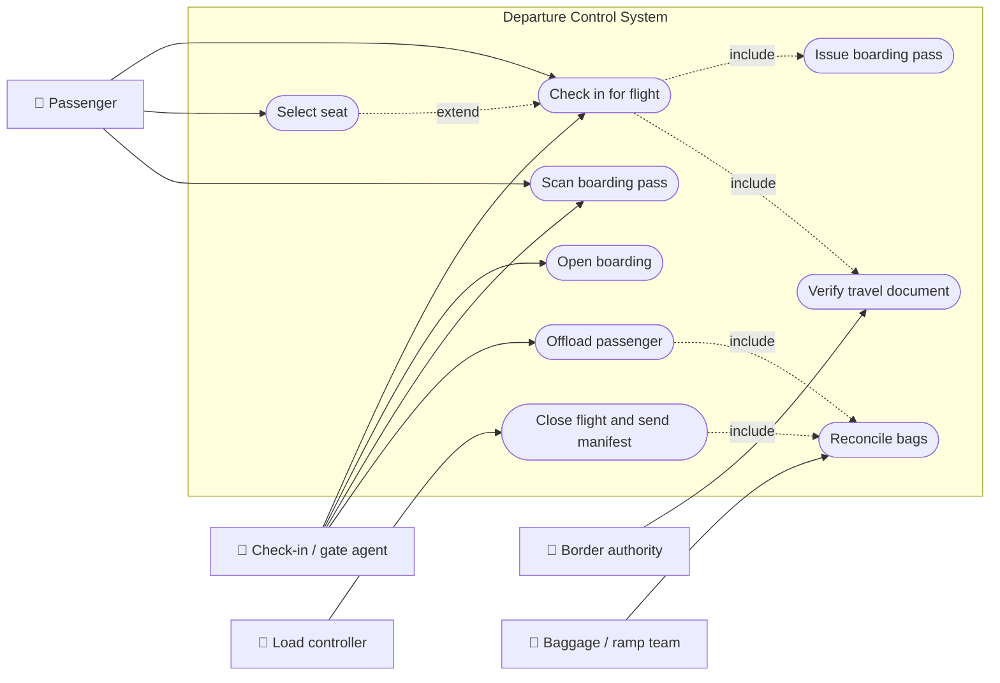
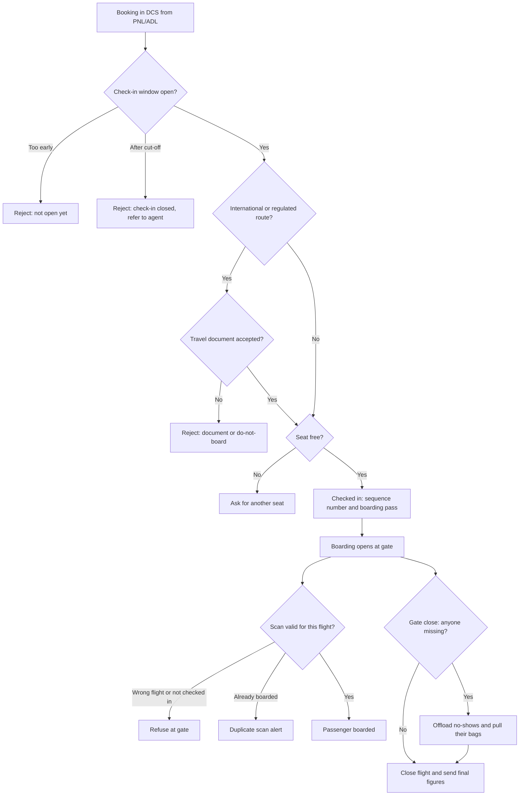
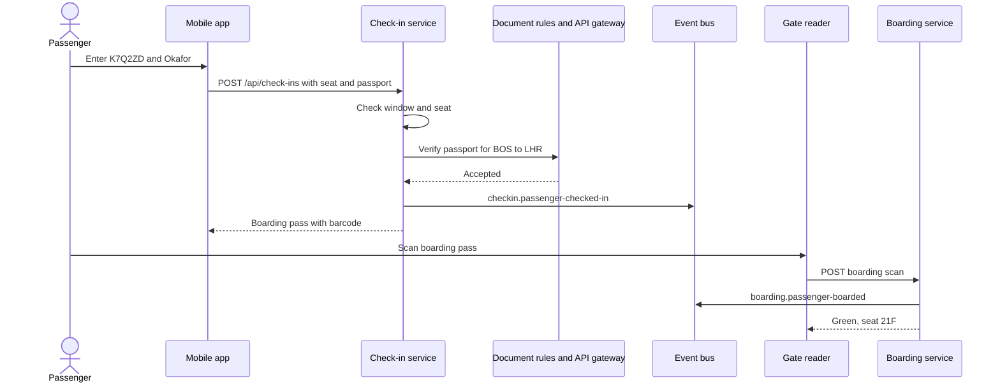
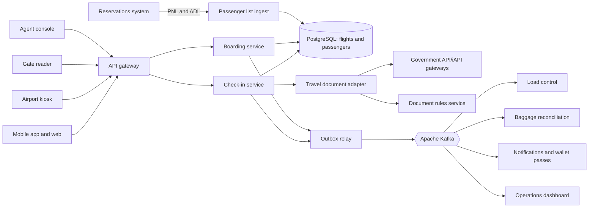
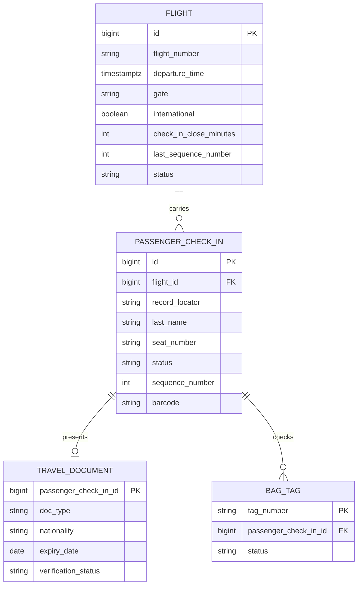
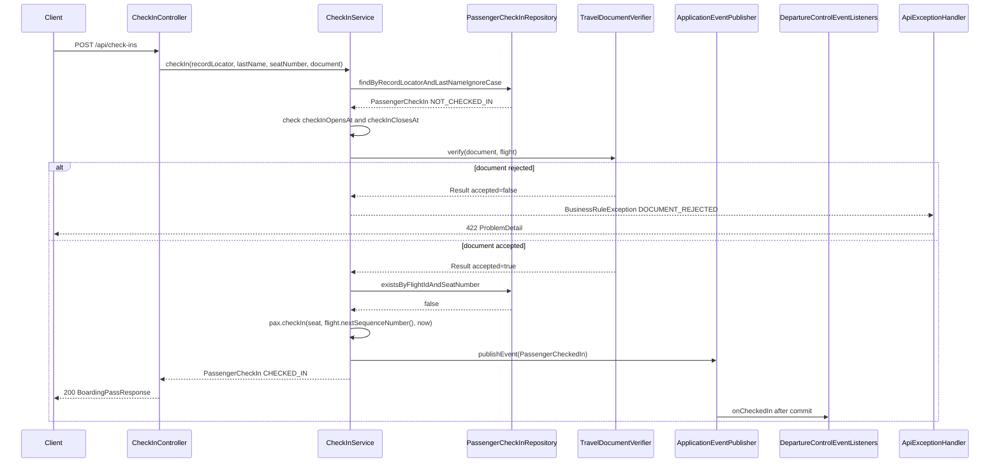
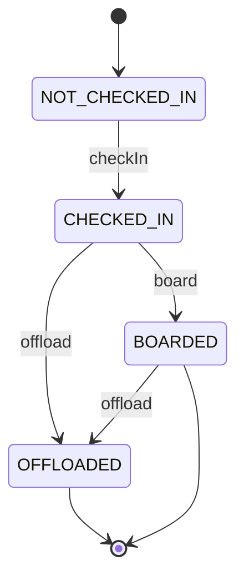
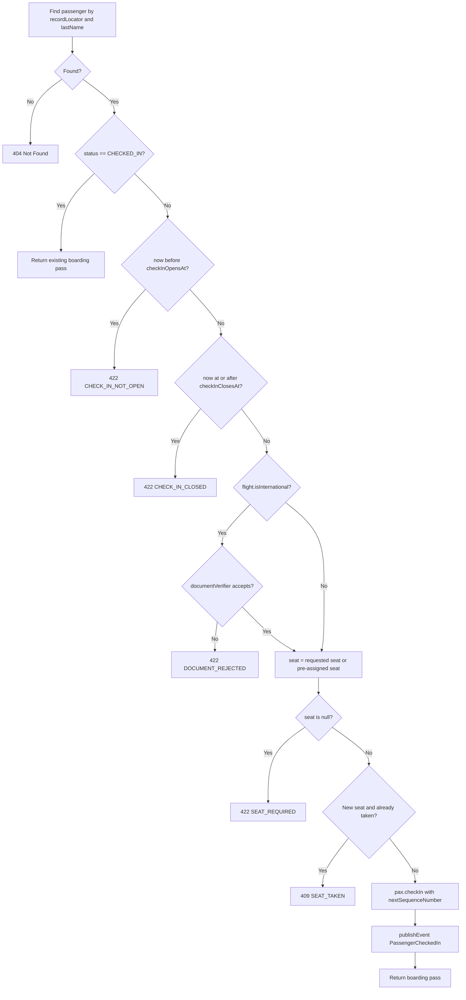

# Check-in and Boarding

> **Domain:** Airline and Travel · **Author:** [@naveenks720](https://github.com/naveenks720) · **Published:** November 17, 2026

> **Runnable code:** [`examples/airline/check-in-and-boarding`](https://github.com/dhulipalla599/domain-knowledge-engineering/tree/main/examples/airline/check-in-and-boarding)

## Explain It Like I'm Five

Imagine a school trip on a big bus. The day before, your teacher calls out each name and says "Yes, you're coming, and you sit in seat 12." She checks that you have your permission slip and gives you a little card with your seat number. On the morning of the trip, you show your card at the bus door. The teacher ticks your name, and nobody can come on twice or sit in somebody else's seat. When everyone on the list is ticked, the door closes and the bus leaves.

Check-in is the airline confirming you are travelling, checking your papers and giving you a seat and a boarding pass. Boarding is the gate ticking you onto the plane so the crew knows exactly who is on board before the door closes.

## Business Overview

**Check-in** turns a ticketed booking into a confirmed passenger on a specific flight. The passenger confirms they will travel, gets a seat, has their travel documents checked, drops bags if they have any, and receives a boarding pass. **Boarding** is the controlled process at the gate. Each boarding pass is scanned, checked against the flight and moved to "boarded". The flight is then closed, so the crew and load controllers know exactly who and what is on the aircraft.

Both steps run in the airline's **Departure Control System (DCS)**. Many airlines rent a DCS from a large IT provider, often run by a ground-handling partner at outstations, and connect their own apps, kiosks and websites to it.

Why the business cares:

- **Safety and regulation.** The aircraft must not leave with a passenger who is not on board, or carry the bags of someone who did not fly. In most jurisdictions, international flights require *positive passenger-bag matching*. Many governments also require **Advance Passenger Information (API)** before departure, and some return a "board / do not board" decision per passenger. If the airline carries someone without valid documents, it can be fined and must fly them back at its own cost. Details differ by country.
- **Operational punctuality.** Check-in and gate close times protect the departure slot. One missing passenger with bags in the hold can delay a flight while those bags are found and offloaded.
- **Revenue.** Check-in is a key sales moment for paid seats, extra bags, upgrades and priority boarding. It also gives the true count of who will turn up, which matters on overbooked flights: no-show seats can be resold to standby passengers or "go-shows".
- **Customer experience.** Most passengers now check in on their phone. A failed or confusing online check-in sends them to the airport counter, which costs the airline staff time.

**Where it sits in the value chain:** Shopping and booking → ticketing and the PNR → **check-in → boarding** → flight operations (load and balance, departure) → arrival, baggage delivery and loyalty accrual. Check-in receives its passenger list from reservations. Boarding feeds load control, baggage reconciliation, revenue accounting (flown coupons) and the operations control centre.

## Real-World Example

**Northwind Air** flight **NW214** leaves Boston (BOS) for London Heathrow (LHR) at 18:00 local time. **Adaeze Okafor** is booked on it under record locator **K7Q2ZD**.

1. **T-24 h:** Online check-in opens. The Northwind app sends Adaeze a push notification.
2. **T-3 h:** Adaeze opens the app and enters `K7Q2ZD` and `Okafor`. The app shows the seat map, and she picks 21F. Because the flight is international, the app asks for her passport details. She scans the passport's machine-readable zone.
3. The check-in service checks three things. Is the check-in window open? (Yes: it closes 60 minutes before departure for this route.) Is the passport valid for travel to the UK? (A rules service says yes.) Is 21F still free? (Yes.) It assigns Adaeze **check-in sequence number 2** and issues a boarding pass with a barcode.
4. The service publishes `checkin.passenger-checked-in`. Her passport data goes into the advance passenger information sent to the authorities, and load control updates the passenger count.
5. **T-45 min:** The gate agent at B12 opens boarding for NW214. Passengers board by group.
6. Adaeze scans her phone at the gate. The reader shows green, she is marked `BOARDED`, and `boarding.passenger-boarded` is published.
7. **T-15 min:** Boarding closes. One checked-in passenger has not turned up, and that passenger has a checked bag. The agent **offloads** them. Baggage reconciliation sees `checkin.passenger-offloaded`, and the ramp team pulls the bag before the door closes. Departure is 4 minutes late instead of 25.

## Stakeholders

| Stakeholder | What they need | What they fear |
|---|---|---|
| Passenger | Fast, mobile check-in, a seat they like, a boarding pass that works at the gate | Being refused at the gate, losing their seat, missing the cut-off by a minute |
| Check-in / gate agent | One screen with the passenger list, clear reasons for every refusal, quick overrides | Queues, systems that hang during boarding, wrong manifests |
| Load controller | Accurate, live counts of passengers and bags per cabin and zone | Late changes after the load sheet is signed off |
| Baggage / ramp team | Instant notice when a passenger with bags is offloaded | Searching the hold for a bag minutes before departure |
| Border and security authorities | Correct advance passenger data, on time; respect for "do not board" decisions | Inadmissible or watch-listed passengers boarding |
| Airline revenue management | Real show-up counts, upsell revenue, standby handling | Seats flying empty, or denied-boarding compensation |
| Operations control centre | On-time departures, early warning of boarding problems | Delays caused by late passengers or reconciliation errors |
| Ground handling partner | Clear airline rules they can apply at outstations | Fines or blame for an airline's policy gaps |

## Use Case Diagram



| Use Case | Primary Actor | Goal | Main success outcome |
|---|---|---|---|
| Check in for flight | Passenger (or agent on their behalf) | Confirm travel on a specific flight | Passenger is `CHECKED_IN` with a sequence number |
| Select seat | Passenger | Choose or change a seat during check-in | Seat is held for that passenger and no one else |
| Verify travel document | Border authority (via the DCS) | Make sure the passenger may enter or transit the destination | Document accepted, API data recorded |
| Issue boarding pass | Passenger | Get a scannable pass | Boarding pass with a barcode is issued |
| Open boarding | Gate agent | Start boarding at the gate | Flight status is `BOARDING` |
| Scan boarding pass | Passenger / gate agent | Let a passenger board the right flight once | Passenger is `BOARDED`; duplicates and wrong flights are refused |
| Offload passenger | Gate agent | Remove a passenger who will not fly | Seat released; bags flagged for removal |
| Close flight and send manifest | Load controller | Finalise who and what is on board | Final passenger and bag counts sent to load control and authorities |
| Reconcile bags | Baggage / ramp team | Make sure no unaccompanied bag flies | Every loaded bag belongs to a boarded passenger |

## Key Terms

| Term | Plain-English meaning |
|---|---|
| DCS (Departure Control System) | The system that runs check-in, seating, boarding and load control for each flight |
| PNR / record locator | The booking record and its six-character code (for example `K7Q2ZD`) |
| PNL / ADL | Passenger Name List and Additions and Deletions List: messages that send the booked passengers from reservations to the DCS before departure |
| Check-in window | The period during which check-in is allowed: it opens some hours before departure (often 24, sometimes more) and closes at a cut-off time that varies by airline, airport and route |
| Check-in sequence number (BSN) | The number given to each passenger in check-in order, printed on the boarding pass and used to find them quickly |
| BCBP | IATA Bar Coded Boarding Pass: the standard barcode format on paper and mobile boarding passes |
| API / APIS / iAPI | Advance Passenger Information sent to governments; "interactive" versions answer per passenger with board / do-not-board |
| Gate close / flight close | The time after which no more passengers may board, and the final closing of the flight in the DCS |
| Offload | Removing a checked-in or boarded passenger (and their bags) from the flight |
| No-show / go-show | A booked passenger who does not turn up / a passenger who turns up without a confirmed seat (for example on standby) |
| Load sheet | The weight and balance document the captain signs before departure, built from passenger and bag counts |
| Positive passenger-bag matching | The security rule that a checked bag only flies if its owner is on board |

## Process Flow

The passenger list arrives in the DCS from reservations (PNL, then ADL updates). When the check-in window opens, passengers check in through the app, website, kiosk or counter. The DCS checks the window, the travel documents (on international or regulated routes) and the seat, then issues a boarding pass and a sequence number. Bags dropped at the airport are tagged against the passenger. At boarding time the gate agent opens boarding, and each scan is checked against the flight and the passenger's status. At gate close, no-shows are offloaded and their bags are pulled. The flight is closed, and the final figures go to load control and, where required, to the authorities.





## Business Rules and Edge Cases

- **Time windows come from the flight, not the server.** Opening and cut-off times differ by airline, route and airport, and sometimes by cabin. Compare instants in UTC, and work out local times from the departure airport's time zone, not the server's. Test the exact boundary: is "60 minutes before" still open or already closed? Then write the answer down.
- **Delays move the windows.** If departure slips by two hours, the check-in close time usually moves with it. Some airlines keep the original schedule time for certain rules, so make this a policy decision, not an accident.
- **Idempotent check-in.** Mobile networks drop responses, and passengers tap twice. A retry must return the same boarding pass and sequence number. It must not issue a second sequence number, charge for a seat twice or send duplicate API data.
- **Seat races.** Two passengers can pick the same seat in the same second. A check-then-write in code is not enough on its own: back it with a database unique constraint, and handle the violation as "seat taken, choose another".
- **Documents are route-specific, and authorities can answer "no".** Entry rules depend on destination, nationality, transit points and visa status. Some countries require passports valid for months beyond the trip. When a government system returns "do not board", or does not answer in time, most airlines treat it as "cannot issue a boarding pass yet". Never treat a timeout as approval.
- **Duplicate and wrong-flight scans.** At a busy gate, the same pass can be scanned twice, and a passenger can come to the wrong gate. Both must be refused clearly, with a reason the agent can act on.
- **Offload must reach baggage.** Removing a passenger from the list without telling baggage reconciliation is a security failure, not just a data bug. The event must be delivered reliably, even if a service restarts.
- **Partial failures.** Check-in can succeed in the DCS while the boarding pass email, a seat payment or an API message fails. Use an outbox and retries for these side effects. Do not roll back a valid check-in because a notification failed.
- **Paid extras and refunds.** If a paid seat is released by an offload or an aircraft swap, the refund or reallocation rules belong to revenue and customer policy. Raise an event instead of hard-coding a refund in the DCS.
- **Aircraft swaps.** A different aircraft type means a different seat map. Seats must be remapped, and some passengers will lose their seat. Plan for bulk re-seating with notifications.
- **Group bookings and infants.** One PNR can hold many passengers. An infant on a lap needs an adult checked in alongside, and an unaccompanied minor needs a handover. Rules like these differ by airline.

## From Business to System

| Business concept / step | System component | Data entity | Event |
|---|---|---|---|
| Booked passenger list (PNL/ADL) | Reservations integration (adapter) | `passenger_check_in` row in `NOT_CHECKED_IN` | (inbound feed) |
| Check-in window | `CheckInService` with `Flight.checkInOpensAt` / `checkInClosesAt` | `flight` | none (rejection only) |
| Document check / API | `TravelDocumentVerifier` adapter | `travel_document` (production) | `checkin.passenger-checked-in` carries the data for the API sender |
| Seat assignment | `CheckInService` + unique constraint | `passenger_check_in.seat_number` | `checkin.passenger-checked-in` |
| Boarding pass and sequence number | `PassengerCheckIn.checkIn`, `Flight.nextSequenceNumber` | `passenger_check_in.barcode`, `flight.last_sequence_number` | `checkin.passenger-checked-in` |
| Open boarding | `BoardingService.openBoarding` | `flight.status` | (production: `boarding.flight-status-changed`) |
| Gate scan | `BoardingService.scan` | `passenger_check_in.status`, `boarded_at` | `boarding.passenger-boarded` |
| Offload | `CheckInService.offload` | `passenger_check_in.status = OFFLOADED` | `checkin.passenger-offloaded` |
| Bag reconciliation, load sheet | Baggage and load-control consumers | `bag_tag` (production) | consumes the events above |

## Architecture



**Why these boundaries.** *Check-in* and *boarding* share one passenger-per-flight record, but they have very different load patterns. Check-in is spread over 24 hours and peaks in the evening. Boarding is a sharp burst at one gate, where the reader needs a sub-second answer. Splitting them lets boarding scale and deploy on its own. The two still agree on a single source of truth: the `passenger_check_in` row and its lifecycle. The *travel document adapter* sits behind an interface because each country's API and each rules provider is different, slow and occasionally down; it can be rate-limited and retried without touching check-in logic. *Load control*, *baggage* and *notifications* are downstream consumers that react to events, so a slow email provider can never block a boarding scan. In the runnable example, everything is one Spring Boot app with the same package boundaries.

## Data Model

```sql
CREATE TABLE flight (
    id                      BIGINT PRIMARY KEY,
    flight_number           VARCHAR(8)  NOT NULL,
    departure_date          DATE        NOT NULL,          -- local date at origin
    origin                  CHAR(3)     NOT NULL,
    destination             CHAR(3)     NOT NULL,
    departure_time          TIMESTAMPTZ NOT NULL,
    gate                    VARCHAR(6),
    international           BOOLEAN     NOT NULL,
    check_in_close_minutes  INT         NOT NULL,
    last_sequence_number    INT         NOT NULL DEFAULT 0,
    status                  VARCHAR(16) NOT NULL,          -- SCHEDULED, BOARDING, CLOSED
    version                 BIGINT      NOT NULL DEFAULT 0,
    UNIQUE (flight_number, departure_date)
);

CREATE TABLE passenger_check_in (
    id               BIGINT PRIMARY KEY,
    flight_id        BIGINT      NOT NULL REFERENCES flight(id),
    record_locator   CHAR(6)     NOT NULL,
    last_name        VARCHAR(64) NOT NULL,
    first_name       VARCHAR(64),
    seat_number      VARCHAR(4),
    status           VARCHAR(16) NOT NULL,                 -- NOT_CHECKED_IN, CHECKED_IN, BOARDED, OFFLOADED
    sequence_number  INT,
    barcode          VARCHAR(256),
    checked_in_at    TIMESTAMPTZ,
    boarded_at       TIMESTAMPTZ,
    version          BIGINT      NOT NULL DEFAULT 0,
    CONSTRAINT uk_seat_per_flight UNIQUE (flight_id, seat_number),
    CONSTRAINT uk_pax_per_flight  UNIQUE (flight_id, record_locator, last_name)
);

CREATE TABLE travel_document (
    passenger_check_in_id BIGINT PRIMARY KEY REFERENCES passenger_check_in(id),
    doc_type              VARCHAR(16) NOT NULL,
    doc_number_hash       VARCHAR(128) NOT NULL,           -- raw number kept encrypted elsewhere
    nationality           CHAR(3)     NOT NULL,
    expiry_date           DATE        NOT NULL,
    verification_status   VARCHAR(16) NOT NULL,            -- ACCEPTED, REJECTED, PENDING
    verified_at           TIMESTAMPTZ
);

CREATE TABLE bag_tag (
    tag_number            CHAR(10) PRIMARY KEY,
    passenger_check_in_id BIGINT NOT NULL REFERENCES passenger_check_in(id),
    status                VARCHAR(16) NOT NULL             -- CHECKED, LOADED, OFFLOADED
);

CREATE TABLE outbox_event (
    id           UUID PRIMARY KEY,
    topic        VARCHAR(64)  NOT NULL,
    message_key  VARCHAR(64)  NOT NULL,                    -- flight number + date
    payload      JSONB        NOT NULL,
    created_at   TIMESTAMPTZ  NOT NULL DEFAULT now(),
    published_at TIMESTAMPTZ
);
```

PostgreSQL treats `NULL`s as distinct in a unique constraint, so many passengers can have no seat yet while an assigned seat stays unique per flight. The runnable example covers `flight` and `passenger_check_in`; `travel_document`, `bag_tag` and `outbox_event` are the production additions.



## APIs

| Method | Path | Purpose |
|---|---|---|
| POST | `/api/check-ins` | Check in a passenger (seat, travel document); returns the boarding pass. Idempotent. |
| POST | `/api/check-ins/{recordLocator}/{lastName}/offload` | Agent offloads a passenger and releases the seat |
| POST | `/api/flights/{flightNumber}/boarding/open` | Gate agent opens boarding |
| POST | `/api/flights/{flightNumber}/boarding/scans` | Gate reader submits a scanned barcode |
| GET | `/api/flights/{flightNumber}/passengers` | Passenger manifest for agents and load control |

`POST /api/check-ins`

```json
{
  "recordLocator": "K7Q2ZD",
  "lastName": "Okafor",
  "seatNumber": "21F",
  "document": {
    "type": "PASSPORT",
    "number": "N1234567",
    "nationality": "NG",
    "expiryDate": "2031-04-30"
  }
}
```

`200 OK`

```json
{
  "recordLocator": "K7Q2ZD",
  "passengerName": "OKAFOR/ADAEZE",
  "flightNumber": "NW214",
  "origin": "BOS",
  "destination": "LHR",
  "departureTime": "2026-11-17T18:05:55.507930Z",
  "gate": "B12",
  "seatNumber": "21F",
  "sequenceNumber": 2,
  "status": "CHECKED_IN",
  "barcode": "NW214|K7Q2ZD|OKAFOR|21F|002"
}
```

A rule violation returns a `ProblemDetail` with a stable `rule` code, for example `422` with `"rule": "CHECK_IN_CLOSED"` or `409` with `"rule": "SEAT_TAKEN"`.

## Events

| Event | Producer | Consumers | Key fields |
|---|---|---|---|
| `checkin.passenger-checked-in` | Check-in service | Load control, API sender, notifications / wallet pass, upsell | `flightNumber`, `recordLocator`, `lastName`, `seatNumber`, `sequenceNumber`, `occurredAt` |
| `boarding.passenger-boarded` | Boarding service | Load control, operations dashboard, revenue accounting (flown) | `flightNumber`, `recordLocator`, `lastName`, `seatNumber`, `occurredAt` |
| `checkin.passenger-offloaded` | Check-in service | Baggage reconciliation, load control, standby handling, customer service | `flightNumber`, `recordLocator`, `lastName`, `occurredAt` |

**Ordering:** key every message by flight number plus departure date, so all events for one flight land on one partition in order. A consumer must never see `passenger-boarded` before the `passenger-checked-in` it depends on. **Idempotency:** consumers deduplicate by `(flightNumber, recordLocator, lastName, event type, occurredAt)` or by an event ID, because the outbox relay delivers at least once. **Reliability:** events go through a transactional outbox (written in the same database transaction as the status change), so an offload can never be committed without its event. The example models this with `@TransactionalEventListener`, which only runs after the transaction commits.

## Backend Implementation

> The Java tab is the runnable example's code; the Python tab uses FastAPI + SQLAlchemy and the Node.js tab uses NestJS + TypeORM.

The key business rule is enforced in `CheckInService.checkIn`: window, travel document, seat and idempotency. Full source: [`examples/airline/check-in-and-boarding`](https://github.com/dhulipalla599/domain-knowledge-engineering/tree/main/examples/airline/check-in-and-boarding).

=== "Java"

    ```java
    /** Checks a passenger in: window, travel document and seat rules, then issues a boarding pass. */
    @Transactional
    public PassengerCheckIn checkIn(String recordLocator, String lastName, String seatNumber, TravelDocument document) {
        PassengerCheckIn pax = passengers.findByRecordLocatorAndLastNameIgnoreCase(recordLocator, lastName)
                .orElseThrow(() -> new NoSuchElementException("No booking " + recordLocator + " for " + lastName));
        if (pax.getStatus() == CheckInStatus.CHECKED_IN) {
            return pax; // idempotent: a retried request gets the same boarding pass, not a new sequence number
        }
        Flight flight = pax.getFlight();
        Instant now = clock.instant();
        if (now.isBefore(flight.checkInOpensAt())) {
            throw new BusinessRuleException("CHECK_IN_NOT_OPEN",
                    "Check-in for " + flight.getFlightNumber() + " opens at " + flight.checkInOpensAt(),
                    HttpStatus.UNPROCESSABLE_ENTITY);
        }
        if (!now.isBefore(flight.checkInClosesAt())) {
            throw new BusinessRuleException("CHECK_IN_CLOSED",
                    "Check-in for " + flight.getFlightNumber() + " closed at " + flight.checkInClosesAt(),
                    HttpStatus.UNPROCESSABLE_ENTITY);
        }
        if (flight.isInternational()) {
            TravelDocumentVerifier.Result result = documentVerifier.verify(document, flight);
            if (!result.accepted()) {
                throw new BusinessRuleException("DOCUMENT_REJECTED", result.reason(), HttpStatus.UNPROCESSABLE_ENTITY);
            }
        }
        String seat = seatNumber != null ? seatNumber.toUpperCase() : pax.getSeatNumber();
        if (seat == null) {
            throw new BusinessRuleException("SEAT_REQUIRED", "Choose a seat to check in", HttpStatus.UNPROCESSABLE_ENTITY);
        }
        if (!seat.equals(pax.getSeatNumber()) && passengers.existsByFlightIdAndSeatNumber(flight.getId(), seat)) {
            throw new BusinessRuleException("SEAT_TAKEN", "Seat " + seat + " is already taken", HttpStatus.CONFLICT);
        }
        pax.checkIn(seat, flight.nextSequenceNumber(), now);
        events.publishEvent(new PassengerCheckedIn(flight.getFlightNumber(), pax.getRecordLocator(),
                pax.getLastName(), seat, pax.getSequenceNumber(), now));
        return pax;
    }
    ```

=== "Python"

    ```python
    def check_in(db: Session, clock: Callable[[], datetime], verifier: TravelDocumentVerifier,
                 events: EventPublisher, record_locator: str, last_name: str,
                 seat_number: str | None, document: TravelDocument | None) -> PassengerCheckIn:
        """Checks a passenger in: window, travel document and seat rules, then issues a boarding pass."""
        pax = db.scalars(select(PassengerCheckIn).where(
            PassengerCheckIn.record_locator == record_locator,
            func.upper(PassengerCheckIn.last_name) == last_name.upper())).one_or_none()
        if pax is None:
            raise NotFound(f"No booking {record_locator} for {last_name}")
        if pax.status == CheckInStatus.CHECKED_IN:
            return pax  # idempotent: a retried request gets the same boarding pass
        flight, now = pax.flight, clock()
        if now < flight.check_in_opens_at():
            raise BusinessRuleError("CHECK_IN_NOT_OPEN",
                                    f"Check-in for {flight.flight_number} opens at {flight.check_in_opens_at()}", 422)
        if now >= flight.check_in_closes_at():
            raise BusinessRuleError("CHECK_IN_CLOSED",
                                    f"Check-in for {flight.flight_number} closed at {flight.check_in_closes_at()}", 422)
        if flight.international:
            result = verifier.verify(document, flight)
            if not result.accepted:
                raise BusinessRuleError("DOCUMENT_REJECTED", result.reason, 422)
        seat = seat_number.upper() if seat_number else pax.seat_number
        if seat is None:
            raise BusinessRuleError("SEAT_REQUIRED", "Choose a seat to check in", 422)
        if seat != pax.seat_number and db.scalar(select(exists().where(
                PassengerCheckIn.flight_id == flight.id, PassengerCheckIn.seat_number == seat))):
            raise BusinessRuleError("SEAT_TAKEN", f"Seat {seat} is already taken", 409)
        pax.check_in(seat, flight.next_sequence_number(), now)
        events.publish(PassengerCheckedIn(flight.flight_number, pax.record_locator, pax.last_name,
                                          seat, pax.sequence_number, now))
        return pax
    ```

=== "Node.js"

    ```typescript
    /** Checks a passenger in: window, travel document and seat rules, then issues a boarding pass. */
    async checkIn(recordLocator: string, lastName: string, seatNumber: string | undefined,
                  document: TravelDocument | undefined): Promise<PassengerCheckIn> {
      return this.dataSource.transaction(async (em) => {
        const pax = await em.getRepository(PassengerCheckIn).findOne({
          where: { recordLocator, lastName: ILike(lastName) }, relations: { flight: true } });
        if (!pax) throw new NotFoundException(`No booking ${recordLocator} for ${lastName}`);
        if (pax.status === CheckInStatus.CHECKED_IN) return pax; // idempotent retry
        const flight = pax.flight;
        const now = this.clock.now();
        if (now < flight.checkInOpensAt()) {
          throw new BusinessRuleException('CHECK_IN_NOT_OPEN',
            `Check-in for ${flight.flightNumber} opens at ${flight.checkInOpensAt().toISOString()}`, 422);
        }
        if (now >= flight.checkInClosesAt()) {
          throw new BusinessRuleException('CHECK_IN_CLOSED',
            `Check-in for ${flight.flightNumber} closed at ${flight.checkInClosesAt().toISOString()}`, 422);
        }
        if (flight.international) {
          const result = await this.documentVerifier.verify(document, flight);
          if (!result.accepted) throw new BusinessRuleException('DOCUMENT_REJECTED', result.reason, 422);
        }
        const seat = seatNumber ? seatNumber.toUpperCase() : pax.seatNumber;
        if (!seat) throw new BusinessRuleException('SEAT_REQUIRED', 'Choose a seat to check in', 422);
        if (seat !== pax.seatNumber &&
            await em.getRepository(PassengerCheckIn).exist({ where: { flight: { id: flight.id }, seatNumber: seat } })) {
          throw new BusinessRuleException('SEAT_TAKEN', `Seat ${seat} is already taken`, 409);
        }
        pax.checkIn(seat, flight.nextSequenceNumber(), now);
        await em.save([flight, pax]);
        this.events.emit('checkin.passenger-checked-in', new PassengerCheckedIn(
          flight.flightNumber, pax.recordLocator, pax.lastName, seat, pax.sequenceNumber!, now));
        return pax;
      });
    }
    ```

The controller endpoint that calls it:

=== "Java"

    ```java
    /** Check in and get a boarding pass. Safe to retry: a checked-in passenger gets the same pass back. */
    @PostMapping("/check-ins")
    public BoardingPassResponse checkIn(@Valid @RequestBody CheckInRequest req) {
        return BoardingPassResponse.from(
                checkIn.checkIn(req.recordLocator(), req.lastName(), req.seatNumber(), req.document()));
    }
    ```

=== "Python"

    ```python
    @router.post("/api/check-ins", response_model=BoardingPassResponse)
    def check_in_endpoint(req: CheckInRequest, db: Session = Depends(get_db),
                          verifier: TravelDocumentVerifier = Depends(get_verifier),
                          events: EventPublisher = Depends(get_events)) -> BoardingPassResponse:
        """Check in and get a boarding pass. Safe to retry: a checked-in passenger gets the same pass back."""
        with db.begin():
            pax = check_in(db, utc_now, verifier, events, req.record_locator, req.last_name,
                           req.seat_number, req.document)
            return BoardingPassResponse.from_entity(pax)
    ```

=== "Node.js"

    ```typescript
    /** Check in and get a boarding pass. Safe to retry: a checked-in passenger gets the same pass back. */
    @Post('check-ins')
    @HttpCode(200)
    async checkIn(@Body() req: CheckInRequest): Promise<BoardingPassResponse> {
      return BoardingPassResponse.from(
        await this.checkInService.checkIn(req.recordLocator, req.lastName, req.seatNumber, req.document));
    }
    ```

## Frontend Screen

The mobile web check-in screen: find the booking, choose a seat, add a passport for international flights, and show the boarding pass. Rule codes from the API are mapped to friendly messages.

```tsx
import { useState } from 'react';

type BoardingPass = {
  recordLocator: string; passengerName: string; flightNumber: string; origin: string; destination: string;
  departureTime: string; gate: string; seatNumber: string; sequenceNumber: number; barcode: string;
};
type Problem = { status: number; detail: string; rule?: string };

const MESSAGES: Record<string, string> = {
  CHECK_IN_NOT_OPEN: 'Online check-in is not open yet.',
  CHECK_IN_CLOSED: 'Online check-in has closed. Please see an agent at the airport.',
  DOCUMENT_REJECTED: 'We could not accept this travel document.',
  SEAT_TAKEN: 'That seat was just taken. Please choose another.',
};

export function CheckInScreen({ international }: { international: boolean }) {
  const [form, setForm] = useState({ recordLocator: '', lastName: '', seatNumber: '', passport: '', expiry: '' });
  const [pass, setPass] = useState<BoardingPass | null>(null);
  const [error, setError] = useState<string | null>(null);
  const [busy, setBusy] = useState(false);
  const set = (k: keyof typeof form) => (e: React.ChangeEvent<HTMLInputElement>) =>
    setForm({ ...form, [k]: e.target.value });

  async function submit(e: React.FormEvent) {
    e.preventDefault();
    setBusy(true);
    setError(null);
    try {
      const res = await fetch('/api/check-ins', {
        method: 'POST',
        headers: { 'Content-Type': 'application/json' },
        body: JSON.stringify({
          recordLocator: form.recordLocator.toUpperCase(),
          lastName: form.lastName,
          seatNumber: form.seatNumber || undefined,
          document: international
            ? { type: 'PASSPORT', number: form.passport, nationality: 'NG', expiryDate: form.expiry }
            : undefined,
        }),
      });
      if (!res.ok) {
        const p: Problem = await res.json();
        setError((p.rule && MESSAGES[p.rule]) ?? p.detail);
        return;
      }
      setPass(await res.json());
    } catch {
      setError('Network problem. It is safe to try again.'); // the API is idempotent
    } finally {
      setBusy(false);
    }
  }

  if (pass) {
    return (
      <section aria-label="Boarding pass">
        <h2>{pass.flightNumber} {pass.origin} → {pass.destination}</h2>
        <p>{pass.passengerName} · Seat {pass.seatNumber} · Gate {pass.gate} · Seq {pass.sequenceNumber}</p>
        <p>Departs {new Date(pass.departureTime).toLocaleString()}</p>
        <code aria-label="Barcode data">{pass.barcode}</code>
      </section>
    );
  }

  return (
    <form onSubmit={submit}>
      <label>Booking reference <input value={form.recordLocator} onChange={set('recordLocator')} maxLength={6} required /></label>
      <label>Last name <input value={form.lastName} onChange={set('lastName')} required /></label>
      <label>Seat <input value={form.seatNumber} onChange={set('seatNumber')} placeholder="21F" /></label>
      {international && (
        <>
          <label>Passport number <input value={form.passport} onChange={set('passport')} required /></label>
          <label>Passport expiry <input type="date" value={form.expiry} onChange={set('expiry')} required /></label>
        </>
      )}
      {error && <p role="alert">{error}</p>}
      <button disabled={busy}>{busy ? 'Checking in…' : 'Check in'}</button>
    </form>
  );
}
```

## Cloud Deployment

**Main services on AWS:**

- **Amazon EKS** runs the check-in service and the boarding service as separate Deployments, spread across at least three Availability Zones, with a Horizontal Pod Autoscaler on each.
- **Amazon Aurora PostgreSQL** (Multi-AZ) holds flights, passengers and the outbox table.
- **Amazon MSK** (managed Apache Kafka) carries the `checkin.*` and `boarding.*` topics; a small outbox relay (or Debezium on MSK Connect) publishes from the outbox table.
- **Amazon API Gateway** or an Application Load Balancer with AWS WAF sits in front of public check-in. Gate readers and agent consoles reach a private endpoint over the airport network or VPN.
- **AWS Secrets Manager** holds database and partner credentials, and **AWS KMS** encrypts passport data at rest.
- **Amazon ElastiCache for Redis** (optional) caches seat maps for the busy evening check-in peak.

The most important resource is the database that holds the single source of truth:

```hcl
resource "aws_rds_cluster" "dcs" {
  cluster_identifier              = "dcs-checkin-boarding"
  engine                          = "aurora-postgresql"
  engine_version                  = "16.4"
  database_name                   = "dcs"
  master_username                 = "dcs_admin"
  manage_master_user_password     = true            # password kept in Secrets Manager
  storage_encrypted               = true
  kms_key_id                      = aws_kms_key.dcs.arn
  db_subnet_group_name            = aws_db_subnet_group.private.name
  vpc_security_group_ids          = [aws_security_group.dcs_db.id]
  backup_retention_period         = 14
  deletion_protection             = true
  enabled_cloudwatch_logs_exports = ["postgresql"]
}

resource "aws_rds_cluster_instance" "dcs" {
  count               = 2                           # writer + reader in different AZs
  identifier          = "dcs-checkin-boarding-${count.index}"
  cluster_identifier  = aws_rds_cluster.dcs.id
  instance_class      = "db.r6g.large"
  engine              = aws_rds_cluster.dcs.engine
  publicly_accessible = false
}
```

**Security:** pods use IAM Roles for Service Accounts (IRSA) to reach MSK and Secrets Manager, so there are no static keys. Passport numbers are encrypted, and logs show them masked. Public endpoints are rate-limited per booking reference to stop people guessing PNR and surname pairs. Gate endpoints require device certificates.

**Scaling:** the boarding service scales on request rate, since a busy hub can have many flights boarding at the same time. The check-in service scales on CPU and on the evening peak. The sequence-number counter is per flight, so optimistic-lock retries stay local to one flight.

**Observability:** the OpenTelemetry SDK, or the Java agent, emits traces and metrics through the AWS Distro for OpenTelemetry collector to CloudWatch and AWS X-Ray. Useful metrics include check-ins per minute by rule code (`CHECK_IN_CLOSED`, `DOCUMENT_REJECTED`), scan latency at p99 and outbox lag. CloudWatch alarms fire on rising document rejections, which can mean a government gateway is failing, and on outbox lag during boarding.

## Non-Functional Requirements

| Requirement | Expectation | How the design meets it |
|---|---|---|
| Availability | Boarding must work whenever a flight is boarding; check-in outages push passengers to counters | Multi-AZ EKS and Aurora; boarding service deployed separately. Airlines also keep offline or fallback procedures at the gate, such as a cached manifest, and the details vary by airline |
| Latency | A gate scan answer feels instant (well under a second); check-in completes in a few seconds, including the document check | Single-row lookups by unique keys; document checks are the only remote call on the check-in path and have strict timeouts |
| Consistency | A seat belongs to one passenger; one passenger boards once; the sequence number is unique per flight | Unique constraints, `@Version` optimistic locking and lifecycle rules in the domain class |
| Idempotency | Retries never create a second check-in, sequence number or event | Check-in returns the existing pass; consumers deduplicate events |
| Audit | Who checked in, boarded or offloaded each passenger, when and through which channel, kept for investigations and disputes | Timestamps on every transition, events retained in Kafka and archived; agent IDs in production |
| Compliance | Advance passenger data sent on time and "do not board" respected; passport data protected under the privacy laws that apply (for example GDPR in the EU/UK) | Document adapter blocks boarding pass issue on rejection or timeout; encryption, masking and retention limits on document data |

## Runnable Example

The example is a small Spring Boot departure-control service. It seeds three Northwind Air flights in different states, relative to start-up time: one open for check-in, one boarding with check-in closed, and one not open yet. It implements check-in with the window, travel-document and seat rules, plus idempotent retries; opening boarding; gate scans that refuse wrong-flight, not-checked-in and duplicate scans; and agent offload. Every state change publishes a domain event, which an after-commit listener consumes in place of Kafka. External document checks sit behind `TravelDocumentVerifier`, with a deterministic stub.

Source: [`examples/airline/check-in-and-boarding`](https://github.com/dhulipalla599/domain-knowledge-engineering/tree/main/examples/airline/check-in-and-boarding)

```bash
cd examples/airline/check-in-and-boarding
mvn spring-boot:run          # http://localhost:8080
mvn verify                   # unit + API tests
```

Check in on the international flight:

```bash
curl -s -X POST localhost:8080/api/check-ins -H 'Content-Type: application/json' \
  -d '{"recordLocator":"K7Q2ZD","lastName":"Okafor","seatNumber":"21F","document":{"type":"PASSPORT","number":"N1234567","nationality":"NG","expiryDate":"2031-04-30"}}'
```

```json
{"recordLocator":"K7Q2ZD","passengerName":"OKAFOR/ADAEZE","flightNumber":"NW214","origin":"BOS","destination":"LHR","departureTime":"2026-11-17T18:05:55.507930Z","gate":"B12","seatNumber":"21F","sequenceNumber":2,"status":"CHECKED_IN","barcode":"NW214|K7Q2ZD|OKAFOR|21F|002"}
```

Try to check in late on the flight that is already boarding:

```bash
curl -s -X POST localhost:8080/api/check-ins -H 'Content-Type: application/json' \
  -d '{"recordLocator":"R2HV6W","lastName":"Morales","seatNumber":"15A"}'
```

```json
{"type":"about:blank","title":"Check-in or boarding rejected","status":422,"detail":"Check-in for NW88 closed at 2026-11-17T14:40:55.507930Z","instance":"/api/check-ins","rule":"CHECK_IN_CLOSED"}
```

(Timestamps depend on when you start the app.)

| Class | Package | Responsibility |
|---|---|---|
| `CheckInAndBoardingApplication` | root | Entry point; provides the injectable `Clock` |
| `Flight` | `domain` | Check-in window, gate, status, boarding sequence counter, `@Version` |
| `FlightStatus` | `domain` | `SCHEDULED`, `BOARDING`, `CLOSED` |
| `PassengerCheckIn` | `domain` | One passenger on one flight; lifecycle transitions; barcode |
| `CheckInStatus` | `domain` | `NOT_CHECKED_IN`, `CHECKED_IN`, `BOARDED`, `OFFLOADED` with `canMoveTo` |
| `CheckInEvents` | `domain` | `PassengerCheckedIn`, `PassengerBoarded`, `PassengerOffloaded` |
| `FlightRepository` | `repository` | Flights by flight number |
| `PassengerCheckInRepository` | `repository` | Passenger lookup, seat-taken check, manifest |
| `CheckInService` | `service` | Check-in rules and offload |
| `BoardingService` | `service` | Open boarding and gate-scan rules |
| `BusinessRuleException` | `service` | Rule code plus HTTP status |
| `CheckInController` | `api` | REST endpoints |
| `CheckInDtos` | `api` | `CheckInRequest`, `BoardingScanRequest`, `BoardingPassResponse`, `FlightResponse` |
| `ApiExceptionHandler` | `api` | Maps exceptions to `ProblemDetail` |
| `TravelDocumentVerifier` / `StubTravelDocumentVerifier` | `integration` | Document check interface and deterministic stub |
| `DepartureControlEventListeners` | `integration` | After-commit event consumers with an audit trail |

## UML Diagrams

### Class Diagram

The domain classes own the rules about state, and the services coordinate repositories, the document adapter and event publishing. Events are plain records consumed by the listener class.

```mermaid
classDiagram
    class CheckInController {
        +checkIn(CheckInRequest) BoardingPassResponse
        +offload(String, String) BoardingPassResponse
        +openBoarding(String) FlightResponse
        +scan(String, BoardingScanRequest) BoardingPassResponse
        +manifest(String) List
    }
    class CheckInService {
        +checkIn(String, String, String, TravelDocument) PassengerCheckIn
        +offload(String, String) PassengerCheckIn
    }
    class BoardingService {
        +openBoarding(String) Flight
        +scan(String, String) PassengerCheckIn
    }
    class FlightRepository {
        <<interface>>
        +findByFlightNumber(String) Optional
    }
    class PassengerCheckInRepository {
        <<interface>>
        +findByRecordLocatorAndLastNameIgnoreCase(String, String) Optional
        +findByFlightFlightNumberAndRecordLocatorAndLastName(String, String, String) Optional
        +existsByFlightIdAndSeatNumber(Long, String) boolean
        +findByFlightFlightNumberOrderByIdAsc(String) List
    }
    class Flight {
        -String flightNumber
        -Instant departureTime
        -boolean international
        -int checkInCloseMinutes
        -int lastSequenceNumber
        -FlightStatus status
        +checkInOpensAt() Instant
        +checkInClosesAt() Instant
        +nextSequenceNumber() int
        +openBoarding()
    }
    class PassengerCheckIn {
        -String recordLocator
        -String lastName
        -String seatNumber
        -CheckInStatus status
        -Integer sequenceNumber
        -String barcode
        +checkIn(String, int, Instant)
        +board(Instant)
        +offload()
    }
    class CheckInStatus {
        <<enumeration>>
        NOT_CHECKED_IN
        CHECKED_IN
        BOARDED
        OFFLOADED
        +canMoveTo(CheckInStatus) boolean
    }
    class FlightStatus {
        <<enumeration>>
        SCHEDULED
        BOARDING
        CLOSED
    }
    class TravelDocumentVerifier {
        <<interface>>
        +verify(TravelDocument, Flight) Result
    }
    class StubTravelDocumentVerifier
    class PassengerCheckedIn {
        <<record>>
    }
    class PassengerBoarded {
        <<record>>
    }
    class PassengerOffloaded {
        <<record>>
    }
    class DepartureControlEventListeners {
        +onCheckedIn(PassengerCheckedIn)
        +onBoarded(PassengerBoarded)
        +onOffloaded(PassengerOffloaded)
        +auditTrail() List
    }
    CheckInController --> CheckInService
    CheckInController --> BoardingService
    CheckInController --> PassengerCheckInRepository
    CheckInService --> PassengerCheckInRepository
    CheckInService --> TravelDocumentVerifier
    BoardingService --> FlightRepository
    BoardingService --> PassengerCheckInRepository
    StubTravelDocumentVerifier ..|> TravelDocumentVerifier
    PassengerCheckIn --> Flight
    PassengerCheckIn --> CheckInStatus
    Flight --> FlightStatus
    CheckInService ..> PassengerCheckedIn : publishes
    CheckInService ..> PassengerOffloaded : publishes
    BoardingService ..> PassengerBoarded : publishes
    DepartureControlEventListeners ..> PassengerCheckedIn : consumes
    DepartureControlEventListeners ..> PassengerBoarded : consumes
    DepartureControlEventListeners ..> PassengerOffloaded : consumes
```



### Sequence Diagram (control flow)

One `POST /api/check-ins` through the code. Window and seat failures follow the same path as the document rejection shown in the `alt` branch: a `BusinessRuleException` becomes a `ProblemDetail`.



### State Diagram

The `CheckInStatus` lifecycle, as enforced by `CheckInStatus.canMoveTo` and `PassengerCheckIn.moveTo`.



### Activity Diagram

The decision logic inside `CheckInService.checkIn`.



## AI Opportunities

1. **No-show and show-up prediction.** Predict which checked-in or booked passengers will not reach the gate, so agents can call names early, release seats to standby and alert baggage in advance. *Data:* check-in time and channel, connection times, bag count, gate distance, past behaviour (where privacy rules allow it). *Risk / control:* predictions must only trigger reminders or preparation. Never offload a passenger automatically. Watch for bias against groups such as families or travellers with reduced mobility.
2. **Document reading and pre-check.** Read a passport's machine-readable zone and visa pages from the phone camera, then pre-fill and pre-validate the API data. *Data:* document images, the destination's entry rules. *Risk / control:* OCR errors can wrongly deny boarding. Keep the official rules service as the decision-maker, show the passenger the extracted fields to confirm, and handle images under strict retention rules.
3. **Boarding flow optimisation.** Recommend a boarding group order and the time to open boarding per flight, from aircraft type, load, cabin bag volume and gate layout. *Data:* past boarding durations, scan timestamps, load figures. *Risk / control:* changes to boarding policy affect priority customers and accessibility commitments, so keep humans in the loop and A/B test.
4. **Agent copilot for disruption.** An LLM assistant helps agents with rebooking and re-seating after an aircraft swap or delay, and drafts passenger messages. *Data:* manifest, seat maps, fare and loyalty rules, policy documents. *Risk / control:* it must call real tools (seat map, rebooking APIs) instead of inventing seats or entitlements. Every action needs agent confirmation and an audit log. Compensation rules such as EU261 are legal obligations, so its suggestions must be checked against policy.
5. **Anomaly detection on check-in.** Spot unusual patterns, such as many failed PNR and surname lookups from one source or a sudden spike in document rejections for one route. *Data:* API logs, rule-code metrics. *Risk / control:* false positives can block real customers; route alerts to people, not automatic bans.

## Common Pitfalls

- **Using server-local time.** Departure times are in airport local time and windows are relative to them. Store instants in UTC, convert at the edges, and test across daylight-saving changes and the date line.
- **Hard-coding one cut-off.** "Check-in closes 45 minutes before" is not universal. Make windows configuration per airline, airport, route and cabin.
- **Check-then-insert for seats.** Without a unique constraint, two phones will eventually get the same seat. Let the database enforce it.
- **Treating a document-check timeout as success.** If the government or rules system does not answer, the safe default is to not issue the boarding pass, and to refer the passenger to an agent.
- **Non-idempotent check-in.** Retries that issue new sequence numbers or charge twice for seats create gate confusion and refunds.
- **Fire-and-forget events.** Publishing to Kafka outside the database transaction can lose an offload event, and then a bag flies without its owner. Use an outbox.
- **Modelling the PNR as the passenger.** A PNR can hold several passengers and several flights. Check-in state belongs to one passenger on one flight segment.
- **Logging passport numbers.** Passport and API data is sensitive personal data. Mask it in logs and traces, and limit how long it is kept.
- **Ignoring aircraft swaps and gate changes.** Seat maps and gates change after check-in. Design for bulk updates and passenger notifications from day one.

## Interview Questions

### Junior

1. **What is the difference between check-in and boarding?**
   *Model answer:* Check-in confirms a passenger will travel on a flight, assigns a seat, checks documents and issues a boarding pass. Boarding is the gate process that scans each pass and records that the passenger is physically on the aircraft. A passenger can be checked in but not boarded, for example a no-show.
2. **Why must a check-in request be idempotent?**
   *Model answer:* Mobile networks drop responses and users tap twice. A retry must return the same boarding pass and sequence number, without new charges or duplicate events. Otherwise the gate sees conflicting data and customers get charged twice.
3. **What HTTP status would you return when check-in has closed, and why?**
   *Model answer:* A 4xx, such as `422 Unprocessable Entity`, with a `ProblemDetail` and a stable rule code like `CHECK_IN_CLOSED`. The request was valid, but a business rule refused it. The client can show a clear message and send the passenger to an agent.

### Mid-Level

1. **How do you stop two passengers getting the same seat?**
   *Model answer:* Check in code for a friendly error, but rely on a database unique constraint on `(flight_id, seat_number)` for correctness. Catch the constraint violation and return `409` "seat taken", so the client can refresh the seat map. Optimistic locking on the flight keeps counters like the sequence number consistent.
2. **How do you make sure baggage is told when a passenger is offloaded?**
   *Model answer:* Write the status change and an outbox row in the same transaction, and relay the outbox to Kafka with at-least-once delivery. Key messages by flight so they stay in order, and make the baggage consumer idempotent. Monitor outbox lag during boarding.
3. **How would you test the check-in window rules?**
   *Model answer:* Inject a `Clock` and use fixed instants. Test just before opening, exactly at opening, just before close and exactly at close. Include flights across time zones and daylight-saving changes, and write down whether the boundary instant is inside or outside the window.

### Senior / Architect

1. **Design a check-in and boarding platform for an airline with 1,500 daily flights across 100 airports.**
   *Key points:* single source of truth per passenger-segment; check-in and boarding as separately scaled services; integration with reservations (PNL/ADL) and with government API gateways; outbox to Kafka keyed by flight; multi-AZ database; per-airport configuration of windows and rules; offline or fallback procedures at the gate; observability by rule code; security for PNR lookups (rate limiting) and for document data.
2. **The government API gateway for one destination is slow or down during peak check-in. What do you do?**
   *Key points:* strict timeouts and circuit breakers on that adapter only; treat "no answer" as "cannot issue a boarding pass yet", not as approval; let check-in complete up to the document step and queue the API submission for retry where the rules allow it; show clear status to passengers and agents; alert operations; never weaken a "do not board" outcome; capture the incident for regulatory reporting.
3. **Would you build your own DCS or integrate a hosted one? What are the trade-offs?**
   *Key points:* hosted DCS products bring airport connectivity, ground-handler familiarity, and messaging and regulatory integrations, but limit customisation and channel-experience speed; a common pattern is to keep the hosted DCS as the system of record and build airline-owned channel services (app, kiosk, notifications) on top of its APIs and events; consider data ownership, latency at the gate, cost per passenger, migration risk and vendor lock-in.

## Further Learning

- IATA Bar Coded Boarding Pass (BCBP) standard, Resolution 792
- IATA Passenger Services Conference Resolutions and Recommended Practices (PNL/ADL messaging)
- Advance Passenger Information (API) and interactive API guidelines (WCO/IATA/ICAO)
- ICAO Annex 9 (Facilitation) and Annex 17 (Security), including passenger-bag reconciliation
- IATA Timatic travel document requirements
- Weight and balance and the load sheet process
- Transactional outbox pattern and Kafka delivery semantics
- EU Regulation 261/2004 on denied boarding, cancellation and delay

## Practitioner Notes

> _Reviewer: add real-world experience, corrections or gotchas here before approving._
