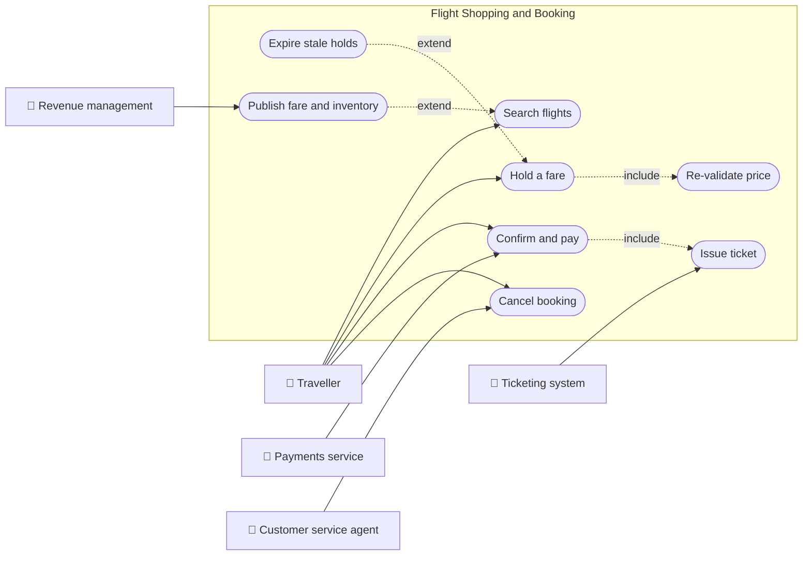
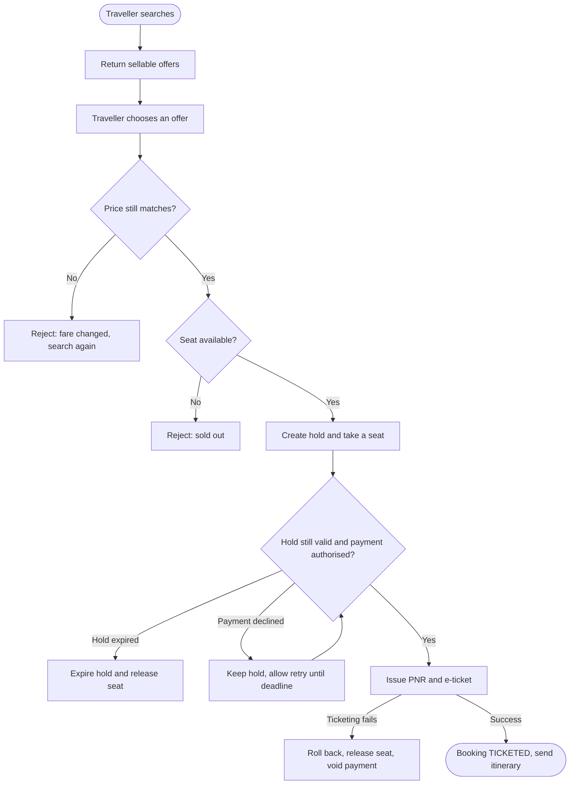
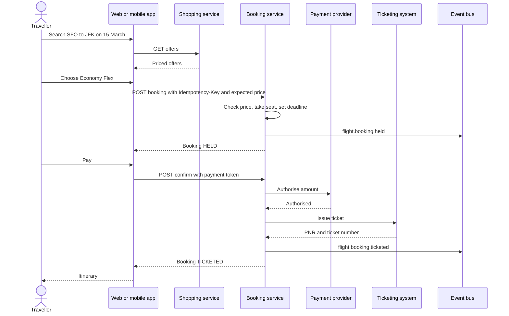
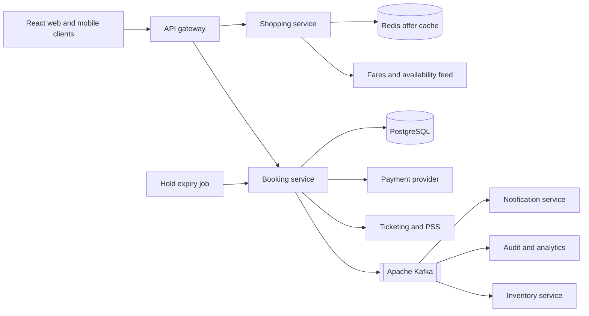
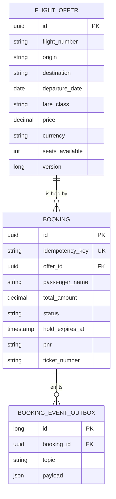
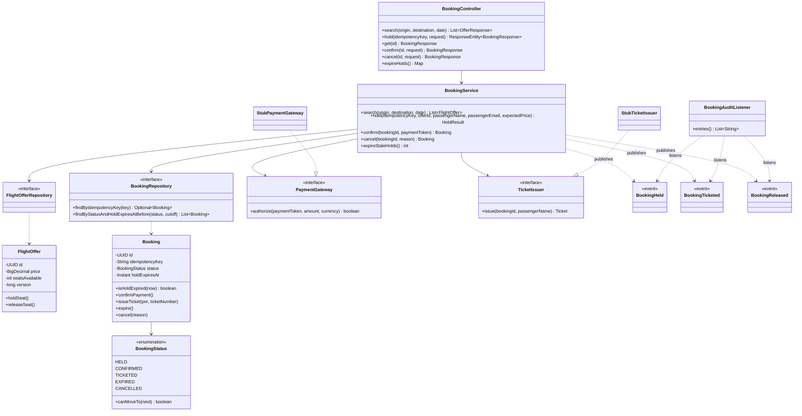
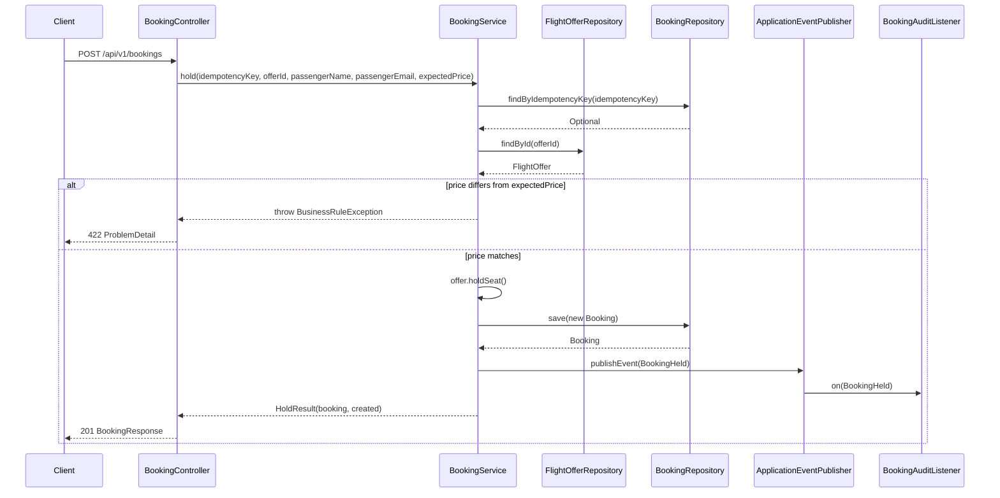
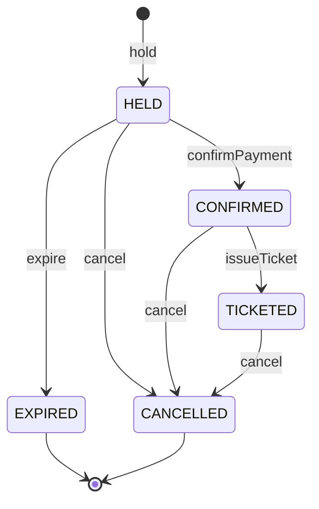
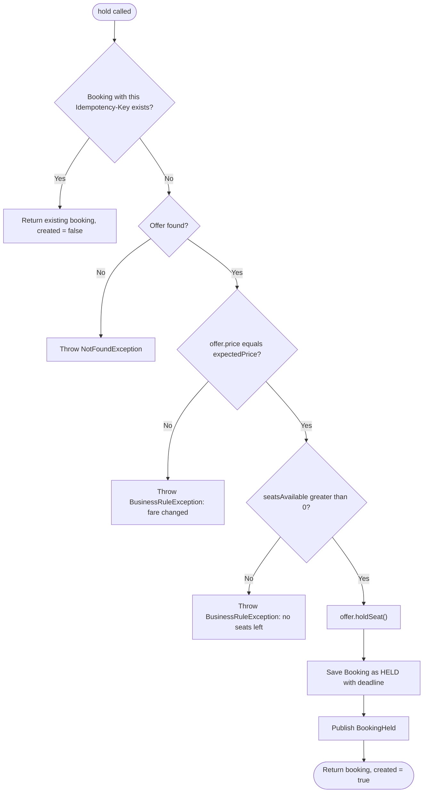

# Flight Shopping and Booking

> **Domain:** Airline and Travel · **Author:** [@naveenks720](https://github.com/naveenks720) · **Published:** October 20, 2026

> **Runnable code:** [`examples/airline/flight-shopping-and-booking`](https://github.com/dhulipalla599/domain-knowledge-engineering/tree/main/examples/airline/flight-shopping-and-booking)

## Explain It Like I'm Five

Imagine a bus with a limited number of seats and a ticket counter with a long line. You tell the clerk where you want to go, and the clerk shows you the seats that are still free and what each one costs. You point at one, and the clerk puts a sticky note with your name on that seat so nobody else grabs it while you dig out your coins. If you pay in time, the sticky note becomes a real ticket. If you take too long, the clerk peels the note off and the next kid in line can have the seat.

Flight shopping and booking is that counter: an airline shows what it can sell, holds a seat for a short time, and turns the hold into a ticket only when payment succeeds.

## Business Overview

Flight shopping is the search-and-compare step in which a traveller asks for flights between two airports on a date and receives priced options. Booking is the step that commits one of those options: inventory is reserved, the customer pays, and the airline issues a reservation record (a PNR) and an electronic ticket.

**Why the business cares**

- **Revenue:** almost all direct ticket revenue passes through this flow. Airlines sell the same seat at several fare levels, so showing the right fare at the right moment, and not losing the customer between search and payment, matters a great deal.
- **Risk:** selling a seat that does not exist (overbooking beyond the airline's deliberate policy), charging a different price from the one displayed, or taking payment without issuing a ticket all create refunds, compensation and complaints.
- **Regulation:** consumer-protection rules differ by country. Many markets require clear total-price display, and some regulators set rules on cancelling shortly after booking (for example, the United States has a 24-hour rule for certain tickets). Payment data falls under card-industry rules such as PCI DSS, and passenger data under privacy law such as GDPR where it applies. Treat the rules in this page as a teaching model and confirm specifics with your legal and compliance teams.
- **Customer experience:** shoppers compare many sites and apps, and speed and price accuracy decide who they buy from.

**Where it sits in the value chain**

```text
Schedule and fare planning -> Inventory and pricing -> Shopping -> Booking and payment -> Ticketing -> Check-in -> Flight operations -> Post-trip service and revenue accounting
```

Shopping and booking sit between "what we can sell" (schedules, fares, inventory) and "what we must deliver" (check-in, boarding, flying). Airlines sell through their own site and app, through travel agencies and online travel agencies, and through global distribution systems. The details of those channels and of the underlying reservation systems vary by airline.

## Real-World Example

Amara Osei lives in San Francisco and wants to visit her sister in New York on 15 March 2027. The airline in this story is the fictional **Dunmore Air** (code DK).

1. **Search.** Amara opens the Dunmore Air app and searches SFO to JFK for 15 March. The shopping service returns three sellable fares, cheapest first: DK101 Economy Saver at 289.00 USD, DK205 Economy Saver at 312.50 USD, and DK101 Economy Flex at 429.00 USD. A Business fare on DK310 is sold out, so it is hidden.
2. **Choice.** She picks the Flex fare because it allows changes. The app remembers the price she saw: 429.00 USD.
3. **Hold.** She enters her name and email and taps "Continue". The booking service checks that the fare still sells at 429.00 USD and that a seat remains, takes one seat out of inventory and creates a booking in state `HELD` with a 15-minute deadline. The app shows a countdown.
4. **Payment.** Her bank app asks for extra authentication. The first attempt with a mistyped code is declined. The booking stays `HELD` and the seat stays reserved until the deadline, so she retries.
5. **Ticketing.** The second attempt succeeds. The booking becomes `CONFIRMED`, the ticketing system issues PNR `DK1001` and e-ticket `0012000001001`, and the booking becomes `TICKETED`.
6. **After the sale.** A `flight.booking.ticketed` event triggers her itinerary email. Had she walked away, a sweep would have expired the hold at the deadline and returned the seat to sale.

## Stakeholders

| Stakeholder | What they need | What they fear |
|---|---|---|
| Traveller (Amara) | Fast, accurate search; the price shown is the price paid; a clear itinerary after payment | Price jumping at checkout, being charged without a ticket, losing the seat while paying |
| Revenue management | Seats sold at the intended fare level; inventory that matches the plan | Cheap fares left open after they should close; seats blocked by abandoned holds |
| Distribution and e-commerce | High search-to-book conversion; quick responses; reliable channels | Slow search, stale fares, checkout errors that lose sales |
| Payments and finance | Authorised, captured and reconciled payments; low chargebacks | Duplicate charges, captured money without a ticket, fraud |
| Ticketing and reservations operations | Every paid booking ends with a valid PNR and ticket | Orphaned bookings, mismatched records between systems |
| Customer service | A single, consistent booking record to look up and fix | Customers who paid but have no confirmation, unclear booking status |
| Compliance and legal | Correct price display, refund and cancellation rules, protected passenger and card data | Fines, mishandled personal data, misleading prices |
| Platform and SRE engineers | A service that scales for fare sales and recovers cleanly | Overselling under load, retry storms, silent event loss |

## Use Case Diagram



| Use Case | Primary Actor | Goal | Main success outcome |
|---|---|---|---|
| Search flights | Traveller | See priced options for a route and date | Sellable offers listed, cheapest first |
| Hold a fare | Traveller | Reserve a seat while completing details and payment | Booking in `HELD` with a deadline, one seat removed from inventory |
| Re-validate price | Booking service (included in Hold) | Make sure the fare shown is still on sale | Hold proceeds only if the price matches |
| Confirm and pay | Traveller | Pay for the held seat | Payment authorised and booking moves to `CONFIRMED` |
| Issue ticket | Ticketing system (included in Confirm) | Produce the PNR and e-ticket | Booking `TICKETED` with PNR and ticket number |
| Cancel booking | Traveller or customer service agent | Give up a hold or a ticketed booking | Booking `CANCELLED`, seat returned to inventory |
| Expire stale holds | Scheduler | Free seats whose payment window passed | Holds past the deadline become `EXPIRED` and seats are released |
| Publish fare and inventory | Revenue management | Keep offers and seat counts current | Fresh offers visible to search |

## Key Terms

| Term | Plain-English meaning |
|---|---|
| PNR (Passenger Name Record) | The reservation record for a trip, identified by a short locator such as `DK1001` |
| E-ticket | The electronic document proving the airline will carry the passenger, with a 13-digit ticket number |
| Fare class / booking class | A letter or label that groups seats sold at the same price and rules |
| Fare basis | The code describing a fare's rules, such as changes allowed or advance purchase |
| Inventory / availability | The number of seats still sellable in each fare class on a flight |
| Offer | A priced, bookable combination of flights and fare returned by search |
| Hold | A temporary reservation of a seat before payment, with a deadline (also called a time limit) |
| Time limit / TTL | The deadline by which payment must complete before the hold lapses |
| Ancillaries | Extras sold alongside the ticket, such as bags, seat selection and meals |
| GDS (Global Distribution System) | A shared network that travel agencies use to search and book many airlines |
| NDC (New Distribution Capability) | An IATA standard that lets airlines distribute richer offers directly through APIs |
| PSS (Passenger Service System) | The airline's core reservation, inventory and departure-control platform |

## Process Flow

Shopping starts when a traveller submits an origin, destination and date. The shopping service reads cached fares and availability and returns sellable offers. When the traveller chooses one, the booking service re-checks the price and inventory, creates a hold and starts a timer. Payment is then authorised. If payment succeeds, the ticketing system issues the PNR and e-ticket and the booking is final. If payment is declined the hold stays until its deadline so the traveller can retry. If the deadline passes, the hold expires and the seat goes back on sale. A traveller or agent can cancel at any point before departure, subject to fare rules.





## Business Rules and Edge Cases

- **Price must match what the customer saw.** Fares change continuously. The booking request carries the price the customer saw; if the current price differs, reject with a clear message instead of silently charging more or less. Whether to honour the old price for a short grace period is a business decision that varies by airline.
- **Never sell a seat twice.** Two shoppers can pick the last seat at the same moment. Inventory changes need either a lock or optimistic concurrency, and the loser must get a clear, retryable error.
- **Holds must expire.** A hold that never ends blocks inventory forever. The deadline is checked when the customer returns to pay, and a background sweep releases holds nobody came back to.
- **Idempotency.** Mobile networks retry. The same `Idempotency-Key` must return the same booking and take only one seat. The same applies to payment calls so a retry never charges twice.
- **Money uses exact decimals and a currency.** Never use floating point. Store amount and currency together, and keep the price agreed at hold time on the booking so later fare changes do not alter it. Taxes and fees are often itemised in real systems; this example keeps a single total.
- **Partial failure.** Payment can succeed and ticketing fail, or the reverse. Define the compensation: void or refund the payment, release the seat, and tell the customer. Reconcile regularly to find bookings stuck between states.
- **A declined payment is not the end.** Keep the hold until the deadline so the traveller can retry with another card.
- **Cancellation depends on fare rules.** Some fares refund, some only give a credit, and some regulators require a free cancellation window. Model the rule as data per fare, not as a hard-coded constant.
- **Time zones.** Departure times are local to the departure airport. Store the airport's zone or an offset and convert carefully; use an injectable clock for deadlines so they are testable.
- **Legal names and personal data.** The passenger name should match the travel document. Collect only the data you need and keep payment card data out of your own database by using provider tokens.
- **Stale search results.** Search is usually served from cache and is only an indication. Availability is authoritative only at hold time.

## From Business to System

| Business concept or step | System component | Data entity | Event |
|---|---|---|---|
| Search flights | Shopping service | `flight_offer` | none (read only) |
| Fare and seat inventory | Offer and inventory store (inside the booking service here) | `flight_offer.seats_available` | none in this example; an inventory service would publish inventory changes |
| Hold a fare | Booking service, `BookingService.hold` | `booking` (`HELD`) | `flight.booking.held` |
| Re-validate price | Booking service | `flight_offer.price` compared with the request | none (rejects with HTTP 422) |
| Pay | Payment adapter, `PaymentGateway` | `booking` (`CONFIRMED`), PSP reference in production | `payment.authorized` (production) |
| Issue ticket | Ticketing adapter, `TicketIssuer` | `booking.pnr`, `booking.ticket_number` (`TICKETED`) | `flight.booking.ticketed` |
| Cancel booking | Booking service, `BookingService.cancel` | `booking` (`CANCELLED`) | `flight.booking.released` |
| Expire stale hold | Scheduled sweep, `expireStaleHolds` | `booking` (`EXPIRED`) | `flight.booking.released` |
| Itinerary and notifications | Notification service | read model from events | consumes `flight.booking.ticketed` |
| Audit and reporting | Audit and analytics consumers | event log | consumes all booking topics |

## Architecture



The **shopping service** is read-heavy and tolerant of slightly stale data, so it scales separately and serves from a cache fed by the fares and availability system. The **booking service** owns the money-and-inventory transaction: it is the only writer of bookings, and it re-validates price and seat count against the source of truth at hold time. External systems (payment provider and the ticketing system or PSS) sit behind adapters so they can be replaced, retried and faked in tests. **Kafka** carries facts about what happened, so notification, audit and inventory consumers evolve without changing the booking service. The expiry job is a separate trigger that calls the same service code, so there is one place that knows how to release a seat.

## Data Model

```sql
CREATE TABLE flight_offer (
    id              UUID PRIMARY KEY,
    flight_number   TEXT         NOT NULL,
    origin          CHAR(3)      NOT NULL,
    destination     CHAR(3)      NOT NULL,
    departure_date  DATE         NOT NULL,
    departure_time  TIME         NOT NULL,
    fare_class      TEXT         NOT NULL,
    price           NUMERIC(12,2) NOT NULL CHECK (price > 0),
    currency        CHAR(3)      NOT NULL,
    seats_available INTEGER      NOT NULL CHECK (seats_available >= 0),
    version         BIGINT       NOT NULL DEFAULT 0
);
CREATE INDEX idx_offer_search ON flight_offer (origin, destination, departure_date);

CREATE TABLE booking (
    id               UUID PRIMARY KEY,
    idempotency_key  TEXT         NOT NULL UNIQUE,
    offer_id         UUID         NOT NULL REFERENCES flight_offer (id),
    passenger_name   TEXT         NOT NULL,
    passenger_email  TEXT         NOT NULL,
    total_amount     NUMERIC(12,2) NOT NULL,
    currency         CHAR(3)      NOT NULL,
    status           TEXT         NOT NULL CHECK (status IN ('HELD','CONFIRMED','TICKETED','EXPIRED','CANCELLED')),
    hold_expires_at  TIMESTAMPTZ  NOT NULL,
    pnr              CHAR(6),
    ticket_number    TEXT,
    status_reason    TEXT,
    created_at       TIMESTAMPTZ  NOT NULL
);
CREATE INDEX idx_booking_hold_sweep ON booking (status, hold_expires_at);

CREATE TABLE booking_event_outbox (
    id           BIGSERIAL PRIMARY KEY,
    booking_id   UUID        NOT NULL REFERENCES booking (id),
    topic        TEXT        NOT NULL,
    payload      JSONB       NOT NULL,
    created_at   TIMESTAMPTZ NOT NULL DEFAULT now(),
    published_at TIMESTAMPTZ
);
```

The example itself keeps the first two tables (created by Hibernate on H2) and publishes events in process; the outbox table shows how production would publish to Kafka reliably. A fuller model would add `passenger`, `payment` and `itinerary_segment` tables.



## APIs

| Method | Path | Purpose |
|---|---|---|
| GET | `/api/v1/offers?origin=&destination=&date=` | Search sellable offers, cheapest first |
| POST | `/api/v1/bookings` | Hold a fare; requires an `Idempotency-Key` header |
| GET | `/api/v1/bookings/{id}` | Read a booking |
| POST | `/api/v1/bookings/{id}/confirm` | Pay and issue the ticket |
| POST | `/api/v1/bookings/{id}/cancel` | Cancel a hold or a ticketed booking |
| POST | `/api/v1/admin/expire-holds` | Run the expiry sweep (operational) |

Status codes: `201` new hold, `200` replay of the same key, `404` unknown id, `409` illegal state change or concurrent seat race, `422` broken business rule (stale fare, sold out, expired hold, declined payment).

Hold a fare:

```json
POST /api/v1/bookings
Idempotency-Key: demo-001

{
  "offerId": "aaaaaaaa-0000-0000-0000-000000000002",
  "passengerName": "Amara Osei",
  "passengerEmail": "amara@example.com",
  "expectedPrice": 429.00
}
```

```json
HTTP/1.1 201

{
  "id": "88a61c65-0ebf-4044-83d8-1dc1eadfb1d1",
  "offerId": "aaaaaaaa-0000-0000-0000-000000000002",
  "passengerName": "Amara Osei",
  "totalAmount": 429.00,
  "currency": "USD",
  "status": "HELD",
  "holdExpiresAt": "2026-10-20T15:20:47.611500503Z",
  "pnr": null,
  "ticketNumber": null,
  "statusReason": null
}
```

## Events

| Event | Producer | Consumers | Key fields |
|---|---|---|---|
| `flight.booking.held` (`BookingHeld`) | Booking service | Audit, analytics, inventory service | `bookingId`, `offerId`, `amount`, `currency`, `occurredAt` |
| `flight.booking.ticketed` (`BookingTicketed`) | Booking service | Notification service, audit, revenue accounting | `bookingId`, `pnr`, `ticketNumber`, `occurredAt` |
| `flight.booking.released` (`BookingReleased`) | Booking service | Inventory service, notification, audit | `bookingId`, `finalStatus` (`EXPIRED` or `CANCELLED`), `reason`, `occurredAt` |

**Ordering.** Use `bookingId` as the Kafka message key so all events for one booking land on one partition and stay in order. Order across different bookings is not guaranteed and should not be needed.

**Idempotency.** Kafka delivers at least once, so consumers must tolerate duplicates: record the processed event id or make the effect naturally repeatable (sending an itinerary email twice is a visible duplicate, so deduplicate on `bookingId` plus event type).

**Reliability.** Publish through a transactional outbox (as in the data model) so a committed booking is never missing its event and a rolled-back one never leaks an event. In the example, Spring's in-process events stand in for this.

## Backend Implementation

> The Java tab is the exact code from the runnable example (Spring Boot 3). The Python tab uses FastAPI with SQLAlchemy and the Node.js tab uses Express with TypeScript, written to apply the same logic, names and rules.

Full source: [`examples/airline/flight-shopping-and-booking`](https://github.com/dhulipalla599/domain-knowledge-engineering/tree/main/examples/airline/flight-shopping-and-booking).

### The rule: a replay-safe, price-checked hold

=== "Java"

    ```java
    /**
     * Key business rule: replay-safe hold. The same Idempotency-Key returns the same booking, the fare the
     * customer saw must still be the fare on sale, and a seat is taken from inventory in the same transaction.
     */
    @Transactional
    public HoldResult hold(String idempotencyKey, UUID offerId, String passengerName, String passengerEmail,
                           BigDecimal expectedPrice) {
        var existing = bookings.findByIdempotencyKey(idempotencyKey);
        if (existing.isPresent()) {
            return new HoldResult(existing.get(), false);
        }
        var offer = offers.findById(offerId).orElseThrow(() -> new NotFoundException("Offer", offerId));
        if (offer.getPrice().compareTo(expectedPrice) != 0) {
            throw new BusinessRuleException("Fare changed from " + expectedPrice + " to " + offer.getPrice()
                    + " " + offer.getCurrency() + "; search again to confirm the new price");
        }
        try {
            offer.holdSeat();
        } catch (IllegalStateException e) {
            throw new BusinessRuleException(e.getMessage());
        }
        Instant now = Instant.now(clock);
        var booking = bookings.save(new Booking(idempotencyKey, offerId, passengerName, passengerEmail,
                offer.getPrice(), offer.getCurrency(), now, now.plus(HOLD_DURATION)));
        events.publishEvent(new BookingHeld(booking.getId(), offerId, booking.getTotalAmount(),
                booking.getCurrency(), now));
        return new HoldResult(booking, true);
    }
    ```

=== "Python"

    ```python
    HOLD_DURATION = timedelta(minutes=15)


    def hold(db: Session, events: EventPublisher, clock: Callable[[], datetime],
             idempotency_key: str, offer_id: UUID, passenger_name: str,
             passenger_email: str, expected_price: Decimal) -> tuple[Booking, bool]:
        """Replay-safe hold: same key -> same booking; price must match; take a seat atomically."""
        existing = db.scalar(select(Booking).where(Booking.idempotency_key == idempotency_key))
        if existing:
            return existing, False
        offer = db.get(FlightOffer, offer_id)
        if offer is None:
            raise NotFoundError(f"Offer {offer_id} not found")
        if offer.price != expected_price:
            raise BusinessRuleError(
                f"Fare changed from {expected_price} to {offer.price} {offer.currency}; "
                "search again to confirm the new price")
        # Optimistic locking: version_id_col on FlightOffer makes a lost race raise StaleDataError (HTTP 409).
        if offer.seats_available <= 0:
            raise BusinessRuleError(f"No seats left on {offer.flight_number} in fare {offer.fare_class}")
        offer.seats_available -= 1
        now = clock()
        booking = Booking(idempotency_key=idempotency_key, offer_id=offer_id,
                          passenger_name=passenger_name, passenger_email=passenger_email,
                          total_amount=offer.price, currency=offer.currency,
                          status=BookingStatus.HELD, created_at=now,
                          hold_expires_at=now + HOLD_DURATION)
        db.add(booking)
        db.flush()
        events.publish("flight.booking.held", booking.id,
                       {"offerId": str(offer_id), "amount": str(booking.total_amount), "currency": booking.currency})
        return booking, True
    ```

=== "Node.js"

    ```typescript
    const HOLD_DURATION_MS = 15 * 60 * 1000;

    export async function hold(
      tx: Tx, events: EventPublisher, clock: () => Date,
      idempotencyKey: string, offerId: string, passengerName: string,
      passengerEmail: string, expectedPrice: Decimal,
    ): Promise<{ booking: Booking; created: boolean }> {
      // Replay-safe: the same Idempotency-Key returns the same booking.
      const existing = await tx.booking.findUnique({ where: { idempotencyKey } });
      if (existing) return { booking: existing, created: false };

      const offer = await tx.flightOffer.findUnique({ where: { id: offerId } });
      if (!offer) throw new NotFoundError(`Offer ${offerId} not found`);
      if (!offer.price.equals(expectedPrice)) {
        throw new BusinessRuleError(
          `Fare changed from ${expectedPrice} to ${offer.price} ${offer.currency}; search again to confirm the new price`);
      }
      // Conditional update on version: a lost race for the last seat updates 0 rows -> HTTP 409.
      const taken = await tx.flightOffer.updateMany({
        where: { id: offerId, version: offer.version, seatsAvailable: { gt: 0 } },
        data: { seatsAvailable: { decrement: 1 }, version: { increment: 1 } },
      });
      if (taken.count === 0) {
        if (offer.seatsAvailable <= 0) {
          throw new BusinessRuleError(`No seats left on ${offer.flightNumber} in fare ${offer.fareClass}`);
        }
        throw new ConcurrencyError("Inventory changed concurrently; retry the request");
      }
      const now = clock();
      const booking = await tx.booking.create({
        data: {
          idempotencyKey, offerId, passengerName, passengerEmail,
          totalAmount: offer.price, currency: offer.currency, status: "HELD",
          createdAt: now, holdExpiresAt: new Date(now.getTime() + HOLD_DURATION_MS),
        },
      });
      await events.publish("flight.booking.held", booking.id,
        { offerId, amount: booking.totalAmount.toString(), currency: booking.currency });
      return { booking, created: true };
    }
    ```

### The endpoint that calls it

=== "Java"

    ```java
    @PostMapping("/bookings")
    public ResponseEntity<BookingResponse> hold(@RequestHeader("Idempotency-Key") String idempotencyKey,
                                                @Valid @RequestBody HoldRequest request) {
        var result = service.hold(idempotencyKey, request.offerId(), request.passengerName(),
                request.passengerEmail(), request.expectedPrice());
        // 201 for a new hold, 200 when the same Idempotency-Key is replayed.
        var status = result.created() ? HttpStatus.CREATED : HttpStatus.OK;
        return ResponseEntity.status(status).body(BookingResponse.from(result.booking()));
    }
    ```

=== "Python"

    ```python
    @router.post("/api/v1/bookings", response_model=BookingResponse)
    def hold_endpoint(body: HoldRequest, response: Response,
                      idempotency_key: str = Header(alias="Idempotency-Key"),
                      db: Session = Depends(get_db)):
        booking, created = hold(db, events, utc_now, idempotency_key, body.offer_id,
                                body.passenger_name, body.passenger_email, body.expected_price)
        # 201 for a new hold, 200 when the same Idempotency-Key is replayed.
        response.status_code = 201 if created else 200
        return BookingResponse.from_orm_booking(booking)
    ```

=== "Node.js"

    ```typescript
    router.post("/api/v1/bookings", async (req, res, next) => {
      try {
        const key = req.header("Idempotency-Key");
        if (!key) return res.status(400).json({ detail: "Idempotency-Key header is required" });
        const body = HoldRequestSchema.parse(req.body); // zod validation
        const { booking, created } = await prisma.$transaction((tx) =>
          hold(tx, events, () => new Date(), key, body.offerId, body.passengerName,
               body.passengerEmail, new Decimal(body.expectedPrice)));
        // 201 for a new hold, 200 when the same Idempotency-Key is replayed.
        res.status(created ? 201 : 200).json(toBookingResponse(booking));
      } catch (e) {
        next(e); // error middleware maps BusinessRuleError -> 422, ConcurrencyError -> 409
      }
    });
    ```

## Frontend Screen

A checkout screen that shows the hold countdown and sends the payment token. It carries the price the customer saw and generates one `Idempotency-Key` per attempt so retries are safe.

```tsx
import { useEffect, useMemo, useState } from "react";

type Offer = { offerId: string; flightNumber: string; fareClass: string; price: number; currency: string };
type Booking = { id: string; status: string; holdExpiresAt: string; pnr: string | null };

export function Checkout({ offer }: { offer: Offer }) {
  const idempotencyKey = useMemo(() => crypto.randomUUID(), []);
  const [booking, setBooking] = useState<Booking | null>(null);
  const [error, setError] = useState<string | null>(null);
  const [secondsLeft, setSecondsLeft] = useState(0);

  async function call(path: string, body: unknown, headers: Record<string, string> = {}) {
    const res = await fetch(`/api/v1${path}`, {
      method: "POST",
      headers: { "Content-Type": "application/json", ...headers },
      body: JSON.stringify(body),
    });
    const data = await res.json();
    if (!res.ok) throw new Error(data.detail ?? "Something went wrong");
    return data as Booking;
  }

  async function hold() {
    setError(null);
    try {
      setBooking(await call("/bookings",
        { offerId: offer.offerId, passengerName: "Amara Osei", passengerEmail: "amara@example.com",
          expectedPrice: offer.price },
        { "Idempotency-Key": idempotencyKey }));
    } catch (e) {
      setError((e as Error).message);
    }
  }

  async function pay() {
    if (!booking) return;
    setError(null);
    try {
      setBooking(await call(`/bookings/${booking.id}/confirm`, { paymentToken: "tok_visa" }));
    } catch (e) {
      setError((e as Error).message);
    }
  }

  useEffect(() => {
    if (booking?.status !== "HELD") return;
    const tick = () => setSecondsLeft(Math.max(0,
      Math.round((new Date(booking.holdExpiresAt).getTime() - Date.now()) / 1000)));
    tick();
    const timer = setInterval(tick, 1000);
    return () => clearInterval(timer);
  }, [booking]);

  return (
    <section aria-live="polite">
      <h2>{offer.flightNumber} · {offer.fareClass}</h2>
      <p>{offer.price.toFixed(2)} {offer.currency}</p>
      {!booking && <button onClick={hold}>Continue</button>}
      {booking?.status === "HELD" && (
        <>
          <p>Seat held for {Math.floor(secondsLeft / 60)}:{String(secondsLeft % 60).padStart(2, "0")}</p>
          <button onClick={pay} disabled={secondsLeft === 0}>Pay {offer.price.toFixed(2)} {offer.currency}</button>
        </>
      )}
      {booking?.status === "TICKETED" && <p>Confirmed. Your booking reference is {booking.pnr}.</p>}
      {error && <p role="alert">{error}</p>}
    </section>
  );
}
```

## Cloud Deployment

On AWS the booking and shopping services run as separate Deployments on **Amazon EKS**, behind an Application Load Balancer and Amazon API Gateway or an ingress controller. State lives in managed services:

- **Amazon RDS for PostgreSQL** (Multi-AZ) for bookings and offers.
- **Amazon MSK** for Apache Kafka topics.
- **Amazon ElastiCache for Redis** for the shopping offer cache.
- **AWS Secrets Manager** for payment-provider and database credentials.
- **Amazon ECR** for container images.

A minimal Terraform snippet for the most important resource, the booking database:

```hcl
resource "aws_db_instance" "booking" {
  identifier                  = "flight-booking"
  engine                      = "postgres"
  engine_version              = "16"
  instance_class              = "db.r6g.large"
  allocated_storage           = 100
  storage_encrypted           = true
  multi_az                    = true
  db_name                     = "booking"
  username                    = "booking_admin"
  manage_master_user_password = true
  db_subnet_group_name        = aws_db_subnet_group.private.name
  vpc_security_group_ids      = [aws_security_group.booking_db.id]
  backup_retention_period     = 14
  deletion_protection         = true
  performance_insights_enabled = true
}
```

**Security.** Run pods in private subnets; allow database access only from the booking service's security group; use IAM Roles for Service Accounts instead of static keys; encrypt in transit and at rest. Never store card numbers: keep only the payment provider's token, which keeps most of the system out of PCI DSS scope. Treat passenger names and emails as personal data with retention limits.

**Scaling.** Scale the shopping service on request rate (Horizontal Pod Autoscaler), since searches far outnumber bookings during sales. Scale the booking service on CPU and latency, and keep database writes efficient by indexing the search and hold-sweep queries. Use a connection pool and set a Kafka consumer group per downstream service.

**Observability.** Instrument services with the OpenTelemetry SDK, export traces and metrics through the OpenTelemetry Collector to Amazon CloudWatch (traces via AWS X-Ray, metrics and logs in CloudWatch). Track search latency, hold success rate, `Fare changed` rejections, sold-out rejections, payment decline rate, hold expiry rate, time from payment to ticket, and Kafka consumer lag. Alarm on bookings stuck in `CONFIRMED` for more than a few minutes, which signals ticketing failures.

## Non-Functional Requirements

| Area | Expectation | How the design meets it |
|---|---|---|
| Availability | Shopping and booking are revenue paths; aim for high availability across zones (the exact target is a business decision) | Stateless services on EKS across zones, Multi-AZ PostgreSQL, search degrades to cache if the fares feed is down |
| Latency | Search should feel instant; hold and confirm should be quick but can take longer than search | Search served from cache; booking does one short transaction; payment and ticketing are the slow external calls |
| Consistency | Never oversell; never double charge | Inventory change and booking row in one database transaction with optimistic locking; idempotency keys on hold and on the payment call |
| Durability | A paid booking is never lost | PostgreSQL with backups and point-in-time recovery; outbox for events |
| Audit | Who held, paid, ticketed or cancelled and when | Immutable event log on Kafka and `status_reason` on the booking |
| Compliance | Payment-card and personal-data protection; correct price display | Provider tokens only, encryption, retention rules, price re-validated at hold time |
| Resilience | External outages must not corrupt state | Adapters with timeouts and retries; compensation (void payment, release seat) on ticketing failure; reconciliation job |

## Runnable Example

The example is a Spring Boot 3 / Java 21 service using an in-memory H2 database and no external services. It implements fare search, an idempotent and price-checked hold that takes a seat from inventory, payment and ticketing behind stub adapters, cancellation, hold expiry, optimistic locking for the last seat, and three domain events published with `ApplicationEventPublisher` and consumed by an `@EventListener` that stands in for Kafka consumers.

Source: [`examples/airline/flight-shopping-and-booking`](https://github.com/dhulipalla599/domain-knowledge-engineering/tree/main/examples/airline/flight-shopping-and-booking)

```bash
cd examples/airline/flight-shopping-and-booking
mvn -B -ntp verify           # build and run tests
mvn spring-boot:run          # start on http://localhost:8080
```

Happy path (HTTP 201):

```bash
curl -s -X POST localhost:8080/api/v1/bookings \
  -H 'Content-Type: application/json' -H 'Idempotency-Key: demo-001' \
  -d '{"offerId":"aaaaaaaa-0000-0000-0000-000000000002","passengerName":"Amara Osei","passengerEmail":"amara@example.com","expectedPrice":429.00}'
```

```json
{"id":"88a61c65-0ebf-4044-83d8-1dc1eadfb1d1","offerId":"aaaaaaaa-0000-0000-0000-000000000002","passengerName":"Amara Osei","totalAmount":429.00,"currency":"USD","status":"HELD","holdExpiresAt":"2026-10-20T15:20:47.611500503Z","pnr":null,"ticketNumber":null,"statusReason":null}
```

Rule violation, a stale fare (HTTP 422):

```bash
curl -s -X POST localhost:8080/api/v1/bookings \
  -H 'Content-Type: application/json' -H 'Idempotency-Key: demo-002' \
  -d '{"offerId":"aaaaaaaa-0000-0000-0000-000000000002","passengerName":"Amara Osei","passengerEmail":"amara@example.com","expectedPrice":399.00}'
```

```json
{"type":"about:blank","title":"Unprocessable Entity","status":422,"detail":"Fare changed from 399.00 to 429.00 USD; search again to confirm the new price","instance":"/api/v1/bookings"}
```

| Class | Package | Responsibility |
|---|---|---|
| `Booking` | `domain` | Entity that owns the lifecycle and rejects illegal transitions |
| `BookingStatus` | `domain` | Lifecycle enum with `canMoveTo()` |
| `FlightOffer` | `domain` | Fare and seat inventory with `holdSeat()` and `releaseSeat()`; `@Version` for optimistic locking |
| `BookingEvents` | `domain` | `BookingHeld`, `BookingTicketed`, `BookingReleased` records and Kafka topic names |
| `FlightOfferRepository` | `repository` | Search query for sellable offers |
| `BookingRepository` | `repository` | Idempotency lookup and stale-hold query |
| `BookingService` | `service` | `search`, `hold`, `confirm`, `cancel`, `expireStaleHolds` and the business rules |
| `BusinessRuleException` | `service` | Rule violation, mapped to HTTP 422 |
| `NotFoundException` | `service` | Missing offer or booking, mapped to HTTP 404 |
| `BookingController` | `api` | REST endpoints under `/api/v1` |
| `ApiExceptionHandler` | `api` | Maps exceptions to `ProblemDetail` (422, 404, 409) |
| `HoldRequest`, `ConfirmRequest`, `CancelRequest` | `api` | Validated request records |
| `OfferResponse`, `BookingResponse` | `api` | Response records |
| `PaymentGateway`, `StubPaymentGateway` | `integration` | Payment port and a stub that declines only `tok_declined` |
| `TicketIssuer`, `StubTicketIssuer` | `integration` | Ticketing port and a deterministic PNR generator |
| `BookingAuditListener` | `integration` | `@EventListener` consumer that records every event |
| `ClockConfig` | `integration` | Injectable `Clock` so deadlines are testable |

## UML Diagrams

### Class Diagram

The controller calls the service, which uses two repositories, two ports and the event publisher. `Booking` and `FlightOffer` hold the rules that protect their own state, and `BookingAuditListener` consumes the events.



### Sequence Diagram (control flow)

One hold request travels from the controller to the service, which checks idempotency and price, takes a seat and saves the booking, then publishes `BookingHeld` to the listener. A price mismatch ends in `BusinessRuleException`, which the exception handler turns into HTTP 422.



### State Diagram

A booking starts `HELD`. Payment moves it to `CONFIRMED`, ticketing to `TICKETED`. `EXPIRED` and `CANCELLED` are terminal, and `BookingStatus.canMoveTo` rejects every other move.



### Activity Diagram

The decision logic inside `BookingService.hold`: replay check, offer lookup, price comparison, seat check, then persist and publish.



## AI Opportunities

1. **Price and demand forecasting for fare display.** Use: predict which fares will sell out or change so the shop can advise "price likely to rise" or order results sensibly. Data: historical searches, bookings, fare changes, seasonality, events. Risk: customers act on predictions, so accuracy claims must be honest, and regulators in some markets scrutinise misleading urgency messages. Do not show advice you cannot back with evidence, and monitor calibration over time.
2. **Personalised ranking of search results.** Use: order options by what a traveller is likely to value (price, duration, stops, loyalty status). Data: past choices, preferences, session context. Risk: bias or favouring higher-margin options without disclosure; protect personal data and make sure the cheapest legitimate option is never hidden. Keep an explanation of the ranking and test it against a fairness review.
3. **Conversational booking assistant (LLM agent).** Use: let a traveller say "cheapest morning flight to New York next Friday" and have an agent call the search and hold APIs. Data: the shopping API, fare rules, customer profile. Risk: hallucinated fares or policies and unintended purchases. Constrain the agent to call real APIs, quote only returned data, require explicit customer confirmation before payment, and log every tool call for audit.
4. **Fraud and abuse detection at checkout.** Use: score bookings for stolen cards, bots that hoard seats with repeated holds, or scraping. Data: device and network signals, booking velocity, payment outcomes. Risk: false positives block genuine customers and may disadvantage groups. Keep a human review path, measure false-positive rates by segment, and keep explanations available for disputes.
5. **Disruption-aware rebooking suggestions.** Use: when a flight is cancelled, propose the best alternative itineraries. Data: live inventory, passenger needs, connection rules. Risk: suggesting invalid or non-compliant options. Validate every suggestion through the same hold rules and regulatory compensation checks before it is offered.

## Common Pitfalls

- **Trusting search results at booking time.** Search is cached and may be stale. Re-validate price and inventory when holding, and return a clear error if they changed.
- **No expiry on holds.** Abandoned carts quietly drain inventory. Always set a deadline, check it on payment, and run a sweep.
- **Check-then-act on seat counts.** Reading seats and then decrementing in separate steps lets two buyers take the last seat. Use optimistic locking, a conditional update or a database constraint.
- **Floating-point money or missing currency.** Use exact decimals and always carry the currency code.
- **Charging before the seat is safe, or ticketing before payment.** Order the steps deliberately and define compensation for each partial failure.
- **Missing idempotency.** Retries on a flaky mobile network will double-book or double-charge. Require an idempotency key on hold and on payment.
- **Letting arbitrary state changes through.** Enforce the booking lifecycle inside the domain class so no code path can ticket a cancelled booking.
- **Ignoring time zones.** Departure times are local to the departure airport; store the zone and convert deliberately.
- **Hard-coding refund and change rules.** They differ by fare and market; make them data.
- **Assuming one universal distribution model.** Airlines sell through direct channels, agencies and GDS or NDC connections, each with different timing and data. Ask which channel you are building for.
- **Storing card numbers.** Keep only the provider's token.

## Interview Questions

### Junior

1. **What is a PNR and how is it different from a ticket?**
   A PNR is the reservation record that groups the passengers, flights and contact details of a trip and is identified by a short locator. A ticket (e-ticket) is the document that proves the airline agreed to carry a passenger and is what is actually paid for. A booking can have a PNR before it is ticketed, which is why a held booking has no ticket number yet.
2. **Why does the booking API take an `Idempotency-Key`?**
   Networks fail and clients retry. With the key, a repeated request returns the original result instead of creating a second booking or taking a second seat. The server stores the key with the booking and checks it first.
3. **Why is `BigDecimal` used for money instead of `double`?**
   Binary floating point cannot represent many decimal amounts exactly, which causes rounding errors. `BigDecimal` keeps exact decimal values, and the amount is stored with its currency.

### Mid-Level

1. **Two customers try to buy the last seat at the same time. How do you stop an oversell?**
   Make the inventory change atomic. Options include optimistic locking with a version column (the loser gets a conflict and retries), a conditional `UPDATE ... WHERE seats_available > 0`, or a row lock. Return a clear retryable error to the loser and keep the seat decrement in the same transaction as the booking insert.
2. **A customer is charged but ticketing fails. What should happen?**
   The system should compensate: void or refund the payment, release the seat, mark the booking failed with a reason and tell the customer. Make each step idempotent, record state so a reconciliation job can find stuck bookings, and alert on bookings sitting in `CONFIRMED` too long.
3. **What happens to the seat when the customer never pays?**
   The hold has a deadline. If the customer returns after it, the confirm call expires the hold, releases the seat and returns an error. A scheduled sweep expires holds nobody returned to. Both paths publish a release event so other systems update.

### Senior / Architect

1. **Design the system so search stays fast during a fare sale while bookings stay correct.**
   Key points: separate read-heavy shopping from the booking write path; serve search from a cache fed by the fares and availability system and accept staleness; make hold the authoritative check for price and inventory; scale each part independently; protect the database with connection pooling and queueing; define behaviour when the cache disagrees with inventory; measure the "fare changed" and sold-out rates to tune cache freshness.
2. **How would you keep the booking database and Kafka consistent?**
   Key points: avoid dual writes; use a transactional outbox written in the same transaction as the booking and a relay (or change data capture) that publishes to Kafka; key by booking id for ordering; at-least-once delivery with idempotent consumers; monitor outbox lag; consider the trade-off of extra latency against guaranteed delivery.
3. **Your airline sells through its own app, agencies and GDS or NDC partners. How do you design the booking domain to support all channels?**
   Key points: one booking core with channel-specific adapters at the edge; canonical offer and order model; channel-specific pricing and commission rules as data; consistent idempotency and hold semantics; contract tests for each partner; clear ownership of the source of truth (PSS versus booking service) and reconciliation between them; versioned APIs and events.

## Further Learning

- IATA NDC (New Distribution Capability) standard
- IATA ONE Order concept
- GDS booking flows (Amadeus, Sabre, Travelport) and PNR structure
- Fare construction, fare basis codes and booking classes
- Airline revenue management and inventory control
- PCI DSS for payment data and tokenisation
- 3-D Secure and Strong Customer Authentication (PSD2)
- Idempotency keys, the transactional outbox pattern and Kafka delivery semantics

## Practitioner Notes

> _Reviewer: add real-world experience, corrections or gotchas here before approving._
