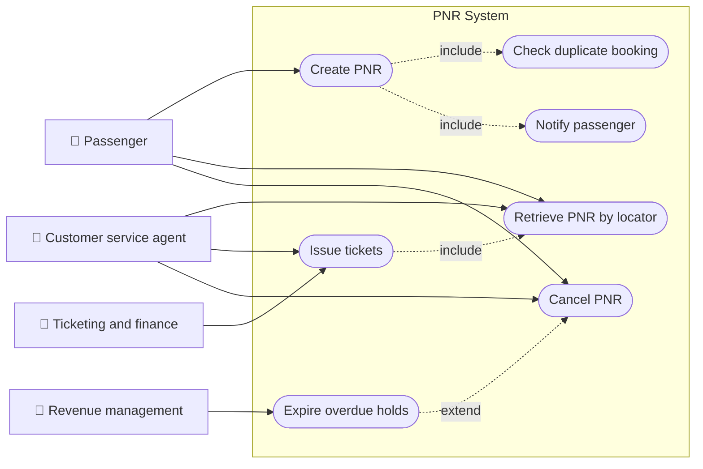
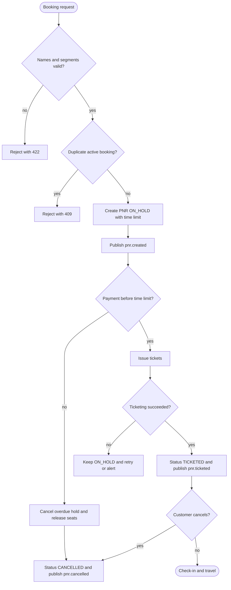
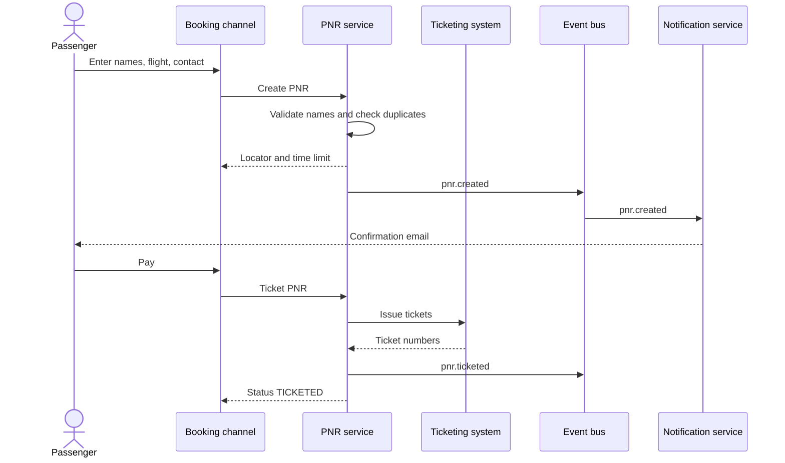
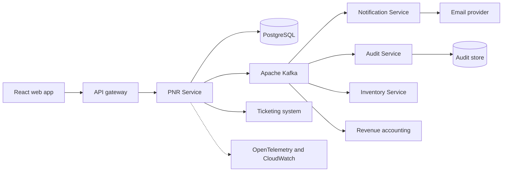
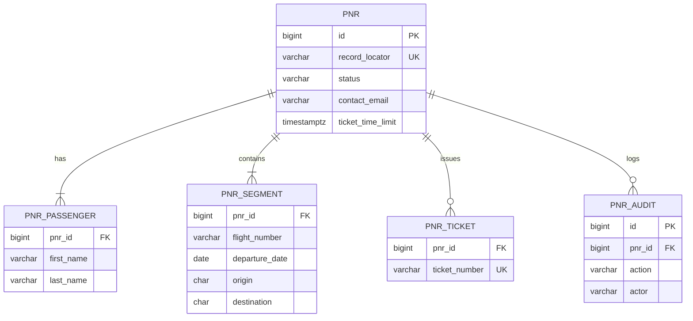
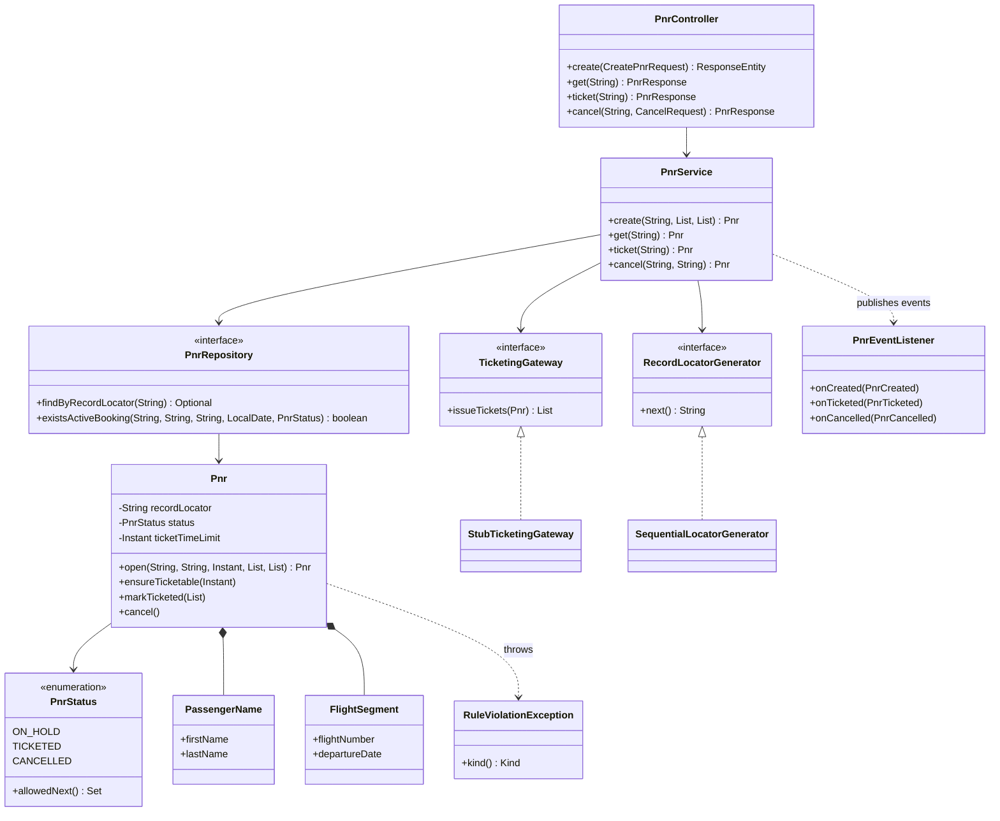
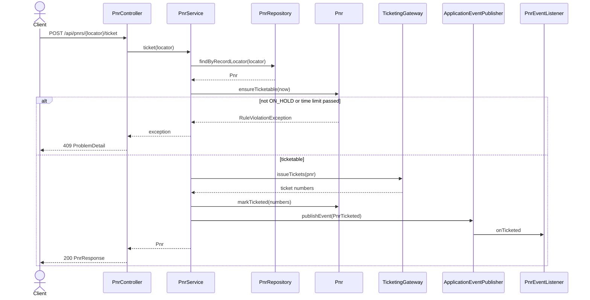
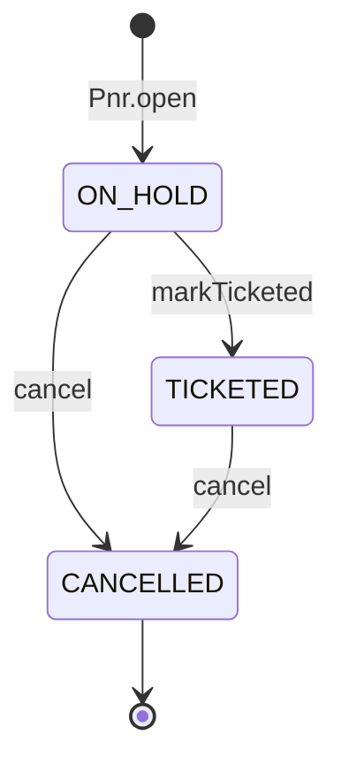
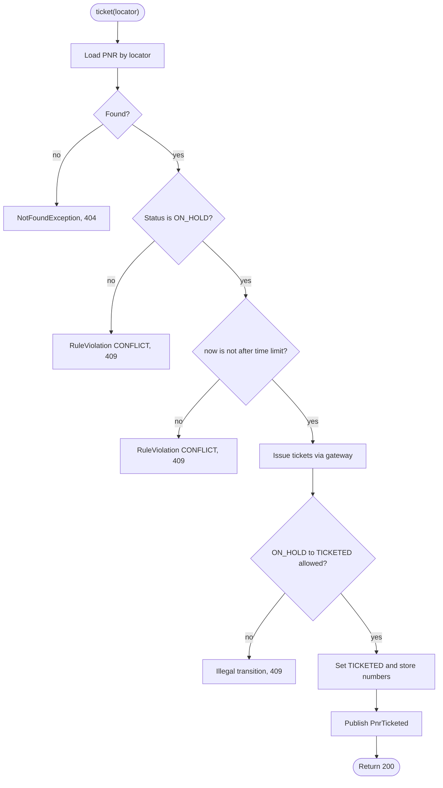

# Passenger Name Record (PNR)

> **Domain:** Airline and Travel · **Author:** [@naveenks720](https://github.com/naveenks720) · **Published:** November 03, 2026

> **Runnable code:** [`examples/airline/passenger-name-record-pnr`](https://github.com/dhulipalla599/domain-knowledge-engineering/tree/main/examples/airline/passenger-name-record-pnr)

## Explain It Like I'm Five

Imagine you are going on a school trip and the teacher keeps one folder for your whole group. Inside the folder is a sheet with everyone's name, the bus you are taking, and a phone number to call if something changes. Anyone who needs to know about your trip, like the bus driver or the lunch helper, looks at the same folder instead of asking you again. The teacher gives the folder a short code, and if you say the code, everybody finds your page straight away. If you do not hand in your permission slip by Friday, the teacher puts the folder back and gives your seat to someone else.

A Passenger Name Record (PNR) is that folder: one shared booking record, found by a short code, that holds who is travelling, on which flights, how to reach them, and a deadline to pay.

## Business Overview

A PNR is the airline industry's standard record of a booking. It groups one or more passengers travelling together with their flight segments, contact details, special requests (meals, assistance), ticketing status and a history of changes. It is identified by a record locator, a short alphanumeric reference (commonly six characters) that customers see as their "booking reference" or "confirmation code".

**Why the business cares**

- **Revenue:** the PNR links a held seat to a ticket. Held-but-unticketed PNRs block inventory, so time limits that release unpaid seats directly affect how many seats can be resold. Ancillary sales (bags, seats, meals) attach to the PNR.
- **Risk:** duplicate bookings, names that do not match travel documents, and tickets issued on a stale record cause denied boarding, change fees and manual rework.
- **Regulation:** many countries require airlines to send passenger data to border authorities before arrival, and passenger data is personal data under laws such as GDPR where it applies. Exact fields, timing and retention differ by country and by airline, so treat this page as a teaching model and confirm requirements with compliance teams.
- **Customer experience:** the PNR is what the website, app, call centre, airport agent and partner airline all read. If it is wrong or slow, every channel is wrong or slow.

**Where it sits in the value chain**

```text
Schedules and fares -> Inventory and pricing -> Shopping -> Booking (PNR created) -> Ticketing -> Changes and servicing -> Check-in -> Flight operations -> Post-trip accounting
```

The PNR starts when a booking is made and stays the shared reference through ticketing, servicing, check-in and revenue accounting. How a PNR is stored differs by airline: some use a third-party passenger service system (PSS), some a global distribution system (GDS) for agency bookings, and some run in-house or newer offer-and-order platforms where the "order" plays a similar role. The concepts below hold across these.

## Real-World Example

Ana Silva works for a fictional design studio and books a trip for herself and her son Lucas on the fictional carrier Skyline Air, flight SK101 from Lisbon (LIS) to Amsterdam (AMS), thirty days from now.

1. **Create:** Ana enters both names exactly as they appear on their passports and her email. The system normalises the names to upper case and checks that neither passenger already holds a booking on SK101 for that date.
2. **Hold:** the system creates PNR `K7M2QP` in status `ON_HOLD` with a ticketing time limit of 24 hours. The seats are held, and a confirmation email goes out with the locator.
3. **Ana forgets:** the next day she tries to pay, but the 24 hours have passed. The system refuses to ticket the PNR and tells her the time limit has expired; the held seats have been released for resale.
4. **Second attempt:** she searches again, books a new PNR `X00001` and pays within an hour. The ticketing system issues one e-ticket per passenger (`176-X00001-1` and `176-X00001-2`), and the PNR becomes `TICKETED`.
5. **Change of plans:** two weeks later Ana cancels. The PNR moves to `CANCELLED`, a cancellation event goes to revenue accounting (which would work out any refund under the fare rules), and the seats return to inventory.

## Stakeholders

| Stakeholder | What they need | What they fear |
|---|---|---|
| Passenger / booker | A reliable booking reference, correct names, clear deadlines | Losing the seat unexpectedly, paying twice, name errors found at the airport |
| Customer service agent | One view of the whole booking and its history | Stale data, being unable to explain what changed |
| Revenue management | Held seats released on time, accurate sales figures | Unpaid holds blocking sellable seats |
| Ticketing / finance | Tickets issued once, matched to payment | Duplicate or orphan tickets, refund disputes |
| Airport / check-in systems | Fast, accurate retrieval by locator or name | Missing or mismatched records at the counter |
| Compliance / data protection | Passenger data shared lawfully, retained for the allowed period | Unauthorised access, over-retention, missing audit trail |

## Use Case Diagram



| Use Case | Primary Actor | Goal | Main success outcome |
|---|---|---|---|
| Create PNR | Passenger | Reserve seats for a group | PNR in `ON_HOLD` with a record locator and ticketing time limit |
| Check duplicate booking | System (included in Create) | Avoid the same person holding two seats on one flight | Booking accepted, or rejected with a clear conflict |
| Retrieve PNR by locator | Passenger, agent | See the current booking | Full PNR returned |
| Issue tickets | Agent, finance | Convert the hold into tickets | Status `TICKETED` with one ticket number per passenger |
| Cancel PNR | Passenger, agent | Give up the booking | Status `CANCELLED`, seats released, event published |
| Expire overdue holds | Revenue management | Release unpaid seats at the time limit | Overdue `ON_HOLD` PNRs cancelled automatically |
| Notify passenger | System (included in Create) | Keep the traveller informed | Confirmation message sent |

## Key Terms

| Term | Plain-English meaning |
|---|---|
| PNR | Passenger Name Record: the shared booking record for one or more travellers |
| Record locator | Short alphanumeric booking reference (often six characters), also called booking reference or confirmation code |
| Segment | One flight leg in the booking (flight number, date, origin, destination) |
| Itinerary | The ordered list of segments in a PNR |
| TTL / ticketing time limit | Deadline by which the booking must be paid and ticketed or it is cancelled |
| Ticketing | Issuing the electronic ticket(s) that make the booking a paid contract of carriage |
| E-ticket number | The identifier of an issued ticket, usually 13 digits starting with the airline's 3-digit code |
| PSS | Passenger Service System: the airline's core reservation, inventory and departure control platform |
| GDS | Global Distribution System: a network through which agencies book many airlines |
| Name match | The booking name must match the travel document; mismatches can block travel |
| Queue | A work list where PNRs needing action (schedule change, TTL warning) are placed for staff |
| Codeshare | A flight sold by one airline but operated by another, so the PNR may exist in both airlines' systems |

## Process Flow

A booking request arrives from a channel (web, app, agent desk). The system validates the passengers and segments, rejects duplicates, creates the PNR in `ON_HOLD` with a time limit, and publishes a creation event. Payment then triggers ticketing. If the deadline passes first, or the customer cancels, the PNR ends as `CANCELLED` and the seats go back to inventory. Ticketed PNRs can still be cancelled, with refunds handled by fare rules downstream.





## Business Rules and Edge Cases

- **Names must match travel documents.** Normalise (trim, upper case) but never silently "fix" spelling. Rules for characters, titles and name changes differ by airline and country.
- **Group size limits.** Many airlines cap a single PNR at nine passengers; the example uses that limit. Larger groups go through a separate group-booking process.
- **Duplicate bookings.** The same person on the same flight and date in two active PNRs usually means a mistake and ties up inventory. Check on creation and treat cancelled PNRs as not active. Some airlines allow a deliberate exception.
- **Ticketing time limit.** A hold must be ticketed before its deadline. The check must use a server-side clock, never client time, and be tested at the boundary. Time zones and daylight-saving changes matter if the deadline is stated in local time; storing UTC avoids ambiguity.
- **Legal state changes only.** `ON_HOLD` may move to `TICKETED` or `CANCELLED`; `TICKETED` may move to `CANCELLED`; `CANCELLED` is final.
- **Idempotency.** A double click or a retried request must not issue two sets of tickets. A second ticketing request on a ticketed PNR should be a clear conflict, not a second issue.
- **Partial failure.** If payment succeeds but ticketing fails, the PNR must stay recoverable (not silently cancelled) and an alert or queue entry raised.
- **Concurrent changes.** Two agents editing one PNR need optimistic locking or a version check, otherwise one change is lost.
- **Money.** Refunds and change fees follow fare rules and are computed downstream, not inside the PNR; the PNR only records what happened.
- **Privacy and audit.** Every read and change of passenger data should be attributable. Retention periods and access rules vary by jurisdiction.

## From Business to System

| Business concept / step | System component | Data entity | Event |
|---|---|---|---|
| Create booking | PNR Service (`PnrController`, `PnrService`) | `pnr`, `pnr_passenger`, `pnr_segment` | `pnr.created` |
| Record locator | Locator generator | `pnr.record_locator` (unique) | none |
| Duplicate check | PNR Service + repository query | `pnr_passenger`, `pnr_segment` | none |
| Ticketing time limit | Domain rule in `Pnr`, expiry job | `pnr.ticket_time_limit` | `pnr.cancelled` (on expiry) |
| Issue tickets | Ticketing adapter | `pnr_ticket` | `pnr.ticketed` |
| Cancel booking | PNR Service | `pnr.status` | `pnr.cancelled` |
| Confirmation message | Notification Service (consumer) | none (reads event) | consumes `pnr.created` |
| Audit trail | Audit consumer | `pnr_audit` | consumes all `pnr.*` |

## Architecture



The **PNR Service** owns the booking record and its lifecycle, and is the only writer of PNR tables, so rules such as duplicate checks and time limits live in one place. **Ticketing** is behind an adapter because it is an external or legacy system with its own failure modes. **Inventory, notifications, audit and revenue accounting** react to Kafka events rather than being called synchronously, so a slow email provider or accounting system cannot block booking. The boundary follows data ownership: the PNR owns who is travelling and its status; inventory owns seat counts; finance owns money.

## Data Model

```sql
CREATE TABLE pnr (
    id                 BIGSERIAL PRIMARY KEY,
    record_locator     VARCHAR(6)  NOT NULL UNIQUE,
    status             VARCHAR(16) NOT NULL CHECK (status IN ('ON_HOLD','TICKETED','CANCELLED')),
    contact_email      VARCHAR(254) NOT NULL,
    ticket_time_limit  TIMESTAMPTZ NOT NULL,
    version            BIGINT      NOT NULL DEFAULT 0,
    created_at         TIMESTAMPTZ NOT NULL DEFAULT now()
);

CREATE TABLE pnr_passenger (
    pnr_id      BIGINT       NOT NULL REFERENCES pnr(id),
    first_name  VARCHAR(64)  NOT NULL,
    last_name   VARCHAR(64)  NOT NULL
);
CREATE INDEX idx_pnr_passenger_name ON pnr_passenger (last_name, first_name);

CREATE TABLE pnr_segment (
    pnr_id          BIGINT      NOT NULL REFERENCES pnr(id),
    flight_number   VARCHAR(8)  NOT NULL,
    departure_date  DATE        NOT NULL,
    origin          CHAR(3)     NOT NULL,
    destination     CHAR(3)     NOT NULL
);
CREATE INDEX idx_pnr_segment_flight ON pnr_segment (flight_number, departure_date);

CREATE TABLE pnr_ticket (
    pnr_id         BIGINT      NOT NULL REFERENCES pnr(id),
    ticket_number  VARCHAR(20) NOT NULL UNIQUE
);

CREATE TABLE pnr_audit (
    id           BIGSERIAL PRIMARY KEY,
    pnr_id       BIGINT      NOT NULL REFERENCES pnr(id),
    action       VARCHAR(32) NOT NULL,
    actor        VARCHAR(64) NOT NULL,
    occurred_at  TIMESTAMPTZ NOT NULL DEFAULT now()
);
```



The example project uses the first four tables (through JPA element collections, without `pnr_audit` and `version`); the audit table is the production addition.

## APIs

| Method | Path | Purpose |
|---|---|---|
| POST | `/api/pnrs` | Create a PNR in `ON_HOLD` |
| GET | `/api/pnrs/{recordLocator}` | Retrieve a PNR |
| POST | `/api/pnrs/{recordLocator}/ticket` | Issue tickets (must be `ON_HOLD` and before the time limit) |
| POST | `/api/pnrs/{recordLocator}/cancel` | Cancel a PNR, optional `reason` |

Errors use `application/problem+json`: 400 for malformed input, 404 for an unknown locator, 409 for conflicts (duplicate booking, wrong state, expired time limit) and 422 for rule violations on input (bad names, too many passengers).

`POST /api/pnrs` request:

```json
{
  "contactEmail": "mia@example.com",
  "passengers": [{ "firstName": "Mia", "lastName": "Chen" }],
  "segments": [{ "flightNumber": "SK300", "departureDate": "2027-03-01", "origin": "LHR", "destination": "CDG" }]
}
```

Response `201 Created` with `Location: /api/pnrs/X00001`:

```json
{
  "recordLocator": "X00001",
  "status": "ON_HOLD",
  "contactEmail": "mia@example.com",
  "ticketTimeLimit": "2026-11-04T15:04:52.273012722Z",
  "passengers": [{ "firstName": "MIA", "lastName": "CHEN" }],
  "segments": [{ "flightNumber": "SK300", "departureDate": "2027-03-01", "origin": "LHR", "destination": "CDG" }],
  "ticketNumbers": []
}
```

## Events

| Event (Kafka topic) | Producer | Consumers | Key fields |
|---|---|---|---|
| `pnr.created` | PNR Service | Notification, Audit, Inventory | `recordLocator`, `passengerCount`, `ticketTimeLimit` |
| `pnr.ticketed` | PNR Service | Revenue accounting, Notification, Audit | `recordLocator`, `ticketNumbers` |
| `pnr.cancelled` | PNR Service | Inventory, Revenue accounting, Notification, Audit | `recordLocator`, `reason` |

**Ordering:** key every message by `recordLocator` so all events of one PNR go to the same partition and are consumed in order; ordering across different PNRs is not guaranteed and should not be assumed. **Idempotency:** Kafka delivers at least once, so consumers must tolerate duplicates, for example by storing the last processed event id per locator. On the producer side use a transactional outbox so the database change and the event are committed together.

## Backend Implementation

> The Java tab is the exact code from the runnable example (Spring Boot 3). The Python tab uses FastAPI with SQLAlchemy, and the Node.js tab uses Express with TypeScript.

The key business rule: a PNR can only be ticketed while `ON_HOLD` and before its time limit. Full source: [`examples/airline/passenger-name-record-pnr`](https://github.com/dhulipalla599/domain-knowledge-engineering/tree/main/examples/airline/passenger-name-record-pnr/src/main/java/com/dke/airline/passenger_name_record_pnr).

### Domain rule and service

=== "Java"

    ```java
    // domain/Pnr.java
    public void ensureTicketable(Instant now) {
        if (status != PnrStatus.ON_HOLD) {
            throw new RuleViolationException(Kind.CONFLICT, "PNR " + recordLocator + " is " + status + ", cannot be ticketed");
        }
        if (now.isAfter(ticketTimeLimit)) {
            throw new RuleViolationException(Kind.CONFLICT,
                    "Ticketing time limit " + ticketTimeLimit + " has passed for PNR " + recordLocator);
        }
    }

    // service/PnrService.java
    @Transactional
    public Pnr ticket(String recordLocator) {
        Pnr pnr = get(recordLocator);
        pnr.ensureTicketable(clock.instant());
        pnr.markTicketed(ticketing.issueTickets(pnr));
        events.publishEvent(new PnrTicketed(pnr.getRecordLocator(), pnr.getTicketNumbers()));
        return pnr;
    }
    ```

=== "Python"

    ```python
    # domain/pnr.py (SQLAlchemy model)
    def ensure_ticketable(self, now: datetime) -> None:
        if self.status != PnrStatus.ON_HOLD:
            raise RuleViolation("CONFLICT", f"PNR {self.record_locator} is {self.status.value}, cannot be ticketed")
        if now > self.ticket_time_limit:
            raise RuleViolation(
                "CONFLICT",
                f"Ticketing time limit {self.ticket_time_limit.isoformat()} has passed for PNR {self.record_locator}",
            )

    # service/pnr_service.py
    def ticket(self, session: Session, record_locator: str) -> Pnr:
        pnr = self.get(session, record_locator)
        pnr.ensure_ticketable(self.clock())
        pnr.mark_ticketed(self.ticketing.issue_tickets(pnr))
        self.events.publish(PnrTicketed(pnr.record_locator, pnr.ticket_numbers))
        session.commit()
        return pnr
    ```

=== "Node.js"

    ```typescript
    // domain/pnr.ts
    ensureTicketable(now: Date): void {
      if (this.status !== "ON_HOLD") {
        throw new RuleViolation("CONFLICT", `PNR ${this.recordLocator} is ${this.status}, cannot be ticketed`);
      }
      if (now > this.ticketTimeLimit) {
        throw new RuleViolation(
          "CONFLICT",
          `Ticketing time limit ${this.ticketTimeLimit.toISOString()} has passed for PNR ${this.recordLocator}`,
        );
      }
    }

    // service/pnrService.ts
    async ticket(recordLocator: string): Promise<Pnr> {
      const pnr = await this.get(recordLocator);
      pnr.ensureTicketable(this.clock());
      pnr.markTicketed(await this.ticketing.issueTickets(pnr));
      await this.repo.save(pnr);
      this.events.publish({ topic: "pnr.ticketed", recordLocator: pnr.recordLocator, ticketNumbers: pnr.ticketNumbers });
      return pnr;
    }
    ```

### Controller endpoint

=== "Java"

    ```java
    // api/PnrController.java
    @PostMapping("/{recordLocator}/ticket")
    public PnrResponse ticket(@PathVariable String recordLocator) {
        return PnrResponse.from(service.ticket(recordLocator));
    }
    ```

=== "Python"

    ```python
    # api/routes.py (FastAPI)
    @router.post("/api/pnrs/{record_locator}/ticket", response_model=PnrResponse)
    def ticket(record_locator: str, session: Session = Depends(get_session)):
        return PnrResponse.from_entity(service.ticket(session, record_locator))
    ```

=== "Node.js"

    ```typescript
    // api/routes.ts (Express)
    router.post("/api/pnrs/:recordLocator/ticket", async (req, res, next) => {
      try {
        res.json(toResponse(await service.ticket(req.params.recordLocator)));
      } catch (err) {
        next(err); // error middleware maps RuleViolation to 409 or 422
      }
    });
    ```

## Frontend Screen

A "Manage booking" screen: the traveller enters a record locator, sees the booking, and can ticket or cancel it.

```tsx
import { useState } from "react";

type Pnr = {
  recordLocator: string;
  status: "ON_HOLD" | "TICKETED" | "CANCELLED";
  ticketTimeLimit: string;
  passengers: { firstName: string; lastName: string }[];
  segments: { flightNumber: string; departureDate: string; origin: string; destination: string }[];
  ticketNumbers: string[];
};

export function ManageBooking() {
  const [locator, setLocator] = useState("");
  const [pnr, setPnr] = useState<Pnr | null>(null);
  const [error, setError] = useState<string | null>(null);

  async function call(path: string, method: "GET" | "POST") {
    setError(null);
    const res = await fetch(`/api/pnrs/${path}`, { method });
    const body = await res.json();
    if (!res.ok) {
      setError(body.detail ?? "Something went wrong");
      return;
    }
    setPnr(body);
  }

  return (
    <main>
      <h1>Manage booking</h1>
      <input
        aria-label="Booking reference"
        value={locator}
        maxLength={6}
        onChange={(e) => setLocator(e.target.value.toUpperCase())}
      />
      <button onClick={() => call(locator, "GET")}>Find</button>
      {error && <p role="alert">{error}</p>}
      {pnr && (
        <section>
          <h2>{pnr.recordLocator} · {pnr.status}</h2>
          <ul>{pnr.passengers.map((p) => <li key={p.firstName + p.lastName}>{p.lastName}/{p.firstName}</li>)}</ul>
          <ul>{pnr.segments.map((s) => <li key={s.flightNumber + s.departureDate}>{s.flightNumber} {s.origin}-{s.destination} {s.departureDate}</li>)}</ul>
          {pnr.status === "ON_HOLD" && (
            <>
              <p>Pay before {new Date(pnr.ticketTimeLimit).toLocaleString()}</p>
              <button onClick={() => call(`${pnr.recordLocator}/ticket`, "POST")}>Pay and ticket</button>
            </>
          )}
          {pnr.status !== "CANCELLED" && (
            <button onClick={() => call(`${pnr.recordLocator}/cancel`, "POST")}>Cancel booking</button>
          )}
        </section>
      )}
    </main>
  );
}
```

## Cloud Deployment

The PNR Service runs as a Spring Boot container on **Amazon EKS** behind an Application Load Balancer. **Amazon RDS for PostgreSQL** (Multi-AZ) stores the PNR tables, **Amazon MSK** provides Apache Kafka, **AWS Secrets Manager** holds credentials, **Amazon ECR** stores images, and the React app is served from **S3 and CloudFront**.

```hcl
resource "aws_db_instance" "pnr" {
  identifier              = "pnr-db"
  engine                  = "postgres"
  engine_version          = "16"
  instance_class          = "db.r6g.large"
  allocated_storage       = 100
  multi_az                = true
  storage_encrypted       = true
  backup_retention_period = 7
  deletion_protection     = true
  db_subnet_group_name    = aws_db_subnet_group.private.name
  vpc_security_group_ids  = [aws_security_group.pnr_db.id]
  username                = "pnr_admin"
  manage_master_user_password = true
}
```

- **Security:** private subnets for pods and database; security groups allow only the service to reach RDS; encryption at rest (KMS) and in transit (TLS); IAM roles for service accounts instead of static keys; field-level access control for passenger data.
- **Scaling:** a horizontal pod autoscaler on CPU and request rate; Kafka partitions keyed by locator allow consumers to scale out; read replicas for retrieval-heavy traffic if needed.
- **Observability:** OpenTelemetry traces and metrics exported through the collector to CloudWatch; alarms on error rate, p95 latency, consumer lag and the count of `ON_HOLD` PNRs about to expire; structured logs with the locator but without full passenger details.

## Non-Functional Requirements

| Area | Expectation | How the design meets it |
|---|---|---|
| Availability | Retrieval and servicing available around the clock; targets are set per airline | Multi-AZ database, several pods across zones, graceful degradation if Kafka consumers lag |
| Latency | Retrieve and create feel instant to agents and customers; typical targets are in the low hundreds of milliseconds | Indexed lookup by locator, no synchronous calls to slow consumers |
| Consistency | A PNR is never ticketed twice and never moves through an illegal state | Single writer, transactions, state-transition checks, optimistic locking via `version`, outbox for events |
| Audit | Every change attributable and reviewable | `pnr_audit` table fed from `pnr.*` events |
| Privacy / compliance | Passenger data protected and retained only as allowed | Encryption, least-privilege access, retention jobs; jurisdiction-specific rules confirmed with compliance |
| Time correctness | Deadlines evaluated consistently | UTC timestamps, server-side clock, boundary tests |

## Runnable Example

The example is a Spring Boot 3 application on Java 21 with an in-memory H2 database. It creates PNRs in `ON_HOLD` with a 24-hour ticketing time limit, issues tickets through a stub ticketing gateway, and cancels. It enforces passenger limits and name rules, rejects duplicate bookings, rejects ticketing after the time limit or in the wrong state, and publishes `pnr.created`, `pnr.ticketed` and `pnr.cancelled` events through Spring's event publisher.

Source: [`examples/airline/passenger-name-record-pnr`](https://github.com/dhulipalla599/domain-knowledge-engineering/tree/main/examples/airline/passenger-name-record-pnr)

```bash
cd examples/airline/passenger-name-record-pnr
mvn spring-boot:run     # http://localhost:8080
mvn verify              # build and run the tests
```

Create a PNR:

```bash
curl -i -X POST localhost:8080/api/pnrs -H 'Content-Type: application/json' -d '{
  "contactEmail":"mia@example.com",
  "passengers":[{"firstName":"Mia","lastName":"Chen"}],
  "segments":[{"flightNumber":"SK300","departureDate":"2027-03-01","origin":"LHR","destination":"CDG"}]}'
```

```text
HTTP/1.1 201
Location: /api/pnrs/X00001
{"recordLocator":"X00001","status":"ON_HOLD","contactEmail":"mia@example.com", ... "passengers":[{"firstName":"MIA","lastName":"CHEN"}], ... "ticketNumbers":[]}
```

Try to ticket the seeded, already ticketed PNR:

```bash
curl -i -X POST localhost:8080/api/pnrs/R4T9WZ/ticket
```

```text
HTTP/1.1 409
{"type":"about:blank","title":"Conflict","status":409,"detail":"PNR R4T9WZ is TICKETED, cannot be ticketed","instance":"/api/pnrs/R4T9WZ/ticket"}
```

| Class | Package | Responsibility |
|---|---|---|
| `Pnr` | `domain` | Aggregate with name rules, time limit check and state transitions |
| `PnrStatus` | `domain` | Lifecycle enum and legal next states |
| `PassengerName`, `FlightSegment` | `domain` | Embeddable value objects |
| `PnrEvents` | `domain` | `PnrCreated`, `PnrTicketed`, `PnrCancelled` |
| `RuleViolationException` | `domain` | Business rule failure with kind `INVALID` or `CONFLICT` |
| `PnrRepository` | `repository` | Locator lookup and duplicate-booking query |
| `PnrService` | `service` | Orchestrates rules, adapters and events |
| `NotFoundException` | `service` | Unknown record locator |
| `PnrController` and DTO records | `api` | REST endpoints |
| `ApiExceptionHandler` | `api` | Maps errors to `ProblemDetail` |
| `RecordLocatorGenerator`, `SequentialLocatorGenerator` | `integration` | Locator port and deterministic stub |
| `TicketingGateway`, `StubTicketingGateway` | `integration` | Ticketing port and stub |
| `PnrEventListener` | `integration` | Stand-in for Kafka consumers |
| `ClockConfig` | `integration` | Injectable clock |

## UML Diagrams

### Class Diagram

The controller calls the service, which uses the repository, two adapters and the event publisher; the `Pnr` aggregate owns the rules.



### Sequence Diagram (control flow)

One ticketing request travels from the controller through the service and domain rule to the stub gateway, then publishes `PnrTicketed`; a rule violation short-circuits to a 409.



### State Diagram

The lifecycle matches `PnrStatus.allowedNext()`; `CANCELLED` is terminal.



### Activity Diagram

The decision logic of the ticketing rule and the transition check that follows it.



## AI Opportunities

1. **Name-match and typo detection.** Use case: flag likely misspellings or swapped first and last names at booking, before they become airport problems. Data: historical corrections, passport-style name patterns. Risk: false alerts and bias across naming conventions; suggest, never auto-change, and keep a human or customer confirmation.
2. **Hold-expiry and no-pay prediction.** Use case: predict which holds will lapse and send timely reminders or tune time limits. Data: past hold-to-ticket behaviour, channel, fare, lead time. Risk: unfair treatment of customer groups and customer annoyance; test for bias and cap contact frequency.
3. **Agent assistant for PNR servicing.** Use case: an LLM agent summarises a PNR's history and drafts customer replies or proposes rebooking options. Data: PNR, change history, fare rules. Risk: wrong or invented facts and exposure of personal data; ground answers in retrieved records, redact personal data, and require agent approval before any change.
4. **Duplicate and fraud detection.** Use case: spot suspicious booking patterns such as many holds from one source. Data: booking events, device and channel signals. Risk: blocking legitimate travellers; provide explainable reasons and a manual review path.
5. **Disruption re-accommodation ranking.** Use case: rank alternatives for passengers when a flight is cancelled. Data: PNR itineraries, connections, loyalty, seat availability. Risk: unexplained or inequitable ranking and regulatory passenger-rights obligations; keep rules for entitlements outside the model and log decisions.

## Common Pitfalls

- **Treating the locator as globally unique forever.** Locators can be reused after a retention period and the same one may exist in a partner airline's system; scope lookups with airline and date context.
- **Using client time for deadlines.** Always compare against the server clock in UTC and test the boundary.
- **"Fixing" names silently.** Normalise format only; change names through a controlled, audited process.
- **Non-idempotent ticketing.** Retries and double clicks can issue duplicate tickets; guard with state checks and idempotency keys.
- **Calling downstream systems inside the booking transaction.** Publish events through an outbox and keep slow integrations asynchronous.
- **Losing concurrent edits.** Use a version column or optimistic locking when several channels update one PNR.
- **Logging passenger details.** Log locators and ids, not names, documents or contact data.
- **Assuming one PNR means one airline.** Codeshare and interline trips can involve linked records in several systems.

## Interview Questions

### Junior

**1. What is a PNR and what does it contain?**
A shared booking record identified by a record locator. It holds the passengers, flight segments, contact details, special requests, ticketing information and change history.

**2. Why does a PNR have a ticketing time limit?**
Held seats cannot be sold to anyone else. The limit releases unpaid holds automatically so inventory is not blocked indefinitely.

**3. Why should ticketing the same PNR twice return an error?**
Tickets represent a paid contract. Issuing them twice would create duplicates and refund problems, so a second request on a ticketed PNR is a conflict.

### Mid-Level

**1. How would you detect duplicate bookings, and what would you treat as "the same passenger"?**
Query active (non-cancelled) PNRs for the same normalised name on the same flight and date, using an index on those columns. Name alone is imperfect (two people can share a name), so many airlines add date of birth or loyalty number and allow deliberate exceptions. Check inside the same transaction as creation, and accept that a race needs a unique constraint or retry.

**2. A payment succeeded but ticketing failed. What should happen?**
Keep the PNR `ON_HOLD` (do not cancel it silently), record the failure, retry with an idempotency key, and alert or queue the PNR for an agent before the time limit. Never refund automatically without confirming no tickets were issued.

**3. How do you keep the database and Kafka consistent when a PNR changes?**
Write the change and an outbox row in one transaction, then a relay publishes to Kafka. Consumers are idempotent because delivery is at least once, and messages are keyed by locator for ordering.

### Senior / Architect

**1. Design the expiry of ON_HOLD PNRs at scale.** Key points: scheduled sweep versus delayed events or timers; indexed query on status and time limit; batching and rate limits; idempotent cancel; release of inventory through events; behaviour when the job is late (ticketing still checks the clock); metrics and alerting for backlog.

**2. How would you integrate with a legacy PSS or GDS that is the real system of record for PNRs?** Key points: anti-corruption layer and adapters; read-through cache versus sync; handling differing locators and data models; reconciliation jobs; failure and timeout behaviour; consistent event model; gradual migration with the strangler pattern.

**3. How do you design for privacy and regulation across countries?** Key points: data classification and minimisation; encryption and field-level access; regional data residency and retention rules; audit of every access; separate pipelines for regulator data transfers; configuration per jurisdiction rather than hard-coded rules; coordination with legal and compliance.

## Further Learning

- IATA e-ticketing standards and passenger data messaging
- IATA NDC and ONE Order (offer and order models)
- EDIFACT PNRGOV and API/PNR passenger data transfer to authorities
- Passenger Service Systems and Global Distribution Systems (Amadeus, Sabre, Travelport concepts)
- Fare rules, ticket exchange and refund handling
- Transactional outbox and idempotent consumers with Apache Kafka
- GDPR and data protection for passenger data
- Overbooking and revenue management basics

## Practitioner Notes

> _Reviewer: add real-world experience, corrections or gotchas here before approving._
