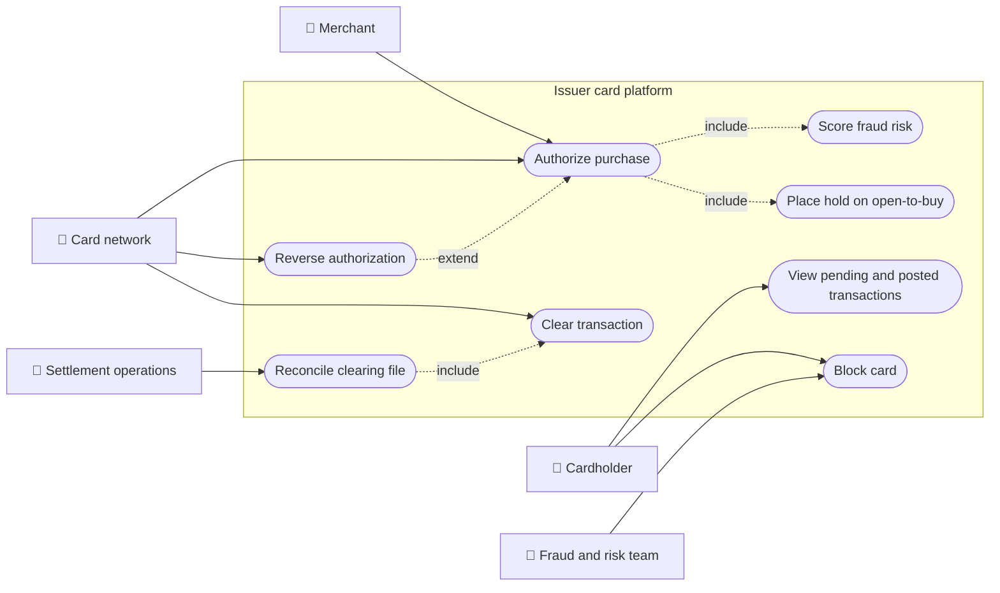
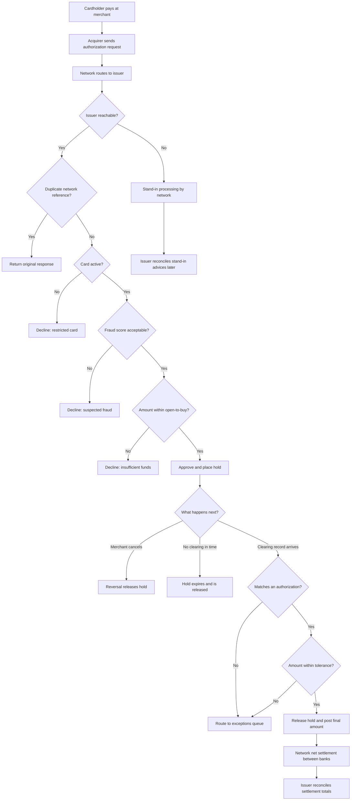
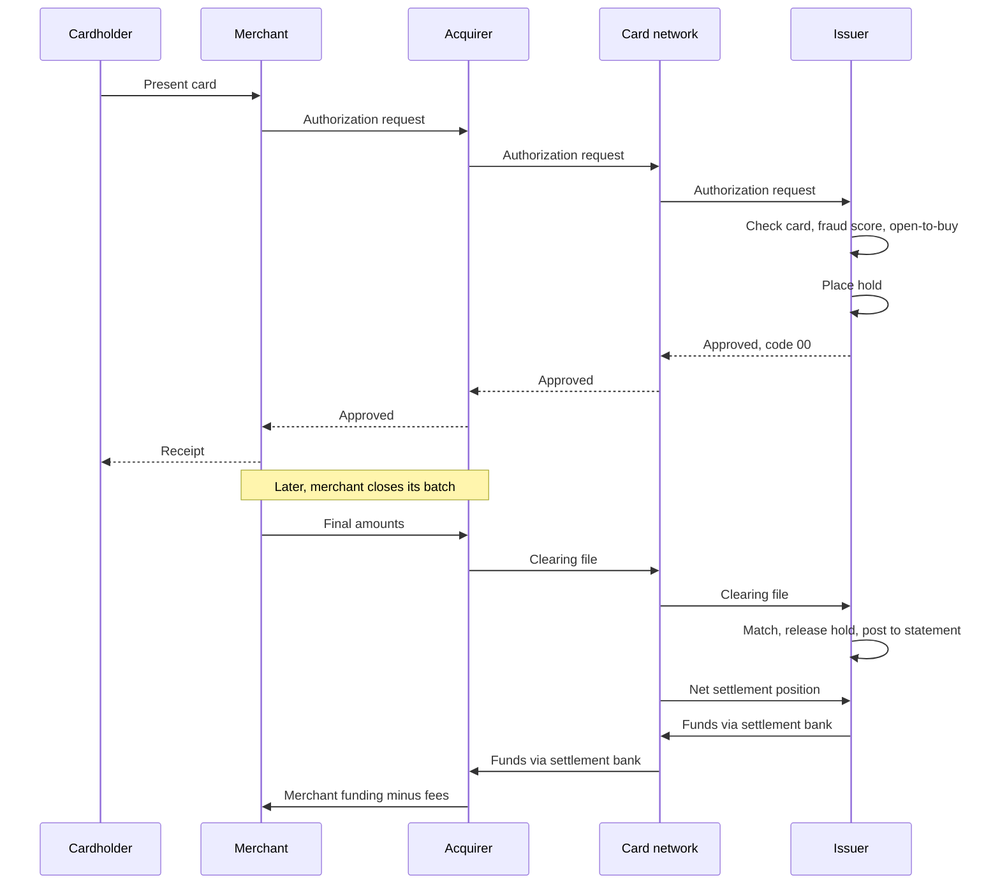
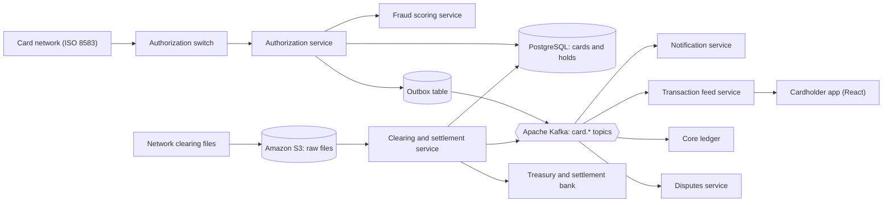
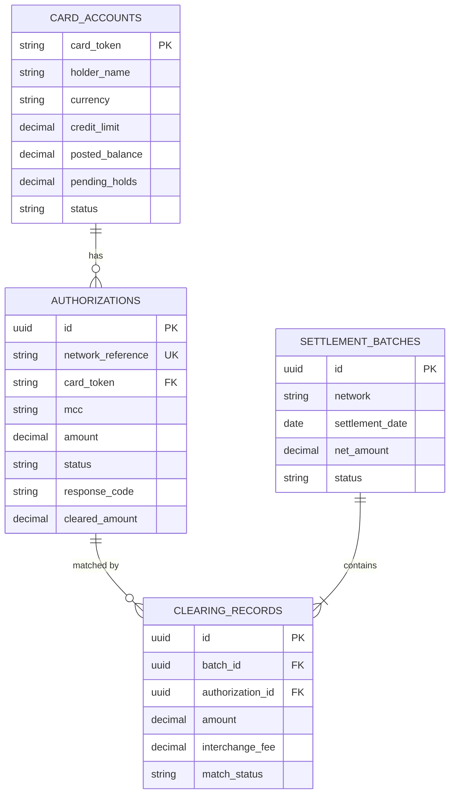
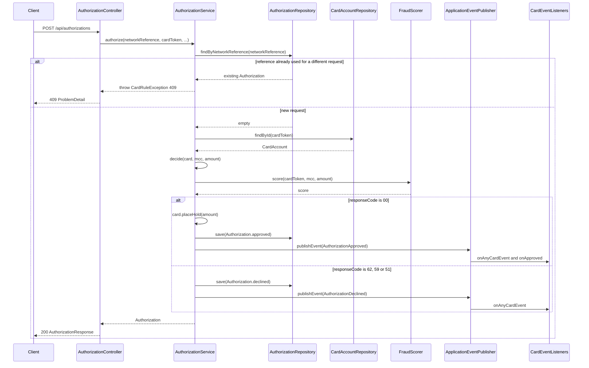
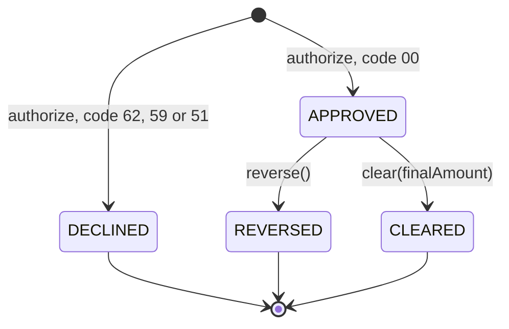
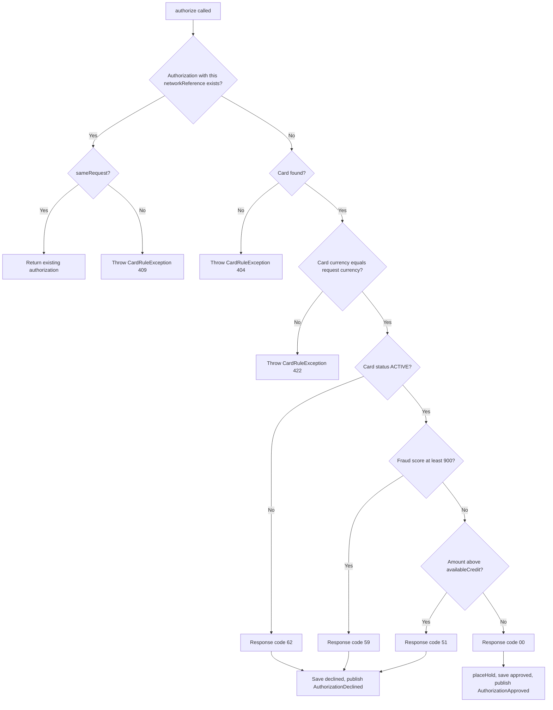

# Card Authorization and Settlement

> **Domain:** Banking · **Author:** [@naveenks720](https://github.com/naveenks720) · **Published:** November 19, 2026

> **Runnable code:** [`examples/banking/card-authorization-and-settlement`](https://github.com/dhulipalla599/domain-knowledge-engineering/tree/main/examples/banking/card-authorization-and-settlement)

## Explain It Like I'm Five

Imagine you buy an ice cream with a note from your grandma that says "I will pay for this." The ice cream seller quickly phones grandma: "Is this note real, and do you have enough money?" Grandma says "Yes!" and puts that money aside in a little jar so she doesn't spend it on something else. At the end of the day, the seller sends grandma a list of everything she promised to pay for, and grandma finally takes the money out of the jar and gives it to the seller. Sometimes the final price is a bit different, like when you added sprinkles, so grandma pays the real price, not the first one.

The phone call is **authorization**, the jar is the **hold**, and the end-of-day list and payment are **clearing and settlement**.

## Business Overview

Card authorization and settlement is the machinery behind every card purchase. It happens in two separate phases:

1. **Authorization** (real time, typically well under a few seconds end to end): the merchant asks, through its acquirer and the card network, whether the card issuer will guarantee the payment. The issuer checks the card, fraud risk and available funds or credit, answers approve or decline, and places a **hold** on the cardholder's open-to-buy.
2. **Clearing and settlement** (batch, usually later the same day or the next business days): the merchant submits the final transaction amount. The network exchanges clearing records between acquirers and issuers, calculates net positions (including interchange and scheme fees), and moves real money between the banks' settlement accounts. The issuer then posts the transaction to the cardholder's statement and releases the hold.

Most credit and signature-debit transactions are **dual-message** (separate authorization and clearing messages). Many PIN debit and some domestic schemes are **single-message**, where one message both authorizes and clears. This page focuses on the dual-message flow from the **issuer's** point of view.

Why the business cares:

| Driver | Why it matters |
|---|---|
| Revenue | Issuers earn interchange on every cleared transaction and interest on revolving balances. Every wrongful decline is lost revenue and often a lost customer, as the cardholder reaches for another card. |
| Risk | Approving a fraudulent or uncollectable transaction is a direct loss. Holds that are released too early or posted twice create balance errors and disputes. |
| Regulation | Card data security (PCI DSS) applies everywhere. Other rules differ by country: strong customer authentication under PSD2 in the EU and UK, debit interchange caps under Regulation II in the US and the Interchange Fee Regulation in the EU, and consumer dispute rights (for example Regulation Z for US credit cards and Regulation E for US debit). |
| Customer experience | Customers see pending transactions in the app within seconds and expect them to match the final statement. Confusing holds, such as a hotel deposit that never disappears, drive call-centre volume. |

In the banking value chain this sits between **cards issuing** (card products, limits, accounts), **fraud and risk**, the **core ledger** (where cleared amounts are posted), **disputes and chargebacks**, and **treasury** (which funds the daily net settlement with the networks).

## Real-World Example

**Priya Raman** holds a credit card issued by the fictional **Harborline Bank**. Her limit is 5,000.00 USD, her posted balance is 1,200.00 USD, and her open-to-buy is 3,800.00 USD.

1. **Friday 19:58.** Priya pays for dinner at **Blue Fern Bistro** (merchant category code 5812, restaurants). The bistro's terminal sends an authorization for the bill of 64.30 USD to its acquirer, **Northgate Merchant Services**, which routes it through the card network to Harborline.
2. **Within a fraction of a second.** Harborline's authorization service finds the card active, gets a low fraud score, sees 3,800.00 USD open-to-buy, approves with response code `00` and approval code `725201`, and places a 64.30 USD hold. Priya's open-to-buy drops to 3,735.70 USD and her app shows a *pending* transaction.
3. **Friday 20:05.** Priya adds a 10.70 USD tip on the paper slip. Nothing is sent to Harborline yet.
4. **Friday night.** The bistro's terminal closes its batch. Northgate submits a clearing record for **75.00 USD** to the network.
5. **Saturday.** Harborline receives the network's clearing file. Its settlement job matches the 75.00 USD record to the 64.30 USD authorization (same card, same approval code and network reference). Because the merchant is a restaurant, a modest over-authorization tip is allowed under Harborline's rules for this scheme, so the record is accepted. The hold is released and 75.00 USD is posted to Priya's statement. Her posted balance becomes 1,275.00 USD.
6. **Settlement.** On the scheme's settlement date, the network nets all of Harborline's transactions for the day. Harborline's settlement bank pays the network the net amount owed (purchases minus the interchange it earns), and the network pays Northgate, which funds Blue Fern Bistro's account minus the merchant discount fee.

If the bistro had cancelled the bill instead, the acquirer would have sent a **reversal**, and Harborline would have released the hold without posting anything.

## Stakeholders

| Stakeholder | What they need | What they fear |
|---|---|---|
| Cardholder | Fast approvals, accurate available balance, pending items that match the statement | Wrongful declines, double charges, holds that never drop off, fraud on their card |
| Merchant | A guaranteed payment for an approved authorization, fast funding | Declines at checkout, chargebacks, delayed settlement |
| Acquirer | Reliable routing to networks, accurate merchant funding | Merchant fraud, scheme fines, liability for merchant losses |
| Card network (scheme) | Issuers and acquirers following message formats, timing and rules | Outages, rule breaches that damage trust in the scheme |
| Issuer authorization team | Low-latency, highly available decisions with explainable decline reasons | Outages that push traffic to stand-in, fraud losses, credit losses |
| Issuer settlement and operations | Every clearing record matched to an authorization and posted once | Unmatched records, out-of-balance settlement, manual reconciliation backlogs |
| Fraud and risk team | Real-time signals and the authority to decline | Missed fraud rings, false positives that anger good customers |
| Treasury | A predictable daily net settlement amount to fund | Unexpected settlement obligations, funding shortfalls |
| Compliance and audit | Evidence of PCI DSS controls, authentication rules and dispute handling | Regulatory findings, card data breaches |

## Use Case Diagram



| Use Case | Primary Actor | Goal | Main success outcome |
|---|---|---|---|
| Authorize purchase | Card network (on behalf of the merchant) | Get an approve/decline decision | Response code returned within the network's timeout; hold placed if approved |
| Score fraud risk | Card network (via Authorize purchase) | Detect likely fraud before approving | A risk score that can trigger a decline |
| Place hold on open-to-buy | Card network (via Authorize purchase) | Reserve the approved amount | Available credit reduced by the authorized amount |
| Reverse authorization | Card network | Cancel an approval that will not be completed | Hold released; transaction never posts |
| Clear transaction | Card network | Present the final amount for payment | Hold released and final amount posted to the statement |
| Reconcile clearing file | Settlement operations | Match every clearing record to an authorization | All records posted or routed to exceptions; totals agree with network settlement |
| View pending and posted transactions | Cardholder | Understand what they have spent | App shows holds and posted items consistently |
| Block card | Cardholder or fraud team | Stop further spending on a lost or compromised card | Later authorizations decline with a restricted-card code |

## Key Terms

| Term | Plain-English meaning |
|---|---|
| Issuer | The bank that gave the cardholder the card and decides whether to approve. |
| Acquirer | The bank or processor that signs up merchants and sends their card transactions to the networks. |
| Card network (scheme) | Visa, Mastercard and others: they route messages between acquirers and issuers, set rules and run settlement. Some (for example American Express) can be both network and issuer. |
| Authorization | The real-time approve/decline request. It does not move money by itself. |
| Hold (pending authorization) | The amount reserved against the cardholder's available funds or credit after an approval. |
| Open-to-buy | For credit cards: credit limit minus posted balance minus pending holds. |
| Clearing (presentment) | The acquirer sending the final transaction details to the issuer, usually in a batch file, so it can be posted. |
| Settlement | The actual movement of net funds between issuers, networks and acquirers. |
| Reversal | A message cancelling all or part of an earlier authorization. |
| Response code | The code in the authorization response, for example `00` approved or `51` insufficient funds (ISO 8583 style; exact codes vary by network). |
| MCC (merchant category code) | A four-digit code describing the merchant's business, used for rules, risk and rewards. |
| Interchange | A fee paid by the acquirer to the issuer on each transaction, set by the network and in some regions capped by regulation. |
| Stand-in processing (STIP) | The network or processor approving or declining on the issuer's behalf when the issuer cannot be reached. |
| Chargeback | A dispute that returns a cleared transaction from the issuer back to the acquirer under network rules. |

## Process Flow

A purchase starts at the merchant's terminal or checkout page. The acquirer formats an authorization request and the network routes it to the issuer. The issuer validates the card and its status, scores fraud, checks open-to-buy, and replies. If it approves, it places a hold. Later, either the merchant cancels (reversal releases the hold), the hold expires unused, or a clearing record arrives in the network's file. The issuer matches clearing to the authorization, checks that the amount is acceptable, releases the hold and posts the final amount. Finally, the network settles net positions between banks, and the issuer reconciles its settlement totals.





## Business Rules and Edge Cases

- **Authorization is not payment.** Approval only reserves funds. Money moves at settlement, and the statement entry is created from clearing, not from the authorization. Never post to the ledger on approval.
- **Clearing amount can differ from the authorized amount.** Tips (restaurants), fuel pumps (often authorized for a preset amount and cleared at the actual amount), hotels and car rentals (estimated, then incremental authorizations) all clear at a different value. Each network defines what difference is acceptable for which MCC; treat any single tolerance number as configuration, not a constant.
- **Clearing without an authorization happens.** Offline transactions, stand-in approvals, late presentments and some recurring transactions arrive without a matching hold. They must still be processed or disputed under network rules, not silently dropped.
- **Idempotency on network retries.** Networks retry when they do not get a response in time. The issuer must recognise the same request (by network reference, trace number or transaction identifier) and return the original answer without placing a second hold.
- **Timeouts are ambiguous.** If the issuer's response arrives after the network timeout, the network may already have stood in or declined, and may send a reversal. The issuer must be prepared to receive a reversal for a hold it thinks is live.
- **Partial and full reversals.** A reversal may cancel part of an amount (for example a fuel pre-authorization). Reversing an authorization that has already cleared must be rejected, and clearing an authorization that was reversed must be routed to exceptions.
- **Hold expiry.** Holds that are never cleared must be released after a window that varies by network, MCC and issuer policy (from days for most retail to longer for hotels and car rentals). Releasing too early lets cardholders overspend; too late angers them.
- **Money arithmetic.** Use exact decimal types or integer minor units, never floating point. Currencies have different minor units (for example JPY has none). Cross-currency transactions carry both the transaction amount and the billing amount with a conversion rate.
- **Concurrency on open-to-buy.** Two authorizations on the same card can arrive within milliseconds. Use optimistic locking or a single-writer per card, otherwise both can be approved against the same available credit.
- **Declines are answers, not errors.** A `51` or `05` decline is a successful business outcome that must be returned quickly and logged with its reason. Only malformed or impossible requests are technical errors.
- **Cut-off times.** Each network has settlement cut-offs. A clearing record received after cut-off belongs to the next settlement cycle, which changes the date it posts and the day treasury funds it.

## From Business to System

| Business concept or step | System component | Data entity | Event |
|---|---|---|---|
| Authorization request from the network | Authorization service (`AuthorizationController.authorize`) | `authorizations` | `card.authorization.approved` / `card.authorization.declined` |
| Card status and open-to-buy check | Authorization service (`AuthorizationService.decide`) | `card_accounts` | none (internal decision) |
| Fraud screening | Fraud scoring adapter (`FraudScorer`) | `fraud_scores` (production) | none (score stored with the authorization in production) |
| Hold on available credit | Authorization service | `card_accounts.pending_holds` | `card.authorization.approved` |
| Reversal | Authorization service (`reverse`) | `authorizations`, `card_accounts` | `card.authorization.reversed` |
| Clearing record matched and posted | Clearing service (`clear` in the example) | `authorizations`, `clearing_records`, `card_accounts.posted_balance` | `card.transaction.cleared` |
| Daily settlement with the network | Settlement and reconciliation service | `settlement_batches` | `card.settlement.reconciled` |
| Cardholder notification and app feed | Notification and transaction-feed consumers | read models | consumes all `card.*` events |

## Architecture



Service boundaries follow the two very different workloads:

- **Authorization service** is on the real-time path. It owns card status, open-to-buy and holds, has a strict latency budget and must be the most available component. It calls only what it needs to decide (fraud score), and publishes events through an outbox so Kafka is never on the critical path.
- **Clearing and settlement service** is batch oriented. It ingests large network files, matches them to authorizations, posts final amounts and reconciles settlement totals. Separating it means a large or malformed file cannot slow down live authorizations.
- **Downstream consumers** (notifications, the app's transaction feed, the core ledger, disputes) react to events and can be scaled or redeployed independently. The core ledger remains the system of record for posted balances; the card platform owns pending state.
- An **authorization switch** (often a vendor product or processor) terminates network connections and translates ISO 8583 into internal calls. Many issuers outsource part or all of this to a card processor; the boundaries stay the same.

## Data Model

```sql
CREATE TABLE card_accounts (
    card_token      VARCHAR(32)   PRIMARY KEY,           -- token, never the PAN
    holder_name     VARCHAR(200)  NOT NULL,
    currency        CHAR(3)       NOT NULL,
    credit_limit    NUMERIC(19,2) NOT NULL CHECK (credit_limit >= 0),
    posted_balance  NUMERIC(19,2) NOT NULL DEFAULT 0,
    pending_holds   NUMERIC(19,2) NOT NULL DEFAULT 0 CHECK (pending_holds >= 0),
    status          VARCHAR(16)   NOT NULL CHECK (status IN ('ACTIVE','BLOCKED')),
    version         BIGINT        NOT NULL DEFAULT 0
);

CREATE TABLE authorizations (
    id                 UUID          PRIMARY KEY,
    network_reference  VARCHAR(64)   NOT NULL UNIQUE,     -- idempotency key from the network
    card_token         VARCHAR(32)   NOT NULL REFERENCES card_accounts(card_token),
    merchant_name      VARCHAR(200)  NOT NULL,
    mcc                CHAR(4)       NOT NULL,
    amount             NUMERIC(19,2) NOT NULL CHECK (amount > 0),
    currency           CHAR(3)       NOT NULL,
    status             VARCHAR(16)   NOT NULL CHECK (status IN ('APPROVED','DECLINED','REVERSED','CLEARED')),
    response_code      CHAR(2)       NOT NULL,
    approval_code      CHAR(6),
    cleared_amount     NUMERIC(19,2),
    created_at         TIMESTAMPTZ   NOT NULL,
    updated_at         TIMESTAMPTZ   NOT NULL
);
CREATE INDEX ix_auth_card_created ON authorizations (card_token, created_at DESC);
CREATE INDEX ix_auth_open_holds ON authorizations (created_at) WHERE status = 'APPROVED';

CREATE TABLE settlement_batches (
    id               UUID          PRIMARY KEY,
    network          VARCHAR(32)   NOT NULL,
    settlement_date  DATE          NOT NULL,
    file_name        VARCHAR(255)  NOT NULL UNIQUE,      -- a file is processed once
    record_count     INTEGER       NOT NULL,
    net_amount       NUMERIC(19,2) NOT NULL,
    status           VARCHAR(16)   NOT NULL CHECK (status IN ('RECEIVED','POSTED','RECONCILED','OUT_OF_BALANCE'))
);

CREATE TABLE clearing_records (
    id                 UUID          PRIMARY KEY,
    batch_id           UUID          NOT NULL REFERENCES settlement_batches(id),
    network_reference  VARCHAR(64)   NOT NULL,
    authorization_id   UUID          REFERENCES authorizations(id),   -- NULL when unmatched
    amount             NUMERIC(19,2) NOT NULL,
    interchange_fee    NUMERIC(19,4) NOT NULL,
    match_status       VARCHAR(16)   NOT NULL CHECK (match_status IN ('MATCHED','UNMATCHED','EXCEPTION')),
    UNIQUE (batch_id, network_reference)
);

CREATE TABLE outbox_events (
    id            BIGSERIAL    PRIMARY KEY,
    topic         VARCHAR(100) NOT NULL,
    event_key     VARCHAR(64)  NOT NULL,                 -- card token, for per-card ordering
    payload       JSONB        NOT NULL,
    created_at    TIMESTAMPTZ  NOT NULL DEFAULT now(),
    published_at  TIMESTAMPTZ
);
```



## APIs

| Method | Path | Purpose |
|---|---|---|
| POST | `/api/authorizations` | Approve or decline a purchase and place a hold (called by the authorization switch) |
| POST | `/api/authorizations/{id}/reversal` | Cancel an approved authorization and release its hold |
| POST | `/api/authorizations/{id}/clearing` | Post the final amount for an authorization (in production, driven by clearing files) |
| GET | `/api/authorizations/{id}` | Read one authorization |
| GET | `/api/cards/{cardToken}` | Card status, limit, posted balance, pending holds and open-to-buy |
| GET | `/api/cards/{cardToken}/authorizations` | Pending and completed authorizations for the app feed |

Example: `POST /api/authorizations`

```json
{
  "networkReference": "NET-20261119-000042",
  "cardToken": "tok_4111_0001",
  "merchantName": "Blue Fern Bistro",
  "mcc": "5812",
  "amount": 64.30,
  "currency": "USD"
}
```

Response `200 OK` (a decline also returns `200` with `"status": "DECLINED"` and a response code such as `51`):

```json
{
  "id": "c3d04900-9fa9-436a-a9e6-75ae0b077f45",
  "networkReference": "NET-20261119-000042",
  "cardToken": "tok_4111_0001",
  "merchantName": "Blue Fern Bistro",
  "mcc": "5812",
  "amount": 64.30,
  "currency": "USD",
  "status": "APPROVED",
  "responseCode": "00",
  "approvalCode": "725201",
  "clearedAmount": null
}
```

## Events

| Event | Producer | Consumers | Key fields |
|---|---|---|---|
| `card.authorization.approved` | Authorization service | Notification, transaction feed, fraud model features | `authorizationId`, `cardToken`, `amount`, `mcc` |
| `card.authorization.declined` | Authorization service | Notification, fraud analytics, customer support views | `authorizationId`, `cardToken`, `responseCode` |
| `card.authorization.reversed` | Authorization service | Transaction feed, notification | `authorizationId`, `cardToken`, `amount` |
| `card.transaction.cleared` | Clearing and settlement service | Core ledger, statements, rewards, disputes, transaction feed | `authorizationId`, `cardToken`, `authorizedAmount`, `clearedAmount` |
| `card.settlement.reconciled` | Clearing and settlement service | Treasury, finance, operations dashboards | `batchId`, `network`, `settlementDate`, `netAmount` |

Ordering and idempotency:

- Key every `card.*` event by **card token** so events for one card stay in order on one partition. A consumer must never see `cleared` before `approved` for the same authorization within the stream; if it can (for example clearing without authorization), it must handle it.
- Publish through a **transactional outbox**: the database change and the event are committed together, then relayed to Kafka. This guarantees at-least-once delivery, so every consumer must be **idempotent** on `authorizationId` plus event type.
- The core ledger must post a `card.transaction.cleared` exactly once. Store processed event IDs or use a unique constraint on the ledger entry's source reference.

## Backend Implementation

> The Java tab is the runnable example's code; the Python tab uses FastAPI with SQLAlchemy and the Node.js tab uses NestJS with TypeORM.

The method that enforces the key business rule: idempotent authorization, then approve or decline and hold funds
([`AuthorizationService.java`](https://github.com/dhulipalla599/domain-knowledge-engineering/tree/main/examples/banking/card-authorization-and-settlement/src/main/java/com/dke/banking/card_authorization_and_settlement/service/AuthorizationService.java)).

=== "Java"

    ```java
    @Transactional
    public Authorization authorize(String networkReference, String cardToken, String merchantName,
                                   String mcc, BigDecimal amount, String currency) {
        var existing = authorizations.findByNetworkReference(networkReference);
        if (existing.isPresent()) {
            if (!existing.get().sameRequest(cardToken, amount, currency)) {
                throw new CardRuleException(HttpStatus.CONFLICT,
                        "Network reference " + networkReference + " was already used for a different request");
            }
            return existing.get(); // network retry: answer exactly as before, never hold twice
        }
        CardAccount card = findCard(cardToken);
        if (!card.getCurrency().equals(currency)) {
            throw new CardRuleException(HttpStatus.UNPROCESSABLE_ENTITY,
                    "Card is billed in " + card.getCurrency() + "; " + currency + " needs currency conversion first");
        }

        String responseCode = decide(card, mcc, amount);
        Authorization auth;
        if ("00".equals(responseCode)) {
            card.placeHold(amount);
            auth = Authorization.approved(networkReference, cardToken, merchantName, mcc, amount, currency,
                    approvalCode(networkReference));
            authorizations.save(auth);
            events.publishEvent(new CardEvent.AuthorizationApproved(auth.getId(), cardToken, amount, mcc));
        } else {
            auth = Authorization.declined(networkReference, cardToken, merchantName, mcc, amount, currency,
                    responseCode);
            authorizations.save(auth);
            events.publishEvent(new CardEvent.AuthorizationDeclined(auth.getId(), cardToken, responseCode));
        }
        return auth;
    }

    /** ISO 8583-style response code: 00 approve, 62 restricted card, 59 suspected fraud, 51 insufficient funds. */
    String decide(CardAccount card, String mcc, BigDecimal amount) {
        if (card.getStatus() != CardStatus.ACTIVE) {
            return "62";
        }
        if (fraudScorer.score(card.getCardToken(), mcc, amount) >= FRAUD_DECLINE_SCORE) {
            return "59";
        }
        if (amount.compareTo(card.availableCredit()) > 0) {
            return "51";
        }
        return "00";
    }
    ```

=== "Python"

    ```python
    FRAUD_DECLINE_SCORE = 900

    class AuthorizationService:
        def __init__(self, db: Session, fraud_scorer: FraudScorer, events: EventPublisher):
            self.db, self.fraud_scorer, self.events = db, fraud_scorer, events

        def authorize(self, network_reference: str, card_token: str, merchant_name: str,
                      mcc: str, amount: Decimal, currency: str) -> Authorization:
            existing = self.db.scalar(select(Authorization).filter_by(network_reference=network_reference))
            if existing:
                if not existing.same_request(card_token, amount, currency):
                    raise CardRuleError(409, f"Network reference {network_reference} "
                                             "was already used for a different request")
                return existing  # network retry: answer exactly as before, never hold twice
            card = self.find_card(card_token)
            if card.currency != currency:
                raise CardRuleError(422, f"Card is billed in {card.currency}; "
                                         f"{currency} needs currency conversion first")

            response_code = self.decide(card, mcc, amount)
            if response_code == "00":
                card.place_hold(amount)
                auth = Authorization.approved(network_reference, card_token, merchant_name, mcc,
                                              amount, currency, approval_code(network_reference))
                self.db.add(auth)
                self.db.flush()
                self.events.publish(AuthorizationApproved(auth.id, card_token, amount, mcc))
            else:
                auth = Authorization.declined(network_reference, card_token, merchant_name, mcc,
                                              amount, currency, response_code)
                self.db.add(auth)
                self.db.flush()
                self.events.publish(AuthorizationDeclined(auth.id, card_token, response_code))
            return auth

        def decide(self, card: CardAccount, mcc: str, amount: Decimal) -> str:
            """ISO 8583-style response code: 00 approve, 62 restricted, 59 suspected fraud, 51 insufficient funds."""
            if card.status != CardStatus.ACTIVE:
                return "62"
            if self.fraud_scorer.score(card.card_token, mcc, amount) >= FRAUD_DECLINE_SCORE:
                return "59"
            if amount > card.available_credit():
                return "51"
            return "00"
    ```

=== "Node.js"

    ```typescript
    const FRAUD_DECLINE_SCORE = 900;

    @Injectable()
    export class AuthorizationService {
      constructor(
        @InjectRepository(CardAccount) private readonly cards: Repository<CardAccount>,
        @InjectRepository(Authorization) private readonly authorizations: Repository<Authorization>,
        private readonly fraudScorer: FraudScorer,
        private readonly events: EventEmitter2,
        private readonly dataSource: DataSource,
      ) {}

      authorize(networkReference: string, cardToken: string, merchantName: string,
                mcc: string, amount: Decimal, currency: string): Promise<Authorization> {
        return this.dataSource.transaction(async (tx) => {
          const existing = await tx.findOneBy(Authorization, { networkReference });
          if (existing) {
            if (!existing.sameRequest(cardToken, amount, currency)) {
              throw new ConflictException(
                `Network reference ${networkReference} was already used for a different request`);
            }
            return existing; // network retry: answer exactly as before, never hold twice
          }
          const card = await tx.findOneBy(CardAccount, { cardToken });
          if (!card) throw new NotFoundException(`Unknown card ${cardToken}`);
          if (card.currency !== currency) {
            throw new UnprocessableEntityException(
              `Card is billed in ${card.currency}; ${currency} needs currency conversion first`);
          }

          const responseCode = await this.decide(card, mcc, amount);
          if (responseCode === '00') {
            card.placeHold(amount);
            await tx.save(card); // @VersionColumn gives optimistic locking
            const auth = await tx.save(Authorization.approved(networkReference, cardToken, merchantName,
              mcc, amount, currency, approvalCode(networkReference)));
            this.events.emit('card.authorization.approved', { authorizationId: auth.id, cardToken, amount, mcc });
            return auth;
          }
          const auth = await tx.save(Authorization.declined(networkReference, cardToken, merchantName,
            mcc, amount, currency, responseCode));
          this.events.emit('card.authorization.declined', { authorizationId: auth.id, cardToken, responseCode });
          return auth;
        });
      }

      /** ISO 8583-style response code: 00 approve, 62 restricted, 59 suspected fraud, 51 insufficient funds. */
      async decide(card: CardAccount, mcc: string, amount: Decimal): Promise<string> {
        if (card.status !== CardStatus.ACTIVE) return '62';
        if ((await this.fraudScorer.score(card.cardToken, mcc, amount)) >= FRAUD_DECLINE_SCORE) return '59';
        if (amount.greaterThan(card.availableCredit())) return '51';
        return '00';
      }
    }
    ```

The controller endpoint that calls it
([`AuthorizationController.java`](https://github.com/dhulipalla599/domain-knowledge-engineering/tree/main/examples/banking/card-authorization-and-settlement/src/main/java/com/dke/banking/card_authorization_and_settlement/api/AuthorizationController.java)):

=== "Java"

    ```java
    /** Approve or decline. A decline is a valid business answer, so both return 200 with a response code. */
    @PostMapping("/authorizations")
    public AuthorizationResponse authorize(@Valid @RequestBody AuthorizationRequest req) {
        return AuthorizationResponse.from(service.authorize(req.networkReference(), req.cardToken(),
                req.merchantName(), req.mcc(), req.amount(), req.currency()));
    }
    ```

=== "Python"

    ```python
    router = APIRouter(prefix="/api")

    @router.post("/authorizations", response_model=AuthorizationResponse)
    def authorize(req: AuthorizationRequest, service: AuthorizationService = Depends(get_service)):
        """Approve or decline. A decline is a valid business answer, so both return 200 with a response code."""
        return AuthorizationResponse.from_entity(service.authorize(
            req.network_reference, req.card_token, req.merchant_name, req.mcc, req.amount, req.currency))
    ```

=== "Node.js"

    ```typescript
    @Controller('api')
    export class AuthorizationController {
      constructor(private readonly service: AuthorizationService) {}

      /** Approve or decline. A decline is a valid business answer, so both return 200 with a response code. */
      @Post('authorizations')
      @HttpCode(200)
      async authorize(@Body() req: AuthorizationRequest): Promise<AuthorizationResponse> {
        return AuthorizationResponse.from(await this.service.authorize(req.networkReference, req.cardToken,
          req.merchantName, req.mcc, new Decimal(req.amount), req.currency));
      }
    }
    ```

Full source: [`examples/banking/card-authorization-and-settlement`](https://github.com/dhulipalla599/domain-knowledge-engineering/tree/main/examples/banking/card-authorization-and-settlement).

## Frontend Screen

The cardholder's most important screen is the card activity view: open-to-buy, pending holds and posted transactions, kept clearly apart.

```tsx
import { useEffect, useState } from "react";

type Card = {
  cardToken: string;
  holderName: string;
  currency: string;
  status: "ACTIVE" | "BLOCKED";
  creditLimit: number;
  postedBalance: number;
  pendingHolds: number;
  availableCredit: number;
};

type Authorization = {
  id: string;
  merchantName: string;
  amount: number;
  currency: string;
  status: "APPROVED" | "DECLINED" | "REVERSED" | "CLEARED";
  responseCode: string;
  clearedAmount: number | null;
};

const money = (value: number, currency: string) =>
  new Intl.NumberFormat(undefined, { style: "currency", currency }).format(value);

const label: Record<Authorization["status"], string> = {
  APPROVED: "Pending",
  DECLINED: "Declined",
  REVERSED: "Cancelled",
  CLEARED: "Posted",
};

export function CardActivity({ cardToken }: { cardToken: string }) {
  const [card, setCard] = useState<Card | null>(null);
  const [items, setItems] = useState<Authorization[]>([]);
  const [error, setError] = useState<string | null>(null);

  useEffect(() => {
    const controller = new AbortController();
    Promise.all([
      fetch(`/api/cards/${cardToken}`, { signal: controller.signal }).then((r) => r.json()),
      fetch(`/api/cards/${cardToken}/authorizations`, { signal: controller.signal }).then((r) => r.json()),
    ])
      .then(([c, a]) => {
        setCard(c);
        setItems(a);
      })
      .catch((e) => e.name !== "AbortError" && setError("Could not load card activity"));
    return () => controller.abort();
  }, [cardToken]);

  if (error) return <p role="alert">{error}</p>;
  if (!card) return <p aria-busy="true">Loading…</p>;

  return (
    <section aria-labelledby="card-heading">
      <h2 id="card-heading">Card ending {cardToken.slice(-4)}</h2>
      {card.status === "BLOCKED" && <p role="status">This card is blocked. New purchases will be declined.</p>}
      <dl>
        <dt>Available to spend</dt>
        <dd>{money(card.availableCredit, card.currency)}</dd>
        <dt>Pending</dt>
        <dd>{money(card.pendingHolds, card.currency)}</dd>
        <dt>Posted balance</dt>
        <dd>{money(card.postedBalance, card.currency)}</dd>
      </dl>
      <ul>
        {items.map((a) => (
          <li key={a.id}>
            <span>{a.merchantName}</span>{" "}
            <span>{money(a.clearedAmount ?? a.amount, a.currency)}</span>{" "}
            <span>{label[a.status]}</span>
            {a.status === "CLEARED" && a.clearedAmount !== a.amount && (
              <small> (authorized {money(a.amount, a.currency)})</small>
            )}
          </li>
        ))}
      </ul>
    </section>
  );
}
```

## Cloud Deployment

Main AWS services:

- **Amazon EKS** runs the authorization service, clearing and settlement service and consumers in separate deployments (and node groups), so batch clearing cannot starve real-time authorization of CPU.
- **Amazon RDS for PostgreSQL** (or Aurora PostgreSQL) in Multi-AZ for cards, holds, authorizations and clearing records.
- **Amazon MSK** for the `card.*` Kafka topics.
- **Amazon S3** for raw clearing and settlement files, with object lock or versioning for audit, and an ingest step that verifies file integrity.
- **AWS KMS** and **AWS Secrets Manager** for encryption keys and database credentials. PIN and cryptogram verification use hardware security modules (for example AWS Payment Cryptography or on-premises HSMs), never application code.
- **AWS Direct Connect** or the processor's private connectivity for the network link; card networks do not connect over the public internet.

The most important resource is the database that holds open-to-buy:

```hcl
resource "aws_db_instance" "card_auth" {
  identifier                   = "card-auth-prod"
  engine                       = "postgres"
  engine_version               = "16"
  instance_class               = "db.r6g.xlarge"
  allocated_storage            = 200
  storage_encrypted            = true
  kms_key_id                   = aws_kms_key.card_data.arn
  multi_az                     = true
  db_subnet_group_name         = aws_db_subnet_group.cde_private.name
  vpc_security_group_ids       = [aws_security_group.card_auth_db.id]
  manage_master_user_password  = true
  backup_retention_period      = 35
  deletion_protection          = true
  performance_insights_enabled = true
  iam_database_authentication_enabled = true
}
```

Security: keep the cardholder data environment (CDE) in its own VPC subnets and namespaces to reduce PCI DSS scope; use tokens instead of PANs everywhere outside the vault; enforce mTLS between services and Kubernetes network policies; give each pod its own IAM role through IRSA or EKS Pod Identity.

Scaling: scale the authorization service horizontally on request rate and latency, with pre-scaled capacity for known peaks (for example holiday shopping days) rather than relying on reactive autoscaling alone. Clearing jobs scale on file size and run as Kubernetes Jobs.

Observability: instrument with OpenTelemetry (traces through switch, authorization service, fraud scorer and database), export to CloudWatch via the AWS Distro for OpenTelemetry collector. Alert on authorization p99 latency, decline rate by response code, stand-in volume, unmatched clearing records and settlement out-of-balance. Never put PANs or full card data in logs, spans or metrics labels.

## Non-Functional Requirements

| Requirement | Expectation for this topic | How the design meets it |
|---|---|---|
| Availability | Authorization is effectively always on; when the issuer is unavailable the network falls back to stand-in, which costs control over risk. Targets are set per issuer, often with very high availability goals. | Multi-AZ database and EKS, no Kafka on the critical path (outbox), independent clearing deployment, regular stand-in reconciliation. |
| Latency | The issuer must answer well within the network's timeout (each network sets its own); issuers typically target tens to low hundreds of milliseconds of internal processing. | Single read-modify-write per card, fraud scorer with a strict timeout and fallback rules, indexes on network reference and card token. |
| Consistency | Open-to-buy must never be over-allocated; each clearing record posts exactly once. | Optimistic locking on `card_accounts`, unique `network_reference`, unique `(batch_id, network_reference)` on clearing records, idempotent consumers. |
| Audit | Every authorization decision, reversal and clearing posting must be traceable, with the reason for declines. | Immutable authorization rows with response codes, raw clearing files retained in S3, events retained and archived. |
| Compliance | PCI DSS for card data, scheme rules for messages and timing, local rules such as PSD2 strong customer authentication or US consumer dispute rules. | Tokenisation, segmented CDE, HSM-based cryptography, configurable per-network rules (for example clearing tolerance by MCC). |
| Recoverability | No lost holds or postings after a failure. | Point-in-time recovery on the database, replayable clearing files, outbox relay restartable from the last unpublished row. |

## Runnable Example

The example implements the issuer side of a dual-message card purchase as a Spring Boot service: it approves or declines an authorization with ISO 8583-style response codes (`00`, `62`, `59`, `51`), places a hold on open-to-buy, handles network retries idempotently by network reference, reverses holds, and clears authorizations with a per-MCC over-clearing tolerance (20% for restaurants, an illustrative value). The authorization lifecycle is enforced in the entity, a stub fraud scorer stands in for the real model, and Spring application events named after the Kafka topics stand in for Kafka. It runs on in-memory H2 with seeded cards and needs no external services.

Source: [`examples/banking/card-authorization-and-settlement`](https://github.com/dhulipalla599/domain-knowledge-engineering/tree/main/examples/banking/card-authorization-and-settlement)

```bash
cd examples/banking/card-authorization-and-settlement
mvn spring-boot:run          # starts on http://localhost:8080
mvn verify                   # runs unit and API tests
```

Approve a restaurant authorization:

```bash
curl -s -X POST localhost:8080/api/authorizations -H 'Content-Type: application/json' \
  -d '{"networkReference":"NET-20261119-000042","cardToken":"tok_4111_0001","merchantName":"Blue Fern Bistro","mcc":"5812","amount":64.30,"currency":"USD"}'
```

```json
{"id":"c3d04900-9fa9-436a-a9e6-75ae0b077f45","networkReference":"NET-20261119-000042","cardToken":"tok_4111_0001","merchantName":"Blue Fern Bistro","mcc":"5812","amount":64.30,"currency":"USD","status":"APPROVED","responseCode":"00","approvalCode":"725201","clearedAmount":null}
```

Clear the seeded 80.00 USD bistro hold at 120.00 USD, above the 20% tolerance (HTTP 422):

```bash
curl -s -X POST localhost:8080/api/authorizations/5b1f2c3e-0000-4000-8000-000000000001/clearing \
  -H 'Content-Type: application/json' -d '{"amount":120.00}'
```

```json
{"type":"about:blank","title":"Unprocessable Entity","status":422,"detail":"Clearing amount 120.00 exceeds authorized 80.00 plus tolerance for MCC 5812","instance":"/api/authorizations/5b1f2c3e-0000-4000-8000-000000000001/clearing"}
```

The `id` and `approvalCode` in the first response differ per run.

| Class | Package | Responsibility |
|---|---|---|
| `CardAuthorizationAndSettlementApplication` | root | Spring Boot entry point |
| `CardAccount` | `domain` | Credit limit, posted balance, pending holds, open-to-buy; optimistic locking |
| `CardStatus` | `domain` | `ACTIVE` / `BLOCKED` |
| `Authorization` | `domain` | Authorization and hold; enforces lifecycle transitions |
| `AuthorizationStatus` | `domain` | Lifecycle enum and allowed next states |
| `CardEvent` | `domain` | Sealed event records named after Kafka topics |
| `CardAccountRepository`, `AuthorizationRepository` | `repository` | Spring Data JPA access |
| `AuthorizationService` | `service` | Approve/decline, hold, reverse, clear; idempotency and tolerance rules |
| `CardRuleException` | `service` | Rule violation carrying an HTTP status |
| `AuthorizationController` | `api` | REST endpoints |
| `AuthorizationRequest`, `ClearingRequest`, `AuthorizationResponse`, `CardResponse` | `api` | Request and response records |
| `ApiExceptionHandler` | `api` | Maps errors to `ProblemDetail` |
| `FraudScorer`, `StubFraudScorer` | `integration` | Fraud-scoring port and deterministic stub |
| `CardEventListeners` | `integration` | `@EventListener` stand-ins for Kafka consumers |

## UML Diagrams

### Class Diagram

The controller delegates to `AuthorizationService`, which owns every business rule and works with the two repositories, the `FraudScorer` port and Spring's event publisher. `Authorization` enforces its own lifecycle through `AuthorizationStatus`, and `CardEventListeners` consumes the sealed `CardEvent` records.

```mermaid
classDiagram
    class AuthorizationController {
        +authorize(AuthorizationRequest) AuthorizationResponse
        +reverse(UUID) AuthorizationResponse
        +clear(UUID, ClearingRequest) AuthorizationResponse
        +get(UUID) AuthorizationResponse
        +card(String) CardResponse
        +history(String) List
    }
    class AuthorizationService {
        -CardAccountRepository cards
        -AuthorizationRepository authorizations
        -FraudScorer fraudScorer
        -ApplicationEventPublisher events
        +authorize(...) Authorization
        ~decide(CardAccount, String, BigDecimal) String
        +reverse(UUID) Authorization
        +clear(UUID, BigDecimal) Authorization
        +findCard(String) CardAccount
        +findAuthorization(UUID) Authorization
        +historyFor(String) List
    }
    class CardAccountRepository {
        <<interface>>
    }
    class AuthorizationRepository {
        <<interface>>
        +findByNetworkReference(String) Optional
        +findByCardTokenOrderByCreatedAtDesc(String) List
    }
    class CardAccount {
        -String cardToken
        -BigDecimal creditLimit
        -BigDecimal postedBalance
        -BigDecimal pendingHolds
        -CardStatus status
        -long version
        +availableCredit() BigDecimal
        +placeHold(BigDecimal)
        +releaseHold(BigDecimal)
        +postCleared(BigDecimal, BigDecimal)
    }
    class Authorization {
        -UUID id
        -String networkReference
        -String mcc
        -BigDecimal amount
        -AuthorizationStatus status
        -String responseCode
        -BigDecimal clearedAmount
        +approved(...) Authorization$
        +declined(...) Authorization$
        +reverse()
        +clear(BigDecimal)
        +sameRequest(String, BigDecimal, String) boolean
    }
    class AuthorizationStatus {
        <<enumeration>>
        APPROVED
        DECLINED
        REVERSED
        CLEARED
        +canMoveTo(AuthorizationStatus) boolean
    }
    class CardStatus {
        <<enumeration>>
        ACTIVE
        BLOCKED
    }
    class FraudScorer {
        <<interface>>
        +score(String, String, BigDecimal) int
    }
    class StubFraudScorer
    class CardEvent {
        <<interface>>
        +authorizationId() UUID
        +topic() String
    }
    class CardEventListeners {
        +onAnyCardEvent(CardEvent)
        +onApproved(AuthorizationApproved)
        +onCleared(TransactionCleared)
        +audit() List
    }
    AuthorizationController --> AuthorizationService
    AuthorizationService --> CardAccountRepository
    AuthorizationService --> AuthorizationRepository
    AuthorizationService --> FraudScorer
    AuthorizationService ..> CardEvent : publishes
    FraudScorer <|.. StubFraudScorer
    CardAccountRepository ..> CardAccount
    AuthorizationRepository ..> Authorization
    CardAccount --> CardStatus
    Authorization --> AuthorizationStatus
    CardEventListeners ..> CardEvent : consumes
```



### Sequence Diagram (control flow)

One `POST /api/authorizations` through the code. The `alt` shows the main rule-violation branch (a reused network reference with different content) next to the decline and approve outcomes.



### State Diagram

The `AuthorizationStatus` lifecycle as enforced by `Authorization.moveTo`: only an `APPROVED` hold can change, and every other state is final.



### Activity Diagram

The decision logic inside `AuthorizationService.authorize` and `decide`, in the order the code checks it.



## AI Opportunities

| Use case | Data it needs | Main risk or control |
|---|---|---|
| Real-time fraud scoring of authorizations | Authorization history, device and channel data, merchant and MCC profiles, confirmed fraud labels | Latency budget and fallback rules when the model is slow; false positives decline good customers; models need monitoring for drift and documented explainability for model risk governance. |
| Clearing exception triage | Unmatched clearing records, authorization history, past analyst resolutions | Suggestions must stay advisory: an agent should propose a match or action with evidence, while a human or deterministic rule posts money. Every decision must be auditable. |
| Hold expiry and amount prediction | Historical authorization-to-clearing gaps and amount differences by merchant and MCC | Releasing holds early on a wrong prediction lets cardholders overspend; keep within network rules and measure impact on credit losses. |
| Dispute and chargeback assistant | Cardholder dispute text, transaction and clearing data, network reason-code rules | LLM output can misstate network rules or rights; ground it in the current rule text, keep a human reviewer, and protect personal and card data in prompts. |
| Decline explanation for customers and agents | Response codes, rule hits, model reason codes | Explanations must not reveal fraud rules to fraudsters and must be accurate; in some jurisdictions adverse-action or fairness expectations apply to credit decisions, so check with compliance. |

## Common Pitfalls

- **Posting to the ledger on authorization.** The statement must come from clearing. Posting on approval double-counts when clearing arrives, or leaves wrong entries when the authorization is reversed.
- **Assuming clearing equals authorization.** Tips, fuel, hotels, partial shipments and currency conversion all change the amount. Match on reference fields, then apply per-MCC tolerance rules.
- **Treating declines as HTTP errors.** Declines are normal outcomes that must be fast, logged with a reason code and returned to the network in the expected format.
- **Ignoring retries and late reversals.** Without idempotency on the network reference, a timeout and retry places two holds. Without handling late reversals, holds stick for days.
- **Floating-point money.** Use `BigDecimal`, `NUMERIC` or integer minor units, and respect each currency's minor unit.
- **Read-then-write races on open-to-buy.** Two concurrent authorizations can both pass the check. Use optimistic locking with a retry, or route all authorizations for a card to a single writer.
- **Putting the PAN everywhere.** Logs, events and analytics stores quickly drag systems into PCI DSS scope. Tokenise at the edge.
- **Hard-coding one network's rules.** Response codes, tolerances, hold windows and cut-offs differ by network and region. Keep them in configuration, versioned and tested.
- **Synchronous calls to non-essential services on the authorization path.** Notifications, rewards and analytics belong behind events, not inside the latency budget.

## Interview Questions

### Junior

**1. What is the difference between authorization and settlement?**
Authorization is the real-time approve/decline decision that places a hold; no money moves. Settlement happens later, after clearing, when the network moves net funds between issuers and acquirers and the issuer posts the final amount.

**2. What is open-to-buy on a credit card?**
The amount the cardholder can still spend: credit limit minus posted balance minus pending holds.

**3. Why might a cardholder see a different amount on their statement than the pending transaction?**
Because the merchant clears the final amount, which can differ from the authorization, for example a restaurant tip, a fuel pump pre-authorization or a hotel deposit.

### Mid-Level

**1. How do you make authorization idempotent?**
Use a unique key from the network message (network reference or transaction identifier) with a unique constraint. On a repeat with identical content, return the stored response without placing a new hold; if the content differs, reject it and alert.

**2. How would you prevent two concurrent authorizations from overspending the same credit line?**
Optimistic locking on the card account row with retry, a conditional update (`UPDATE ... SET pending_holds = pending_holds + ? WHERE available >= ?`), or partitioning so one worker owns each card. Test with concurrent load, not only unit tests.

**3. Why use a transactional outbox instead of publishing to Kafka directly from the authorization service?**
So the database change and the event cannot diverge, and so Kafka latency or outages do not slow down or fail authorizations. The relay publishes at least once, so consumers must be idempotent.

### Senior / Architect

**1. Design the issuer authorization platform for very high availability and low latency.**
Strong answers cover: active-active or fast-failover across AZs and possibly regions; data partitioning by card; keeping only essential calls on the critical path with strict timeouts and fallback rules; outbox-based events; capacity planning for peaks; stand-in processing agreements and reconciliation of stand-in advices; and observability on latency, decline rates and stand-in volume.

**2. How do you design clearing and reconciliation so that every record posts exactly once and settlement balances?**
Strong answers cover: storing raw files immutably; a unique file identifier to prevent reprocessing; unique record keys; matching rules with tolerances per network and MCC; an exceptions queue with SLAs; idempotent posting to the ledger; and reconciling totals per file and per settlement date against the network's settlement report and the bank's settlement account.

**3. Build vs buy: would you run your own authorization switch or use a card processor?**
Strong answers weigh: time to market and network certification effort; PCI DSS scope and HSM operations; control over decisioning and fraud logic (some processors allow issuer-hosted decisioning); per-transaction cost at scale; vendor lock-in and data access; and a hybrid where the processor handles network connectivity and stand-in while the bank owns decisioning and holds.

## Further Learning

- ISO 8583 financial transaction card messages
- ISO 20022 card-related message sets
- EMV chip specifications and EMV 3-D Secure
- PCI DSS (Payment Card Industry Data Security Standard)
- PSD2 strong customer authentication (EU and UK)
- Visa and Mastercard core rules on authorization, clearing and chargebacks
- Transactional outbox pattern and idempotent consumers
- Interchange regulation: US Regulation II and the EU Interchange Fee Regulation

## Practitioner Notes

> _Reviewer: add real-world experience, corrections or gotchas here before approving._
