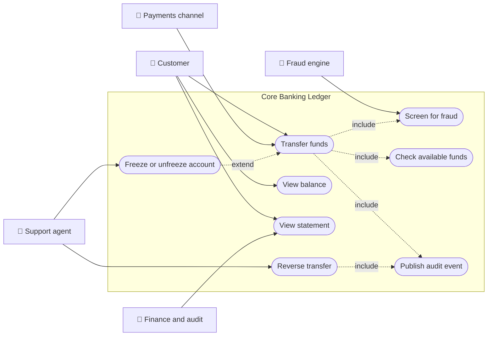
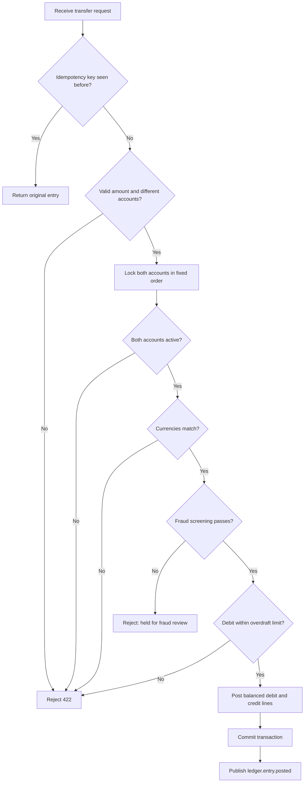
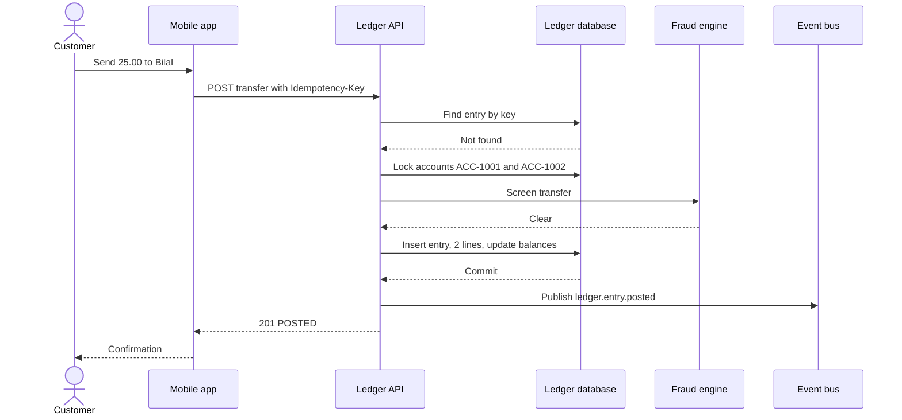
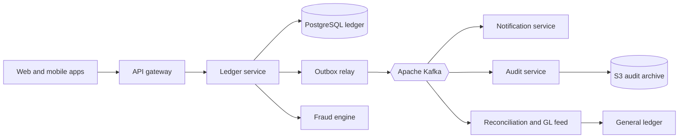
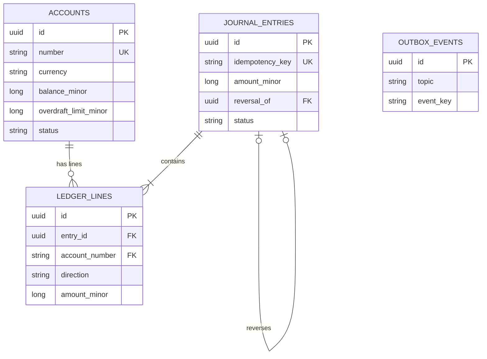
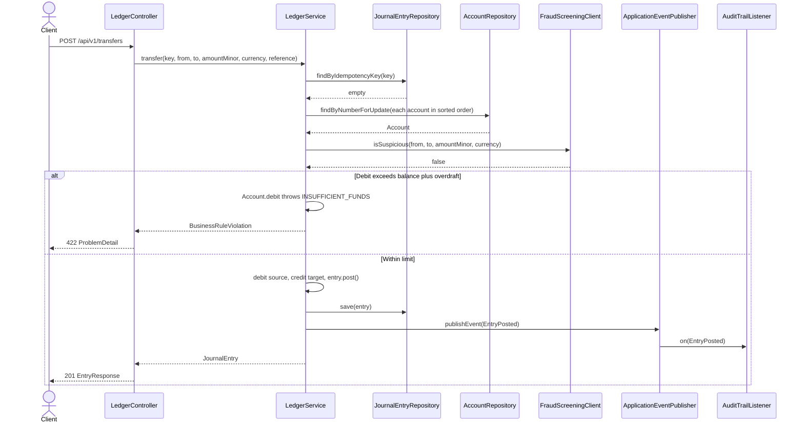
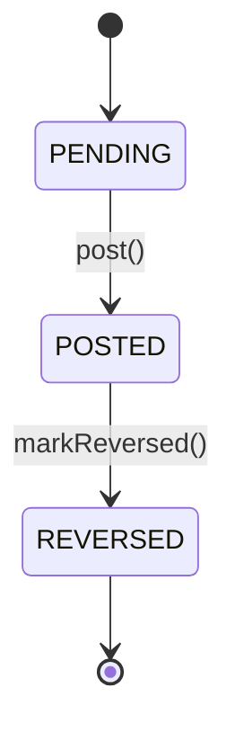
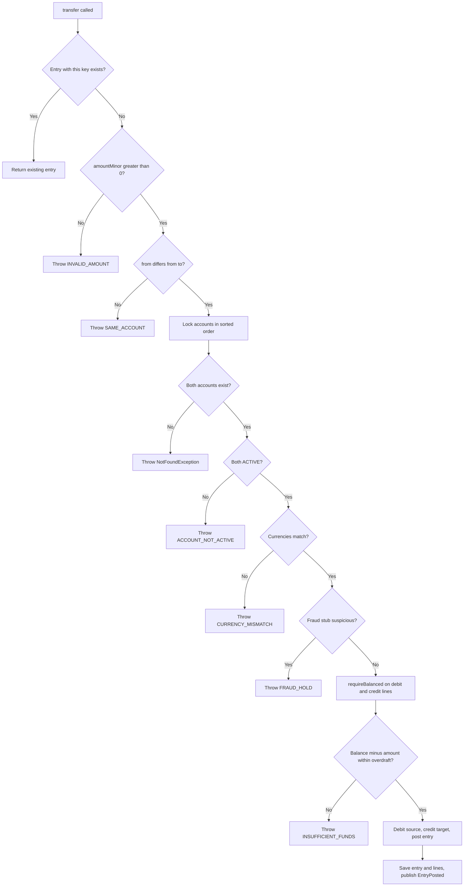

# Core Banking Ledger and Accounts

> **Domain:** Banking · **Author:** [@dhulipalla599](https://github.com/dhulipalla599) · **Published:** October 21, 2026

> **Runnable code:** [`examples/banking/core-banking-ledger-and-accounts`](https://github.com/dhulipalla599/domain-knowledge-engineering/tree/main/examples/banking/core-banking-ledger-and-accounts)

## Explain It Like I'm Five

Imagine a class piggy-bank game. Every child has a little notebook with their name on it. When Maya gives Leo three tokens, the teacher does not just erase a number and write a new one. She writes one line in Maya's notebook ("gave 3 tokens") and one line in Leo's notebook ("got 3 tokens"), and she writes both lines at the same moment or not at all. Nobody is allowed to rub out an old line; if there was a mistake, the teacher adds a new line that cancels it. At the end of the day anybody can add up the lines and see exactly where every token went.

A bank's core ledger is that teacher's notebook system: it records every movement of money as matching lines that can never be erased, so the balance on your screen can always be explained.

## Business Overview

The **core banking ledger** is the system of record for money. It holds customer **accounts** (current, savings, loan and so on) and the **journal** of every posting that changed a balance. Everything customer-facing, such as mobile apps, cards, payments and statements, ultimately reads from or writes to it.

Why the business cares:

- **Risk and trust.** A wrong balance, a lost update or a double-posted payment is a direct financial loss and a customer-trust incident. The ledger has to be correct before it is fast.
- **Regulation and audit.** Supervisors and auditors expect a complete, tamper-evident history, the ability to reproduce any balance at any past date, and reconciliation against external systems. Exact retention periods and reporting duties differ by country and institution.
- **Customer experience.** Balances, available funds and statements must agree across every channel, and retries must never move money twice.
- **Revenue.** Interest, fees and overdraft income are all calculated from ledger data.

In the value chain it sits behind channels and payment gateways and in front of finance. Onboarding and KYC create the customer and the account, payments and cards instruct postings, and general-ledger, risk and reporting functions consume the results.

## Real-World Example

Northwind Bank (fictional) has two customers. Amara Okafor holds current account `ACC-1001` with GBP 1,000.00. Bilal Haddad holds `ACC-1002` with GBP 250.00 and an agreed overdraft of GBP 500.00.

1. Amara opens the mobile app and sends GBP 25.00 to Bilal as her share of the rent. The app generates a unique `Idempotency-Key` for this tap and calls the transfer API.
2. The ledger checks that both accounts are active, are in GBP, and that Amara has enough available funds. A fraud check on the amount passes.
3. It writes one journal entry with two lines: DEBIT `ACC-1001` 25.00 and CREDIT `ACC-1002` 25.00. Both balances change in the same database transaction. Amara now has GBP 975.00 and Bilal GBP 275.00.
4. A `ledger.entry.posted` event is published. The notification service pushes "You sent GBP 25.00" and the audit store records the event.
5. Amara's phone loses signal and the app retries the same request. The ledger finds the existing idempotency key and returns the original entry. No second payment is made.
6. A minute later Amara notices she sent money for the wrong month. Customer support asks for a **reversal**. The ledger posts a second entry with the opposite lines and marks the original `REVERSED`. The original lines stay in the history for audit.

## Stakeholders

| Stakeholder | What they need | What they fear |
|---|---|---|
| Retail customer (Amara) | Correct balance, instant confirmation, safe retries | Missing or doubled money, wrongly blocked account |
| Payments and channels team | A reliable posting API with clear errors | Timeouts that leave the outcome unknown |
| Operations and support agent | Explainable statements, ability to reverse errors | Having to edit data by hand |
| Finance and accounting | Ledger that reconciles to the general ledger daily | Unexplained differences, unbalanced postings |
| Compliance and audit | Immutable history and a trace of who changed what | Altered records, missing audit evidence |
| Fraud and risk team | Real-time hooks to hold or block suspicious movements | Money leaving before screening completes |
| Platform engineer | Predictable latency, safe concurrency, easy recovery | Deadlocks, hot accounts, data corruption |

## Use Case Diagram



| Use Case | Primary Actor | Goal | Main success outcome |
|---|---|---|---|
| Transfer funds | Customer or payments channel | Move money between two accounts | One balanced journal entry is posted and both balances change |
| View balance | Customer | See current and available funds | Balance and available amount returned |
| View statement | Customer, finance | See the lines that explain the balance | Ordered list of ledger lines |
| Reverse transfer | Support agent | Correct a mistaken payment | Opposite entry posted, original marked reversed |
| Freeze or unfreeze account | Support agent | Stop or resume activity on an account | Status changes and a status event is published |
| Screen for fraud | Fraud engine | Hold suspicious transfers | Transfer is allowed or rejected before any balance changes |
| Check available funds | Ledger (internal) | Enforce the overdraft limit | Debit allowed only inside balance plus overdraft |
| Publish audit event | Ledger (internal) | Make every change visible downstream | Event delivered to topics for audit and notifications |

## Key Terms

| Term | Plain-English meaning |
|---|---|
| Ledger | The authoritative record of every posting and balance |
| Double-entry | Every movement has equal debits and credits, so the books always balance |
| Journal entry | One atomic, balanced group of ledger lines |
| Debit / Credit | The two sides of a line. On a customer deposit account, a debit reduces the balance and a credit increases it, because the account is a liability of the bank |
| Posting | Writing a journal entry so it takes effect on balances |
| Ledger balance | The sum of posted lines on an account |
| Available balance | Ledger balance plus any overdraft limit, minus holds |
| Overdraft limit | The agreed amount an account may go below zero |
| Idempotency key | A client-supplied token so a retried request is applied only once |
| Reversal | A new entry with opposite lines that cancels an earlier one without editing it |
| Minor units | Smallest currency unit (pence, cents) stored as integers; the number of decimals depends on the currency |
| Reconciliation | Comparing the ledger with external records such as payment-scheme settlement files |
| End-of-day (EOD) | The batch cut-off for interest, fees and reporting; "value date" and "booking date" can differ |

## Process Flow

A channel submits a transfer with an idempotency key. The ledger first looks for an earlier request with the same key and, if found, returns that result. Otherwise it validates the request, locks both accounts in a fixed order, checks account state, currency and available funds, asks the fraud engine for a decision, and writes the balanced entry. Only after the transaction commits is the `ledger.entry.posted` event delivered to downstream consumers. Mistakes are corrected by reversal, never by editing.





## Business Rules and Edge Cases

- **Double-entry balance.** Total debits must equal total credits in every entry. An unbalanced entry is a bug and must never be committed.
- **Money is integers.** Store minor units as whole numbers and keep the currency alongside. Floating point and silent rounding cause penny differences. Currencies have different decimal places, and rounding rules (for interest, for example) are set by product and local policy.
- **Overdraft limit.** A debit may not take the balance below the agreed limit. The check and the update must happen under the same lock, or two concurrent debits can both pass.
- **Idempotency.** Networks retry. The same key must return the same result, and two simultaneous requests with one key must not both post. A unique constraint is the final safety net.
- **Account state.** Frozen or closed accounts must not transact. Closing needs a zero balance. Whether a frozen account may still receive credits depends on bank policy and legal orders; this example blocks both directions for simplicity.
- **Immutability.** Posted lines are never updated or deleted. Corrections are new entries, and an entry can be reversed only once. Reversals of reversals are not allowed here.
- **Reversal and limits.** A reversal may take an account beyond its overdraft limit; whether that is allowed, or requires approval, is a bank policy decision.
- **Concurrency and deadlocks.** Two transfers in opposite directions between the same accounts will deadlock unless locks are taken in a consistent order.
- **Partial failure.** If the event publish fails after commit, the ledger is right but downstream is stale. Use a transactional outbox rather than publishing and hoping.
- **Timing.** Booking date, value date, cut-off times and holidays differ by payment scheme and country. Do not assume that "now" is the value date.
- **Compliance.** Sanctions and fraud screening happen before funds move; the rules and thresholds differ by jurisdiction and institution.

## From Business to System

| Business concept or step | System component | Data entity | Event |
|---|---|---|---|
| Customer account | Account service | `accounts` | `ledger.account.status-changed` |
| Transfer funds | Posting service (`LedgerService.transfer`) | `journal_entries`, `ledger_lines` | `ledger.entry.posted` |
| Retry safety | Idempotency check in the posting service | `journal_entries.idempotency_key` | none |
| Overdraft check | `Account.debit` under row lock | `accounts.balance_minor`, `overdraft_limit_minor` | none |
| Fraud screening | Fraud adapter | none | none (decision is synchronous) |
| Reverse a payment | Posting service (`LedgerService.reverse`) | new `journal_entries` row with `reversal_of` | `ledger.entry.reversed` |
| Freeze or close | Account service | `accounts.status` | `ledger.account.status-changed` |
| Statement | Query service | `ledger_lines` | none |
| Audit trail | Audit consumer | audit store | consumes all ledger topics |

## Architecture



The **ledger service** owns accounts, journal entries and lines, and is the only writer to them. Keeping postings and balances in one service and one database lets a single ACID transaction guarantee the double-entry invariant; splitting them across services would turn every transfer into a distributed transaction. The **fraud engine** is external and called synchronously because the decision must precede the money movement. Notifications, audit and reconciliation are **consumers** of Kafka events: they can lag or fail without affecting correctness of the ledger. The outbox relay turns committed rows into Kafka messages so publishing is never lost or sent for a rolled-back posting.

## Data Model

```sql
CREATE TABLE accounts (
  id                    UUID PRIMARY KEY,
  number                VARCHAR(20) NOT NULL UNIQUE,
  owner_name            VARCHAR(120) NOT NULL,
  currency              CHAR(3) NOT NULL,
  balance_minor         BIGINT NOT NULL,
  overdraft_limit_minor BIGINT NOT NULL DEFAULT 0 CHECK (overdraft_limit_minor >= 0),
  status                VARCHAR(10) NOT NULL CHECK (status IN ('ACTIVE','FROZEN','CLOSED')),
  version               BIGINT NOT NULL DEFAULT 0
);

CREATE TABLE journal_entries (
  id               UUID PRIMARY KEY,
  idempotency_key  VARCHAR(80) NOT NULL UNIQUE,
  reference        VARCHAR(140),
  currency         CHAR(3) NOT NULL,
  amount_minor     BIGINT NOT NULL CHECK (amount_minor > 0),
  reversal_of      UUID REFERENCES journal_entries(id),
  status           VARCHAR(10) NOT NULL CHECK (status IN ('PENDING','POSTED','REVERSED')),
  created_at       TIMESTAMPTZ NOT NULL
);

CREATE TABLE ledger_lines (
  id             UUID PRIMARY KEY,
  entry_id       UUID NOT NULL REFERENCES journal_entries(id),
  account_number VARCHAR(20) NOT NULL REFERENCES accounts(number),
  direction      VARCHAR(6) NOT NULL CHECK (direction IN ('DEBIT','CREDIT')),
  amount_minor   BIGINT NOT NULL CHECK (amount_minor > 0),
  posted_at      TIMESTAMPTZ NOT NULL
);
CREATE INDEX ledger_lines_account_time ON ledger_lines (account_number, posted_at DESC);

CREATE TABLE outbox_events (
  id         UUID PRIMARY KEY,
  topic      VARCHAR(80) NOT NULL,
  event_key  VARCHAR(40) NOT NULL,
  payload    JSONB NOT NULL,
  created_at TIMESTAMPTZ NOT NULL DEFAULT now(),
  sent_at    TIMESTAMPTZ
);
```

The `outbox_events` table is part of the production design; the runnable example publishes in-process events instead.



## APIs

| Method | Path | Purpose |
|---|---|---|
| POST | `/api/v1/transfers` | Post a transfer (requires `Idempotency-Key` header) |
| POST | `/api/v1/transfers/{entryId}/reversal` | Reverse a posted transfer |
| GET | `/api/v1/accounts/{number}` | Balance, available funds and status |
| GET | `/api/v1/accounts/{number}/statement` | Ledger lines, newest first |
| POST | `/api/v1/accounts/{number}/status` | Freeze, unfreeze or close an account |

Errors use RFC 9457 problem responses: 422 for business-rule violations (with a machine-readable `code`), 404 for unknown accounts or entries, 409 for a duplicate request still in flight, and 400 for a malformed request or a missing `Idempotency-Key`.

Request `POST /api/v1/transfers` with header `Idempotency-Key: demo-1`:

```json
{
  "fromAccount": "ACC-1001",
  "toAccount": "ACC-1002",
  "amountMinor": 2500,
  "currency": "GBP",
  "reference": "Rent share"
}
```

Response `201 Created`:

```json
{
  "entryId": "a492cc11-118d-46cf-bd2c-803e967c1ddb",
  "status": "POSTED",
  "amountMinor": 2500,
  "currency": "GBP",
  "reference": "Rent share",
  "reversalOf": null,
  "createdAt": "2026-10-21T15:06:35.678827520Z"
}
```

## Events

| Event (Kafka topic) | Producer | Consumers | Key fields |
|---|---|---|---|
| `ledger.entry.posted` | Ledger service | Notification, audit, reconciliation | `entryId`, `fromAccount`, `toAccount`, `amountMinor`, `currency`, `postedAt` |
| `ledger.entry.reversed` | Ledger service | Notification, audit, reconciliation | `originalEntryId`, `reversalEntryId`, `reversedAt` |
| `ledger.account.status-changed` | Ledger service | Audit, card and channel services | `accountNumber`, `from`, `to` |

**Ordering.** Kafka orders messages only within a partition, so key messages by account number so events for one account stay in order. An entry touches two accounts, so consumers that need a per-account view should expect each event on the partition of its source account and treat the event itself as a fact, not as an instruction to update a counter.

**Idempotency.** The outbox gives at-least-once delivery, so consumers must tolerate duplicates, for example by de-duplicating on `entryId`. Publish from the outbox after commit, never before.

## Backend Implementation

> The Java tab is the exact code from the runnable example (Spring Boot 3). The Python tab uses FastAPI with SQLAlchemy and the Node.js tab uses Express with TypeScript and the `pg` driver, applying the same rules and names.

=== "Java"

    ```java
    // Account.java
        /** Key rule: a debit may not take the balance below the agreed overdraft limit. */
        public void debit(long amountMinor, boolean enforceLimit) {
            if (enforceLimit && balanceMinor - amountMinor < -overdraftLimitMinor) {
                throw new BusinessRuleViolation("INSUFFICIENT_FUNDS",
                        "Account " + number + " has " + availableMinor() + " available, needs " + amountMinor);
            }
            balanceMinor -= amountMinor;
        }

    // LedgerService.java
        /** Moves money between two accounts as one balanced, atomic journal entry. Safe to retry with the same key. */
        @Transactional
        public JournalEntry transfer(String idempotencyKey, String from, String to, long amountMinor, String currency,
                                     String reference) {
            var replay = entries.findByIdempotencyKey(idempotencyKey);
            if (replay.isPresent()) {
                return replay.get();
            }
            if (amountMinor <= 0) {
                throw new BusinessRuleViolation("INVALID_AMOUNT", "Amount must be positive");
            }
            if (from.equals(to)) {
                throw new BusinessRuleViolation("SAME_ACCOUNT", "Source and destination must differ");
            }
            // Lock in a fixed order so two opposite transfers can never deadlock each other.
            Account source = null;
            Account target = null;
            for (String number : List.of(from, to).stream().sorted().toList()) {
                Account locked = accounts.findByNumberForUpdate(number)
                        .orElseThrow(() -> new NotFoundException("Account " + number + " not found"));
                if (number.equals(from)) source = locked; else target = locked;
            }
            source.assertActive();
            target.assertActive();
            if (!source.getCurrency().equals(currency) || !target.getCurrency().equals(currency)) {
                throw new BusinessRuleViolation("CURRENCY_MISMATCH", "Both accounts must be held in " + currency);
            }
            if (fraud.isSuspicious(from, to, amountMinor, currency)) {
                throw new BusinessRuleViolation("FRAUD_HOLD", "Transfer held for fraud review");
            }

            Instant now = clock.instant();
            UUID entryId = UUID.randomUUID();
            JournalEntry entry = new JournalEntry(entryId, idempotencyKey, reference, currency, amountMinor, null, now);
            List<LedgerLine> posting = List.of(
                    new LedgerLine(entryId, from, Direction.DEBIT, amountMinor, now),
                    new LedgerLine(entryId, to, Direction.CREDIT, amountMinor, now));
            JournalEntry.requireBalanced(posting);

            source.debit(amountMinor, true);
            target.credit(amountMinor);
            entry.post();
            entries.save(entry);
            lines.saveAll(posting);
            events.publishEvent(new EntryPosted(entryId, from, to, amountMinor, currency, now));
            return entry;
        }

    // LedgerController.java
        @PostMapping("/transfers")
        @ResponseStatus(HttpStatus.CREATED)
        EntryResponse transfer(@RequestHeader("Idempotency-Key") String idempotencyKey,
                               @Valid @RequestBody TransferRequest request) {
            return EntryResponse.from(ledger.transfer(idempotencyKey, request.fromAccount(), request.toAccount(),
                    request.amountMinor(), request.currency(), request.reference()));
        }
    ```

=== "Python"

    ```python
    # ledger.py (FastAPI + SQLAlchemy 2)
    class BusinessRuleViolation(Exception):
        def __init__(self, code: str, message: str):
            super().__init__(message)
            self.code = code

    class Account(Base):
        __tablename__ = "accounts"
        number: Mapped[str] = mapped_column(primary_key=True)
        currency: Mapped[str]
        balance_minor: Mapped[int]
        overdraft_limit_minor: Mapped[int]
        status: Mapped[str]

        def available_minor(self) -> int:
            return self.balance_minor + self.overdraft_limit_minor

        def debit(self, amount_minor: int, enforce_limit: bool) -> None:
            if enforce_limit and self.balance_minor - amount_minor < -self.overdraft_limit_minor:
                raise BusinessRuleViolation(
                    "INSUFFICIENT_FUNDS",
                    f"Account {self.number} has {self.available_minor()} available, needs {amount_minor}")
            self.balance_minor -= amount_minor

    def transfer(db: Session, key: str, from_no: str, to_no: str, amount: int, currency: str, reference: str | None):
        replay = db.scalar(select(JournalEntry).where(JournalEntry.idempotency_key == key))
        if replay:
            return replay
        if amount <= 0:
            raise BusinessRuleViolation("INVALID_AMOUNT", "Amount must be positive")
        if from_no == to_no:
            raise BusinessRuleViolation("SAME_ACCOUNT", "Source and destination must differ")
        locked = {}
        for number in sorted([from_no, to_no]):  # fixed lock order avoids deadlocks
            locked[number] = db.scalar(select(Account).where(Account.number == number).with_for_update())
            if locked[number] is None:
                raise NotFound(f"Account {number} not found")
        source, target = locked[from_no], locked[to_no]
        for a in (source, target):
            if a.status != "ACTIVE":
                raise BusinessRuleViolation("ACCOUNT_NOT_ACTIVE", f"Account {a.number} is {a.status}")
        if source.currency != currency or target.currency != currency:
            raise BusinessRuleViolation("CURRENCY_MISMATCH", f"Both accounts must be held in {currency}")
        if fraud.is_suspicious(from_no, to_no, amount, currency):
            raise BusinessRuleViolation("FRAUD_HOLD", "Transfer held for fraud review")

        entry_id = uuid4()
        now = datetime.now(timezone.utc)
        source.debit(amount, True)
        target.balance_minor += amount
        entry = JournalEntry(id=entry_id, idempotency_key=key, reference=reference,
                             currency=currency, amount_minor=amount, status="POSTED", created_at=now)
        db.add_all([entry,
                    LedgerLine(entry_id=entry_id, account_number=from_no, direction="DEBIT", amount_minor=amount, posted_at=now),
                    LedgerLine(entry_id=entry_id, account_number=to_no, direction="CREDIT", amount_minor=amount, posted_at=now)])
        publish("ledger.entry.posted", entry_id, from_no, to_no, amount, currency, now)
        return entry

    @router.post("/api/v1/transfers", status_code=201)
    def post_transfer(body: TransferRequest, idempotency_key: str = Header(...), db: Session = Depends(get_db)):
        with db.begin():
            return to_response(transfer(db, idempotency_key, body.from_account, body.to_account,
                                        body.amount_minor, body.currency, body.reference))
    ```

=== "Node.js"

    ```typescript
    // ledger.ts (Express + pg)
    class BusinessRuleViolation extends Error {
      constructor(readonly code: string, message: string) { super(message); }
    }

    function debit(a: Account, amountMinor: number, enforceLimit: boolean): void {
      if (enforceLimit && a.balanceMinor - amountMinor < -a.overdraftLimitMinor) {
        throw new BusinessRuleViolation(
          "INSUFFICIENT_FUNDS",
          `Account ${a.number} has ${a.balanceMinor + a.overdraftLimitMinor} available, needs ${amountMinor}`);
      }
      a.balanceMinor -= amountMinor;
    }

    export async function transfer(tx: PoolClient, key: string, from: string, to: string,
                                   amountMinor: number, currency: string, reference?: string) {
      const replay = await findEntryByKey(tx, key);
      if (replay) return replay;
      if (amountMinor <= 0) throw new BusinessRuleViolation("INVALID_AMOUNT", "Amount must be positive");
      if (from === to) throw new BusinessRuleViolation("SAME_ACCOUNT", "Source and destination must differ");

      const locked = new Map<string, Account>();
      for (const number of [from, to].sort()) {            // fixed lock order avoids deadlocks
        const a = await selectAccountForUpdate(tx, number); // SELECT ... FOR UPDATE
        if (!a) throw new NotFound(`Account ${number} not found`);
        locked.set(number, a);
      }
      const source = locked.get(from)!, target = locked.get(to)!;
      for (const a of [source, target]) {
        if (a.status !== "ACTIVE") throw new BusinessRuleViolation("ACCOUNT_NOT_ACTIVE", `Account ${a.number} is ${a.status}`);
      }
      if (source.currency !== currency || target.currency !== currency) {
        throw new BusinessRuleViolation("CURRENCY_MISMATCH", `Both accounts must be held in ${currency}`);
      }
      if (await fraud.isSuspicious(from, to, amountMinor, currency)) {
        throw new BusinessRuleViolation("FRAUD_HOLD", "Transfer held for fraud review");
      }

      const entryId = randomUUID();
      const now = new Date();
      debit(source, amountMinor, true);
      target.balanceMinor += amountMinor;
      await saveAccounts(tx, source, target);
      await insertEntryWithLines(tx, { entryId, key, reference, currency, amountMinor, now, from, to });
      await publish("ledger.entry.posted", { entryId, from, to, amountMinor, currency, now });
      return { entryId, status: "POSTED", amountMinor, currency, reference, now };
    }

    router.post("/api/v1/transfers", async (req, res) => {
      const key = req.header("Idempotency-Key");
      if (!key) return res.status(400).json({ title: "Missing Idempotency-Key" });
      const { fromAccount, toAccount, amountMinor, currency, reference } = req.body;
      const entry = await withTransaction((tx) =>
        transfer(tx, key, fromAccount, toAccount, amountMinor, currency, reference));
      res.status(201).json(entry);
    });
    ```

Full source: [`examples/banking/core-banking-ledger-and-accounts`](https://github.com/dhulipalla599/domain-knowledge-engineering/tree/main/examples/banking/core-banking-ledger-and-accounts/src/main/java/com/dke/banking/core_banking_ledger_and_accounts).

## Frontend Screen

```tsx
import { useState } from "react";

type Result = { ok: boolean; text: string };

export function SendMoney({ from }: { from: string }) {
  const [to, setTo] = useState("");
  const [amount, setAmount] = useState("");
  const [busy, setBusy] = useState(false);
  const [result, setResult] = useState<Result | null>(null);
  // One key per intent: reused if the user (or the network layer) retries the same submission.
  const [key] = useState(() => crypto.randomUUID());

  async function submit(e: React.FormEvent) {
    e.preventDefault();
    setBusy(true);
    try {
      const res = await fetch("/api/v1/transfers", {
        method: "POST",
        headers: { "Content-Type": "application/json", "Idempotency-Key": key },
        body: JSON.stringify({
          fromAccount: from,
          toAccount: to,
          amountMinor: Math.round(parseFloat(amount) * 100),
          currency: "GBP",
        }),
      });
      const body = await res.json();
      setResult(res.ok
        ? { ok: true, text: `Sent. Reference ${body.entryId}` }
        : { ok: false, text: body.detail ?? "Something went wrong" });
    } catch {
      setResult({ ok: false, text: "No connection. Retrying is safe: you will not be charged twice." });
    } finally {
      setBusy(false);
    }
  }

  return (
    <form onSubmit={submit} aria-busy={busy}>
      <label>To account <input value={to} onChange={(e) => setTo(e.target.value)} required /></label>
      <label>Amount (GBP) <input type="number" min="0.01" step="0.01" value={amount}
        onChange={(e) => setAmount(e.target.value)} required /></label>
      <button disabled={busy}>Send</button>
      {result && <p role={result.ok ? "status" : "alert"}>{result.text}</p>}
    </form>
  );
}
```

The component sends one `Idempotency-Key` per form instance, so a double-click or a retry after a timeout cannot post twice. In production, convert amounts with a currency-aware library instead of `Math.round(x * 100)`.

## Cloud Deployment

The ledger service runs as a Deployment on **Amazon EKS** behind an Application Load Balancer, in at least three Availability Zones. The ledger database is **Amazon Aurora PostgreSQL** (or RDS PostgreSQL Multi-AZ). **Amazon MSK** provides Apache Kafka, **Amazon S3** with Object Lock stores audit archives, **AWS Secrets Manager** holds credentials, and **AWS KMS** encrypts data at rest.

```hcl
resource "aws_rds_cluster" "ledger" {
  cluster_identifier              = "ledger-prod"
  engine                          = "aurora-postgresql"
  database_name                   = "ledger"
  master_username                 = "ledger_admin"
  manage_master_user_password     = true
  storage_encrypted               = true
  kms_key_id                      = aws_kms_key.ledger.arn
  backup_retention_period         = 35
  deletion_protection             = true
  vpc_security_group_ids          = [aws_security_group.ledger_db.id]
  db_subnet_group_name            = aws_db_subnet_group.private.name
  enabled_cloudwatch_logs_exports = ["postgresql"]
}
```

- **Security.** Private subnets only; the database accepts traffic only from the service's security group. Use IAM roles for service accounts, TLS everywhere, and least-privilege database users (the application user has no `UPDATE` or `DELETE` on `ledger_lines`).
- **Scaling.** Scale pods with a Horizontal Pod Autoscaler on CPU and request latency. The database is the bottleneck, so watch lock waits and consider partitioning `ledger_lines` by time. Hot accounts (for example a bank's own settlement account) need special handling, such as batching.
- **Observability.** Instrument with OpenTelemetry (traces across API, database and Kafka), export to CloudWatch via the AWS Distro for OpenTelemetry collector, and alarm on p99 latency, 5xx rate, lock wait time, outbox lag and the reconciliation difference.

## Non-Functional Requirements

| Concern | Expectation | How the design meets it |
|---|---|---|
| Availability | Postings are available whenever channels are; targets are set by the bank | Multi-AZ database, stateless pods, retry-safe idempotent API |
| Latency | Interactive transfers complete in well under a second at the API | One short database transaction; fraud call has a timeout and a defined policy |
| Consistency | Never lose or duplicate money; balances equal the sum of lines | ACID transaction, row locks, unique idempotency key, balanced-entry check |
| Durability | No committed posting is ever lost | Synchronous replication, point-in-time recovery, backups |
| Audit | Full history, no edits, traceable events | Append-only lines, reversal entries, events archived to S3 with Object Lock |
| Compliance | Retention, access control and reporting as required locally | Encryption, least privilege, retention configured per jurisdiction |
| Recoverability | Rebuild any balance from lines | Daily reconciliation job compares `balance_minor` with the sum of lines |

## Runnable Example

The example is a Spring Boot 3 service on Java 21 with an in-memory H2 database, so it needs no setup. It implements transfers as balanced journal entries, idempotent retries, the overdraft, account-state and currency rules, a stubbed fraud check, reversals, statements and account freeze, and publishes the three events with Spring's event publisher as stand-ins for Kafka topics.

Source: [`examples/banking/core-banking-ledger-and-accounts`](https://github.com/dhulipalla599/domain-knowledge-engineering/tree/main/examples/banking/core-banking-ledger-and-accounts)

```bash
cd examples/banking/core-banking-ledger-and-accounts
mvn spring-boot:run      # http://localhost:8080
mvn -B -ntp verify       # build and run the tests
```

Happy path:

```bash
curl -s -X POST localhost:8080/api/v1/transfers -H 'Content-Type: application/json' \
  -H 'Idempotency-Key: demo-1' \
  -d '{"fromAccount":"ACC-1001","toAccount":"ACC-1002","amountMinor":2500,"currency":"GBP","reference":"Rent share"}'
```

```json
{"entryId":"a492cc11-118d-46cf-bd2c-803e967c1ddb","status":"POSTED","amountMinor":2500,"currency":"GBP","reference":"Rent share","reversalOf":null,"createdAt":"2026-10-21T15:06:35.678827520Z"}
```

Rule violation (the entry id and timestamp will differ on your machine):

```bash
curl -s -X POST localhost:8080/api/v1/transfers -H 'Content-Type: application/json' \
  -H 'Idempotency-Key: demo-2' \
  -d '{"fromAccount":"ACC-1001","toAccount":"ACC-1002","amountMinor":999999,"currency":"GBP"}'
```

```json
{"type":"about:blank","title":"Business rule violated","status":422,"detail":"Account ACC-1001 has 97500 available, needs 999999","instance":"/api/v1/transfers","code":"INSUFFICIENT_FUNDS"}
```

| Class | Package | Responsibility |
|---|---|---|
| `LedgerController` | `api` | REST endpoints |
| `LedgerDtos` | `api` | Request and response records |
| `ApiExceptionHandler` | `api` | Maps errors to `ProblemDetail` |
| `LedgerService` | `service` | Transfer, reversal and status rules; publishes events |
| `NotFoundException` | `service` | Unknown account or entry |
| `Account`, `AccountStatus` | `domain` | Balance, overdraft rule, account lifecycle |
| `JournalEntry`, `EntryStatus` | `domain` | Balanced entry, idempotency key, entry lifecycle |
| `LedgerLine`, `Direction` | `domain` | Append-only debit or credit line |
| `LedgerEvents` | `domain` | Event records named after topics |
| `BusinessRuleViolation` | `domain` | Carries the rule `code` |
| `AccountRepository`, `JournalEntryRepository`, `LedgerLineRepository` | `repository` | Persistence, including `findByNumberForUpdate` |
| `FraudScreeningClient`, `StubFraudScreeningClient` | `integration` | Fraud port and deterministic stub |
| `AuditTrailListener`, `LowBalanceAlertListener` | `integration` | Event consumers |

## UML Diagrams

### Class Diagram

The controller delegates to `LedgerService`, which uses three repositories, the fraud port and the event publisher. Domain classes enforce their own rules.

```mermaid
classDiagram
    class LedgerController {
        +transfer(idempotencyKey, request) EntryResponse
        +reverse(entryId) EntryResponse
        +account(number) AccountResponse
        +statement(number) List
        +changeStatus(number, request) AccountResponse
    }
    class LedgerService {
        +transfer(idempotencyKey, from, to, amountMinor, currency, reference) JournalEntry
        +reverse(originalId) JournalEntry
        +changeStatus(number, next) Account
        +account(number) Account
        +statement(number) List
    }
    class Account {
        -number String
        -balanceMinor long
        -overdraftLimitMinor long
        -status AccountStatus
        +assertActive()
        +debit(amountMinor, enforceLimit)
        +credit(amountMinor)
        +transitionTo(next)
    }
    class JournalEntry {
        -idempotencyKey String
        -status EntryStatus
        -reversalOf UUID
        +requireBalanced(lines)$
        +post()
        +markReversed()
    }
    class LedgerLine {
        -accountNumber String
        -direction Direction
        -amountMinor long
    }
    class AccountStatus {
        <<enumeration>>
        ACTIVE
        FROZEN
        CLOSED
    }
    class EntryStatus {
        <<enumeration>>
        PENDING
        POSTED
        REVERSED
    }
    class Direction {
        <<enumeration>>
        DEBIT
        CREDIT
    }
    class FraudScreeningClient {
        <<interface>>
        +isSuspicious(from, to, amountMinor, currency) boolean
    }
    class StubFraudScreeningClient
    class AccountRepository {
        <<interface>>
        +findByNumberForUpdate(number)
    }
    class JournalEntryRepository {
        <<interface>>
        +findByIdempotencyKey(key)
    }
    class LedgerLineRepository {
        <<interface>>
        +findByEntryId(entryId)
    }
    class AuditTrailListener {
        +trail() List
    }
    class LowBalanceAlertListener
    class EntryPosted {
        <<event>>
    }
    class EntryReversed {
        <<event>>
    }
    class AccountStatusChanged {
        <<event>>
    }
    LedgerController --> LedgerService
    LedgerService --> AccountRepository
    LedgerService --> JournalEntryRepository
    LedgerService --> LedgerLineRepository
    LedgerService --> FraudScreeningClient
    StubFraudScreeningClient ..|> FraudScreeningClient
    LedgerService ..> EntryPosted : publishes
    LedgerService ..> EntryReversed : publishes
    LedgerService ..> AccountStatusChanged : publishes
    AuditTrailListener ..> EntryPosted : consumes
    AuditTrailListener ..> EntryReversed : consumes
    AuditTrailListener ..> AccountStatusChanged : consumes
    LowBalanceAlertListener ..> EntryPosted : consumes
    Account --> AccountStatus
    JournalEntry --> EntryStatus
    LedgerLine --> Direction
```



### Sequence Diagram (control flow)

One transfer request through the code. A rule violation throws `BusinessRuleViolation`, the transaction rolls back and `ApiExceptionHandler` returns a 422.



### State Diagram

`EntryStatus` and `JournalEntry.post()` and `markReversed()` allow only these transitions. `PENDING` exists only inside the transaction in the example; an entry is saved as `POSTED`.



### Activity Diagram

The decision logic inside `LedgerService.transfer`.



## AI Opportunities

- **Real-time fraud and anomaly scoring.** Use case: score each transfer before posting. Data: transaction history, device and behavioural signals, payee age. Risk and control: false positives block honest customers and bias is possible, so keep humans in the loop for high-impact decisions, monitor error rates by customer segment, and keep a documented explanation for each decision.
- **Reconciliation break triage.** Use case: cluster and explain differences between the ledger and external settlement files, and propose matches. Data: ledger lines, scheme files, past resolutions. Risk and control: a wrong auto-match hides a real loss, so suggest matches for an operator to approve and log every acceptance.
- **Natural-language statement and dispute assistant.** Use case: an LLM agent explains charges and drafts dispute cases using read-only ledger data. Data: statements, merchant data, policy documents. Risk and control: hallucinated amounts or policy, so ground answers in retrieved ledger lines, give the agent read-only credentials, and never let it post or reverse entries on its own.
- **Cash-flow and overdraft forecasting.** Use case: warn customers before they overdraw. Data: balances, recurring payments, income patterns. Risk and control: poor forecasts erode trust, and affordability nudges may be regulated; test accuracy and avoid using protected characteristics.
- **Operational anomaly detection.** Use case: detect unusual lock waits, outbox lag or posting failures. Data: metrics and traces. Risk and control: alert fatigue; start with advisory alerts and tune thresholds with engineers.

## Common Pitfalls

- **Storing money as floating point.** Use integer minor units (or a decimal type) with an explicit currency.
- **Update-in-place balances with no lines.** Without immutable lines you cannot explain or rebuild a balance. Keep both and reconcile them.
- **Check-then-update without a lock.** Two concurrent debits can both pass the overdraft check. Lock the row, or use a conditional update, in the same transaction.
- **Inconsistent lock order.** Opposite transfers deadlock. Always lock accounts in a fixed order.
- **No idempotency.** Timeouts lead to retries and double payments. Require a key and enforce it with a unique constraint.
- **Publishing events before commit.** A rollback leaves consumers with events for money that never moved. Use a transactional outbox.
- **Deleting to correct mistakes.** Auditors expect reversals and adjustments, not edits.
- **Treating the available balance as the ledger balance.** Holds, overdrafts and pending items make them different; show customers the right one.
- **Ignoring time.** Booking date, value date, time zones and cut-offs matter. Store timestamps in UTC and decide explicitly which date a posting takes.

## Interview Questions

### Junior

**1. What is double-entry bookkeeping and why does a ledger use it?**
Every movement is recorded as at least one debit and one credit of equal total. The ledger can then check that it balances, and errors show up as an imbalance instead of silently corrupting money.

**2. Why store money as integer minor units?**
Floating point cannot represent many decimal amounts exactly, which creates rounding errors. Integers (plus a currency code) are exact. Different currencies have different numbers of decimal places, so conversion must be currency-aware.

**3. What is an idempotency key?**
A unique value the client sends with a request so the server can recognise a retry. If the key was already used, the server returns the original result instead of repeating the operation.

### Mid-Level

**1. How do you stop two concurrent withdrawals overdrawing an account?**
Make the check and the update atomic: lock the account row (`SELECT ... FOR UPDATE`) or use an optimistic version check with retry, inside one transaction. Locking multiple accounts must follow a fixed order to avoid deadlocks.

**2. A payment was sent by mistake. How do you fix it?**
Post a reversal: a new entry with opposite lines linked to the original, then mark the original reversed. Never edit or delete the original. Decide by policy whether the reversal may exceed overdraft limits and who must approve it.

**3. Why is the transactional outbox useful?**
Writing to the database and to Kafka cannot be one atomic operation. The outbox stores the event in the same transaction as the posting, and a relay publishes it afterwards, giving at-least-once delivery with no phantom events.

### Senior / Architect

**1. Design the ledger to handle very high volume and a few extremely hot accounts.**
Key points: shard by account for normal traffic; hot accounts (settlement or fee accounts) cause lock contention, so use batching, per-shard sub-accounts summed on read, or asynchronous aggregation; keep the invariants per entry; discuss how cross-shard transfers need a clearing account or a saga; measure before optimising.

**2. Should the ledger use strong consistency, or event sourcing with eventual consistency?**
Key points: balances and limit checks need strong consistency at the account level; the append-only journal is event-like and can feed read models; downstream views can be eventually consistent; discuss replay, rebuild-from-lines, schema evolution, and the operational cost of event sourcing.

**3. How do you migrate from a legacy core to a new ledger without downtime?**
Key points: run both in parallel with the legacy as source of truth, replicate postings and reconcile daily, migrate customers or product lines in waves, define the cut-over and rollback, keep history and audit continuity, and plan for balance and reference-data mapping.

## Further Learning

- Double-entry bookkeeping and chart of accounts
- ISO 20022 payment messaging
- ISO 4217 currency codes and minor units
- Open banking and PSD2 concepts (UK and EU)
- Transactional outbox and saga patterns
- PostgreSQL transaction isolation and row locking
- Apache Kafka partitioning and delivery semantics
- Reconciliation and general-ledger integration

## Practitioner Notes

> _Reviewer: add real-world experience, corrections or gotchas here before approving._
