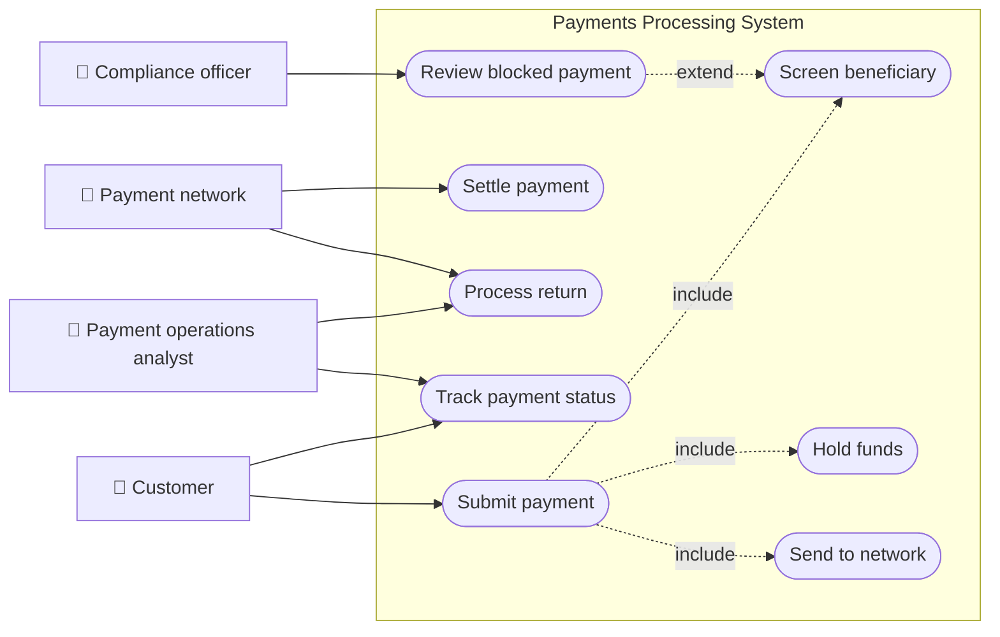
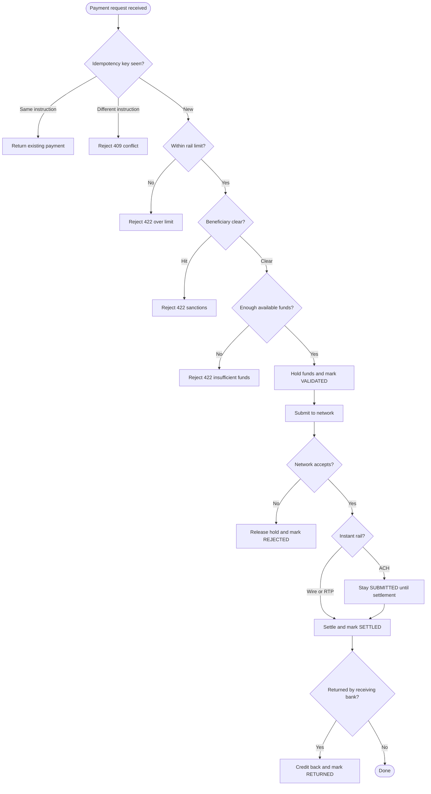
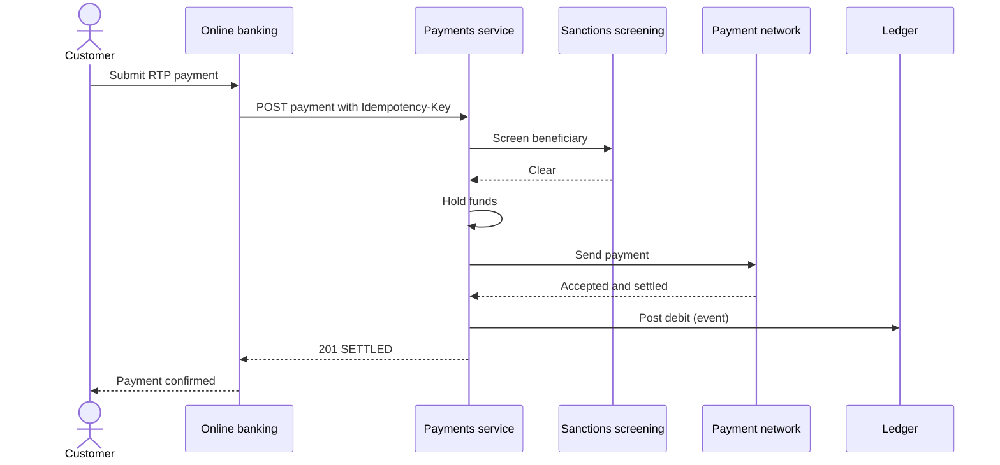
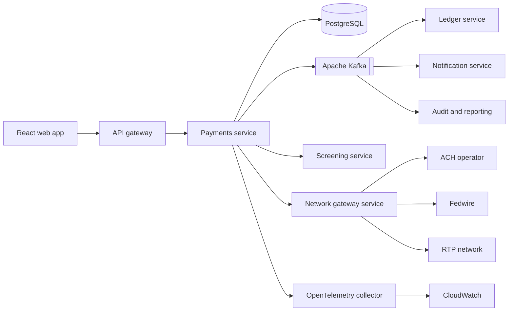
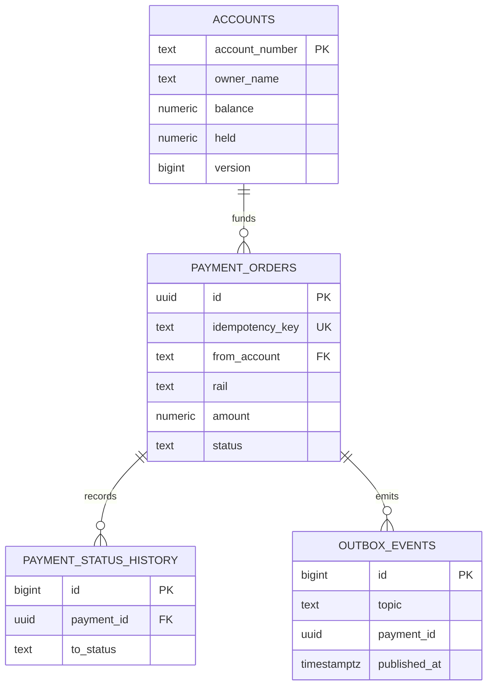
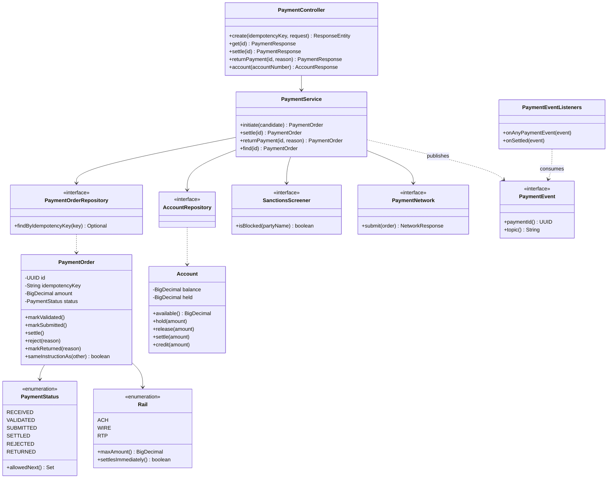
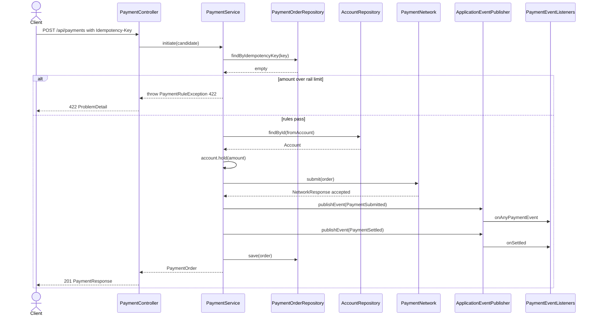
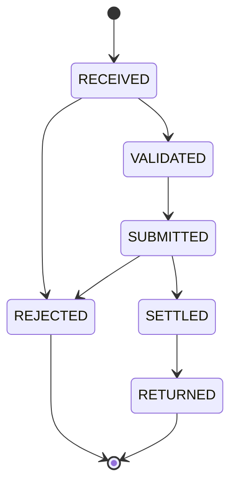
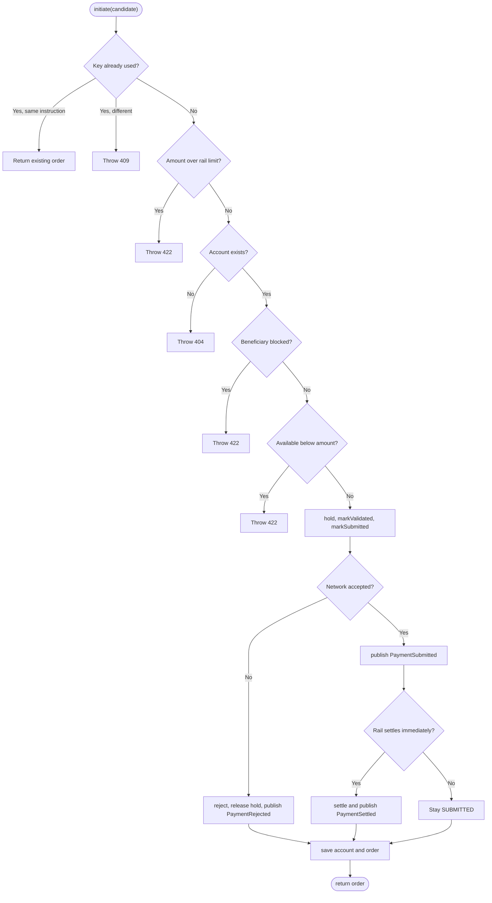

# Payments Processing (ACH, Wire, RTP)

> **Domain:** Banking · **Author:** [@dhulipalla599](https://github.com/dhulipalla599) · **Published:** November 04, 2026

> **Runnable code:** [`examples/banking/payments-processing-ach-wire-rtp`](https://github.com/dhulipalla599/domain-knowledge-engineering/tree/main/examples/banking/payments-processing-ach-wire-rtp)

## Explain It Like I'm Five

Imagine you want to send a toy to your friend who lives far away. You can drop it in the big mail truck that leaves once a day, which is cheap but slow. You can pay for a special courier who drives it over right now, which costs more but cannot be called back. Or you can use a magic tube in the wall that delivers it in a few seconds, any time of day. Before the toy goes anywhere, a grown-up checks that you really own it, that your friend is a safe person to send it to, and that you do not send the same toy twice by accident.

Payments processing is the same job for money: ACH is the daily mail truck, wires are the special courier, RTP is the magic tube, and the bank is the grown-up who checks everything.

## Business Overview

Payments processing is the capability that takes a customer's instruction to move money ("pay this supplier $12,500") and carries it safely to the receiving bank over the right payment network. In the US the main rails are:

- **ACH**: a batch network. Payments are collected and settled in windows, usually taking one or more business days (same-day ACH exists with extra cut-offs). Cheap, high volume, and payments can be *returned* by the receiving bank for some days afterwards.
- **Wire (for example Fedwire)**: real-time gross settlement of individual, high-value payments during operating hours. Treated as final and effectively irrevocable.
- **RTP (and similar instant networks such as FedNow)**: instant, 24x7, irrevocable credit transfers, typically with lower per-payment limits.

Practices, limits, cut-off times and fees differ by country (for example SEPA Credit Transfer and SEPA Instant in Europe, Faster Payments in the UK, UPI in India) and by bank, so treat the numbers in this page as illustrative.

Why the business cares:

- **Revenue**: payments drive fee income, deposits and customer stickiness; corporate clients choose banks partly on payment reach and speed.
- **Risk**: irrevocable rails mean a mistake or fraud cannot be undone, so every check must happen *before* release. Duplicate or lost payments are direct financial loss.
- **Regulation**: sanctions screening, anti-money-laundering monitoring, network rules (for example Nacha rules for ACH) and record keeping apply.
- **Customer experience**: customers expect to know whether a payment is accepted, in flight, settled or returned, and to retry safely.

In the Banking value chain it sits between **channels** (online banking, APIs, file uploads) and **core banking / the ledger** (which holds balances), and connects outward to the **payment networks** and to **compliance** services.

## Real-World Example

Maple Street Bakery (fictional) owns account ACC-1001 at Riverbend Bank (fictional). Its owner, Priya, logs in on a Tuesday evening to pay Harbor Steel Supply $250 for oven parts.

1. Priya picks **RTP** because the supplier wants it today, and submits. Her browser sends a payment request with a unique idempotency key.
2. Riverbend checks the key is new, the amount is under its RTP limit, the beneficiary name is not on a sanctions list, and the account has at least $250 available.
3. The bank places a **hold** of $250 so Priya cannot spend it twice, and sends the payment to the RTP network.
4. The network accepts and settles within seconds. The hold turns into a real debit, a ledger posting is made, and Priya sees "Settled".
5. Her phone loses signal mid-request and the app retries the same request. Because the idempotency key matches, Riverbend returns the original payment instead of paying twice.

Later that week she pays a landlord by **ACH**. That payment shows "Submitted" with funds on hold until the batch settles. Two days later the landlord's bank returns it (account closed), the status becomes "Returned" and the money goes back to Priya.

## Stakeholders

| Stakeholder | What they need | What they fear |
|---|---|---|
| Retail / business customer | Fast, predictable payments and clear status | Money lost, paid twice, or stuck in limbo |
| Payment operations analyst | Visibility into stuck, rejected and returned payments; tools to repair | Unexplained failures, manual rework, missed cut-offs |
| Compliance / sanctions officer | Every payment screened and auditable | Releasing a payment to a sanctioned party |
| Fraud analyst | Signals and holds on suspicious payments | Irrevocable fraudulent payments |
| Treasury / liquidity manager | Accurate settlement positions and cash forecasts | Unexpected overdraft at the settlement account |
| Payment network / receiving bank | Well-formed, valid messages | Malformed, duplicate or non-compliant payments |
| Engineering / SRE team | A system that is observable, replayable and safe to deploy | Duplicate processing, lost events, midnight pages |

## Use Case Diagram



| Use Case | Primary Actor | Goal | Main success outcome |
|---|---|---|---|
| Submit payment | Customer | Send money over a chosen rail | Payment accepted with an ID and status |
| Screen beneficiary | Compliance officer (via system) | Stop sanctioned parties | Beneficiary cleared, or payment refused |
| Hold funds | Customer (via system) | Reserve money so it is not spent twice | Available balance reduced by the amount |
| Send to network | Payment network | Deliver the payment instruction | Network accepts the instruction |
| Settle payment | Payment network | Confirm money moved | Hold converted to a debit; ledger updated |
| Process return | Payment operations analyst | Handle a payment the receiving bank sent back | Funds credited back, status RETURNED |
| Track payment status | Customer | Know where the payment is | Current status and any failure reason |
| Review blocked payment | Compliance officer | Decide on a screening hit | Payment released or permanently refused |

## Key Terms

| Term | Plain-English meaning |
|---|---|
| ACH | Automated Clearing House: a batch network for low-cost credits and debits, settled in windows |
| Wire / Fedwire | Individual, high-value, real-time gross settled transfers; final once sent |
| RTP / instant payments | 24x7 near-instant credit transfers; irrevocable |
| Rail | A payment network and its rules (ACH, wire, RTP) |
| Originator / beneficiary | The sender and the receiver of the money |
| Routing number (ABA) | 9-digit US identifier of a bank, used with an account number |
| Settlement | The moment the money actually moves between banks |
| Cut-off time | Latest time a payment can be submitted to make a given settlement window |
| Return | Receiving bank sends an ACH payment back, with a reason code (for example account closed) |
| Idempotency key | A client-supplied unique value so retries do not create duplicates |
| Hold (authorization hold) | Funds reserved but not yet debited |
| Sanctions screening | Checking parties against government watch lists before releasing money |
| ISO 20022 | The modern XML message standard used by many payment systems |

## Process Flow

A customer submits a payment through a channel. The system first checks whether it has seen the idempotency key, then applies rules (rail limit, sanctions, available balance). If all pass, it holds the funds and submits to the network. Instant rails (wire, RTP) settle right away; ACH waits for the batch to settle. A rejection by the network releases the hold. An ACH payment can still be returned after settlement, which credits the customer back. Every step emits an event for ledger, notifications and audit.





## Business Rules and Edge Cases

- **Idempotency**: networks and mobile clients retry. The same key with the same instruction must return the original result; the same key with a different instruction is an error, never a second payment.
- **Money is decimal, never float**: use fixed-point types (`NUMERIC` / `BigDecimal`) with explicit scale and currency. Beware of rounding and of mixing currencies.
- **Hold before send**: reserve funds first, then settle or release. Without a hold, two concurrent payments can overspend the same balance; use optimistic or pessimistic locking on the account.
- **Rail limits and cut-offs**: each rail and bank has limits and operating windows (RTP is 24x7, wires and ACH have cut-offs). A payment after cut-off usually rolls to the next window; make that explicit to the customer.
- **Irrevocability**: wire and RTP cannot be recalled by the sender; ACH can be returned by the receiver within network-defined windows. Fraud checks must therefore run *before* release.
- **Sanctions and AML**: screening is mandatory and must be recorded; fuzzy name matches need human review rather than silent pass or fail.
- **Partial failure**: the network accepted but your database write failed (or vice versa). Design for reconciliation with network settlement files and for safe replay, not for "it cannot happen".
- **Return handling**: a returned ACH payment must credit the customer back exactly once and notify them; returns can arrive days later.
- **Auditability**: keep an immutable history of every status change and who or what caused it.

## From Business to System

| Business concept / step | System component | Data entity | Event |
|---|---|---|---|
| Customer submits a payment | Payments API (`PaymentController`) | `payment_orders` | none yet |
| Safe retry | Payments service idempotency check | `payment_orders.idempotency_key` (unique) | none |
| Rail limit and rules | `PaymentService` / `Rail` | `Rail` enum | none |
| Sanctions screening | Screening adapter (`SanctionsScreener`) | `screening_results` (production) | none |
| Hold funds | `Account.hold` | `accounts.held` | none |
| Send to network | `PaymentNetwork` adapter | `payment_orders.status = SUBMITTED` | `payments.submitted` |
| Settlement | `PaymentService.settle` | `accounts.balance`, `status = SETTLED` | `payments.settled` |
| Network refusal | `PaymentService.initiate` | `status = REJECTED` | `payments.rejected` |
| Return | `PaymentService.returnPayment` | `status = RETURNED` | `payments.returned` |
| Audit trail | Event consumers | `payment_status_history` | all `payments.*` |

## Architecture



**Service boundaries.** The *Payments service* owns the payment lifecycle, idempotency and the funds hold, because those must change together in one database transaction. The *Network gateway* isolates the three external rails behind one interface so message formats, certificates and outages do not leak into business logic. *Screening* is separate because compliance teams change rules and vendors independently and need their own audit. The *Ledger*, *Notifications* and *Audit* are Kafka consumers: they react to events and can fail or replay without blocking the customer's payment. Account balances are owned by the ledger / core banking in a real bank; the example keeps a simple `accounts` table to show the hold-and-settle pattern.

## Data Model

```sql
CREATE TABLE accounts (
  account_number text PRIMARY KEY,
  owner_name     text NOT NULL,
  balance        numeric(19,2) NOT NULL,
  held           numeric(19,2) NOT NULL DEFAULT 0,
  version        bigint NOT NULL DEFAULT 0,
  CHECK (held >= 0 AND held <= balance)
);

CREATE TABLE payment_orders (
  id                  uuid PRIMARY KEY,
  idempotency_key     text NOT NULL UNIQUE,
  from_account        text NOT NULL REFERENCES accounts(account_number),
  rail                text NOT NULL CHECK (rail IN ('ACH','WIRE','RTP')),
  beneficiary_name    text NOT NULL,
  beneficiary_routing char(9) NOT NULL,
  beneficiary_account text NOT NULL,
  amount              numeric(19,2) NOT NULL CHECK (amount > 0),
  status              text NOT NULL,
  failure_reason      text,
  created_at          timestamptz NOT NULL DEFAULT now()
);

CREATE TABLE payment_status_history (
  id          bigserial PRIMARY KEY,
  payment_id  uuid NOT NULL REFERENCES payment_orders(id),
  from_status text,
  to_status   text NOT NULL,
  changed_at  timestamptz NOT NULL DEFAULT now()
);

CREATE TABLE outbox_events (
  id           bigserial PRIMARY KEY,
  topic        text NOT NULL,
  payment_id   uuid NOT NULL,
  payload      jsonb NOT NULL,
  created_at   timestamptz NOT NULL DEFAULT now(),
  published_at timestamptz
);
```



`payment_status_history` and `outbox_events` are part of the production design; the runnable example keeps only `accounts` and `payment_orders`.

## APIs

| Method | Path | Purpose |
|---|---|---|
| POST | `/api/payments` | Submit a payment (requires `Idempotency-Key` header) |
| GET | `/api/payments/{id}` | Read a payment and its status |
| POST | `/api/payments/{id}/settle` | Record network settlement (batch rails; internal) |
| POST | `/api/payments/{id}/return` | Record a return from the receiving bank (internal) |
| GET | `/api/accounts/{accountNumber}` | Read balance, held and available funds |

Example: submit an RTP payment.

```json
// POST /api/payments   Idempotency-Key: demo-1
{
  "fromAccount": "ACC-1001",
  "rail": "RTP",
  "beneficiaryName": "Harbor Steel Supply",
  "beneficiaryRouting": "021000021",
  "beneficiaryAccount": "8800123456",
  "amount": 250.00
}

// 201 Created
{
  "id": "31467041-7838-4e80-b12a-ed0640f4fe4a",
  "fromAccount": "ACC-1001",
  "rail": "RTP",
  "beneficiaryName": "Harbor Steel Supply",
  "amount": 250.00,
  "status": "SETTLED",
  "failureReason": null,
  "createdAt": "2026-11-04T15:04:56.294Z"
}
```

## Events

| Event (Kafka topic) | Producer | Consumers | Key fields |
|---|---|---|---|
| `payments.submitted` | Payments service | Audit, notifications | `paymentId`, `rail`, `amount` |
| `payments.settled` | Payments service | Ledger, notifications, reporting | `paymentId`, `rail`, `amount` |
| `payments.rejected` | Payments service | Notifications, operations dashboard | `paymentId`, `reason` |
| `payments.returned` | Payments service | Ledger, notifications, operations | `paymentId`, `reason` |

**Ordering**: use `paymentId` as the Kafka message key so all events for one payment land in one partition and stay in order. **Idempotency**: consumers can see an event more than once (at-least-once delivery), so the ledger must de-duplicate on `paymentId` plus event type. **Atomicity**: write the event to an `outbox_events` table in the same transaction as the status change, and let a relay publish it, so you never commit a state change without its event or the reverse. The example publishes in-process with Spring events as a stand-in.

## Backend Implementation

> The Java tab is the exact code from the runnable example (Spring Boot 3). The Python tab uses FastAPI with SQLAlchemy and the Node.js tab uses Express with TypeScript, showing the same logic and rules.

The method that enforces the key rules (idempotency, rail limit, sanctions, funds, hold, network submission):

=== "Java"

    ```java
        /** Core rule set: idempotency, rail limit, sanctions, funds hold, then network submission. */
        @Transactional
        public PaymentOrder initiate(PaymentOrder candidate) {
            var existing = orders.findByIdempotencyKey(candidate.getIdempotencyKey());
            if (existing.isPresent()) {
                if (existing.get().sameInstructionAs(candidate)) {
                    return existing.get();   // safe retry: same key, same instruction
                }
                throw new PaymentRuleException(HttpStatus.CONFLICT,
                        "Idempotency key already used with a different instruction");
            }
            if (candidate.getAmount().compareTo(candidate.getRail().maxAmount()) > 0) {
                throw new PaymentRuleException(HttpStatus.UNPROCESSABLE_ENTITY,
                        "Amount exceeds the " + candidate.getRail() + " limit of " + candidate.getRail().maxAmount());
            }
            Account account = accounts.findById(candidate.getFromAccount())
                    .orElseThrow(() -> new PaymentRuleException(HttpStatus.NOT_FOUND, "Unknown source account"));
            if (sanctions.isBlocked(candidate.getBeneficiaryName())) {
                throw new PaymentRuleException(HttpStatus.UNPROCESSABLE_ENTITY, "Beneficiary failed sanctions screening");
            }
            if (account.available().compareTo(candidate.getAmount()) < 0) {
                throw new PaymentRuleException(HttpStatus.UNPROCESSABLE_ENTITY,
                        "Insufficient available balance: " + account.available());
            }

            account.hold(candidate.getAmount());
            candidate.markValidated();
            candidate.markSubmitted();
            NetworkResponse response = network.submit(candidate);
            if (!response.accepted()) {
                candidate.reject(response.reason());
                account.release(candidate.getAmount());
                events.publishEvent(new PaymentEvent.PaymentRejected(candidate.getId(), response.reason()));
            } else {
                events.publishEvent(new PaymentEvent.PaymentSubmitted(
                        candidate.getId(), candidate.getRail(), candidate.getAmount()));
                if (candidate.getRail().settlesImmediately()) {
                    settleOrder(candidate, account);
                }
            }
            accounts.save(account);
            return orders.save(candidate);
        }
    ```

=== "Python"

    ```python
    @router.post("/payments", status_code=201)
    def initiate(candidate: PaymentOrder, db: Session, sanctions: SanctionsScreener,
                 network: PaymentNetwork, events: EventBus) -> PaymentOrder:
        existing = db.scalar(select(PaymentOrder).where(
            PaymentOrder.idempotency_key == candidate.idempotency_key))
        if existing:
            if existing.same_instruction_as(candidate):
                return existing  # safe retry
            raise PaymentRuleError(409, "Idempotency key already used with a different instruction")
        if candidate.amount > candidate.rail.max_amount:
            raise PaymentRuleError(
                422, f"Amount exceeds the {candidate.rail.name} limit of {candidate.rail.max_amount}")
        account = db.get(Account, candidate.from_account)
        if account is None:
            raise PaymentRuleError(404, "Unknown source account")
        if sanctions.is_blocked(candidate.beneficiary_name):
            raise PaymentRuleError(422, "Beneficiary failed sanctions screening")
        if account.available < candidate.amount:
            raise PaymentRuleError(422, f"Insufficient available balance: {account.available}")

        account.hold(candidate.amount)
        candidate.mark_validated()
        candidate.mark_submitted()
        response = network.submit(candidate)
        if not response.accepted:
            candidate.reject(response.reason)
            account.release(candidate.amount)
            events.publish(PaymentRejected(candidate.id, response.reason))
        else:
            events.publish(PaymentSubmitted(candidate.id, candidate.rail, candidate.amount))
            if candidate.rail.settles_immediately:
                settle_order(candidate, account, events)
        db.add_all([account, candidate])
        db.commit()
        return candidate
    ```

=== "Node.js"

    ```typescript
    export async function initiate(candidate: PaymentOrder, d: Deps): Promise<PaymentOrder> {
      const existing = await d.orders.findByIdempotencyKey(candidate.idempotencyKey);
      if (existing) {
        if (sameInstruction(existing, candidate)) return existing; // safe retry
        throw new PaymentRuleError(409, "Idempotency key already used with a different instruction");
      }
      const rail = RAILS[candidate.rail];
      if (candidate.amount.gt(rail.maxAmount)) {
        throw new PaymentRuleError(422, `Amount exceeds the ${candidate.rail} limit of ${rail.maxAmount}`);
      }
      const account = await d.accounts.findById(candidate.fromAccount);
      if (!account) throw new PaymentRuleError(404, "Unknown source account");
      if (d.sanctions.isBlocked(candidate.beneficiaryName)) {
        throw new PaymentRuleError(422, "Beneficiary failed sanctions screening");
      }
      if (available(account).lt(candidate.amount)) {
        throw new PaymentRuleError(422, `Insufficient available balance: ${available(account)}`);
      }

      hold(account, candidate.amount);
      moveTo(candidate, "VALIDATED");
      moveTo(candidate, "SUBMITTED");
      const response = await d.network.submit(candidate);
      if (!response.accepted) {
        reject(candidate, response.reason);
        release(account, candidate.amount);
        d.events.publish({ topic: "payments.rejected", paymentId: candidate.id, reason: response.reason });
      } else {
        d.events.publish({ topic: "payments.submitted", paymentId: candidate.id });
        if (rail.settlesImmediately) settleOrder(candidate, account, d.events);
      }
      await d.accounts.save(account);
      return d.orders.save(candidate);
    }
    ```

The controller endpoint that calls it:

=== "Java"

    ```java
        @PostMapping("/payments")
        public ResponseEntity<PaymentResponse> create(@RequestHeader("Idempotency-Key") String idempotencyKey,
                                                      @Valid @RequestBody PaymentRequest request) {
            PaymentOrder order = service.initiate(new PaymentOrder(idempotencyKey, request.fromAccount(),
                    request.rail(), request.beneficiaryName(), request.beneficiaryRouting(),
                    request.beneficiaryAccount(), request.amount()));
            return ResponseEntity.created(URI.create("/api/payments/" + order.getId()))
                    .body(PaymentResponse.from(order));
        }
    ```

=== "Python"

    ```python
    @router.post("/api/payments", status_code=201)
    def create(request: PaymentRequest, idempotency_key: str = Header(...),
               service: PaymentService = Depends()) -> PaymentResponse:
        order = service.initiate(PaymentOrder(
            idempotency_key, request.from_account, request.rail, request.beneficiary_name,
            request.beneficiary_routing, request.beneficiary_account, request.amount))
        return PaymentResponse.from_order(order)
    ```

=== "Node.js"

    ```typescript
    router.post("/api/payments", async (req, res) => {
      const key = req.header("Idempotency-Key");
      if (!key) return res.status(400).json({ title: "Bad Request", detail: "Idempotency-Key header required" });
      const body = paymentRequestSchema.parse(req.body); // zod validation
      const order = await service.initiate(newPaymentOrder(key, body));
      res.status(201).location(`/api/payments/${order.id}`).json(toResponse(order));
    });
    ```

Full source: [`examples/banking/payments-processing-ach-wire-rtp`](https://github.com/dhulipalla599/domain-knowledge-engineering/tree/main/examples/banking/payments-processing-ach-wire-rtp/src/main/java/com/dke/banking/payments_processing_ach_wire_rtp).

## Frontend Screen

```tsx
import { useState } from "react";

type Rail = "ACH" | "WIRE" | "RTP";
interface Payment { id: string; status: string; failureReason: string | null; amount: number; }

export function SendPayment() {
  const [rail, setRail] = useState<Rail>("RTP");
  const [amount, setAmount] = useState("");
  const [name, setName] = useState("");
  const [result, setResult] = useState<Payment | null>(null);
  const [error, setError] = useState<string | null>(null);
  // One key per form attempt: a retry of the same click must reuse it.
  const [key] = useState(() => crypto.randomUUID());

  async function submit(e: React.FormEvent) {
    e.preventDefault();
    setError(null);
    const res = await fetch("/api/payments", {
      method: "POST",
      headers: { "Content-Type": "application/json", "Idempotency-Key": key },
      body: JSON.stringify({
        fromAccount: "ACC-1001", rail, beneficiaryName: name,
        beneficiaryRouting: "021000021", beneficiaryAccount: "8800123456",
        amount: Number(amount),
      }),
    });
    const body = await res.json();
    if (res.ok) setResult(body as Payment);
    else setError(body.detail ?? "Payment failed");
  }

  return (
    <form onSubmit={submit}>
      <h2>Send a payment</h2>
      <select value={rail} onChange={(e) => setRail(e.target.value as Rail)}>
        <option value="RTP">Instant (RTP)</option>
        <option value="WIRE">Wire</option>
        <option value="ACH">ACH (1-2 days)</option>
      </select>
      <input placeholder="Beneficiary name" value={name} onChange={(e) => setName(e.target.value)} required />
      <input type="number" step="0.01" min="0.01" placeholder="Amount" value={amount}
             onChange={(e) => setAmount(e.target.value)} required />
      <button type="submit">Send</button>
      {error && <p role="alert">{error}</p>}
      {result && <p>Status: <strong>{result.status}</strong> ({result.id})</p>}
    </form>
  );
}
```

## Cloud Deployment

On AWS the services run as Kubernetes Deployments on **Amazon EKS** across three Availability Zones. Managed services: **Amazon RDS for PostgreSQL** (Multi-AZ) for the payment and account data, **Amazon MSK** for Apache Kafka, **AWS Secrets Manager** and **KMS** for credentials and encryption keys, **ALB** with **AWS WAF** in front of the API, and **ECR** for images. Outbound connections to payment networks usually go through private connectivity or a bank connectivity provider, with fixed egress IPs.

```hcl
resource "aws_db_instance" "payments" {
  identifier              = "payments-db"
  engine                  = "postgres"
  engine_version          = "16"
  instance_class          = "db.m6g.large"
  allocated_storage       = 100
  multi_az                = true
  storage_encrypted       = true
  kms_key_id              = aws_kms_key.payments.arn
  backup_retention_period = 14
  deletion_protection     = true
  db_subnet_group_name    = aws_db_subnet_group.private.name
  vpc_security_group_ids  = [aws_security_group.payments_db.id]
  username                = "payments_admin"
  manage_master_user_password = true
}
```

- **Security**: private subnets, network policies between pods, least-privilege IAM roles for service accounts (IRSA), mTLS to the network gateway, secrets never in images, encryption in transit and at rest.
- **Scaling**: horizontal pod autoscaling on CPU and request rate; Kafka partitions keyed by `paymentId` so consumers scale out; the database is the scaling limit, so keep transactions short.
- **Observability**: instrument with OpenTelemetry (traces across API, Kafka and network calls), export through the collector to CloudWatch (metrics, logs, X-Ray traces). Alert on payment-failure rate, stuck `SUBMITTED` age, consumer lag and outbox backlog.

## Non-Functional Requirements

| Concern | Expectation | How the design meets it |
|---|---|---|
| Availability | Instant rails are 24x7, so there is no maintenance window; targets are set by the bank (for example 99.95% or higher) | Multi-AZ EKS and RDS, rolling deploys, stateless services |
| Latency | An instant payment should answer within a few seconds including network time | Short transaction, async side effects via Kafka, timeouts on external calls |
| Consistency | A payment must never be sent twice or lose its hold | Unique idempotency key, hold in the same transaction as the status change, optimistic locking, outbox |
| Durability | No lost payments or events | Synchronous replication, backups, replayable Kafka topics |
| Audit | Full history of who did what and when, retained per regulation (period varies by country) | Status history table, immutable event log, trace IDs |
| Compliance | Sanctions screening, AML monitoring, network rules | Screening before release, screening results stored, access control and reviews |
| Security | Protect account data and payment instructions | Encryption, IAM, mTLS, least privilege, no sensitive data in logs |

## Runnable Example

The example is a Spring Boot 3 / Java 21 service that implements the payment flow on H2 with no external services. It submits payments with idempotency keys, enforces rail limits, sanctions screening and available balance, holds funds, submits to a stub network, settles instantly for RTP and Wire (ACH settles later and can be returned), and publishes `payments.*` events through Spring's event publisher.

Source: [`examples/banking/payments-processing-ach-wire-rtp`](https://github.com/dhulipalla599/domain-knowledge-engineering/tree/main/examples/banking/payments-processing-ach-wire-rtp)

```bash
cd examples/banking/payments-processing-ach-wire-rtp
mvn spring-boot:run    # http://localhost:8080
mvn -B -ntp verify     # build and run the tests
```

Happy path:

```bash
curl -s -X POST localhost:8080/api/payments -H 'Content-Type: application/json' \
  -H 'Idempotency-Key: demo-1' \
  -d '{"fromAccount":"ACC-1001","rail":"RTP","beneficiaryName":"Harbor Steel Supply","beneficiaryRouting":"021000021","beneficiaryAccount":"8800123456","amount":250.00}'
```

```json
{"id":"31467041-7838-4e80-b12a-ed0640f4fe4a","fromAccount":"ACC-1001","rail":"RTP","beneficiaryName":"Harbor Steel Supply","amount":250.00,"status":"SETTLED","failureReason":null,"createdAt":"2026-11-04T15:04:56.294Z"}
```

Rule violation (amount over the RTP limit):

```bash
curl -s -X POST localhost:8080/api/payments -H 'Content-Type: application/json' \
  -H 'Idempotency-Key: demo-2' \
  -d '{"fromAccount":"ACC-1001","rail":"RTP","beneficiaryName":"Harbor Steel Supply","beneficiaryRouting":"021000021","beneficiaryAccount":"8800123456","amount":100000.01}'
```

```json
{"type":"about:blank","title":"Unprocessable Entity","status":422,"detail":"Amount exceeds the RTP limit of 100000.00","instance":"/api/payments"}
```

| Class | Package | Responsibility |
|---|---|---|
| `PaymentsProcessingAchWireRtpApplication` | root | Spring Boot entry point |
| `PaymentController` | api | REST endpoints |
| `PaymentRequest`, `PaymentResponse`, `AccountResponse` | api | Validated request and response records |
| `ApiExceptionHandler` | api | Maps rule violations and errors to `ProblemDetail` |
| `PaymentService` | service | Business rules and orchestration |
| `PaymentRuleException` | service | Rule violation carrying an HTTP status |
| `PaymentOrder` | domain | Payment entity; enforces legal transitions |
| `PaymentStatus` | domain | Lifecycle enum with allowed next states |
| `Rail` | domain | Rail limit and settlement behaviour |
| `Account` | domain | Balance, held funds, optimistic lock |
| `PaymentEvent` | domain | Sealed event records named after Kafka topics |
| `AccountRepository`, `PaymentOrderRepository` | repository | Spring Data JPA repositories |
| `SanctionsScreener`, `StubSanctionsScreener` | integration | Screening port and deterministic stub |
| `PaymentNetwork`, `StubPaymentNetwork` | integration | Network port and deterministic stub |
| `PaymentEventListeners` | integration | `@EventListener` stand-ins for Kafka consumers |

## UML Diagrams

### Class Diagram

The structure of the example: the controller calls the service, which uses repositories, two integration ports and the event publisher; the domain classes hold the lifecycle rules.



### Sequence Diagram (control flow)

One `POST /api/payments` request through the code. The `alt` shows a rule violation (for example amount over the rail limit) turned into a 422 `ProblemDetail`.



### State Diagram

The lifecycle of `PaymentOrder`, matching `PaymentStatus.allowedNext()`. A payment is rejected either before the network (not persisted as an order in the example) or by the network after submission. Only settled payments can be returned.



### Activity Diagram

The decision logic inside `PaymentService.initiate`.



## AI Opportunities

1. **Payment fraud and anomaly detection**: score each payment (amount, beneficiary history, device, time, velocity) and hold or step up authentication on high scores. *Data*: historical payments with confirmed-fraud labels, customer behaviour profiles. *Risk*: false positives block legitimate customers and irrevocable rails leave no second chance; require explainable reason codes, threshold tuning with fraud analysts, and monitoring for drift and bias.
2. **Sanctions screening alert triage**: an ML model or LLM agent ranks name-match alerts and drafts a rationale for the analyst. *Data*: screening hits, past analyst decisions, list entries. *Risk*: missing a true match is a regulatory breach; keep a human decision for every release, log the model's evidence, and test recall regularly.
3. **Returns and exception repair**: classify return reason codes and rejected messages, and suggest fixes (wrong routing number, malformed field) for operations. *Data*: historical exceptions and resolutions. *Risk*: wrong auto-repair can misdirect money; only auto-apply low-risk fixes and keep an audit trail.
4. **Cash and liquidity forecasting**: predict settlement volumes by rail and time to size funding at the settlement account. *Data*: historical flows, calendars, customer payroll cycles. *Risk*: poor forecasts cause shortfalls; use confidence ranges and keep treasury overrides.
5. **Operations assistant**: an LLM agent that answers "where is payment X?" by reading status history and events. *Data*: payment status, events, runbooks. *Risk*: hallucinated answers and data leakage; restrict it to read-only tools, cite the records it used, and apply the same access control as the ops console.

## Common Pitfalls

- **No idempotency**: a retry creates a second payment. Require a client key, store it with a unique constraint, and return the original result.
- **Using floating point for money**: use `NUMERIC` / `BigDecimal` with explicit scale and currency.
- **Checking the balance without holding it**: two concurrent requests both pass the check. Hold funds in the same transaction and lock or version the account.
- **Treating "sent" as "settled"**: ACH is accepted long before it settles and can be returned. Model separate statuses and handle returns.
- **Screening after sending**: on irrevocable rails there is no undo. Screen and run fraud checks first.
- **Publishing events outside the transaction**: a crash leaves state changed but no event, or the reverse. Use an outbox.
- **Ignoring cut-offs and time zones**: submit times, value dates and holidays differ by rail and country. Store timestamps in UTC and compute value dates explicitly.
- **No reconciliation**: your records and the network's settlement files will differ sometimes. Build daily reconciliation and a way to investigate breaks.
- **Assuming one universal rule**: limits, formats and timelines differ by bank, network and country; keep them in configuration.

## Interview Questions

### Junior

**1. What is the difference between ACH, wire and RTP?**
ACH is a batch network: cheap, settled in windows, and returnable. A wire is an individual, high-value, real-time gross settled transfer treated as final. RTP is an instant, 24x7 credit transfer that is also irrevocable, usually with lower limits.

**2. What is an idempotency key and why do payments need one?**
A unique value the client sends with a request so the server can recognise a retry. Networks and apps retry on timeouts; without the key, a retry would pay twice.

**3. Why store money as `NUMERIC` / `BigDecimal` rather than float?**
Floating point cannot represent many decimal fractions exactly and rounding errors accumulate. Fixed-point decimals with explicit scale give exact cents, and the currency must be stored with the amount.

### Mid-Level

**1. A customer's payment shows "Submitted" for two days. What could be happening and how do you investigate?**
For ACH this can be normal (waiting for the settlement window). Otherwise check cut-off times, whether the network acknowledged it, stuck events or a failed callback. Use the status history, trace ID and the network's acknowledgement or settlement file, and reconcile with the network.

**2. How do you stop two concurrent payments from overspending an account?**
Hold funds in the same database transaction as creating the payment, protected by a version column (optimistic locking) or row lock, plus a `CHECK (held <= balance)` constraint. The loser retries or fails with insufficient funds.

**3. How do you handle a returned ACH payment?**
Accept the return event once (de-duplicate), move the payment from SETTLED to RETURNED through the state machine, credit the customer exactly once, store the reason code, publish `payments.returned` and notify the customer.

### Senior / Architect

**1. Design the payment service so that no payment is lost or duplicated even if the service crashes between writing to the database and calling the network.**
Strong answers cover: idempotency keys end to end (also towards the network where supported), a persisted state machine so a recovery job can find payments stuck in `VALIDATED` or `SUBMITTED`, a transactional outbox, safe replay, reconciliation against network settlement reports, and clear handling of the "unknown outcome" case (query the network before resending).

**2. Compare synchronous versus asynchronous processing for instant payments.**
Cover: customer wants a fast answer but network latency and outages are outside your control; synchronous gives simple UX but ties up threads and couples availability; asynchronous (accept, then notify) improves resilience but needs status polling or push and clear "pending" semantics. Mention timeouts, circuit breakers, backpressure, and a hybrid (short synchronous wait then pending).

**3. How would you add a new rail (for example FedNow) to the platform?**
Cover: the network gateway abstraction (port and adapter), rail configuration (limits, hours, message format such as ISO 20022), new status mappings and failure codes, screening and fraud rules that apply, testing against a sandbox, feature flags and gradual rollout, observability per rail, and reconciliation for the new settlement reports.

## Further Learning

- Nacha Operating Rules (ACH)
- Federal Reserve Fedwire Funds Service documentation
- The Clearing House RTP network rules and FedNow Service documentation
- ISO 20022 payment messages (pain, pacs, camt)
- SEPA Credit Transfer and SEPA Instant (European comparison)
- OFAC sanctions programmes and screening practices
- Transactional outbox pattern and idempotent consumers
- Payment reconciliation and settlement risk

## Practitioner Notes

> _Reviewer: add real-world experience, corrections or gotchas here before approving._
