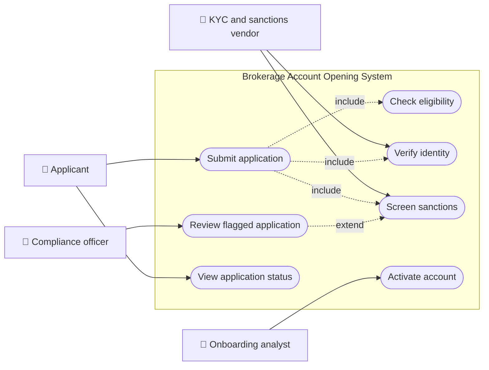
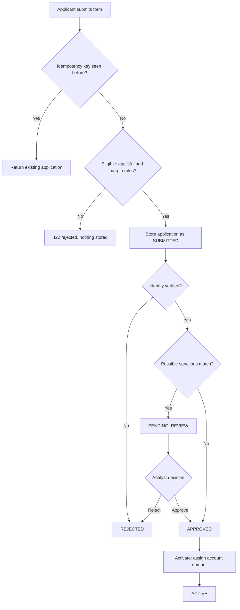
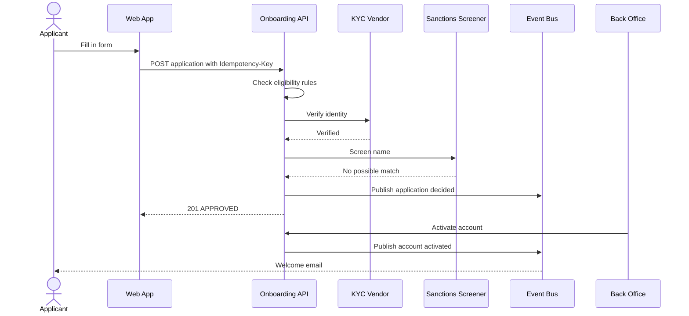
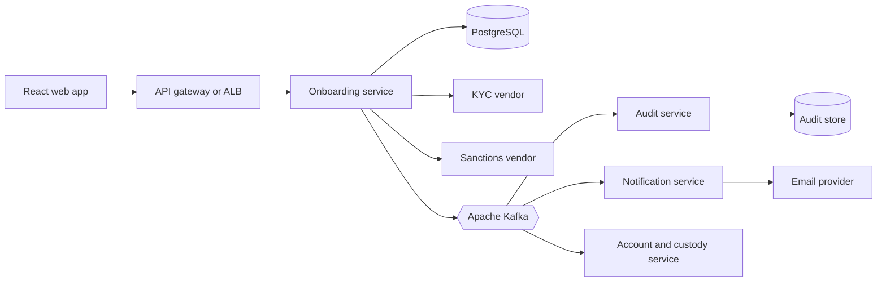
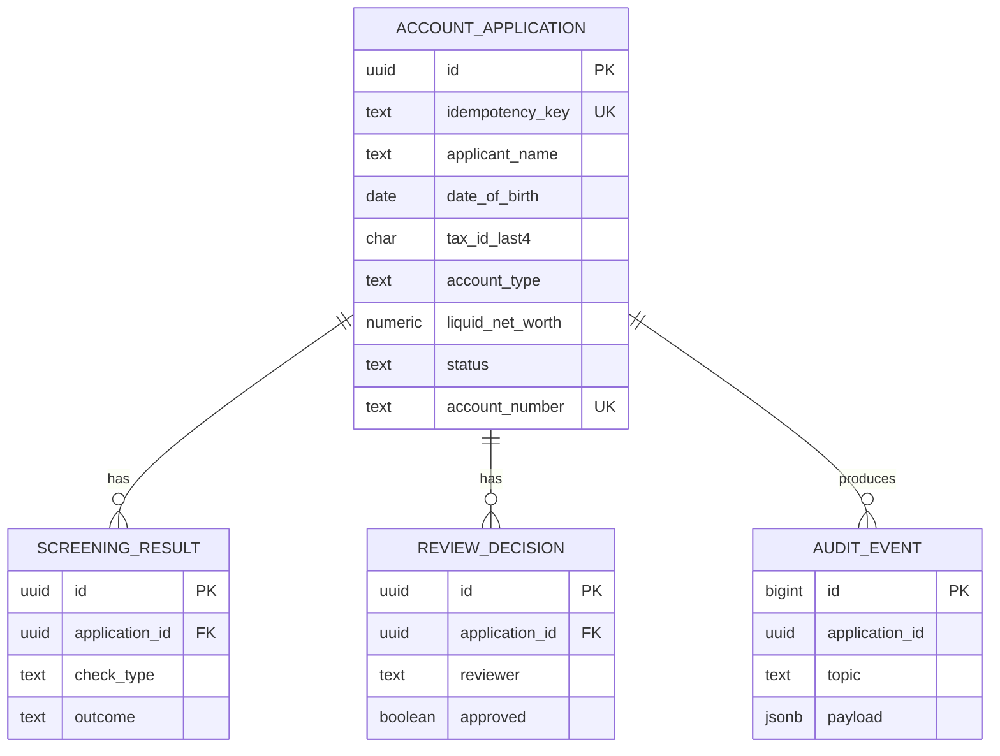
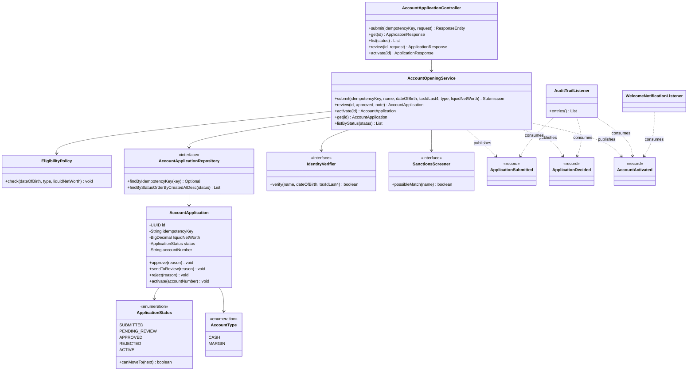
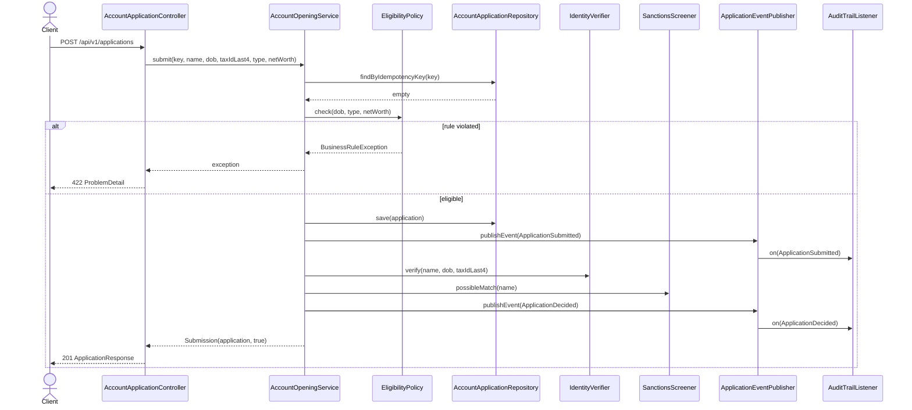
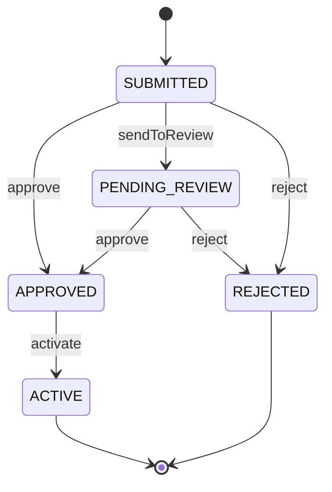
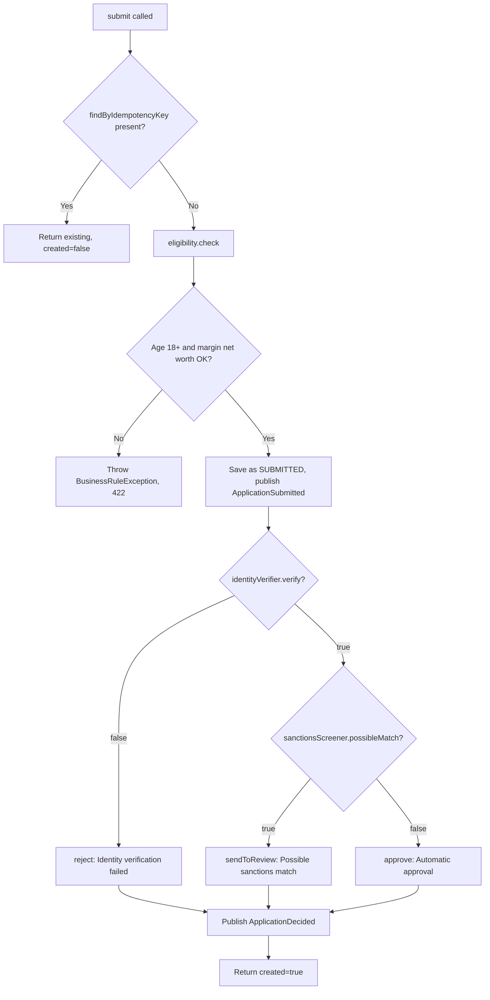

# Brokerage Account Opening

> **Domain:** Capital Markets and Brokerage · **Author:** [@naveenks720](https://github.com/naveenks720) · **Published:** October 14, 2026

> **Runnable code:** [`examples/capital-markets/brokerage-account-opening`](https://github.com/dhulipalla599/domain-knowledge-engineering/tree/main/examples/capital-markets/brokerage-account-opening)

## Explain It Like I'm Five

Imagine you want to join a big playground where kids trade shiny stickers. Before the grown-up at the gate lets you in, they ask your name, check that you are old enough, make sure you are really you, and look at a list of kids who are not allowed to play. If everything looks fine, you get a playground card with your own number, and only then can you start trading. If something looks odd, the grown-up pauses and asks a boss to take a second look instead of just saying no.

Brokerage account opening is that gate: a broker-dealer checks who you are, whether you are allowed and suited to trade, and only then gives you an account number so you can buy and sell securities.

## Business Overview

Brokerage account opening is the process by which a prospective customer becomes an account holder at a broker-dealer. The firm collects identity and financial-profile data, decides which account type is appropriate (for example cash or margin), screens the person against regulatory and sanctions requirements, and finally creates the account that can receive funds and orders.

**Why the business cares**

- **Revenue:** no account means no trading, custody or interest income. Every step of friction in onboarding costs completed applications, so firms track funnel conversion and time-to-approve closely.
- **Risk:** a bad account (a fraudster, a sanctioned person, a customer given leverage they cannot afford) becomes a loss, a regulatory finding, or both.
- **Regulation:** requirements vary by country and firm type. In the United States, broker-dealers generally operate under customer identification program (CIP) rules, anti-money-laundering (AML) obligations, and suitability or best-interest standards; other jurisdictions have their own equivalents. Treat the rules in this page as a teaching model, and confirm specifics with your compliance team.
- **Customer experience:** the first interaction sets the tone. Customers expect minutes, not weeks.

**Where it sits in the value chain**

```text
Marketing -> Account opening -> Funding -> Order entry -> Execution -> Clearing and settlement -> Custody and reporting
```

Account opening is the front door. Everything downstream (order management, positions, margin, statements) refers to the account it creates, so mistakes here propagate everywhere.

## Real-World Example

Fictional firm **Harborline Securities** offers retail brokerage accounts. **Priya Raman**, 34, wants a margin account.

1. Priya opens the Harborline app and enters her name, date of birth, last four digits of her tax ID, and her liquid net worth (60,000). She picks a **margin** account.
2. The app sends the application with an `Idempotency-Key` so that a flaky mobile connection cannot create two applications.
3. Harborline's rules check she is at least 18 and that margin applicants meet the firm's minimum liquid net worth (a fictional house policy of 25,000). She passes.
4. The identity-verification vendor confirms her details and the sanctions screen returns no possible match.
5. The application moves from `SUBMITTED` to `APPROVED` automatically, and a `brokerage.application.decided` event is published.
6. Priya e-signs her agreements and the back office activates the account. She receives account number `BRK-500001` and a welcome email.

A second applicant, **Sam Blocklisted**, produces a possible sanctions match. Harborline does not auto-reject him, because name matches are often false positives. The application goes to `PENDING_REVIEW` and a compliance analyst decides.

## Stakeholders

| Stakeholder | What they need | What they fear |
|---|---|---|
| Applicant (retail investor) | A fast, clear process; to start trading quickly | Rejection with no explanation; leaked personal data |
| Onboarding operations analyst | A queue of cases needing manual work, with context | Case backlogs; missing documents |
| Compliance officer | Evidence that KYC, AML and sanctions checks ran and were reviewed | Onboarding a sanctioned or fraudulent person; audit findings |
| Risk and credit team | Correct account type and leverage for the customer's profile | Margin granted to customers who cannot cover losses |
| Product owner | High conversion and low time-to-approve | Drop-off in the funnel |
| Engineer / platform team | Idempotent, auditable, observable workflows | Duplicate accounts, silent failures, untraceable decisions |
| External vendors (KYC, sanctions) | Well-formed requests | Being blamed for outages the integration did not handle |

## Use Case Diagram



| Use Case | Primary Actor | Goal | Main success outcome |
|---|---|---|---|
| Submit application | Applicant | Request a brokerage account | Application stored as `SUBMITTED`, then decided |
| Check eligibility | System (included in Submit) | Apply age and account-type rules | Ineligible requests rejected before any vendor call |
| Verify identity | KYC vendor | Confirm the applicant is who they claim | Pass, or the application is `REJECTED` |
| Screen sanctions | Sanctions vendor | Detect possible watch-list matches | No match, or the case goes to review |
| Review flagged application | Compliance officer | Resolve a possible match | `APPROVED` or `REJECTED` with a recorded note |
| Activate account | Onboarding analyst | Open the approved account | Account number assigned, status `ACTIVE` |
| View application status | Applicant | Know where the application stands | Current status and reason returned |

## Key Terms

| Term | Plain-English meaning |
|---|---|
| Broker-dealer | A firm that buys and sells securities for customers and sometimes for itself |
| KYC (Know Your Customer) | Verifying who a customer is and understanding their profile |
| CIP (Customer Identification Program) | The identity data a US firm must collect and verify before opening an account |
| AML (Anti-Money Laundering) | Controls that detect and report the use of the financial system for crime |
| Sanctions screening | Checking a person against government watch lists of restricted parties |
| Cash account | An account where purchases must be paid for in full |
| Margin account | An account that lets the customer borrow from the broker to buy securities |
| Suitability / best interest | The duty to recommend products that fit the customer's profile |
| Liquid net worth | Assets that can quickly be turned into cash, minus liabilities |
| Clearing firm | The firm that settles trades and often holds assets; some brokers use an outside one |
| Idempotency key | A client-supplied token so that retrying a request does not duplicate its effect |
| Manual review | A human decision step for cases software cannot safely decide |

## Process Flow

An applicant submits the form. The system first applies cheap local rules (age, account-type thresholds). Only valid applications are stored and sent to external checks. A failed identity check rejects the application; a possible sanctions match pauses it for a human; a clean result approves it automatically. Approved applications are activated, which assigns the account number and triggers downstream setup such as welcome communications and funding.





## Business Rules and Edge Cases

- **Minimum age.** Applicants below the age of majority cannot open an individual account (the age differs by jurisdiction; the example uses 18). Compute age against the *application date* from an injectable clock, not a hard-coded year, and test the birthday boundary.
- **Account-type thresholds.** Margin accounts are riskier than cash accounts, so firms impose their own eligibility minimums on top of regulatory ones. Check them before calling paid external vendors.
- **Idempotency.** Mobile clients retry. The same `Idempotency-Key` must return the original application rather than create a second one, and a database unique constraint must back this up for concurrent requests.
- **Possible sanctions matches are not rejections.** Name matching produces false positives. Route to human review and record who decided and why. Never silently drop or auto-reject on a fuzzy match.
- **Partial failure.** The identity vendor can time out. Decide explicitly whether a timeout leaves the application `SUBMITTED` for retry or moves it to review; do not treat it as "verified" or as "failed".
- **Illegal state changes.** An application in `PENDING_REVIEW` must not be activated; a `REJECTED` one must never come back to life. Enforce this in the domain object, not just in the UI.
- **Money as decimals.** Net worth and income use exact decimal types, never floating point.
- **Sensitive data.** Store only what you need. The example keeps just the last four digits of the tax ID; full identifiers belong in a vault or the vendor's system, encrypted, with strict access control.
- **Auditability.** Every decision needs an immutable record: inputs, vendor responses, rule outcomes, reviewer and timestamp. Retention periods vary by jurisdiction and firm policy.

## From Business to System

| Business concept / step | System component | Data entity | Event |
|---|---|---|---|
| Applicant submits application | Onboarding API (`AccountApplicationController`) | `account_application` | `brokerage.application.submitted` |
| Eligibility check | `EligibilityPolicy` in the onboarding service | none (stateless) | none |
| Identity verification | `IdentityVerifier` adapter to a KYC vendor | `screening_result` | none |
| Sanctions screening | `SanctionsScreener` adapter | `screening_result` | none |
| Automatic or manual decision | `AccountOpeningService`, review endpoint | `account_application`, `review_decision` | `brokerage.application.decided` |
| Account activation | `AccountOpeningService.activate` | `account_application.account_number` | `brokerage.account.activated` |
| Compliance evidence | Audit consumer | `audit_event` | consumes all three topics |
| Customer communication | Notification service | none | consumes `brokerage.account.activated` |

## Architecture



The **onboarding service** owns the application lifecycle and its database; nothing else writes to `account_application`. External vendors sit behind adapters so they can be replaced, timed out and mocked without touching business rules. Decisions leave the service only as **Kafka events**, so the audit, notification and account-and-custody services react independently and an outage in one cannot block applicants. The audit store is separate because compliance retention and access rules differ from operational data. The account-and-custody service owns the live trading account, which is created only after the `brokerage.account.activated` event.

## Data Model

```sql
CREATE TABLE account_application (
    id               UUID PRIMARY KEY,
    idempotency_key  TEXT NOT NULL UNIQUE,
    applicant_name   TEXT NOT NULL,
    date_of_birth    DATE NOT NULL,
    tax_id_last4     CHAR(4) NOT NULL,
    account_type     TEXT NOT NULL CHECK (account_type IN ('CASH', 'MARGIN')),
    liquid_net_worth NUMERIC(18,2) NOT NULL CHECK (liquid_net_worth >= 0),
    status           TEXT NOT NULL CHECK (status IN
                       ('SUBMITTED','PENDING_REVIEW','APPROVED','REJECTED','ACTIVE')),
    decision_reason  TEXT,
    account_number   TEXT UNIQUE,
    created_at       TIMESTAMPTZ NOT NULL DEFAULT now()
);

CREATE TABLE screening_result (
    id             UUID PRIMARY KEY,
    application_id UUID NOT NULL REFERENCES account_application(id),
    check_type     TEXT NOT NULL CHECK (check_type IN ('IDENTITY','SANCTIONS')),
    outcome        TEXT NOT NULL,
    vendor_ref     TEXT,
    checked_at     TIMESTAMPTZ NOT NULL DEFAULT now()
);

CREATE TABLE review_decision (
    id             UUID PRIMARY KEY,
    application_id UUID NOT NULL REFERENCES account_application(id),
    reviewer       TEXT NOT NULL,
    approved       BOOLEAN NOT NULL,
    note           TEXT NOT NULL,
    decided_at     TIMESTAMPTZ NOT NULL DEFAULT now()
);

CREATE TABLE audit_event (
    id             BIGSERIAL PRIMARY KEY,
    application_id UUID NOT NULL,
    topic          TEXT NOT NULL,
    payload        JSONB NOT NULL,
    occurred_at    TIMESTAMPTZ NOT NULL
);
```

The runnable example implements only `account_application`; the other tables show what production adds.



## APIs

| Method | Path | Purpose |
|---|---|---|
| POST | `/api/v1/applications` | Submit an application (requires `Idempotency-Key` header); 201 new, 200 replay, 422 rule violation |
| GET | `/api/v1/applications/{id}` | Fetch one application |
| GET | `/api/v1/applications?status=PENDING_REVIEW` | List applications by status (review queue) |
| POST | `/api/v1/applications/{id}/review` | Approve or reject a `PENDING_REVIEW` application |
| POST | `/api/v1/applications/{id}/activate` | Activate an `APPROVED` application and assign the account number |

Example: submit an application.

```http
POST /api/v1/applications
Idempotency-Key: demo-001
Content-Type: application/json

{
  "applicantName": "Priya Raman",
  "dateOfBirth": "1991-06-20",
  "taxIdLast4": "9012",
  "accountType": "MARGIN",
  "liquidNetWorth": 60000
}
```

```json
{
  "id": "2ef45f2d-10c3-402a-a42c-3b771436cd0b",
  "applicantName": "Priya Raman",
  "accountType": "MARGIN",
  "liquidNetWorth": 60000,
  "status": "APPROVED",
  "decisionReason": "Automatic approval: KYC and screening passed",
  "accountNumber": null
}
```

Rule violations return an RFC 9457 `ProblemDetail` body with status 422; an illegal state change returns 409.

## Events

| Event (Kafka topic) | Producer | Consumers | Key fields |
|---|---|---|---|
| `brokerage.application.submitted` | Onboarding service | Audit service | `applicationId`, `accountType`, `occurredAt` |
| `brokerage.application.decided` | Onboarding service | Audit service, review-queue service | `applicationId`, `status`, `reason`, `occurredAt` |
| `brokerage.account.activated` | Onboarding service | Account and custody service, notification service, audit service | `applicationId`, `accountNumber`, `occurredAt` |

**Ordering.** Use `applicationId` as the Kafka message key so all events for one application land on one partition and stay in order. Ordering across applications is not guaranteed and not needed.

**Idempotency.** Kafka delivers at least once. Consumers must tolerate duplicates, for example by recording processed `(applicationId, topic)` pairs or making handlers naturally idempotent (activating an already-active account is a no-op).

**Atomicity.** Writing to PostgreSQL and publishing to Kafka are two operations. Use a transactional outbox so a decision is never saved without its event, or vice versa. The example publishes in-process and does not model this.

## Backend Implementation

> The Java tab is the exact code from the runnable example (Spring Boot 3). The Python tab uses FastAPI with SQLAlchemy; the Node.js tab uses Express with TypeScript. Full source: [`examples/capital-markets/brokerage-account-opening`](https://github.com/dhulipalla599/domain-knowledge-engineering/tree/main/examples/capital-markets/brokerage-account-opening/src/main/java/com/dke/capital_markets/brokerage_account_opening).

### The key business rule: eligibility, idempotency, screening

=== "Java"

    ```java
    @Transactional
    public Submission submit(String idempotencyKey, String name, LocalDate dateOfBirth, String taxIdLast4,
                             AccountType type, BigDecimal liquidNetWorth) {
        var existing = repository.findByIdempotencyKey(idempotencyKey);
        if (existing.isPresent()) {
            return new Submission(existing.get(), false);
        }
        eligibility.check(dateOfBirth, type, liquidNetWorth);

        var application = repository.save(
                new AccountApplication(idempotencyKey, name, dateOfBirth, taxIdLast4, type, liquidNetWorth));
        events.publishEvent(new ApplicationSubmitted(application.getId(), type, Instant.now(clock)));

        if (!identityVerifier.verify(name, dateOfBirth, taxIdLast4)) {
            application.reject("Identity verification failed");
        } else if (sanctionsScreener.possibleMatch(name)) {
            application.sendToReview("Possible sanctions match");
        } else {
            application.approve("Automatic approval: KYC and screening passed");
        }
        publishDecision(application);
        return new Submission(application, true);
    }
    ```

=== "Python"

    ```python
    def submit(db: Session, key: str, name: str, dob: date, tax_id_last4: str,
               account_type: AccountType, net_worth: Decimal) -> tuple[AccountApplication, bool]:
        existing = db.scalar(select(AccountApplication).where(AccountApplication.idempotency_key == key))
        if existing:
            return existing, False
        eligibility.check(dob, account_type, net_worth)

        application = AccountApplication(idempotency_key=key, applicant_name=name, date_of_birth=dob,
                                         tax_id_last4=tax_id_last4, account_type=account_type,
                                         liquid_net_worth=net_worth, status=Status.SUBMITTED)
        db.add(application)
        db.flush()
        publish(ApplicationSubmitted(application.id, account_type, utcnow()))

        if not identity_verifier.verify(name, dob, tax_id_last4):
            application.reject("Identity verification failed")
        elif sanctions_screener.possible_match(name):
            application.send_to_review("Possible sanctions match")
        else:
            application.approve("Automatic approval: KYC and screening passed")
        publish_decision(application)
        db.commit()
        return application, True
    ```

=== "Node.js"

    ```typescript
    export async function submit(
      repo: ApplicationRepository, key: string, req: SubmitRequest,
    ): Promise<{ application: AccountApplication; created: boolean }> {
      const existing = await repo.findByIdempotencyKey(key);
      if (existing) return { application: existing, created: false };
      checkEligibility(req.dateOfBirth, req.accountType, req.liquidNetWorth);

      const application = await repo.save(AccountApplication.create(key, req));
      publish({ type: "ApplicationSubmitted", applicationId: application.id, accountType: req.accountType });

      if (!(await identityVerifier.verify(req.applicantName, req.dateOfBirth, req.taxIdLast4))) {
        application.reject("Identity verification failed");
      } else if (await sanctionsScreener.possibleMatch(req.applicantName)) {
        application.sendToReview("Possible sanctions match");
      } else {
        application.approve("Automatic approval: KYC and screening passed");
      }
      await repo.save(application);
      publishDecision(application);
      return { application, created: true };
    }
    ```

### The controller endpoint

=== "Java"

    ```java
    @PostMapping
    public ResponseEntity<ApplicationResponse> submit(@RequestHeader("Idempotency-Key") String idempotencyKey,
                                                      @Valid @RequestBody SubmitApplicationRequest request) {
        var result = service.submit(idempotencyKey, request.applicantName(), request.dateOfBirth(),
                request.taxIdLast4(), request.accountType(), request.liquidNetWorth());
        // 201 for a new application, 200 when the same Idempotency-Key is replayed.
        var status = result.created() ? HttpStatus.CREATED : HttpStatus.OK;
        return ResponseEntity.status(status).body(ApplicationResponse.from(result.application()));
    }
    ```

=== "Python"

    ```python
    @router.post("/api/v1/applications")
    def submit_application(body: SubmitApplicationRequest, response: Response,
                           idempotency_key: str = Header(...), db: Session = Depends(get_db)):
        application, created = service.submit(db, idempotency_key, body.applicant_name,
                                              body.date_of_birth, body.tax_id_last4,
                                              body.account_type, body.liquid_net_worth)
        response.status_code = 201 if created else 200
        return ApplicationResponse.from_entity(application)
    ```

=== "Node.js"

    ```typescript
    router.post("/api/v1/applications", async (req, res, next) => {
      try {
        const key = req.header("Idempotency-Key");
        if (!key) return res.status(400).json({ detail: "Idempotency-Key header is required" });
        const { application, created } = await submit(repo, key, SubmitRequestSchema.parse(req.body));
        res.status(created ? 201 : 200).json(toResponse(application));
      } catch (err) {
        next(err); // error middleware maps BusinessRuleError to 422
      }
    });
    ```

## Frontend Screen

```tsx
import { useState, FormEvent } from "react";

type Status = "SUBMITTED" | "PENDING_REVIEW" | "APPROVED" | "REJECTED" | "ACTIVE";
interface ApplicationResponse { id: string; status: Status; decisionReason: string | null; }

export default function OpenAccountScreen() {
  const [form, setForm] = useState({
    applicantName: "", dateOfBirth: "", taxIdLast4: "", accountType: "CASH", liquidNetWorth: "",
  });
  const [key] = useState(() => crypto.randomUUID()); // one key per form, reused on retry
  const [result, setResult] = useState<ApplicationResponse | null>(null);
  const [error, setError] = useState<string | null>(null);

  async function onSubmit(e: FormEvent) {
    e.preventDefault();
    setError(null);
    const res = await fetch("/api/v1/applications", {
      method: "POST",
      headers: { "Content-Type": "application/json", "Idempotency-Key": key },
      body: JSON.stringify({ ...form, liquidNetWorth: Number(form.liquidNetWorth) }),
    });
    const body = await res.json();
    if (res.ok) setResult(body as ApplicationResponse);
    else setError(body.detail ?? "Something went wrong");
  }

  const set = (field: string) => (e: { target: { value: string } }) =>
    setForm({ ...form, [field]: e.target.value });

  if (result) {
    return (
      <p role="status">
        Application {result.id}: <strong>{result.status}</strong>
        {result.status === "PENDING_REVIEW" && " - we need a little more time to review it."}
      </p>
    );
  }
  return (
    <form onSubmit={onSubmit}>
      <h1>Open a brokerage account</h1>
      <input placeholder="Full legal name" value={form.applicantName} onChange={set("applicantName")} required />
      <input type="date" value={form.dateOfBirth} onChange={set("dateOfBirth")} required />
      <input placeholder="Last 4 of tax ID" maxLength={4} pattern="\d{4}" value={form.taxIdLast4}
             onChange={set("taxIdLast4")} required />
      <select value={form.accountType} onChange={set("accountType")}>
        <option value="CASH">Cash</option>
        <option value="MARGIN">Margin</option>
      </select>
      <input type="number" min="0" placeholder="Liquid net worth" value={form.liquidNetWorth}
             onChange={set("liquidNetWorth")} required />
      {error && <p role="alert">{error}</p>}
      <button type="submit">Submit application</button>
    </form>
  );
}
```

## Cloud Deployment

**Main AWS services**

- **Amazon EKS** runs the onboarding, audit, notification and account services as Kubernetes Deployments.
- **Amazon RDS for PostgreSQL** (Multi-AZ) holds application data.
- **Amazon MSK** provides managed Apache Kafka.
- **Application Load Balancer** with AWS WAF fronts the API; **AWS Secrets Manager** and **KMS** hold vendor credentials and encryption keys.
- **CloudWatch** and **AWS Distro for OpenTelemetry** collect telemetry.

```hcl
resource "aws_db_instance" "onboarding" {
  identifier              = "onboarding-pg"
  engine                  = "postgres"
  engine_version          = "16"
  instance_class          = "db.m6g.large"
  allocated_storage       = 100
  multi_az                = true
  storage_encrypted       = true
  kms_key_id              = aws_kms_key.onboarding.arn
  backup_retention_period = 14
  deletion_protection     = true
  db_subnet_group_name    = aws_db_subnet_group.private.name
  vpc_security_group_ids  = [aws_security_group.onboarding_db.id]
  username                = "onboarding_admin"
  manage_master_user_password = true
}
```

**Security.** Keep the database and MSK in private subnets; allow access only from the EKS node or pod security groups. Use IAM roles for service accounts instead of static keys. Encrypt in transit (TLS) and at rest (KMS). Never log tax IDs or full dates of birth; mask them in traces.

**Scaling.** Scale the onboarding Deployment with a Horizontal Pod Autoscaler on CPU and request rate. Onboarding traffic is usually spiky around marketing campaigns, so set sensible minimum replicas and protect vendor calls with timeouts, bulkheads and circuit breakers.

**Observability.** Instrument the service with OpenTelemetry and export traces and metrics to CloudWatch. Useful signals: applications per minute, time-to-decision, share of cases sent to review, vendor latency and error rate, and Kafka consumer lag. Propagate the application ID as a trace attribute.

## Non-Functional Requirements

| Concern | Expectation | How the design meets it |
|---|---|---|
| Availability | Applicants can apply at any time; targets are set by the firm (for example 99.9%) | Stateless pods across Availability Zones, Multi-AZ database, vendor circuit breakers |
| Latency | Automatic decision within seconds for the happy path | Cheap local rules first; vendor calls with strict timeouts; slow cases fall back to review |
| Consistency | An application and its decision event must never disagree | Single-writer service, state machine in the domain object, transactional outbox |
| Idempotency | Retries never create a second application | Unique `idempotency_key` constraint and replay handling |
| Audit | Every decision reconstructable later | Append-only audit store fed from Kafka; reviewer and reason recorded |
| Security and privacy | Minimise stored personal data | Last four digits only, field-level encryption, masked logs, least-privilege IAM |
| Compliance | Retention, reporting and monitoring duties differ by jurisdiction | Configurable retention; confirm requirements with compliance rather than hard-coding them |

## Runnable Example

The example is a Spring Boot 3 / Java 21 service using an in-memory H2 database and no external services. It implements submission with eligibility rules (age and margin net worth), idempotent replay, stubbed identity and sanctions checks, automatic or manual decisions, activation with an account number, and three domain events published with `ApplicationEventPublisher` and consumed by `@EventListener` classes that stand in for Kafka consumers.

Source: [`examples/capital-markets/brokerage-account-opening`](https://github.com/dhulipalla599/domain-knowledge-engineering/tree/main/examples/capital-markets/brokerage-account-opening)

```bash
cd examples/capital-markets/brokerage-account-opening
mvn -B -ntp verify           # build and run tests
mvn spring-boot:run          # start on http://localhost:8080
```

Happy path (HTTP 201):

```bash
curl -s -X POST localhost:8080/api/v1/applications \
  -H 'Content-Type: application/json' -H 'Idempotency-Key: demo-001' \
  -d '{"applicantName":"Priya Raman","dateOfBirth":"1991-06-20","taxIdLast4":"9012","accountType":"MARGIN","liquidNetWorth":60000}'
```

```json
{"id":"2ef45f2d-10c3-402a-a42c-3b771436cd0b","applicantName":"Priya Raman","accountType":"MARGIN","liquidNetWorth":60000,"status":"APPROVED","decisionReason":"Automatic approval: KYC and screening passed","accountNumber":null}
```

Rule violation (HTTP 422):

```bash
curl -s -X POST localhost:8080/api/v1/applications \
  -H 'Content-Type: application/json' -H 'Idempotency-Key: demo-002' \
  -d '{"applicantName":"Tom Baker","dateOfBirth":"1980-01-01","taxIdLast4":"1111","accountType":"MARGIN","liquidNetWorth":5000}'
```

```json
{"type":"about:blank","title":"Unprocessable Entity","status":422,"detail":"Margin accounts require liquid net worth of at least 25000","instance":"/api/v1/applications"}
```

| Class | Package | Responsibility |
|---|---|---|
| `AccountApplication` | `domain` | Entity that owns the lifecycle and rejects illegal transitions |
| `ApplicationStatus` | `domain` | Lifecycle enum with `allowedNext()` and `canMoveTo()` |
| `AccountType` | `domain` | `CASH` or `MARGIN` |
| `AccountEvents` | `domain` | Event records and Kafka-style topic names |
| `AccountApplicationRepository` | `repository` | Spring Data repository, lookup by idempotency key |
| `EligibilityPolicy` | `service` | Age and margin net-worth rules |
| `AccountOpeningService` | `service` | `submit`, `review`, `activate`; publishes events |
| `BusinessRuleException`, `ApplicationNotFoundException` | `service` | Errors mapped to HTTP 422 and 404 |
| `AccountApplicationController` | `api` | REST endpoints |
| `SubmitApplicationRequest`, `ReviewRequest`, `ApplicationResponse` | `api` | Request and response records |
| `ApiExceptionHandler` | `api` | `@RestControllerAdvice` producing `ProblemDetail` |
| `IdentityVerifier`, `StubIdentityVerifier` | `integration` | KYC port and deterministic stub |
| `SanctionsScreener`, `StubSanctionsScreener` | `integration` | Sanctions port and deterministic stub |
| `AuditTrailListener`, `WelcomeNotificationListener` | `integration` | Event consumers |
| `ClockConfig` | `integration` | Injectable `Clock` bean |

## UML Diagrams

### Class Diagram

The service coordinates the repository, policy, vendor ports and event publisher; the entity guards its own status through `ApplicationStatus`.



### Sequence Diagram (control flow)

One submit request flows through the controller and service; a rule violation stops before anything is stored.



### State Diagram

The same transitions as `ApplicationStatus.allowedNext()`. `REJECTED` and `ACTIVE` are terminal.



### Activity Diagram

Decision logic inside `AccountOpeningService.submit`.



## AI Opportunities

1. **Document extraction and verification.** Use OCR and vision models to read ID documents and proof of address and flag tampering. *Data:* document images and the application form. *Risk:* error rates differ across document types and demographics; keep a human in the loop for low-confidence results and test for bias.
2. **Sanctions alert triage.** Rank possible name matches by likelihood of being a true hit, using secondary attributes such as date of birth and country. *Data:* alert details, historical analyst dispositions. *Risk:* missing a true match is a serious regulatory failure, so the model may only reorder or annotate the queue, never auto-clear without approved governance.
3. **Fraud and synthetic-identity detection.** Score applications using device, behavioural and consortium signals. *Data:* device telemetry, application history, vendor signals. *Risk:* false positives block legitimate customers; require explainable reason codes and a review path, and check that adverse-decision notice obligations are met in each jurisdiction.
4. **Suitability pre-screening and guidance.** An assistant helps applicants understand account types and fills the profile questionnaire. *Data:* applicant answers and product rules. *Risk:* an LLM must not give investment advice or make eligibility decisions; constrain it to explanation, log conversations, and keep rules in deterministic code.
5. **Onboarding funnel analytics.** Predict drop-off and suggest where the form causes friction. *Data:* anonymised funnel events. *Risk:* privacy; aggregate and de-identify before analysis.

## Common Pitfalls

- **Auto-rejecting on a fuzzy sanctions match.** Route to manual review and record the outcome.
- **Calling vendors before cheap local checks.** You pay per call and add latency. Validate locally first.
- **No idempotency.** Retries create duplicate applications or accounts. Use an idempotency key plus a unique constraint.
- **State changes outside the domain object.** Setting `status` directly from several places allows illegal transitions. Funnel changes through one method.
- **Using `double` for money.** Use `BigDecimal` or `NUMERIC`.
- **Hard-coding "today".** Age checks fail tests and edge cases; inject a clock.
- **Storing full tax IDs or logging personal data.** Store the minimum, encrypt, and mask logs.
- **Treating a vendor timeout as pass or fail.** Decide a deliberate policy: retry, or route to review.
- **Assuming one global rule set.** Age of majority, required checks and retention differ by country and firm; make them configuration and confirm with compliance.
- **Saving then publishing without an outbox.** A crash between the two leaves state and events disagreeing.

## Interview Questions

### Junior

1. **What is KYC and why does a broker need it?**
   *Answer:* Know Your Customer is verifying who a customer is and understanding their profile. It helps prevent fraud and money laundering and is required by regulators, with details varying by country.
2. **Why should the account-opening API accept an idempotency key?**
   *Answer:* Clients retry on timeouts. With the key the server returns the original result instead of creating a duplicate application.
3. **What is the difference between a cash and a margin account?**
   *Answer:* A cash account requires full payment for purchases; a margin account lets the customer borrow from the broker, which adds risk and so stricter eligibility.

### Mid-Level

1. **How would you model the application lifecycle?**
   *Answer:* An enum of states with an explicit allowed-transition map enforced inside the entity (`SUBMITTED`, `PENDING_REVIEW`, `APPROVED`, `REJECTED`, `ACTIVE`), so illegal jumps throw and map to HTTP 409.
2. **A sanctions vendor times out. What do you do?**
   *Answer:* Do not assume pass or fail. Use a bounded timeout and retries, keep the application in a recoverable state or send it to review, alert on repeated failures, and record the outage in the audit trail.
3. **How do you keep the database and Kafka consistent when a decision is made?**
   *Answer:* Use a transactional outbox: write the event row in the same transaction as the state change, and have a relay publish it to Kafka at least once. Consumers deduplicate.

### Senior / Architect

1. **Design onboarding to scale to a marketing spike and survive vendor outages.**
   *Key points:* stateless services with autoscaling; queue or asynchronous screening with applicant-facing "pending" state; circuit breakers and timeouts; idempotent retries; backpressure; degraded mode that routes to review; monitoring of funnel and vendor SLOs.
2. **How would you support several jurisdictions with different rules?**
   *Key points:* rules as versioned configuration or a policy engine keyed by jurisdiction; separate regulatory data residency and retention; one workflow engine with pluggable checks; compliance-owned rule changes with audit and tests.
3. **Where would you place AI in the pipeline, and what controls would you require?**
   *Key points:* AI advises or prioritises, deterministic rules and humans decide on adverse outcomes; model governance, explainability, bias testing, human override, logging of inputs and outputs, monitoring for drift, and regulator-ready documentation.

## Further Learning

- Know Your Customer (KYC) and Customer Identification Program (CIP) requirements
- Anti-money-laundering (AML) program fundamentals and suspicious-activity reporting
- Sanctions regimes and watch-list screening (for example OFAC in the US)
- FINRA rules on account opening and margin (for example Rule 4210), for US context
- Regulation Best Interest and suitability concepts
- FIX protocol and order lifecycle (what happens after the account exists)
- Clearing and settlement (DTCC, T+1 in the US)
- Transactional outbox and idempotent consumer patterns

## Practitioner Notes

> _Reviewer: add real-world experience, corrections or gotchas here before approving._
