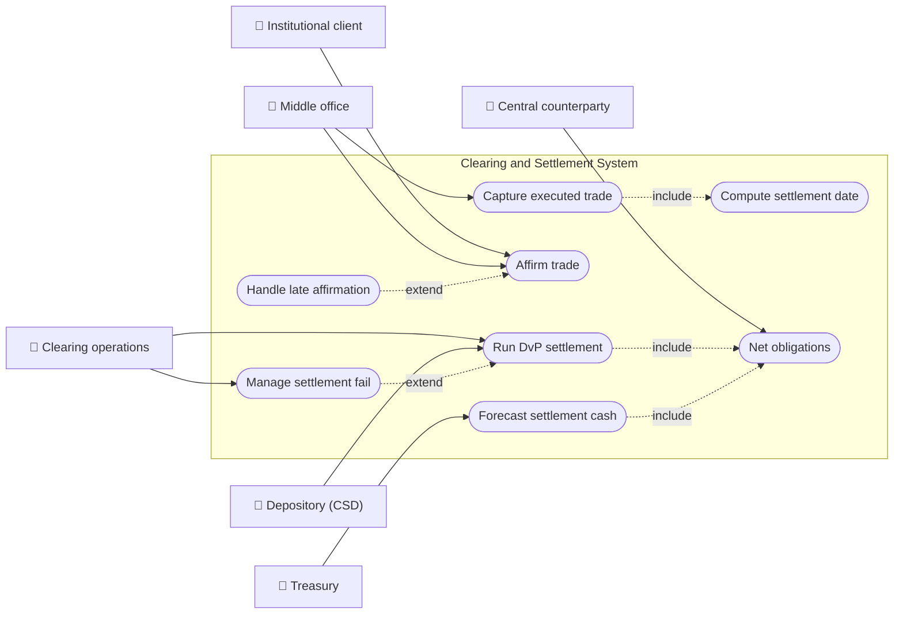
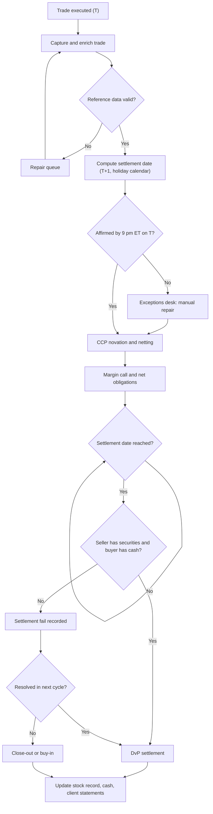
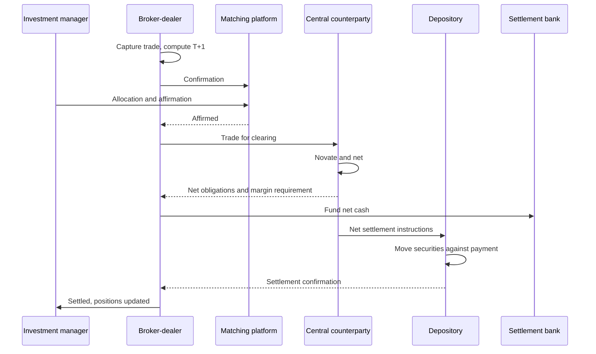
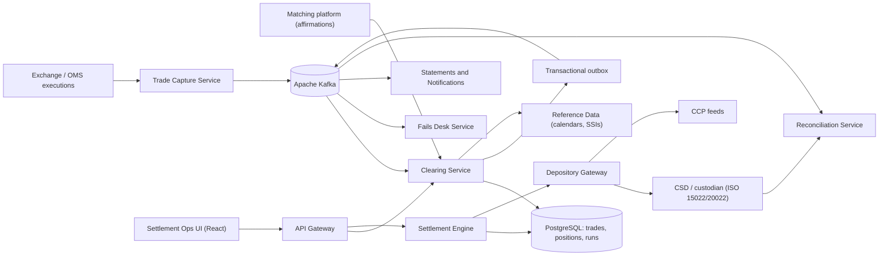
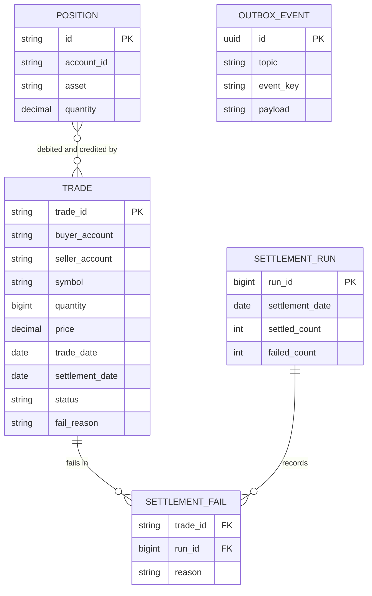
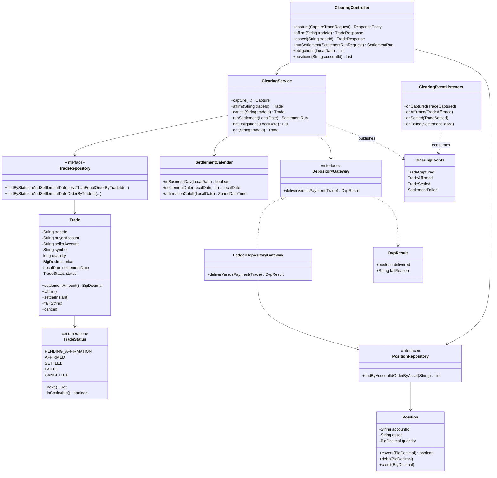
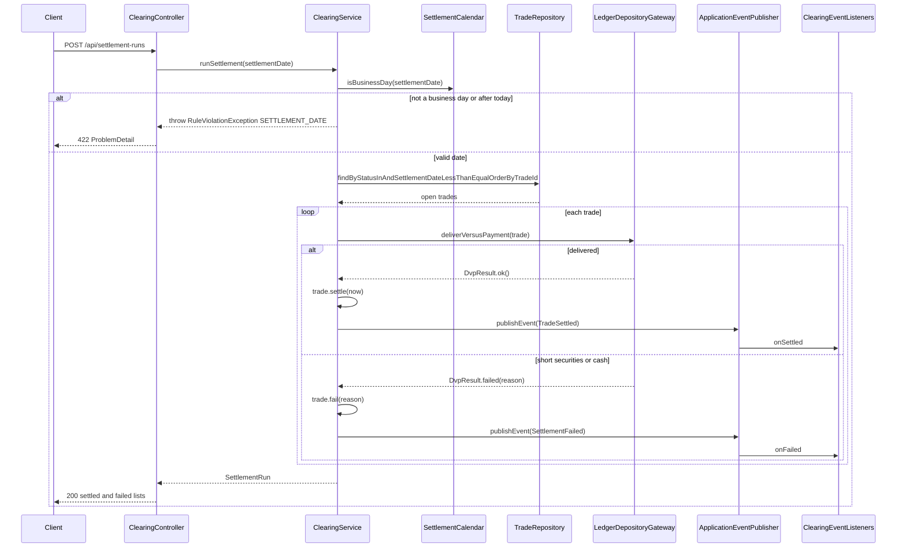
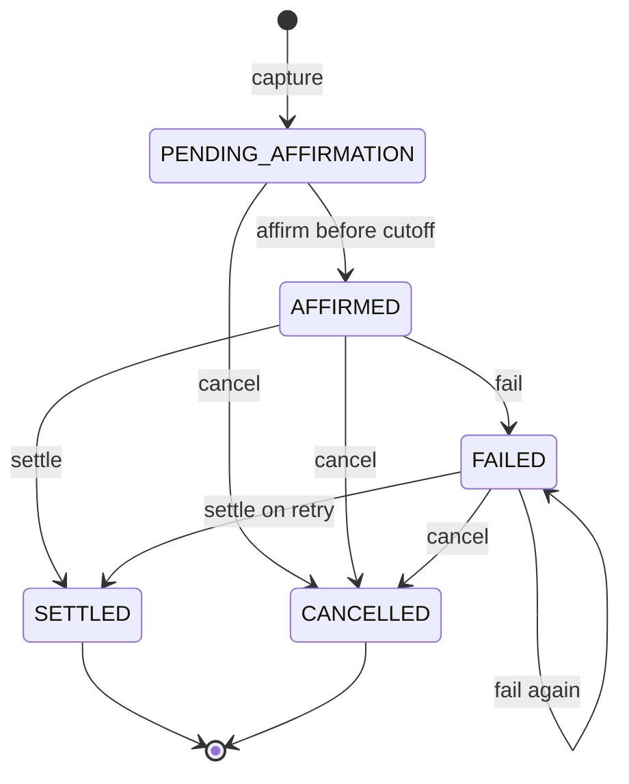
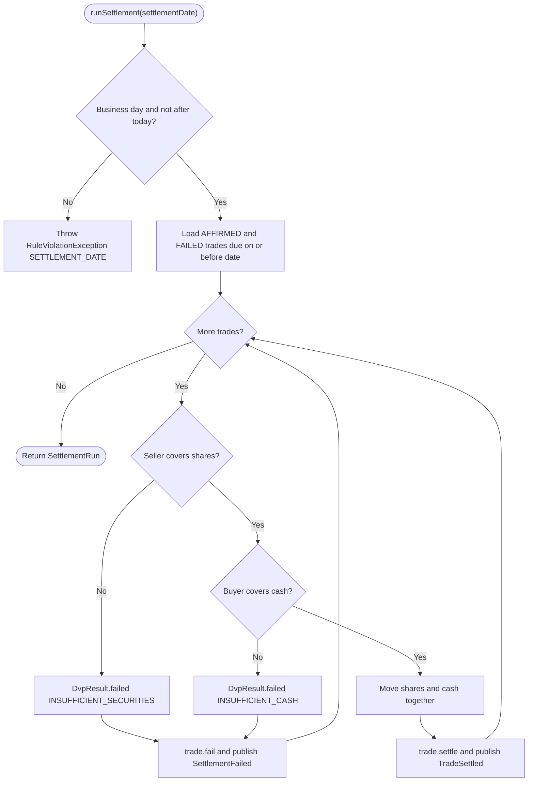

# Clearing and Settlement

> **Domain:** Capital Markets and Brokerage · **Author:** [@dhulipalla599](https://github.com/dhulipalla599) · **Published:** November 26, 2026

> **Runnable code:** [`examples/capital-markets/clearing-and-settlement`](https://github.com/dhulipalla599/domain-knowledge-engineering/tree/main/examples/capital-markets/clearing-and-settlement)

## Explain It Like I'm Five

Imagine you and a friend agree at lunch to swap your toy car for their sticker book, but you promise to do the real swap tomorrow morning. Overnight, a teacher writes the promise down, checks that you both still agree, and makes sure you each really have what you promised. In the morning, the teacher holds both toys and hands them over at exactly the same moment, so nobody can run off with both. If your friend forgot the sticker book, the swap does not happen, the teacher writes "missing" in a notebook, and you try again the next day. If lots of kids are swapping, the teacher can even work out that some swaps cancel each other out, so fewer toys need to move.

In capital markets, the "promise at lunch" is the trade, the teacher's checking is **clearing**, and the simultaneous hand-over of shares and cash is **settlement**.

## Business Overview

A trade on an exchange is only a promise: the buyer owes cash and the seller owes securities. **Clearing** is everything that happens between execution and the exchange of assets: confirming and affirming the trade details, calculating who owes what, netting offsetting obligations, managing counterparty risk, and (where a central counterparty is used) stepping in as buyer to every seller and seller to every buyer. **Settlement** is the final, irrevocable transfer: securities move at the central securities depository (CSD) and cash moves through settlement banks, ideally **delivery versus payment (DvP)** so neither side can lose the principal.

Why the business cares:

- **Risk.** Between trade and settlement the firm is exposed to the counterparty defaulting and to price moves. Shorter settlement cycles (the US, Canada and Mexico moved most securities from T+2 to T+1 in May 2024; India completed its move to T+1 in 2023; the EU, UK and Switzerland have announced a move to T+1 for October 2027) cut this exposure, but compress operations into hours.
- **Capital and cost.** Central counterparties (CCPs) require margin and clearing-fund contributions sized on unsettled exposure. Fails cost money: funding, cash penalties (for example under the EU's CSDR settlement discipline regime) and possible buy-ins.
- **Regulation.** Rules differ by market. In the US, SEC Rule 15c6-1 sets the standard cycle, Rule 15c6-2 requires broker-dealers to complete allocation, confirmation and affirmation by end of trade date (or have written agreements and policies designed to achieve it), and Regulation SHO Rule 204 imposes close-out requirements for fails to deliver. Broker-dealers also have customer-protection and books-and-records obligations. Other jurisdictions have their own equivalents.
- **Customer experience.** Clients expect positions and cash to be available on settlement date; a fail can block a client's next trade or withdrawal.

**Where it sits in the value chain:** account opening → order management → execution and routing → **clearing and settlement** → custody, asset servicing (dividends, corporate actions), statements and regulatory reporting. It is the "post-trade" backbone that turns executions into real ownership.

Market structure varies. US cash equities clear through NSCC (a CCP that nets via Continuous Net Settlement) and settle at DTC (the CSD). Europe has several CCPs and CSDs, with T2S as a common settlement platform for many euro-area CSDs. Many brokers are not clearing members themselves and use a **clearing broker** that clears on their behalf.

## Real-World Example

**Northwind Securities** is a fictional US broker-dealer and self-clearing member. On Tuesday 24 November 2026 its institutional client, **Larkspur Pension Fund** (portfolio manager Amara Osei), buys 1,000 shares of ACME at $45.10. The sell side is **Blue Harbor Capital**, executing for its own client.

1. **Execution (T, 11:02 ET).** The trade executes on an exchange. The exchange sends the locked-in trade to the CCP, and Northwind's middle office captures it as `T-1001`.
2. **Allocation and confirmation (T, 15:30 ET).** Larkspur's investment manager allocates the block to the fund's custodial account. Northwind sends a confirmation with price, quantity, commission and settlement date: Wednesday 25 November (T+1).
3. **Affirmation (T, 17:45 ET).** Larkspur affirms on the matching platform, well before the 9:00 pm ET cutoff, so the trade is eligible for automated settlement.
4. **Clearing (T evening).** The CCP novates the trade, nets it with Northwind's other ACME activity and publishes Northwind's net obligation for 25 November: receive 1,000 ACME, pay $45,100 (plus everything else that day, netted).
5. **Settlement (T+1).** At the depository, Blue Harbor's ACME shares move to Northwind and, at the same time, cash moves the other way. Northwind's stock record now shows 1,000 ACME for Larkspur's custodian.
6. **A fail on the same day.** Northwind is also buying 500 GLBX from **Redcliff Markets** (`T-1002`), but Redcliff only holds 100 GLBX. Delivery fails. Northwind keeps its cash, flags the client, and the fails desk chases Redcliff. The trade is retried in the next settlement cycle until it settles or is bought in.
7. **A late affirmation.** A third trade (`T-1003`) was never affirmed by 9:00 pm ET. It drops out of the automated flow and goes to the exceptions desk, increasing the chance it fails.

## Stakeholders

| Stakeholder | What they need | What they fear |
|---|---|---|
| Institutional client (investment manager) | Accurate confirmations, settlement on the agreed date, correct positions at custodian | Failed trades, wrong allocations, uninvested cash |
| Retail client | Shares and cash available when promised | A sale whose proceeds "disappear" or a buy that does not show up |
| Middle office / trade support | Matched, affirmed trades by the cutoff | Breaks discovered after the cutoff |
| Clearing operations | Correct net obligations, sufficient securities and cash to settle | Fails, buy-ins, penalties, margin calls |
| Treasury / funding desk | A reliable cash forecast for settlement date | Unexpected funding needs and overdrafts |
| Central counterparty (CCP) | Timely trade feeds, margin and fund contributions | A member default |
| Central securities depository (CSD) | Valid, matched settlement instructions | Unmatched or late instructions |
| Custodian / settlement bank | Correct instructions and pre-funding | Unexpected debit, failed delivery |
| Compliance and regulatory reporting | Accurate books and records, close-out evidence | Rule breaches found in an exam |
| Finance (product control) | Settled positions and cash that reconcile to the ledger | Unreconciled breaks at month end |

## Use Case Diagram



| Use Case | Primary Actor | Goal | Main success outcome |
|---|---|---|---|
| Capture executed trade | Middle office | Record every execution as a settlement obligation | Trade stored with its T+1 settlement date |
| Affirm trade | Institutional client | Agree the trade details before the cutoff | Trade is `AFFIRMED` and eligible for automated settlement |
| Compute settlement date | System (included) | Apply the settlement cycle and market calendar | Correct business-day settlement date |
| Net obligations | Central counterparty | Reduce gross trades to one obligation per account and asset | A net delivery/receipt and net cash figure per account |
| Run DvP settlement | Clearing operations | Exchange securities and cash simultaneously | Trades `SETTLED`, positions and cash updated |
| Manage settlement fail | Clearing operations | Resolve trades that could not settle | Fail recycled and eventually settled, bought in or cancelled |
| Forecast settlement cash | Treasury | Fund the net cash obligation in time | Cash in place before the settlement window |
| Handle late affirmation | Middle office | Rescue trades that missed the cutoff | Trade manually repaired and instructed |

## Key Terms

| Term | Plain-English meaning |
|---|---|
| Trade date (T) | The day the trade was executed. |
| Settlement date (T+1) | The day shares and cash actually change hands; counted in business days of the relevant market. |
| Clearing | Confirming, netting and risk-managing obligations between execution and settlement. |
| Central counterparty (CCP) | An entity that becomes buyer to every seller and seller to every buyer, so members face the CCP rather than each other. |
| Novation | The legal step that replaces the original trade with two trades against the CCP. |
| Netting | Offsetting buys and sells so only the net amount of each security and cash moves. |
| Central securities depository (CSD) | The institution that holds securities in book-entry form and moves them between accounts. |
| Delivery versus payment (DvP) | Securities move only if cash moves, at the same time. |
| Affirmation | The investment manager (or its custodian) agrees that the broker's confirmation is correct. |
| Settlement fail | A trade that did not settle on its settlement date, usually because securities or cash were missing. |
| Buy-in | Buying the undelivered securities in the market to close out a fail, at the failing party's cost. |
| Margin / clearing fund | Collateral the CCP collects to cover losses if a member defaults. |

## Process Flow

An execution is captured and enriched with reference data (security, accounts, settlement instructions). The settlement date is computed from the market's cycle and holiday calendar. For institutional trades, allocation, confirmation and affirmation must complete on trade date. The CCP novates and nets the trades, collects margin, and produces net obligations. On settlement date the depository runs DvP: if both sides have the assets, the trade settles; otherwise it fails, is recycled into later cycles, and may eventually be bought in. Every outcome updates the stock record, cash ledger and client statements.





## Business Rules and Edge Cases

- **Settlement date is business days, per market.** T+1 skips weekends and that market's settlement holidays. A US trade on Wednesday 25 November 2026 settles Friday 27 November because 26 November is Thanksgiving. Cross-border trades need both the securities market's and the cash currency's calendars, and calendars change, so treat them as versioned reference data.
- **Cycles differ by product and market.** Not everything is T+1: some instruments settle T+0 or on a negotiated date, and many markets outside North America and India are still T+2. Store the cycle per instrument and market rather than hard-coding it.
- **Time zones.** Cutoffs are in market local time (the US affirmation cutoff is 9:00 pm ET on trade date). Compute them in the market time zone and store instants in UTC; daylight saving changes the UTC offset.
- **Affirmation timing.** Missing the cutoff does not cancel the trade, but it falls out of automated processing and is more likely to fail. Treat a late affirmation as an exception, not a silent success.
- **Money is decimal.** Settlement amount = price × quantity plus or minus fees, commission and accrued interest (for bonds). Use decimal types with explicit rounding per currency; never floating point.
- **Idempotency.** Trade feeds are replayed and corrected. Key trades by a stable trade identifier, treat replays as no-ops, and process corrections (cancel/rebook) as explicit new events. A settlement run must never settle the same trade twice.
- **DvP is all or nothing.** Never debit securities without crediting cash in the same atomic step. Partial settlement exists in some markets (for example, it is supported in T2S), and must be modelled explicitly if used.
- **Fails are normal and recycle.** A failed trade remains an obligation. It is retried in later cycles, ages, and may trigger penalties, close-out obligations or buy-ins depending on the market's rules.
- **Netting changes what fails.** At a CCP, one short delivery in a net position can affect other settlements. Know whether you settle gross (trade by trade) or net before designing fail handling.
- **Corporate actions in flight.** A dividend or split between trade and settlement date creates claims or adjustments on unsettled trades.
- **Partial failure across systems.** The trade can be settled at the depository while your confirmation message is lost. Reconcile against the depository's statements every day and treat the depository as the source of truth for settled positions.
- **Cancels after cutoff.** Once a trade is novated or instructed, cancelling it is a controlled correction (often with maker-checker approval), never a simple delete.

## From Business to System

| Business concept / step | System component | Data entity | Event |
|---|---|---|---|
| Trade captured from execution | Clearing service (`ClearingService.capture`) | `trade` | `clearing.trade-captured.v1` |
| Settlement date (T+1, holidays) | `SettlementCalendar` | `trade.settlement_date` | — |
| Affirmation by cutoff | Clearing service (`affirm`) | `trade.status` | `clearing.trade-affirmed.v1` |
| Netting | Clearing service (`netObligations`) | Derived from `trade` | — (report / CCP feed) |
| DvP settlement run | Clearing service (`runSettlement`) + `DepositoryGateway` | `trade`, `position`, `settlement_run` | `settlement.trade-settled.v1` |
| Settlement fail | Clearing service + fails desk consumer | `trade.fail_reason`, `settlement_fail` | `settlement.trade-failed.v1` |
| Stock record and cash ledger | Depository adapter / ledger | `position` | `settlement.trade-settled.v1` |
| Client confirmation and statements | Notification and statements services | — | Consumers of the above topics |

## Architecture



**Service boundaries.** *Trade capture* is separate because it ingests high-volume, replayable feeds and must normalise many sources. *Clearing* owns the trade lifecycle and its rules (cycle, cutoff, cancels) and is the single writer of `trade`. The *settlement engine* is a batch-oriented component that runs per settlement cycle and talks to the outside world only through the *depository gateway*, which isolates message formats (ISO 15022 MT54x, ISO 20022 sese) and the asynchronous confirmations. *Fails*, *statements* and *reconciliation* are consumers: they react to events and must never block settlement. Reconciliation compares internal positions to the depository's statements because the depository, not your database, is the legal record of settled holdings. In the runnable example, clearing and the settlement engine are collapsed into one `ClearingService` for readability.

## Data Model

```sql
CREATE TABLE trade (
    trade_id         VARCHAR(40)    PRIMARY KEY,
    buyer_account    VARCHAR(40)    NOT NULL,
    seller_account   VARCHAR(40)    NOT NULL,
    symbol           VARCHAR(20)    NOT NULL,
    quantity         BIGINT         NOT NULL CHECK (quantity > 0),
    price            NUMERIC(18, 6) NOT NULL CHECK (price > 0),
    trade_date       DATE           NOT NULL,
    settlement_date  DATE           NOT NULL,
    status           VARCHAR(24)    NOT NULL,
    fail_reason      VARCHAR(40),
    settled_at       TIMESTAMPTZ,
    version          BIGINT         NOT NULL DEFAULT 0,
    CHECK (buyer_account <> seller_account),
    CHECK (settlement_date > trade_date)
);
CREATE INDEX trade_open_by_date ON trade (settlement_date) WHERE status IN ('AFFIRMED', 'FAILED');

CREATE TABLE position (
    id          VARCHAR(80)    PRIMARY KEY,          -- account:asset
    account_id  VARCHAR(40)    NOT NULL,
    asset       VARCHAR(20)    NOT NULL,             -- symbol, or currency code for cash
    quantity    NUMERIC(20, 6) NOT NULL,
    UNIQUE (account_id, asset)
);

CREATE TABLE settlement_run (
    run_id           BIGSERIAL   PRIMARY KEY,
    settlement_date  DATE        NOT NULL,
    started_at       TIMESTAMPTZ NOT NULL,
    finished_at      TIMESTAMPTZ,
    settled_count    INT         NOT NULL DEFAULT 0,
    failed_count     INT         NOT NULL DEFAULT 0
);

CREATE TABLE settlement_fail (
    trade_id         VARCHAR(40) NOT NULL REFERENCES trade (trade_id),
    run_id           BIGINT      NOT NULL REFERENCES settlement_run (run_id),
    reason           VARCHAR(40) NOT NULL,
    PRIMARY KEY (trade_id, run_id)
);

CREATE TABLE outbox_event (
    id           UUID        PRIMARY KEY,
    topic        VARCHAR(80) NOT NULL,
    event_key    VARCHAR(80) NOT NULL,                -- tradeId
    payload      JSONB       NOT NULL,
    created_at   TIMESTAMPTZ NOT NULL DEFAULT now(),
    published_at TIMESTAMPTZ
);
```



## APIs

| Method | Path | Purpose |
|---|---|---|
| POST | `/api/trades` | Capture an executed trade (idempotent on `tradeId`) |
| GET | `/api/trades/{tradeId}` | Read a trade and its settlement status |
| POST | `/api/trades/{tradeId}/affirm` | Affirm a trade (rejected after the cutoff) |
| POST | `/api/trades/{tradeId}/cancel` | Cancel an unsettled trade |
| GET | `/api/obligations?settlementDate=` | Net obligations per account and asset |
| POST | `/api/settlement-runs` | Run DvP settlement for a settlement date |
| GET | `/api/accounts/{accountId}/positions` | Depository positions (shares and cash) |

Most important endpoint: `POST /api/settlement-runs`.

```json
POST /api/settlement-runs
{ "settlementDate": "2026-11-25" }
```

```json
200 OK
{
  "settlementDate": "2026-11-25",
  "settled": ["T-1001"],
  "failed": ["T-1002"]
}
```

Rule violation (run for a date after today, or a non-business day):

```json
422 Unprocessable Entity
{
  "type": "about:blank",
  "title": "Clearing rule violated",
  "status": 422,
  "detail": "2026-11-27 is not a business day on or before 2026-11-25",
  "instance": "/api/settlement-runs",
  "rule": "SETTLEMENT_DATE"
}
```

## Events

| Event | Producer | Consumers | Key fields |
|---|---|---|---|
| `clearing.trade-captured.v1` | Clearing service | Confirmations, risk, treasury forecast | `tradeId`, accounts, `symbol`, `quantity`, `price`, `settlementDate` |
| `clearing.trade-affirmed.v1` | Clearing service | Settlement engine, middle-office dashboard | `tradeId`, `settlementDate` |
| `settlement.trade-settled.v1` | Settlement engine | Stock record, statements, finance, reconciliation | `tradeId`, `symbol`, `quantity`, `amount`, `settlementDate` |
| `settlement.trade-failed.v1` | Settlement engine | Fails desk, client service, regulatory close-out tracking | `tradeId`, `reason`, `settlementDate` |

**Ordering.** Key every topic by `tradeId` so all events for one trade land on one partition and are consumed in order (captured → affirmed → settled/failed). There is no ordering across trades, so consumers that build per-account views must tolerate interleaving.

**Idempotency.** Producers write events through a transactional outbox in the same database transaction as the state change, so a crash cannot leave a settled trade without its event. Delivery is at least once: consumers de-duplicate by (`tradeId`, event type, `settlementDate`) because a failed trade can emit `trade-failed` on several dates before `trade-settled`.

## Backend Implementation

> The Java tab is the runnable example's code (Spring Boot 3). The Python tab uses FastAPI with SQLAlchemy; the Node.js tab uses Express with TypeScript. Full source: [`examples/capital-markets/clearing-and-settlement`](https://github.com/dhulipalla599/domain-knowledge-engineering/tree/main/examples/capital-markets/clearing-and-settlement).

The key business rule: the settlement run only runs for a valid date, and settles each open obligation delivery versus payment or records a fail (`ClearingService.runSettlement`).

=== "Java"

    ```java
    /** Settles every open obligation due on or before the date, delivery versus payment, trade by trade. */
    @Transactional
    public SettlementRun runSettlement(LocalDate settlementDate) {
        if (!calendar.isBusinessDay(settlementDate) || settlementDate.isAfter(today())) {
            throw new RuleViolationException("SETTLEMENT_DATE",
                    settlementDate + " is not a business day on or before " + today());
        }
        List<String> settled = new ArrayList<>();
        List<String> failed = new ArrayList<>();
        for (Trade trade : trades.findByStatusInAndSettlementDateLessThanEqualOrderByTradeId(SETTLEABLE, settlementDate)) {
            DvpResult result = depository.deliverVersusPayment(trade);
            if (result.delivered()) {
                trade.settle(clock.instant());
                settled.add(trade.getTradeId());
                events.publishEvent(new TradeSettled(trade.getTradeId(), trade.getSymbol(), trade.getQuantity(),
                        trade.settlementAmount(), settlementDate));
            } else {
                trade.fail(result.failReason());
                failed.add(trade.getTradeId());
                events.publishEvent(new SettlementFailed(trade.getTradeId(), result.failReason(), settlementDate));
            }
        }
        return new SettlementRun(settlementDate, settled, failed);
    }
    ```

=== "Python"

    ```python
    SETTLEABLE = (TradeStatus.AFFIRMED, TradeStatus.FAILED)

    def run_settlement(db: Session, settlement_date: date) -> SettlementRun:
        if not calendar.is_business_day(settlement_date) or settlement_date > today():
            raise RuleViolation("SETTLEMENT_DATE",
                                f"{settlement_date} is not a business day on or before {today()}")
        settled, failed = [], []
        with db.begin():
            open_trades = db.scalars(
                select(Trade)
                .where(Trade.status.in_(SETTLEABLE), Trade.settlement_date <= settlement_date)
                .order_by(Trade.trade_id)
                .with_for_update()
            )
            for trade in open_trades:
                result = depository.deliver_versus_payment(db, trade)
                if result.delivered:
                    trade.settle(now_utc())
                    settled.append(trade.trade_id)
                    outbox.publish(db, TradeSettled(trade.trade_id, trade.symbol, trade.quantity,
                                                    trade.settlement_amount(), settlement_date))
                else:
                    trade.fail(result.fail_reason)
                    failed.append(trade.trade_id)
                    outbox.publish(db, SettlementFailed(trade.trade_id, result.fail_reason, settlement_date))
        return SettlementRun(settlement_date, settled, failed)
    ```

=== "Node.js"

    ```typescript
    const SETTLEABLE: TradeStatus[] = ["AFFIRMED", "FAILED"];

    export async function runSettlement(settlementDate: string): Promise<SettlementRun> {
      if (!calendar.isBusinessDay(settlementDate) || settlementDate > today()) {
        throw new RuleViolation("SETTLEMENT_DATE",
          `${settlementDate} is not a business day on or before ${today()}`);
      }
      const settled: string[] = [];
      const failed: string[] = [];
      await db.transaction(async (tx) => {
        const open = await tx.trades.findOpen(SETTLEABLE, settlementDate); // ORDER BY trade_id FOR UPDATE
        for (const trade of open) {
          const result = await depository.deliverVersusPayment(tx, trade);
          if (result.delivered) {
            trade.settle(new Date());
            settled.push(trade.tradeId);
            await outbox.publish(tx, "settlement.trade-settled.v1", trade.tradeId, {
              tradeId: trade.tradeId, symbol: trade.symbol, quantity: trade.quantity,
              amount: trade.settlementAmount(), settlementDate,
            });
          } else {
            trade.fail(result.failReason);
            failed.push(trade.tradeId);
            await outbox.publish(tx, "settlement.trade-failed.v1", trade.tradeId, {
              tradeId: trade.tradeId, reason: result.failReason, settlementDate,
            });
          }
          await tx.trades.save(trade);
        }
      });
      return { settlementDate, settled, failed };
    }
    ```

The controller endpoint that calls it (`ClearingController.runSettlement`):

=== "Java"

    ```java
    @PostMapping("/settlement-runs")
    public SettlementRun runSettlement(@Valid @RequestBody SettlementRunRequest r) {
        return clearing.runSettlement(r.settlementDate());
    }
    ```

=== "Python"

    ```python
    class SettlementRunRequest(BaseModel):
        settlement_date: date = Field(alias="settlementDate")

    @router.post("/api/settlement-runs")
    def post_settlement_run(r: SettlementRunRequest, db: Session = Depends(get_db)) -> SettlementRun:
        return run_settlement(db, r.settlement_date)
    ```

=== "Node.js"

    ```typescript
    const SettlementRunRequest = z.object({ settlementDate: z.string().date() });

    router.post("/api/settlement-runs", async (req, res, next) => {
      try {
        const r = SettlementRunRequest.parse(req.body);
        res.json(await runSettlement(r.settlementDate));
      } catch (e) {
        next(e); // error middleware maps RuleViolation -> 422 problem+json
      }
    });
    ```

## Frontend Screen

The settlement operations screen: pick a settlement date, review net obligations, run settlement and see what settled or failed.

```tsx
import { useEffect, useState } from "react";

type NetObligation = { accountId: string; asset: string; netQuantity: number };
type SettlementRun = { settlementDate: string; settled: string[]; failed: string[] };
type Problem = { detail: string; rule?: string };

export function SettlementRunScreen({ initialDate }: { initialDate: string }) {
  const [date, setDate] = useState(initialDate);
  const [obligations, setObligations] = useState<NetObligation[]>([]);
  const [run, setRun] = useState<SettlementRun | null>(null);
  const [error, setError] = useState<Problem | null>(null);
  const [busy, setBusy] = useState(false);

  useEffect(() => {
    fetch(`/api/obligations?settlementDate=${date}`)
      .then((r) => r.json())
      .then(setObligations)
      .catch(() => setObligations([]));
  }, [date, run]);

  async function runSettlement() {
    setBusy(true);
    setError(null);
    const res = await fetch("/api/settlement-runs", {
      method: "POST",
      headers: { "Content-Type": "application/json" },
      body: JSON.stringify({ settlementDate: date }),
    });
    const body = await res.json();
    if (res.ok) setRun(body as SettlementRun);
    else setError(body as Problem);
    setBusy(false);
  }

  const fmt = (n: number) => n.toLocaleString("en-US", { maximumFractionDigits: 2 });

  return (
    <section aria-labelledby="settle-title">
      <h2 id="settle-title">Settlement run</h2>
      <label>
        Settlement date{" "}
        <input type="date" value={date} onChange={(e) => { setDate(e.target.value); setRun(null); }} />
      </label>
      <table>
        <caption>Net obligations (+ receive, − deliver or pay)</caption>
        <thead><tr><th>Account</th><th>Asset</th><th>Net</th></tr></thead>
        <tbody>
          {obligations.map((o) => (
            <tr key={`${o.accountId}-${o.asset}`}>
              <td>{o.accountId}</td><td>{o.asset}</td>
              <td style={{ color: o.netQuantity < 0 ? "crimson" : "inherit" }}>{fmt(o.netQuantity)}</td>
            </tr>
          ))}
        </tbody>
      </table>
      <button onClick={runSettlement} disabled={busy}>{busy ? "Running…" : "Run DvP settlement"}</button>
      {error && <p role="alert">{error.rule}: {error.detail}</p>}
      {run && (
        <p role="status">
          Settled: {run.settled.join(", ") || "none"} · Failed: {run.failed.join(", ") || "none"}
        </p>
      )}
    </section>
  );
}
```

## Cloud Deployment

**Managed services on AWS:**

- **Amazon EKS** runs the clearing, settlement engine, depository gateway, fails and reconciliation services as separate deployments. The settlement engine runs as a Kubernetes `CronJob` or a leader-elected worker per settlement cycle.
- **Amazon RDS for PostgreSQL** (or Aurora PostgreSQL), Multi-AZ, with point-in-time recovery for the trade and position store.
- **Amazon MSK** for Apache Kafka topics, with replication factor 3 and `min.insync.replicas=2`.
- **AWS Secrets Manager** and **AWS KMS** for database credentials and connectivity keys for depository/custodian links; **AWS PrivateLink** or **AWS Direct Connect** where the CSD or custodian requires private connectivity.
- **Amazon S3** (with Object Lock where retention rules require write-once storage) for settlement messages, depository statements and audit archives.

The most important resource is the database that holds the legal-grade trade and position record:

```hcl
resource "aws_db_instance" "clearing" {
  identifier                   = "clearing-settlement"
  engine                       = "postgres"
  engine_version               = "16"
  instance_class               = "db.r6g.large"
  allocated_storage            = 200
  multi_az                     = true
  storage_encrypted            = true
  kms_key_id                   = aws_kms_key.clearing.arn
  backup_retention_period      = 35
  deletion_protection          = true
  db_subnet_group_name         = aws_db_subnet_group.private.name
  vpc_security_group_ids       = [aws_security_group.clearing_db.id]
  username                     = "clearing_admin"
  manage_master_user_password  = true
  performance_insights_enabled = true
}
```

**Security.** Private subnets only; IAM Roles for Service Accounts (IRSA) so each pod gets least-privilege AWS access; network policies so only the gateway can reach external settlement links; maker-checker approval for cancels and manual settlement overrides; every state change written to an append-only audit trail.

**Scaling.** Capture and event consumers scale horizontally with Kafka partitions. The settlement run is bursty around cycle cutoffs: partition the work by account or security and process partitions in parallel, while keeping one writer per trade. Pre-scale before known peaks (index rebalances, month and quarter end).

**Observability.** Instrument services with OpenTelemetry (traces across capture → affirm → settle, with `tradeId` as a span attribute) and export through the AWS Distro for OpenTelemetry collector to CloudWatch and X-Ray. Business metrics matter more than CPU: affirmation rate by cutoff, settled vs failed count per run, fail value by age, depository confirmation lag. Alarm on a run that has not finished before the depository's deadline and on any reconciliation break.

## Non-Functional Requirements

| Requirement | Expectation | How the design meets it |
|---|---|---|
| Availability | Very high during the settlement window; a missed window means fails for every client | Multi-AZ database and Kafka, stateless services on EKS across AZs, runbook to rerun a cycle safely |
| Latency | Affirmation and capture in near real time on T; the settlement run must finish well before the depository deadline | Event-driven capture, indexed `settlement_date` query, parallel partitions in the run |
| Consistency | Never settle twice; securities and cash move together | Single writer per trade, optimistic locking (`version`), DvP inside one transaction, outbox for events |
| Idempotency | Replays of trades and runs are safe | Natural key `tradeId`; runs only pick `AFFIRMED`/`FAILED` trades |
| Audit | Every state change traceable to who, when and why | Append-only audit log, events retained, settlement messages archived |
| Compliance | Books and records retention, close-out tracking, regulatory reporting by market | Immutable archives (S3 Object Lock where required), fail ageing reports, jurisdiction-specific rules as configuration |
| Reconciliation | Internal positions match the depository daily | Reconciliation service compares statements to `position` and raises breaks |

## Runnable Example

The example implements the clearing and settlement core end to end with no external services: capture an executed trade with an idempotent `tradeId`, compute the T+1 settlement date from a business-day calendar (Thanksgiving 2026 is configured as a holiday), affirm the trade before the 9:00 pm New York cutoff, report net obligations per account and asset, and run a settlement cycle that moves shares and cash delivery versus payment between depository positions. Trades the seller cannot deliver become `FAILED` and are retried on the next run. A fixed demo clock (Wednesday 25 November 2026, 09:00 New York) keeps the seeded data and responses deterministic. Domain events stand in for the Kafka topics on this page.

Source: [`examples/capital-markets/clearing-and-settlement`](https://github.com/dhulipalla599/domain-knowledge-engineering/tree/main/examples/capital-markets/clearing-and-settlement)

```bash
cd examples/capital-markets/clearing-and-settlement
mvn spring-boot:run          # starts on http://localhost:8080
mvn verify                   # runs the unit and API tests
```

```bash
# Run settlement for 25 Nov 2026: T-1001 settles DvP, T-1002 fails (seller short)
curl -s -XPOST localhost:8080/api/settlement-runs -H 'Content-Type: application/json' \
  -d '{"settlementDate":"2026-11-25"}'
# {"settlementDate":"2026-11-25","settled":["T-1001"],"failed":["T-1002"]}

# Rule violation: T-1003 missed the affirmation cutoff -> 422
curl -s -XPOST localhost:8080/api/trades/T-1003/affirm
# {"type":"about:blank","title":"Clearing rule violated","status":422,
#  "detail":"affirmation cutoff was 2026-11-24T21:00-05:00[America/New_York]; route trade T-1003 to the exceptions desk",
#  "instance":"/api/trades/T-1003/affirm","rule":"AFFIRMATION_CUTOFF"}
```

| Class | Package | Responsibility |
|---|---|---|
| `Trade` | `domain` | Entity; lifecycle methods `affirm`, `settle`, `fail`, `cancel`; `settlementAmount()` |
| `TradeStatus` | `domain` | Lifecycle enum and legal transitions |
| `Position` | `domain` | Depository holding (shares or USD) with `covers`, `debit`, `credit` |
| `ClearingEvents` | `domain` | `TradeCaptured`, `TradeAffirmed`, `TradeSettled`, `SettlementFailed` records |
| `TradeRepository`, `PositionRepository` | `repository` | Spring Data JPA repositories |
| `ClearingService` | `service` | Capture, affirmation cutoff, settlement run, net obligations |
| `SettlementCalendar` | `service` | Business days, T+1 date, affirmation cutoff |
| `RuleViolationException`, `NotFoundException` | `service` | Business errors |
| `ClearingController`, `ApiModels` | `api` | REST endpoints and DTO records |
| `ApiExceptionHandler` | `api` | Maps errors to `ProblemDetail` (422, 404, 409, 400) |
| `DepositoryGateway`, `LedgerDepositoryGateway` | `integration` | Depository port and in-database DvP stub |
| `ClearingEventListeners` | `integration` | Stand-in Kafka consumers (confirmations, books and records, fails desk) |

## UML Diagrams

### Class Diagram

The controller delegates to `ClearingService`, which owns the rules, uses `SettlementCalendar` for dates and the `DepositoryGateway` port for DvP, and publishes `ClearingEvents` records that `ClearingEventListeners` consume.



### Sequence Diagram (control flow)

One `POST /api/settlement-runs` call. The `alt` covers the date rule; inside the loop, the gateway's `DvpResult` decides between settle and fail.



### State Diagram

The `TradeStatus` lifecycle exactly as `TradeStatus.next()` allows it. `FAILED` loops back to itself on each unsuccessful retry.



### Activity Diagram

The decision logic inside `ClearingService.runSettlement` together with `LedgerDepositoryGateway.deliverVersusPayment`.



## AI Opportunities

1. **Fail prediction.** Score each trade on trade date for its likelihood of failing (counterparty history, security liquidity, borrow availability, late affirmation, inventory position) so ops can pre-position securities or chase early. *Data:* historical fails, affirmation timestamps, inventory and stock-loan data. *Risk/control:* the model prioritises work but never decides settlement; monitor precision by counterparty and security class, and keep features explainable to ops.
2. **Exception triage with an LLM agent.** Read depository status messages, counterparty emails and SWIFT free-text to classify why a trade is unmatched or failing and draft the repair or chaser. *Data:* settlement messages, internal trade and SSI data. *Risk/control:* human approval before any instruction is changed or sent; redact client data; log every suggestion for audit.
3. **Standing settlement instruction (SSI) validation.** Detect anomalous or changed counterparty settlement instructions before they cause fails or misdirected payments. *Data:* SSI history, reference data, past breaks. *Risk/control:* SSI changes are also a fraud vector; anomalies must trigger out-of-band verification, not auto-correction.
4. **Cash and liquidity forecasting.** Forecast settlement-date funding needs and CCP margin calls from the open trade book and historical patterns. *Data:* unsettled trades, margin history, market volatility. *Risk/control:* forecasts must be back-tested and conservative; treasury keeps the final decision.
5. **Reconciliation break matching.** Suggest likely matches and root causes for breaks between internal records and depository statements. *Data:* both ledgers and historical resolved breaks. *Risk/control:* every auto-match needs a confidence threshold, a reviewer for low-confidence cases, and full lineage for auditors.

## Common Pitfalls

- **Treating execution as ownership.** A filled order is not a settled position. Show clients "pending settlement" and never let unsettled proceeds be withdrawn unless the firm's credit policy explicitly allows it.
- **Calendar-day arithmetic.** `tradeDate.plusDays(1)` is wrong on Fridays and before holidays. Use a business-day calendar per market and currency, and load it as reference data.
- **Local time everywhere.** Cutoffs are in market time; servers run in UTC. Convert explicitly and test across daylight saving changes.
- **Floating-point money.** Use decimal types and currency-aware rounding.
- **Non-atomic DvP.** Debiting the seller's shares in one transaction and crediting cash in another creates free deliveries when something crashes in between.
- **Deleting failed trades.** A fail is still an obligation with regulatory and financial consequences. Model it as a state, keep ageing, never delete.
- **Assuming one global rule.** Cycles, cutoffs, penalties and buy-in regimes differ by market and product. Make them configuration per market.
- **Trusting your own database over the depository.** Reconcile daily; the depository is the record of settled holdings.
- **Not designing for replays.** Trade feeds and settlement confirmations are delivered more than once. Use natural keys and idempotent consumers.
- **Ignoring corporate actions on unsettled trades.** Splits and dividends during the settlement window need claims and adjustments.

## Interview Questions

### Junior

1. **What is the difference between clearing and settlement?**
   Clearing is everything between execution and settlement: confirming trade details, calculating and netting obligations and managing counterparty risk (often through a CCP). Settlement is the actual transfer of securities and cash, ideally delivery versus payment.
2. **What does T+1 mean, and how would you compute it?**
   Settlement happens one business day after trade date. Add business days, skipping weekends and the market's settlement holidays, not calendar days.
3. **Why use delivery versus payment?**
   It removes principal risk: securities move only if cash moves at the same time, so neither side can deliver and not be paid.

### Mid-Level

1. **How do you make a settlement run safe to re-run after a crash?**
   Select only open obligations (`AFFIRMED`, `FAILED`), update state and positions in one transaction with optimistic locking, write events via an outbox, and key everything by `tradeId` so a re-run skips settled trades and consumers de-duplicate.
2. **A trade fails because the seller is short. What should the system do?**
   Mark it `FAILED` with a reason, publish a fail event, keep it as an open obligation, retry it in later cycles, age it for penalties and close-out rules, notify the client and the fails desk, and never release cash to the seller.
3. **Why key Kafka topics by `tradeId`?**
   So all events for one trade go to the same partition and are consumed in order (captured, affirmed, settled), while different trades can be processed in parallel.

### Senior / Architect

1. **Design the post-trade system for a broker moving a market from T+2 to T+1.**
   Strong answers cover: compressing allocation, confirmation and affirmation onto trade date; real-time capture instead of end-of-day batch; automated SSI management; earlier funding and FX (especially for foreign investors who must buy currency); stock-loan recall timing; calendar and cutoff configuration per market; monitoring affirmation rates; and a migration plan with parallel runs and a cut-over weekend.
2. **Gross versus net settlement: what changes in your design?**
   Netting reduces the volume of securities and cash moved and the liquidity needed, but one member's shortfall affects net positions and fails are harder to attribute to individual trades. Gross settlement is simpler to trace but liquidity-intensive. The design must allocate net fails back to underlying trades and client accounts, and handle partial settlement if the market supports it.
3. **How do you guarantee your positions match the depository?**
   Treat the depository as the system of record for settled holdings; ingest its statements and settlement confirmations; reconcile positions and cash daily (and intraday where feeds allow); classify breaks by cause with ownership and ageing; make every internal change event-sourced or auditable; and alert on breaks before client statements or regulatory reports are produced.

## Further Learning

- SEC Rule 15c6-1 and Rule 15c6-2 (US settlement cycle and same-day affirmation)
- Regulation SHO, Rule 204 (close-out of fails to deliver)
- EU Central Securities Depositories Regulation (CSDR) and its settlement discipline regime
- CPMI-IOSCO Principles for Financial Market Infrastructures (PFMI)
- BIS delivery-versus-payment models (Model 1, 2 and 3)
- ISO 15022 (MT540–MT548) and ISO 20022 securities settlement (sese) messages
- Central counterparty risk management: margin models, default waterfalls and clearing funds
- Continuous Net Settlement and the roles of NSCC and DTC in US equities

## Practitioner Notes

> _Reviewer: add real-world experience, corrections or gotchas here before approving._
