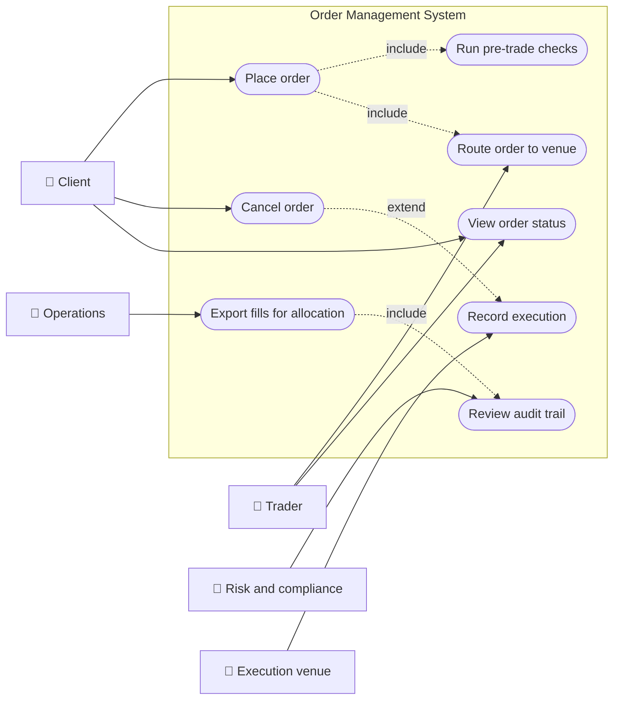
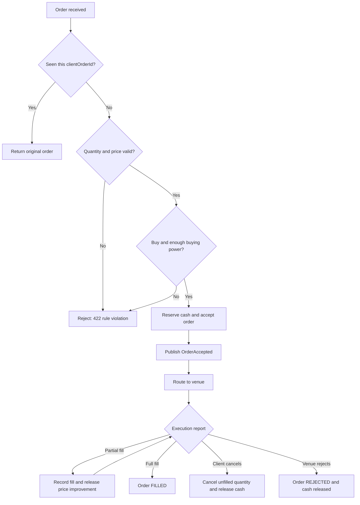
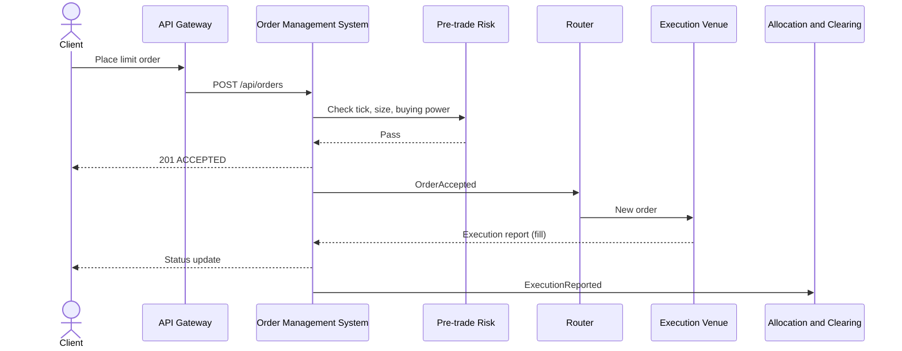
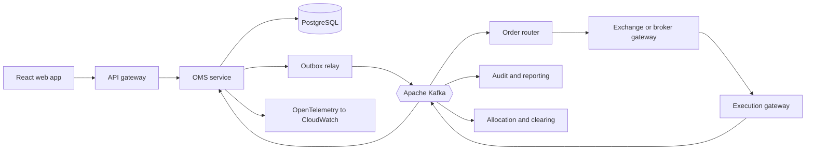
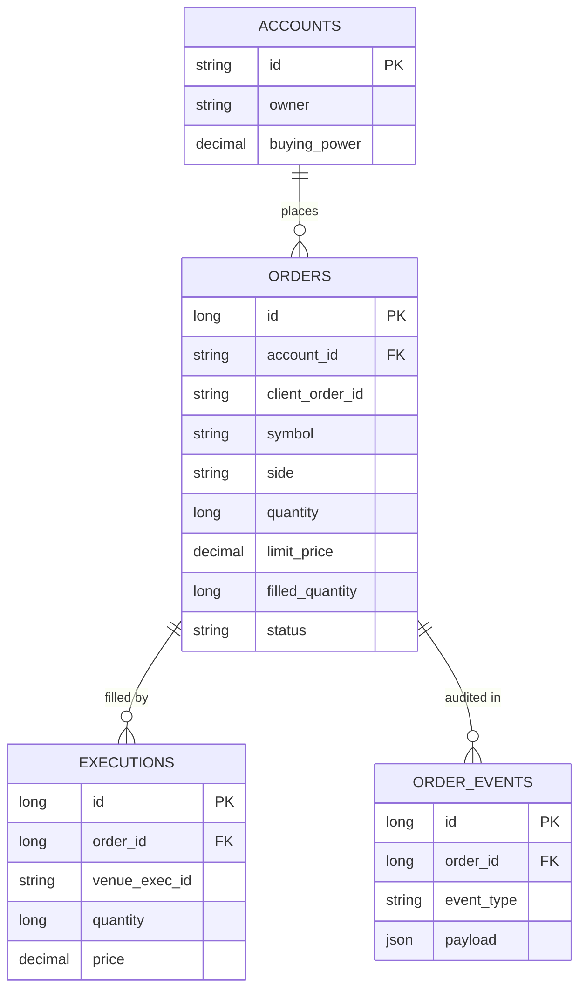
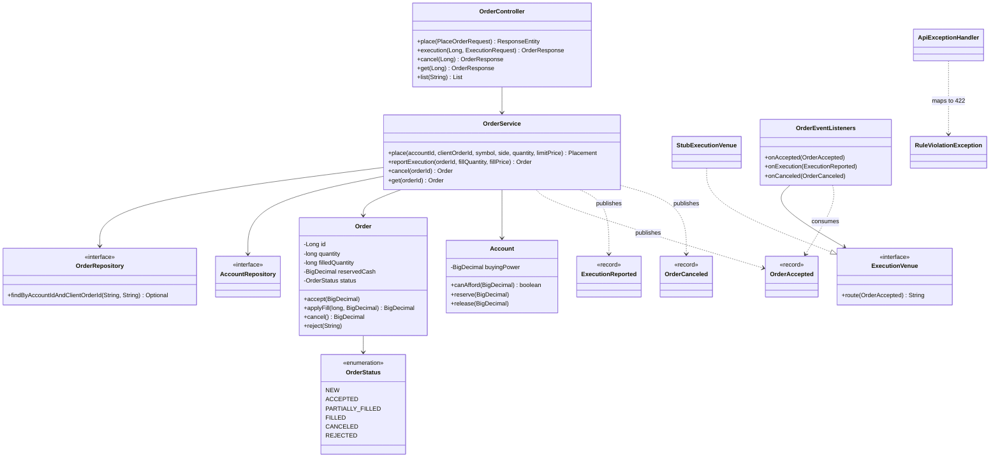
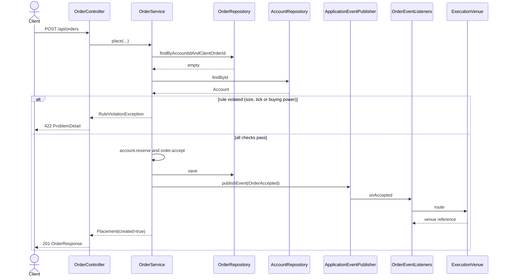
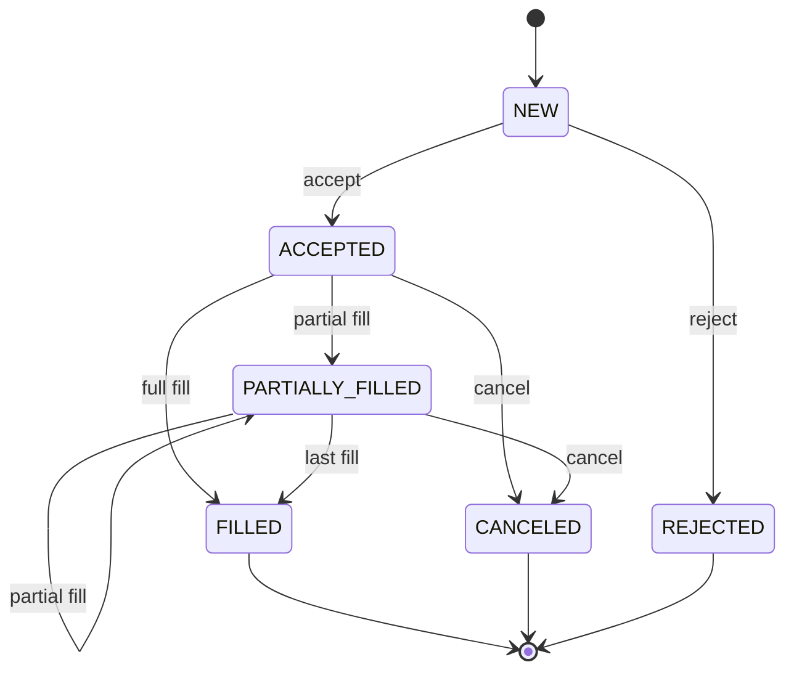
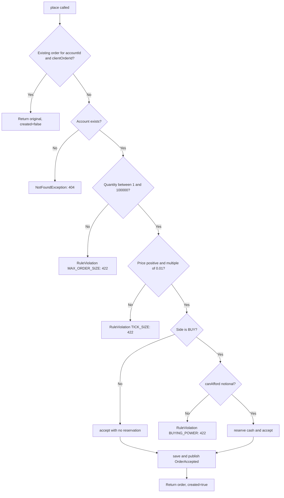

# Order Management System

> **Domain:** Capital Markets and Brokerage · **Author:** [@naveenks720](https://github.com/naveenks720) · **Published:** October 28, 2026

> **Runnable code:** [`examples/capital-markets/order-management-system`](https://github.com/dhulipalla599/domain-knowledge-engineering/tree/main/examples/capital-markets/order-management-system)

## Explain It Like I'm Five

Imagine a school lunch counter where kids write down what they want to swap: "I will trade my two cookies for one juice box, but only if I get at least one juice box." A helper takes every note, checks that the kid really has two cookies and that the note makes sense, then walks it to the big swap table. When another kid agrees, the helper crosses off what was swapped and keeps a tidy list of who has what. If a kid changes their mind before the swap happens, the helper tears up the note and gives the cookies back.

An order management system (OMS) is that helper: it takes a client's order to buy or sell securities, checks it, sends it to the market, tracks every partial or full execution, and keeps the official record.

## Business Overview

An order management system is the broker-dealer's (or asset manager's) system of record for orders. It captures an order from a client, advisor or portfolio manager, validates it against pre-trade rules, routes it to an exchange, alternative venue or another broker, receives execution reports, and keeps the order's state, fills and audit trail.

Why the business cares:

- **Revenue:** orders that are accepted quickly and routed well generate commissions, spread and payment for order flow (where permitted). Lost or stuck orders lose clients.
- **Risk:** pre-trade checks (buying power, size limits, price sanity) stop a bad order before it reaches the market, where a mistake can be expensive and hard to reverse.
- **Regulation:** firms must keep accurate order and execution records and be able to reconstruct the life of an order. Specific obligations (for example best execution, order audit trail reporting, market access controls) vary by jurisdiction and by whether the firm is a retail broker, institutional broker or asset manager, so confirm them with your compliance team.
- **Customer experience:** clients expect to see an order's status change in near real time and to cancel it reliably.

In the value chain, the OMS sits between **client channels** (web, mobile, advisor desktops, FIX connections) and **execution** (smart order router, exchanges, ECNs, other brokers). Downstream, it feeds **trade allocation, clearing and settlement**, **position keeping**, **books and records** and **regulatory reporting**. An execution management system (EMS) is often a separate, trader-focused tool for working orders in the market; in some firms the two are combined.

## Real-World Example

**Company:** Harborline Securities, a fictional retail broker. **Customer:** Priya Nair, account `ACC-1001`, buying power 50,000.00.

1. Priya opens the Harborline app and enters a limit order: buy 100 shares of ACME at no more than 25.50. The app generates a `clientOrderId` of `web-1` so a retry cannot create a second order.
2. The OMS checks the order: the price is a legal tick, the size is within limits, and 100 x 25.50 = 2,550.00 is available. It reserves that cash (buying power drops to 47,450.00) and marks the order `ACCEPTED`.
3. The OMS publishes `OrderAccepted`. The router picks it up and sends the order to a venue.
4. The venue fills 40 shares at 25.40. The OMS records the fill, moves the order to `PARTIALLY_FILLED`, and releases the price improvement of 0.10 x 40 = 4.00 back to buying power.
5. Priya's phone shows 40 of 100 filled. She decides to stop and taps cancel. The OMS cancels the remaining 60 shares, releases the 1,530.00 still reserved for them, and publishes `OrderCanceled`.
6. The 40 executed shares flow to allocation, clearing and settlement as a separate process outside this system.

A second customer, Tomas Weber (`ACC-1002`, buying power 1,000.00), tries to buy 1,000 shares at 50.00. The OMS rejects it immediately with a clear reason, and nothing reaches the market.

## Stakeholders

| Stakeholder | What they need | What they fear |
|---|---|---|
| Retail client | Fast, clear order status; reliable cancel; correct fills | A duplicate order, a stale status, an order that cannot be canceled |
| Advisor or portfolio manager | Enter and monitor many orders; see fills quickly | Mis-keyed orders, losing track of partial fills |
| Trader | Control over how orders are worked and routed | Orders stuck in the OMS, delays before the market |
| Risk and compliance officer | Enforced pre-trade limits and a complete audit trail | Orders bypassing controls; missing records during an inquiry |
| Operations (middle and back office) | Clean executions to allocate, confirm and settle | Breaks between OMS, venue and clearing records |
| Execution venue or broker gateway | Well-formed orders and prompt replies | Malformed or runaway order flow |
| Engineering and SRE | Predictable behavior, replayable events, observability | Duplicate processing, silent data drift, outages at market open |

## Use Case Diagram



| Use Case | Primary Actor | Goal | Main success outcome |
|---|---|---|---|
| Place order | Client | Get an order into the market safely | Order is `ACCEPTED`, cash reserved, event published |
| Run pre-trade checks | Risk and compliance (as policy owner) | Block orders that break limits | Bad orders rejected with a named rule |
| Route order to venue | Trader | Send accepted orders to the right venue | Venue reference recorded |
| Record execution | Execution venue | Report fills back | Order moves to `PARTIALLY_FILLED` or `FILLED` |
| Cancel order | Client | Stop the unfilled part of an order | Order `CANCELED`, reservation released |
| View order status | Client | See where the order stands | Current status and filled quantity shown |
| Review audit trail | Risk and compliance | Reconstruct what happened and when | Ordered list of events per order |
| Export fills for allocation | Operations | Hand executions to downstream processing | Fill events available to allocation and clearing |

## Key Terms

| Term | Plain-English meaning |
|---|---|
| OMS / EMS | Order management system (the order record) / execution management system (tools for working orders in the market) |
| Limit order | An order to buy at or below, or sell at or above, a stated price |
| Market order | An order to trade immediately at the best available price |
| Tick size | The smallest allowed price increment; many venues use 0.01 for typical stocks, but rules differ by market and instrument |
| Buying power | Cash (and possibly margin) the client can use for new purchases |
| Pre-trade check | A validation run before an order is sent to market |
| Partial fill | Only part of the order quantity has executed |
| Execution report | A venue's message saying an order was acknowledged, filled, canceled or rejected |
| FIX | Financial Information eXchange, the common messaging protocol between brokers and venues |
| `ClOrdID` / client order id | Identifier created by the client for an order; used to detect retries |
| Smart order router (SOR) | Component that picks a venue or splits an order across venues |
| Best execution | A broker's duty to seek good outcomes for client orders; the exact standard depends on the jurisdiction |

## Process Flow

A client or advisor submits an order. The OMS de-duplicates by client order id, runs pre-trade checks, reserves cash for buys, and accepts the order. The router sends it to a venue. The venue returns execution reports, which the OMS applies in order until the order is filled, or until the client cancels the rest. Orders that fail a check are rejected immediately; orders that reach a venue but are refused by it are marked `REJECTED` too (the example models only pre-trade rejection).





## Business Rules and Edge Cases

- **Idempotency:** networks retry. The same client order id from the same account must never create two orders; return the original. The key is scoped per account, not global.
- **Money precision:** use exact decimals for prices and cash. Binary floating point causes off-by-a-cent errors in reservations and refunds.
- **Tick size and price validity:** reject prices that are not a legal increment. Rules differ by market, price level and instrument, so keep the table configurable rather than hard-coding one value.
- **Buying power reservation:** reserve at accept time so two concurrent orders cannot spend the same cash. Release the unused part on price improvement and on cancel. Use optimistic locking (a version column) or serializable updates on the account.
- **Partial fills:** never assume one order equals one fill. Track `filledQuantity`, reject a fill that exceeds the remaining quantity, and accept more than one fill per order.
- **Out-of-order and duplicate execution reports:** venues and brokers can resend. De-duplicate by execution id and apply per-order events in sequence.
- **Cancel races:** a cancel can cross a fill in flight. The venue's answer is authoritative: a cancel request is only confirmed when the venue says so. The example simplifies this to an immediate cancel of open orders.
- **Illegal lifecycle moves:** a filled, canceled or rejected order is final. Canceling it, or filling it again, is an error, not a silent no-op.
- **Sells:** a sell needs a position check (and, for short sales, locate and short-sale rules). The example does not check positions; production must.
- **Market hours and halts:** order types, sessions and halts vary by venue. Do not assume 24-hour trading.
- **Partial failure:** the order must be saved and the event published together (transactional outbox in production), or a crash between the two loses orders from the router's view.

## From Business to System

| Business concept or step | System component | Data entity | Event |
|---|---|---|---|
| Place order | Order API and `OrderService` | `orders` | `OrderAccepted` (`oms.order.accepted.v1`) |
| Idempotent retry | `OrderService` + unique constraint | `orders(account_id, client_order_id)` | none (returns original) |
| Pre-trade check | `OrderService` rules | `accounts` | none (rejects with 422) |
| Reserve cash | `Account.reserve` | `accounts.buying_power`, `orders.reserved_cash` | none |
| Route to venue | Router consumer, `ExecutionVenue` adapter | `orders` | consumes `OrderAccepted` |
| Execution report | Execution endpoint or Kafka consumer | `executions` | `ExecutionReported` (`oms.order.execution.v1`) |
| Cancel | `OrderService.cancel` | `orders` | `OrderCanceled` (`oms.order.canceled.v1`) |
| Audit trail | Audit consumer | `order_events` | consumes all order topics |

## Architecture



**Service boundaries.** The OMS service owns order state and cash reservations, because those must change together in one database transaction. The router and execution gateway own the venue connections (FIX sessions, throttling, venue quirks) and are separate so a venue outage cannot block order entry. Audit, reporting and allocation are pure consumers: they read the event stream and never write to the OMS database, which keeps the system of record small and the audit trail replayable. Kafka topics are keyed by `orderId` so all events for one order stay in sequence.

## Data Model

```sql
CREATE TABLE accounts (
    id            VARCHAR(20) PRIMARY KEY,
    owner         VARCHAR(100) NOT NULL,
    buying_power  NUMERIC(18,2) NOT NULL CHECK (buying_power >= 0),
    version       BIGINT NOT NULL DEFAULT 0
);

CREATE TABLE orders (
    id                BIGSERIAL PRIMARY KEY,
    account_id        VARCHAR(20) NOT NULL REFERENCES accounts(id),
    client_order_id   VARCHAR(64) NOT NULL,
    symbol            VARCHAR(16) NOT NULL,
    side              VARCHAR(4)  NOT NULL CHECK (side IN ('BUY','SELL')),
    quantity          BIGINT NOT NULL CHECK (quantity > 0),
    limit_price       NUMERIC(18,4) NOT NULL CHECK (limit_price > 0),
    filled_quantity   BIGINT NOT NULL DEFAULT 0,
    reserved_cash     NUMERIC(18,2) NOT NULL DEFAULT 0,
    status            VARCHAR(20) NOT NULL,
    reject_reason     VARCHAR(200),
    created_at        TIMESTAMPTZ NOT NULL DEFAULT now(),
    version           BIGINT NOT NULL DEFAULT 0,
    UNIQUE (account_id, client_order_id)
);

CREATE TABLE executions (
    id            BIGSERIAL PRIMARY KEY,
    order_id      BIGINT NOT NULL REFERENCES orders(id),
    venue_exec_id VARCHAR(64) NOT NULL,
    quantity      BIGINT NOT NULL CHECK (quantity > 0),
    price         NUMERIC(18,4) NOT NULL,
    executed_at   TIMESTAMPTZ NOT NULL,
    UNIQUE (order_id, venue_exec_id)
);

CREATE TABLE order_events (
    id          BIGSERIAL PRIMARY KEY,
    order_id    BIGINT NOT NULL REFERENCES orders(id),
    event_type  VARCHAR(40) NOT NULL,
    payload     JSONB NOT NULL,
    occurred_at TIMESTAMPTZ NOT NULL DEFAULT now()
);

CREATE TABLE outbox (
    id           BIGSERIAL PRIMARY KEY,
    topic        VARCHAR(100) NOT NULL,
    message_key  VARCHAR(64) NOT NULL,
    payload      JSONB NOT NULL,
    published_at TIMESTAMPTZ
);
```



The runnable example implements `accounts` and `orders` only; `executions`, `order_events` and `outbox` are production additions.

## APIs

| Method | Path | Purpose |
|---|---|---|
| POST | `/api/orders` | Place an order (idempotent on `accountId` + `clientOrderId`) |
| GET | `/api/orders/{id}` | Get one order |
| GET | `/api/orders?accountId=` | List an account's orders, newest first |
| POST | `/api/orders/{id}/cancel` | Cancel the unfilled quantity |
| POST | `/api/orders/{id}/executions` | Apply an execution report (in production this arrives from Kafka, not a public API) |

Request to `POST /api/orders`:

```json
{
  "accountId": "ACC-1001",
  "clientOrderId": "web-1",
  "symbol": "ACME",
  "side": "BUY",
  "quantity": 100,
  "limitPrice": 25.50
}
```

Response `201 Created` (a replay with the same ids returns `200 OK` and the same body):

```json
{
  "id": 1,
  "accountId": "ACC-1001",
  "clientOrderId": "web-1",
  "symbol": "ACME",
  "side": "BUY",
  "quantity": 100,
  "limitPrice": 25.50,
  "filledQuantity": 0,
  "status": "ACCEPTED"
}
```

Rule violations return `422` with a `ProblemDetail` body that includes a `rule` field (`BUYING_POWER`, `TICK_SIZE`, `MAX_ORDER_SIZE`, `LIMIT_PRICE`); illegal lifecycle moves return `409`.

## Events

| Event | Producer | Consumers | Key fields |
|---|---|---|---|
| `OrderAccepted` (`oms.order.accepted.v1`) | OMS service | Router, audit | `orderId`, `accountId`, `symbol`, `side`, `quantity`, `limitPrice` |
| `ExecutionReported` (`oms.order.execution.v1`) | OMS service | Audit, allocation, client notifications | `orderId`, `fillQuantity`, `fillPrice`, `statusAfter` |
| `OrderCanceled` (`oms.order.canceled.v1`) | OMS service | Router (to cancel at venue), audit | `orderId`, `unfilledQuantity` |

**Ordering:** key every message by `orderId` so one partition carries all events for an order in sequence. **Idempotency:** consumers must tolerate redelivery (Kafka is at-least-once by default). De-duplicate executions by the venue's execution id, and store the last processed event per order. **Atomicity:** write the event to an outbox table in the same transaction as the order change, and let a relay publish it, so a crash cannot save an order without its event.

## Backend Implementation

> The Java tab is the exact code from the runnable example (Spring Boot 3). The Python tab uses FastAPI with SQLAlchemy; the Node.js tab uses Express with TypeScript. Full source: [`examples/capital-markets/order-management-system`](https://github.com/dhulipalla599/domain-knowledge-engineering/tree/main/examples/capital-markets/order-management-system).

The key business rule: idempotent placement with pre-trade checks and cash reservation (`OrderService.place`).

=== "Java"

    ```java
    @Transactional
    public Placement place(String accountId, String clientOrderId, String symbol, Side side, long quantity, BigDecimal limitPrice) {
        var replay = orders.findByAccountIdAndClientOrderId(accountId, clientOrderId);
        if (replay.isPresent()) {
            return new Placement(replay.get(), false);
        }
        Account account = accounts.findById(accountId)
                .orElseThrow(() -> new NotFoundException("account " + accountId + " not found"));
        if (quantity <= 0 || quantity > MAX_QUANTITY) {
            throw new RuleViolationException("MAX_ORDER_SIZE", "quantity must be between 1 and " + MAX_QUANTITY);
        }
        if (limitPrice.signum() <= 0 || limitPrice.remainder(TICK).signum() != 0) {
            throw new RuleViolationException("TICK_SIZE", "limit price must be positive and a multiple of " + TICK);
        }
        Order order = new Order(accountId, clientOrderId, symbol, side, quantity, limitPrice);
        if (side == Side.BUY) {
            if (!account.canAfford(order.notional())) {
                throw new RuleViolationException("BUYING_POWER",
                        "order needs " + order.notional() + " but buying power is " + account.getBuyingPower());
            }
            account.reserve(order.notional());
            order.accept(order.notional());
        } else {
            order.accept(BigDecimal.ZERO);
        }
        Order saved = orders.save(order);
        events.publishEvent(new OrderAccepted(saved.getId(), accountId, symbol, side, quantity, limitPrice));
        return new Placement(saved, true);
    }
    ```

=== "Python"

    ```python
    MAX_QUANTITY = 100_000
    TICK = Decimal("0.01")

    def place(db: Session, account_id, client_order_id, symbol, side, quantity, limit_price: Decimal):
        replay = db.scalar(select(Order).where(
            Order.account_id == account_id, Order.client_order_id == client_order_id))
        if replay:
            return replay, False
        account = db.get(Account, account_id)
        if account is None:
            raise NotFound(f"account {account_id} not found")
        if quantity <= 0 or quantity > MAX_QUANTITY:
            raise RuleViolation("MAX_ORDER_SIZE", f"quantity must be between 1 and {MAX_QUANTITY}")
        if limit_price <= 0 or limit_price % TICK != 0:
            raise RuleViolation("TICK_SIZE", f"limit price must be positive and a multiple of {TICK}")
        order = Order(account_id=account_id, client_order_id=client_order_id, symbol=symbol,
                      side=side, quantity=quantity, limit_price=limit_price)
        if side == "BUY":
            if account.buying_power < order.notional():
                raise RuleViolation("BUYING_POWER",
                    f"order needs {order.notional()} but buying power is {account.buying_power}")
            account.buying_power -= order.notional()
            order.accept(order.notional())
        else:
            order.accept(Decimal(0))
        db.add(order)
        db.flush()
        publish(OrderAccepted(order.id, account_id, symbol, side, quantity, limit_price))
        return order, True
    ```

=== "Node.js"

    ```typescript
    const MAX_QUANTITY = 100_000;
    const TICK_CENTS = 1; // prices handled as integer cents to avoid float error

    export async function place(db: Db, r: PlaceOrder): Promise<{ order: Order; created: boolean }> {
      const replay = await db.orders.findByClientOrderId(r.accountId, r.clientOrderId);
      if (replay) return { order: replay, created: false };
      const account = await db.accounts.find(r.accountId);
      if (!account) throw new NotFound(`account ${r.accountId} not found`);
      if (r.quantity <= 0 || r.quantity > MAX_QUANTITY)
        throw new RuleViolation("MAX_ORDER_SIZE", `quantity must be between 1 and ${MAX_QUANTITY}`);
      if (r.limitPriceCents <= 0 || r.limitPriceCents % TICK_CENTS !== 0)
        throw new RuleViolation("TICK_SIZE", "limit price must be positive and a legal tick");
      const order = newOrder(r);
      if (r.side === "BUY") {
        const notional = order.quantity * order.limitPriceCents;
        if (account.buyingPowerCents < notional)
          throw new RuleViolation("BUYING_POWER",
            `order needs ${notional} but buying power is ${account.buyingPowerCents}`);
        account.buyingPowerCents -= notional;
        accept(order, notional);
      } else {
        accept(order, 0);
      }
      const saved = await db.orders.save(order);
      bus.publish("oms.order.accepted.v1", { orderId: saved.id, ...r });
      return { order: saved, created: true };
    }
    ```

The controller endpoint that calls it (`OrderController.place`):

=== "Java"

    ```java
    @PostMapping
    public ResponseEntity<OrderResponse> place(@Valid @RequestBody PlaceOrderRequest r) {
        var placement = service.place(r.accountId(), r.clientOrderId(), r.symbol(), r.side(), r.quantity(), r.limitPrice());
        HttpStatus status = placement.created() ? HttpStatus.CREATED : HttpStatus.OK;
        return ResponseEntity.status(status).body(OrderResponse.from(placement.order()));
    }
    ```

=== "Python"

    ```python
    @app.post("/api/orders")
    def place_order(r: PlaceOrderRequest, response: Response, db: Session = Depends(get_db)):
        order, created = place(db, r.account_id, r.client_order_id, r.symbol, r.side, r.quantity, r.limit_price)
        response.status_code = 201 if created else 200
        return OrderResponse.from_order(order)
    ```

=== "Node.js"

    ```typescript
    router.post("/api/orders", async (req, res) => {
      const { order, created } = await place(db, parsePlaceOrder(req.body));
      res.status(created ? 201 : 200).json(toResponse(order));
    });
    ```

## Frontend Screen

An order ticket that submits a limit order and shows the result. It generates the `clientOrderId` once per ticket so a double click or retry is safe.

```tsx
import { useState } from "react";

type Side = "BUY" | "SELL";
type Order = { id: number; status: string; filledQuantity: number; quantity: number };

export function OrderTicket({ accountId }: { accountId: string }) {
  const [clientOrderId] = useState(() => crypto.randomUUID());
  const [symbol, setSymbol] = useState("ACME");
  const [side, setSide] = useState<Side>("BUY");
  const [quantity, setQuantity] = useState(100);
  const [limitPrice, setLimitPrice] = useState("25.50");
  const [order, setOrder] = useState<Order | null>(null);
  const [error, setError] = useState<string | null>(null);

  async function submit(e: React.FormEvent) {
    e.preventDefault();
    setError(null);
    const res = await fetch("/api/orders", {
      method: "POST",
      headers: { "Content-Type": "application/json" },
      body: JSON.stringify({ accountId, clientOrderId, symbol, side, quantity, limitPrice: Number(limitPrice) }),
    });
    if (res.ok) setOrder(await res.json());
    else setError((await res.json()).detail ?? "Order failed");
  }

  return (
    <form onSubmit={submit}>
      <input value={symbol} onChange={(e) => setSymbol(e.target.value.toUpperCase())} aria-label="Symbol" />
      <select value={side} onChange={(e) => setSide(e.target.value as Side)} aria-label="Side">
        <option>BUY</option>
        <option>SELL</option>
      </select>
      <input type="number" min={1} value={quantity} onChange={(e) => setQuantity(Number(e.target.value))} aria-label="Quantity" />
      <input value={limitPrice} onChange={(e) => setLimitPrice(e.target.value)} aria-label="Limit price" />
      <button type="submit">Place order</button>
      {error && <p role="alert">{error}</p>}
      {order && <p>Order {order.id}: {order.status} ({order.filledQuantity}/{order.quantity} filled)</p>}
    </form>
  );
}
```

A production screen would also show live status through server-sent events or WebSockets, and would not use `Number()` for prices that need exact decimals (send them as strings).

## Cloud Deployment

On AWS, run the OMS service, router and execution gateway as separate Deployments on **Amazon EKS**. Use **Amazon RDS for PostgreSQL** (Multi-AZ) for order state, **Amazon MSK** for Apache Kafka, **AWS Secrets Manager** for venue and database credentials, an **Application Load Balancer** with **AWS WAF** in front of the API, and **Amazon ECR** for images. Venue connectivity (FIX over private links or VPN) depends on the venue and is usually the most constrained part of the network design.

```hcl
resource "aws_db_instance" "oms" {
  identifier                  = "oms-postgres"
  engine                      = "postgres"
  instance_class              = "db.r6g.large"
  allocated_storage           = 100
  multi_az                    = true
  storage_encrypted           = true
  backup_retention_period     = 14
  deletion_protection         = true
  manage_master_user_password = true
  db_subnet_group_name        = aws_db_subnet_group.private.name
  vpc_security_group_ids      = [aws_security_group.oms_db.id]
}
```

- **Security:** private subnets, security groups that allow only the OMS pods to reach the database, IAM roles for service accounts (IRSA), TLS everywhere, encryption at rest, and per-account authorization checked on every call.
- **Scaling:** scale OMS pods on CPU and request rate with a Horizontal Pod Autoscaler; keep the router's venue sessions as a small, stable set (a FIX session usually has one active connection per session). Pre-scale before market open instead of waiting for autoscaling.
- **Observability:** OpenTelemetry instrumentation exports traces and metrics to CloudWatch (via the AWS Distro for OpenTelemetry collector). Track order-accept latency, venue round-trip, rejects by rule, consumer lag and orders stuck in `ACCEPTED`. Propagate the `orderId` as a trace attribute and log field.

## Non-Functional Requirements

| Area | Expectation | How the design meets it |
|---|---|---|
| Availability | Order entry and cancel must work during market hours; targets are set by the firm and the business | Multi-AZ database, several stateless OMS pods, separate router so venue issues do not block order entry |
| Latency | Retail order acceptance usually needs to feel instant; ultra-low-latency trading is a different, specialized design | Single transaction on indexed keys; venue routing is asynchronous through Kafka |
| Consistency | Cash reservation and order state must never disagree | One database transaction for order and account; optimistic locking via `version` |
| Idempotency | Retries must not duplicate orders or fills | Unique `(account_id, client_order_id)`; unique `(order_id, venue_exec_id)` |
| Audit | Every state change must be reconstructable | Append-only `order_events` and Kafka retention; retention periods follow local record-keeping rules |
| Compliance | Pre-trade controls must be enforced and evidenced | Rules in one service, named rule codes in rejections, logs of every rejection |
| Security | Only the account owner or an authorized user can act on an order | OIDC at the gateway, account-level authorization in the service |

## Runnable Example

The example implements the core flow: place a limit order with idempotency, tick-size, order-size and buying-power rules; route it to a stub venue; apply partial and full executions; cancel the remainder; and publish three domain events (stand-ins for Kafka topics). It runs on H2 with no external services.

Source: [`examples/capital-markets/order-management-system`](https://github.com/dhulipalla599/domain-knowledge-engineering/tree/main/examples/capital-markets/order-management-system)

```bash
cd examples/capital-markets/order-management-system
mvn spring-boot:run     # http://localhost:8080
mvn verify              # run the tests
```

Place an order:

```bash
curl -s -XPOST localhost:8080/api/orders -H 'Content-Type: application/json' \
  -d '{"accountId":"ACC-1001","clientOrderId":"web-1","symbol":"ACME","side":"BUY","quantity":100,"limitPrice":25.50}'
```

```json
{"id":1,"accountId":"ACC-1001","clientOrderId":"web-1","symbol":"ACME","side":"BUY","quantity":100,"limitPrice":25.50,"filledQuantity":0,"status":"ACCEPTED"}
```

Trigger the buying-power rule:

```bash
curl -s -XPOST localhost:8080/api/orders -H 'Content-Type: application/json' \
  -d '{"accountId":"ACC-1002","clientOrderId":"web-2","symbol":"ACME","side":"BUY","quantity":1000,"limitPrice":50.00}'
```

```json
{"type":"about:blank","title":"Order rejected by pre-trade check","status":422,"detail":"order needs 50000.00 but buying power is 1000.00","instance":"/api/orders","rule":"BUYING_POWER"}
```

| Class | Package | Responsibility |
|---|---|---|
| `OrderManagementSystemApplication` | root | Spring Boot entry point |
| `Order` | `domain` | Entity and lifecycle methods (`accept`, `applyFill`, `cancel`, `reject`) |
| `OrderStatus` | `domain` | Lifecycle enum with legal transitions |
| `Account` | `domain` | Buying power and cash reservation |
| `Side` | `domain` | `BUY` or `SELL` |
| `OrderEvents` | `domain` | Event records `OrderAccepted`, `ExecutionReported`, `OrderCanceled` |
| `OrderRepository` | `repository` | Order persistence and idempotency lookup |
| `AccountRepository` | `repository` | Account persistence |
| `OrderService` | `service` | Pre-trade rules, executions, cancels, event publishing |
| `RuleViolationException` | `service` | Business rule failure with a rule code |
| `NotFoundException` | `service` | Missing order or account |
| `OrderController` | `api` | REST endpoints |
| `OrderRequests` | `api` | Request and response records |
| `ApiExceptionHandler` | `api` | Maps errors to `ProblemDetail` (422, 404, 409) |
| `ExecutionVenue` | `integration` | Port to the exchange or broker gateway |
| `StubExecutionVenue` | `integration` | Deterministic in-memory venue |
| `OrderEventListeners` | `integration` | Router and audit-trail consumers |

## UML Diagrams

### Class Diagram

The controller delegates to the service, which owns the rules and talks to repositories, entities and the event publisher; listeners react to events and call the venue port.



### Sequence Diagram (control flow)

One placement request through the code. A rule violation is thrown from the service and turned into a 422 by the exception handler; on success the event is published inside the transaction and the listener routes the order.



### State Diagram

The `OrderStatus` enum defines every legal move; `Order.moveTo` rejects anything else with an `IllegalStateException` (HTTP 409).



### Activity Diagram

The decision logic inside `OrderService.place`.



## AI Opportunities

1. **Pre-trade anomaly detection ("fat finger" assist).** Flag orders whose size, price or symbol is unusual for the client or far from the market. *Data:* historical orders per account, current quotes, typical sizes. *Risk/control:* false positives annoy clients and false negatives give false comfort, so use it to warn or hold for review, not as the only control; hard limits stay rule-based.
2. **Smart routing and execution-quality models.** Predict which venue or tactic gives better fill rates or lower cost. *Data:* venue fill and latency history, order characteristics, market data. *Risk/control:* the firm must still be able to explain and evidence its best-execution process, so keep models explainable, versioned and monitored, with a fallback to deterministic routing.
3. **Order-status and exception assistant for operations.** An LLM agent summarizes why an order is stuck (venue reject text, missing execution, event gaps) and suggests the next step. *Data:* order events, venue messages, runbooks. *Risk/control:* read-only access to production data, no authority to cancel or amend orders without human approval, and logging of every answer.
4. **Surveillance support.** Rank order patterns that may need compliance review (for example repeated cancels or unusual sequences). *Data:* order and cancel events, account history. *Risk/control:* bias and explainability matter because outcomes can affect clients; alerts are leads for a human analyst, not conclusions.
5. **Natural-language order entry for advisors.** Parse "buy 100 ACME at 25.50" into a draft ticket. *Data:* advisor input, instrument master. *Risk/control:* always show the parsed order for explicit confirmation; the model never submits on its own.

## Common Pitfalls

- **No idempotency key.** A mobile retry places the order twice. Require a client order id and enforce uniqueness per account.
- **Floating-point money.** Use `BigDecimal`, `NUMERIC` or integer minor units, never `double`.
- **Treating cancel as instant.** At a real venue, cancel is a request; a fill can arrive first. Model `PENDING_CANCEL` and wait for the venue's confirmation.
- **One order, one fill.** Real orders fill in pieces, sometimes across venues. Keep an executions table and track cumulative quantity.
- **Hard-coding one tick size or session.** Rules differ by venue, instrument and price level. Keep them in reference data.
- **Dual writes.** Saving an order and publishing to Kafka separately can lose events. Use an outbox.
- **Unordered events.** Without a key per order, consumers can see a fill before the accept. Key by `orderId`.
- **Mutating final orders.** Allowing edits to `FILLED` or `CANCELED` orders corrupts the audit trail. Enforce the state machine in the domain class.
- **Skipping the sell side.** Position, locate and short-sale checks are part of pre-trade control for sells.

## Interview Questions

### Junior

**1. What is the difference between a market order and a limit order?**
A market order trades immediately at the best available price; the price is not guaranteed. A limit order sets a worst acceptable price (buy at or below, sell at or above) and may not fill, or may fill only partly.

**2. Why does an OMS need a client order id?**
It makes placement idempotent. If the client retries after a timeout, the OMS recognizes the id and returns the original order instead of creating a duplicate.

**3. What is a partial fill, and how should the system handle it?**
Only part of the quantity executed. The OMS keeps `filledQuantity`, moves the order to `PARTIALLY_FILLED`, keeps the rest open, and only moves to `FILLED` when the full quantity has executed.

### Mid-Level

**1. How do you stop two concurrent orders from spending the same cash?**
Reserve cash in the same transaction that accepts the order, and protect the account row with optimistic locking (a version column) or a row lock. A losing transaction retries and then fails the buying-power check.

**2. A venue sends the same execution report twice. What happens?**
Each execution has a venue execution id. Store it with a unique constraint on `(order_id, venue_exec_id)` and ignore duplicates, so cumulative quantity and cash are not applied twice.

**3. Why use a transactional outbox instead of publishing to Kafka inside the service method?**
Saving to the database and sending to Kafka are two systems, so one can succeed without the other. The outbox writes the event in the same database transaction, and a relay publishes it afterward, giving at-least-once delivery with no lost events.

### Senior / Architect

**1. Design the cancel flow when a fill can arrive at the same time.**
Key points: a `PENDING_CANCEL` state; send the cancel to the venue and wait for its confirmation or reject; apply fills that arrive meanwhile; release cash only after the venue confirms; timeouts and reconciliation with the venue's order book; clear client messaging.

**2. How would you scale the OMS for market open, when order volume spikes?**
Key points: stateless OMS pods and pre-scaling before the open; partition by account or order id; keep the database transaction small; asynchronous routing through Kafka; back-pressure and rate limits per client; load tests with realistic bursts; protect venues with throttling in the router.

**3. How would you guarantee a complete, replayable audit trail for regulators?**
Key points: append-only event log per order with timestamps from a controlled clock; the outbox plus Kafka retention and archival to immutable storage; correlation ids across services; retention per local rules; access controls and tamper evidence; tested replay that rebuilds order state from events.

## Further Learning

- FIX Protocol (order and execution report messages, `ClOrdID`, `OrdStatus`)
- Order types and time-in-force (limit, market, stop, IOC, FOK, day, GTC)
- Market structure and best-execution obligations in your jurisdiction
- Pre-trade risk controls and market access rules
- Smart order routing and execution algorithms
- Trade lifecycle: allocation, clearing and settlement
- Event sourcing, CQRS and the transactional outbox pattern
- Order audit trail and trade reporting regimes in your region

## Practitioner Notes

> _Reviewer: add real-world experience, corrections or gotchas here before approving._
