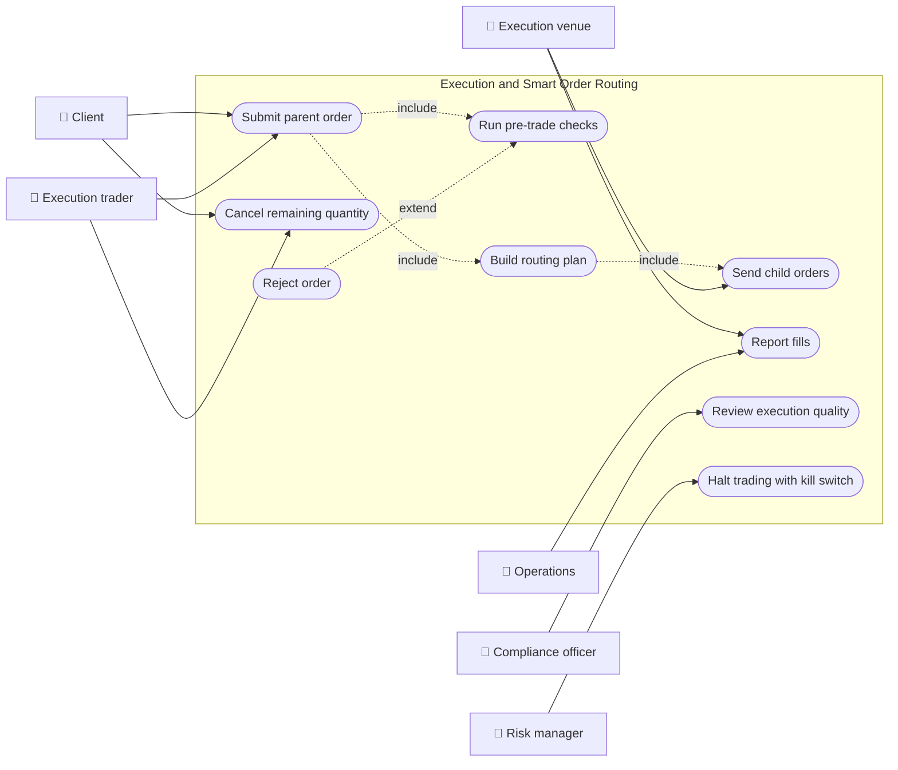
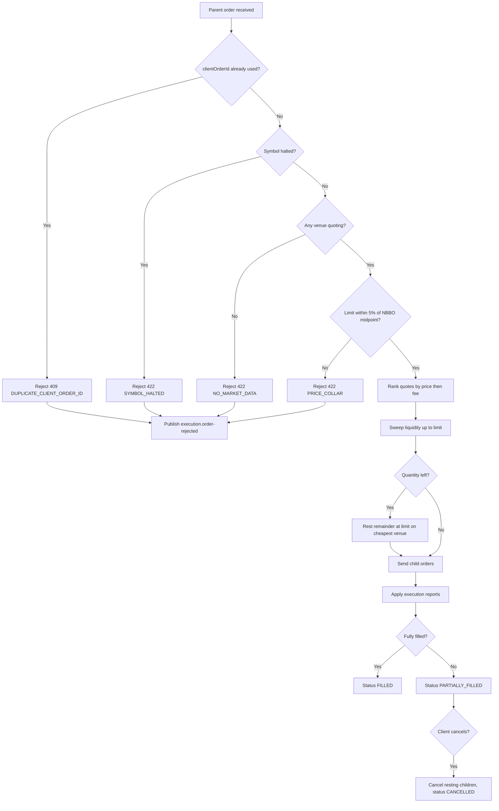
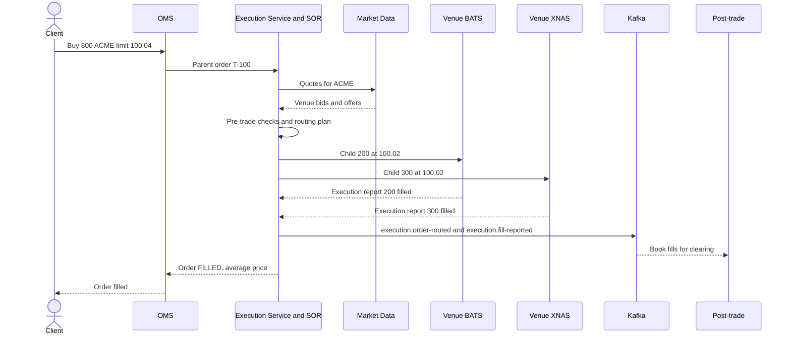
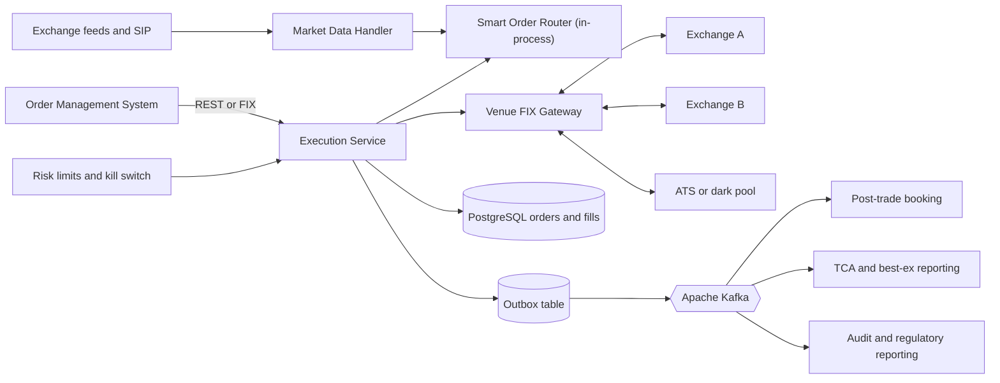
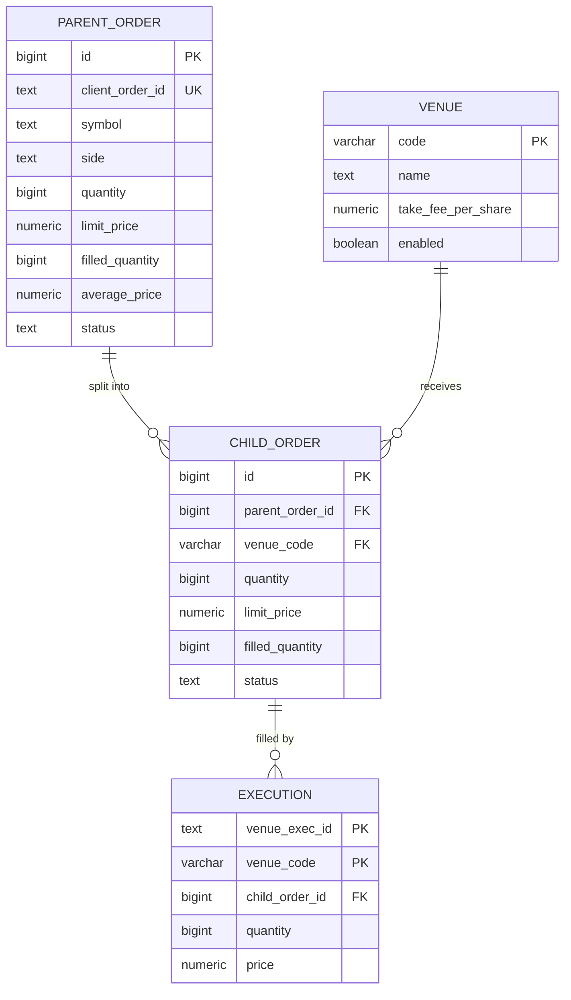
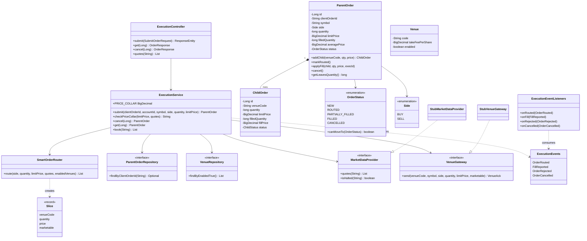
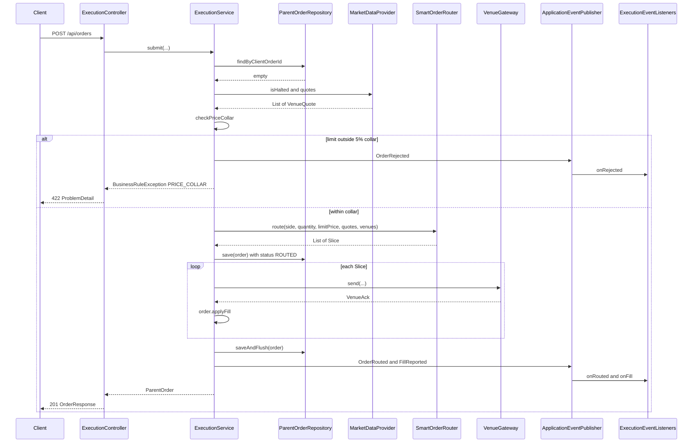
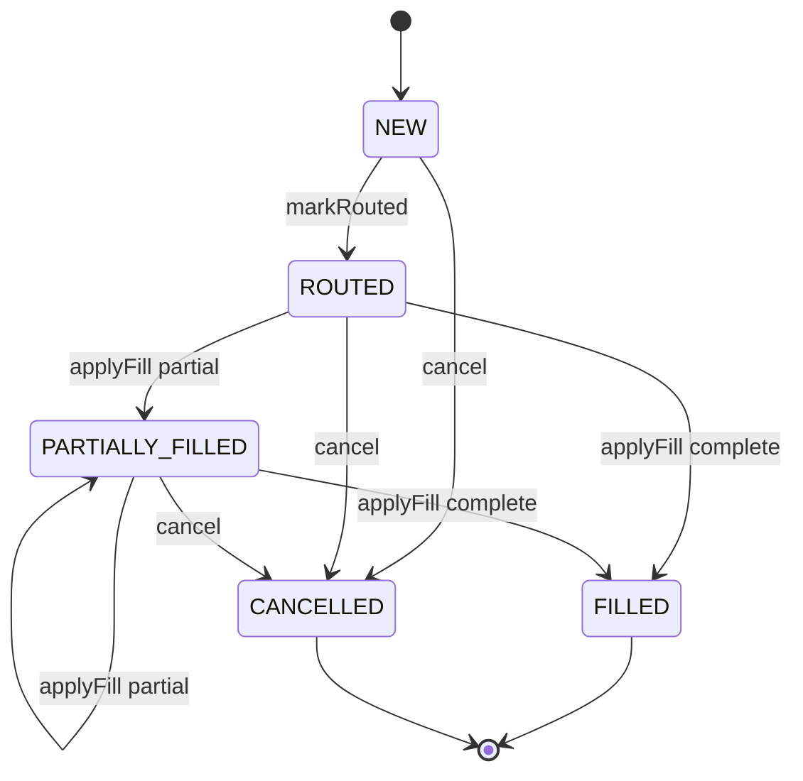
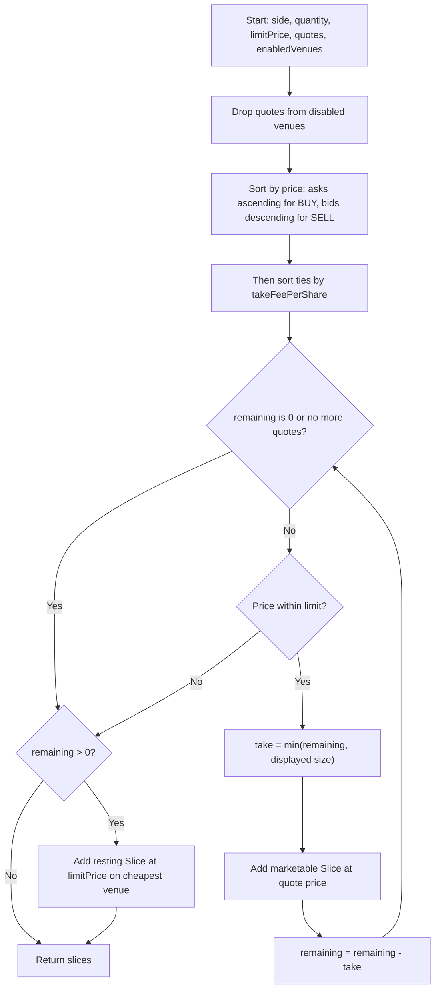

# Trade Execution and Smart Order Routing

> **Domain:** Capital Markets and Brokerage · **Author:** [@naveenks720](https://github.com/naveenks720) · **Published:** November 11, 2026

> **Runnable code:** [`examples/capital-markets/trade-execution-and-smart-order-routing`](https://github.com/dhulipalla599/domain-knowledge-engineering/tree/main/examples/capital-markets/trade-execution-and-smart-order-routing)

## Explain It Like I'm Five

Imagine you want to buy 8 apples, and there are four fruit stands in the market. One stand sells 2 apples for 1 coin each, another sells 3 apples for 1 coin each, a third sells 5 apples for a tiny bit more, and the last one is the most expensive. Your mum told you never to pay more than a certain price. A clever helper runs around, buys the cheapest apples first, and when two stands have the same price, picks the one that charges the smallest bag fee. If no stand is cheap enough for the last few apples, the helper leaves a note at one stand saying "I'll buy 2 more if the price comes down."

A smart order router is that helper for a broker: it splits a client's order across many trading venues to get the best overall result, never paying more than the client's limit, and keeps a record of every piece it bought.

## Business Overview

**Trade execution** is the step where an order that has passed the order management system (OMS) actually meets the market and becomes trades. In most modern equity, options, futures and FX markets, the same instrument trades on many venues at once: exchanges, alternative trading systems (ATSs) or multilateral trading facilities (MTFs), dark pools, single-dealer platforms and wholesalers. Liquidity is **fragmented**, so a broker needs a **smart order router (SOR)**: software that reads market data from every venue and decides where, in what size, at what price and in what order to send *child orders* so the client's *parent order* gets the best result.

Why the business cares:

- **Regulation:** brokers owe clients **best execution**. In the US this comes from FINRA Rule 5310 and is reinforced by Regulation NMS (including the Order Protection Rule against trading through better-priced protected quotes) and routing/execution-quality disclosures under SEC Rules 605 and 606. In the EU and UK, MiFID II and the UK equivalent require firms to take all sufficient steps to obtain the best possible result, considering price, costs, speed, likelihood of execution and other factors. Details differ by jurisdiction, asset class and client type, so the router's policy must be agreed with compliance.
- **Revenue and cost:** venues charge fees for taking liquidity and may pay rebates for providing it. Routing decisions directly change the broker's execution costs and, where permitted, payment for order flow economics (restricted or banned in some jurisdictions, such as the UK).
- **Risk:** the router is the last software hop before the market. US broker-dealers with market access must have pre-trade risk controls under SEC Rule 15c3-5 (the Market Access Rule); a runaway or fat-finger order can cause large losses in seconds.
- **Customer experience:** institutional clients measure brokers with transaction cost analysis (TCA); retail clients notice fill speed, price improvement and partial fills.

In the value chain it sits after **order capture and the OMS** and before **post-trade**: trade capture, allocation, confirmation, clearing and settlement, and regulatory reporting (for example the Consolidated Audit Trail in the US, or transaction reporting under MiFIR in the EU).

## Real-World Example

**Company:** Kestrel Point Securities, a fictional US broker-dealer. **Client:** Amara Osei, account `ACC-7781`, through Kestrel's web platform.

1. At 10:15 Amara enters: buy 800 shares of ACME, limit 100.04. Her browser assigns `clientOrderId` `T-100`. The OMS checks buying power and passes the order to the execution service.
2. Pre-trade checks run: ACME is not halted, `T-100` has never been used, and the limit 100.04 is within the 5% price collar around the NBBO midpoint (bid 100.00, ask 100.02, midpoint 100.01).
3. The SOR reads the book. Offers: BATS 200 @ 100.02, XNAS 300 @ 100.02, ARCX 500 @ 100.03, IEXG 1,000 @ 100.05. BATS and XNAS tie on price; BATS has the lower take fee, so it goes first.
4. The router plans three child orders: 200 to BATS @ 100.02, 300 to XNAS @ 100.02, 300 to ARCX @ 100.03. IEXG at 100.05 is above the limit and is skipped.
5. All three venues return executions. The parent order is `FILLED`: 800 shares at an average price of 100.0238. Three `execution.fill-reported` events flow to post-trade booking and to the TCA service.
6. Later, Amara buys 700 more with a limit of 100.02. Only 500 shares are available at or below 100.02, so the router takes those and rests the remaining 200 at 100.02 on IEXG. The order is `PARTIALLY_FILLED`. When she cancels, the resting 200 are cancelled, the 500 executed shares stay, and the order becomes `CANCELLED`.
7. A colleague's mis-typed order (limit 120.00) is rejected before it reaches any venue with rule `PRICE_COLLAR`, and the rejection is recorded for the compliance audit trail.

## Stakeholders

| Stakeholder | What they need | What they fear |
|---|---|---|
| Client (retail or institutional) | Best price, fast fills, accurate status and average price | Being traded through, slow or partial fills without explanation |
| Execution trader / sales trader | Control of routing strategy, visibility into child orders | A router that behaves differently from what they told the client |
| Best execution and compliance committee | Documented routing policy, evidence it is followed, regular reviews | Regulatory findings, trade-throughs, conflicts of interest from fees or rebates |
| Risk management | Pre-trade controls, kill switch, exposure limits | Fat-finger or runaway algorithms hitting the market |
| Execution venue | Valid FIX messages, controlled message rates | Malformed or excessive order flow |
| Operations / post-trade | Clean, complete fills with venue execution IDs | Missing or duplicate executions causing breaks |
| Quant / TCA analyst | Timestamped decisions and market snapshots | Unreproducible routing decisions |
| Engineering and SRE | Low, predictable latency; replayable events | Clock drift, lost execution reports, outages at the open |

## Use Case Diagram



| Use Case | Primary Actor | Goal | Main success outcome |
|---|---|---|---|
| Submit parent order | Client / trader | Buy or sell a quantity at or better than a limit | Order accepted, routed and status returned |
| Run pre-trade checks | System (on behalf of risk) | Stop orders that are duplicated, halted or mispriced | Only valid orders reach routing |
| Build routing plan | System | Split the order across venues for best execution | Child orders ranked by price then cost, none through the limit |
| Send child orders | Execution venue | Place each slice on its venue | Each child acknowledged, executed or resting |
| Report fills | Execution venue / operations | Record executions and update the parent | Filled quantity and average price are correct |
| Cancel remaining quantity | Client / trader | Stop the unfilled part of an order | Resting child orders cancelled; fills kept |
| Reject order | System | Explain why an order cannot trade | Clear rule code, audit event published |
| Review execution quality | Compliance officer | Prove routing follows the best execution policy | Reports built from routing and fill events |
| Halt trading with kill switch | Risk manager | Stop all new routing instantly | No new child orders leave the firm |

## Key Terms

| Term | Plain-English meaning |
|---|---|
| Parent order | The client's whole order, for example "buy 800 ACME at 100.04 or better" |
| Child order | A slice of the parent sent to one venue |
| Venue | Any place an order can execute: exchange, ATS/MTF, dark pool, wholesaler |
| NBBO | National Best Bid and Offer (US): the best displayed buy and sell prices across all venues |
| Marketable order | A limit order priced to execute immediately against displayed liquidity |
| Trade-through | Executing at a worse price than a better protected quote available elsewhere |
| Take fee / rebate | Fee a venue charges to remove liquidity, or pays to add it ("maker-taker") |
| Leaves quantity | Shares still open on an order (FIX tag 151 LeavesQty) |
| Execution report | Venue message reporting an acknowledgement, fill or cancel (FIX message type 35=8) |
| ClOrdID | Client-assigned order identifier used for idempotency (FIX tag 11) |
| Price collar | Pre-trade check that rejects limits too far from the current market |
| TCA | Transaction cost analysis: measuring execution quality against benchmarks such as arrival price or VWAP |

## Process Flow

An order arrives from the OMS with a client order ID. The execution service rejects duplicates, then checks the instrument's trading status and the current market. If the limit is within the price collar, the router ranks venue quotes by price and cost, sweeps displayed liquidity up to the limit, and rests any remainder. Child orders go out over venue connections; execution reports come back and update the parent. The client can cancel the remaining quantity at any time before the order is complete. Every decision, fill and rejection is published as an event for post-trade, TCA and audit.





## Business Rules and Edge Cases

- **Never trade through the limit.** A buy never executes above its limit; a sell never below. Rank strictly by price first, and stop sweeping at the first venue whose price is worse than the limit.
- **Order protection (US).** Under Regulation NMS Rule 611, trading centers must have policies to prevent trade-throughs of protected quotations. A router that sweeps several venues at once typically uses Intermarket Sweep Orders (ISOs), which carry the obligation to also take out better-priced protected quotes. Other regions have no equivalent rule but still require best execution.
- **Price and fees are both part of cost.** Ties on price are broken by fees, rebates, fill probability or latency according to the firm's documented policy. Choosing a venue only for its rebate when the client gets a worse result is a conflict of interest regulators look for.
- **Idempotency.** Clients and the OMS retry. The `clientOrderId` (FIX ClOrdID) must be unique per session or firm; a duplicate must never create a second market order.
- **Stale market data.** Quotes can be milliseconds old. A child sized to the displayed quantity may get only a partial fill or none, because another participant took the liquidity first. Treat fills, not plans, as the truth.
- **Execution reports can arrive out of order, late or twice.** Deduplicate by venue execution ID (FIX tag 17 ExecID) and never let cumulative quantity exceed order quantity.
- **Cancel races.** A cancel can cross with a fill in flight. The order may end up `FILLED` even though the client pressed cancel; the UI must say "cancel requested" until the venue confirms.
- **Halts and price bands.** Instruments can be halted (news, volatility, regulatory) or limited by price bands, such as Limit Up-Limit Down in US equities. Routing into a halted symbol must be blocked, and resting orders handled per venue rules.
- **Price collars and size limits.** Fat-finger checks (price far from market, quantity or notional above limits) must run before anything leaves the firm. US market access controls must be under the broker's direct and exclusive control.
- **Money precision.** Use decimal types, not floating point. Respect tick sizes per instrument and price level; average prices are computed with more decimals than the tick and rounded only for display or confirmation.
- **Partial failure.** One venue session may be down while others work. The router must route around disabled venues and never leave a child order whose state is unknown without reconciling it.
- **Clock and audit.** Regulators expect timestamps synchronised to a reference clock and enough detail to reconstruct each routing decision. Record the market snapshot the router used.

## From Business to System

| Business concept / step | System component | Data entity | Event |
|---|---|---|---|
| Client submits order | `ExecutionController` (REST); FIX gateway in production | `parent_order` | - |
| Duplicate / halt / collar checks | `ExecutionService.submit` pre-trade checks | `parent_order.client_order_id` | `execution.order-rejected` |
| Read venue quotes | `MarketDataProvider` | In-memory book (`VenueQuote`) | - |
| Decide where to send | `SmartOrderRouter.route` | `routing_decision` (production) | `execution.order-routed` |
| Place slice on a venue | `VenueGateway` | `child_order` | - |
| Venue reports a fill | `ExecutionService` / execution report handler | `child_order`, `execution` | `execution.fill-reported` |
| Client cancels | `ExecutionService.cancel` | `parent_order`, `child_order` | `execution.order-cancelled` |
| Venue configuration and fees | `VenueRepository` | `venue` | - |
| Post-trade booking, TCA, audit | `ExecutionEventListeners` (Kafka consumers in production) | Downstream stores | consumes all above |

## Architecture



Service boundaries:

- **Execution Service + SOR** own the parent/child order state and the routing decision. The router is a pure function inside the same process, because routing must happen in microseconds to milliseconds against the latest quotes; a network hop to a separate "router service" would add latency and a consistency gap.
- **Market Data Handler** is separate because it scales with market data volume, not order volume, and many services consume it.
- **Venue FIX Gateway** isolates session management (logon, sequence numbers, resend requests) per venue so a broken session does not take down routing for other venues.
- **Post-trade, TCA and audit** are downstream consumers on Kafka. They are not on the latency-critical path and can be replayed from the topic.
- **Risk limits and the kill switch** are owned by risk, but enforced inside the execution path, so they cannot be bypassed.

## Data Model

```sql
CREATE TABLE venue (
    code                 VARCHAR(8)    PRIMARY KEY,          -- ISO 10383 MIC
    name                 TEXT          NOT NULL,
    take_fee_per_share   NUMERIC(10,5) NOT NULL,
    enabled              BOOLEAN       NOT NULL DEFAULT TRUE
);

CREATE TABLE parent_order (
    id                BIGSERIAL     PRIMARY KEY,
    client_order_id   TEXT          NOT NULL UNIQUE,         -- idempotency key (FIX 11)
    account_id        TEXT          NOT NULL,
    symbol            TEXT          NOT NULL,
    side              TEXT          NOT NULL CHECK (side IN ('BUY','SELL')),
    quantity          BIGINT        NOT NULL CHECK (quantity > 0),
    limit_price       NUMERIC(18,4) NOT NULL,
    filled_quantity   BIGINT        NOT NULL DEFAULT 0 CHECK (filled_quantity <= quantity),
    average_price     NUMERIC(18,4) NOT NULL DEFAULT 0,
    status            TEXT          NOT NULL,
    received_at       TIMESTAMPTZ   NOT NULL,
    version           BIGINT        NOT NULL DEFAULT 0
);

CREATE TABLE child_order (
    id                BIGSERIAL     PRIMARY KEY,
    parent_order_id   BIGINT        NOT NULL REFERENCES parent_order(id),
    venue_code        VARCHAR(8)    NOT NULL REFERENCES venue(code),
    quantity          BIGINT        NOT NULL CHECK (quantity > 0),
    limit_price       NUMERIC(18,4) NOT NULL,
    filled_quantity   BIGINT        NOT NULL DEFAULT 0,
    fill_price        NUMERIC(18,4),
    venue_exec_id     TEXT,
    status            TEXT          NOT NULL
);

CREATE TABLE execution (
    venue_exec_id     TEXT          NOT NULL,
    venue_code        VARCHAR(8)    NOT NULL,
    child_order_id    BIGINT        NOT NULL REFERENCES child_order(id),
    quantity          BIGINT        NOT NULL CHECK (quantity > 0),
    price             NUMERIC(18,4) NOT NULL,
    executed_at       TIMESTAMPTZ   NOT NULL,
    PRIMARY KEY (venue_code, venue_exec_id)                  -- dedupe replayed execution reports
);

CREATE TABLE outbox_event (
    id                BIGSERIAL     PRIMARY KEY,
    topic             TEXT          NOT NULL,
    event_key         TEXT          NOT NULL,
    payload           JSONB         NOT NULL,
    created_at        TIMESTAMPTZ   NOT NULL DEFAULT now(),
    published_at      TIMESTAMPTZ
);
```

The runnable example keeps fill details on `child_order`; the separate `execution` table is the production shape, where one child can receive many fills.



## APIs

| Method | Path | Purpose |
|---|---|---|
| POST | `/api/orders` | Submit a parent order; runs pre-trade checks, routes and returns child orders |
| GET | `/api/orders/{id}` | Parent order with fills, leaves quantity, average price and child orders |
| POST | `/api/orders/{id}/cancel` | Cancel the remaining quantity (resting child orders) |
| GET | `/api/market/{symbol}/quotes` | The per-venue quotes the router sees for a symbol |

`POST /api/orders` request:

```json
{
  "clientOrderId": "T-100",
  "accountId": "ACC-7781",
  "symbol": "ACME",
  "side": "BUY",
  "quantity": 800,
  "limitPrice": 100.04
}
```

Response `201 Created`, `Location: /api/orders/2`:

```json
{
  "id": 2,
  "clientOrderId": "T-100",
  "symbol": "ACME",
  "side": "BUY",
  "quantity": 800,
  "limitPrice": 100.04,
  "filledQuantity": 800,
  "leavesQuantity": 0,
  "averagePrice": 100.0238,
  "status": "FILLED",
  "childOrders": [
    {"id": 3, "venue": "BATS", "quantity": 200, "limitPrice": 100.02, "filledQuantity": 200, "fillPrice": 100.02, "status": "FILLED"},
    {"id": 4, "venue": "XNAS", "quantity": 300, "limitPrice": 100.02, "filledQuantity": 300, "fillPrice": 100.02, "status": "FILLED"},
    {"id": 5, "venue": "ARCX", "quantity": 300, "limitPrice": 100.03, "filledQuantity": 300, "fillPrice": 100.03, "status": "FILLED"}
  ]
}
```

## Events

| Event | Producer | Consumers | Key fields |
|---|---|---|---|
| `execution.order-routed` | Execution Service | TCA, audit, OMS status | orderId, clientOrderId, symbol, childOrders, at |
| `execution.fill-reported` | Execution Service | Post-trade booking, positions, TCA, client notifications | orderId, childOrderId, venue, quantity, price, venueExecId, at |
| `execution.order-rejected` | Execution Service | Audit, compliance surveillance, OMS status | clientOrderId, symbol, rule, reason, at |
| `execution.order-cancelled` | Execution Service | OMS status, positions, audit | orderId, clientOrderId, cancelledQuantity, at |

Ordering and idempotency:

- Key every event by **parent order ID** so all events for one order land on one partition and are consumed in order. Different orders can be processed in parallel.
- Consumers must be idempotent: deduplicate fills on `(venue, venueExecId)`; a replayed `fill-reported` must not double-book a position.
- Publish through a **transactional outbox** so the order state change and its event commit together; publishing directly to Kafka after commit can lose events on a crash, and before commit can emit events for rolled-back orders.
- Rejections for orders that never got an ID are keyed by `clientOrderId`.

## Backend Implementation

> The Java tab is the runnable example's code; the Python tab uses FastAPI with SQLAlchemy and the Node.js tab uses Express with TypeScript.

The key business rule is the routing algorithm: best price first, ties broken by fee, never through the client's limit, remainder rests on the cheapest venue ([`SmartOrderRouter.java`](https://github.com/dhulipalla599/domain-knowledge-engineering/tree/main/examples/capital-markets/trade-execution-and-smart-order-routing/src/main/java/com/dke/capital_markets/trade_execution_and_smart_order_routing/service/SmartOrderRouter.java)):

=== "Java"

    ```java
    /**
     * Sweeps displayed liquidity best price first, breaking price ties by the lowest take fee,
     * never crossing the client's limit. Any remainder rests at the limit on the cheapest venue.
     */
    public List<Slice> route(Side side, long quantity, BigDecimal limitPrice,
                             List<VenueQuote> quotes, Map<String, Venue> enabledVenues) {
        Comparator<VenueQuote> byPrice = side == Side.BUY
                ? Comparator.comparing(VenueQuote::askPrice)
                : Comparator.comparing(VenueQuote::bidPrice).reversed();
        Comparator<VenueQuote> byFee = Comparator.comparing(q -> enabledVenues.get(q.venueCode()).getTakeFeePerShare());

        List<Slice> slices = new ArrayList<>();
        long remaining = quantity;
        List<VenueQuote> ranked = quotes.stream()
                .filter(q -> enabledVenues.containsKey(q.venueCode()))
                .sorted(byPrice.thenComparing(byFee))
                .toList();
        for (VenueQuote q : ranked) {
            if (remaining == 0) {
                break;
            }
            BigDecimal price = side == Side.BUY ? q.askPrice() : q.bidPrice();
            long size = side == Side.BUY ? q.askSize() : q.bidSize();
            boolean withinLimit = side == Side.BUY ? price.compareTo(limitPrice) <= 0 : price.compareTo(limitPrice) >= 0;
            if (!withinLimit) {
                break; // ranked by price, so every later venue is worse
            }
            long take = Math.min(remaining, size);
            slices.add(new Slice(q.venueCode(), take, price, true));
            remaining -= take;
        }
        if (remaining > 0) {
            Optional<Venue> cheapest = enabledVenues.values().stream()
                    .min(Comparator.comparing(Venue::getTakeFeePerShare).thenComparing(Venue::getCode));
            long rest = remaining;
            cheapest.ifPresent(v -> slices.add(new Slice(v.getCode(), rest, limitPrice, false)));
        }
        return slices;
    }
    ```

=== "Python"

    ```python
    from dataclasses import dataclass
    from decimal import Decimal


    @dataclass(frozen=True)
    class Slice:
        venue_code: str
        quantity: int
        price: Decimal
        marketable: bool


    def route(side: str, quantity: int, limit_price: Decimal,
              quotes: list[VenueQuote], enabled_venues: dict[str, Venue]) -> list[Slice]:
        """Sweep best price first, ties by lowest take fee, never through the limit."""
        is_buy = side == "BUY"
        ranked = sorted(
            (q for q in quotes if q.venue_code in enabled_venues),
            key=lambda q: (q.ask_price if is_buy else -q.bid_price,
                           enabled_venues[q.venue_code].take_fee_per_share),
        )
        slices: list[Slice] = []
        remaining = quantity
        for q in ranked:
            if remaining == 0:
                break
            price = q.ask_price if is_buy else q.bid_price
            size = q.ask_size if is_buy else q.bid_size
            within_limit = price <= limit_price if is_buy else price >= limit_price
            if not within_limit:
                break  # ranked by price, so every later venue is worse
            take = min(remaining, size)
            slices.append(Slice(q.venue_code, take, price, True))
            remaining -= take
        if remaining > 0 and enabled_venues:
            cheapest = min(enabled_venues.values(), key=lambda v: (v.take_fee_per_share, v.code))
            slices.append(Slice(cheapest.code, remaining, limit_price, False))
        return slices
    ```

=== "Node.js"

    ```typescript
    import Decimal from "decimal.js";

    export interface Slice { venueCode: string; quantity: number; price: Decimal; marketable: boolean; }

    export function route(side: "BUY" | "SELL", quantity: number, limitPrice: Decimal,
                          quotes: VenueQuote[], enabledVenues: Map<string, Venue>): Slice[] {
      const isBuy = side === "BUY";
      const px = (q: VenueQuote) => (isBuy ? q.askPrice : q.bidPrice);
      const ranked = quotes
        .filter((q) => enabledVenues.has(q.venueCode))
        .sort((a, b) => {
          const byPrice = isBuy ? px(a).comparedTo(px(b)) : px(b).comparedTo(px(a));
          return byPrice !== 0 ? byPrice
            : enabledVenues.get(a.venueCode)!.takeFeePerShare.comparedTo(enabledVenues.get(b.venueCode)!.takeFeePerShare);
        });

      const slices: Slice[] = [];
      let remaining = quantity;
      for (const q of ranked) {
        if (remaining === 0) break;
        const price = px(q);
        const withinLimit = isBuy ? price.lte(limitPrice) : price.gte(limitPrice);
        if (!withinLimit) break; // ranked by price, so every later venue is worse
        const take = Math.min(remaining, isBuy ? q.askSize : q.bidSize);
        slices.push({ venueCode: q.venueCode, quantity: take, price, marketable: true });
        remaining -= take;
      }
      if (remaining > 0 && enabledVenues.size > 0) {
        const cheapest = [...enabledVenues.values()].sort((a, b) =>
          a.takeFeePerShare.comparedTo(b.takeFeePerShare) || a.code.localeCompare(b.code))[0];
        slices.push({ venueCode: cheapest.code, quantity: remaining, price: limitPrice, marketable: false });
      }
      return slices;
    }
    ```

The fat-finger price collar, called from `ExecutionService.submit` before routing ([`ExecutionService.java`](https://github.com/dhulipalla599/domain-knowledge-engineering/tree/main/examples/capital-markets/trade-execution-and-smart-order-routing/src/main/java/com/dke/capital_markets/trade_execution_and_smart_order_routing/service/ExecutionService.java)):

=== "Java"

    ```java
    /** Returns a reason if the limit price is outside the collar around the NBBO midpoint, otherwise null. */
    static String checkPriceCollar(BigDecimal limitPrice, List<VenueQuote> quotes) {
        BigDecimal bestBid = quotes.stream().map(VenueQuote::bidPrice).max(Comparator.naturalOrder()).orElseThrow();
        BigDecimal bestAsk = quotes.stream().map(VenueQuote::askPrice).min(Comparator.naturalOrder()).orElseThrow();
        BigDecimal mid = bestBid.add(bestAsk).divide(BigDecimal.TWO, 4, RoundingMode.HALF_UP);
        BigDecimal deviation = limitPrice.subtract(mid).abs().divide(mid, 4, RoundingMode.HALF_UP);
        if (deviation.compareTo(PRICE_COLLAR) > 0) {
            return "Limit " + limitPrice + " is " + deviation.movePointRight(2).stripTrailingZeros().toPlainString()
                    + "% from NBBO midpoint " + mid + " (collar 5%)";
        }
        return null;
    }
    ```

=== "Python"

    ```python
    from decimal import Decimal, ROUND_HALF_UP

    PRICE_COLLAR = Decimal("0.05")
    FOUR_DP = Decimal("0.0001")


    def check_price_collar(limit_price: Decimal, quotes: list[VenueQuote]) -> str | None:
        """Returns a reason if the limit is outside the collar around the NBBO midpoint, otherwise None."""
        best_bid = max(q.bid_price for q in quotes)
        best_ask = min(q.ask_price for q in quotes)
        mid = ((best_bid + best_ask) / 2).quantize(FOUR_DP, ROUND_HALF_UP)
        deviation = (abs(limit_price - mid) / mid).quantize(FOUR_DP, ROUND_HALF_UP)
        if deviation > PRICE_COLLAR:
            pct = (deviation * 100).normalize()
            return f"Limit {limit_price} is {pct:f}% from NBBO midpoint {mid} (collar 5%)"
        return None
    ```

=== "Node.js"

    ```typescript
    import Decimal from "decimal.js";

    const PRICE_COLLAR = new Decimal("0.05");

    export function checkPriceCollar(limitPrice: Decimal, quotes: VenueQuote[]): string | null {
      const bestBid = Decimal.max(...quotes.map((q) => q.bidPrice));
      const bestAsk = Decimal.min(...quotes.map((q) => q.askPrice));
      const mid = bestBid.plus(bestAsk).div(2).toDecimalPlaces(4, Decimal.ROUND_HALF_UP);
      const deviation = limitPrice.minus(mid).abs().div(mid).toDecimalPlaces(4, Decimal.ROUND_HALF_UP);
      if (deviation.gt(PRICE_COLLAR)) {
        return `Limit ${limitPrice.toFixed(2)} is ${deviation.times(100).toString()}% from NBBO midpoint ${mid.toFixed(4)} (collar 5%)`;
      }
      return null;
    }
    ```

The controller endpoint that triggers checks and routing ([`ExecutionController.java`](https://github.com/dhulipalla599/domain-knowledge-engineering/tree/main/examples/capital-markets/trade-execution-and-smart-order-routing/src/main/java/com/dke/capital_markets/trade_execution_and_smart_order_routing/api/ExecutionController.java)):

=== "Java"

    ```java
    @PostMapping("/orders")
    public ResponseEntity<OrderResponse> submit(@Valid @RequestBody SubmitOrderRequest req) {
        var order = service.submit(req.clientOrderId(), req.accountId(), req.symbol().toUpperCase(),
                req.side(), req.quantity(), req.limitPrice());
        return ResponseEntity.created(URI.create("/api/orders/" + order.getId())).body(OrderResponse.from(order));
    }
    ```

=== "Python"

    ```python
    from fastapi import APIRouter, Depends, Response
    from sqlalchemy.orm import Session

    router = APIRouter(prefix="/api")


    @router.post("/orders", status_code=201, response_model=OrderResponse)
    def submit(req: SubmitOrderRequest, response: Response,
               db: Session = Depends(get_session),
               service: ExecutionService = Depends(get_execution_service)) -> OrderResponse:
        order = service.submit(db, req.client_order_id, req.account_id, req.symbol.upper(),
                               req.side, req.quantity, req.limit_price)
        response.headers["Location"] = f"/api/orders/{order.id}"
        return OrderResponse.from_orm_order(order)
    ```

=== "Node.js"

    ```typescript
    import { Router } from "express";

    export const executionRouter = Router();

    executionRouter.post("/api/orders", async (req, res, next) => {
      try {
        const body = SubmitOrderRequest.parse(req.body); // zod schema: positive qty, 2-dp limit price
        const order = await executionService.submit(body.clientOrderId, body.accountId,
          body.symbol.toUpperCase(), body.side, body.quantity, new Decimal(body.limitPrice));
        res.status(201).location(`/api/orders/${order.id}`).json(toOrderResponse(order));
      } catch (err) {
        next(err); // error middleware maps BusinessRuleException to 409/422 problem+json
      }
    });
    ```

## Frontend Screen

An order ticket that submits a limit order and shows how the router split it.

```tsx
import { useState } from "react";

type ChildOrder = { id: number; venue: string; quantity: number; limitPrice: number;
  filledQuantity: number; fillPrice: number | null; status: string };
type Order = { id: number; clientOrderId: string; symbol: string; side: "BUY" | "SELL"; quantity: number;
  filledQuantity: number; leavesQuantity: number; averagePrice: number; status: string; childOrders: ChildOrder[] };
type Problem = { detail: string; rule?: string };

export function OrderTicket() {
  const [form, setForm] = useState({ symbol: "ACME", side: "BUY", quantity: 800, limitPrice: "100.04" });
  const [order, setOrder] = useState<Order | null>(null);
  const [error, setError] = useState<Problem | null>(null);
  const [busy, setBusy] = useState(false);

  async function submit(e: React.FormEvent) {
    e.preventDefault();
    setBusy(true); setError(null);
    const res = await fetch("/api/orders", {
      method: "POST",
      headers: { "Content-Type": "application/json" },
      body: JSON.stringify({ ...form, accountId: "ACC-7781", clientOrderId: crypto.randomUUID(),
        limitPrice: Number(form.limitPrice) }),
    });
    const body = await res.json();
    res.ok ? setOrder(body) : setError(body);
    setBusy(false);
  }

  async function cancel() {
    if (!order) return;
    const res = await fetch(`/api/orders/${order.id}/cancel`, { method: "POST" });
    const body = await res.json();
    res.ok ? setOrder(body) : setError(body);
  }

  return (
    <section aria-label="Order ticket">
      <form onSubmit={submit}>
        <input aria-label="Symbol" value={form.symbol} onChange={(e) => setForm({ ...form, symbol: e.target.value })} />
        <select aria-label="Side" value={form.side} onChange={(e) => setForm({ ...form, side: e.target.value })}>
          <option>BUY</option><option>SELL</option>
        </select>
        <input aria-label="Quantity" type="number" min={1} value={form.quantity}
               onChange={(e) => setForm({ ...form, quantity: Number(e.target.value) })} />
        <input aria-label="Limit price" inputMode="decimal" value={form.limitPrice}
               onChange={(e) => setForm({ ...form, limitPrice: e.target.value })} />
        <button disabled={busy}>{busy ? "Routing..." : "Submit"}</button>
      </form>

      {error && <p role="alert">{error.rule ? `${error.rule}: ` : ""}{error.detail}</p>}

      {order && (
        <div>
          <h2>{order.side} {order.quantity} {order.symbol} - {order.status}</h2>
          <p>Filled {order.filledQuantity}, leaves {order.leavesQuantity}, avg {order.averagePrice}</p>
          <table>
            <thead><tr><th>Venue</th><th>Qty</th><th>Limit</th><th>Filled</th><th>Status</th></tr></thead>
            <tbody>
              {order.childOrders.map((c) => (
                <tr key={c.id}><td>{c.venue}</td><td>{c.quantity}</td><td>{c.limitPrice}</td>
                  <td>{c.filledQuantity}</td><td>{c.status}</td></tr>
              ))}
            </tbody>
          </table>
          {order.leavesQuantity > 0 && <button onClick={cancel}>Cancel remaining</button>}
        </div>
      )}
    </section>
  );
}
```

## Cloud Deployment

Main AWS services:

- **Amazon EKS** runs the execution service, FIX gateways and market data handler. Latency-sensitive pods use a dedicated node group (compute-optimized instances, CPU pinning via the static CPU manager policy, no noisy neighbours) and a placement group close to the venue connectivity.
- **Venue connectivity:** many exchanges and market centres run in their own colocation data centres. Ultra-low-latency firms colocate there; others reach venues through extranet providers or AWS Direct Connect. Some venues offer cloud-based access; check what each venue supports.
- **Amazon MSK** for Kafka topics (`execution.*`).
- **Amazon RDS for PostgreSQL / Aurora PostgreSQL** (Multi-AZ) for orders, fills and the outbox.
- **AWS Secrets Manager** for FIX session credentials and database passwords, mounted through the Secrets Store CSI driver.
- **Amazon Time Sync Service** for clock synchronisation (supports PTP on supported instance types) to meet audit timestamp requirements.
- **Amazon S3** (with Object Lock where record retention rules require immutability) for archived execution and decision records.

Kafka cluster in Terraform:

```hcl
resource "aws_msk_cluster" "execution" {
  cluster_name           = "execution-events"
  kafka_version          = "3.6.0"
  number_of_broker_nodes = 3

  broker_node_group_info {
    instance_type   = "kafka.m5.large"
    client_subnets  = var.private_subnet_ids
    security_groups = [aws_security_group.msk.id]
    storage_info {
      ebs_storage_info {
        volume_size = 500
      }
    }
  }

  encryption_info {
    encryption_in_transit {
      client_broker = "TLS"
      in_cluster    = true
    }
  }

  client_authentication {
    sasl {
      iam = true
    }
  }

  logging_info {
    broker_logs {
      cloudwatch_logs {
        enabled   = true
        log_group = aws_cloudwatch_log_group.msk.name
      }
    }
  }
}
```

Security, scaling and observability:

- **Security:** private subnets only; IAM Roles for Service Accounts (IRSA) per pod; TLS everywhere; FIX sessions over dedicated lines or VPN; the kill switch is an authenticated, audited control owned by risk.
- **Scaling:** scale on order rate and venue session count, not CPU alone. Do not autoscale FIX gateways mid-session (sessions are stateful with sequence numbers); size for peak (market open, close, index rebalances) and pre-warm before the open.
- **Observability:** OpenTelemetry traces span OMS -> execution service -> gateway, with order ID and clientOrderId as attributes. Export metrics and logs to CloudWatch: tick-to-trade latency percentiles, reject rate by rule, fill rate by venue, venue session status, outbox lag, Kafka consumer lag. Alarm on any venue session drop and on reject-rate spikes.

## Non-Functional Requirements

| Requirement | Expectation for this topic | How the design meets it |
|---|---|---|
| Availability | Fully available during trading hours, including pre-open and close; no unknown order state after a failure | Multi-AZ database, active/standby gateways per venue, outbox replay, startup reconciliation with venues (order status requests) |
| Latency | Routing decision in-process; latency budget set per business line (retail, institutional, high-frequency differ by orders of magnitude) | Router is a pure in-memory function; market data pushed, not polled; nothing blocking on Kafka in the order path |
| Consistency | Filled quantity never exceeds order quantity; each fill booked exactly once | Domain checks in `ParentOrder.applyFill`, optimistic locking (`@Version`), unique key on venue execution ID, idempotent consumers |
| Audit | Reconstruct every decision: what was seen, what was sent, what came back, with synchronised timestamps | Store the market snapshot and plan per routing decision; events for every state change; synced clocks |
| Compliance | Best execution policy evidenced and reviewed; market access controls; routing disclosures where required | Rule codes on every rejection, venue configuration under change control, TCA consumers produce review data |
| Security | Only authorised flow reaches the market | Pre-trade checks in the only path to gateways; kill switch; least-privilege IAM |

## Runnable Example

The example is a Spring Boot 3 service that accepts a limit order, runs three pre-trade checks (duplicate `clientOrderId`, halted symbol, 5% price collar around the NBBO midpoint), reads deterministic quotes for four venues, and uses a pure `SmartOrderRouter` to split the order: best price first, ties broken by the lowest take fee, never through the limit, with any remainder resting on the cheapest venue. A stub venue gateway fills marketable child orders; the parent order tracks filled quantity, leaves quantity and average price through an enforced `OrderStatus` lifecycle, and events named after the Kafka topics are consumed by `@EventListener` stand-ins. It needs no external services.

Source: [`examples/capital-markets/trade-execution-and-smart-order-routing`](https://github.com/dhulipalla599/domain-knowledge-engineering/tree/main/examples/capital-markets/trade-execution-and-smart-order-routing)

```bash
cd examples/capital-markets/trade-execution-and-smart-order-routing
mvn spring-boot:run      # http://localhost:8080
mvn verify               # unit tests + MockMvc API tests
```

Happy path: buy 800 ACME, limit 100.04.

```bash
curl -s -X POST localhost:8080/api/orders -H 'Content-Type: application/json' \
  -d '{"clientOrderId":"T-100","accountId":"ACC-7781","symbol":"ACME","side":"BUY","quantity":800,"limitPrice":100.04}'
```

```json
{"id":2,"clientOrderId":"T-100","symbol":"ACME","side":"BUY","quantity":800,"limitPrice":100.04,
 "filledQuantity":800,"leavesQuantity":0,"averagePrice":100.0238,"status":"FILLED",
 "childOrders":[
  {"id":3,"venue":"BATS","quantity":200,"limitPrice":100.02,"filledQuantity":200,"fillPrice":100.02,"status":"FILLED"},
  {"id":4,"venue":"XNAS","quantity":300,"limitPrice":100.02,"filledQuantity":300,"fillPrice":100.02,"status":"FILLED"},
  {"id":5,"venue":"ARCX","quantity":300,"limitPrice":100.03,"filledQuantity":300,"fillPrice":100.03,"status":"FILLED"}]}
```

Rule violation: fat-finger limit.

```bash
curl -s -X POST localhost:8080/api/orders -H 'Content-Type: application/json' \
  -d '{"clientOrderId":"T-102","accountId":"ACC-7781","symbol":"ACME","side":"BUY","quantity":100,"limitPrice":120.00}'
```

```json
{"type":"about:blank","title":"Order rejected by pre-trade check","status":422,
 "detail":"Limit 120.00 is 19.99% from NBBO midpoint 100.0100 (collar 5%)","instance":"/api/orders","rule":"PRICE_COLLAR"}
```

| Class | Package | Responsibility |
|---|---|---|
| `ParentOrder` | `domain` | Client order; enforces lifecycle transitions, applies fills, computes average price |
| `ChildOrder` | `domain` | One slice on one venue (`RESTING`, `FILLED`, `CANCELLED`) |
| `OrderStatus`, `Side` | `domain` | Lifecycle enum with `canMoveTo`; buy/sell |
| `Venue` | `domain` | Venue MIC code, take fee, enabled flag |
| `ExecutionEvents` | `domain` | `OrderRouted`, `FillReported`, `OrderRejected`, `OrderCancelled` records |
| `ParentOrderRepository`, `VenueRepository` | `repository` | Spring Data JPA repositories |
| `SmartOrderRouter` | `service` | Pure routing algorithm |
| `ExecutionService` | `service` | Pre-trade checks, routing, child order dispatch, event publishing |
| `BusinessRuleException` | `service` | Rejection carrying a stable `rule` code |
| `ExecutionController`, `ExecutionDtos` | `api` | REST endpoints, request/response records |
| `ApiExceptionHandler` | `api` | `ProblemDetail` mapping for 404, 409 and 422 |
| `MarketDataProvider`, `StubMarketDataProvider` | `integration` | Venue quotes and halts (deterministic stub) |
| `VenueGateway`, `StubVenueGateway` | `integration` | Child order dispatch (stub fills marketable orders) |
| `ExecutionEventListeners` | `integration` | Stand-in Kafka consumers writing an audit trail |

## UML Diagrams

### Class Diagram

The controller delegates to `ExecutionService`, which owns pre-trade checks and orchestration; `SmartOrderRouter` is a pure helper, and external systems sit behind the `MarketDataProvider` and `VenueGateway` interfaces.



### Sequence Diagram (control flow)

One `POST /api/orders` through the code. The `alt` block shows the price collar rejection; the happy path sends each slice through the gateway, applies fills and publishes events after the save.



### State Diagram

The `OrderStatus` lifecycle as enforced by `OrderStatus.canMoveTo` and `ParentOrder.moveTo`. Pre-trade rejections never create an order, so there is no rejected state on the entity.



### Activity Diagram

The decision logic inside `SmartOrderRouter.route`.



## AI Opportunities

1. **Venue fill-probability and markout models.** Predict, per venue and order size, the chance a child order fills and the short-term price move after the fill (adverse selection). *Data:* historical child orders, fills, cancels, market snapshots at decision time, venue latency. *Risk/control:* models must be explainable to the best execution committee, monitored for drift (venue fee or rule changes break them) and backtested; the deterministic limit and collar checks stay outside the model.
2. **Reinforcement-learning or ML-driven execution algorithms** (when to slice a large order, passive vs aggressive). *Data:* tick data, order book depth, own historical executions with TCA labels. *Risk/control:* market access controls and hard limits wrap any model; rollout behind kill switches and A/B allocation; firms using algorithmic trading are subject to specific testing and governance rules in several jurisdictions (for example MiFID II algorithmic trading requirements).
3. **LLM assistant for TCA and best execution reviews.** Summarise why a set of orders underperformed, draft the committee pack, and answer "why was this order routed to venue X". *Data:* routing decision logs, TCA outputs, venue configuration history. *Risk/control:* answers must cite logged decisions; no fabricated figures; human sign-off on anything sent to regulators or clients.
4. **Anomaly detection on order flow and venue behaviour.** Spot runaway algorithms, unusual reject spikes, venue degradation or possible manipulative patterns. *Data:* real-time event streams, reject codes, latency metrics. *Risk/control:* false positives must not halt trading automatically without a defined escalation; surveillance outcomes need audit trails.
5. **Automated parsing of venue notices.** Extract fee schedule and rule changes from venue announcements into proposed configuration changes. *Data:* venue circulars, current `venue` table. *Risk/control:* proposals only; a human reviews and approves every configuration change.

## Common Pitfalls

- **Using `double` for prices.** Rounding errors cause off-by-a-tick orders and wrong average prices. Use `BigDecimal`/`NUMERIC` and validate tick sizes.
- **Treating the routing plan as the result.** The plan is a guess based on displayed quotes; only execution reports are facts. Build the state machine around fills, not intents.
- **Ignoring duplicate and out-of-order execution reports.** Venues resend after reconnects. Deduplicate on venue and execution ID and enforce `filled <= quantity`.
- **Optimising only for fees or rebates.** Lowest cost to the broker is not best execution for the client; document the policy and measure outcomes with TCA.
- **Blocking the order path on Kafka or the database.** Put events through an outbox and keep slow work off the latency-critical path.
- **Assuming cancel always wins.** Cancels and fills race. Show "pending cancel" and reconcile with the venue's final state.
- **Hard-coding venue lists and fees.** Venues change fees, launch order types and have outages; keep venue configuration in data with change control and allow instant disabling.
- **Unsynchronised clocks and missing decision logs.** Without the market snapshot and synchronised timestamps, you cannot prove best execution or reconstruct an incident.
- **Copying US rules to other markets.** NBBO, Rule 611 and ISOs are US-specific; European venues, dark pool caps and reporting rules work differently.

## Interview Questions

### Junior

1. **What is the difference between a parent order and a child order?**
   The parent is the client's whole instruction (for example buy 800 at 100.04). Child orders are the slices the router sends to individual venues; their fills add up to the parent's filled quantity.
2. **Why do we use a client order ID?**
   It is an idempotency key. If the client or OMS retries after a timeout, the duplicate is detected and no second order reaches the market.
3. **What does "never trade through the limit" mean in code?**
   For a buy, never send a marketable child at a price above the limit; for a sell, never below. The router stops sweeping as soon as the next best price is outside the limit.

### Mid-Level

1. **How do you compute the average price of a partially filled order, and why not use floating point?**
   Volume-weighted: sum of quantity times price over total filled quantity, using decimal arithmetic with extra precision. Floating point introduces rounding errors that show up in client confirms and reconciliation breaks.
2. **A venue resends the same execution report after a reconnect. What happens in your system?**
   The fill is keyed by venue and execution ID with a unique constraint; the duplicate is ignored, and the domain also refuses any fill that would make filled quantity exceed order quantity. Consumers of `execution.fill-reported` deduplicate the same way.
3. **How would you make event publishing reliable without slowing the order path?**
   Write the event to an outbox table in the same transaction as the state change, and have a relay (or CDC) publish to Kafka keyed by order ID. The order path only does a local insert.

### Senior / Architect

1. **Design a smart order router for a broker trading US equities across 15 venues.**
   Strong answers cover: market data ingestion (direct feeds vs SIP, book building, staleness detection); in-process routing with a pure, replayable decision function; Reg NMS order protection and ISO usage; fee/rebate and fill-probability inputs; FIX gateway per venue with session recovery; pre-trade risk controls and kill switch under Rule 15c3-5; outbox to Kafka; decision logging for TCA and Rule 605/606 reporting; latency budgets and colocation trade-offs.
2. **Where would you draw the line between the OMS and the execution/SOR service?**
   Points: OMS owns client-facing order state, allocations and buying power; execution owns child orders and venue interactions. Discuss the latency-critical path, failure isolation (OMS up while a venue is down), who is the source of truth for fills, and how status flows back (events vs synchronous calls).
3. **How would you prove to regulators that your router achieves best execution, and how would you change routing safely?**
   Points: written policy and committee governance; capture market snapshot and decision for every child; TCA against arrival price and other benchmarks; venue-level fill and markout statistics; shadow mode and A/B routing for changes; versioned routing configuration with change control and rollback; regular review cadence and documented exceptions.

## Further Learning

- FIX Protocol (FIX 4.4 / 5.0 order and execution report messages)
- SEC Regulation NMS (Rules 610 and 611)
- FINRA Rule 5310 (Best Execution and Interpositioning)
- SEC Rules 605 and 606 (execution quality and order routing disclosures)
- SEC Rule 15c3-5 (Market Access Rule)
- MiFID II / MiFIR best execution and algorithmic trading requirements
- Consolidated Audit Trail (CAT)
- Market microstructure (for example the book "Trading and Exchanges" by Larry Harris)

## Practitioner Notes

> _Reviewer: add real-world experience, corrections or gotchas here before approving._
