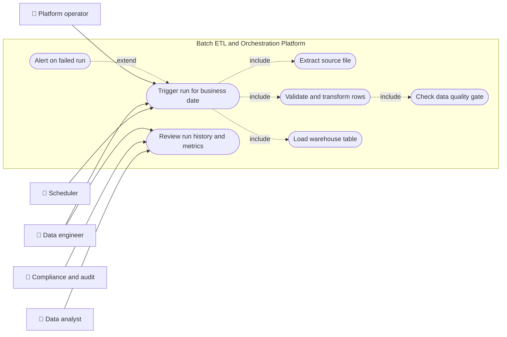
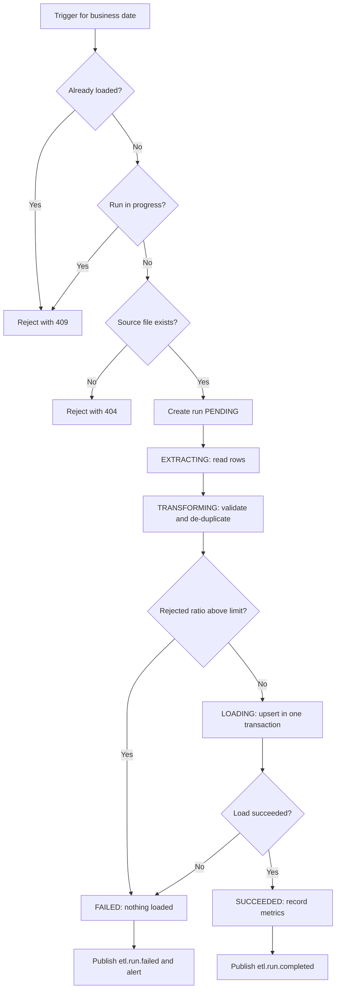
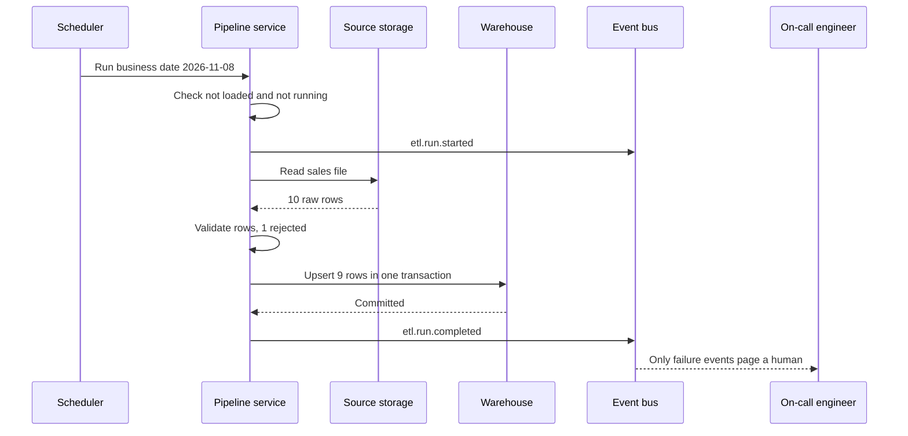
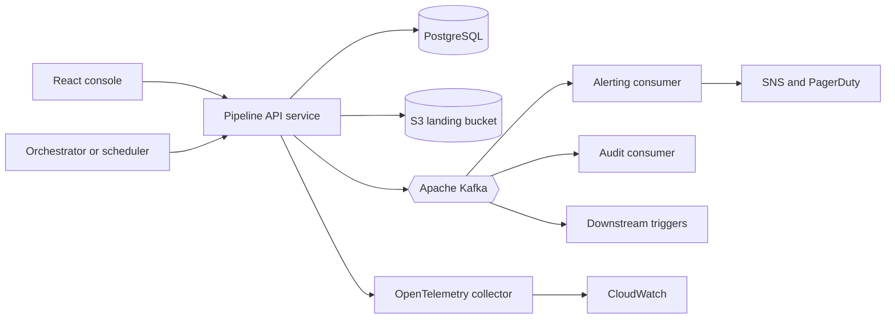
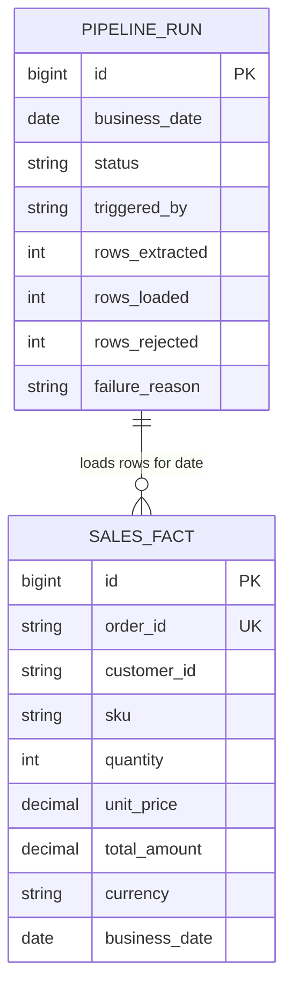
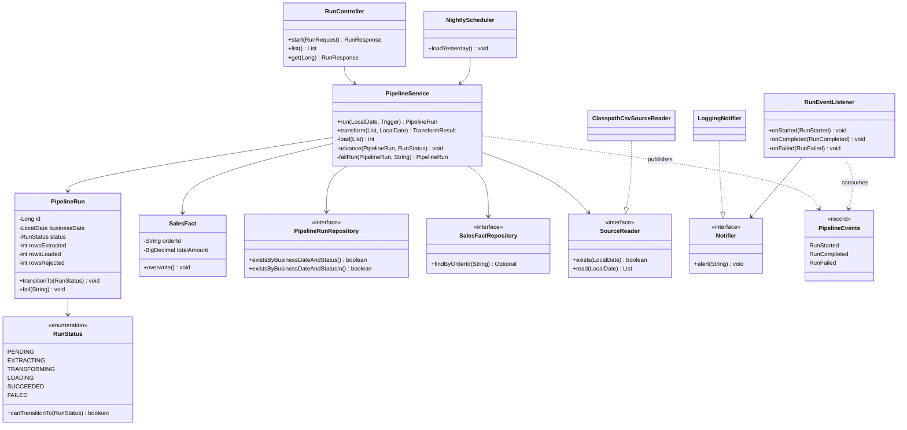
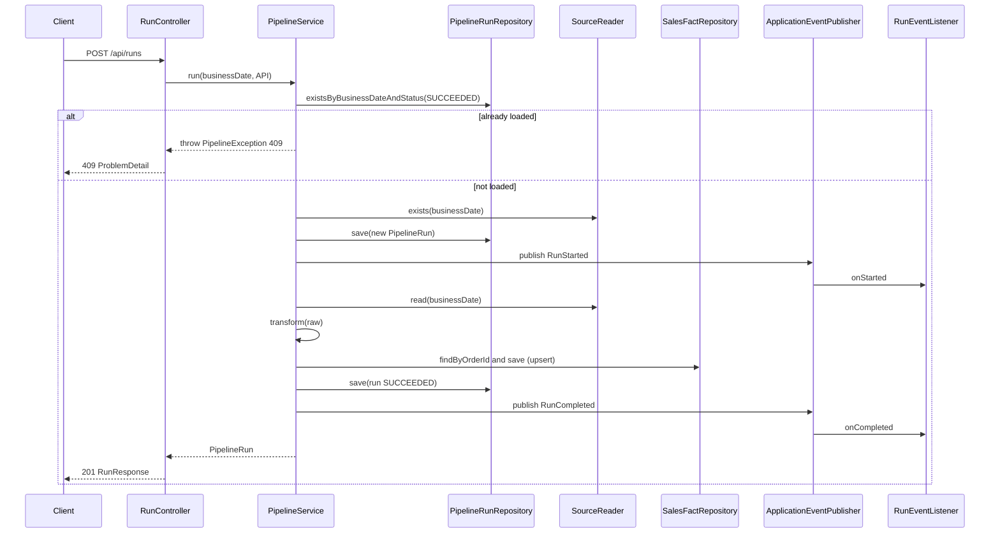
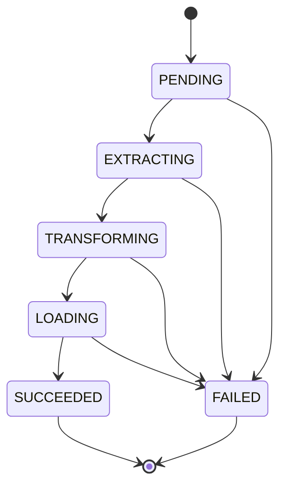
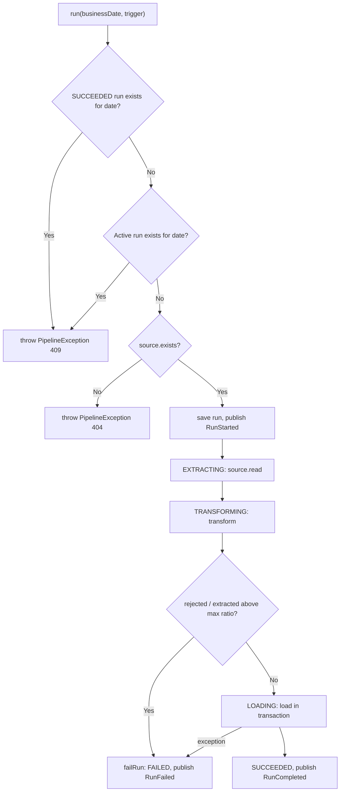

# Batch ETL and Workflow Orchestration

> **Domain:** Data Engineering · **Author:** [@naveenks720](https://github.com/naveenks720) · **Published:** November 09, 2026

> **Runnable code:** [`examples/data-engineering/batch-etl-and-workflow-orchestration`](https://github.com/dhulipalla599/domain-knowledge-engineering/tree/main/examples/data-engineering/batch-etl-and-workflow-orchestration)

## Explain It Like I'm Five

Imagine a school bakery that makes cupcakes every night for the next morning. First a helper collects the eggs, flour and sugar from the pantry. Next another helper checks each ingredient and throws out the cracked eggs. Then the cupcakes are baked and put on the shelf. A teacher with a checklist makes sure each step starts only when the one before it is finished, writes down how many cupcakes were made, and shouts for the principal if the oven breaks. If the teacher runs the whole night again by mistake, the shelf must not end up with twice as many cupcakes.

In a company, batch ETL moves data from busy systems into a place where analysts can use it, and orchestration is the teacher with the checklist who runs the steps in order, retries them and reports problems.

## Business Overview

**ETL** (extract, transform, load) copies data from source systems, cleans and reshapes it, and loads it into a warehouse, lakehouse or reporting database. **Batch** means it runs on a schedule or on demand over a bounded slice of data, for example "all orders for 2026-11-08". **Workflow orchestration** is the layer that decides when each step runs, in which order, with what retries and alerts, and what happens when something fails.

Why the business cares:

- **Revenue:** pricing, inventory and marketing decisions use yesterday's numbers; a late or wrong load means wrong decisions made with confidence.
- **Risk:** silent partial loads and double loads produce reports nobody can reconcile, which erodes trust in the data team.
- **Regulation:** financial and privacy reporting often needs lineage and an audit trail of what was loaded, when, and by which run. Specific obligations differ by country and sector.
- **Customer experience:** loyalty balances, order history views and personalised offers are often fed from batch-built tables.
- **Cost:** reruns, backfills and manual fixes are expensive; a design that is safe to repeat is cheaper to operate.

In the Data Engineering value chain, batch ETL sits between **ingestion** (landing files, database extracts, CDC streams) and **serving** (BI, data science, reverse ETL). Orchestration spans the whole chain.

## Real-World Example

The fictional retailer **Northwind Outfitters** sells camping gear online. Its point-of-sale system drops one CSV per day into a landing bucket. Analyst **Priya Nair** needs the 2026-11-08 sales in the warehouse by 07:00.

1. At 02:00 the scheduler triggers the load for business date 2026-11-08 (a data engineer, **Tomás Ruiz**, can also trigger it by hand).
2. The pipeline records a new run in `PENDING`, then `EXTRACTING`, and reads 10 rows from `sales-2026-11-08.csv`.
3. The transform step finds one row with quantity 0 and rejects it. 1 of 10 is under the 20% quality threshold, so the run continues.
4. The load upserts 9 rows into `sales_fact` in one transaction. The run becomes `SUCCEEDED` with 10 extracted, 9 loaded, 1 rejected.
5. Priya's dashboard shows the new day. The `etl.run.completed` event notifies downstream consumers.
6. Later, an operator mistakenly calls the load for 2026-11-08 again. The system answers 409 Conflict instead of loading it twice.
7. The next day's file arrives with half its rows malformed. The quality gate fails the run, nothing is loaded, and Tomás is alerted before Priya sees a half-empty day.

## Stakeholders

| Stakeholder | What they need | What they fear |
|---|---|---|
| Data analyst (Priya) | Complete, correct data at a predictable time | Dashboards with partial or duplicated numbers |
| Data engineer (Tomás) | Observable, repeatable runs with clear failure reasons | Being paged for failures that need manual database surgery |
| Platform operator | Safe retries, backfills and capacity control | Concurrent runs corrupting a table |
| Source system owner | Extracts that do not hurt the operational system | Heavy queries during trading hours |
| Compliance and audit | A record of every run, its inputs and its outcome | Not being able to prove what data a report used |
| Finance lead | Numbers that reconcile to the ledger | Revenue reported twice or missed |

## Use Case Diagram



| Use Case | Primary Actor | Goal | Main success outcome |
|---|---|---|---|
| Trigger run for business date | Scheduler, data engineer, operator | Load one day of data | A run is created and executed once per date |
| Extract source file | Pipeline | Read the day's raw rows | Rows read exactly as delivered |
| Validate and transform rows | Pipeline | Type, clean and de-duplicate rows | Valid rows and a rejected count |
| Check data quality gate | Pipeline | Stop bad files from reaching the warehouse | Run continues or is failed with a reason |
| Load warehouse table | Pipeline | Publish valid rows | Idempotent upsert committed atomically |
| Review run history and metrics | Analyst, auditor, engineer | Know what was loaded and when | Run list with counts, status and timestamps |
| Alert on failed run | Pipeline | Tell a human quickly | Alert with run id, date and reason |

## Key Terms

| Term | Plain-English meaning |
|---|---|
| ETL / ELT | Extract-transform-load, or load first and transform inside the warehouse |
| Batch window | The period in which a load must finish, such as before 07:00 |
| Business date | The day the data describes, not the day the job ran |
| DAG | Directed acyclic graph: tasks and their dependencies in a workflow |
| Orchestrator | The tool that schedules and monitors tasks (for example Apache Airflow, AWS Step Functions) |
| Idempotent | Running the same load twice leaves the same result as running it once |
| Backfill | Re-running history for past dates, for example after a bug fix |
| Upsert | Insert a row, or update it if its key already exists |
| Data quality gate | A check that stops the pipeline when too many rows are bad |
| Dead letter / reject | A row set aside because it failed validation |
| Watermark | A marker for "loaded up to here" in incremental loads |
| Lineage | The record of where data came from and what changed it |

## Process Flow

A trigger (schedule or person) asks for a load of one business date. The platform first checks that the date is not already loaded and not currently running, and that the source file exists. It then creates a run, extracts the rows, transforms and validates them, applies the quality gate, loads the survivors in one transaction, records metrics and publishes an event. Any exception or failed gate marks the run `FAILED`, publishes a failure event and raises an alert.





## Business Rules and Edge Cases

- **Idempotency per business date.** A date that already succeeded must not be loaded again by accident. Deliberate reprocessing (a backfill after a bug fix) should be a separate, explicit, audited operation.
- **One active run per date.** Two triggers for the same date (a schedule firing while an operator retries) must not run concurrently. A query check is not enough on its own under real concurrency; use a database constraint or lock.
- **Natural keys on load.** Load by upsert on a business key so a re-run overwrites rather than duplicates. Duplicates inside the same file need a rule (here the first occurrence wins).
- **Atomic load.** Either all valid rows of a run are visible or none are. Partial loads are the worst outcome because they look healthy.
- **Data quality gate.** A few bad rows are normal; a large share suggests an upstream change. Fail the run past a threshold instead of loading a damaged day. The threshold is a business decision (20% here is only an example).
- **Late and missing files.** The scheduler may fire before the file lands. Decide whether to wait, retry or alert; a missing file should be a clear error, not an empty successful run.
- **Time zones.** The business date is defined in a stated time zone. Mixing UTC and local dates shifts orders into the wrong day.
- **Money.** Use decimal types, never floating point, and keep the currency with the amount.
- **Partial failure and retries.** Every step must be safe to retry. Record the failure reason so engineers can fix the cause rather than just re-run.
- **Auditability.** Keep run records (counts, status, timestamps, trigger) even for failed runs.

## From Business to System

| Business concept / step | System component | Data entity | Event |
|---|---|---|---|
| Trigger run for a date | `RunController`, `NightlyScheduler` | `pipeline_run` | `etl.run.started` |
| Prevent double load | `PipelineService.run` guards | `pipeline_run.status` | none (409 returned) |
| Extract source file | `SourceReader` adapter | `RawSale` (in memory) | none |
| Validate and transform | `PipelineService.transform` | `sales_fact` candidates | none |
| Data quality gate | `PipelineService.run` | `pipeline_run.rows_rejected` | `etl.run.failed` |
| Load warehouse | `PipelineService.load` in a transaction | `sales_fact` | `etl.run.completed` |
| Review history | `RunController` GET endpoints | `pipeline_run` | none |
| Alert on failure | `RunEventListener`, `Notifier` | `pipeline_run.failure_reason` | consumes `etl.run.failed` |

## Architecture



The **pipeline API service** owns run state and the load rules; it is the only writer of `pipeline_run` and `sales_fact`. The **orchestrator** (Airflow on MWAA, Step Functions with EventBridge, or the Spring scheduler in the example) only decides *when* to call it, so scheduling tools can be replaced without touching business rules. Source files stay in object storage and are read through an adapter so the extract can change from CSV to Parquet or JDBC. Alerting and audit are Kafka consumers, so a slow pager integration can never block a load. In a production variant the heavy work runs as a Kubernetes Job on EKS and the API only enqueues it.

## Data Model

```sql
CREATE TABLE pipeline_run (
    id              BIGSERIAL PRIMARY KEY,
    business_date   DATE        NOT NULL,
    status          VARCHAR(16) NOT NULL,
    triggered_by    VARCHAR(16) NOT NULL,
    rows_extracted  INT         NOT NULL DEFAULT 0,
    rows_loaded     INT         NOT NULL DEFAULT 0,
    rows_rejected   INT         NOT NULL DEFAULT 0,
    failure_reason  TEXT,
    started_at      TIMESTAMPTZ,
    finished_at     TIMESTAMPTZ
);
-- Production guard: at most one active or succeeded run per date.
CREATE UNIQUE INDEX uq_run_active_or_done
    ON pipeline_run (business_date)
    WHERE status IN ('PENDING','EXTRACTING','TRANSFORMING','LOADING','SUCCEEDED');

CREATE TABLE sales_fact (
    id            BIGSERIAL PRIMARY KEY,
    order_id      VARCHAR(40) NOT NULL UNIQUE,
    customer_id   VARCHAR(40),
    sku           VARCHAR(40),
    quantity      INT NOT NULL,
    unit_price    NUMERIC(12,2) NOT NULL,
    total_amount  NUMERIC(14,2) NOT NULL,
    currency      CHAR(3) NOT NULL,
    business_date DATE NOT NULL
);
CREATE INDEX ix_sales_fact_date ON sales_fact (business_date);
```



The relationship is by `business_date`, not a foreign key: facts are upserted by `order_id` and a later run may legitimately overwrite an earlier run's rows.

## APIs

| Method | Path | Purpose |
|---|---|---|
| POST | `/api/runs` | Start a run for a business date (201, 404, 409, 400) |
| GET | `/api/runs` | List runs, newest first |
| GET | `/api/runs/{id}` | Get one run with its metrics |

Example for `POST /api/runs`:

```json
{ "businessDate": "2026-11-08" }
```

```json
{
  "id": 2,
  "businessDate": "2026-11-08",
  "status": "SUCCEEDED",
  "triggeredBy": "API",
  "rowsExtracted": 10,
  "rowsLoaded": 9,
  "rowsRejected": 1,
  "failureReason": null,
  "startedAt": "2026-11-09T15:04:53.708Z",
  "finishedAt": "2026-11-09T15:04:53.830Z"
}
```

Errors use RFC 9457 problem details, for example `409` with `"detail": "Business date 2026-11-08 is already loaded"`.

## Events

| Event (topic) | Producer | Consumers | Key fields |
|---|---|---|---|
| `etl.run.started` | Pipeline API | Audit | `runId`, `businessDate` |
| `etl.run.completed` | Pipeline API | Audit, downstream triggers | `runId`, `businessDate`, `extracted`, `loaded`, `rejected` |
| `etl.run.failed` | Pipeline API | Alerting, audit | `runId`, `businessDate`, `reason` |

Use the business date as the Kafka message key so events for one date stay ordered within a partition. Consumers must be idempotent: Kafka delivery is at least once by default, so a downstream trigger should check whether it has already handled `runId`. Publish events from an outbox table in production so a committed run is never missing its event.

## Backend Implementation

> The Java tab is the exact code from the runnable example (Spring Boot 3). The Python tab uses FastAPI with SQLAlchemy and the Node.js tab uses Express with TypeScript; they express the same logic and rules.

Full source: [`examples/data-engineering/batch-etl-and-workflow-orchestration`](https://github.com/dhulipalla599/domain-knowledge-engineering/tree/main/examples/data-engineering/batch-etl-and-workflow-orchestration).

The rule-enforcing method, `PipelineService.run`:

=== "Java"

    ```java
    public PipelineRun run(LocalDate businessDate, Trigger trigger) {
        if (runs.existsByBusinessDateAndStatus(businessDate, RunStatus.SUCCEEDED)) {
            throw new PipelineException(HttpStatus.CONFLICT, "Business date " + businessDate + " is already loaded");
        }
        if (runs.existsByBusinessDateAndStatusIn(businessDate, RunStatus.ACTIVE)) {
            throw new PipelineException(HttpStatus.CONFLICT, "A run for " + businessDate + " is already in progress");
        }
        if (!source.exists(businessDate)) {
            throw new PipelineException(HttpStatus.NOT_FOUND, "No source file for " + businessDate);
        }

        PipelineRun run = runs.save(new PipelineRun(businessDate, trigger));
        events.publishEvent(new RunStarted(run.getId(), businessDate));
        try {
            advance(run, RunStatus.EXTRACTING);
            List<RawSale> raw = source.read(businessDate);
            run.recordExtract(raw.size());

            advance(run, RunStatus.TRANSFORMING);
            TransformResult result = transform(raw, businessDate);
            run.recordTransform(result.rejected());
            if (!raw.isEmpty() && (double) result.rejected() / raw.size() > maxRejectRatio) {
                return failRun(run, "Data quality gate: " + result.rejected() + " of " + raw.size()
                        + " rows rejected (max ratio " + maxRejectRatio + ")");
            }

            advance(run, RunStatus.LOADING);
            run.recordLoad(load(result.valid()));
            advance(run, RunStatus.SUCCEEDED);
            events.publishEvent(new RunCompleted(run.getId(), businessDate,
                    run.getRowsExtracted(), run.getRowsLoaded(), run.getRowsRejected()));
            return run;
        } catch (RuntimeException e) {
            return failRun(run, e.getClass().getSimpleName() + ": " + e.getMessage());
        }
    }
    ```

=== "Python"

    ```python
    def run(db: Session, business_date: date, trigger: str) -> PipelineRun:
        if runs.exists(db, business_date, [RunStatus.SUCCEEDED]):
            raise PipelineError(409, f"Business date {business_date} is already loaded")
        if runs.exists(db, business_date, ACTIVE):
            raise PipelineError(409, f"A run for {business_date} is already in progress")
        if not source.exists(business_date):
            raise PipelineError(404, f"No source file for {business_date}")

        run = runs.save(db, PipelineRun(business_date=business_date, triggered_by=trigger))
        events.publish(RunStarted(run.id, business_date))
        try:
            advance(db, run, RunStatus.EXTRACTING)
            raw = source.read(business_date)
            run.rows_extracted = len(raw)

            advance(db, run, RunStatus.TRANSFORMING)
            valid, rejected = transform(raw, business_date)
            run.rows_rejected = rejected
            if raw and rejected / len(raw) > MAX_REJECT_RATIO:
                return fail_run(db, run, f"Data quality gate: {rejected} of {len(raw)} "
                                         f"rows rejected (max ratio {MAX_REJECT_RATIO})")

            advance(db, run, RunStatus.LOADING)
            run.rows_loaded = load(db, valid)
            advance(db, run, RunStatus.SUCCEEDED)
            events.publish(RunCompleted(run.id, business_date, run.rows_extracted,
                                        run.rows_loaded, run.rows_rejected))
            return run
        except Exception as e:
            return fail_run(db, run, f"{type(e).__name__}: {e}")
    ```

=== "Node.js"

    ```typescript
    export async function run(businessDate: string, trigger: Trigger): Promise<PipelineRun> {
      if (await runs.exists(businessDate, ["SUCCEEDED"])) {
        throw new PipelineError(409, `Business date ${businessDate} is already loaded`);
      }
      if (await runs.exists(businessDate, ACTIVE)) {
        throw new PipelineError(409, `A run for ${businessDate} is already in progress`);
      }
      if (!source.exists(businessDate)) {
        throw new PipelineError(404, `No source file for ${businessDate}`);
      }

      const run = await runs.save(newRun(businessDate, trigger));
      events.emit("etl.run.started", { runId: run.id, businessDate });
      try {
        await advance(run, "EXTRACTING");
        const raw = await source.read(businessDate);
        run.rowsExtracted = raw.length;

        await advance(run, "TRANSFORMING");
        const { valid, rejected } = transform(raw, businessDate);
        run.rowsRejected = rejected;
        if (raw.length > 0 && rejected / raw.length > MAX_REJECT_RATIO) {
          return failRun(run, `Data quality gate: ${rejected} of ${raw.length} rows rejected (max ratio ${MAX_REJECT_RATIO})`);
        }

        await advance(run, "LOADING");
        run.rowsLoaded = await load(valid);
        await advance(run, "SUCCEEDED");
        events.emit("etl.run.completed", { runId: run.id, businessDate,
          extracted: run.rowsExtracted, loaded: run.rowsLoaded, rejected: run.rowsRejected });
        return run;
      } catch (e) {
        return failRun(run, `${(e as Error).name}: ${(e as Error).message}`);
      }
    }
    ```

The controller endpoint that calls it:

=== "Java"

    ```java
    @PostMapping
    @ResponseStatus(HttpStatus.CREATED)
    public RunResponse start(@Valid @RequestBody RunRequest request) {
        return RunResponse.from(pipeline.run(request.businessDate(), Trigger.API));
    }
    ```

=== "Python"

    ```python
    @router.post("/api/runs", status_code=201, response_model=RunResponse)
    def start(request: RunRequest, db: Session = Depends(get_db)):
        return RunResponse.from_run(pipeline.run(db, request.business_date, "API"))
    ```

=== "Node.js"

    ```typescript
    router.post("/api/runs", async (req, res) => {
      const { businessDate } = req.body ?? {};
      if (!businessDate) throw new PipelineError(400, "businessDate is required (yyyy-MM-dd)");
      res.status(201).json(toResponse(await pipeline.run(businessDate, "API")));
    });
    ```

## Frontend Screen

An operator console to start a load and watch run history.

```tsx
import { useEffect, useState } from "react";

type Run = {
  id: number; businessDate: string; status: string;
  rowsExtracted: number; rowsLoaded: number; rowsRejected: number; failureReason: string | null;
};

export function RunConsole() {
  const [runs, setRuns] = useState<Run[]>([]);
  const [date, setDate] = useState("");
  const [error, setError] = useState<string | null>(null);

  const refresh = () => fetch("/api/runs").then(r => r.json()).then(setRuns);
  useEffect(() => { refresh(); }, []);

  async function start() {
    setError(null);
    const res = await fetch("/api/runs", {
      method: "POST",
      headers: { "Content-Type": "application/json" },
      body: JSON.stringify({ businessDate: date }),
    });
    if (!res.ok) setError((await res.json()).detail ?? "Request failed");
    refresh();
  }

  return (
    <main>
      <h1>Sales load runs</h1>
      <input type="date" value={date} onChange={e => setDate(e.target.value)} />
      <button disabled={!date} onClick={start}>Run load</button>
      {error && <p role="alert">{error}</p>}
      <table>
        <thead><tr><th>Date</th><th>Status</th><th>Extracted</th><th>Loaded</th><th>Rejected</th><th>Reason</th></tr></thead>
        <tbody>
          {runs.map(r => (
            <tr key={r.id}>
              <td>{r.businessDate}</td><td>{r.status}</td><td>{r.rowsExtracted}</td>
              <td>{r.rowsLoaded}</td><td>{r.rowsRejected}</td><td>{r.failureReason ?? ""}</td>
            </tr>
          ))}
        </tbody>
      </table>
    </main>
  );
}
```

## Cloud Deployment

- **Compute:** the API runs as a Deployment on Amazon EKS; heavy loads run as Kubernetes Jobs (or Spark on EKS) so they scale independently of the API.
- **Orchestration:** Amazon MWAA (managed Airflow) or AWS Step Functions with EventBridge schedules calls the API or launches the Job and owns retries and backfills.
- **Data:** Amazon RDS or Aurora for PostgreSQL (run state and the serving table); Amazon S3 for landing files; Amazon MSK for Apache Kafka.
- **Secrets:** AWS Secrets Manager, mounted with IAM Roles for Service Accounts (IRSA) so pods hold no static credentials.

```hcl
resource "aws_s3_bucket" "landing" {
  bucket = "northwind-sales-landing"
}

resource "aws_s3_bucket_versioning" "landing" {
  bucket = aws_s3_bucket.landing.id
  versioning_configuration {
    status = "Enabled"
  }
}

resource "aws_s3_bucket_public_access_block" "landing" {
  bucket                  = aws_s3_bucket.landing.id
  block_public_acls       = true
  block_public_policy     = true
  ignore_public_acls      = true
  restrict_public_buckets = true
}
```

- **Security:** least-privilege IAM per job (read the landing bucket, write one schema), encryption at rest (S3, RDS, MSK) and in transit, private subnets, no public bucket access.
- **Scaling:** scale Jobs by partitioning files by date or region; keep one active run per business date regardless of worker count.
- **Observability:** OpenTelemetry traces and metrics (rows extracted, loaded, rejected, duration, run status) exported to CloudWatch; alarms on failed runs and on "no successful run by 06:00".

## Non-Functional Requirements

| Concern | Expectation | How the design meets it |
|---|---|---|
| Timeliness | Data ready before the stated batch window | Alarm if no `SUCCEEDED` run by the deadline; parallelise by partition |
| Availability | A failed night can be repaired without data loss | Safe retries, idempotent upserts, durable run records |
| Consistency | A day is fully visible or not at all | Single-transaction load and quality gate before load |
| Latency | Minutes to hours, not milliseconds | Batch design; use streaming (a separate topic) when seconds matter |
| Audit | Who or what loaded which date and with what result | `pipeline_run` keeps counts, trigger, status, reason and timestamps |
| Compliance | Retention and deletion rules reach every copy | Documented lineage; deletion handled in the load design, rules vary by jurisdiction |
| Cost | Predictable compute and storage | Right-sized Jobs, S3 lifecycle rules, no accidental full reloads |

## Runnable Example

The example implements the Northwind sales load end to end with no external services: a REST endpoint (and a `@Scheduled` job that is off by default) extracts a CSV from `src/main/resources/sample-data/`, transforms and validates it, loads it into H2, and records metrics on a `pipeline_run` row. It enforces the one-load-per-date and one-active-run rules, a 404 for a missing file, and a data quality gate that fails the run without loading. Events named after the Kafka topics are published with `ApplicationEventPublisher` and consumed with `@EventListener`.

Source: [`examples/data-engineering/batch-etl-and-workflow-orchestration`](https://github.com/dhulipalla599/domain-knowledge-engineering/tree/main/examples/data-engineering/batch-etl-and-workflow-orchestration)

```bash
cd examples/data-engineering/batch-etl-and-workflow-orchestration
mvn spring-boot:run     # http://localhost:8080
mvn -B -ntp verify      # build and run the tests
```

Happy path:

```bash
curl -s -X POST localhost:8080/api/runs -H 'Content-Type: application/json' -d '{"businessDate":"2026-11-08"}'
```

```json
{"id":2,"businessDate":"2026-11-08","status":"SUCCEEDED","triggeredBy":"API","rowsExtracted":10,"rowsLoaded":9,"rowsRejected":1,"failureReason":null,"startedAt":"2026-11-09T15:04:53.708Z","finishedAt":"2026-11-09T15:04:53.830Z"}
```

Rule violation (the same date again):

```bash
curl -s -X POST localhost:8080/api/runs -H 'Content-Type: application/json' -d '{"businessDate":"2026-11-08"}'
```

```json
{"type":"about:blank","title":"Conflict","status":409,"detail":"Business date 2026-11-08 is already loaded","instance":"/api/runs"}
```

| Class | Package | Responsibility |
|---|---|---|
| `BatchEtlAndWorkflowOrchestrationApplication` | root | Spring Boot entry point |
| `RunStatus` | domain | Lifecycle enum with legal transitions |
| `PipelineRun` | domain | Run entity, enforces transitions, holds metrics |
| `SalesFact` | domain | Warehouse row, unique by `order_id` |
| `RawSale` | domain | Untyped source row |
| `PipelineEvents` | domain | `RunStarted`, `RunCompleted`, `RunFailed` records |
| `PipelineRunRepository` | repository | Run queries (by date and status) |
| `SalesFactRepository` | repository | Fact lookup by `order_id` |
| `PipelineService` | service | Extract, transform, load and the business rules |
| `PipelineException` | service | Rule violation with an HTTP status |
| `RunController` | api | REST endpoints |
| `RunRequest`, `RunResponse` | api | Request and response records |
| `ApiExceptionHandler` | api | Maps errors to `ProblemDetail` |
| `SourceReader`, `ClasspathCsvSourceReader` | integration | Extract port and CSV adapter |
| `Notifier`, `LoggingNotifier` | integration | Alert port and log stub |
| `RunEventListener` | integration | `@EventListener` consumers of the run events |
| `NightlyScheduler` | integration | `@Scheduled` job, disabled by default |

## UML Diagrams

### Class Diagram

The controller delegates to `PipelineService`, which uses the repositories, the `SourceReader` port and the event publisher; the listener reacts to the events.



### Sequence Diagram (control flow)

One `POST /api/runs` request through the code, including the 409 branch for an already loaded date.



### State Diagram



`RunStatus.canTransitionTo` allows only the next step or `FAILED`; `SUCCEEDED` and `FAILED` are terminal.

### Activity Diagram

Decision logic inside `PipelineService.run`.



## AI Opportunities

1. **Anomaly detection on run metrics.** Use: flag a load whose row count, null rate or total amount deviates from the usual pattern before it reaches dashboards. Data: historical `pipeline_run` counts and column profiles. Risk: false positives cause alert fatigue and false negatives give false comfort; keep the hard quality gate and use the model only as an additional signal, with thresholds reviewed by a human.
2. **Automatic schema-drift and mapping suggestions.** Use: an LLM proposes column mappings or transform fixes when a source file changes. Data: old and new schemas, sample rows (masked). Risk: wrong mappings silently corrupt data; require a pull request review and tests, and never let the model write to production tables.
3. **Failure triage assistant.** Use: summarise logs and `failure_reason` into a likely cause and a runbook step for the on-call engineer. Data: run records, logs, recent deployments. Risk: confident but wrong explanations; present it as a suggestion with links to evidence, and keep humans in control of reruns.
4. **Schedule and capacity forecasting.** Use: predict run duration and warn when a batch window will be missed. Data: historical durations and file sizes. Risk: drift after infrastructure changes; retrain regularly and compare against actuals.
5. **PII detection in landed files.** Use: classify columns that contain personal data so masking and retention rules apply. Data: column samples and names. Risk: missed PII has privacy and regulatory impact; combine with explicit data contracts and sampling audits.

## Common Pitfalls

- **Non-idempotent loads.** Plain inserts double the data on retry. Upsert on a natural key and guard each business date.
- **Using run time instead of business date.** Late runs then load into the wrong day. Pass the business date explicitly.
- **Treating an empty file as success.** A missing or empty source should fail or alert, not report green.
- **Partial commits.** Loading row by row outside a transaction leaves half a day visible. Load atomically or into a staging table and swap.
- **No quality gate.** Bad upstream changes flow straight into reports. Count rejects and fail past a threshold.
- **Race between triggers.** A check-then-insert is not safe alone; add a unique index or lock.
- **Orchestration logic inside business code.** Keep scheduling, retries and dependencies in the orchestrator, and rules in the service, so each can change independently.
- **Floating point for money.** Use decimals and carry the currency.
- **Swallowing errors.** Record the failure reason and alert; "retry until it works" hides root causes.
- **Ignoring backfills.** Design reruns up front, as a deliberate and audited operation.

## Interview Questions

### Junior

1. **What do extract, transform and load each do?** Extract reads data from a source, transform cleans, validates and reshapes it, and load writes it to the target. Orchestration runs these steps in order.
2. **What does idempotent mean for a pipeline?** Running the same load again gives the same final data as running it once, for example by upserting on a key.
3. **Why record run metrics?** They show what was processed (counts, status, duration), support alerts, and give auditors and engineers evidence of what happened.

### Mid-Level

1. **How would you prevent two runs for the same date?** Check state in the service for a clear error, and enforce it with a unique partial index or an advisory lock so concurrent requests cannot both pass the check.
2. **A file arrives with 30% bad rows. What should happen?** Apply a configurable quality gate: fail the run, load nothing, alert, and keep the rejected rows for diagnosis. The threshold is agreed with the business.
3. **How do you handle a backfill of 90 days?** Run dates independently with controlled parallelism, use idempotent loads, keep audited run records, and avoid overwhelming the source system or the warehouse.

### Senior / Architect

1. **Airflow versus Step Functions versus a custom scheduler: how do you choose?** Key points: team skills and existing platform, dependency complexity and backfill needs, managed versus self-hosted operations, cost per task, observability, vendor lock-in, and keeping business rules out of the orchestrator so it can change.
2. **Design exactly-once-looking results on at-least-once infrastructure.** Key points: idempotent upserts by natural key, run-level uniqueness per date, transactional loads, an outbox for events, idempotent consumers keyed by `runId`, and reconciliation checks against the source.
3. **When do you move from batch to streaming?** Key points: freshness requirement and its real business value, cost and operational complexity, ordering and late data handling, hybrid options (micro-batch, CDC into batch), and whether consumers can actually act on faster data.

## Further Learning

- Apache Airflow concepts (DAGs, operators, sensors, backfill)
- AWS Step Functions and Amazon MWAA
- Dimensional modelling (Kimball) and slowly changing dimensions
- Idempotency and the transactional outbox pattern
- Data quality frameworks and data contracts (for example Great Expectations, dbt tests)
- Data lineage with OpenLineage
- Apache Kafka delivery semantics
- OpenTelemetry for pipeline observability

## Practitioner Notes

> _Reviewer: add real-world experience, corrections or gotchas here before approving._
