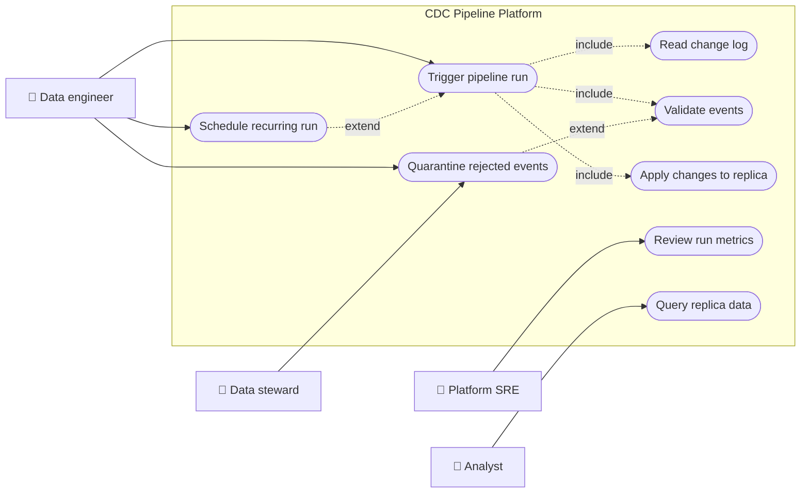
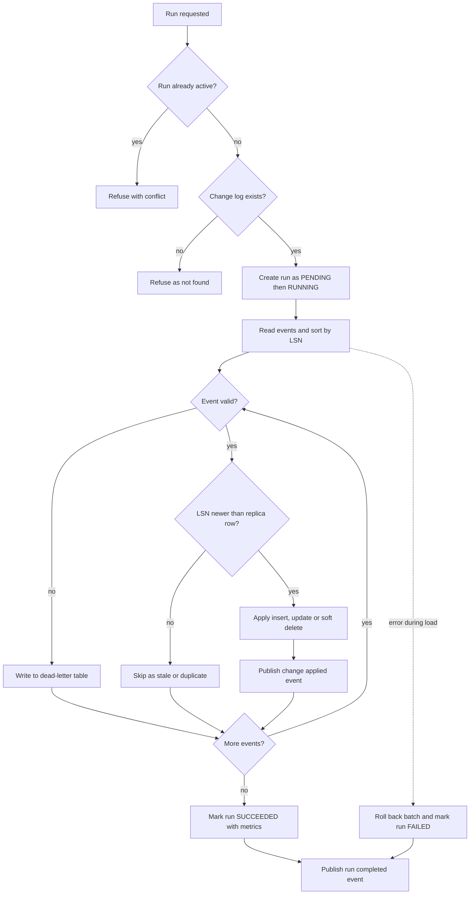
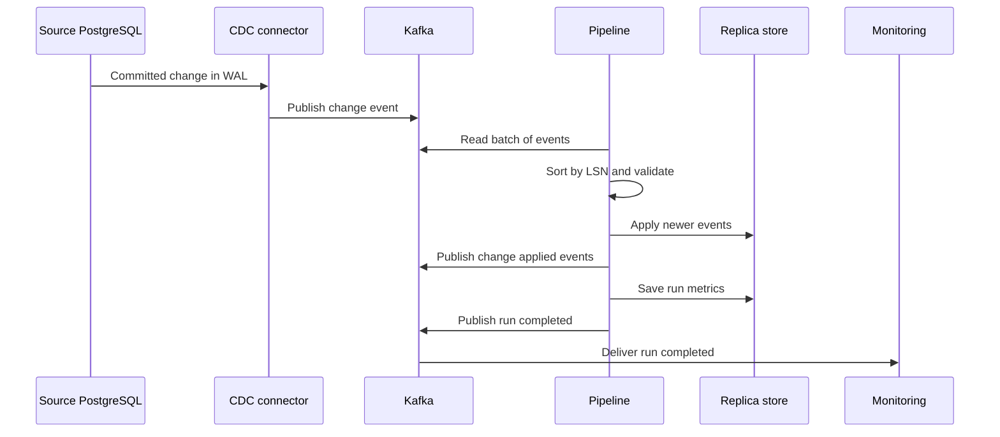
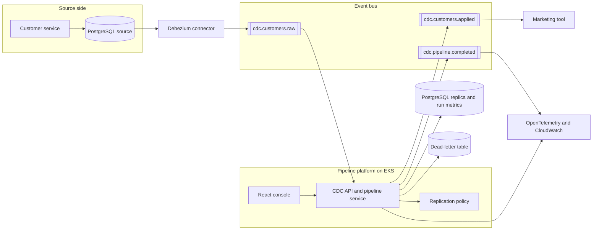
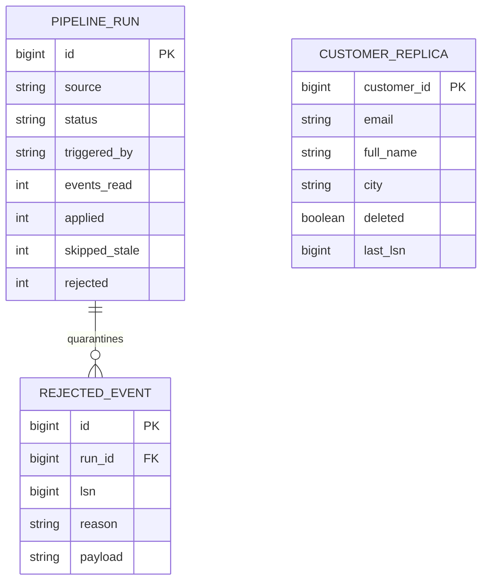
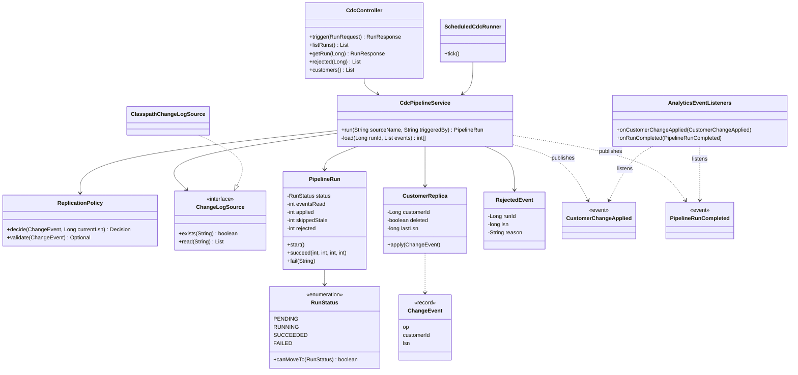
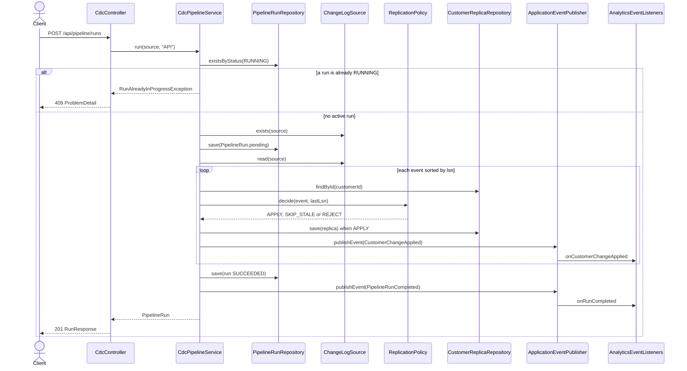
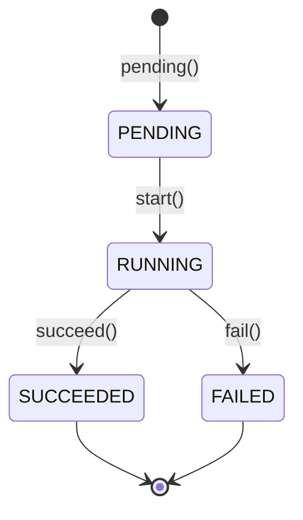
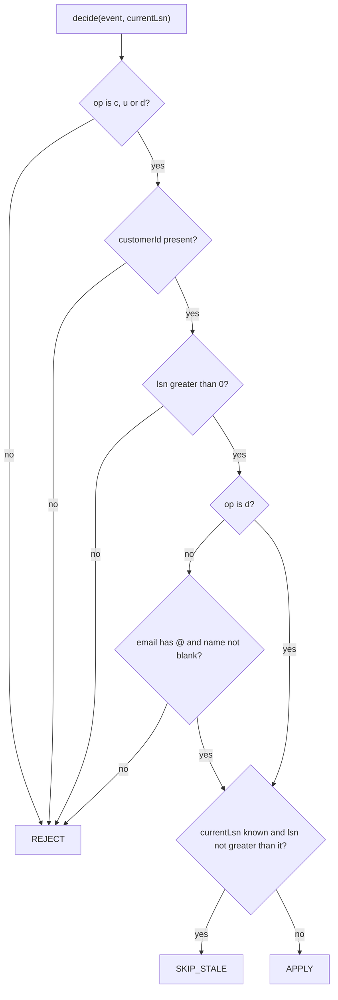

# Change Data Capture (CDC) Pipelines

> **Domain:** Data Engineering · **Author:** [@naveenks720](https://github.com/naveenks720) · **Published:** October 12, 2026

> **Runnable code:** [`examples/data-engineering/change-data-capture-cdc-pipelines`](https://github.com/dhulipalla599/domain-knowledge-engineering/tree/main/examples/data-engineering/change-data-capture-cdc-pipelines)

## Explain It Like I'm Five

Imagine your class keeps a big poster on the wall showing everyone's favourite colour. Every morning the teacher could erase the whole poster and ask all thirty kids again. That works, but it takes ages. A smarter way is to have a helper sit next to the poster and write down only what changes: "Mia switched to green", "Sam moved to another school", "a new kid, Leo, likes red". Another helper in the next classroom reads that list of changes, in order, and updates a copy of the poster. If the same note gets read twice, or an old note shows up late, the helper notices and ignores it.

In a company, change data capture (CDC) is that helper: it watches a database, writes down each change, and lets other systems keep their own copies up to date without asking for everything again.

## Business Overview

**Change data capture** is a set of techniques for detecting row-level changes (inserts, updates, deletes) in a source database and delivering them, in order, to other systems. The most common production approach is **log-based CDC**: a connector reads the database's transaction log (the write-ahead log in PostgreSQL) and turns each committed change into an event. Alternatives are trigger-based CDC and query-based CDC (polling an `updated_at` column); they are simpler but miss deletes or add load to the source.

Why the business cares:

- **Revenue:** analytics, search, recommendations and marketing segments are only as good as their freshness. Hourly full exports mean decisions on stale data.
- **Risk:** a replica that silently drifts from the source produces wrong reports. Deleted customers who still appear in marketing lists create compliance exposure.
- **Regulation:** erasure and retention rules (for example GDPR in the EU; other regions differ) must reach every copy of personal data, including replicas. CDC is the channel that carries deletes downstream.
- **Customer experience:** a customer who changes their address expects every system to see it quickly.
- **Cost and load:** reading the log is far cheaper for the operational database than repeated full-table queries.

In the Data Engineering value chain, CDC sits at the **ingestion** stage: after operational systems produce data and before transformation, the warehouse or lakehouse, BI, machine learning features and downstream services consume it.

## Real-World Example

The fictional retailer **Harbor & Pine** runs its customer master in PostgreSQL. The analytics team keeps a `customer_replica` table that feeds dashboards and a marketing tool.

1. Support agent Ana updates customer Ana Martins' city from Lisbon to Porto. The operational database commits the change with log sequence number (LSN) 160.
2. The CDC connector reads the committed change from the log and publishes an event `{op: u, customerId: 1, lsn: 160, city: Porto}`.
3. The pipeline reads a batch of events, sorts them by LSN and validates each one.
4. For customer 1 the replica last applied LSN 100, so LSN 160 is newer and is applied.
5. In the same batch, an old update for Ben Okafor (LSN 140) arrives although the replica already holds LSN 150. It is skipped as stale.
6. A new customer, Dmitri Volkov (LSN 161), is inserted; Chloe Dubois (LSN 162) is deleted, which marks her row as deleted in the replica rather than erasing it.
7. Two events are malformed (an invalid email and an unknown operation code). They are written to a dead-letter table with the reason, not silently dropped.
8. The run finishes with metrics: 7 read, 3 applied, 2 skipped, 2 rejected. A completion event tells monitoring the batch is done.
9. If the same batch is replayed after an outage, nothing is applied twice: every valid event is now stale.

## Stakeholders

| Stakeholder | What they need | What they fear |
|---|---|---|
| Data engineer | A pipeline that is observable, restartable and idempotent | Being paged at night for duplicates or a stuck connector |
| Analytics engineer / analyst | Fresh, correct replica tables with clear lag | Dashboards that disagree with the source |
| Source application team | Zero impact on the operational database | CDC slowing writes or filling disk with retained log |
| Data steward / compliance officer | Deletes and corrections reach all copies; an audit trail | Personal data lingering in replicas |
| Platform / SRE engineer | Clear metrics, alerts and safe deployments | Silent lag, unbounded storage, noisy failures |
| Marketing user | Current segments and contact details | Emailing a customer who has been deleted or changed their email |

## Use Case Diagram



| Use Case | Primary Actor | Goal | Main success outcome |
|---|---|---|---|
| Trigger pipeline run | Data engineer | Process a batch of changes on demand | A run record with status `SUCCEEDED` and metrics |
| Read change log | Pipeline (included) | Obtain ordered change events | Events sorted by LSN |
| Validate events | Pipeline (included) | Keep malformed data out of the replica | Each event is accepted, skipped or rejected |
| Apply changes to replica | Pipeline (included) | Keep the copy consistent with the source | Newer events applied, stale ones skipped |
| Quarantine rejected events | Data steward | Inspect and fix bad events | Dead-letter rows with reasons |
| Review run metrics | Platform SRE | Know whether the pipeline is healthy | Counts of read, applied, skipped, rejected |
| Query replica data | Analyst | Use fresh data in reports | Current customer rows, with deletes flagged |
| Schedule recurring run | Data engineer | Run without manual action | A scheduled run that behaves like a manual one |

## Key Terms

| Term | Plain-English meaning |
|---|---|
| CDC | Capturing row-level changes in a source database and delivering them downstream |
| Write-ahead log (WAL) | PostgreSQL's ordered record of every committed change, used for recovery and replication |
| Logical replication | PostgreSQL feature that decodes the WAL into row-level changes; the basis of log-based CDC |
| LSN | Log sequence number: a position in the log that orders changes |
| Debezium | A widely used open-source CDC connector framework that publishes changes to Apache Kafka |
| Snapshot | A one-time consistent copy of existing rows taken before streaming changes |
| Replica / sink | The downstream copy that receives and applies the changes |
| Idempotent | Applying the same change twice leaves the same result as applying it once |
| Tombstone / soft delete | A marker that a row was deleted, kept so the delete can propagate and be audited |
| Dead-letter table (DLQ) | A place to park events that failed validation so nothing is lost silently |
| Replication slot | A server-side bookmark that makes PostgreSQL retain WAL until the consumer has read it |
| Consumer lag | How far the pipeline is behind the source, in time or events |

## Process Flow

A connector (Debezium in production) reads committed changes from the source log and publishes them. The pipeline obtains a batch, sorts it by LSN, and validates each event. Valid events newer than the row's last applied LSN are applied; older or duplicate ones are skipped; malformed ones go to the dead-letter table. Metrics are saved, and a completion event is published. A run is refused if another run is active, and a failure during the load rolls the batch back and marks the run `FAILED`.





## Business Rules and Edge Cases

- **Ordering:** changes to one row must be applied in log order. Sort by LSN within a batch and, in Kafka, key messages by primary key so one row's changes stay in one partition. Ordering across different rows or tables is not guaranteed.
- **Idempotency:** connectors deliver at-least-once, so duplicates are normal. Store the last applied LSN per row and skip any event that is not newer.
- **Stale events:** late or replayed events must never overwrite newer data. The comparison is "newer than", not "different from".
- **Deletes:** a delete must propagate. Hard-deleting loses the audit trail and makes a late stale update look like a new insert; soft deletes (or a tombstone with a retention window) are safer. Erasure obligations may still require physically purging later, according to local rules.
- **Malformed data:** reject to a dead-letter table with a reason. Dropping silently hides bugs; failing the whole batch on one bad row blocks everyone.
- **Partial failure:** load a batch in one transaction so a crash cannot leave half a batch applied, and record the run as `FAILED` with the error.
- **Concurrent runs:** two runs over the same data race on the same rows. Allow one active run, and in production enforce it with a lock, not only a read-then-write check.
- **Schema change:** adding or renaming a source column changes the event shape. Use a schema registry and compatible evolution, or the pipeline breaks at 3 a.m.
- **Replication slot growth:** if a consumer stops, PostgreSQL retains WAL for its slot and can exhaust disk. Monitor slot lag and set alerts.
- **Initial load:** existing rows must be snapshotted before streaming; a gap or overlap between snapshot and stream causes missing or duplicated changes.
- **Safe inputs:** a source name taken from a request must not be able to reach arbitrary files.

## From Business to System

| Business concept or step | System component | Data entity | Event |
|---|---|---|---|
| Source of changes | Debezium connector, `ChangeLogSource` port | `ChangeEvent` | `cdc.customers.raw` (from the connector) |
| Trigger a run | `CdcController`, `CdcPipelineService` | `PipelineRun` | none |
| Validate an event | `ReplicationPolicy` | `ChangeEvent` | none |
| Apply a change | `CdcPipelineService` | `CustomerReplica` (`lastLsn`, `deleted`) | `cdc.customers.applied` |
| Quarantine bad data | `CdcPipelineService` | `RejectedEvent` | none |
| Skip stale or duplicate | `ReplicationPolicy` | `CustomerReplica.lastLsn` | none |
| Track run health | `PipelineRun` metrics | `PipelineRun` | `cdc.pipeline.completed` |
| Recurring execution | `ScheduledCdcRunner` (CronJob in production) | `PipelineRun.triggeredBy` | none |
| Query fresh data | `CdcController`, React screen | `CustomerReplica` | none |

## Architecture



**Service boundaries.** The source application knows nothing about CDC: the connector reads the log, so the operational path is untouched. The pipeline service owns the replica, the run metrics and the dead-letter table, because they must change together in one transaction. The replication policy is a pure class with no I/O so the ordering and idempotency rules can be unit tested and reviewed on their own. Downstream consumers (marketing, monitoring) subscribe to the applied and completed topics rather than reading the replica's tables, so they can be added without touching the pipeline.

## Data Model

```sql
CREATE TABLE customer_replica (
    customer_id  BIGINT PRIMARY KEY,
    email        VARCHAR(255),
    full_name    VARCHAR(255),
    city         VARCHAR(120),
    deleted      BOOLEAN NOT NULL DEFAULT FALSE,
    last_lsn     BIGINT NOT NULL,
    updated_at   TIMESTAMPTZ
);

CREATE TABLE pipeline_run (
    id             BIGSERIAL PRIMARY KEY,
    source         VARCHAR(120) NOT NULL,
    status         VARCHAR(20) NOT NULL CHECK (status IN ('PENDING','RUNNING','SUCCEEDED','FAILED')),
    triggered_by   VARCHAR(20) NOT NULL,
    started_at     TIMESTAMPTZ,
    finished_at    TIMESTAMPTZ,
    events_read    INT NOT NULL DEFAULT 0,
    applied        INT NOT NULL DEFAULT 0,
    skipped_stale  INT NOT NULL DEFAULT 0,
    rejected       INT NOT NULL DEFAULT 0,
    error_message  TEXT
);

CREATE TABLE rejected_event (
    id       BIGSERIAL PRIMARY KEY,
    run_id   BIGINT NOT NULL REFERENCES pipeline_run(id),
    lsn      BIGINT NOT NULL,
    reason   VARCHAR(255) NOT NULL,
    payload  VARCHAR(1000)
);

-- Only one run may be RUNNING at a time (production guard).
CREATE UNIQUE INDEX one_running_run ON pipeline_run ((status)) WHERE status = 'RUNNING';
```



`customer_replica` is not linked by a foreign key: it is the target of the stream and is updated independently of any single run.

## APIs

| Method | Path | Purpose |
|---|---|---|
| POST | `/api/pipeline/runs` | Trigger a run for a named change log |
| GET | `/api/pipeline/runs` | List runs, newest first |
| GET | `/api/pipeline/runs/{id}` | Get one run with its metrics |
| GET | `/api/pipeline/runs/{id}/rejected` | List dead-letter events of a run |
| GET | `/api/replica/customers` | List replicated customers |

Errors use RFC 7807 `ProblemDetail`: `400` for an invalid source name, `404` for an unknown source or run, `409` when a run is already active.

Request `POST /api/pipeline/runs`:

```json
{ "source": "customers-batch-1" }
```

Response `201 Created`:

```json
{
  "id": 2,
  "source": "customers-batch-1",
  "status": "SUCCEEDED",
  "triggeredBy": "API",
  "startedAt": "2026-10-12T15:08:56.547Z",
  "finishedAt": "2026-10-12T15:08:56.628Z",
  "eventsRead": 7,
  "applied": 3,
  "skippedStale": 2,
  "rejected": 2,
  "errorMessage": null
}
```

## Events

| Event | Producer | Consumers | Key fields |
|---|---|---|---|
| `cdc.customers.raw` | Debezium connector | Pipeline service | `op`, `customerId`, `lsn`, `email`, `fullName`, `city` |
| `cdc.customers.applied` | Pipeline service | Marketing tool, cache invalidator | `customerId`, `op`, `lsn` |
| `cdc.pipeline.completed` | Pipeline service | Monitoring and alerting | `runId`, `status`, `applied`, `skippedStale`, `rejected` |

**Ordering:** key `cdc.customers.*` messages by `customerId` so every change to one row goes to one partition and stays ordered. There is no ordering across partitions.

**Idempotency:** Kafka delivers at least once, so consumers must tolerate duplicates. The pipeline does this with `lastLsn`; downstream consumers can use `(customerId, lsn)` as a deduplication key. To avoid publishing an event for a change that was rolled back, or losing one after commit, use a transactional outbox rather than publishing inside the database transaction (the runnable example publishes in-process for simplicity).

## Backend Implementation

> The **Java** tab is the exact code from the runnable example. The **Python** tab uses FastAPI with SQLAlchemy and the **Node.js** tab uses TypeScript with Express.

Excerpts from [`examples/data-engineering/change-data-capture-cdc-pipelines`](https://github.com/dhulipalla599/domain-knowledge-engineering/tree/main/examples/data-engineering/change-data-capture-cdc-pipelines). The key rule lives in a small pure class, `ReplicationPolicy`:

=== "Java"

    ```java
    @Component
    public class ReplicationPolicy {

        public enum Decision { APPLY, SKIP_STALE, REJECT }

        private static final Set<String> OPS = Set.of("c", "u", "d");

        /** currentLsn is the last LSN applied to the target row, or null if the row is not replicated yet. */
        public Decision decide(ChangeEvent event, Long currentLsn) {
            if (validate(event).isPresent()) {
                return Decision.REJECT;
            }
            if (currentLsn != null && event.lsn() <= currentLsn) {
                return Decision.SKIP_STALE;
            }
            return Decision.APPLY;
        }

        /** Returns the reason an event is invalid, or empty if it is fine. */
        public Optional<String> validate(ChangeEvent event) {
            if (event.op() == null || !OPS.contains(event.op())) {
                return Optional.of("unknown operation '" + event.op() + "'");
            }
            if (event.customerId() == null) {
                return Optional.of("missing primary key");
            }
            if (event.lsn() <= 0) {
                return Optional.of("missing or non-positive lsn");
            }
            if (!"d".equals(event.op())) {
                if (event.email() == null || !event.email().contains("@")) {
                    return Optional.of("invalid email");
                }
                if (event.fullName() == null || event.fullName().isBlank()) {
                    return Optional.of("blank full name");
                }
            }
            return Optional.empty();
        }
    }
    ```

=== "Python"

    ```python
    from enum import Enum

    class Decision(Enum):
        APPLY = "APPLY"
        SKIP_STALE = "SKIP_STALE"
        REJECT = "REJECT"

    OPS = {"c", "u", "d"}

    class ReplicationPolicy:

        def decide(self, event: ChangeEvent, current_lsn: int | None) -> Decision:
            if self.validate(event) is not None:
                return Decision.REJECT
            if current_lsn is not None and event.lsn <= current_lsn:
                return Decision.SKIP_STALE
            return Decision.APPLY

        def validate(self, event: ChangeEvent) -> str | None:
            if event.op not in OPS:
                return f"unknown operation '{event.op}'"
            if event.customer_id is None:
                return "missing primary key"
            if event.lsn <= 0:
                return "missing or non-positive lsn"
            if event.op != "d":
                if not event.email or "@" not in event.email:
                    return "invalid email"
                if not event.full_name or not event.full_name.strip():
                    return "blank full name"
            return None
    ```

=== "Node.js"

    ```typescript
    export type Decision = "APPLY" | "SKIP_STALE" | "REJECT";
    const OPS = new Set(["c", "u", "d"]);

    export class ReplicationPolicy {
      decide(event: ChangeEvent, currentLsn: number | null): Decision {
        if (this.validate(event) !== null) return "REJECT";
        if (currentLsn !== null && event.lsn <= currentLsn) return "SKIP_STALE";
        return "APPLY";
      }

      validate(event: ChangeEvent): string | null {
        if (!event.op || !OPS.has(event.op)) return `unknown operation '${event.op}'`;
        if (event.customerId == null) return "missing primary key";
        if (!(event.lsn > 0)) return "missing or non-positive lsn";
        if (event.op !== "d") {
          if (!event.email || !event.email.includes("@")) return "invalid email";
          if (!event.fullName || event.fullName.trim() === "") return "blank full name";
        }
        return null;
      }
    }
    ```

The controller endpoint that triggers a run. The `@Pattern` on `RunRequest` is the second rule: source names are plain file stems, so a request cannot reach outside the sample-data folder.

=== "Java"

    ```java
    @PostMapping("/pipeline/runs")
    @ResponseStatus(HttpStatus.CREATED)
    public RunResponse trigger(@Valid @RequestBody RunRequest request) {
        return RunResponse.from(pipeline.run(request.source(), "API"));
    }
    ```

    ```java
    public record RunRequest(
            @NotBlank @Pattern(regexp = "[a-z0-9-]+", message = "must contain only a-z, 0-9 and '-'") String source) {
    }
    ```

=== "Python"

    ```python
    class RunRequest(BaseModel):
        source: str = Field(pattern=r"^[a-z0-9-]+$")

    @router.post("/pipeline/runs", status_code=201)
    def trigger(request: RunRequest, pipeline: CdcPipelineService = Depends(get_pipeline)) -> RunResponse:
        return RunResponse.from_run(pipeline.run(request.source, "API"))
    ```

=== "Node.js"

    ```typescript
    router.post("/pipeline/runs", async (req, res, next) => {
      const source = String(req.body?.source ?? "");
      if (!/^[a-z0-9-]+$/.test(source)) {
        return res.status(400).json({ title: "Bad Request", status: 400,
          detail: "source must contain only a-z, 0-9 and '-'" });
      }
      try {
        res.status(201).json(toRunResponse(await pipeline.run(source, "API")));
      } catch (err) {
        next(err); // maps RunAlreadyInProgress to 409 and UnknownSource to 404
      }
    });
    ```

## Frontend Screen

An operator console: trigger a run and see metrics for recent runs.

```tsx
import { useEffect, useState } from "react";

interface Run {
  id: number; source: string; status: "PENDING" | "RUNNING" | "SUCCEEDED" | "FAILED";
  eventsRead: number; applied: number; skippedStale: number; rejected: number; errorMessage: string | null;
}

export function PipelineRuns() {
  const [runs, setRuns] = useState<Run[]>([]);
  const [error, setError] = useState<string | null>(null);

  const load = () => fetch("/api/pipeline/runs").then(r => r.json()).then(setRuns);
  useEffect(() => { load(); }, []);

  async function trigger() {
    setError(null);
    const res = await fetch("/api/pipeline/runs", {
      method: "POST",
      headers: { "Content-Type": "application/json" },
      body: JSON.stringify({ source: "customers-batch-1" }),
    });
    if (!res.ok) setError((await res.json()).detail ?? "Run failed");
    await load();
  }

  return (
    <section>
      <h2>CDC pipeline runs</h2>
      <button onClick={trigger}>Run customers-batch-1</button>
      {error && <p role="alert">{error}</p>}
      <table>
        <thead><tr><th>Run</th><th>Status</th><th>Read</th><th>Applied</th><th>Skipped</th><th>Rejected</th></tr></thead>
        <tbody>
          {runs.map(r => (
            <tr key={r.id}>
              <td>{r.id}</td><td>{r.status}</td><td>{r.eventsRead}</td>
              <td>{r.applied}</td><td>{r.skippedStale}</td><td>{r.rejected}</td>
            </tr>
          ))}
        </tbody>
      </table>
    </section>
  );
}
```

## Cloud Deployment

On AWS the pipeline service runs as a Deployment on **Amazon EKS**. Typical managed services:

- **Amazon RDS for PostgreSQL** (or Aurora) for the source and the replica. For logical replication, set `rds.logical_replication = 1` in the parameter group.
- **Amazon MSK** (managed Kafka) for the event bus; **MSK Connect** or Debezium on EKS for the connector.
- **AWS Glue Schema Registry** (or Confluent Schema Registry) for event schemas.
- **Amazon ECR** for images, **AWS Secrets Manager** for credentials, **Amazon CloudWatch** for logs and metrics.

```hcl
resource "aws_db_parameter_group" "cdc_source" {
  name   = "customer-db-cdc"
  family = "postgres16"

  parameter {
    name         = "rds.logical_replication"
    value        = "1"
    apply_method = "pending-reboot"
  }
  parameter {
    name  = "max_replication_slots"
    value = "10"
    apply_method = "pending-reboot"
  }
}
```

- **Security:** private subnets, security groups that allow only the connector and pipeline to reach the database, TLS to MSK and RDS, IAM roles for service accounts (IRSA) instead of static keys, and a dedicated database role with only `REPLICATION` and `SELECT` for the connector. Mask or exclude personal-data columns that analytics does not need.
- **Scaling:** scale pipeline pods with consumer lag (for example KEDA on the Kafka lag metric). Partition count caps useful parallelism, and partitioning by `customerId` keeps per-row order.
- **Observability:** instrument with OpenTelemetry and export through the AWS Distro for OpenTelemetry collector to CloudWatch. Track events read, applied, skipped and rejected, run duration, consumer lag and replication slot lag; alert on slot lag and on a growing dead-letter table.

## Non-Functional Requirements

| Concern | Expectation | How the design meets it |
|---|---|---|
| Availability | The pipeline survives pod and broker restarts | Stateless pods, Kafka offsets, a replication slot that retains WAL, restartable runs |
| Latency | Freshness target agreed with the business (seconds to minutes for streaming) | Log-based CDC with consumer-lag alerts; batch mode for catch-up |
| Consistency | Eventual consistency; per-row order preserved | Key by primary key, LSN guard, one transaction per batch |
| Idempotency | Replays and duplicates are harmless | `lastLsn` comparison; deduplication key `(customerId, lsn)` downstream |
| Audit | Know what was applied or rejected, and when | `pipeline_run` metrics, dead-letter table, completion events |
| Compliance | Deletes and corrections reach every copy; minimal personal data | Soft delete then governed purge, column filtering in the connector, encryption in transit and at rest |
| Operability | Safe schema changes and bounded storage | Schema registry with compatibility checks, replication slot monitoring |

## Runnable Example

The example implements the pipeline in-process: it reads change events from a JSON file, sorts them by LSN, validates them, and loads them into a `customer_replica` table in H2. It records metrics per run, quarantines invalid events, skips stale or duplicate ones, and publishes domain events with Spring's `ApplicationEventPublisher` as stand-ins for Kafka topics. A `@Scheduled` job exists but is disabled by default. No external services are needed.

Source: [`examples/data-engineering/change-data-capture-cdc-pipelines`](https://github.com/dhulipalla599/domain-knowledge-engineering/tree/main/examples/data-engineering/change-data-capture-cdc-pipelines)

```bash
cd examples/data-engineering/change-data-capture-cdc-pipelines
mvn spring-boot:run     # http://localhost:8080
mvn -B -ntp verify      # build and run the tests
```

Trigger a run (happy path):

```bash
curl -s -X POST localhost:8080/api/pipeline/runs -H 'Content-Type: application/json' \
  -d '{"source":"customers-batch-1"}'
```

```json
{"id":2,"source":"customers-batch-1","status":"SUCCEEDED","triggeredBy":"API","startedAt":"2026-10-12T15:08:56.547325931Z","finishedAt":"2026-10-12T15:08:56.628285874Z","eventsRead":7,"applied":3,"skippedStale":2,"rejected":2,"errorMessage":null}
```

Rule violation (unsafe source name):

```bash
curl -s -X POST localhost:8080/api/pipeline/runs -H 'Content-Type: application/json' -d '{"source":"../x"}'
```

```json
{"type":"about:blank","title":"Bad Request","status":400,"detail":"source must contain only a-z, 0-9 and '-'","instance":"/api/pipeline/runs"}
```

| Class | Package | Responsibility |
|---|---|---|
| `ChangeDataCaptureCdcPipelinesApplication` | root | Spring Boot entry point |
| `PipelineRun` | domain | Run entity with lifecycle methods `start`, `succeed`, `fail` |
| `RunStatus` | domain | Enum `PENDING`, `RUNNING`, `SUCCEEDED`, `FAILED` with legal transitions |
| `CustomerReplica` | domain | Target row with `lastLsn` and soft delete |
| `RejectedEvent` | domain | Dead-letter record |
| `ChangeEvent` | domain | One change from the log |
| `DomainEvents` | domain | `CustomerChangeApplied` and `PipelineRunCompleted` events |
| `PipelineRunRepository`, `CustomerReplicaRepository`, `RejectedEventRepository` | repository | Spring Data JPA access |
| `ReplicationPolicy` | service | Reject, skip stale, or apply |
| `CdcPipelineService` | service | Orchestrates read, validate, load, metrics and events |
| `ChangeLogSource` | service | Port for the change log |
| `RunAlreadyInProgressException`, `UnknownSourceException` | service | Rule violations mapped to 409 and 404 |
| `CdcController`, `RunRequest`, `RunResponse` | api | REST endpoints and DTOs |
| `ApiExceptionHandler` | api | `@RestControllerAdvice` returning `ProblemDetail` |
| `ClasspathChangeLogSource` | integration | Reads `sample-data/{name}.json` |
| `ScheduledCdcRunner` | integration | Optional `@Scheduled` trigger |
| `AnalyticsEventListeners` | integration | `@EventListener` stand-ins for Kafka consumers |

## UML Diagrams

### Class Diagram

The controller delegates to `CdcPipelineService`, which asks `ReplicationPolicy` for a decision per event, persists through the repositories, and publishes the two domain events consumed by `AnalyticsEventListeners`.



### Sequence Diagram (control flow)

One `POST /api/pipeline/runs` request through the code. The `alt` shows the main rule violation: a second run while one is `RUNNING`.



### State Diagram

The lifecycle of `PipelineRun`, as enforced by `RunStatus.canMoveTo`. Any other transition throws `IllegalStateException`.



### Activity Diagram

The decision logic inside `ReplicationPolicy.decide` and `validate`.



## AI Opportunities

1. **Anomaly detection on pipeline health.** Learn normal volumes and lag per table and flag unusual drops, spikes or rising rejection rates. Needs: run metrics history, lag and slot metrics. Risk: false alarms or missed incidents; keep thresholds as a fallback and review alerts before automating any response.
2. **Schema-drift triage.** An LLM agent summarises a schema change (new, renamed or retyped columns), assesses downstream impact from lineage metadata and drafts a migration ticket. Needs: schema registry history, lineage graph. Risk: wrong impact analysis; a human approves every change and the agent has no write access to production.
3. **Dead-letter classification and repair suggestions.** Cluster rejected events by reason and propose fixes (for example a systematic email formatting bug in one source). Needs: the dead-letter payloads and reasons. Risk: payloads contain personal data, so redact or process inside the approved environment; suggestions are never applied automatically.
4. **Data quality rule generation.** Profile the replica and propose validation rules and expectations. Needs: samples or statistics, not raw personal data where avoidable. Risk: over-fitting to current data; review rules before enforcing them.
5. **Natural-language lineage and runbook assistant.** Answers "which dashboards break if this column changes?" from lineage metadata. Needs: a current lineage catalogue. Risk: stale metadata gives confident wrong answers; cite sources and show the underlying lineage.

## Common Pitfalls

- **Assuming exactly-once delivery.** Most CDC chains are at-least-once. Design every sink to be idempotent (LSN guard, upsert by key).
- **Ignoring deletes.** Query-based CDC cannot see them, and a replica that never deletes breaks erasure obligations. Use log-based CDC or explicit tombstones.
- **Losing order.** Publishing without a key, or using many partitions without keying by primary key, applies updates out of order.
- **Letting a replication slot grow.** An abandoned consumer makes PostgreSQL retain WAL until disk fills. Monitor slot lag and drop unused slots.
- **Skipping the initial snapshot design.** Plan the handover from snapshot to stream, or rows are missed or double applied.
- **Failing the entire batch on one bad row** (or silently dropping it). Quarantine with a reason and alert on volume.
- **No schema evolution plan.** Use a registry and compatibility rules; test a column rename before it reaches production.
- **Treating the replica as the source of truth.** It is a derived copy that can lag; document its freshness.
- **Publishing events inside the database transaction.** A rollback or crash can leave the broker and database disagreeing. Use a transactional outbox.
- **Trusting request input as a file path or topic name.** Validate names against a strict pattern.

## Interview Questions

### Junior

1. **What is change data capture and why use it instead of a nightly full export?**
   CDC captures row-level changes as they happen and ships only those. It gives fresher data, lower load on the source, and carries deletes, which a nightly diff of an `updated_at` column usually misses.
2. **What does it mean for a pipeline to be idempotent?**
   Applying the same event more than once gives the same result as applying it once. In CDC this is needed because delivery is typically at-least-once; a stored last-applied LSN per row lets you skip duplicates.
3. **Why keep rejected events in a dead-letter table instead of discarding them?**
   They show data or code bugs, allow repair and replay, and provide an audit trail. Discarding hides problems; failing the whole batch stops healthy data.

### Mid-Level

1. **A stale update arrives after a newer one was applied. How do you prevent overwriting?**
   Keep a monotonic ordering value (LSN or offset) per row and apply an event only if it is strictly newer. Equal means duplicate and is skipped too.
2. **Why is a delete harder to replicate than an update, and how do you handle it?**
   There is no row left to compare. Log-based CDC emits a delete event; the sink marks the row deleted (soft delete or tombstone) and keeps its LSN so a late stale insert or update cannot resurrect it. A later governed purge can remove it physically.
3. **How do you make the batch load safe against partial failure?**
   Load in one transaction so it is all-or-nothing, record the run as `FAILED` with the error, and make the run restartable because the LSN guard makes reprocessing harmless.

### Senior / Architect

1. **Design CDC from a PostgreSQL OLTP database to a lakehouse for 200 tables with strict erasure rules.** A strong answer covers: log-based CDC via logical replication and a connector; initial snapshot then stream; key by primary key for per-row order; schema registry and compatibility rules; idempotent upserts and tombstones; propagating deletes and a purge process with retention; dead-letter handling; replication slot monitoring; per-table lag SLOs; access control and column filtering for personal data; backfill and replay strategy.
2. **Compare log-based, trigger-based and query-based CDC.** Key points: log-based has low source impact, sees deletes and preserves order but needs database configuration and slot management; trigger-based sees deletes but adds write latency and maintenance on the source; query-based is simplest but misses deletes, can miss intermediate changes, and adds polling load. The choice depends on source database, ownership, and freshness needs.
3. **How would you guarantee that downstream events match committed database state?** Key points: avoid dual writes; use a transactional outbox (or CDC on the outbox table), publish after commit, deduplicate by `(key, lsn)` downstream, keep per-key ordering, reconcile periodically (counts and checksums against the source), and define what "eventually consistent" means with a measured lag SLO.

## Further Learning

- PostgreSQL logical replication and logical decoding
- The write-ahead log and replication slots in PostgreSQL
- Debezium architecture and connectors
- Apache Kafka: partitions, keys, ordering, delivery semantics and Kafka Connect
- Transactional outbox and idempotent consumer patterns
- Schema registry and schema evolution (Avro, Protobuf, JSON Schema)
- Data contracts and data lineage (for example OpenLineage)
- Slowly changing dimensions and lakehouse table formats (Apache Iceberg, Delta Lake)

## Practitioner Notes

> _Reviewer: add real-world experience, corrections or gotchas here before approving._
