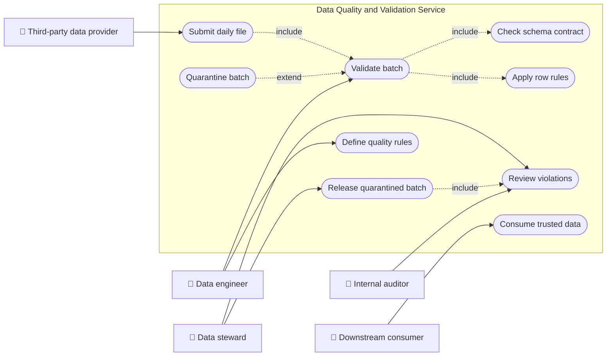
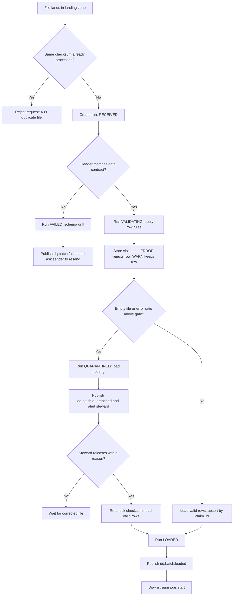
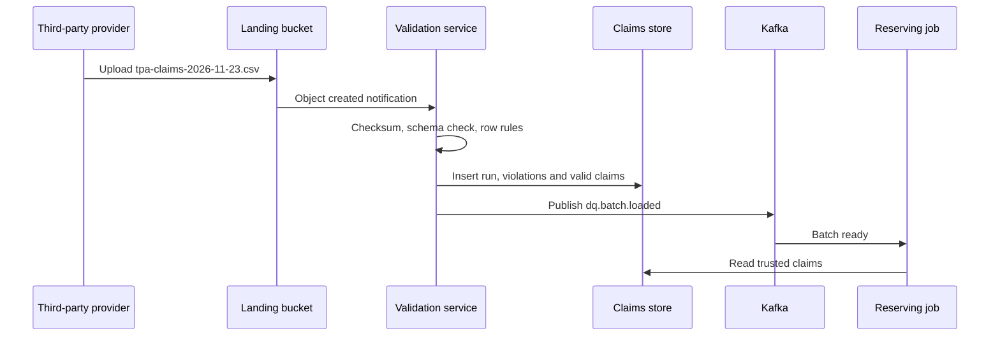
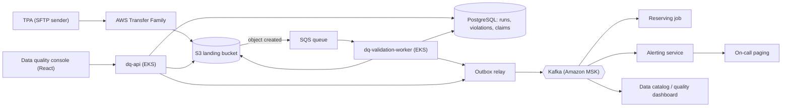
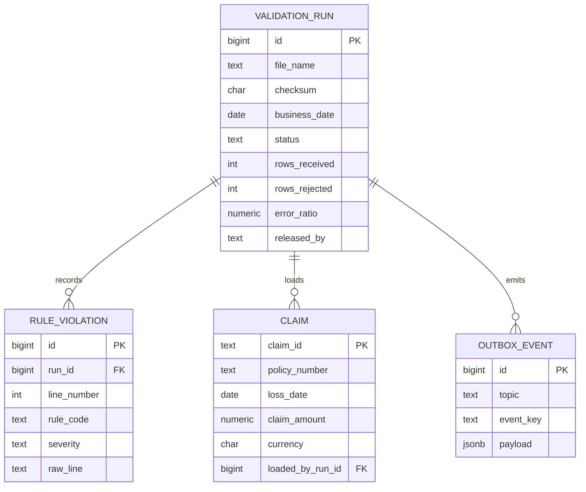
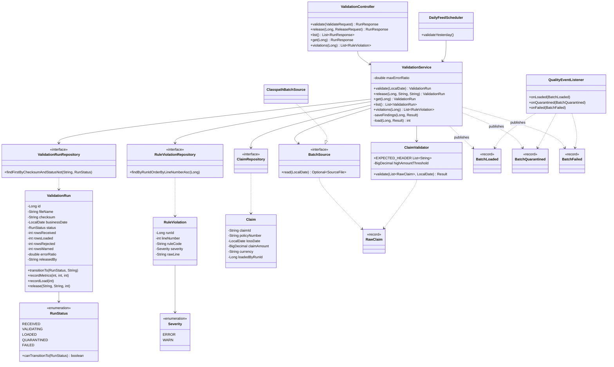
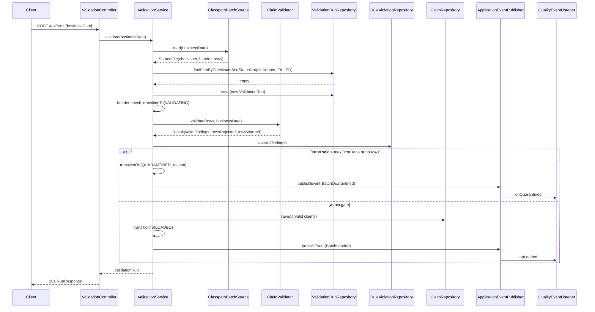
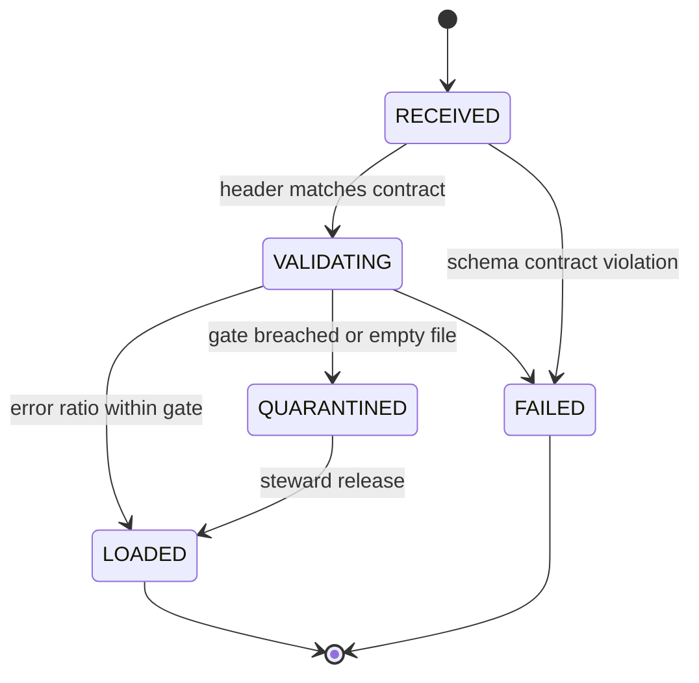
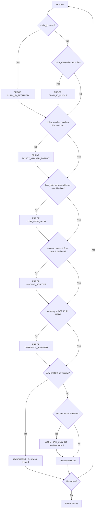

# Data Quality and Validation

> **Domain:** Data Engineering · **Author:** [@dhulipalla599](https://github.com/dhulipalla599) · **Published:** November 24, 2026

> **Runnable code:** [`examples/data-engineering/data-quality-and-validation`](https://github.com/dhulipalla599/domain-knowledge-engineering/tree/main/examples/data-engineering/data-quality-and-validation)

## Explain It Like I'm Five

Imagine a school canteen where a van brings a big crate of apples every morning. Before the apples go into the fruit bowl, the cook opens the crate and checks every apple: is it really an apple, is it bruised, is it rotten? Good apples go into the bowl, bad ones go into a separate box so the farmer can see what went wrong. If almost the whole crate is rotten, the cook does not put any of it out and calls the farmer instead. That way, no child ever bites into a bad apple.

Data quality and validation is that cook: it checks every incoming record before the business uses it, sets the bad ones aside with a reason, and stops a whole delivery when too much of it is wrong.

## Business Overview

Data quality and validation is the set of checks that decide whether incoming data is fit for use before it reaches the systems and people who depend on it. It covers the **shape** of the data (schema, types, required fields), the **content** (valid ranges, formats, reference values, uniqueness), the **batch as a whole** (row counts, freshness, error ratio) and **what happens next** (load, quarantine, alert, release).

This page anchors everything in one use case. **Brightwater Mutual**, a fictional property and casualty insurer, outsources part of its claims handling to a third-party administrator (TPA), **Harbourline Claims Services**. Every morning Harbourline sends a CSV file of the claims it registered the previous day. Brightwater loads those claims into its claims data store, where they feed reserving (how much money to set aside), fraud screening, finance reporting and customer service dashboards.

Why the business cares:

- **Money and risk.** A claim loaded with the wrong amount or currency distorts reserves and financial reporting. A duplicate claim can lead to a duplicate payment.
- **Regulation.** Insurers and banks in many jurisdictions are expected to show that data used for reporting is accurate, complete and traceable. The specific obligations differ by country and regulator (for example Solvency II data-quality expectations in the EU and UK, or BCBS 239 principles for banks), so the exact controls are set by each company's risk and compliance teams.
- **Customer experience.** If a claim is silently dropped, a customer calling the contact centre finds no record of it.
- **Trust in data.** Once analysts find bad numbers in a dashboard, they stop trusting it and build their own spreadsheets. Visible, explained quality checks keep the shared platform credible.

In the Data Engineering value chain, validation sits between **ingestion** (receiving files, change data capture, streams) and **storage and serving** (warehouse, lakehouse, operational stores). It is the gate that turns a raw, untrusted landing zone into a trusted, curated layer. It also produces its own data: run metrics and violation records that data owners use to fix problems at the source.

## Real-World Example

**Monday 24 November 2026, 06:30.** Harbourline drops `tpa-claims-2026-11-24.csv` into Brightwater's secure landing bucket. The file has 10 claim rows.

1. **Receive.** The validation service picks up the file, computes its SHA-256 checksum and checks that this exact file has not already been processed. It has not, so a validation run is created with status `RECEIVED`.
2. **Schema contract.** The header is `claim_id,policy_number,loss_date,claim_amount,currency`, exactly as agreed in the data contract with Harbourline. The run moves to `VALIDATING`.
3. **Row rules.** Every row is checked. Four rows fail:
   - line 3: policy number `POL12-0045` does not match the `POL-nnnnnn` format;
   - line 4: loss date `2026-11-30` is after the file date, which is impossible for a claim already registered;
   - line 6: currency `JPY`, but Brightwater only writes business in GBP, EUR and USD;
   - line 7: claim `CLM-2026-008834` appears a second time in the same file.
4. **Quality gate.** 4 of 10 rows failed, an error ratio of 40%. Brightwater's agreed threshold for this feed is 10%. Too much of the file is wrong to trust the rest blindly, so the run becomes `QUARANTINED`. Nothing is loaded. A `dq.batch.quarantined` event pages the data steward on call.
5. **Investigate.** **Maya Okafor**, the claims data steward, opens the run in the data quality console. She sees the four violations with the raw lines. She calls Harbourline, who confirm a manual keying error on their side and promise corrected rows in tomorrow's file. The other six claims are genuine and the claims team needs them today.
6. **Release.** Maya releases the batch with the reason "TPA confirmed the 4 bad rows will be resent". The service re-checks that the file has not changed, loads the six valid claims, keeps the four bad rows in quarantine and records her name on the run. The run becomes `LOADED`, and a `dq.batch.loaded` event tells the reserving job it can start.
7. **Audit.** Later, an internal auditor can see exactly which file arrived, what failed, who released it, why, and which run loaded each claim.

The day before, the 23 November file had only 1 bad row in 12 (8.3%), under the gate, so it was loaded automatically: 11 claims loaded, 1 quarantined, and 1 claim above 250,000 flagged as a warning for a claims manager to look at.

## Stakeholders

| Stakeholder | What they need | What they fear |
|---|---|---|
| Data steward (claims data owner) | Clear view of what failed and why, the power to release or block a batch, a record of decisions | Being blamed for bad numbers they never saw; alert fatigue from noisy rules |
| Data engineer / platform team | Rules as code, reliable pipeline runs, metrics and alerts | Silent data loss, pipelines that fail at 3 a.m. for a trivial issue, rules nobody owns |
| Third-party data provider (the TPA) | A clear data contract and fast, specific feedback on rejected rows | Disputes about who caused a bad payment or report |
| Downstream consumers (reserving actuaries, finance, fraud team) | Data that is complete, correct and on time, plus a signal when it is ready | Making decisions on wrong or partial data without knowing it |
| Claims operations / customer service | Every genuine claim visible in their systems | A customer calls and their claim is missing |
| Risk, compliance and internal audit | Evidence that controls exist, run every day and that overrides are approved and logged | Undocumented manual fixes, no lineage from report back to source |

## Use Case Diagram



| Use Case | Primary Actor | Goal | Main success outcome |
|---|---|---|---|
| Submit daily file | Third-party data provider | Deliver yesterday's claims | File is received once and a validation run starts |
| Validate batch | Data engineer (or the schedule) | Decide whether the file is fit to load | Run ends `LOADED`, `QUARANTINED` or `FAILED` with metrics |
| Check schema contract | System | Make sure the file has the agreed columns | Header matches; otherwise the run fails and the sender is asked to resend |
| Apply row rules | System | Reject bad rows, flag suspicious ones | Each failed check is stored with the rule, line and raw row |
| Quarantine batch | System | Stop a mostly-bad file from reaching consumers | Nothing is loaded and the steward is alerted |
| Review violations | Data steward | Understand what failed and why | Steward sees violations grouped by rule with raw lines |
| Release quarantined batch | Data steward | Accept a batch with a documented reason | Valid rows are loaded; approver and reason are recorded |
| Consume trusted data | Downstream consumer | Use claims for reserving, finance and fraud | Consumer starts only after a `dq.batch.loaded` event |
| Define quality rules | Data engineer | Encode the data contract as checks | Rules are versioned, reviewed and deployed like code |

## Key Terms

| Term | Plain-English meaning |
|---|---|
| Data contract | The agreement with a data provider about columns, types, allowed values and delivery time |
| Schema drift | The provider changes the structure (renames, adds or drops a column) without warning |
| Validation rule (check, expectation) | One testable statement about the data, such as "amount must be greater than zero" |
| Severity | How serious a failed check is: an error rejects the row, a warning keeps it but flags it |
| Quality gate | A batch-level threshold that decides whether the whole file may be loaded |
| Error ratio | Rejected rows divided by received rows for one batch |
| Quarantine | A holding area for rejected rows or batches, with the reason, kept for review |
| Data steward | The business person accountable for a dataset's quality and for override decisions |
| Release (override) | A steward's documented decision to load a quarantined batch anyway |
| Idempotency | Processing the same file twice has the same effect as processing it once |
| Data quality dimensions | Common lenses for quality: completeness, validity, accuracy, uniqueness, consistency, timeliness |
| Lineage | The trail showing where a record came from and which run loaded it |

## Process Flow

A file lands in the landing zone. The service checks it has not already been processed (by checksum), records a run and checks the schema contract. A schema break fails the run immediately because nothing in the file can be interpreted safely. Otherwise every row is validated against every rule. Failed checks are stored as violations. Rows with errors are rejected; rows with only warnings are kept. The quality gate then compares the error ratio with the agreed threshold. Under the threshold, valid rows are loaded and consumers are told the data is ready. Over the threshold (or for an empty file), the batch is quarantined and the steward is alerted. The steward can release it, which loads the valid rows, or leave it and wait for a corrected file.





## Business Rules and Edge Cases

- **Same file twice (idempotency).** Providers resend files after network errors, and schedulers retry. Identify a file by a content checksum, not only by its name, and refuse to process an identical file twice unless the earlier attempt failed. A corrected resend has a different checksum and is allowed.
- **Load by business key, not by append.** Even with checksum protection, the same claim can appear in two different files (a correction). Load with an upsert on the business key (`claim_id`) so a claim is never duplicated. Whether the later version should win, or be flagged as a restatement, is a business decision to agree with the data owner.
- **Duplicates inside one file.** Decide explicitly. The example keeps the first occurrence and rejects later ones; some teams reject all copies because they cannot tell which is right.
- **Report all failures per row, not just the first.** The provider needs the full list to fix a row in one go.
- **Errors versus warnings.** A rule that rejects valid but unusual data (a very large claim) causes data loss. Use warnings for "suspicious but possible" and errors for "impossible or unusable".
- **The gate protects against partial loads.** Loading 60% of a file and reporting it as complete is worse than loading nothing and saying so. Pick the threshold with the data owner per feed; it is not a universal number.
- **Empty and tiny files.** An empty file is usually a sender failure, not "no claims today". Treat zero rows (or a big drop in volume against recent days) as a batch-level failure.
- **Dates and time zones.** "Loss date after the file date" depends on which date counts. Agree whether the business date is the provider's local date or UTC, and compare dates, not timestamps.
- **Money.** Parse amounts as decimals, never floating point. Reject amounts with more decimal places than the currency allows; the allowed number of decimals varies by currency (JPY has none, for example).
- **Reference data.** Allowed currencies, products or branch codes change. Keep them in reference tables, not hard-coded lists, in production.
- **Schema drift is not a row problem.** A renamed column makes every row "invalid"; failing the whole run with a clear message is better than quarantining every row.
- **Overrides must be governed.** A release needs a named approver and a reason, and should be restricted by role. Releasing must never load the rejected rows themselves.
- **The file can change under you.** If the steward releases hours later, re-check that the file is the same one that was validated.
- **Partial failure during load.** Load valid rows and update run status in one database transaction, so a crash cannot leave claims loaded under a run that still says `VALIDATING`.

## From Business to System

| Business concept / step | System component | Data entity | Event |
|---|---|---|---|
| Provider delivers daily file | Landing bucket + `BatchSource` adapter | Source file (checksum, header, rows) | (S3 object-created notification) |
| Do not process the same file twice | `ValidationService.validate` checksum check | `validation_run.checksum` | none (409 to caller) |
| Check data contract | `ValidationService.validate` schema check | `validation_run.status = FAILED` | `dq.batch.failed` |
| Check every row | `ClaimValidator.validate` | `rule_violation` | none |
| Decide if the batch is fit | Quality gate in `ValidationService.validate` | `validation_run.error_ratio`, `status` | `dq.batch.quarantined` or `dq.batch.loaded` |
| Load trusted claims | `ValidationService.load` (upsert) | `claim` | `dq.batch.loaded` |
| Steward reviews and releases | `ValidationController` release endpoint, `ValidationService.release` | `validation_run.released_by`, `status_reason` | `dq.batch.loaded` (released = true) |
| Alert steward / start downstream jobs | `QualityEventListener` (Kafka consumers in production) | none | consumes all three topics |

## Architecture



**Why the boundaries are drawn here.** The **validation worker** does the heavy, bursty work (reading files, running rules) and scales on queue depth; it is the only writer of new runs. The **dq-api** serves the console and the release action; it is small, always on, and needs different permissions (stewards, not machines). Both share one PostgreSQL schema because a run, its violations and the claims it loaded must change in one transaction. Downstream systems never read the landing bucket or the quarantine; they react to Kafka events and read only the trusted `claim` table. Events go through a **transactional outbox** so an event is published if and only if the database change committed. In the runnable example all of this runs in one Spring Boot process.

## Data Model

```sql
CREATE TABLE validation_run (
    id              BIGSERIAL PRIMARY KEY,
    file_name       TEXT        NOT NULL,
    checksum        CHAR(64)    NOT NULL,             -- SHA-256 of file content
    business_date   DATE        NOT NULL,
    status          TEXT        NOT NULL CHECK (status IN ('RECEIVED','VALIDATING','LOADED','QUARANTINED','FAILED')),
    rows_received   INT         NOT NULL DEFAULT 0,
    rows_loaded     INT         NOT NULL DEFAULT 0,
    rows_rejected   INT         NOT NULL DEFAULT 0,
    rows_warned     INT         NOT NULL DEFAULT 0,
    error_ratio     NUMERIC(5,4) NOT NULL DEFAULT 0,
    status_reason   TEXT,
    released_by     TEXT,
    received_at     TIMESTAMPTZ NOT NULL DEFAULT now(),
    finished_at     TIMESTAMPTZ
);
-- One non-failed run per file content: closes the race between two workers.
CREATE UNIQUE INDEX ux_run_checksum_active ON validation_run (checksum) WHERE status <> 'FAILED';

CREATE TABLE rule_violation (
    id           BIGSERIAL PRIMARY KEY,
    run_id       BIGINT  NOT NULL REFERENCES validation_run(id),
    line_number  INT     NOT NULL,
    rule_code    TEXT    NOT NULL,
    severity     TEXT    NOT NULL CHECK (severity IN ('ERROR','WARN')),
    message      TEXT,
    raw_line     TEXT                                   -- may hold personal data: restrict access, set retention
);
CREATE INDEX ix_violation_run ON rule_violation (run_id, line_number);

CREATE TABLE claim (
    claim_id          TEXT          PRIMARY KEY,
    policy_number     TEXT          NOT NULL,
    loss_date         DATE          NOT NULL,
    claim_amount      NUMERIC(14,2) NOT NULL CHECK (claim_amount > 0),
    currency          CHAR(3)       NOT NULL,
    loaded_by_run_id  BIGINT        NOT NULL REFERENCES validation_run(id)
);

CREATE TABLE outbox_event (
    id           BIGSERIAL PRIMARY KEY,
    topic        TEXT        NOT NULL,
    event_key    TEXT        NOT NULL,
    payload      JSONB       NOT NULL,
    created_at   TIMESTAMPTZ NOT NULL DEFAULT now(),
    published_at TIMESTAMPTZ
);
```

The runnable example has the first three tables (generated by JPA on H2); `outbox_event` is the production addition.



## APIs

| Method | Path | Purpose |
|---|---|---|
| POST | `/api/runs` | Validate the file for a business date (start a run) |
| GET | `/api/runs` | List runs, newest first |
| GET | `/api/runs/{id}` | One run with its metrics and status |
| GET | `/api/runs/{id}/violations` | Failed checks for a run, ordered by line |
| POST | `/api/runs/{id}/release` | Steward releases a quarantined run with a reason |

Most important endpoint, `POST /api/runs`, for a file that breaches the gate:

```json
{ "businessDate": "2026-11-24" }
```

Response `201 Created`:

```json
{
  "id": 3,
  "fileName": "tpa-claims-2026-11-24.csv",
  "businessDate": "2026-11-24",
  "status": "QUARANTINED",
  "rowsReceived": 10,
  "rowsLoaded": 0,
  "rowsRejected": 4,
  "rowsWarned": 0,
  "errorRatio": 0.4,
  "statusReason": "Quality gate: 4 of 10 rows failed (40.0% > 10.0%)",
  "releasedBy": null,
  "receivedAt": "2026-11-24T06:30:01.534Z",
  "finishedAt": "2026-11-24T06:30:01.542Z"
}
```

A quarantined run is still `201`: the request succeeded, and the outcome is in `status`. Business-rule violations of the request itself return `ProblemDetail` errors: `409` for a duplicate file or releasing a run that is not quarantined, `404` for a missing file or run, `400` for a missing date or a release without a proper reason.

## Events

| Event | Producer | Consumers | Key fields |
|---|---|---|---|
| `dq.batch.loaded` | Validation worker, dq-api (on release) | Reserving job, fraud scoring, data catalog | `runId`, `fileName`, `businessDate`, `rowsLoaded`, `rowsRejected`, `released` |
| `dq.batch.quarantined` | Validation worker | Alerting service (pages steward), quality dashboard | `runId`, `fileName`, `businessDate`, `errorRatio`, `reason` |
| `dq.batch.failed` | Validation worker | Alerting service, provider-feedback job | `runId`, `fileName`, `reason` |

**Ordering and idempotency.** Key every event by the file checksum (or `runId`) so all events for one batch land on the same partition in order; a run can emit `dq.batch.quarantined` and later `dq.batch.loaded` after release, and consumers must see them in that order. Delivery is at least once, so consumers must be idempotent: the reserving job records the `runId` values it has processed and ignores repeats. Publish through the outbox table in the same transaction as the status change, so there is never a "loaded" event for a run that rolled back. Do not put raw rows or personal data in events; consumers read trusted data from the store.

## Backend Implementation

> The Java tab is the exact code from the runnable example (Spring Boot 3). The Python tab uses FastAPI with SQLAlchemy and the Node.js tab uses Express with TypeScript; they express the same logic and rules.

Full source: [`examples/data-engineering/data-quality-and-validation`](https://github.com/dhulipalla599/domain-knowledge-engineering/tree/main/examples/data-engineering/data-quality-and-validation).

The rule-enforcing method, `ValidationService.validate` (idempotency, schema contract, quality gate, load):

=== "Java"

    ```java
    @Transactional
    public ValidationRun validate(LocalDate businessDate) {
        SourceFile file = source.read(businessDate)
                .orElseThrow(() -> new QualityException(HttpStatus.NOT_FOUND, "No claims file for " + businessDate));
        runs.findFirstByChecksumAndStatusNot(file.checksum(), RunStatus.FAILED).ifPresent(previous -> {
            throw new QualityException(HttpStatus.CONFLICT,
                    "File " + file.fileName() + " was already processed by run " + previous.getId());
        });

        ValidationRun run = runs.save(new ValidationRun(file.fileName(), file.checksum(), businessDate));
        if (!ClaimValidator.EXPECTED_HEADER.equals(file.header())) {
            String reason = "Schema contract violation: expected " + ClaimValidator.EXPECTED_HEADER + " but got " + file.header();
            run.transitionTo(RunStatus.FAILED, reason);
            events.publishEvent(new BatchFailed(run.getId(), file.fileName(), reason));
            return run;
        }

        run.transitionTo(RunStatus.VALIDATING, null);
        Result result = validator.validate(file.rows(), businessDate);
        run.recordMetrics(file.rows().size(), result.rowsRejected(), result.rowsWarned());
        saveFindings(run.getId(), result);

        if (file.rows().isEmpty() || run.getErrorRatio() > maxErrorRatio) {
            String reason = file.rows().isEmpty()
                    ? "Volume check: file has no data rows"
                    : String.format("Quality gate: %d of %d rows failed (%.1f%% > %.1f%%)", result.rowsRejected(),
                            file.rows().size(), run.getErrorRatio() * 100, maxErrorRatio * 100);
            run.transitionTo(RunStatus.QUARANTINED, reason);
            events.publishEvent(new BatchQuarantined(run.getId(), file.fileName(), businessDate, run.getErrorRatio(), reason));
            return run;
        }

        run.recordLoad(load(run.getId(), result));
        run.transitionTo(RunStatus.LOADED, null);
        events.publishEvent(new BatchLoaded(run.getId(), file.fileName(), businessDate,
                run.getRowsLoaded(), run.getRowsRejected(), false));
        return run;
    }
    ```

=== "Python"

    ```python
    def validate(db: Session, business_date: date) -> ValidationRun:
        file = source.read(business_date)
        if file is None:
            raise QualityError(404, f"No claims file for {business_date}")
        previous = runs.first_by_checksum_not_failed(db, file.checksum)
        if previous:
            raise QualityError(409, f"File {file.file_name} was already processed by run {previous.id}")

        run = ValidationRun(file_name=file.file_name, checksum=file.checksum, business_date=business_date)
        db.add(run)
        db.flush()
        if file.header != EXPECTED_HEADER:
            reason = f"Schema contract violation: expected {EXPECTED_HEADER} but got {file.header}"
            run.transition_to(RunStatus.FAILED, reason)
            events.publish(BatchFailed(run.id, file.file_name, reason))
            return run

        run.transition_to(RunStatus.VALIDATING, None)
        result = validator.validate(file.rows, business_date)
        run.record_metrics(len(file.rows), result.rows_rejected, result.rows_warned)
        save_findings(db, run.id, result)

        if not file.rows or run.error_ratio > settings.max_error_ratio:
            reason = ("Volume check: file has no data rows" if not file.rows else
                      f"Quality gate: {result.rows_rejected} of {len(file.rows)} rows failed "
                      f"({run.error_ratio * 100:.1f}% > {settings.max_error_ratio * 100:.1f}%)")
            run.transition_to(RunStatus.QUARANTINED, reason)
            events.publish(BatchQuarantined(run.id, file.file_name, business_date, run.error_ratio, reason))
            return run

        run.rows_loaded = load(db, run.id, result)
        run.transition_to(RunStatus.LOADED, None)
        events.publish(BatchLoaded(run.id, file.file_name, business_date,
                                   run.rows_loaded, run.rows_rejected, released=False))
        return run
    ```

=== "Node.js"

    ```typescript
    export async function validate(tx: Tx, businessDate: string): Promise<ValidationRun> {
      const file = await source.read(businessDate);
      if (!file) throw new QualityError(404, `No claims file for ${businessDate}`);
      const previous = await runs.firstByChecksumNotFailed(tx, file.checksum);
      if (previous) {
        throw new QualityError(409, `File ${file.fileName} was already processed by run ${previous.id}`);
      }

      const run = await runs.insert(tx, newRun(file.fileName, file.checksum, businessDate));
      if (file.header.join(",") !== EXPECTED_HEADER.join(",")) {
        const reason = `Schema contract violation: expected ${EXPECTED_HEADER} but got ${file.header}`;
        transitionTo(run, "FAILED", reason);
        await events.publish(tx, { type: "BatchFailed", runId: run.id, fileName: file.fileName, reason });
        return runs.update(tx, run);
      }

      transitionTo(run, "VALIDATING", null);
      const result = validator.validate(file.rows, businessDate);
      recordMetrics(run, file.rows.length, result.rowsRejected, result.rowsWarned);
      await saveFindings(tx, run.id, result);

      if (file.rows.length === 0 || run.errorRatio > config.maxErrorRatio) {
        const reason = file.rows.length === 0
          ? "Volume check: file has no data rows"
          : `Quality gate: ${result.rowsRejected} of ${file.rows.length} rows failed ` +
            `(${(run.errorRatio * 100).toFixed(1)}% > ${(config.maxErrorRatio * 100).toFixed(1)}%)`;
        transitionTo(run, "QUARANTINED", reason);
        await events.publish(tx, { type: "BatchQuarantined", runId: run.id, fileName: file.fileName,
          businessDate, errorRatio: run.errorRatio, reason });
        return runs.update(tx, run);
      }

      run.rowsLoaded = await load(tx, run.id, result);
      transitionTo(run, "LOADED", null);
      await events.publish(tx, { type: "BatchLoaded", runId: run.id, fileName: file.fileName, businessDate,
        rowsLoaded: run.rowsLoaded, rowsRejected: run.rowsRejected, released: false });
      return runs.update(tx, run);
    }
    ```

The controller endpoints that call it, from `ValidationController`:

=== "Java"

    ```java
    @PostMapping
    @ResponseStatus(HttpStatus.CREATED)
    public RunResponse validate(@Valid @RequestBody ValidateRequest request) {
        return RunResponse.from(service.validate(request.businessDate()));
    }

    @PostMapping("/{id}/release")
    public RunResponse release(@PathVariable Long id, @Valid @RequestBody ReleaseRequest request) {
        return RunResponse.from(service.release(id, request.approvedBy(), request.reason()));
    }
    ```

=== "Python"

    ```python
    class ValidateRequest(BaseModel):
        business_date: date = Field(alias="businessDate")

    class ReleaseRequest(BaseModel):
        approved_by: str = Field(alias="approvedBy", min_length=1)
        reason: str = Field(min_length=10, max_length=500)

    @router.post("/api/runs", status_code=201, response_model=RunResponse)
    def validate_run(request: ValidateRequest, db: Session = Depends(get_db)):
        with db.begin():
            return RunResponse.from_run(service.validate(db, request.business_date))

    @router.post("/api/runs/{run_id}/release", response_model=RunResponse)
    def release_run(run_id: int, request: ReleaseRequest, db: Session = Depends(get_db)):
        with db.begin():
            return RunResponse.from_run(service.release(db, run_id, request.approved_by, request.reason))
    ```

=== "Node.js"

    ```typescript
    const ValidateRequest = z.object({ businessDate: z.string().date() });
    const ReleaseRequest = z.object({ approvedBy: z.string().min(1), reason: z.string().min(10).max(500) });

    router.post("/api/runs", async (req, res) => {
      const { businessDate } = ValidateRequest.parse(req.body);
      const run = await db.transaction((tx) => service.validate(tx, businessDate));
      res.status(201).json(toRunResponse(run));
    });

    router.post("/api/runs/:id/release", async (req, res) => {
      const { approvedBy, reason } = ReleaseRequest.parse(req.body);
      const run = await db.transaction((tx) => service.release(tx, Number(req.params.id), approvedBy, reason));
      res.json(toRunResponse(run));
    });
    ```

## Frontend Screen

The data steward's run review screen: shows the run, its violations, and the release action for a quarantined run.

```tsx
import { useEffect, useState } from "react";

type RunStatus = "RECEIVED" | "VALIDATING" | "LOADED" | "QUARANTINED" | "FAILED";
interface Run {
  id: number; fileName: string; businessDate: string; status: RunStatus;
  rowsReceived: number; rowsLoaded: number; rowsRejected: number; rowsWarned: number;
  errorRatio: number; statusReason: string | null; releasedBy: string | null;
}
interface Violation { id: number; lineNumber: number; ruleCode: string; severity: "ERROR" | "WARN"; message: string; rawLine: string; }

export function RunReview({ runId, steward }: { runId: number; steward: string }) {
  const [run, setRun] = useState<Run | null>(null);
  const [violations, setViolations] = useState<Violation[]>([]);
  const [reason, setReason] = useState("");
  const [error, setError] = useState<string | null>(null);

  useEffect(() => {
    Promise.all([
      fetch(`/api/runs/${runId}`).then((r) => r.json()),
      fetch(`/api/runs/${runId}/violations`).then((r) => r.json()),
    ]).then(([r, v]) => { setRun(r); setViolations(v); });
  }, [runId]);

  async function release() {
    setError(null);
    const res = await fetch(`/api/runs/${runId}/release`, {
      method: "POST",
      headers: { "Content-Type": "application/json" },
      body: JSON.stringify({ approvedBy: steward, reason }),
    });
    const body = await res.json();
    if (res.ok) setRun(body); else setError(body.detail);
  }

  if (!run) return <p>Loading…</p>;
  const byRule = violations.reduce<Record<string, number>>((acc, v) => ({ ...acc, [v.ruleCode]: (acc[v.ruleCode] ?? 0) + 1 }), {});

  return (
    <section aria-labelledby="run-title">
      <h2 id="run-title">{run.fileName} <span className={`badge badge-${run.status.toLowerCase()}`}>{run.status}</span></h2>
      <p>{run.rowsReceived} received · {run.rowsLoaded} loaded · {run.rowsRejected} rejected · {run.rowsWarned} warnings ·
        error ratio {(run.errorRatio * 100).toFixed(1)}%</p>
      {run.statusReason && <p role="status">{run.statusReason}</p>}

      <h3>Failures by rule</h3>
      <ul>{Object.entries(byRule).map(([rule, n]) => <li key={rule}>{rule}: {n}</li>)}</ul>

      <table>
        <thead><tr><th>Line</th><th>Rule</th><th>Severity</th><th>Message</th><th>Raw row</th></tr></thead>
        <tbody>
          {violations.map((v) => (
            <tr key={v.id}><td>{v.lineNumber}</td><td>{v.ruleCode}</td><td>{v.severity}</td><td>{v.message}</td><td><code>{v.rawLine}</code></td></tr>
          ))}
        </tbody>
      </table>

      {run.status === "QUARANTINED" && (
        <form onSubmit={(e) => { e.preventDefault(); void release(); }}>
          <label htmlFor="reason">Reason for release (min. 10 characters)</label>
          <textarea id="reason" value={reason} onChange={(e) => setReason(e.target.value)} minLength={10} maxLength={500} required />
          <button type="submit">Release {run.rowsReceived - run.rowsRejected} valid rows</button>
          {error && <p role="alert">{error}</p>}
        </form>
      )}
    </section>
  );
}
```

Raw rows can contain personal data; in production the violations call should only return `rawLine` to users with the steward role.

## Cloud Deployment

**Managed services on AWS.**

- **Amazon EKS** runs `dq-api` (Deployment, 2+ replicas) and `dq-validation-worker` (Deployment scaled on queue depth, for example with KEDA).
- **AWS Transfer Family** gives the TPA an SFTP endpoint that writes straight into the **S3 landing bucket**; S3 event notifications go to **Amazon SQS**.
- **Amazon RDS for PostgreSQL** (or Aurora PostgreSQL), Multi-AZ, holds runs, violations, claims and the outbox.
- **Amazon MSK** carries the `dq.batch.*` topics; an outbox relay (for example Debezium on MSK Connect, or a small poller) publishes committed events.
- **AWS Secrets Manager** for database credentials, **AWS KMS** for encryption keys.

The most important resource is the landing bucket, because it holds raw, unvalidated data from outside the company:

```hcl
resource "aws_s3_bucket" "claims_landing" {
  bucket = "brightwater-claims-landing-prod"
}

resource "aws_s3_bucket_versioning" "claims_landing" {
  bucket = aws_s3_bucket.claims_landing.id
  versioning_configuration { status = "Enabled" }
}

resource "aws_s3_bucket_server_side_encryption_configuration" "claims_landing" {
  bucket = aws_s3_bucket.claims_landing.id
  rule {
    apply_server_side_encryption_by_default {
      sse_algorithm     = "aws:kms"
      kms_master_key_id = aws_kms_key.claims.arn
    }
  }
}

resource "aws_s3_bucket_public_access_block" "claims_landing" {
  bucket                  = aws_s3_bucket.claims_landing.id
  block_public_acls       = true
  block_public_policy     = true
  ignore_public_acls      = true
  restrict_public_buckets = true
}

resource "aws_s3_bucket_lifecycle_configuration" "claims_landing" {
  bucket = aws_s3_bucket.claims_landing.id
  rule {
    id     = "archive-raw-files"
    status = "Enabled"
    filter { prefix = "tpa-claims/" }
    transition {
      days          = 30
      storage_class = "GLACIER"
    }
  }
}

resource "aws_s3_bucket_notification" "claims_landing" {
  bucket = aws_s3_bucket.claims_landing.id
  queue {
    queue_arn     = aws_sqs_queue.claims_files.arn
    events        = ["s3:ObjectCreated:*"]
    filter_prefix = "tpa-claims/"
  }
}
```

Retention periods for raw files and quarantined rows depend on the company's records policy and local regulation; set the lifecycle rule with the data protection officer, not by default.

**Security.** Pods use IAM Roles for Service Accounts (IRSA): the worker can read the landing prefix and write to RDS; only `dq-api` can perform releases, and the release endpoint requires a steward role from the identity provider (OIDC). Raw lines in `rule_violation` are personal data in most jurisdictions: encrypt at rest, restrict reads, and purge on the agreed schedule. Network policies keep the database private to the cluster.

**Scaling.** Files are processed one per worker; scale workers on SQS queue depth. Stream large files row by row instead of loading them into memory, and write violations and claims in batches. The partial unique index on `checksum` keeps concurrent workers from processing the same file.

**Observability.** Instrument with the OpenTelemetry Java agent and export traces and metrics to CloudWatch through the AWS Distro for OpenTelemetry collector. Emit per-feed metrics: `dq.rows.received`, `dq.rows.rejected`, `dq.error_ratio`, `dq.run.duration`, and runs by final status. Alarm on: any `FAILED` run, error ratio trending up across days, a file not arriving by its agreed time (a freshness alarm), and outbox lag.

## Non-Functional Requirements

| Requirement | Expectation for this feed | How the design meets it |
|---|---|---|
| Availability | Validation completes before downstream jobs start (for example by 08:00 local time); the console is available in business hours | Worker and API run as multi-replica Deployments across AZs; SQS buffers files if workers are down; Multi-AZ RDS |
| Latency | A daily file of tens of thousands of rows validates in minutes, not hours | Streaming parse, batch inserts, rules are pure in-memory functions |
| Consistency | A run's status, violations and loaded claims are never out of step; consumers never see a partial batch | One database transaction per run; events via outbox; consumers start only on `dq.batch.loaded` |
| Idempotency | Retries and resends never duplicate claims | Checksum check plus partial unique index; upsert by `claim_id`; idempotent consumers keyed by `runId` |
| Audit | Every file, failure and override is traceable | `validation_run` keeps checksum, metrics, approver and reason; `claim.loaded_by_run_id` gives lineage; S3 versioning keeps the original file |
| Compliance | Data quality controls are evidenced and overrides approved; personal data protected | Rules are versioned in Git and run on every file; release needs a named steward and reason; encryption, role-based access and retention on raw data. The exact regulatory requirements vary by jurisdiction and are set with compliance |
| Data quality transparency | Owners see quality trends, not just today's run | Run metrics per feed in CloudWatch and the quality dashboard |

## Runnable Example

The example implements the whole Brightwater flow in one Spring Boot 3 application with no external services. A REST call (or a `@Scheduled` job, disabled by default) reads `tpa-claims-<date>.csv` from `src/main/resources/sample-data/`, rejects a file it has already processed (by SHA-256 checksum), fails the run on schema drift, runs the row rules in `ClaimValidator`, applies the 10% quality gate, and either loads valid claims into H2 or quarantines the batch. A steward can release a quarantined run. Run metrics are stored in `validation_run`, failed checks in `rule_violation`, and events `BatchLoaded`, `BatchQuarantined` and `BatchFailed` stand in for the Kafka topics.

Source: [`examples/data-engineering/data-quality-and-validation`](https://github.com/dhulipalla599/domain-knowledge-engineering/tree/main/examples/data-engineering/data-quality-and-validation)

```bash
cd examples/data-engineering/data-quality-and-validation
mvn spring-boot:run          # starts on http://localhost:8080
mvn verify                   # runs the unit and API tests
```

Happy path (12 rows, 1 rejected, 1 warning, 8.3% under the gate):

```bash
curl -s -X POST localhost:8080/api/runs -H 'Content-Type: application/json' -d '{"businessDate":"2026-11-23"}'
```

```json
{"id":2,"fileName":"tpa-claims-2026-11-23.csv","businessDate":"2026-11-23","status":"LOADED","rowsReceived":12,"rowsLoaded":11,"rowsRejected":1,"rowsWarned":1,"errorRatio":0.0833,"statusReason":null,"releasedBy":null,"receivedAt":"...","finishedAt":"..."}
```

Rule violation (the same file again):

```bash
curl -s -X POST localhost:8080/api/runs -H 'Content-Type: application/json' -d '{"businessDate":"2026-11-23"}'
```

```json
{"type":"about:blank","title":"Conflict","status":409,"detail":"File tpa-claims-2026-11-23.csv was already processed by run 2","instance":"/api/runs"}
```

`{"businessDate":"2026-11-24"}` is quarantined (4 of 10 rows fail) and can be released with `POST /api/runs/3/release`; `2026-11-25` fails on schema drift.

| Class | Package | Responsibility |
|---|---|---|
| `RunStatus` | domain | Lifecycle enum with legal transitions |
| `ValidationRun` | domain | Run entity: enforces transitions, holds quality metrics |
| `RawClaim` | domain | Untyped source row with its line number |
| `Severity` | domain | `ERROR` rejects the row, `WARN` keeps it |
| `RuleViolation` | domain | One failed check on one row (the quarantine) |
| `Claim` | domain | Trusted claim, keyed by `claim_id` |
| `QualityEvents` | domain | `BatchLoaded`, `BatchQuarantined`, `BatchFailed` |
| `ValidationRunRepository`, `RuleViolationRepository`, `ClaimRepository` | repository | Spring Data JPA |
| `ClaimValidator` | service | Row-level rules, pure logic |
| `ValidationService` | service | Idempotency, schema check, quality gate, load, release |
| `QualityException` | service | Rule violation carrying an HTTP status |
| `ValidationController`, `ValidateRequest`, `ReleaseRequest`, `RunResponse` | api | REST endpoints and DTO records |
| `ApiExceptionHandler` | api | Maps errors to `ProblemDetail` |
| `BatchSource`, `ClasspathBatchSource` | integration | Extract port and classpath CSV adapter |
| `QualityEventListener` | integration | `@EventListener` consumers |
| `DailyFeedScheduler` | integration | `@Scheduled` job, off by default |

## UML Diagrams

### Class Diagram

The controller delegates to `ValidationService`, which reads files through the `BatchSource` port, applies `ClaimValidator`, persists through three repositories and publishes the events consumed by `QualityEventListener`. `ValidationRun` owns its lifecycle through `RunStatus`.



### Sequence Diagram (control flow)

One `POST /api/runs` call through the code. The `alt` shows the quality-gate branch that quarantines the batch instead of loading it; the duplicate-file check throws before any run is created.



### State Diagram

The lifecycle enforced by `RunStatus.canTransitionTo` and `ValidationRun.transitionTo`. `LOADED` and `FAILED` are terminal; `QUARANTINED` can only move to `LOADED` through a steward release.



### Activity Diagram

The decision logic inside `ClaimValidator.validate` for each row. All error checks run so every problem is reported; the warning check runs only for rows with no errors.



## AI Opportunities

1. **Anomaly detection on batch metrics.** Learn the normal volume, error ratio and value distributions per feed and day of week, and flag files that pass every rule but look unusual (half the usual claims, a shift in average amount). *Data:* history of run metrics and column profiles. *Risk/control:* false alarms erode trust; start in advisory mode, tune with stewards, and keep hard rules as the gate.
2. **Rule suggestion from profiling.** Profile a new feed and propose candidate rules (formats, ranges, allowed values) for an engineer to review. *Data:* sample files and the data contract. *Risk/control:* a model can encode today's bad data as "normal"; every suggested rule needs human review and a test before it goes live.
3. **LLM triage summaries for stewards.** Summarise a quarantined run in plain language ("38 of 40 failures are the new date format DD/MM/YYYY from line 120 on") and draft the message to the provider. *Data:* violation records, rule descriptions. *Risk/control:* do not send raw personal data to an external model without a data protection assessment; mask or aggregate first; the steward approves anything sent.
4. **Entity matching for duplicates.** Detect near-duplicate claims across files (same policy, loss date and similar amount with a different claim id). *Data:* historical claims. *Risk/control:* explainability matters because a flagged duplicate may delay a genuine payment; route to a human, never auto-reject.
5. **Root-cause hints for schema drift.** Map renamed or reordered columns to the contract and propose a fix. *Data:* contract, failed headers, sample rows. *Risk/control:* never auto-apply a mapping; a wrong mapping silently corrupts data, which is worse than a failed run.

## Common Pitfalls

- **Validating after loading.** Running checks on the warehouse table after consumers have read it. Validate before the trusted layer, and gate consumers on a "loaded" signal.
- **Silent drops.** Filtering out bad rows with no record of what was dropped. Always store rejected rows with the rule and reason, and report counts.
- **All-or-nothing with no threshold.** Rejecting a 100,000-row file for one bad row frustrates the business; loading everything regardless hides problems. Use row-level rejection plus a batch-level gate agreed with the data owner.
- **Only the first error per row.** Providers fix one issue, resend, and fail on the next. Report all failures at once.
- **Treating schema drift as row errors.** Leads to thousands of violations for one renamed column. Check the header first.
- **Floating point for money.** Use decimal types end to end, including JSON parsing.
- **Hard-coded reference values.** Allowed currencies or product codes change; keep them in managed reference data with owners.
- **No idempotency.** Re-running a job appends duplicates. Use content checksums and business-key upserts.
- **Overrides with no audit.** A "just load it" button with no approver or reason fails audit and hides recurring issues.
- **Noisy rules.** Rules nobody owns, or warnings nobody reads, train people to ignore alerts. Every rule needs an owner and a documented action.
- **Personal data in logs and events.** Raw lines often contain names or policy numbers. Keep them in access-controlled storage, not in logs, events or chat alerts.

## Interview Questions

### Junior

**1. What is the difference between a schema check and a row-level validation rule?**
A schema check looks at the structure of the whole file or table (columns, names, types) and is done once per batch. A row rule checks the values in each record (format, range, allowed values). If the schema is wrong, row rules cannot be interpreted, so the schema check comes first and usually fails the whole batch.

**2. Why store rejected rows instead of just skipping them?**
So the business knows what was not loaded, the provider can fix it, and auditors can see what happened. Silently skipped rows lead to missing claims and wrong totals that nobody can explain.

**3. Why should money amounts be parsed as decimals?**
Floating-point types cannot represent many decimal fractions exactly, so sums and comparisons drift. Decimal types keep exact values and let you check the number of decimal places.

### Mid-Level

**1. How do you make a file-based pipeline idempotent?**
Identify each file by a content checksum and record it with the run; refuse to reprocess an identical file unless the earlier run failed. Load with an upsert on the business key so the same record in two files is not duplicated. Make event consumers idempotent by tracking processed run ids. Enforce the checksum rule with a unique index, not just a query, to handle concurrent workers.

**2. When should a check be a warning rather than an error?**
When the value is possible but unusual and rejecting it would lose genuine data, for example a very large claim, a rare product code or an old loss date. Errors are for values that are impossible or that downstream systems cannot use. The choice should be made with the data owner and revisited as you learn from the data.

**3. How do you choose a quality-gate threshold?**
With the data owner, per feed, based on how consumers use the data and the cost of a partial load versus a late load. Start from historical error ratios, set the gate above normal noise, and review it. Some feeds (financial postings) may need zero tolerance; others (marketing contacts) can tolerate more. Also add batch-level checks such as volume against recent history and freshness.

### Senior / Architect

**1. Design data quality for 200 inbound feeds from 50 partners.**
Strong answers cover: data contracts per feed, versioned with the partner; declarative, reusable rule definitions (a framework rather than hand-written code per feed) stored in Git with tests; a shared validation service or library run in the ingestion path; per-feed thresholds and owners; a quarantine store and steward workflow with role-based release; metrics per feed and partner in a dashboard; alerting on failures, trends and late files; lineage from trusted records back to the source file; and how new feeds onboard (profiling, suggested rules, review).

**2. Batch versus streaming validation: what changes?**
In streaming there is no file to quarantine or ratio to compute up front. Key points: validate per event and route failures to a dead-letter topic with the reason; compute quality metrics over windows; gate consumers with watermarks or "partition complete" signals instead of a batch-loaded event; handle schema evolution with a schema registry and compatibility rules; keep per-key ordering and idempotency; decide whether bad events block the stream or flow around it.

**3. A steward released a batch that later turned out to corrupt finance reports. How do you prevent and recover?**
Prevention: release only for named roles, require a reason, show the impact (rows, amounts) before release, consider a second approver for high-value feeds, and never load rejected rows. Recovery: lineage (`loaded_by_run_id`) to find affected records, the ability to roll back or restate by run, downstream notification events so consumers recompute, and a post-incident review that turns the miss into a new rule. Also discuss the trade-off between speed for the business and control.

## Further Learning

- Data quality dimensions (completeness, validity, accuracy, consistency, uniqueness, timeliness) as described in the DAMA-DMBOK
- ISO 8000 (data quality) and ISO/IEC 25012 (data quality model)
- BCBS 239 principles for risk data aggregation and reporting (banking)
- Data contracts and schema registries (Avro, Protobuf, JSON Schema compatibility rules)
- Declarative data testing tools such as Great Expectations, dbt tests, Soda and Amazon Deequ
- Transactional outbox and idempotent consumer patterns
- Data lineage standards such as OpenLineage
- Master data management and entity resolution

## Practitioner Notes

> _Reviewer: add real-world experience, corrections or gotchas here before approving._
