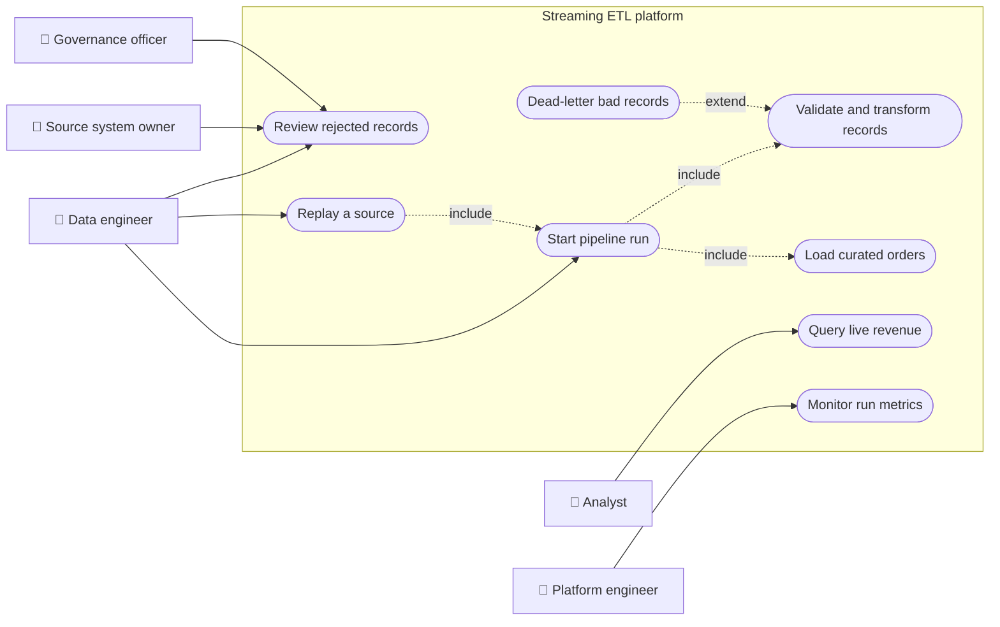
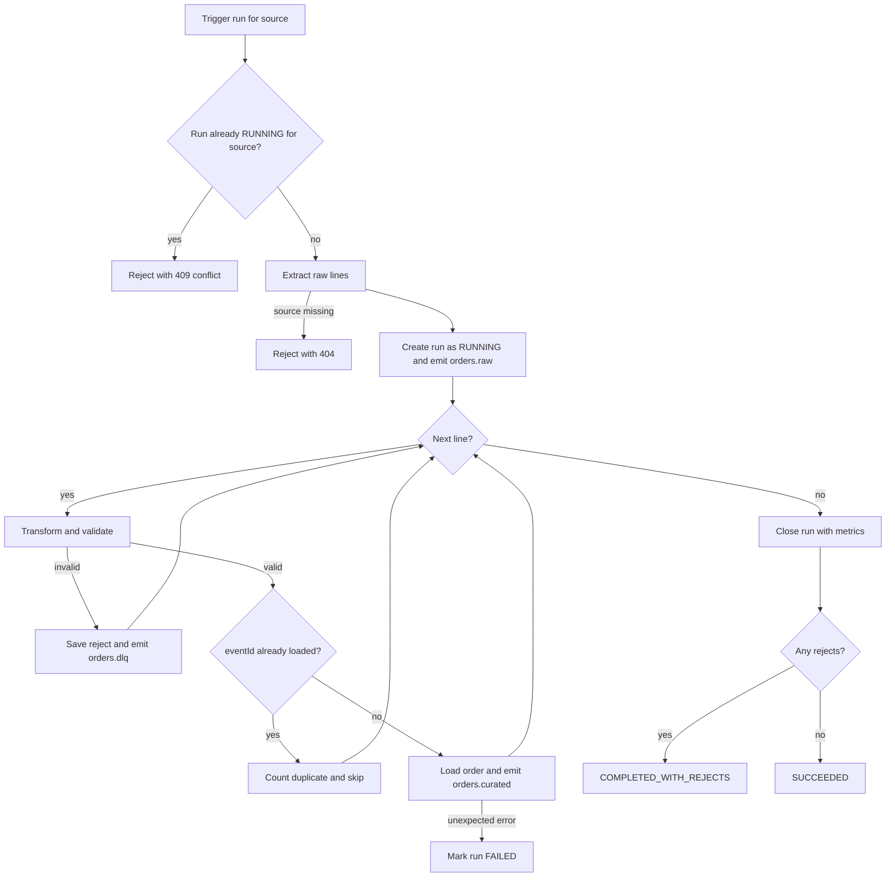
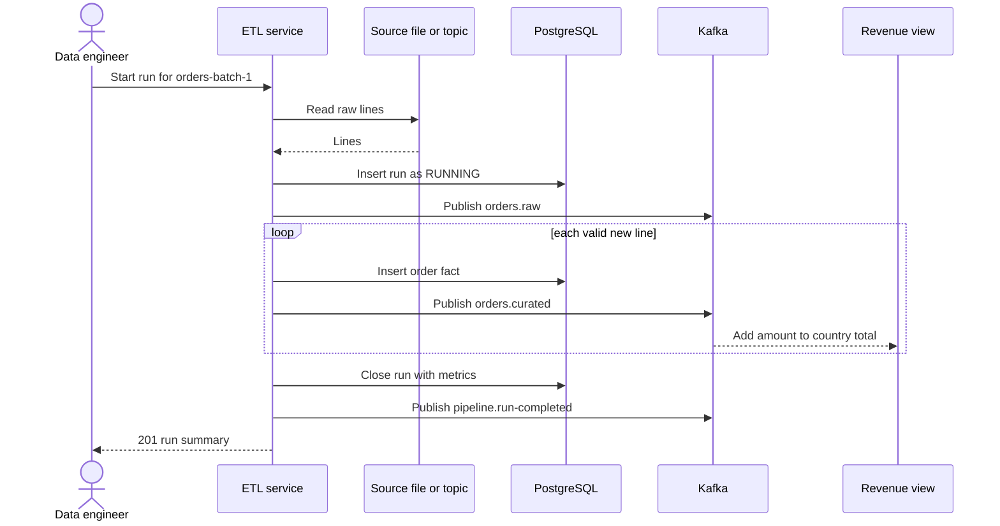
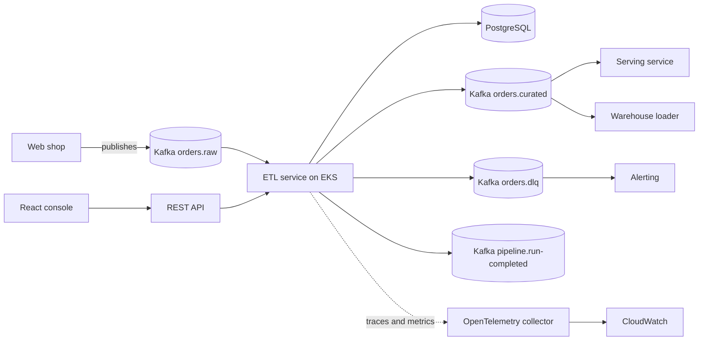
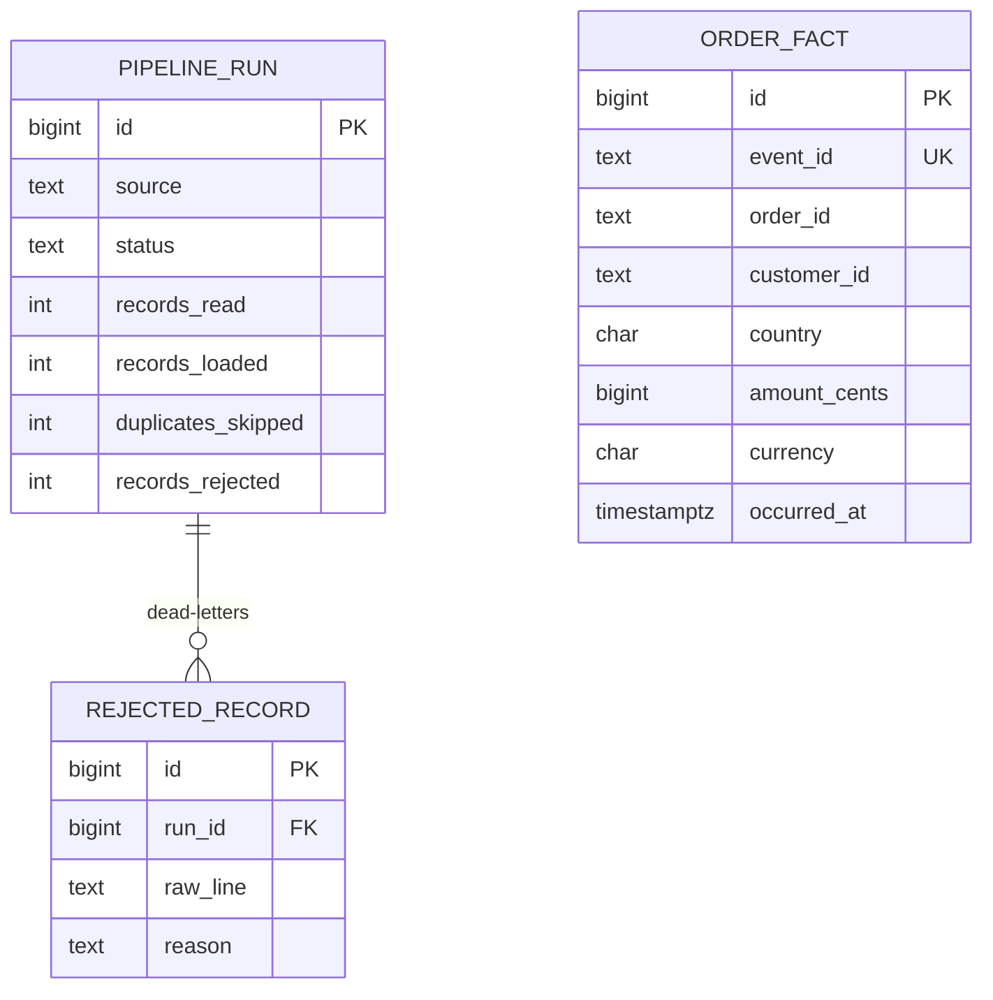
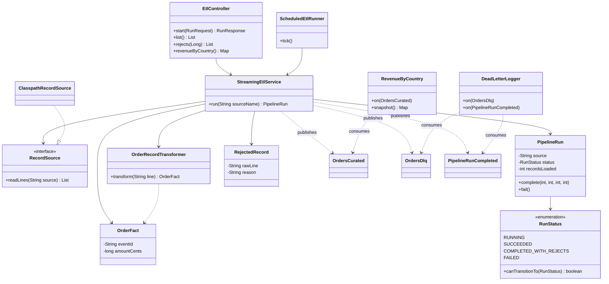
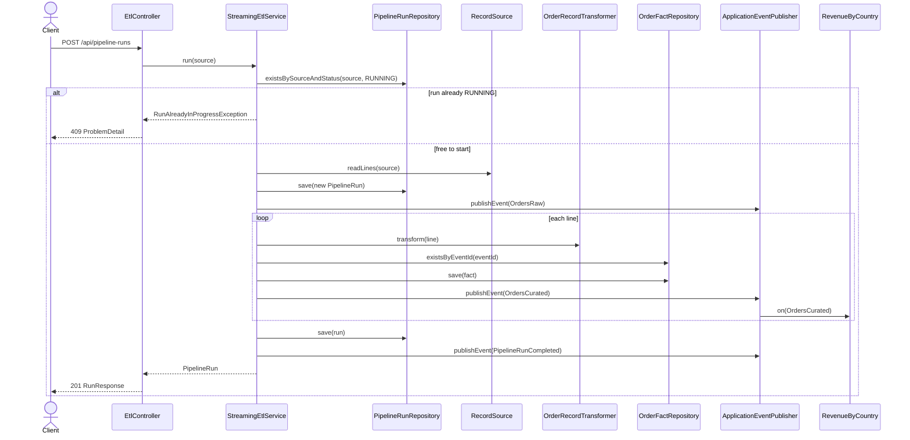
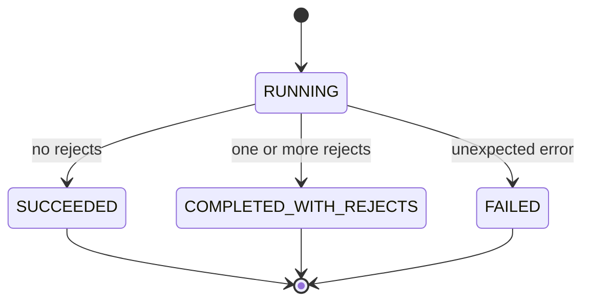
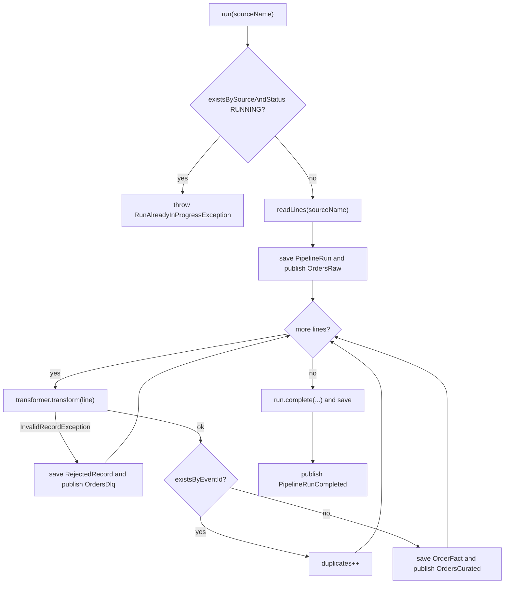

# Real-Time Streaming ETL with Kafka

> **Domain:** Data Engineering · **Author:** [@naveenks720](https://github.com/naveenks720) · **Published:** October 26, 2026

> **Runnable code:** [`examples/data-engineering/real-time-streaming-etl-with-kafka`](https://github.com/dhulipalla599/domain-knowledge-engineering/tree/main/examples/data-engineering/real-time-streaming-etl-with-kafka)

## Explain It Like I'm Five

Picture a juice stand where oranges roll down a little conveyor belt. One helper picks out the bruised oranges and puts them in a "look at later" basket. Another helper washes and peels the good ones, and a third squeezes them into cups. Nobody waits for a whole truckload to arrive: each orange is handled the moment it rolls past, so the first cup of juice is ready in seconds. If the same orange rolls by twice by mistake, the helper notices the sticker and lets it go.

In a company, streaming ETL is that conveyor belt: every order or click is cleaned, checked and stored as it arrives, bad records go to a basket for someone to inspect, and duplicates are ignored, so reports are fresh instead of a day old.

## Business Overview

**ETL** (extract, transform, load) moves data from where it is produced to where it is used. **Streaming ETL** does this continuously, record by record, instead of in a nightly batch. **Apache Kafka** is the usual backbone: producers append events to durable, partitioned, ordered logs called topics, and consumers read them at their own pace and remember their position (the offset).

Why the business cares:

- **Revenue:** dashboards, recommendations and pricing that react in seconds rather than the next morning.
- **Risk:** bad or duplicated records caught at the door instead of polluting finance reports; failures isolated per record rather than failing a whole batch.
- **Regulation:** a replayable, auditable log of what was received and what was rejected supports data-quality and retention obligations (specific rules vary by country and industry).
- **Customer experience:** order status, loyalty points and fraud checks that reflect what just happened.

In the Data Engineering value chain this sits at **ingestion and transformation**: operational systems and apps produce events, the streaming pipeline cleans and conforms them, and the warehouse, serving stores, machine learning features and BI consume the curated result. Streaming does not replace batch everywhere; many teams keep batch for heavy backfills and use streaming where freshness pays for the extra operational effort.

## Real-World Example

The fictional retailer **Harbor & Pine** emits an event for every order placed on its web shop. The data team owns a pipeline that turns the raw feed into curated order facts.

1. Customer Maria Alvarez in the US buys a jacket for 59.90 USD. The shop publishes the line `E-1001,O-5001,C-100,us,59.90,USD,2026-10-20T09:15:00Z` to the topic `orders.raw`.
2. The pipeline extracts the line, upper-cases the country to `US`, converts the amount to 5990 minor units and validates it.
3. The `eventId` `E-1001` has not been seen, so the order is loaded into `order_fact` and published to `orders.curated`.
4. The live revenue view for the US increases by 5990, and the marketing dashboard shows the sale within seconds.
5. The shop's retry logic resends the same event. The pipeline sees `E-1001` already exists and counts a duplicate instead of loading it twice.
6. Another line has an amount of `-12.00`. It is written to the dead-letter topic `orders.dlq` and the `rejected_record` table with the reason, and the batch carries on.
7. The run finishes as `COMPLETED_WITH_REJECTS` with metrics (read, loaded, duplicates, rejected). Data engineer Priya Nair sees the rejects and asks the shop team to fix the producer.

## Stakeholders

| Stakeholder | What they need | What they fear |
|---|---|---|
| Data engineer (pipeline owner) | Reliable, observable runs; easy replay; clear reject reasons | Silent data loss, poison messages that block the stream, 3 a.m. pages |
| Analyst / BI user | Fresh, correct, deduplicated facts | Dashboards that disagree with finance or double count |
| Source system owner (web shop team) | Feedback on bad events without being blocked by the pipeline | Pipeline outages slowing down checkout |
| Platform / SRE engineer | Predictable capacity, lag alerts, safe deployments | Consumer lag spirals, broker disk full, runaway reprocessing |
| Data governance / compliance officer | Lineage, audit of rejects, retention controls | Personal data copied without control, unexplained numbers |

## Use Case Diagram



| Use Case | Primary Actor | Goal | Main success outcome |
|---|---|---|---|
| Start pipeline run | Data engineer | Process a source now | A run record is created and the run finishes with metrics |
| Validate and transform records | Data engineer | Only clean, conformed data is loaded | Codes normalised, amounts in minor units |
| Load curated orders | Data engineer | Persist valid, new orders | Rows in `order_fact`, event on `orders.curated` |
| Dead-letter bad records | Data engineer | Isolate bad input without stopping the stream | Row in `rejected_record`, event on `orders.dlq` |
| Review rejected records | Source system owner | Understand and fix producer problems | Reject list with raw line and reason |
| Query live revenue | Analyst | See current totals per country | Fresh totals reflecting recent events |
| Monitor run metrics | Platform engineer | Detect failures and stalls early | Run status and counts visible |
| Replay a source | Data engineer | Reprocess safely after a fix | Duplicates skipped, only missing data loaded |

## Key Terms

| Term | Plain-English meaning |
|---|---|
| Topic | A named, append-only log of events in Kafka |
| Partition | A slice of a topic; order is guaranteed only within one partition |
| Offset | A consumer's position in a partition |
| Consumer group | Consumers sharing the work of a topic; each partition is read by one member of the group |
| Consumer lag | How far the consumer is behind the newest event |
| Delivery semantics | At-most-once, at-least-once or exactly-once handling of each event |
| Idempotency | Processing the same event twice has the same effect as once |
| Dead-letter queue (DLQ) | A place for records that cannot be processed, kept for inspection and replay |
| Schema registry | A service that stores and checks event schemas so producers and consumers stay compatible |
| Watermark | In stream processing, the point up to which event time is considered complete |
| Backpressure | A slow stage causing upstream stages to slow down or buffer |
| Minor units | Money stored as integers (cents) to avoid floating point errors |

## Process Flow

A run is triggered by an operator or a schedule. The pipeline refuses to start if a run for the same source is still in progress. It extracts the raw lines, then handles each one independently: transform and validate, skip it if its `eventId` was already loaded, otherwise load it and emit a curated event. A line that fails validation is dead-lettered, never allowed to fail the batch. At the end the run is closed with its metrics and a completion event is emitted. An unexpected infrastructure error marks the run `FAILED`.





## Business Rules and Edge Cases

- **Idempotency by event id.** Producers retry and operators replay. Deduplicate on a stable `eventId`, backed by a unique constraint, not only by an application check.
- **One bad record must not stop the stream.** Validation failures go to a dead-letter store with the raw payload and reason. A "poison pill" that crashes the consumer in a loop blocks every record behind it.
- **Money is integers.** Convert to minor units with exact decimal arithmetic, and reject amounts with sub-cent precision. Currency exponents differ (JPY has none, some currencies have three), so a production system uses a currency table rather than assuming two decimals.
- **Event time versus processing time.** Orders arrive late and out of order. Aggregate by the time the event happened, and define how late is too late.
- **Ordering is per partition.** Key events by `orderId` so all events of one order stay in order; there is no global ordering across partitions.
- **Delivery guarantees.** Kafka consumers are usually at-least-once. Commit the offset only after the load succeeds, and make the load idempotent so reprocessing is safe. Exactly-once processing exists inside Kafka (transactions) but ends at the boundary with an external database.
- **Only one run per source at a time.** Two concurrent runs over the same file or partition set can race on duplicates and double count metrics.
- **Partial failure.** A crash after the database insert but before the offset commit is normal; the replay must be harmless.
- **Schema evolution.** Producers add fields. Use a schema registry with compatibility rules so a new field does not break consumers.
- **Personal data.** Retention, masking and deletion duties apply to topics and to every copy downstream; rules differ by country.

## From Business to System

| Business concept / step | System component | Data entity | Event |
|---|---|---|---|
| Raw order feed | Source adapter (Kafka consumer on `orders.raw`) | Raw line | `orders.raw` |
| Run a pipeline | `StreamingEtlService` | `pipeline_run` | `pipeline.run-completed` |
| Clean and validate | `OrderRecordTransformer` | Parsed order | none |
| Curated order | Loader in `StreamingEtlService` | `order_fact` | `orders.curated` |
| Bad record | Dead-letter handler | `rejected_record` | `orders.dlq` |
| Duplicate protection | Unique `event_id` plus existence check | `order_fact.event_id` | none |
| Live revenue | `RevenueByCountry` consumer | In-memory or serving table | consumes `orders.curated` |
| Run monitoring | Metrics on the run row, CloudWatch | `pipeline_run` counters | `pipeline.run-completed` |

## Architecture



The shop owns `orders.raw` and only the pipeline reads it, so producer teams are never blocked by consumers. The ETL service owns three things: the transformation rules, the `pipeline_run`, `order_fact` and `rejected_record` tables, and the topics it produces. Downstream consumers such as the serving service and the warehouse loader read `orders.curated` through their own consumer groups, so a slow consumer cannot slow the pipeline. Dead letters have their own topic and table because they have a different audience (producers and data engineers) and retention from curated data. The REST API is a thin control plane for starting runs and inspecting results; it does not sit on the hot path of the stream.

## Data Model

```sql
CREATE TABLE pipeline_run (
    id                 BIGSERIAL PRIMARY KEY,
    source             TEXT        NOT NULL,
    status             TEXT        NOT NULL CHECK (status IN ('RUNNING','SUCCEEDED','COMPLETED_WITH_REJECTS','FAILED')),
    started_at         TIMESTAMPTZ NOT NULL DEFAULT now(),
    finished_at        TIMESTAMPTZ,
    records_read       INT NOT NULL DEFAULT 0,
    records_loaded     INT NOT NULL DEFAULT 0,
    duplicates_skipped INT NOT NULL DEFAULT 0,
    records_rejected   INT NOT NULL DEFAULT 0
);
-- at most one active run per source, enforced by the database
CREATE UNIQUE INDEX one_running_run_per_source ON pipeline_run (source) WHERE status = 'RUNNING';

CREATE TABLE order_fact (
    id           BIGSERIAL PRIMARY KEY,
    event_id     TEXT        NOT NULL UNIQUE,
    order_id     TEXT        NOT NULL,
    customer_id  TEXT        NOT NULL,
    country      CHAR(2)     NOT NULL,
    amount_cents BIGINT      NOT NULL CHECK (amount_cents > 0),
    currency     CHAR(3)     NOT NULL,
    occurred_at  TIMESTAMPTZ NOT NULL
);
CREATE INDEX order_fact_occurred_at ON order_fact (occurred_at);

CREATE TABLE rejected_record (
    id        BIGSERIAL PRIMARY KEY,
    run_id    BIGINT NOT NULL REFERENCES pipeline_run (id),
    raw_line  TEXT   NOT NULL,
    reason    TEXT   NOT NULL
);
```



`order_fact` is not linked to a run on purpose: a fact is identified by its `event_id`, so a replay in a later run must not create a second copy.

## APIs

| Method | Path | Purpose |
|---|---|---|
| POST | `/api/pipeline-runs` | Start a run for a source and return its summary |
| GET | `/api/pipeline-runs` | List runs, newest first, with metrics |
| GET | `/api/pipeline-runs/{id}/rejects` | List dead-lettered lines and reasons for a run |
| GET | `/api/revenue` | Revenue per country in minor units |

Errors use RFC 9457 problem details: 404 for an unknown source, 409 when a run is already in progress, 400 for a blank source.

Request `POST /api/pipeline-runs`:

```json
{ "source": "orders-batch-1" }
```

Response `201 Created`:

```json
{
  "runId": 2,
  "source": "orders-batch-1",
  "status": "COMPLETED_WITH_REJECTS",
  "recordsRead": 10,
  "recordsLoaded": 4,
  "duplicatesSkipped": 2,
  "recordsRejected": 4
}
```

## Events

| Event | Producer | Consumers | Key fields |
|---|---|---|---|
| `orders.raw` | Web shop (extract adapter in the example) | ETL service | `runId`, `source`, `lineCount` in the example; raw payload in production |
| `orders.curated` | ETL service | Serving service, warehouse loader, `RevenueByCountry` | `eventId`, `orderId`, `country`, `currency`, `amountCents` |
| `orders.dlq` | ETL service | Alerting, data engineers | `runId`, `rawLine`, `reason` |
| `pipeline.run-completed` | ETL service | Monitoring, orchestration | `runId`, `status`, `loaded`, `duplicates`, `rejected` |

**Ordering:** key `orders.curated` and `orders.dlq` by `orderId` so events of one order land in one partition and stay ordered; ordering across orders is not guaranteed. **Idempotency:** consumers are at-least-once, so every consumer must tolerate repeats, using `eventId` as the idempotency key. Version the schemas in a registry and add fields compatibly.

## Backend Implementation

> The Java tab is the exact code from the runnable example (Spring Boot 3). The Python tab uses FastAPI with SQLAlchemy, and the Node.js tab uses Express with TypeScript.

Full source: [`examples/data-engineering/real-time-streaming-etl-with-kafka`](https://github.com/dhulipalla599/domain-knowledge-engineering/tree/main/examples/data-engineering/real-time-streaming-etl-with-kafka/src/main/java/com/dke/data_engineering/real_time_streaming_etl_with_kafka).

### The key rules: one run per source, dead-letter bad lines, skip duplicates

=== "Java"

    ```java
    public PipelineRun run(String sourceName) {
        if (runs.existsBySourceAndStatus(sourceName, RunStatus.RUNNING)) {
            throw new RunAlreadyInProgressException(sourceName);
        }
        List<String> lines = source.readLines(sourceName);
        PipelineRun run = runs.save(new PipelineRun(sourceName));
        events.publishEvent(new OrdersRaw(run.getId(), sourceName, lines.size()));

        int loaded = 0, duplicates = 0, rejected = 0;
        try {
            for (String line : lines) {
                try {
                    OrderFact fact = transformer.transform(line);
                    if (facts.existsByEventId(fact.getEventId())) {
                        duplicates++;
                        continue;
                    }
                    facts.save(fact);
                    loaded++;
                    events.publishEvent(new OrdersCurated(run.getId(), fact.getEventId(), fact.getOrderId(),
                            fact.getCountry(), fact.getCurrency(), fact.getAmountCents()));
                } catch (InvalidRecordException e) {
                    rejected++;
                    rejects.save(new RejectedRecord(run.getId(), line, e.getMessage()));
                    events.publishEvent(new OrdersDlq(run.getId(), line, e.getMessage()));
                }
            }
            run.complete(lines.size(), loaded, duplicates, rejected);
        } catch (RuntimeException e) {
            run.fail();
            runs.save(run);
            throw e;
        }
        runs.save(run);
        events.publishEvent(new PipelineRunCompleted(run.getId(), run.getStatus(), loaded, duplicates, rejected));
        return run;
    }
    ```

=== "Python"

    ```python
    def run(self, source_name: str) -> PipelineRun:
        if self.db.query(PipelineRun).filter_by(source=source_name, status="RUNNING").first():
            raise RunAlreadyInProgress(source_name)
        lines = self.source.read_lines(source_name)
        run = PipelineRun(source=source_name)
        self.db.add(run)
        self.db.commit()
        self.events.publish("orders.raw", {"runId": run.id, "source": source_name, "lineCount": len(lines)})

        loaded = duplicates = rejected = 0
        try:
            for line in lines:
                try:
                    fact = self.transformer.transform(line)
                    if self.db.query(OrderFact).filter_by(event_id=fact.event_id).first():
                        duplicates += 1
                        continue
                    self.db.add(fact)
                    self.db.commit()
                    loaded += 1
                    self.events.publish("orders.curated", {"runId": run.id, "eventId": fact.event_id,
                        "orderId": fact.order_id, "country": fact.country,
                        "currency": fact.currency, "amountCents": fact.amount_cents})
                except InvalidRecord as e:
                    rejected += 1
                    self.db.add(RejectedRecord(run_id=run.id, raw_line=line, reason=str(e)))
                    self.db.commit()
                    self.events.publish("orders.dlq", {"runId": run.id, "rawLine": line, "reason": str(e)})
            run.complete(len(lines), loaded, duplicates, rejected)
        except Exception:
            run.fail()
            self.db.commit()
            raise
        self.db.commit()
        self.events.publish("pipeline.run-completed", {"runId": run.id, "status": run.status,
            "loaded": loaded, "duplicates": duplicates, "rejected": rejected})
        return run
    ```

=== "Node.js"

    ```typescript
    async run(sourceName: string): Promise<PipelineRun> {
      if (await this.runs.existsBy({ source: sourceName, status: "RUNNING" })) {
        throw new RunAlreadyInProgress(sourceName);
      }
      const lines = await this.source.readLines(sourceName);
      const run = await this.runs.save(new PipelineRun(sourceName));
      this.events.publish("orders.raw", { runId: run.id, source: sourceName, lineCount: lines.length });

      let loaded = 0, duplicates = 0, rejected = 0;
      try {
        for (const line of lines) {
          try {
            const fact = this.transformer.transform(line);
            if (await this.facts.existsByEventId(fact.eventId)) {
              duplicates++;
              continue;
            }
            await this.facts.save(fact);
            loaded++;
            this.events.publish("orders.curated", { runId: run.id, eventId: fact.eventId,
              orderId: fact.orderId, country: fact.country,
              currency: fact.currency, amountCents: fact.amountCents });
          } catch (e) {
            if (!(e instanceof InvalidRecord)) throw e;
            rejected++;
            await this.rejects.save({ runId: run.id, rawLine: line, reason: e.message });
            this.events.publish("orders.dlq", { runId: run.id, rawLine: line, reason: e.message });
          }
        }
        run.complete(lines.length, loaded, duplicates, rejected);
      } catch (e) {
        run.fail();
        await this.runs.save(run);
        throw e;
      }
      await this.runs.save(run);
      this.events.publish("pipeline.run-completed", { runId: run.id, status: run.status,
        loaded, duplicates, rejected });
      return run;
    }
    ```

### The controller endpoint

=== "Java"

    ```java
    @PostMapping("/pipeline-runs")
    @ResponseStatus(HttpStatus.CREATED)
    public RunResponse start(@Valid @RequestBody RunRequest request) {
        return RunResponse.from(etl.run(request.source()));
    }
    ```

=== "Python"

    ```python
    @router.post("/api/pipeline-runs", status_code=201, response_model=RunResponse)
    def start(request: RunRequest, etl: StreamingEtlService = Depends(get_etl)):
        return RunResponse.from_run(etl.run(request.source))
    ```

=== "Node.js"

    ```typescript
    router.post("/api/pipeline-runs", async (req, res, next) => {
      try {
        const { source } = RunRequest.parse(req.body); // zod: non-blank string
        res.status(201).json(RunResponse.from(await etl.run(source)));
      } catch (e) {
        next(e); // error middleware maps to 404, 409 or 400 problem details
      }
    });
    ```

The rule that a run cannot leave a terminal state lives in the domain class, as an enum of legal transitions:

```java
public enum RunStatus {
    RUNNING, SUCCEEDED, COMPLETED_WITH_REJECTS, FAILED;

    public Set<RunStatus> allowedNext() {
        return this == RUNNING ? Set.of(SUCCEEDED, COMPLETED_WITH_REJECTS, FAILED) : Set.of();
    }

    public boolean canTransitionTo(RunStatus next) {
        return allowedNext().contains(next);
    }
}
```

## Frontend Screen

A pipeline console: operators pick a source, start a run and see the metrics and the live revenue.

```tsx
import { useEffect, useState } from "react";

type Run = {
  runId: number; source: string; status: string;
  recordsRead: number; recordsLoaded: number; duplicatesSkipped: number; recordsRejected: number;
};

export function PipelineConsole() {
  const [source, setSource] = useState("orders-batch-1");
  const [runs, setRuns] = useState<Run[]>([]);
  const [revenue, setRevenue] = useState<Record<string, number>>({});
  const [error, setError] = useState<string | null>(null);

  const refresh = async () => {
    setRuns(await (await fetch("/api/pipeline-runs")).json());
    setRevenue(await (await fetch("/api/revenue")).json());
  };
  useEffect(() => { refresh(); }, []);

  const start = async () => {
    setError(null);
    const res = await fetch("/api/pipeline-runs", {
      method: "POST",
      headers: { "Content-Type": "application/json" },
      body: JSON.stringify({ source }),
    });
    if (!res.ok) setError((await res.json()).detail); // ProblemDetail
    await refresh();
  };

  return (
    <main>
      <h1>Order pipeline</h1>
      <input value={source} onChange={(e) => setSource(e.target.value)} aria-label="Source" />
      <button onClick={start}>Run</button>
      {error && <p role="alert">{error}</p>}
      <table>
        <thead><tr><th>Run</th><th>Source</th><th>Status</th><th>Loaded</th><th>Duplicates</th><th>Rejected</th></tr></thead>
        <tbody>
          {runs.map((r) => (
            <tr key={r.runId}>
              <td>{r.runId}</td><td>{r.source}</td><td>{r.status}</td>
              <td>{r.recordsLoaded}</td><td>{r.duplicatesSkipped}</td><td>{r.recordsRejected}</td>
            </tr>
          ))}
        </tbody>
      </table>
      <h2>Revenue (minor units)</h2>
      <ul>{Object.entries(revenue).map(([c, v]) => <li key={c}>{c}: {v}</li>)}</ul>
    </main>
  );
}
```

## Cloud Deployment

The ETL service runs as a Deployment on **Amazon EKS**. **Amazon MSK** provides managed Kafka, **Amazon RDS for PostgreSQL** holds runs, facts and rejects, **AWS Secrets Manager** holds credentials, and **Amazon ECR** stores images. Terraform defines everything; a minimal MSK cluster looks like this:

```hcl
resource "aws_msk_cluster" "events" {
  cluster_name           = "harbor-pine-events"
  kafka_version          = "3.6.0"
  number_of_broker_nodes = 3

  broker_node_group_info {
    instance_type   = "kafka.m5.large"
    client_subnets  = var.private_subnet_ids
    security_groups = [aws_security_group.msk.id]
    storage_info {
      ebs_storage_info { volume_size = 500 }
    }
  }

  encryption_info {
    encryption_in_transit {
      client_broker = "TLS"
      in_cluster    = true
    }
  }
}
```

- **Security:** brokers and RDS in private subnets; TLS in transit; encryption at rest with KMS; IAM roles for service accounts so pods get least-privilege access; MSK authentication through IAM or mTLS; a topic ACL per producer and consumer group.
- **Scaling:** scale ETL pods with a horizontal pod autoscaler or KEDA on consumer lag; the number of partitions caps useful consumers in a group, so size partitions for the peak.
- **Observability:** instrument with OpenTelemetry (traces across consume, transform and load; metrics for records per second, rejects, run duration, lag) and export to CloudWatch; alarm on consumer lag, DLQ rate and `FAILED` runs.
- **Delivery:** deploy with rolling updates and a pod disruption budget; consumers rebalance when pods restart, so processing must be idempotent.

## Non-Functional Requirements

| Concern | Expectation | How the design meets it |
|---|---|---|
| Availability | Pipeline survives a pod or broker loss | Multi-AZ MSK with replication factor 3, several consumer pods, offsets committed after load |
| Latency | Curated data within seconds of the event (a target the business sets) | Record-at-a-time processing, no batch window, lag alarms |
| Consistency | No lost or double-counted orders | At-least-once delivery plus idempotent load on a unique `event_id` |
| Throughput | Handle peak sale traffic | Partition by `orderId`, scale consumers up to the partition count |
| Audit | Explain every number | Run metrics, dead letters with raw payload and reason, immutable topic retention |
| Compliance | Control personal data in topics and copies | Minimise fields, encrypt, define retention and deletion paths; rules vary by country |
| Operability | Safe replay and clear failure signals | Replay is idempotent, DLQ and run status are monitored |

## Runnable Example

The example is a small in-process version of this pipeline. It reads CSV order files from `src/main/resources/sample-data/`, transforms and validates each line, loads valid new orders into H2, dead-letters bad lines, skips duplicates and records metrics per run. Spring application events named after the Kafka topics stand in for the broker, and a scheduled job (disabled by default) can trigger the same flow. It needs no external services.

Source: [`examples/data-engineering/real-time-streaming-etl-with-kafka`](https://github.com/dhulipalla599/domain-knowledge-engineering/tree/main/examples/data-engineering/real-time-streaming-etl-with-kafka)

```bash
cd examples/data-engineering/real-time-streaming-etl-with-kafka
mvn -B -ntp verify           # build and run the tests
mvn spring-boot:run          # start on http://localhost:8080
```

Run batch 1 (10 lines: 4 valid, 2 duplicates, 4 invalid):

```bash
curl -s -X POST localhost:8080/api/pipeline-runs -H 'Content-Type: application/json' -d '{"source":"orders-batch-1"}'
```

```json
{"runId":2,"source":"orders-batch-1","status":"COMPLETED_WITH_REJECTS","recordsRead":10,"recordsLoaded":4,"duplicatesSkipped":2,"recordsRejected":4}
```

An unknown source is rejected:

```bash
curl -s -X POST localhost:8080/api/pipeline-runs -H 'Content-Type: application/json' -d '{"source":"nope"}'
```

```json
{"type":"about:blank","title":"Not Found","status":404,"detail":"Unknown source: nope","instance":"/api/pipeline-runs"}
```

| Class | Package | Responsibility |
|---|---|---|
| `EtlController` | `api` | REST endpoints for runs, rejects and revenue |
| `ApiExceptionHandler` | `api` | Maps rule violations to `ProblemDetail` (404, 409, 400) |
| `RunRequest`, `RunResponse` | `api` | Request and response records |
| `StreamingEtlService` | `service` | Orchestrates the pipeline and enforces the business rules |
| `OrderRecordTransformer` | `service` | Parses and validates one line into an `OrderFact` |
| `RecordSource` | `service` | Extract port; the stub reads files, production reads Kafka |
| `PipelineRun`, `OrderFact`, `RejectedRecord` | `domain` | JPA entities; `PipelineRun` guards its transitions |
| `RunStatus`, `DomainEvents` | `domain` | Lifecycle enum and topic-named events |
| `PipelineRunRepository`, `OrderFactRepository`, `RejectedRecordRepository` | `repository` | Spring Data repositories |
| `ClasspathRecordSource` | `integration` | Reads `sample-data/{source}.csv` |
| `RevenueByCountry`, `DeadLetterLogger` | `integration` | `@EventListener` consumers |
| `ScheduledEtlRunner` | `integration` | Optional `@Scheduled` trigger |

## UML Diagrams

### Class Diagram

The controller delegates to the service, which uses the source port, the transformer and the repositories, and publishes events that the listeners consume.



### Sequence Diagram (control flow)

One request through the code. The `alt` shows the rule violation where a run is already in progress; invalid lines are handled inside the loop.



### State Diagram

A run starts `RUNNING` and ends in exactly one terminal state, which `RunStatus.canTransitionTo` enforces.



### Activity Diagram

The decision logic inside `StreamingEtlService.run`.



## AI Opportunities

1. **Schema and anomaly detection on the stream.** Use: flag unusual amounts, volumes or new field patterns before they reach the warehouse. Data: historical curated orders and reject rates. Risk: false alarms or missed drift; keep a human-reviewed threshold and measure precision.
2. **Automatic triage of dead letters.** Use: an LLM agent groups rejects by cause and drafts a ticket for the producer team. Data: raw rejected lines (which may contain personal data), reasons and schemas. Risk: leaking personal data to a model and wrong diagnoses; mask data first, keep the agent read-only and require human approval for fixes.
3. **Lag and capacity forecasting.** Use: predict consumer lag and partition needs before a sale peak. Data: lag, throughput and calendar history. Risk: unusual events break the forecast; keep autoscaling guardrails and manual overrides.
4. **Data quality rule suggestion.** Use: propose validation rules from observed data and past rejects. Data: sample records and incident history. Risk: overly strict rules that drop valid data; rules are reviewed and rolled out in shadow mode first.
5. **Entity matching and enrichment.** Use: resolve customers or products across feeds with ML matching. Data: identifiers and attributes from several sources. Risk: wrong merges and bias; log match confidence and allow explanation and correction.

## Common Pitfalls

- **Assuming exactly-once everywhere.** Design for at-least-once and make the sink idempotent with a unique key.
- **Committing offsets before the load.** A crash then loses data; commit after the write succeeds.
- **No dead-letter path.** One malformed record stalls the partition; isolate bad records and alert on the DLQ rate.
- **Floating point money.** Use integer minor units or exact decimals.
- **Relying on an application check for uniqueness.** Two consumers can race; add a database unique constraint (the example's check-then-insert is a simplification).
- **Ignoring partition keys.** Wrong keys scramble per-entity ordering or create hot partitions.
- **Unversioned schemas.** A producer adding or renaming a field breaks consumers; use a schema registry and compatibility rules.
- **Treating event time as processing time.** Late events silently land in the wrong window.
- **Unbounded retries.** Retrying a permanently bad record forever; use bounded retries then the DLQ.
- **No replay plan.** Know how to reprocess a topic range safely and test it.

## Interview Questions

### Junior

1. **What is a Kafka topic and a partition?** A topic is a named, append-only log of events. It is split into partitions for parallelism; order is guaranteed only within a partition.
2. **Why store money as integer cents?** Floating point cannot represent many decimals exactly, so sums drift. Integers in minor units are exact.
3. **What is a dead-letter queue?** A place for records that cannot be processed, kept with the reason so engineers can inspect and replay them without blocking the stream.

### Mid-Level

1. **How do you make a consumer idempotent?** Use a stable event id as an idempotency key and a unique constraint in the sink (or an upsert), so processing twice has the same effect as once; commit offsets after the write.
2. **A consumer group has 12 pods but a topic has 6 partitions. What happens?** Only 6 pods receive work; the rest sit idle, because a partition is read by one consumer in the group. Increase partitions, not pods, to scale further.
3. **How do you handle a record that fails validation?** Catch it per record, write it with the raw payload and reason to a DLQ topic or table, emit a metric, continue, and alert when the reject rate rises.

### Senior / Architect

1. **Design the pipeline so a six-hour outage loses nothing and the backlog drains safely.** Key points: Kafka retention longer than the worst outage; offsets committed after load; idempotent sink; autoscaling on lag with a cap that protects the database; backpressure and rate limits; monitoring of lag and drain time; downstream consumers isolated by group.
2. **Exactly-once end to end versus at-least-once with idempotent sinks: which do you choose?** Key points: Kafka transactions give exactly-once within Kafka but not across an external database; idempotent writes are simpler and more portable; use transactions or an outbox where the sink cannot dedupe; cost in latency and complexity.
3. **How would you evolve the event schema with many independent consumers?** Key points: schema registry with backward or forward compatibility rules; additive changes first; deprecation windows; contract tests; versioned topics for breaking changes; dual publishing during migration; communicating through data contracts.

## Further Learning

- Apache Kafka fundamentals: topics, partitions, consumer groups, offsets
- Kafka delivery semantics, idempotent producers and transactions
- Kafka Streams and Apache Flink for stateful stream processing
- Schema registry with Avro or Protobuf, and compatibility rules
- Kafka Connect and Debezium for moving data in and out
- The transactional outbox pattern
- Data contracts and data quality testing
- OpenTelemetry for pipeline observability

## Practitioner Notes

> _Reviewer: add real-world experience, corrections or gotchas here before approving._
