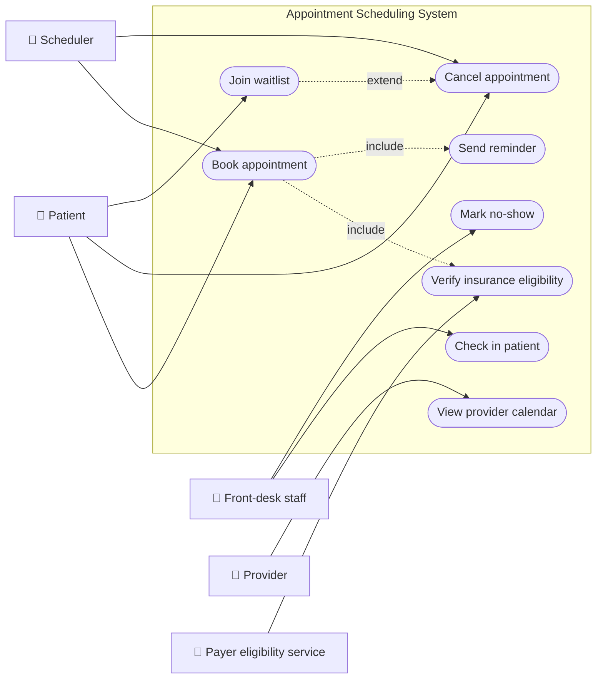
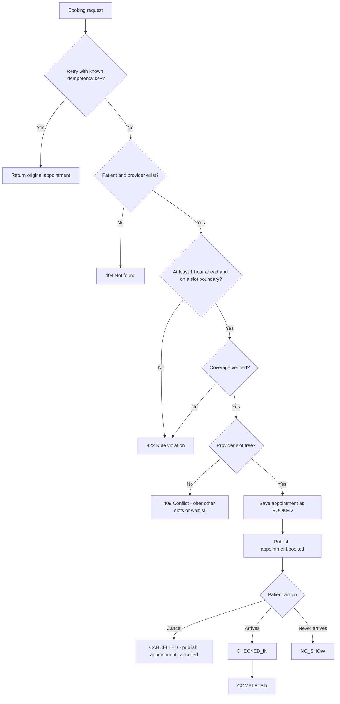
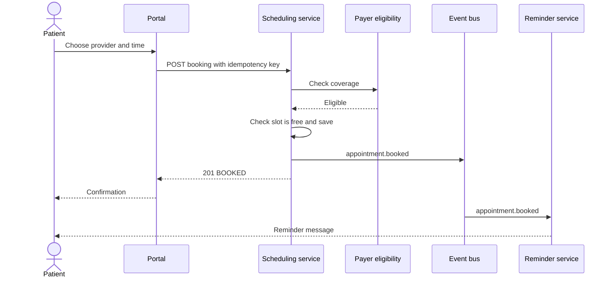
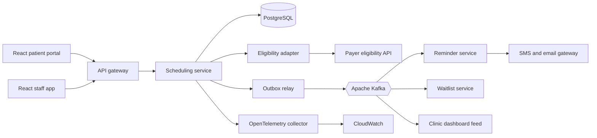
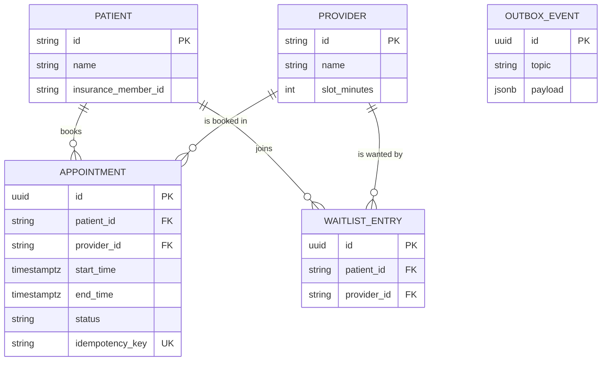
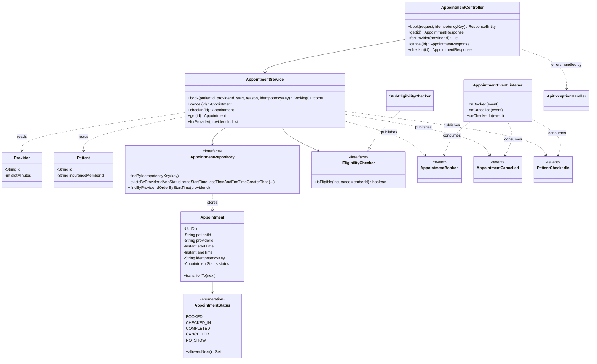
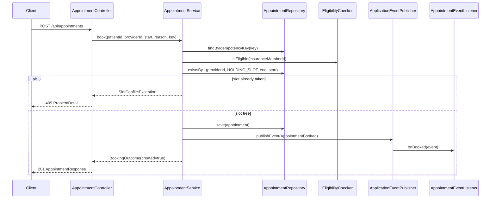
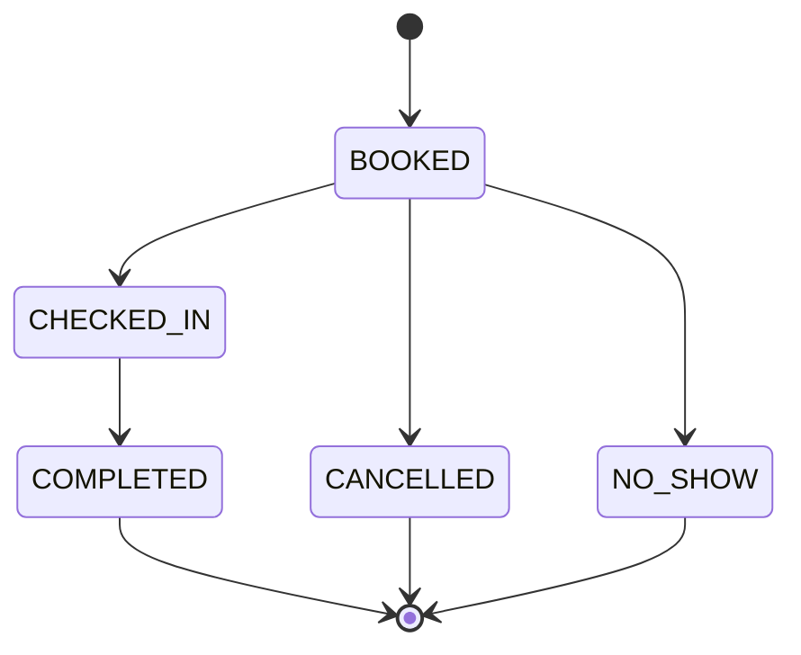
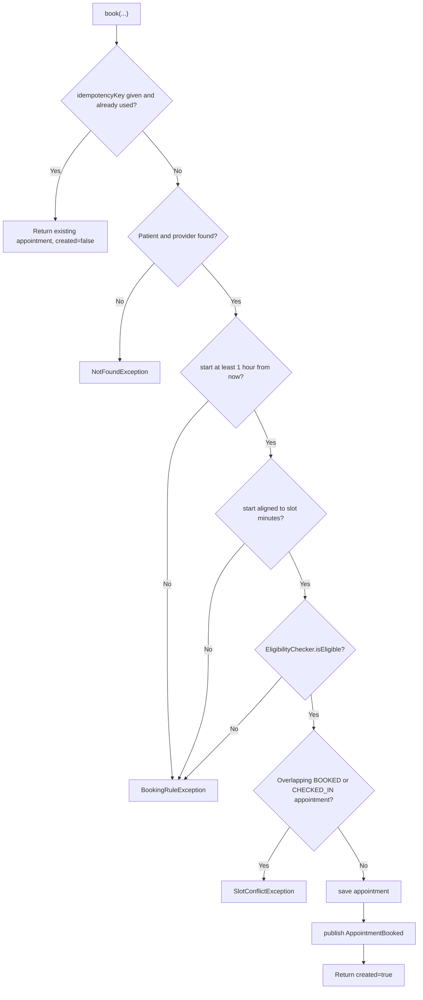

# Appointment Scheduling

> **Domain:** Healthcare · **Author:** [@naveenks720](https://github.com/naveenks720) · **Published:** October 22, 2026

> **Runnable code:** [`examples/healthcare/appointment-scheduling`](https://github.com/dhulipalla599/domain-knowledge-engineering/tree/main/examples/healthcare/appointment-scheduling)

## Explain It Like I'm Five

Imagine a playground with one swing and lots of children who want a turn. The teacher keeps a sign-up sheet with time boxes: 9:00, 9:30, 10:00. Each child writes their name in one box, and nobody else may write in a box that is already taken. If a child cannot come, they rub out their name so a friend can have the turn. The teacher also needs to make sure the child really goes to the swing at the right time, or the box is wasted.

In a clinic, the swing is the doctor's time, the sign-up sheet is the appointment schedule, and the system's job is to make sure each time box goes to exactly one patient and is used well.

## Business Overview

**Appointment scheduling** is the capability that lets patients, call-centre agents and referring clinicians find and reserve time with a provider (a doctor, nurse practitioner, therapist or a piece of equipment such as an MRI scanner), and then manage that booking until the visit happens.

Why the business cares:

- **Revenue.** A provider's hour that goes unused cannot be sold again. No-shows and late cancellations leave empty slots, so scheduling teams use reminders, waitlists and (where policy allows) overbooking to keep calendars full.
- **Patient experience and access.** Long waits and phone-tag are common complaints. Self-service booking, reminders and easy rescheduling improve satisfaction and attendance.
- **Clinical risk.** Delays in follow-up for urgent conditions can harm patients, so schedulers often triage by visit type and urgency.
- **Regulation and privacy.** Appointment data reveals that a person is a patient of a given clinic or specialty, which is protected health information in many jurisdictions (for example under HIPAA in the United States or GDPR in the EU). Access must be limited and audited, and rules differ by country.
- **Payer rules.** Some insurers or national schemes require eligibility checks or referrals before certain visits.

In the healthcare value chain, scheduling sits at the front of the patient journey: scheduling, registration, check-in, clinical care, coding, billing and follow-up. It depends on patient identity (see [Patient Registration and Master Patient Index](patient-registration-and-master-patient-index.md)) and feeds registration, the electronic health record, billing and capacity planning.

## Real-World Example

Fictional company: **Riverbend Health Network**, with a family-medicine clinic and a cardiology practice.

1. **Monday, 09:10.** Amara Okafor opens the Riverbend patient portal and asks for an annual check-up with Dr. Mei Chen. The portal shows open 30-minute slots and she picks Thursday 09:00.
2. The scheduling service checks that Thursday 09:00 is at least an hour away and aligned to Dr. Chen's 30-minute slots, asks the payer eligibility service whether Amara's coverage is active, and confirms Dr. Chen has nothing overlapping. It saves the appointment as `BOOKED` and publishes `appointment.booked`.
3. The reminder service sends Amara a text message three days before and one day before.
4. Her phone's network drops after she taps "Book", so the portal retries the same request with the same idempotency key. The service returns the original appointment instead of a second one.
5. **Tuesday.** Amara has a work trip and cancels. Because the visit is more than 24 hours away, it is a normal cancellation. The service sets `CANCELLED` and publishes `appointment.cancelled`; the waitlist service offers the slot to Jonas Weber, who was waiting for any time that week.
6. Had she cancelled two hours before the visit, the event would carry `lateCancellation = true` and the clinic's policy might record it for a fee or for future booking limits (policies vary by organisation and country).

## Stakeholders

| Stakeholder | What they need | What they fear |
|---|---|---|
| Patient | Easy booking, a time that suits them, reminders, simple rescheduling | Wasted trips, long waits, a visit that was silently lost |
| Scheduler / call-centre agent | A clear view of availability and fast rebooking | Double bookings, angry patients, slow screens |
| Provider (clinician) | A full, sensible calendar with the right visit lengths | Gaps from no-shows, back-to-back overload, wrong visit types |
| Front-desk / check-in staff | Accurate day lists and quick check-in | Patients on the list who are not in the system |
| Revenue cycle / billing team | Verified coverage and correct visit codes at booking | Claim denials caused by missed eligibility or referral rules |
| Practice manager | Utilisation, no-show and wait-time metrics | Idle capacity, complaints |
| Privacy and compliance officer | Least-privilege access and an audit trail | Breach of appointment data, failed audit |
| Payer eligibility service (external) | Well-formed requests within its limits | Being overloaded by retries |

## Use Case Diagram



| Use Case | Primary Actor | Goal | Main success outcome |
|---|---|---|---|
| Book appointment | Patient or scheduler | Reserve a provider slot | Appointment in `BOOKED` status and `appointment.booked` published |
| Verify insurance eligibility | Payer eligibility service | Confirm active coverage before the slot is held | Eligibility answer used by the booking rule |
| Cancel appointment | Patient or scheduler | Release a slot that will not be used | Status `CANCELLED`, slot freed, late-cancellation flag set when applicable |
| Check in patient | Front-desk staff | Record arrival | Status `CHECKED_IN` and clinic dashboard updated |
| View provider calendar | Provider | See the day's patients | Ordered list of appointments |
| Join waitlist | Patient | Be offered an earlier slot | Patient offered freed slots in order |
| Send reminder | System | Reduce no-shows | Reminder delivered through the patient's preferred channel |
| Mark no-show | Front-desk staff | Record a missed visit | Status `NO_SHOW` and the slot reported as lost capacity |

## Key Terms

| Term | Plain-English meaning |
|---|---|
| Provider | The clinician or resource whose time is being booked |
| Slot | A fixed block of provider time that can hold one appointment |
| Visit type | The kind of visit (new patient, follow-up, procedure) that decides how long it takes |
| No-show | A patient who neither attends nor cancels |
| Late cancellation | A cancellation inside the clinic's notice window (24 hours in this example; policies vary) |
| Overbooking | Deliberately booking more patients than slots, based on expected no-shows |
| Waitlist | Patients who want an earlier slot and are offered cancellations |
| Eligibility check | Asking the payer whether the patient's coverage is active (in the US, an X12 270/271 transaction) |
| Referral / prior authorisation | Approval a payer may require before a specialist visit or procedure |
| Check-in | The arrival step at the front desk or by kiosk or app |
| Template (availability) | The weekly pattern of when a provider works and with which visit types |
| Idempotency key | A client-chosen identifier that makes a retried request safe |

## Process Flow

A request arrives from the portal, call centre or a referral. The system validates the patient and provider, applies timing and slot rules, checks insurance, confirms the slot is free and saves the appointment. Events trigger reminders. Before the visit the patient may cancel (freeing the slot for the waitlist), or on the day they are checked in and seen. If they never arrive, front-desk staff mark a no-show, which feeds utilisation reports.





## Business Rules and Edge Cases

- **No double booking.** Two requests for the same provider and time can arrive at the same moment. A check in application code is not enough on its own; the database must also be able to refuse the overlap (see Data Model).
- **Overlap, not equality.** A 30-minute and a 45-minute visit starting at different times can still overlap. Compare time ranges, not just start times.
- **Lead time and slot alignment.** Booking minutes before the visit, or at 09:07 on a 30-minute grid, creates unusable fragments.
- **Time zones and daylight saving.** Store instants in UTC and the clinic's time zone separately. A "9:00 every Thursday" template must still mean 9:00 local time across a daylight-saving change.
- **Idempotency.** Mobile clients retry. The same key must return the same appointment, not create another. Key lifetime and scoping (per patient or per client) are design choices.
- **Eligibility is time-sensitive and fallible.** Coverage can lapse between booking and visit, and the payer service can be down. Decide whether to block, allow with a warning or re-check at check-in; practices differ by organisation and country.
- **Late cancellation and no-show policies.** Windows and fees are set by each organisation and sometimes by regulation. Keep them configurable and record the facts (timestamps) rather than only the outcome.
- **Legal lifecycle.** A cancelled appointment cannot be checked in, and a completed one cannot be cancelled. Enforce transitions in the domain, not in the UI.
- **Partial failure.** If the appointment is saved but the event is not published, reminders never go out. Use an outbox so the write and the event stay consistent.
- **Privacy.** Reminders over SMS or email must not reveal the specialty or reason unless the patient consented.

## From Business to System

| Business concept / step | System component | Data entity | Event |
|---|---|---|---|
| Book a slot | Scheduling service (`AppointmentService.book`) | `appointment` | `appointment.booked` |
| Retry-safe booking | Idempotency check in scheduling service | `appointment.idempotency_key` | - |
| Verify coverage | Eligibility adapter | none (answer is not stored in the example) | - |
| Slot and provider rules | Scheduling service, provider catalogue | `provider` (slot length) | - |
| Cancel and late cancellation | Scheduling service | `appointment.status` | `appointment.cancelled` |
| Check in | Scheduling service, clinic dashboard | `appointment.status` | `appointment.checked-in` |
| Reminders | Notification service | reminder log | consumes `appointment.booked` |
| Waitlist | Waitlist service | `waitlist_entry` | consumes `appointment.cancelled` |
| Patient identity | Patient service (MPI) | `patient` | - |

## Architecture



The **scheduling service** owns appointments and provider calendars, because the no-double-booking rule needs a single authority and a transactional database. Eligibility sits behind an **adapter** so the slow, unreliable payer call can have its own timeouts and a stub in tests. **Reminders and waitlist** are consumers of events: they can fall behind or fail without ever blocking a booking. Patient identity stays in its own service and is referenced by id only.

## Data Model

```sql
CREATE EXTENSION IF NOT EXISTS btree_gist;

CREATE TABLE provider (
    id            TEXT PRIMARY KEY,
    name          TEXT NOT NULL,
    specialty     TEXT NOT NULL,
    slot_minutes  INT  NOT NULL CHECK (slot_minutes > 0),
    time_zone     TEXT NOT NULL DEFAULT 'UTC'
);

CREATE TABLE patient (
    id                   TEXT PRIMARY KEY,
    name                 TEXT NOT NULL,
    insurance_member_id  TEXT
);

CREATE TABLE appointment (
    id               UUID PRIMARY KEY,
    patient_id       TEXT NOT NULL REFERENCES patient(id),
    provider_id      TEXT NOT NULL REFERENCES provider(id),
    start_time       TIMESTAMPTZ NOT NULL,
    end_time         TIMESTAMPTZ NOT NULL,
    reason           TEXT,
    idempotency_key  TEXT UNIQUE,
    status           TEXT NOT NULL CHECK (status IN ('BOOKED','CHECKED_IN','COMPLETED','CANCELLED','NO_SHOW')),
    version          BIGINT NOT NULL DEFAULT 0,
    CHECK (end_time > start_time),
    -- the database refuses overlapping active appointments for one provider
    EXCLUDE USING gist (
        provider_id WITH =,
        tstzrange(start_time, end_time) WITH &&
    ) WHERE (status IN ('BOOKED','CHECKED_IN'))
);

CREATE TABLE waitlist_entry (
    id           UUID PRIMARY KEY,
    patient_id   TEXT NOT NULL REFERENCES patient(id),
    provider_id  TEXT NOT NULL REFERENCES provider(id),
    earliest     TIMESTAMPTZ NOT NULL,
    latest       TIMESTAMPTZ NOT NULL
);

CREATE TABLE outbox_event (
    id          UUID PRIMARY KEY,
    topic       TEXT NOT NULL,
    event_key   TEXT NOT NULL,
    payload     JSONB NOT NULL,
    created_at  TIMESTAMPTZ NOT NULL DEFAULT now(),
    sent_at     TIMESTAMPTZ
);
```



The runnable example uses H2 and Hibernate-generated tables with the same columns for `provider`, `patient` and `appointment`; the `EXCLUDE` constraint, the waitlist and the outbox are production additions.

## APIs

| Method | Path | Purpose |
|---|---|---|
| POST | `/api/appointments` | Book an appointment (optional `Idempotency-Key` header) |
| GET | `/api/appointments/{id}` | Read one appointment |
| GET | `/api/appointments?providerId=` | List a provider's appointments in time order |
| POST | `/api/appointments/{id}/check-in` | Move `BOOKED` to `CHECKED_IN` |
| POST | `/api/appointments/{id}/cancel` | Move `BOOKED` to `CANCELLED` |

Error responses use RFC 7807 `ProblemDetail`: 404 unknown patient/provider/appointment, 409 slot taken or illegal transition, 422 rule violation, 400 invalid body.

Request: `POST /api/appointments` with header `Idempotency-Key: demo-1`

```json
{
  "patientId": "pat-amara",
  "providerId": "prov-chen",
  "startTime": "2026-10-25T09:00:00Z",
  "reason": "Annual checkup"
}
```

Response `201 Created`:

```json
{
  "id": "03ca631f-c76e-4f8b-8beb-b6c3972c5d95",
  "patientId": "pat-amara",
  "providerId": "prov-chen",
  "startTime": "2026-10-25T09:00:00Z",
  "endTime": "2026-10-25T09:30:00Z",
  "status": "BOOKED",
  "reason": "Annual checkup"
}
```

## Events

| Event (Kafka topic) | Producer | Consumers | Key fields |
|---|---|---|---|
| `appointment.booked` | Scheduling service | Reminder service, clinic dashboard, analytics | `appointmentId`, `patientId`, `providerId`, `startTime` |
| `appointment.cancelled` | Scheduling service | Waitlist service, reminder service (cancel pending reminders), analytics | `appointmentId`, `providerId`, `startTime`, `lateCancellation` |
| `appointment.checked-in` | Scheduling service | Clinic dashboard, registration | `appointmentId`, `providerId` |

**Ordering.** Use the provider id (or the appointment id) as the Kafka message key so events about one appointment stay in order on a partition; a `cancelled` event processed before its `booked` event would leave a stale reminder.

**Idempotency.** Kafka delivers at least once. Consumers must tolerate duplicates, for example by recording processed `appointmentId` plus event type, and the producer should write events through a transactional outbox so a saved booking is never missing its event.

## Backend Implementation

> The Java tab is the runnable example's code. The Python tab uses FastAPI with SQLAlchemy; the Node.js tab uses Express with TypeScript.

Full source: [`examples/healthcare/appointment-scheduling`](https://github.com/dhulipalla599/domain-knowledge-engineering/tree/main/examples/healthcare/appointment-scheduling/src/main/java/com/dke/healthcare/appointment_scheduling).

### Business rule: `AppointmentService.book`

=== "Java"

    ```java
    @Transactional
    public BookingOutcome book(String patientId, String providerId, Instant start, String reason, String idempotencyKey) {
        if (idempotencyKey != null) {
            var existing = appointments.findByIdempotencyKey(idempotencyKey);
            if (existing.isPresent()) {
                return new BookingOutcome(existing.get(), false);
            }
        }
        Patient patient = patients.findById(patientId)
                .orElseThrow(() -> new NotFoundException("Patient " + patientId + " not found"));
        Provider provider = providers.findById(providerId)
                .orElseThrow(() -> new NotFoundException("Provider " + providerId + " not found"));

        if (start.isBefore(clock.instant().plus(MIN_LEAD_TIME))) {
            throw new BookingRuleException("Appointments must be booked at least 1 hour ahead");
        }
        if (start.getEpochSecond() % (provider.getSlotMinutes() * 60L) != 0) {
            throw new BookingRuleException("Start time must align to the provider's "
                    + provider.getSlotMinutes() + "-minute slots");
        }
        if (!eligibility.isEligible(patient.getInsuranceMemberId())) {
            throw new BookingRuleException("Insurance coverage could not be verified for patient " + patientId);
        }
        Instant end = start.plus(Duration.ofMinutes(provider.getSlotMinutes()));
        if (appointments.existsByProviderIdAndStatusInAndStartTimeLessThanAndEndTimeGreaterThan(
                providerId, AppointmentStatus.HOLDING_SLOT, end, start)) {
            throw new SlotConflictException("Provider " + providerId + " is already booked at " + start);
        }

        Appointment saved = appointments.save(new Appointment(patientId, providerId, start, end, reason, idempotencyKey));
        events.publishEvent(new AppointmentBooked(saved.getId(), patientId, providerId, start));
        return new BookingOutcome(saved, true);
    }
    ```

=== "Python"

    ```python
    HOLDING_SLOT = ("BOOKED", "CHECKED_IN")
    MIN_LEAD_TIME = timedelta(hours=1)


    def book(db: Session, patient_id: str, provider_id: str, start: datetime,
             reason: str | None, idempotency_key: str | None) -> tuple[Appointment, bool]:
        if idempotency_key:
            existing = db.scalar(select(Appointment).where(Appointment.idempotency_key == idempotency_key))
            if existing:
                return existing, False
        patient = db.get(Patient, patient_id)
        if patient is None:
            raise NotFoundError(f"Patient {patient_id} not found")
        provider = db.get(Provider, provider_id)
        if provider is None:
            raise NotFoundError(f"Provider {provider_id} not found")

        if start < datetime.now(timezone.utc) + MIN_LEAD_TIME:
            raise BookingRuleError("Appointments must be booked at least 1 hour ahead")
        if int(start.timestamp()) % (provider.slot_minutes * 60) != 0:
            raise BookingRuleError(
                f"Start time must align to the provider's {provider.slot_minutes}-minute slots")
        if not eligibility.is_eligible(patient.insurance_member_id):
            raise BookingRuleError(f"Insurance coverage could not be verified for patient {patient_id}")
        end = start + timedelta(minutes=provider.slot_minutes)
        overlap = db.scalar(select(exists().where(
            Appointment.provider_id == provider_id,
            Appointment.status.in_(HOLDING_SLOT),
            Appointment.start_time < end,
            Appointment.end_time > start)))
        if overlap:
            raise SlotConflictError(f"Provider {provider_id} is already booked at {start.isoformat()}")

        saved = Appointment(patient_id=patient_id, provider_id=provider_id, start_time=start,
                            end_time=end, reason=reason, idempotency_key=idempotency_key)
        db.add(saved)
        db.flush()
        publish(AppointmentBooked(saved.id, patient_id, provider_id, start))
        return saved, True
    ```

=== "Node.js"

    ```typescript
    const HOLDING_SLOT = ["BOOKED", "CHECKED_IN"];
    const MIN_LEAD_TIME_MS = 60 * 60 * 1000;

    export async function book(
      patientId: string, providerId: string, start: Date,
      reason: string | undefined, idempotencyKey: string | undefined,
    ): Promise<{ appointment: Appointment; created: boolean }> {
      if (idempotencyKey) {
        const existing = await appointments.findOneBy({ idempotencyKey });
        if (existing) return { appointment: existing, created: false };
      }
      const patient = await patients.findOneBy({ id: patientId });
      if (!patient) throw new NotFoundError(`Patient ${patientId} not found`);
      const provider = await providers.findOneBy({ id: providerId });
      if (!provider) throw new NotFoundError(`Provider ${providerId} not found`);

      if (start.getTime() < Date.now() + MIN_LEAD_TIME_MS) {
        throw new BookingRuleError("Appointments must be booked at least 1 hour ahead");
      }
      if (Math.floor(start.getTime() / 1000) % (provider.slotMinutes * 60) !== 0) {
        throw new BookingRuleError(
          `Start time must align to the provider's ${provider.slotMinutes}-minute slots`);
      }
      if (!(await eligibility.isEligible(patient.insuranceMemberId))) {
        throw new BookingRuleError(`Insurance coverage could not be verified for patient ${patientId}`);
      }
      const end = new Date(start.getTime() + provider.slotMinutes * 60_000);
      const overlap = await appointments.existsBy({
        providerId, status: In(HOLDING_SLOT), startTime: LessThan(end), endTime: MoreThan(start),
      });
      if (overlap) throw new SlotConflictError(`Provider ${providerId} is already booked at ${start.toISOString()}`);

      const saved = await appointments.save(
        appointments.create({ patientId, providerId, startTime: start, endTime: end, reason, idempotencyKey, status: "BOOKED" }));
      events.emit("appointment.booked", { appointmentId: saved.id, patientId, providerId, startTime: start });
      return { appointment: saved, created: true };
    }
    ```

### Endpoint: `AppointmentController.book`

=== "Java"

    ```java
    @PostMapping
    public ResponseEntity<AppointmentResponse> book(
            @Valid @RequestBody BookAppointmentRequest request,
            @RequestHeader(value = "Idempotency-Key", required = false) String idempotencyKey) {
        BookingOutcome outcome = service.book(request.patientId(), request.providerId(),
                request.startTime(), request.reason(), idempotencyKey);
        var body = AppointmentResponse.from(outcome.appointment());
        if (!outcome.created()) {
            return ResponseEntity.ok(body);
        }
        return ResponseEntity.created(URI.create("/api/appointments/" + body.id())).body(body);
    }
    ```

=== "Python"

    ```python
    @router.post("/api/appointments")
    def book_endpoint(req: BookAppointmentRequest, response: Response,
                      idempotency_key: str | None = Header(default=None),
                      db: Session = Depends(get_db)) -> AppointmentResponse:
        appointment, created = book(db, req.patient_id, req.provider_id, req.start_time,
                                    req.reason, idempotency_key)
        db.commit()
        response.status_code = 201 if created else 200
        if created:
            response.headers["Location"] = f"/api/appointments/{appointment.id}"
        return AppointmentResponse.model_validate(appointment, from_attributes=True)
    ```

=== "Node.js"

    ```typescript
    router.post("/api/appointments", async (req, res, next) => {
      try {
        const body = bookSchema.parse(req.body);
        const { appointment, created } = await book(
          body.patientId, body.providerId, new Date(body.startTime), body.reason,
          req.header("Idempotency-Key"));
        if (created) res.location(`/api/appointments/${appointment.id}`);
        res.status(created ? 201 : 200).json(appointment);
      } catch (err) {
        next(err); // error middleware maps rule errors to 404, 409 and 422 problem responses
      }
    });
    ```

## Frontend Screen

A booking form that sends an idempotency key generated once per attempt, so a retry after a dropped connection is safe, and shows the server's reason when a rule rejects the request.

```tsx
import { FormEvent, useRef, useState } from "react";

type Appointment = { id: string; providerId: string; startTime: string; endTime: string; status: string };

export function BookAppointment({ patientId }: { patientId: string }) {
  const [providerId, setProviderId] = useState("prov-chen");
  const [start, setStart] = useState("");
  const [result, setResult] = useState<Appointment | null>(null);
  const [error, setError] = useState<string | null>(null);
  const [busy, setBusy] = useState(false);
  const attemptKey = useRef(crypto.randomUUID());

  async function submit(e: FormEvent) {
    e.preventDefault();
    setBusy(true);
    setError(null);
    try {
      const res = await fetch("/api/appointments", {
        method: "POST",
        headers: { "Content-Type": "application/json", "Idempotency-Key": attemptKey.current },
        body: JSON.stringify({ patientId, providerId, startTime: new Date(start).toISOString() }),
      });
      if (res.ok) {
        setResult(await res.json());
        attemptKey.current = crypto.randomUUID(); // next booking is a new attempt
      } else {
        const problem = await res.json();
        setError(problem.detail ?? "Could not book this appointment");
      }
    } catch {
      setError("Network problem - you can safely try again");
    } finally {
      setBusy(false);
    }
  }

  return (
    <form onSubmit={submit} aria-busy={busy}>
      <label>Provider
        <select value={providerId} onChange={(e) => setProviderId(e.target.value)}>
          <option value="prov-chen">Dr. Mei Chen - Family medicine</option>
          <option value="prov-ortiz">Dr. Luis Ortiz - Cardiology</option>
        </select>
      </label>
      <label>Date and time
        <input type="datetime-local" step={1800} value={start} onChange={(e) => setStart(e.target.value)} required />
      </label>
      <button disabled={busy || !start}>Book appointment</button>
      {error && <p role="alert">{error}</p>}
      {result && <p role="status">Booked for {new Date(result.startTime).toLocaleString()} ({result.status})</p>}
    </form>
  );
}
```

## Cloud Deployment

The scheduling service runs as a Deployment on **Amazon EKS** behind an Application Load Balancer and API gateway. Managed services: **Amazon RDS for PostgreSQL** (Multi-AZ) for appointments, **Amazon MSK** for Apache Kafka, **AWS Secrets Manager** for credentials, **Amazon Cognito** or the organisation's OIDC provider for identity, and **CloudWatch** for logs, metrics and alarms. Everything is created with Terraform.

```hcl
resource "aws_db_instance" "scheduling" {
  identifier              = "scheduling-prod"
  engine                  = "postgres"
  engine_version          = "16"
  instance_class          = "db.m6g.large"
  allocated_storage       = 100
  multi_az                = true
  storage_encrypted       = true
  kms_key_id              = aws_kms_key.phi.arn
  backup_retention_period = 14
  deletion_protection     = true
  db_subnet_group_name    = aws_db_subnet_group.private.name
  vpc_security_group_ids  = [aws_security_group.db.id]
  username                = "scheduling"
  manage_master_user_password = true
}
```

- **Security.** Private subnets for pods and database; security groups allow only the service to reach RDS; TLS in transit; KMS encryption at rest; pod identity (IRSA) instead of static keys. If you handle protected health information, confirm the AWS services you use are covered by your agreement with AWS (for example a HIPAA business associate agreement in the US) and your local rules.
- **Scaling.** Horizontal Pod Autoscaler on CPU and request rate; the service is stateless. Booking spikes (for example when a clinic releases new slots) hit one hot provider calendar, so rely on the database constraint and short transactions rather than distributed locks. Scale Kafka consumers by partition count.
- **Observability.** The OpenTelemetry Java agent exports traces and metrics to an OpenTelemetry collector that forwards to CloudWatch. Track booking latency, 409 and 422 rates, eligibility call latency, consumer lag and outbox backlog. Never put patient names or reasons in span attributes or logs.

## Non-Functional Requirements

| Area | Expectation | How the design meets it |
|---|---|---|
| Availability | Patients can book during clinic hours; a typical target is 99.9% (set by the business) | Stateless pods across zones, Multi-AZ database, reminders and waitlist decoupled through Kafka |
| Latency | Booking feels instant (a typical target is under about 500 ms at the 95th percentile) | Indexed overlap query, eligibility behind a timeout with a defined fallback |
| Consistency | Never two active appointments for one provider and time | Transaction plus `EXCLUDE` constraint; optimistic `version` column on updates |
| Idempotency | Retries never duplicate bookings | Unique `idempotency_key`, original appointment returned |
| Audit | Who booked, viewed, changed or cancelled, and when | Append-only audit log, status history, events retained in Kafka and an archive |
| Privacy and compliance | Least privilege, encryption, retention rules that vary by jurisdiction | Role-based access, KMS, minimal data in reminders, configurable retention |
| Resilience | Payer outage must not stop all booking | Circuit breaker on eligibility; policy decides block, warn or re-check at check-in |

## Runnable Example

The example implements the booking flow end to end: a REST API for booking, cancelling and checking in, a provider overlap check, lead-time, slot-alignment and eligibility rules, idempotent retries, a lifecycle enforced in the `Appointment` entity, and three domain events consumed by listeners. It runs on H2 with a stub eligibility adapter, so it needs no external services.

Source: [`examples/healthcare/appointment-scheduling`](https://github.com/dhulipalla599/domain-knowledge-engineering/tree/main/examples/healthcare/appointment-scheduling)

```bash
cd examples/healthcare/appointment-scheduling
mvn spring-boot:run     # http://localhost:8080
mvn verify              # unit and API tests
```

Book a slot (GNU `date`; on macOS use `date -u -v+3d +%Y-%m-%dT09:00:00Z`):

```bash
START=$(date -u -d '+3 days' +%Y-%m-%dT09:00:00Z)
curl -i -X POST localhost:8080/api/appointments \
  -H 'Content-Type: application/json' -H 'Idempotency-Key: demo-1' \
  -d "{\"patientId\":\"pat-amara\",\"providerId\":\"prov-chen\",\"startTime\":\"$START\",\"reason\":\"Annual checkup\"}"
```

```json
{"id":"03ca631f-c76e-4f8b-8beb-b6c3972c5d95","patientId":"pat-amara","providerId":"prov-chen","startTime":"2026-10-25T09:00:00Z","endTime":"2026-10-25T09:30:00Z","status":"BOOKED","reason":"Annual checkup"}
```

Try the same slot for another patient and the rule rejects it:

```bash
curl -s -X POST localhost:8080/api/appointments -H 'Content-Type: application/json' \
  -d "{\"patientId\":\"pat-jonas\",\"providerId\":\"prov-chen\",\"startTime\":\"$START\"}"
```

```json
{"type":"about:blank","title":"Conflict","status":409,"detail":"Provider prov-chen is already booked at 2026-10-25T09:00:00Z","instance":"/api/appointments"}
```

| Class | Package | Responsibility |
|---|---|---|
| `AppointmentController` | `api` | REST endpoints and the `Idempotency-Key` header |
| `BookAppointmentRequest`, `AppointmentResponse` | `api` | Request and response records |
| `ApiExceptionHandler` | `api` | Maps errors to `ProblemDetail` (404, 409, 422) |
| `AppointmentService` | `service` | Booking rules, cancel, check-in, event publishing |
| `BookingRuleException`, `SlotConflictException`, `NotFoundException` | `service` | Business errors |
| `Appointment`, `Provider`, `Patient` | `domain` | JPA entities; `Appointment.transitionTo` guards the lifecycle |
| `AppointmentStatus` | `domain` | Lifecycle enum with allowed transitions |
| `AppointmentEvents` | `domain` | `AppointmentBooked`, `AppointmentCancelled`, `PatientCheckedIn` |
| `AppointmentRepository`, `ProviderRepository`, `PatientRepository` | `repository` | Spring Data JPA, including the overlap query |
| `EligibilityChecker`, `StubEligibilityChecker` | `integration` | Insurance port and deterministic stub |
| `AppointmentEventListener` | `integration` | Stand-in for the Kafka consumers |

## UML Diagrams

### Class Diagram

The controller delegates to the service, which uses repositories and the eligibility port and publishes events that the listener consumes.



### Sequence Diagram (control flow)

One booking request through the code, with the double-booking branch.



### State Diagram

The lifecycle matches `AppointmentStatus.allowedNext()`; `COMPLETED`, `CANCELLED` and `NO_SHOW` are terminal.



### Activity Diagram

The decision logic inside `AppointmentService.book`.



## AI Opportunities

1. **No-show prediction and smart overbooking.** Data: historic attendance, lead time, visit type, weather, reminder responses. Risk: models can encode bias (for example by neighbourhood or transport access) and lead to patients being treated worse; use only features the organisation can justify, audit outcomes by group, keep humans in charge of overbooking limits, and never use the score to deny care.
2. **Reminder timing and channel optimisation.** Data: past responses by channel and time of day. Risk: privacy and consent; respect opt-outs, avoid sensitive detail in messages and measure that changes reduce no-shows rather than only increase messages.
3. **Conversational booking assistant (LLM agent).** Data: provider availability and the patient's own appointments through the same API a human uses. Risk: wrong bookings, leaking another patient's data, and clinical advice; give the agent narrow tools, require explicit patient confirmation, redirect urgent symptoms to a human or emergency service and log every action.
4. **Triage-aware slot recommendation.** Data: referral text, visit type rules, urgency flags. Risk: patient safety and regulation of decision-support software; the system should suggest, a clinician or protocol should decide, and the logic must be explainable and tested.
5. **Demand forecasting and template tuning.** Data: booking volumes, visit durations, provider schedules. Risk: forecast errors causing under-capacity; use forecasts for planning reviewed by managers, not automatic cuts to patient access.

## Common Pitfalls

- **Checking availability in code only.** Two concurrent requests both pass the check. Add a database constraint and handle its violation as a 409.
- **Comparing start times instead of ranges.** Different visit lengths overlap. Always test `start < existingEnd AND end > existingStart`.
- **Storing local times without a zone.** Daylight-saving changes shift visits by an hour. Store UTC instants plus the clinic's time zone.
- **No idempotency.** Mobile retries double-book. Accept a key and return the original result.
- **Letting the UI own the lifecycle.** Enforce legal status changes in the domain object and the API.
- **Hard-coding policies.** Notice windows, lead times and slot lengths differ by clinic and country; make them configuration.
- **Putting patient details in reminders, logs or traces.** Treat appointment data as protected health information.
- **Publishing events outside the transaction.** A crash between save and publish loses reminders. Use an outbox.
- **Blocking on the payer.** An eligibility outage should degrade gracefully with a defined policy, not stop all booking.

## Interview Questions

### Junior

1. **What does idempotency mean for a booking endpoint, and why does it matter?**
   Repeating the same request has the same effect as sending it once. Networks fail and clients retry; without a key you can create two appointments.
2. **Why do we use an enum and a transition method for appointment status?**
   It limits status values and rejects illegal moves, such as checking in a cancelled appointment, in one place that every caller shares.
3. **Which HTTP status codes would you use for "slot taken" and "booked too late", and why?**
   409 Conflict for a clash with the current state (slot already taken) and 422 for a request that is well-formed but violates a business rule (too short notice, coverage not verified). Teams may choose differently as long as they are consistent.

### Mid-Level

1. **How do you prevent double booking under concurrent requests?**
   Check in the service for a friendly error, and enforce with a database constraint (an exclusion constraint on provider and time range in PostgreSQL) so the database wins races; translate the violation into a 409 and retry or suggest another slot.
2. **How would you make saving a booking and publishing the event reliable?**
   Transactional outbox: write the event row in the same transaction, and a relay publishes to Kafka at least once; consumers deduplicate by appointment id and event type.
3. **How would you handle an eligibility service that is slow or down?**
   Timeout, circuit breaker and a policy chosen with the business: block, allow with a "to be verified" flag and re-check at check-in, or queue the check. Keep the adapter behind an interface so it can be stubbed.

### Senior / Architect

1. **Design scheduling for a hospital group with 200 clinics, different time zones and a patient portal. Where do you draw service boundaries and how do you partition data?**
   Strong answers cover: provider calendars as the consistency unit (partition or shard by provider or clinic), one authority per calendar, time zones stored per clinic with UTC instants, availability templates versus booked appointments, read models for search, events for reminders and waitlist, cross-region data residency, and failure isolation between clinics.
2. **How would you introduce overbooking and waitlist auto-fill without harming patient care?**
   Strong answers cover: business-set policy per visit type, a predictive model with bias audits, caps and human review, fairness and urgency rules for waitlist order, patient consent and clear communication, measuring wait time and no-show impact, and the ability to switch the feature off.
3. **A payer eligibility API has a 3-second p95 and occasional outages, but booking must stay fast. What do you do?**
   Strong answers cover: asynchronous or cached eligibility with expiry, circuit breaker and bulkhead, booking in a "pending verification" state versus blocking, re-verification at check-in, idempotent retries to the payer, metrics and alerts, and legal or contractual constraints on caching coverage data.

## Further Learning

- HL7 FHIR scheduling resources (Appointment, Slot, Schedule, Schedule availability)
- HL7 v2 scheduling messages (SIU)
- IHE scheduling and eligibility profiles
- X12 270/271 eligibility transactions
- HIPAA Privacy and Security Rules, and GDPR for health data
- Transactional outbox and idempotent consumer patterns
- PostgreSQL range types and exclusion constraints
- Queueing theory basics for capacity planning and overbooking

## Practitioner Notes

> _Reviewer: add real-world experience, corrections or gotchas here before approving._
