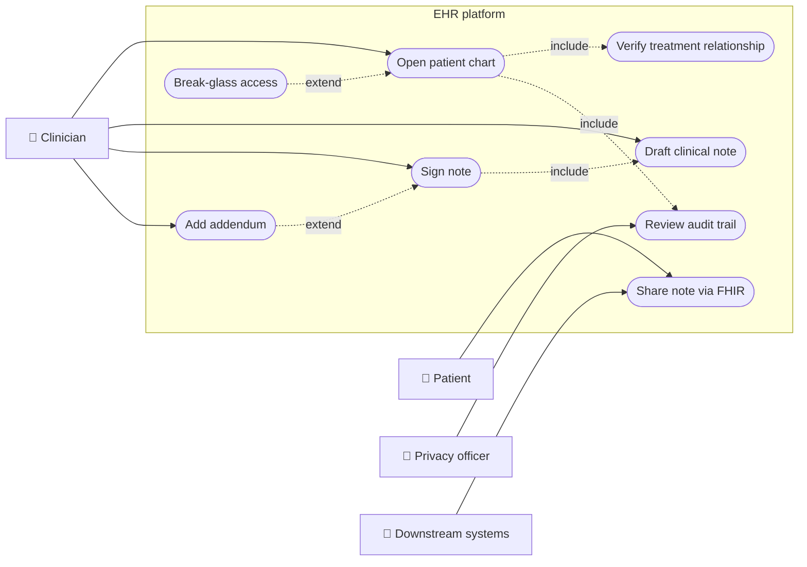
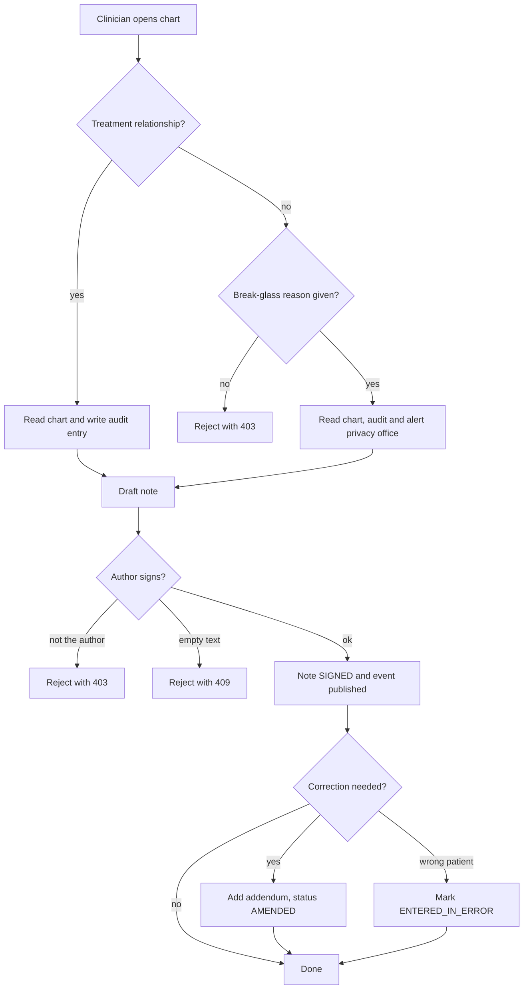
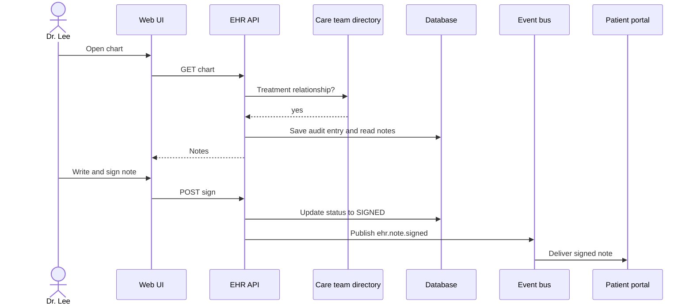
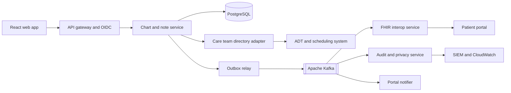
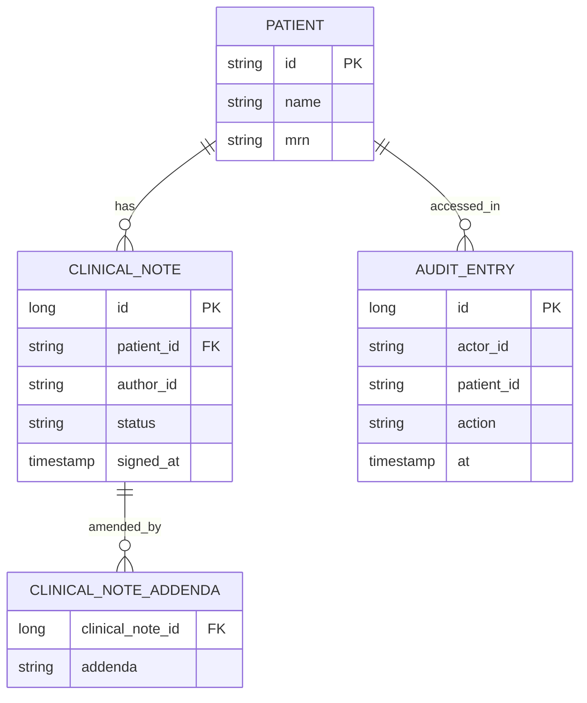
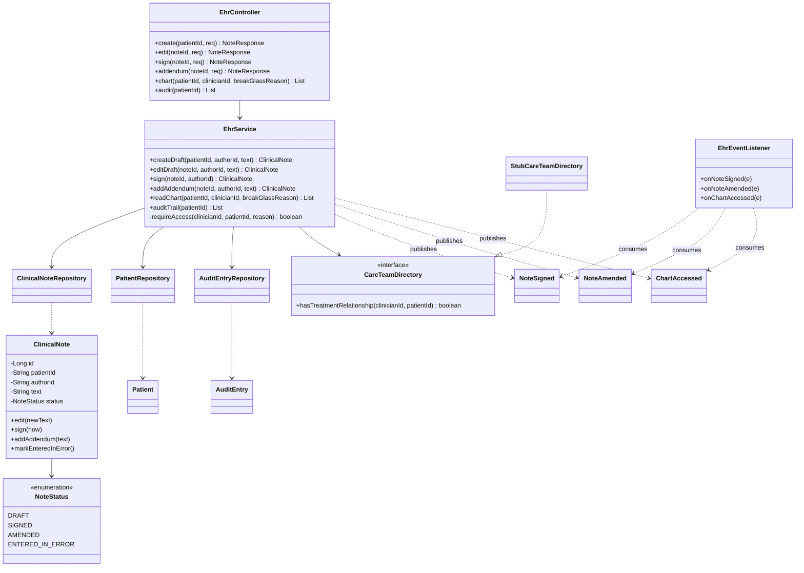
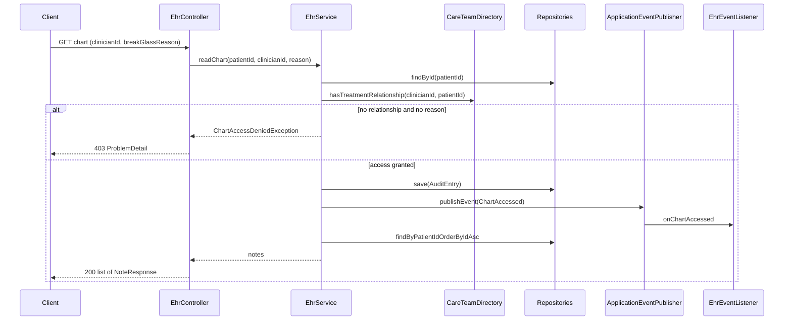
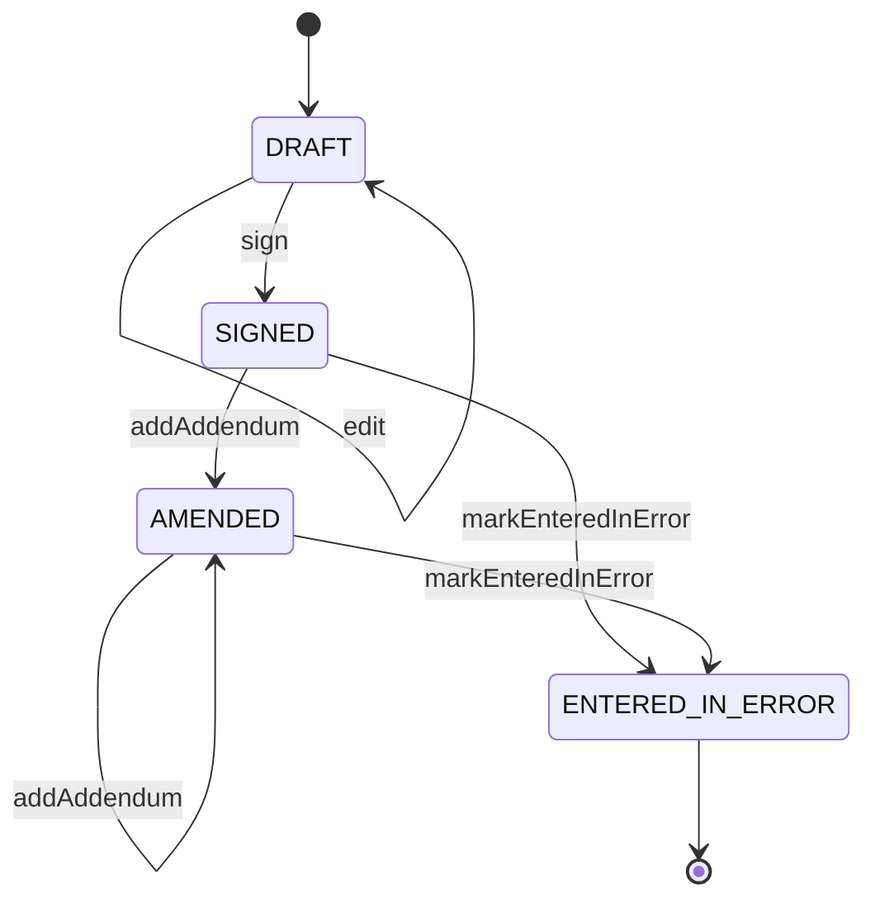
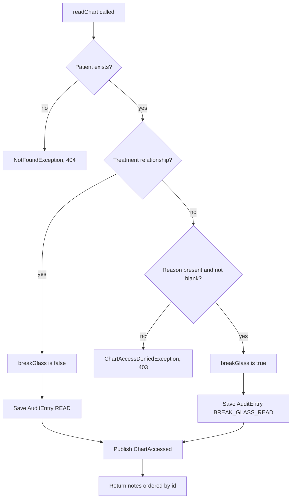

# Electronic Health Records (EHR)

> **Domain:** Healthcare · **Author:** [@naveenks720](https://github.com/naveenks720) · **Published:** November 05, 2026

> **Runnable code:** [`examples/healthcare/electronic-health-records-ehr`](https://github.com/dhulipalla599/domain-knowledge-engineering/tree/main/examples/healthcare/electronic-health-records-ehr)

## Explain It Like I'm Five

Imagine a big notebook that follows you from your first day of school to your last. Every time you visit a doctor, the doctor writes in it what hurt, what they did and what to do next. When the doctor finishes writing, they sign the page with a pen, so nobody can secretly scribble over it. If the doctor made a mistake, they add a new note underneath that says "oops, here is the fix" instead of erasing the old one. Only the people helping you are allowed to open your notebook, and a librarian writes down every time someone looks inside.

An Electronic Health Record (EHR) is that notebook as software: a trusted, signed, auditable history of a patient's care that the right clinicians can read at the right moment.

## Business Overview

An EHR is the system of record for a patient's clinical story inside a provider organisation: problems, medications, allergies, visit notes, orders, results and care plans. Clinicians read and write it many times a day, so it sits at the centre of the Healthcare value chain: **registration and scheduling** feed it patients and encounters, **clinical care** produces documentation and orders, **billing and claims** consume the coded documentation, and **quality, research and public health** reuse its data.

Why the business cares:

- **Patient safety.** A missing allergy or an unreadable note is a clinical risk, not only a software bug.
- **Regulation and privacy.** Rules differ by country (for example HIPAA in the US, GDPR plus national health-data laws in the EU, and various national regimes elsewhere). Common themes are access control, audit trails, patient access to their data and breach notification.
- **Revenue.** Billing depends on documentation that is complete, signed and timely. Unsigned notes delay claims.
- **Interoperability.** Hospitals exchange data with labs, pharmacies, payers and other providers. Standards such as HL7 v2, FHIR and CDA are the common languages, although adoption and profiles vary by country and vendor.
- **Clinician experience.** Documentation burden is a well-known source of clinician frustration, so latency and usability matter as much as correctness.

Throughout this page the fictional organisation is **Riverbend Health**, a regional hospital group modernising its documentation platform.

## Real-World Example

Amara Okafor, 54, visits Dr. Lee at a Riverbend clinic for chest tightness.

1. Reception has already registered Amara, and scheduling created the encounter. Dr. Lee opens her chart. Dr. Lee is on her care team, so access is granted and the read is logged.
2. During the visit Dr. Lee starts a **draft** note: "BP 150/95, ECG normal, start home BP monitoring." Drafts can be edited freely and are autosaved.
3. Dr. Lee **signs** the note. From this moment its text is frozen, and the platform publishes `ehr.note.signed`. A downstream job turns it into a FHIR `DocumentReference` for the patient portal and the billing coder.
4. The next day a lab result shows the BP reading was transcribed wrongly. Dr. Lee cannot edit the signed note. They add an **addendum**: "Correction: BP was 140/90." The note becomes *amended*, both versions remain visible, and `ehr.note.amended` is published.
5. Weeks later, an ED physician, Dr. Patel, treats Amara after a collapse. Dr. Patel is not on her care team, so the first read is denied. Dr. Patel supplies a break-glass reason ("Unconscious in ED, history needed"). Access is granted, flagged, and the privacy office reviews it the next morning.

## Stakeholders

| Stakeholder | What they need | What they fear |
|---|---|---|
| Patient | Accurate, private record; access to their own data | Wrong data, snooping, breaches |
| Clinician (physician, nurse) | Fast, complete chart; low documentation effort | Slow screens, alert fatigue, liability from unsigned or altered notes |
| Medical coder / billing | Signed, complete documentation | Late or ambiguous notes causing claim denials |
| Privacy / compliance officer | Full audit trail, enforceable access rules | Unexplained access, missing logs, regulatory fines |
| Health IT / platform team | Reliable, observable, integrable system | Downtime, data corruption, vendor lock-in |
| Downstream systems (portal, lab, payer) | Timely, standards-based data | Duplicates, out-of-order or incomplete messages |

## Use Case Diagram



| Use Case | Primary Actor | Goal | Main success outcome |
|---|---|---|---|
| Open patient chart | Clinician | Read the patient's history | Notes returned and the read is audited |
| Draft clinical note | Clinician | Capture the visit | Editable `DRAFT` note stored |
| Sign note | Clinician | Finalise documentation | Note frozen as `SIGNED`, event published |
| Add addendum | Clinician | Correct a signed note | Note becomes `AMENDED`; original text preserved |
| Break-glass access | Clinician | Emergency access without a relationship | Access granted with a recorded reason and alert |
| Review audit trail | Privacy officer | Detect inappropriate access | Ordered list of who accessed what and why |
| Share note via FHIR | Downstream systems / patient | Receive signed documentation | `DocumentReference` available in the portal or exchange |
| Verify treatment relationship | Clinician (via system) | Decide if access is legitimate | Boolean decision from the care-team directory |

## Key Terms

| Term | Plain-English meaning |
|---|---|
| EHR / EMR | Electronic Health Record (shared across organisations) / Electronic Medical Record (within one practice). Usage varies and the words are often interchanged |
| MRN | Medical Record Number: the patient identifier within one organisation |
| Encounter | One interaction between patient and provider (visit, admission, telehealth call) |
| Clinical note | Narrative documentation of an encounter |
| Sign-off / attestation | The clinician's act of finalising a note, making it legally part of the record |
| Addendum | Later, additional text attached to a signed note instead of editing it |
| Entered in error | Marking a note as wrongly filed while retaining it for audit |
| Break-glass | Emergency override of access controls, allowed with a reason and heavy audit |
| Treatment relationship | A legitimate care link between a clinician and a patient |
| FHIR | HL7 Fast Healthcare Interoperability Resources: a REST/JSON standard for health data |
| HL7 v2 | Older pipe-delimited messaging still widely used between hospital systems |
| ADT | Admit, Discharge, Transfer: the event feed describing patient movement |
| CDS | Clinical decision support: rules or models that suggest actions in the workflow |

## Process Flow

A clinician opens a chart, which first checks for a treatment relationship. If there is none, the clinician either stops or invokes break-glass with a reason. The clinician drafts a note, edits it freely, then signs it. Signing freezes the text and publishes an event for downstream consumers. Later corrections can only be addenda. Every read and write is audited.





## Business Rules and Edge Cases

- **Signed means immutable.** Never overwrite a signed note. Store addenda as separate, timestamped content so the legal record shows what was known when. A naive `UPDATE` destroys that history.
- **Only the author signs.** Some organisations allow co-signature (residents and supervisors) or delegation. Model it explicitly rather than loosening the author check.
- **Access needs a reason.** A valid treatment relationship, or a break-glass reason that is recorded and reviewed. Role alone ("is a doctor") is not enough in most privacy regimes.
- **Audit everything, append-only.** Reads are audited, not only writes. Audit rows must not be editable by the application's normal role.
- **Idempotency.** Double-clicking "Sign" or a retried HTTP call must not publish two `ehr.note.signed` events or fail confusingly. Use state checks plus an idempotency key or event id.
- **Ordering.** A consumer must never apply an amendment before the signed event it amends. Key events by patient or note id.
- **Partial failure.** If the database commit succeeds but the broker is down, the event is lost unless you use a transactional outbox.
- **Time.** Store timestamps in UTC with the clinician's time zone context. Late entries ("documented at 18:00 about 14:00") need both times.
- **Wrong patient.** Misfiled notes are marked *entered in error*, not deleted, and downstream systems are told.
- **Sensitive categories.** Mental health, substance-use and reproductive-health notes often have stricter rules that vary by jurisdiction. Support per-note sensitivity labels.
- **Patient merges.** When two records are found to be the same person, notes and audit history must move with a traceable link.

## From Business to System

| Business concept / step | System component | Data entity | Event |
|---|---|---|---|
| Open chart | Chart service | `audit_entry`, `clinical_note` | `ehr.chart.accessed` |
| Treatment relationship | Care-team adapter | (external directory) | none |
| Break-glass | Access policy in chart service | `audit_entry.reason` | `ehr.chart.accessed` (flagged) |
| Draft note | Note service | `clinical_note` (`DRAFT`) | none |
| Sign note | Note service | `clinical_note.status`, `signed_at` | `ehr.note.signed` |
| Addendum | Note service | `note_addendum` | `ehr.note.amended` |
| Share via FHIR | Interop service | derived `DocumentReference` | consumes `ehr.note.signed` |
| Privacy review | Audit service / SIEM | `audit_entry` | consumes `ehr.chart.accessed` |

## Architecture



The **chart and note service** owns the clinical record and its invariants (immutability, authorship, access). It is one transactional boundary because a sign-off and its audit entry must commit together. The **care-team directory** sits behind an adapter because the source of truth is another system (ADT, scheduling) that changes at its own pace. **Interop, audit and notification** consume Kafka events: they can lag, retry or be replaced without slowing a clinician. The audit and privacy service is separate so that a compromised clinical service cannot rewrite the evidence.

## Data Model

```sql
CREATE TABLE patient (
    id   VARCHAR(40) PRIMARY KEY,
    name VARCHAR(200) NOT NULL,
    mrn  VARCHAR(40)  NOT NULL UNIQUE
);

CREATE TABLE clinical_note (
    id         BIGSERIAL PRIMARY KEY,
    patient_id VARCHAR(40) NOT NULL REFERENCES patient(id),
    author_id  VARCHAR(40) NOT NULL,
    text       VARCHAR(4000),
    status     VARCHAR(20) NOT NULL CHECK (status IN ('DRAFT','SIGNED','AMENDED','ENTERED_IN_ERROR')),
    signed_at  TIMESTAMPTZ
);
CREATE INDEX ix_note_patient ON clinical_note(patient_id, id);

CREATE TABLE clinical_note_addenda (
    clinical_note_id BIGINT NOT NULL REFERENCES clinical_note(id),
    addenda          VARCHAR(4000) NOT NULL
);

CREATE TABLE audit_entry (
    id         BIGSERIAL PRIMARY KEY,
    actor_id   VARCHAR(40) NOT NULL,
    patient_id VARCHAR(40) NOT NULL,
    action     VARCHAR(30) NOT NULL,
    reason     VARCHAR(500),
    at         TIMESTAMPTZ NOT NULL
);
```



## APIs

| Method | Path | Purpose |
|---|---|---|
| POST | `/api/patients/{patientId}/notes` | Create a draft note |
| PUT | `/api/notes/{noteId}` | Edit a draft (409 once signed) |
| POST | `/api/notes/{noteId}/sign` | Sign a draft |
| POST | `/api/notes/{noteId}/addenda` | Add an addendum to a signed note |
| GET | `/api/patients/{patientId}/chart?clinicianId=&breakGlassReason=` | Read the chart (audited) |
| GET | `/api/patients/{patientId}/audit` | List audit entries |

In the example the acting user is passed as a parameter for simplicity. In production it comes from the validated OIDC token, never from the request body.

`GET /api/patients/pat-priya/chart?clinicianId=dr-lee&breakGlassReason=Unconscious in ED`

```json
[
  {
    "id": 3,
    "patientId": "pat-priya",
    "authorId": "dr-patel",
    "text": "Admitted with syncope. Allergic to penicillin.",
    "status": "SIGNED",
    "addenda": []
  }
]
```

Without a relationship and without a reason, the response is `403` with a `ProblemDetail` body.

## Events

| Event (Kafka topic) | Producer | Consumers | Key fields |
|---|---|---|---|
| `ehr.note.signed` | Chart and note service | FHIR interop, portal notifier, billing | `noteId`, `patientId`, `authorId` |
| `ehr.note.amended` | Chart and note service | FHIR interop, portal notifier | `noteId`, `patientId`, `authorId` |
| `ehr.chart.accessed` | Chart and note service | Audit and privacy service | `patientId`, `actorId`, `breakGlass`, `reason` |

Use `patientId` as the Kafka message key so events for one patient stay ordered within a partition. Consumers must be idempotent: deduplicate on an event id (or `noteId` plus version) because delivery is at-least-once. Publish through a transactional outbox so a committed sign-off is never lost.

## Backend Implementation

> The Java tab is the exact code from the runnable example (Spring Boot 3). The Python tab uses FastAPI with SQLAlchemy, and the Node.js tab uses Express with TypeScript.

Full source: [`examples/healthcare/electronic-health-records-ehr`](https://github.com/dhulipalla599/domain-knowledge-engineering/tree/main/examples/healthcare/electronic-health-records-ehr/src/main/java/com/dke/healthcare/electronic_health_records_ehr).

### Key rule: chart access and immutable notes

=== "Java"

    ```java
    /** Key rule: a chart is readable only with a treatment relationship, or with a recorded break-glass reason. */
    @Transactional
    public List<ClinicalNote> readChart(String patientId, String clinicianId, String breakGlassReason) {
        requirePatient(patientId);
        boolean breakGlass = requireAccess(clinicianId, patientId, breakGlassReason);
        audit.save(new AuditEntry(clinicianId, patientId, breakGlass ? "BREAK_GLASS_READ" : "READ", breakGlassReason, clock.instant()));
        events.publishEvent(new ChartAccessed(patientId, clinicianId, breakGlass, breakGlassReason));
        return notes.findByPatientIdOrderByIdAsc(patientId);
    }

    /** Returns true when access was granted through break-glass. */
    private boolean requireAccess(String clinicianId, String patientId, String breakGlassReason) {
        if (careTeams.hasTreatmentRelationship(clinicianId, patientId)) {
            return false;
        }
        if (breakGlassReason == null || breakGlassReason.isBlank()) {
            throw new ChartAccessDeniedException(
                    clinicianId + " has no treatment relationship with " + patientId + "; supply a break-glass reason for emergency access");
        }
        return true;
    }
    ```

=== "Python"

    ```python
    def require_access(clinician_id: str, patient_id: str, reason: str | None) -> bool:
        """Returns True when access was granted through break-glass."""
        if care_teams.has_treatment_relationship(clinician_id, patient_id):
            return False
        if not reason or not reason.strip():
            raise ChartAccessDenied(
                f"{clinician_id} has no treatment relationship with {patient_id}; "
                "supply a break-glass reason for emergency access")
        return True

    def read_chart(db: Session, patient_id: str, clinician_id: str, reason: str | None):
        require_patient(db, patient_id)
        break_glass = require_access(clinician_id, patient_id, reason)
        db.add(AuditEntry(actor_id=clinician_id, patient_id=patient_id,
                          action="BREAK_GLASS_READ" if break_glass else "READ",
                          reason=reason, at=datetime.now(timezone.utc)))
        publish("ehr.chart.accessed", {"patientId": patient_id, "actorId": clinician_id,
                                       "breakGlass": break_glass, "reason": reason})
        db.commit()
        return db.query(ClinicalNote).filter_by(patient_id=patient_id).order_by(ClinicalNote.id).all()
    ```

=== "Node.js"

    ```typescript
    function requireAccess(clinicianId: string, patientId: string, reason?: string): boolean {
      // Returns true when access was granted through break-glass.
      if (careTeams.hasTreatmentRelationship(clinicianId, patientId)) return false;
      if (!reason || reason.trim() === "") {
        throw new ChartAccessDenied(
          `${clinicianId} has no treatment relationship with ${patientId}; supply a break-glass reason for emergency access`);
      }
      return true;
    }

    export async function readChart(patientId: string, clinicianId: string, reason?: string) {
      await requirePatient(patientId);
      const breakGlass = requireAccess(clinicianId, patientId, reason);
      await audit.insert({ actorId: clinicianId, patientId, action: breakGlass ? "BREAK_GLASS_READ" : "READ", reason, at: new Date() });
      events.emit("ehr.chart.accessed", { patientId, actorId: clinicianId, breakGlass, reason });
      return notes.findByPatient(patientId);
    }
    ```

### Domain rule: signed notes are frozen

=== "Java"

    ```java
    public void edit(String newText) {
        if (status != NoteStatus.DRAFT) {
            throw new IllegalStateException("Note " + id + " is " + status + " and cannot be edited; add an addendum instead");
        }
        this.text = newText;
    }

    public void sign(Instant now) {
        if (status != NoteStatus.DRAFT) {
            throw new IllegalStateException("Only a DRAFT note can be signed, but note " + id + " is " + status);
        }
        if (text == null || text.isBlank()) {
            throw new IllegalStateException("An empty note cannot be signed");
        }
        this.status = NoteStatus.SIGNED;
        this.signedAt = now;
    }
    ```

=== "Python"

    ```python
    class ClinicalNote(Base):
        # columns omitted: id, patient_id, author_id, text, status, signed_at

        def edit(self, new_text: str) -> None:
            if self.status != "DRAFT":
                raise IllegalState(f"Note {self.id} is {self.status} and cannot be edited; add an addendum instead")
            self.text = new_text

        def sign(self, now: datetime) -> None:
            if self.status != "DRAFT":
                raise IllegalState(f"Only a DRAFT note can be signed, but note {self.id} is {self.status}")
            if not self.text or not self.text.strip():
                raise IllegalState("An empty note cannot be signed")
            self.status = "SIGNED"
            self.signed_at = now
    ```

=== "Node.js"

    ```typescript
    class ClinicalNote {
      constructor(public id: number, public text: string, public status = "DRAFT", public signedAt?: Date) {}

      edit(newText: string) {
        if (this.status !== "DRAFT") {
          throw new IllegalState(`Note ${this.id} is ${this.status} and cannot be edited; add an addendum instead`);
        }
        this.text = newText;
      }

      sign(now: Date) {
        if (this.status !== "DRAFT") throw new IllegalState(`Only a DRAFT note can be signed, but note ${this.id} is ${this.status}`);
        if (!this.text || this.text.trim() === "") throw new IllegalState("An empty note cannot be signed");
        this.status = "SIGNED";
        this.signedAt = now;
      }
    }
    ```

### Controller endpoint

=== "Java"

    ```java
    @GetMapping("/api/patients/{patientId}/chart")
    List<NoteResponse> chart(@PathVariable String patientId, @RequestParam String clinicianId,
                             @RequestParam(required = false) String breakGlassReason) {
        return service.readChart(patientId, clinicianId, breakGlassReason).stream().map(NoteResponse::from).toList();
    }
    ```

=== "Python"

    ```python
    @app.get("/api/patients/{patient_id}/chart")
    def chart(patient_id: str, clinician_id: str, break_glass_reason: str | None = None,
              db: Session = Depends(get_db)):
        return [NoteResponse.from_orm(n) for n in read_chart(db, patient_id, clinician_id, break_glass_reason)]
    ```

=== "Node.js"

    ```typescript
    app.get("/api/patients/:patientId/chart", async (req, res) => {
      const { clinicianId, breakGlassReason } = req.query as Record<string, string | undefined>;
      const chart = await readChart(req.params.patientId, clinicianId ?? "", breakGlassReason);
      res.json(chart);
    });
    ```

## Frontend Screen

```tsx
import { useState } from "react";

type Note = { id: number; text: string; status: string; addenda: string[] };

export function ChartScreen({ patientId, clinicianId }: { patientId: string; clinicianId: string }) {
  const [notes, setNotes] = useState<Note[]>([]);
  const [error, setError] = useState<string | null>(null);
  const [reason, setReason] = useState("");

  async function load(withReason?: string) {
    const q = new URLSearchParams({ clinicianId });
    if (withReason) q.set("breakGlassReason", withReason);
    const res = await fetch(`/api/patients/${patientId}/chart?${q}`);
    if (res.status === 403) {
      setError((await res.json()).detail);
      return;
    }
    setError(null);
    setNotes(await res.json());
  }

  return (
    <section>
      <button onClick={() => load()}>Open chart</button>
      {error && (
        <div role="alert">
          <p>{error}</p>
          <input value={reason} onChange={(e) => setReason(e.target.value)} placeholder="Emergency reason" />
          <button disabled={!reason.trim()} onClick={() => load(reason)}>Break glass (audited)</button>
        </div>
      )}
      {notes.map((n) => (
        <article key={n.id}>
          <h3>Note {n.id} <small>{n.status}</small></h3>
          <p>{n.text}</p>
          {n.addenda.map((a, i) => <p key={i}><em>Addendum:</em> {a}</p>)}
        </article>
      ))}
    </section>
  );
}
```

## Cloud Deployment

Riverbend runs the services on **Amazon EKS**, with **Amazon RDS for PostgreSQL** (Multi-AZ, encrypted), **Amazon MSK** for Kafka, **AWS KMS** for keys, **Amazon Cognito** or the hospital IdP for OIDC, **AWS Secrets Manager**, an Application Load Balancer with **AWS WAF**, and **S3** for scanned documents. Whether a given organisation may use a public cloud for patient data, and under which agreement (for example a business associate agreement in the US), depends on jurisdiction and contract. Confirm with compliance first.

```hcl
resource "aws_db_instance" "ehr" {
  identifier                   = "ehr-prod"
  engine                       = "postgres"
  engine_version               = "16"
  instance_class               = "db.r6g.xlarge"
  allocated_storage            = 200
  multi_az                     = true
  storage_encrypted            = true
  kms_key_id                   = aws_kms_key.ehr.arn
  backup_retention_period      = 14
  deletion_protection          = true
  performance_insights_enabled = true
  db_subnet_group_name         = aws_db_subnet_group.private.name
  vpc_security_group_ids       = [aws_security_group.ehr_db.id]
}
```

- **Security:** private subnets, security groups allowing only the service pods, IRSA roles with least privilege, TLS everywhere, field-level encryption for especially sensitive columns, separate AWS account for audit logs with write-once storage.
- **Scaling:** stateless pods behind a Horizontal Pod Autoscaler on CPU and request rate; read replicas for reporting; Kafka consumer groups scale by partition.
- **Observability:** OpenTelemetry SDK or collector exports traces and metrics to CloudWatch (and X-Ray); structured logs go to CloudWatch Logs. Never put note text or patient names in logs or span attributes. Alarm on break-glass rate, sign-off latency and consumer lag.

## Non-Functional Requirements

| Concern | Expectation | How the design meets it |
|---|---|---|
| Availability | Clinicians need the chart around the clock; organisations often set targets such as 99.9% or higher and plan downtime procedures | Multi-AZ database, multiple pods, graceful degradation of non-critical consumers |
| Latency | Chart open and note save should feel instant (targets are set per organisation) | Indexed lookups by patient, paginated chart, async downstream work |
| Consistency | Sign-off, status change and audit must be atomic | One transaction plus transactional outbox |
| Audit | Every read, write and break-glass is reconstructable | Append-only `audit_entry`, separate audit service, restricted DB privileges |
| Privacy | Least privilege and purpose-bound access | Treatment relationship check, break-glass with review, encryption at rest and in transit |
| Retention | Medical-record retention periods vary by country and record type | Soft statuses (`ENTERED_IN_ERROR`), no hard deletes, archival policy per jurisdiction |
| Interoperability | Standard formats for exchange | FHIR resources built from signed notes |

## Runnable Example

The example is a Spring Boot 3 service (Java 21, H2, no external services) that implements drafting, signing and amending notes, audited chart reads with a break-glass path, and in-process events named after the Kafka topics. Source: [`examples/healthcare/electronic-health-records-ehr`](https://github.com/dhulipalla599/domain-knowledge-engineering/tree/main/examples/healthcare/electronic-health-records-ehr).

```bash
cd examples/healthcare/electronic-health-records-ehr
mvn spring-boot:run     # http://localhost:8080
mvn -B -ntp verify      # build and tests
```

Create and sign a note:

```bash
curl -s -X POST localhost:8080/api/patients/pat-amara/notes -H 'Content-Type: application/json' \
  -d '{"authorId":"dr-lee","text":"BP 150/95. Start home monitoring."}'
# {"id":1,"patientId":"pat-amara","authorId":"dr-lee","text":"BP 150/95. Start home monitoring.","status":"DRAFT","addenda":[]}
```

A chart read without a treatment relationship is refused:

```bash
curl -s "localhost:8080/api/patients/pat-priya/chart?clinicianId=dr-lee"
# {"status":403,"title":"Forbidden","detail":"dr-lee has no treatment relationship with pat-priya; supply a break-glass reason for emergency access",...}
```

| Class | Package | Responsibility |
|---|---|---|
| `ElectronicHealthRecordsEhrApplication` | root | Spring Boot entry point |
| `ClockConfig` | root | Provides an injectable `Clock` |
| `ClinicalNote` | `domain` | Entity and lifecycle rules |
| `NoteStatus` | `domain` | Lifecycle enum |
| `Patient` | `domain` | Patient entity |
| `AuditEntry` | `domain` | Append-only access log entity |
| `EhrEvents` | `domain` | `NoteSigned`, `NoteAmended`, `ChartAccessed` event records |
| `PatientRepository`, `ClinicalNoteRepository`, `AuditEntryRepository` | `repository` | Spring Data JPA repositories |
| `EhrService` | `service` | Access rule, authorship checks, audit, event publishing |
| `NotFoundException`, `ChartAccessDeniedException` | `service` | Business exceptions |
| `EhrController` | `api` | REST endpoints |
| `NoteRequest`, `NoteResponse` | `api` | DTO records |
| `ApiExceptionHandler` | `api` | Maps exceptions to `ProblemDetail` (403, 404, 409) |
| `CareTeamDirectory`, `StubCareTeamDirectory` | `integration` | Port and in-memory stub for care-team lookups |
| `EhrEventListener` | `integration` | `@EventListener` consumers standing in for Kafka consumers |

## UML Diagrams

### Class Diagram

The service holds the rules, the entities hold their own lifecycle, and the directory and event listener sit behind the `integration` package.



### Sequence Diagram (control flow)

This follows `GET /api/patients/{id}/chart` through the code, including the denied branch.



### State Diagram



### Activity Diagram

The decision logic inside `EhrService.readChart` and `requireAccess`.



## AI Opportunities

1. **Ambient documentation drafting.** An LLM turns a recorded, consented visit conversation into a draft note. Data: audio transcript, problem list, medications. Risk: hallucinated findings and omissions. Control: output stays a `DRAFT`, the clinician must review and sign, and every AI-authored span is labelled.
2. **Chart summarisation.** Summarise years of notes into a one-page history for a new clinician. Data: notes, results, allergies. Risk: dropping a critical fact. Control: link every statement back to its source note, show the summary as assistive only, and evaluate on clinician-rated samples.
3. **Coding suggestions.** Suggest diagnosis and procedure codes from signed notes. Data: signed notes and the code sets used locally. Risk: upcoding and compliance exposure. Control: suggestions only, coder approval, audit of acceptance rates.
4. **Anomalous access detection.** ML over `audit_entry` finds snooping (for example access to colleagues, celebrities or neighbours). Data: access logs, rosters, care-team data. Risk: false positives and bias against particular roles. Control: route to privacy staff for human review, with explainable features.
5. **Clinical decision support.** Models flag deterioration or missing follow-ups. Data: vitals, labs, notes. Risk: alert fatigue and regulation as a medical device in many jurisdictions. Control: clinical validation, monitoring for drift, clear override and logging.

For all of these, keep patient data inside an approved boundary, minimise what is sent to any model, and confirm whether the vendor agreement permits that use.

## Common Pitfalls

- **Editing signed notes in place.** Use addenda and versions. Add database privileges and tests that prove it.
- **Auditing only writes.** Reads are the main privacy risk. Audit them.
- **Trusting the client for identity.** Derive the actor from the token, not the request body.
- **Role-only authorisation.** "Is a doctor" is not a treatment relationship. Model the relationship and the emergency override.
- **Losing events.** Publishing to Kafka inside the transaction without an outbox causes silent gaps.
- **Logging PHI.** Note text, names and identifiers leak through logs, traces and error messages.
- **Hard deletes.** Records are retained by law in many places. Use statuses such as `ENTERED_IN_ERROR`.
- **Ignoring time zones and late entries.** Keep both event time and documentation time.
- **Assuming one global rule.** Retention, consent and access rules differ by country, state and organisation. Make them configurable and ask compliance.
- **Treating FHIR as a drop-in.** Profiles, terminologies and local extensions differ between organisations. Plan mapping work.

## Interview Questions

### Junior

**1. Why can't a signed clinical note be edited?**
It is part of the legal and clinical record. Editing would hide what the clinician knew and decided at the time. Corrections are added as addenda so both the original and the correction remain visible.

**2. What is an audit trail and why audit reads?**
It is an append-only log of who did what, to which record, when and why. Inappropriate reads (snooping) are a major privacy risk, and regulators or privacy officers need evidence to investigate.

**3. What does `ProblemDetail` give you in a Spring API?**
A standard, structured error body (status, title, detail) following RFC 9457, so clients and the UI can show a clear reason such as "supply a break-glass reason".

### Mid-Level

**1. How would you make "sign note" idempotent?**
Enforce the state check (`DRAFT` only) inside the transaction, return the current state or a clear 409 on repeats, and give the event an id so consumers can deduplicate. Optionally accept an `Idempotency-Key` header.

**2. How do you guarantee an event is published when a note is signed?**
Write the status change and an outbox row in one transaction, then a relay publishes to Kafka and marks the row sent. Delivery is at-least-once, so consumers deduplicate.

**3. How would you model the treatment relationship?**
As data from the care-team or ADT source, cached with short expiry, behind an interface. It should consider encounters, assignments and teams, and fall back to break-glass with a mandatory reason. Do not infer it from role alone.

### Senior / Architect

**1. Design the EHR audit system for a multi-hospital group.**
Key points: capture at the service layer and the database; ship to a separate account with write-once storage; include actor, patient, action, reason, source IP and time; stream to a SIEM; define review workflows for break-glass; protect audit data itself with strict access and retention; avoid logging PHI inside the audit payload beyond identifiers.

**2. Monolith or services for the clinical record?**
Key points: keep the invariants (signing, immutability, access, audit atomicity) in one transactional boundary; split read-heavy and integration concerns (FHIR, search, notifications) behind events; avoid distributed transactions; consider a modular monolith first; weigh team size, change rate and the cost of consistency bugs.

**3. How do you integrate with legacy HL7 v2 systems and modern FHIR consumers?**
Key points: an anti-corruption layer or integration engine translating between formats; canonical internal model; idempotent, ordered processing keyed by patient; mapping and terminology governance; replay and dead-letter handling; contract tests per partner; versioning of FHIR profiles.

## Further Learning

- HL7 FHIR (resources, profiles, SMART on FHIR)
- HL7 v2 messaging and the ADT feed
- IHE profiles such as XDS and PIX/PDQ
- Terminologies: SNOMED CT, LOINC, ICD-10, RxNorm
- HIPAA Privacy and Security Rules (US) and GDPR health-data provisions (EU)
- OAuth 2.0, OpenID Connect and SMART authorisation
- Transactional outbox and event-driven architecture patterns
- Master patient index and patient matching

## Practitioner Notes

> _Reviewer: add real-world experience, corrections or gotchas here before approving._
