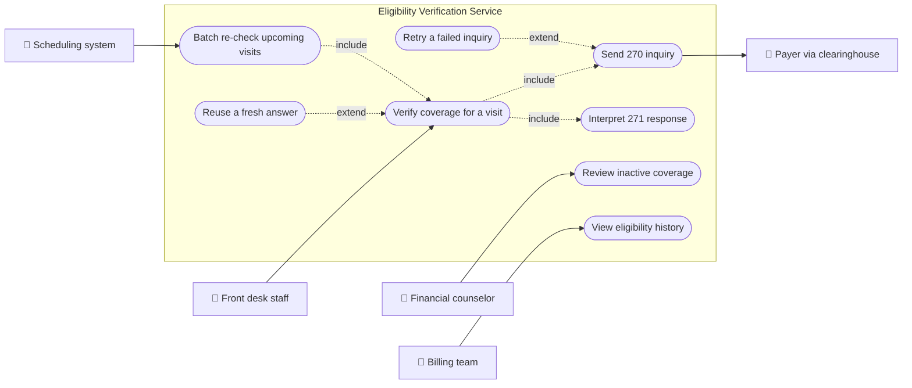
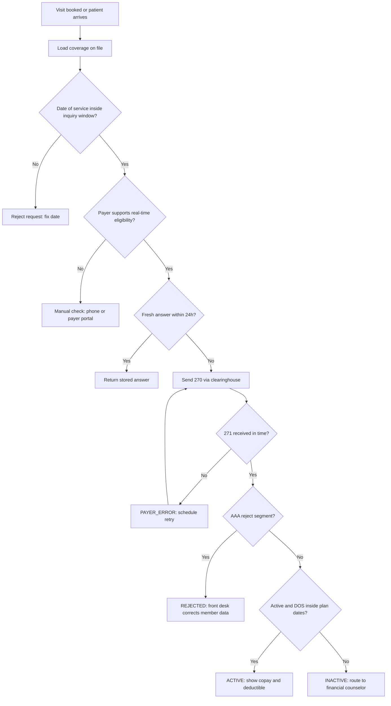
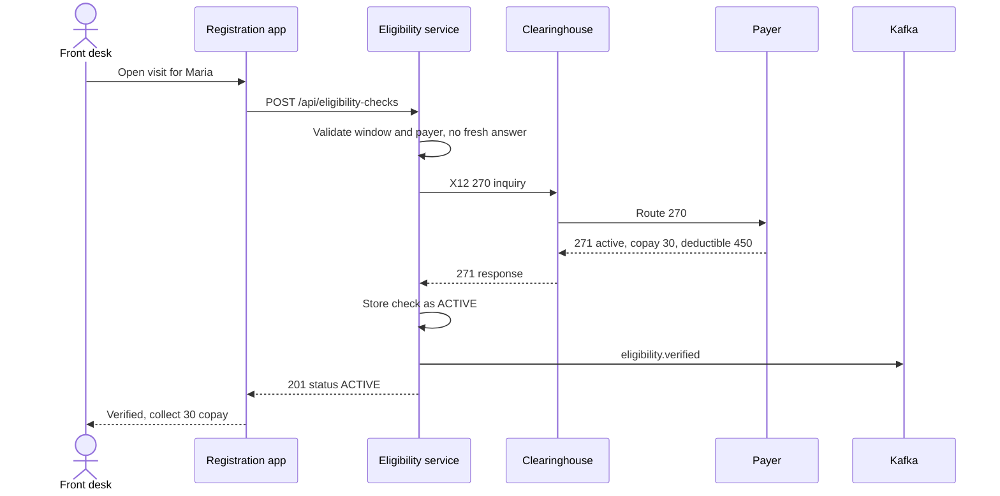
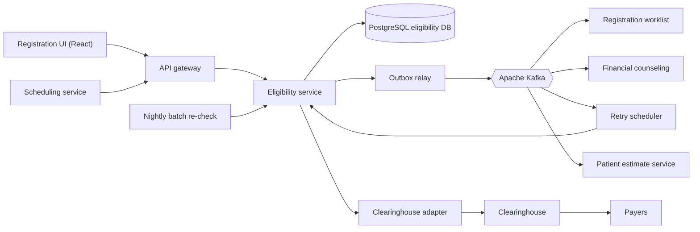
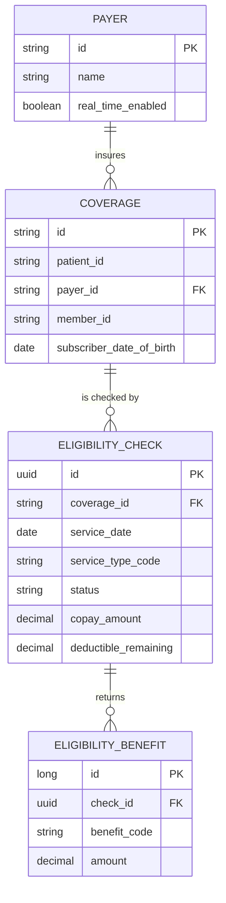
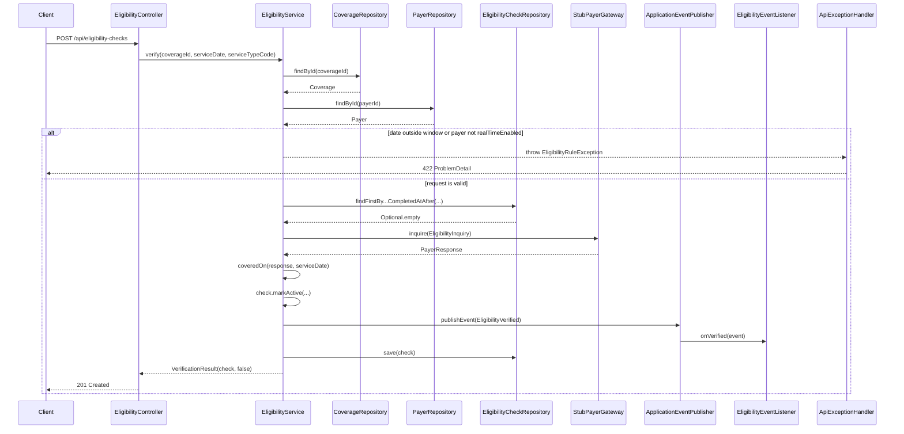
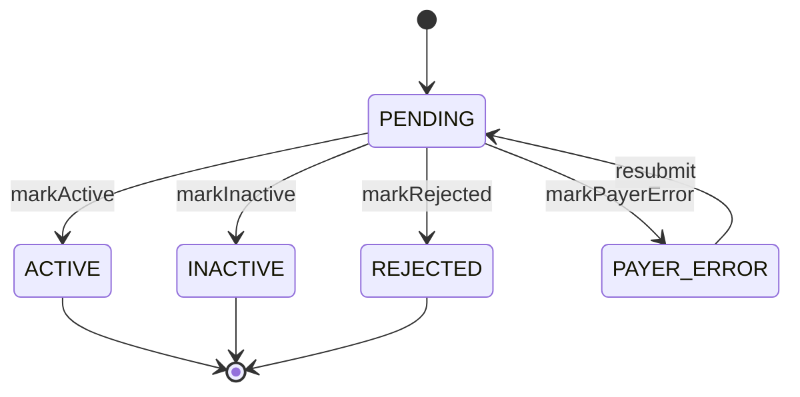
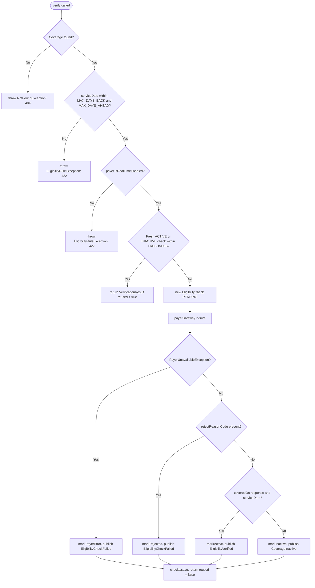

# Insurance Eligibility Verification

> **Domain:** Healthcare · **Author:** [@dhulipalla599](https://github.com/dhulipalla599) · **Published:** November 20, 2026

> **Runnable code:** [`examples/healthcare/insurance-eligibility-verification`](https://github.com/dhulipalla599/domain-knowledge-engineering/tree/main/examples/healthcare/insurance-eligibility-verification)

## Explain It Like I'm Five

Imagine you have a ticket to the school fair that your grandma bought for you. Before you get on the rides, the person at the gate looks at your ticket and calls the ticket office to ask, "Is this ticket real, is it for today, and which rides does it include?" The office says "yes, today, and three rides are free, but the big wheel costs one coin." Now you know before you get in line, instead of finding out at the end that you owe coins. If the office doesn't pick up the phone, the gate person tries again later instead of guessing.

Insurance eligibility verification is that phone call: before a patient is treated, the provider asks the insurer whether the patient's coverage is active on the date of service and what the patient will owe.

## Business Overview

**What it is.** Eligibility verification is the check a healthcare provider (hospital, clinic, lab, pharmacy) makes with a patient's health plan, the *payer*, to confirm that coverage is active for a specific date of service and type of service, and to learn the patient's cost-sharing: copay, coinsurance, remaining deductible and out-of-pocket amounts. In the United States, HIPAA names the ASC X12 270 (inquiry) and 271 (response) transactions as the standard for electronic eligibility, usually exchanged through a *clearinghouse*, and CAQH CORE operating rules add expectations such as real-time response behaviour and which benefits must be returned. Other countries work differently: in single-payer systems eligibility may be a residency or registration check, and in systems built on insurance cards (for example Germany's electronic health card) the check is tied to the card and national infrastructure. Treat the US X12 flow on this page as one concrete model, not a universal rule.

**Why the business cares.**

- **Revenue.** Claims sent for patients with no active coverage, the wrong payer, or a wrong member ID are denied. Eligibility problems are one of the most common, and most preventable, causes of front-end denials. Every denial costs rework and delays cash.
- **Patient experience.** Patients want to know what they will owe before the visit. Accurate copay and deductible data lets the front desk collect the right amount and avoid surprise bills.
- **Risk and compliance.** The response contains protected health information (PHI). It must be handled under HIPAA privacy and security rules, and it supports regulated processes such as cost estimates for patients.
- **Operational cost.** Each inquiry may carry a clearinghouse fee and each manual phone call to a payer takes staff time. Automating and deduplicating checks saves both.

**Where it sits in the value chain.** It is the first step of *revenue cycle management* (RCM): scheduling → patient registration → **eligibility and benefits verification** → prior authorization (if needed) → care delivery → charge capture and coding → claim submission → payment posting → denial management. A wrong answer here travels all the way to a denied claim weeks later.

## Real-World Example

**Maria Alvarez** books a follow-up visit with Dr. Chen at **Lakeside Family Clinic** (fictional) for Thursday. Her coverage on file is **Northwind Health Plan** (fictional), member ID `NWH884213307`.

1. **At booking (Monday).** The scheduling system calls the clinic's eligibility service with Maria's coverage, Thursday's date and service type `98` (professional office visit). The service builds a 270 and sends it through the clinic's clearinghouse.
2. **Payer answers.** Northwind returns a 271 in a few seconds: coverage active from January 1 to December 31, office-visit copay $30, $450 of deductible remaining. The service stores the answer as an `ACTIVE` check and publishes `eligibility.verified`; the registration worklist marks Maria's visit as cleared.
3. **Day before the visit.** A nightly batch re-checks tomorrow's appointments. Maria's answer from Monday is older than the clinic's 24-hour freshness rule, so a new inquiry is sent. Still active.
4. **Thursday, check-in.** The front desk opens Maria's visit, sees "Verified, copay $30" and collects it. Because the answer is from last night and still fresh, no new inquiry is sent.
5. **A different patient, same morning.** Daniel Okafor's 271 comes back with "coverage terminated October 31". The check is stored as `INACTIVE` and `eligibility.coverage-inactive` routes Daniel to a financial counselor, who finds he has a new employer plan and updates his coverage. A new check against the new plan comes back `ACTIVE`.
6. **And another.** Priya Raman's member ID was mistyped at registration. The payer returns an AAA reject, code `72` ("Invalid/Missing Subscriber/Insured ID"). The check is `REJECTED`, and the front desk asks Priya for her card before the visit, instead of the claim being denied a month later.

## Stakeholders

| Stakeholder | What they need | What they fear |
|---|---|---|
| Patient | To know they are covered and what they will owe before care | Surprise bills; being turned away at the desk |
| Front desk / patient access staff | A fast, clear "verified / not verified" answer with copay | Long payer phone calls; queues at check-in |
| Financial counselor | Early warning of inactive or missing coverage | Finding out after the service, when options are fewer |
| Billing and denials team | Correct payer, member ID and coverage on every claim | Eligibility denials and rework |
| Clinician | Not to have care delayed by paperwork | Treating, then learning the service is not covered |
| Payer (health plan) | Well-formed inquiries at reasonable volume | Inquiry floods, wrong member data, PHI leaks |
| Clearinghouse | Valid X12 traffic and connectivity | Outages blamed on them; malformed transactions |
| Compliance / privacy officer | PHI access logged and minimised | Breaches; staff browsing records without reason |

## Use Case Diagram



| Use Case | Primary Actor | Goal | Main success outcome |
|---|---|---|---|
| Verify coverage for a visit | Front desk staff | Know if the patient is covered on the date of service | Check stored as ACTIVE with copay and deductible |
| Send 270 inquiry | Eligibility service | Ask the payer in the standard format | 271 received within the timeout |
| Interpret 271 response | Eligibility service | Turn payer codes into a clear status | ACTIVE, INACTIVE or REJECTED with reason |
| Reuse a fresh answer | Front desk staff | Avoid paying for a duplicate inquiry | Existing answer returned |
| Retry a failed inquiry | Eligibility service | Recover from payer timeouts | PAYER_ERROR check re-sent and answered |
| Batch re-check upcoming visits | Scheduling system | Catch coverage changes before the visit | Tomorrow's visits all have fresh answers |
| Review inactive coverage | Financial counselor | Find new coverage or a payment plan | Coverage updated or self-pay arranged |
| View eligibility history | Billing team | Prove what the payer said before the claim | Timeline of checks for a coverage |

## Key Terms

| Term | Plain-English meaning |
|---|---|
| Payer | The health plan or insurer that pays claims |
| Subscriber / member | The policy holder / any person covered by the policy (a dependant is a member but not the subscriber) |
| Member ID | The identifier on the insurance card used to find the member |
| 270 / 271 | X12 eligibility inquiry and response transactions used in the US |
| Clearinghouse | Intermediary that routes and validates X12 transactions between providers and many payers |
| Service type code | X12 code for the kind of service asked about, e.g. `30` health benefit plan coverage, `98` office visit |
| EB segment | The part of the 271 that carries benefit information (active, inactive, copay, deductible) |
| AAA reject | Segment in the 271 saying the payer could not process the request, with a reason code (e.g. `72` invalid member ID, `75` subscriber not found) |
| Copay / coinsurance | Fixed amount / percentage the patient pays for a service |
| Deductible | Amount the patient pays each plan year before the plan starts paying |
| Coordination of benefits (COB) | Rules for which plan pays first when a patient has more than one |
| Date of service (DOS) | The date care is delivered; eligibility is always "as of" a date |

## Process Flow

Eligibility is checked at booking, re-checked shortly before the visit (often in a nightly batch) and confirmed at check-in. Each check takes the coverage on file, validates the request against local policy (date window, payer supports real-time inquiries), reuses a fresh answer if one exists, and otherwise sends a 270 through the clearinghouse. The 271 is interpreted into one of four outcomes: covered, not covered on that date, payer could not identify the member, or no answer at all. Each outcome routes to a different team.





## Business Rules and Edge Cases

- **Eligibility is always "as of" a date.** A patient can be active today and terminated next week. Always send and store the date of service, never "current" status alone, and re-check close to the visit.
- **"Active" is not the whole answer.** A 271 can say active while plan dates exclude the date of service, or active for medical but not for the service type asked about. Check the plan begin/end dates and the benefit for the specific service type.
- **Inactive, rejected and no-answer are different.** `INACTIVE` means the payer found the member and there is no coverage; `REJECTED` (AAA) means the payer could not match the request, usually a data-entry error; a timeout means nothing is known. Collapsing them into "not verified" sends work to the wrong team.
- **Inquiry date windows vary by payer.** Many payers answer only for a limited range of past and future dates. Make the window configurable per payer; do not hard-code one rule.
- **Not every payer supports real-time.** Some smaller plans, government programs or international insurers need a portal or phone call. The system must record a manual verification with who, when and reference number.
- **Idempotency and cost.** Double-clicks, retries and multiple systems (scheduling, registration, billing) can all ask the same question. Reuse a fresh answer for the same coverage, date of service and service type; the freshness window is policy and may differ for day-of-service checks.
- **Partial failure.** The payer may time out after receiving the request. Retrying is safe (inquiries do not change payer state), but cap retries and back off per payer so an outage does not become an inquiry flood.
- **Money is decimal and plan-year bound.** Copays and deductibles are amounts in currency, never floats, and deductibles reset by plan year, which is not always the calendar year.
- **Multiple coverages.** Patients may have primary and secondary coverage (COB). The payer may report another payer as primary; that needs human review before billing.
- **Retroactive changes.** Some coverage (for example certain government programs) can be granted or terminated retroactively. A stored answer is evidence of what the payer said at that time, not a guarantee of payment.
- **PHI.** The 271 contains names, dates of birth and benefits. Store only what is needed, encrypt it, and log every access.

## From Business to System

| Business concept / step | System component | Data entity | Event |
|---|---|---|---|
| Insurance presented at registration | Registration service (upstream) | `coverage` | `coverage.updated` (upstream) |
| Payer directory and real-time support | Eligibility service | `payer` | none |
| Verify coverage for a visit | `EligibilityController`, `EligibilityService.verify` | `eligibility_check` | `eligibility.verified` / `eligibility.coverage-inactive` / `eligibility.check-failed` |
| Send 270, receive 271 | `PayerGateway` clearinghouse adapter | `eligibility_check` (+ raw 271 in production) | none |
| Reuse a fresh answer | `EligibilityService.verify` freshness query | `eligibility_check` | none (no new inquiry) |
| Retry after payer timeout | Retry scheduler consuming `eligibility.check-failed` | `eligibility_check` | `eligibility.check-failed` or a success event |
| Inactive coverage follow-up | Financial counseling worklist | `eligibility_check` | `eligibility.coverage-inactive` |
| Benefit details for estimates | Benefits store | `eligibility_benefit` | `eligibility.verified` |

## Architecture



**Boundaries.** The *eligibility service* owns the question "is this coverage good for this date and service?" and its history; it does not own patient demographics or coverage capture (registration does) or claims (billing does). The *clearinghouse adapter* is separate because it speaks X12, handles connectivity, credentials and payer-specific quirks, and fails in ways the rest of the system should not care about; it can be a module first and a service later. Downstream teams (worklist, counseling, estimates) react to events instead of calling the eligibility service synchronously, so a slow payer never slows check-in screens that do not need a new answer.

## Data Model

```sql
CREATE TABLE payer (
    id                 VARCHAR(40)  PRIMARY KEY,
    name               VARCHAR(200) NOT NULL,
    real_time_enabled  BOOLEAN      NOT NULL,
    max_days_ahead     INT          NOT NULL DEFAULT 30,
    max_days_back      INT          NOT NULL DEFAULT 365
);

CREATE TABLE coverage (
    id                        VARCHAR(40) PRIMARY KEY,
    patient_id                VARCHAR(40) NOT NULL,
    payer_id                  VARCHAR(40) NOT NULL REFERENCES payer(id),
    member_id                 VARCHAR(80) NOT NULL,
    subscriber_first_name     VARCHAR(100) NOT NULL,
    subscriber_last_name      VARCHAR(100) NOT NULL,
    subscriber_date_of_birth  DATE        NOT NULL,
    priority                  SMALLINT    NOT NULL DEFAULT 1   -- 1 primary, 2 secondary
);

CREATE TABLE eligibility_check (
    id                   UUID PRIMARY KEY,
    coverage_id          VARCHAR(40) NOT NULL REFERENCES coverage(id),
    service_date         DATE        NOT NULL,
    service_type_code    VARCHAR(2)  NOT NULL,
    status               VARCHAR(20) NOT NULL
        CHECK (status IN ('PENDING','ACTIVE','INACTIVE','REJECTED','PAYER_ERROR')),
    plan_begin_date      DATE,
    plan_end_date        DATE,
    copay_amount         NUMERIC(12,2),
    deductible_remaining NUMERIC(12,2),
    reject_reason_code   VARCHAR(3),
    message              TEXT,
    requested_at         TIMESTAMPTZ NOT NULL,
    completed_at         TIMESTAMPTZ,
    version              BIGINT      NOT NULL DEFAULT 0
);
CREATE INDEX ix_check_fresh
    ON eligibility_check (coverage_id, service_date, service_type_code, completed_at DESC);

CREATE TABLE eligibility_benefit (
    id                   BIGSERIAL PRIMARY KEY,
    check_id             UUID        NOT NULL REFERENCES eligibility_check(id),
    service_type_code    VARCHAR(2)  NOT NULL,
    benefit_code         VARCHAR(2)  NOT NULL,   -- EB01, e.g. B copay, C deductible
    in_network           BOOLEAN,
    amount               NUMERIC(12,2),
    percent              NUMERIC(5,4),
    time_period          VARCHAR(20)
);

CREATE TABLE outbox_event (
    id           UUID PRIMARY KEY,
    topic        VARCHAR(100) NOT NULL,
    event_key    VARCHAR(40)  NOT NULL,
    payload      JSONB        NOT NULL,
    created_at   TIMESTAMPTZ  NOT NULL DEFAULT now(),
    published_at TIMESTAMPTZ
);
```



## APIs

| Method | Path | Purpose |
|---|---|---|
| POST | `/api/eligibility-checks` | Verify coverage for a date and service type (201 new, 200 reused) |
| GET | `/api/eligibility-checks/{id}` | Read one check |
| GET | `/api/eligibility-checks?coverageId=` | Eligibility history for a coverage |
| POST | `/api/eligibility-checks/{id}/retry` | Re-send an inquiry that ended in `PAYER_ERROR` |

Request:

```json
POST /api/eligibility-checks
{
  "coverageId": "cov-1001",
  "serviceDate": "2026-11-20",
  "serviceTypeCode": "30"
}
```

Response `201 Created`, `Location: /api/eligibility-checks/ad2a6fae-a388-401f-8de5-153eeb5aab2d`:

```json
{
  "id": "ad2a6fae-a388-401f-8de5-153eeb5aab2d",
  "coverageId": "cov-1001",
  "serviceDate": "2026-11-20",
  "serviceTypeCode": "30",
  "status": "ACTIVE",
  "planBeginDate": "2026-01-01",
  "planEndDate": "2026-12-31",
  "copayAmount": 30.00,
  "deductibleRemaining": 450.00,
  "rejectReasonCode": null,
  "message": null,
  "completedAt": "2026-11-20T15:05:05.782260794Z",
  "reused": false
}
```

A completed check that is `INACTIVE` or `REJECTED` is still `201`: the inquiry succeeded and the answer is in `status`. Only requests the service refuses to send (outside the date window, payer without real-time support) return `422`.

## Events

| Event | Producer | Consumers | Key fields |
|---|---|---|---|
| `eligibility.verified` | Eligibility service | Registration worklist, patient estimate service | `checkId`, `coverageId`, `serviceDate`, `serviceTypeCode` |
| `eligibility.coverage-inactive` | Eligibility service | Financial counseling, registration worklist | `checkId`, `coverageId`, `serviceDate`, `reason` |
| `eligibility.check-failed` | Eligibility service | Retry scheduler (`PAYER_ERROR`), front desk worklist (`REJECTED`) | `checkId`, `coverageId`, `status`, `reason` |

**Ordering.** Key events by `coverageId` so all answers for one coverage land on one partition in order; a consumer must still compare `completedAt` and ignore an older answer that arrives after a newer one (for example after a retry). **Idempotency.** Delivery is at-least-once, so consumers deduplicate on `checkId` + event type. Write events through a transactional outbox so a stored answer and its event can never disagree. **PHI.** Keep payloads to identifiers and status; consumers that need benefits read them from the service with their own access checks.

## Backend Implementation

> The Java tab is the runnable example's code (Spring Boot 3); the Python tab uses FastAPI + SQLAlchemy and the Node.js tab uses NestJS with TypeORM.

The core rule: validate the request, reuse a fresh answer, otherwise ask the payer. From [`EligibilityService.java`](https://github.com/dhulipalla599/domain-knowledge-engineering/blob/main/examples/healthcare/insurance-eligibility-verification/src/main/java/com/dke/healthcare/insurance_eligibility_verification/service/EligibilityService.java):

=== "Java"

    ```java
    /** Verify coverage for one date of service, reusing a fresh answer instead of paying for a second inquiry. */
    @Transactional
    public VerificationResult verify(String coverageId, LocalDate serviceDate, String serviceTypeCode) {
        Coverage coverage = coverages.findById(coverageId)
                .orElseThrow(() -> new NotFoundException("Coverage " + coverageId + " not found"));

        LocalDate today = LocalDate.now(clock);
        if (serviceDate.isAfter(today.plusDays(MAX_DAYS_AHEAD)) || serviceDate.isBefore(today.minusDays(MAX_DAYS_BACK))) {
            throw new EligibilityRuleException("Service date " + serviceDate + " is outside the inquiry window ("
                    + MAX_DAYS_BACK + " days back to " + MAX_DAYS_AHEAD + " days ahead)");
        }
        Payer payer = payers.findById(coverage.getPayerId())
                .orElseThrow(() -> new NotFoundException("Payer " + coverage.getPayerId() + " not found"));
        if (!payer.isRealTimeEnabled()) {
            throw new EligibilityRuleException("Payer " + payer.getName()
                    + " does not support real-time eligibility; verify by phone or payer portal");
        }

        Instant now = clock.instant();
        Optional<EligibilityCheck> fresh = checks
                .findFirstByCoverageIdAndServiceDateAndServiceTypeCodeAndStatusInAndCompletedAtAfterOrderByCompletedAtDesc(
                        coverageId, serviceDate, serviceTypeCode,
                        List.of(EligibilityStatus.ACTIVE, EligibilityStatus.INACTIVE), now.minus(FRESHNESS));
        if (fresh.isPresent()) {
            return new VerificationResult(fresh.get(), true);
        }

        EligibilityCheck check = new EligibilityCheck(UUID.randomUUID().toString(), coverageId, serviceDate, serviceTypeCode, now);
        submit(check, coverage);
        return new VerificationResult(checks.save(check), false);
    }

    /** "Active" alone is not enough: the date of service must also fall inside the plan dates. */
    static boolean coveredOn(PayerResponse response, LocalDate serviceDate) {
        return response.activeCoverage()
                && response.planBeginDate() != null && !serviceDate.isBefore(response.planBeginDate())
                && (response.planEndDate() == null || !serviceDate.isAfter(response.planEndDate()));
    }
    ```

=== "Python"

    ```python
    MAX_DAYS_AHEAD, MAX_DAYS_BACK = 30, 365
    FRESHNESS = timedelta(hours=24)

    def verify(db: Session, gateway: PayerGateway, clock: Clock,
               coverage_id: str, service_date: date, service_type_code: str) -> VerificationResult:
        coverage = db.get(Coverage, coverage_id)
        if coverage is None:
            raise NotFoundError(f"Coverage {coverage_id} not found")

        today = clock.today()
        if service_date > today + timedelta(days=MAX_DAYS_AHEAD) or service_date < today - timedelta(days=MAX_DAYS_BACK):
            raise EligibilityRuleError(f"Service date {service_date} is outside the inquiry window "
                                       f"({MAX_DAYS_BACK} days back to {MAX_DAYS_AHEAD} days ahead)")
        payer = db.get(Payer, coverage.payer_id)
        if payer is None:
            raise NotFoundError(f"Payer {coverage.payer_id} not found")
        if not payer.real_time_enabled:
            raise EligibilityRuleError(f"Payer {payer.name} does not support real-time eligibility; "
                                       "verify by phone or payer portal")

        now = clock.now()
        fresh = db.scalars(
            select(EligibilityCheck)
            .where(EligibilityCheck.coverage_id == coverage_id,
                   EligibilityCheck.service_date == service_date,
                   EligibilityCheck.service_type_code == service_type_code,
                   EligibilityCheck.status.in_([EligibilityStatus.ACTIVE, EligibilityStatus.INACTIVE]),
                   EligibilityCheck.completed_at > now - FRESHNESS)
            .order_by(EligibilityCheck.completed_at.desc())
            .limit(1)
        ).first()
        if fresh is not None:
            return VerificationResult(fresh, reused=True)

        check = EligibilityCheck.new(str(uuid4()), coverage_id, service_date, service_type_code, now)
        submit(db, gateway, clock, check, coverage)
        db.add(check)
        db.commit()
        return VerificationResult(check, reused=False)

    def covered_on(response: PayerResponse, service_date: date) -> bool:
        return (response.active_coverage
                and response.plan_begin_date is not None and service_date >= response.plan_begin_date
                and (response.plan_end_date is None or service_date <= response.plan_end_date))
    ```

=== "Node.js"

    ```typescript
    const MAX_DAYS_AHEAD = 30;
    const MAX_DAYS_BACK = 365;
    const FRESHNESS_MS = 24 * 60 * 60 * 1000;

    @Injectable()
    export class EligibilityService {
      constructor(
        @InjectRepository(Coverage) private readonly coverages: Repository<Coverage>,
        @InjectRepository(Payer) private readonly payers: Repository<Payer>,
        @InjectRepository(EligibilityCheck) private readonly checks: Repository<EligibilityCheck>,
        private readonly payerGateway: PayerGateway,
        private readonly events: EventEmitter2,
        private readonly clock: Clock,
      ) {}

      async verify(coverageId: string, serviceDate: string, serviceTypeCode: string): Promise<VerificationResult> {
        const coverage = await this.coverages.findOneBy({ id: coverageId });
        if (!coverage) throw new NotFoundException(`Coverage ${coverageId} not found`);

        const today = this.clock.today(); // ISO yyyy-mm-dd, UTC
        if (serviceDate > addDays(today, MAX_DAYS_AHEAD) || serviceDate < addDays(today, -MAX_DAYS_BACK)) {
          throw new EligibilityRuleException(
            `Service date ${serviceDate} is outside the inquiry window (${MAX_DAYS_BACK} days back to ${MAX_DAYS_AHEAD} days ahead)`);
        }
        const payer = await this.payers.findOneBy({ id: coverage.payerId });
        if (!payer) throw new NotFoundException(`Payer ${coverage.payerId} not found`);
        if (!payer.realTimeEnabled) {
          throw new EligibilityRuleException(
            `Payer ${payer.name} does not support real-time eligibility; verify by phone or payer portal`);
        }

        const now = this.clock.now();
        const fresh = await this.checks.findOne({
          where: {
            coverageId, serviceDate, serviceTypeCode,
            status: In([EligibilityStatus.ACTIVE, EligibilityStatus.INACTIVE]),
            completedAt: MoreThan(new Date(now.getTime() - FRESHNESS_MS)),
          },
          order: { completedAt: 'DESC' },
        });
        if (fresh) return { check: fresh, reused: true };

        const check = EligibilityCheck.create(randomUUID(), coverageId, serviceDate, serviceTypeCode, now);
        await this.submit(check, coverage);
        return { check: await this.checks.save(check), reused: false };
      }
    }

    export function coveredOn(response: PayerResponse, serviceDate: string): boolean {
      return response.activeCoverage
        && response.planBeginDate != null && serviceDate >= response.planBeginDate
        && (response.planEndDate == null || serviceDate <= response.planEndDate);
    }
    ```

The controller endpoint that calls it, from [`EligibilityController.java`](https://github.com/dhulipalla599/domain-knowledge-engineering/blob/main/examples/healthcare/insurance-eligibility-verification/src/main/java/com/dke/healthcare/insurance_eligibility_verification/api/EligibilityController.java):

=== "Java"

    ```java
    /** 201 with a new check, or 200 when a fresh answer for the same question was reused. */
    @PostMapping
    public ResponseEntity<EligibilityCheckResponse> verify(@Valid @RequestBody EligibilityCheckRequest request) {
        VerificationResult result = service.verify(request.coverageId(), request.serviceDate(), request.serviceTypeCode());
        EligibilityCheckResponse body = EligibilityCheckResponse.of(result.check(), result.reused());
        return result.reused()
                ? ResponseEntity.ok(body)
                : ResponseEntity.created(URI.create("/api/eligibility-checks/" + body.id())).body(body);
    }
    ```

=== "Python"

    ```python
    @router.post("/api/eligibility-checks", response_model=EligibilityCheckResponse)
    def verify_endpoint(request: EligibilityCheckRequest, response: Response,
                        db: Session = Depends(get_db), gateway: PayerGateway = Depends(get_gateway),
                        clock: Clock = Depends(get_clock)) -> EligibilityCheckResponse:
        result = verify(db, gateway, clock, request.coverage_id, request.service_date, request.service_type_code)
        body = EligibilityCheckResponse.of(result.check, result.reused)
        if result.reused:
            response.status_code = status.HTTP_200_OK
        else:
            response.status_code = status.HTTP_201_CREATED
            response.headers["Location"] = f"/api/eligibility-checks/{body.id}"
        return body
    ```

=== "Node.js"

    ```typescript
    @Controller('api/eligibility-checks')
    export class EligibilityController {
      constructor(private readonly service: EligibilityService) {}

      /** 201 with a new check, or 200 when a fresh answer for the same question was reused. */
      @Post()
      async verify(@Body() request: EligibilityCheckRequest, @Res({ passthrough: true }) res: Response) {
        const result = await this.service.verify(request.coverageId, request.serviceDate, request.serviceTypeCode);
        const body = EligibilityCheckResponse.of(result.check, result.reused);
        if (result.reused) {
          res.status(200);
        } else {
          res.status(201).location(`/api/eligibility-checks/${body.id}`);
        }
        return body;
      }
    }
    ```

## Frontend Screen

The check-in panel the front desk uses: it shows the latest answer and lets staff re-verify or retry.

```tsx
import { useState } from "react";

type Status = "PENDING" | "ACTIVE" | "INACTIVE" | "REJECTED" | "PAYER_ERROR";

interface EligibilityCheck {
  id: string;
  serviceDate: string;
  status: Status;
  planEndDate: string | null;
  copayAmount: number | null;
  deductibleRemaining: number | null;
  rejectReasonCode: string | null;
  message: string | null;
  completedAt: string | null;
  reused: boolean;
}

const LABELS: Record<Status, { text: string; tone: string }> = {
  PENDING: { text: "Checking with payer…", tone: "gray" },
  ACTIVE: { text: "Coverage verified", tone: "green" },
  INACTIVE: { text: "No active coverage", tone: "red" },
  REJECTED: { text: "Payer could not find member", tone: "orange" },
  PAYER_ERROR: { text: "Payer did not respond", tone: "orange" },
};

const money = (n: number | null) =>
  n == null ? "—" : n.toLocaleString("en-US", { style: "currency", currency: "USD" });

export function EligibilityPanel({ coverageId, serviceDate }: { coverageId: string; serviceDate: string }) {
  const [check, setCheck] = useState<EligibilityCheck | null>(null);
  const [error, setError] = useState<string | null>(null);
  const [busy, setBusy] = useState(false);

  async function call(url: string, body?: object) {
    setBusy(true);
    setError(null);
    try {
      const res = await fetch(url, {
        method: "POST",
        headers: { "Content-Type": "application/json" },
        body: body ? JSON.stringify(body) : undefined,
      });
      const json = await res.json();
      if (!res.ok) setError(json.detail ?? "Request failed");
      else setCheck(json);
    } catch {
      setError("Network error, try again");
    } finally {
      setBusy(false);
    }
  }

  const verify = () => call("/api/eligibility-checks", { coverageId, serviceDate, serviceTypeCode: "30" });
  const retry = () => check && call(`/api/eligibility-checks/${check.id}/retry`);

  return (
    <section aria-labelledby="elig-title" className="panel">
      <h2 id="elig-title">Insurance eligibility for {serviceDate}</h2>
      {error && <p role="alert" className="error">{error}</p>}
      {check && (
        <div aria-live="polite">
          <p className={`badge ${LABELS[check.status].tone}`}>{LABELS[check.status].text}</p>
          {check.status === "ACTIVE" && (
            <dl>
              <dt>Copay</dt><dd>{money(check.copayAmount)}</dd>
              <dt>Deductible remaining</dt><dd>{money(check.deductibleRemaining)}</dd>
              <dt>Plan ends</dt><dd>{check.planEndDate ?? "—"}</dd>
            </dl>
          )}
          {check.status === "REJECTED" && (
            <p>Reason {check.rejectReasonCode}: {check.message}. Ask the patient for their card and correct the coverage.</p>
          )}
          {check.status === "INACTIVE" && <p>{check.message}. Refer to financial counseling.</p>}
          <small>
            Checked {check.completedAt ? new Date(check.completedAt).toLocaleString() : "—"}
            {check.reused && " (recent answer reused)"}
          </small>
        </div>
      )}
      <button onClick={verify} disabled={busy}>{check ? "Re-verify" : "Verify coverage"}</button>
      {check?.status === "PAYER_ERROR" && <button onClick={retry} disabled={busy}>Retry</button>}
    </section>
  );
}
```

## Cloud Deployment

**Managed services on AWS.**

- **Amazon EKS** runs the eligibility service, clearinghouse adapter, outbox relay and retry consumer as separate Deployments.
- **Amazon RDS for PostgreSQL** (Multi-AZ, encrypted with AWS KMS) stores payers, coverage references, checks and benefits.
- **Amazon MSK** provides Apache Kafka for the `eligibility.*` topics.
- **AWS Secrets Manager** holds clearinghouse credentials and certificates, injected through the Secrets Store CSI driver or External Secrets.
- **Outbound connectivity** to the clearinghouse goes through NAT gateways with fixed Elastic IPs (clearinghouses often allow-list source IPs), or AWS PrivateLink / VPN where the clearinghouse offers it.
- **Amazon CloudWatch** receives logs, metrics and traces through the AWS Distro for OpenTelemetry collector.

Check that every service that stores or processes PHI is covered by your Business Associate Agreement with AWS before using it.

```hcl
resource "aws_db_instance" "eligibility" {
  identifier                   = "eligibility-prod"
  engine                       = "postgres"
  engine_version               = "16"
  instance_class               = "db.r6g.large"
  allocated_storage            = 100
  storage_encrypted            = true
  kms_key_id                   = aws_kms_key.phi.arn
  multi_az                     = true
  db_subnet_group_name         = aws_db_subnet_group.private.name
  vpc_security_group_ids       = [aws_security_group.eligibility_db.id]
  username                     = "eligibility_admin"
  manage_master_user_password  = true
  backup_retention_period      = 35
  deletion_protection          = true
  performance_insights_enabled = true
  performance_insights_kms_key_id = aws_kms_key.phi.arn
  enabled_cloudwatch_logs_exports = ["postgresql"]
}
```

**Security.** Private subnets only; IAM Roles for Service Accounts (IRSA) so each pod gets only the AWS permissions it needs; TLS everywhere including MSK; no PHI in log lines or span attributes (log check IDs, not names or member IDs); an audit trail of who viewed which check.

**Scaling.** Real-time traffic follows clinic opening hours; the nightly batch is a large burst. Scale the service with the Horizontal Pod Autoscaler on CPU and request rate, and run the batch through a Kafka-fed worker with a per-payer concurrency limit so a burst does not trip payer throttling.

**Observability.** OpenTelemetry spans around the payer call tagged with payer ID and outcome; CloudWatch metrics and alarms for payer latency (p95), `PAYER_ERROR` rate per payer, `REJECTED` rate (a jump often means a registration screen bug), and reuse ratio.

## Non-Functional Requirements

| Concern | Expectation | How the design meets it |
|---|---|---|
| Availability | Check-in must keep working when a payer is down | Stored answers are reused; payer outages produce `PAYER_ERROR` plus retry, never a blocked screen; circuit breaker per payer |
| Latency | Interactive checks answered in seconds; CAQH CORE rules set real-time response expectations for payers and clearinghouses | Short timeout on the payer call, fresh-answer reuse, batch re-checks so most check-ins need no live call |
| Consistency | One current answer per coverage, date and service type | Freshness query, optimistic locking (`version`), outbox for events |
| Audit | Prove what the payer said and when | Immutable check history, raw 271 retained per policy, access log |
| Compliance | HIPAA privacy and security in the US; local health-data law elsewhere | Encryption at rest and in transit, minimum necessary data in events, role-based access, retention rules |
| Cost | Pay for as few inquiries as possible | Reuse window, deduplicated batch, per-payer rate limits |

## Runnable Example

The example is a Spring Boot service that verifies a patient's coverage for one date of service and service type. It validates the inquiry window and whether the payer supports real-time eligibility (both `422` on failure), reuses a fresh `ACTIVE`/`INACTIVE` answer from the last 24 hours (`200`, `"reused": true`), otherwise asks a deterministic stub clearinghouse and stores the result as `ACTIVE`, `INACTIVE`, `REJECTED` or `PAYER_ERROR`. Only `PAYER_ERROR` checks can be retried (`409` otherwise). Events stand in for the Kafka topics. Source: [`examples/healthcare/insurance-eligibility-verification`](https://github.com/dhulipalla599/domain-knowledge-engineering/tree/main/examples/healthcare/insurance-eligibility-verification).

```bash
cd examples/healthcare/insurance-eligibility-verification
mvn spring-boot:run      # http://localhost:8080
mvn verify               # unit and API tests
```

Happy path (seeded coverage `cov-1001`):

```bash
TODAY=$(date -u +%Y-%m-%d)
curl -i -X POST localhost:8080/api/eligibility-checks -H 'Content-Type: application/json' \
  -d "{\"coverageId\":\"cov-1001\",\"serviceDate\":\"$TODAY\",\"serviceTypeCode\":\"30\"}"
```

Expected `201 Created`:

```json
{"id":"ad2a6fae-a388-401f-8de5-153eeb5aab2d","coverageId":"cov-1001","serviceDate":"2026-11-20","serviceTypeCode":"30","status":"ACTIVE","planBeginDate":"2026-01-01","planEndDate":"2026-12-31","copayAmount":30.00,"deductibleRemaining":450.00,"rejectReasonCode":null,"message":null,"completedAt":"2026-11-20T15:05:05.782260794Z","reused":false}
```

Rule violation (payer without real-time eligibility, `cov-1005`):

```bash
curl -s -X POST localhost:8080/api/eligibility-checks -H 'Content-Type: application/json' \
  -d "{\"coverageId\":\"cov-1005\",\"serviceDate\":\"$TODAY\",\"serviceTypeCode\":\"30\"}"
```

Expected `422 Unprocessable Entity`:

```json
{"type":"about:blank","title":"Unprocessable Entity","status":422,"detail":"Payer Smalltown Mutual Benefit does not support real-time eligibility; verify by phone or payer portal","instance":"/api/eligibility-checks"}
```

| Class | Package | Responsibility |
|---|---|---|
| `EligibilityController` | `api` | REST endpoints; 201 new check, 200 reused answer |
| `EligibilityCheckRequest`, `EligibilityCheckResponse` | `api` | Request and response records |
| `ApiExceptionHandler` | `api` | `ProblemDetail` for 404, 409 and 422 |
| `EligibilityService` | `service` | Business rules, payer answer interpretation, retry, events |
| `EligibilityRuleException`, `NotFoundException` | `service` | Errors mapped to 422 and 404 |
| `EligibilityCheck` | `domain` | Main entity; `transitionTo` enforces the lifecycle |
| `EligibilityStatus` | `domain` | Lifecycle enum with allowed transitions |
| `Payer`, `Coverage` | `domain` | Payer directory and patient coverage |
| `EligibilityEvents` | `domain` | `EligibilityVerified`, `CoverageInactive`, `EligibilityCheckFailed` |
| `PayerRepository`, `CoverageRepository`, `EligibilityCheckRepository` | `repository` | Spring Data JPA |
| `PayerGateway`, `StubPayerGateway` | `integration` | Clearinghouse port and deterministic stub |
| `EligibilityEventListener` | `integration` | Stand-in Kafka consumers |

## UML Diagrams

### Class Diagram

The controller delegates to `EligibilityService`, which owns the rules and depends on three repositories, the `PayerGateway` port and Spring's event publisher. `EligibilityCheck` holds its `EligibilityStatus` and guards every change through `transitionTo`.

```mermaid
classDiagram
    class EligibilityController {
        +verify(EligibilityCheckRequest) ResponseEntity
        +get(String id) EligibilityCheckResponse
        +history(String coverageId) List
        +retry(String id) EligibilityCheckResponse
    }
    class EligibilityService {
        ~MAX_DAYS_AHEAD int
        ~MAX_DAYS_BACK int
        ~FRESHNESS Duration
        +verify(String coverageId, LocalDate serviceDate, String serviceTypeCode) VerificationResult
        +retry(String checkId) EligibilityCheck
        +get(String checkId) EligibilityCheck
        +history(String coverageId) List
        -submit(EligibilityCheck, Coverage) void
        ~coveredOn(PayerResponse, LocalDate) boolean
    }
    class EligibilityCheckRepository {
        <<interface>>
        +findFirstByCoverageIdAndServiceDateAndServiceTypeCodeAndStatusInAndCompletedAtAfterOrderByCompletedAtDesc()
        +findByCoverageIdOrderByRequestedAtDesc(String) List
    }
    class CoverageRepository {
        <<interface>>
    }
    class PayerRepository {
        <<interface>>
    }
    class PayerGateway {
        <<interface>>
        +inquire(EligibilityInquiry) PayerResponse
    }
    class StubPayerGateway {
        +inquire(EligibilityInquiry) PayerResponse
    }
    class EligibilityCheck {
        -String id
        -String coverageId
        -LocalDate serviceDate
        -String serviceTypeCode
        -EligibilityStatus status
        -BigDecimal copayAmount
        -BigDecimal deductibleRemaining
        -String rejectReasonCode
        +transitionTo(EligibilityStatus) void
        +markActive() void
        +markInactive() void
        +markRejected() void
        +markPayerError() void
        +resubmit(Instant) void
    }
    class EligibilityStatus {
        <<enumeration>>
        PENDING
        ACTIVE
        INACTIVE
        REJECTED
        PAYER_ERROR
        +allowedNext() Set
        +canMoveTo(EligibilityStatus) boolean
    }
    class Coverage {
        -String id
        -String payerId
        -String memberId
        -LocalDate subscriberDateOfBirth
    }
    class Payer {
        -String id
        -String name
        -boolean realTimeEnabled
    }
    class EligibilityVerified {
        <<record>>
    }
    class CoverageInactive {
        <<record>>
    }
    class EligibilityCheckFailed {
        <<record>>
    }
    class EligibilityEventListener {
        ~onVerified(EligibilityVerified) void
        ~onInactive(CoverageInactive) void
        ~onFailed(EligibilityCheckFailed) void
    }
    EligibilityController --> EligibilityService
    EligibilityService --> EligibilityCheckRepository
    EligibilityService --> CoverageRepository
    EligibilityService --> PayerRepository
    EligibilityService --> PayerGateway
    StubPayerGateway ..|> PayerGateway
    EligibilityCheck --> EligibilityStatus
    Coverage --> Payer : payerId
    EligibilityCheck --> Coverage : coverageId
    EligibilityService ..> EligibilityVerified : publishes
    EligibilityService ..> CoverageInactive : publishes
    EligibilityService ..> EligibilityCheckFailed : publishes
    EligibilityEventListener ..> EligibilityVerified : consumes
    EligibilityEventListener ..> CoverageInactive : consumes
    EligibilityEventListener ..> EligibilityCheckFailed : consumes
```



### Sequence Diagram (control flow)

One `POST /api/eligibility-checks` through the code. The `alt` shows the rule-violation branch that returns `422` before anything is sent to the payer.



### State Diagram

The lifecycle enforced by `EligibilityStatus.allowedNext()` and `EligibilityCheck.transitionTo`. Only `PAYER_ERROR` can go back to `PENDING` (retry); the other outcomes are final, and a new question needs a new check.



### Activity Diagram

The decisions inside `EligibilityService.verify` and the `submit` step it calls.



## AI Opportunities

1. **Insurance card capture.** OCR plus a vision model reads the payer name, member ID and group number from a photo of the card, and matches the payer to the clearinghouse payer list. *Data:* card images, payer directory. *Risk:* misreads create `REJECTED` checks; show the extracted fields for staff confirmation and keep the image as evidence.
2. **Reject resolution assistant.** When a check is `REJECTED`, a model suggests the likely fix (transposed digits, dependant vs subscriber, name suffix, wrong payer) from the AAA code and registration data, and proposes a corrected inquiry. *Data:* past rejects and the corrections that worked. *Risk:* repeated automated guessing against a payer can look like probing; limit attempts and require a human to accept a suggestion.
3. **Coverage discovery for self-pay patients.** A model ranks which payers a patient is likely covered by so the system can send a small number of targeted inquiries. *Data:* region, employer, prior coverage history. *Risk:* privacy and payer terms of use; inquiries must have a legitimate treatment or payment purpose under the applicable law.
4. **Benefit summarisation for staff and patients.** An LLM turns the many EB segments of a 271 into a plain-language summary ("$30 copay for office visits, $450 left on your deductible"). *Data:* parsed 271 benefits. *Risk:* hallucinated or misread amounts; generate from structured fields with a template, use the LLM only for wording, and show the source values.
5. **Payer outage prediction.** Anomaly detection on per-payer latency and error rates opens the circuit breaker and switches the front desk to manual workflow before queues form. *Data:* OpenTelemetry metrics. *Risk:* false positives that stop verification; keep thresholds explainable and reversible.

## Common Pitfalls

- **Checking "is the patient active?" without a date.** Always ask and store "as of" the date of service, and re-check close to the visit.
- **Treating `active` as the whole answer.** Check plan dates and the benefit for the service type; a plan can be active with no coverage for the service.
- **One "not verified" status.** Inactive, rejected and timeout need different people and actions.
- **Calling the payer inside a long database transaction.** A slow payer holds connections; save `PENDING`, call outside the transaction, then record the answer (the runnable example keeps it inside for brevity).
- **Unlimited retries.** Retry with backoff and per-payer limits; a payer outage plus aggressive retries becomes an inquiry flood and can get your submitter ID throttled.
- **Re-querying on every screen refresh.** Inquiries may cost money and add payer load; reuse fresh answers.
- **Logging the 271.** It is full of PHI. Log IDs and outcome codes only.
- **Floats for money and calendar-year assumptions for deductibles.** Use decimals; plan years vary.
- **Hard-coding payer behaviour.** Date windows, supported service types and response quirks differ by payer; keep them in configuration.
- **Ignoring secondary coverage and COB hints in the 271.** Billing the wrong payer first is a classic denial.

## Interview Questions

### Junior

1. **What is the difference between the 270 and the 271?**
   The 270 is the eligibility inquiry the provider sends; the 271 is the payer's response with coverage status and benefits.
2. **Why do we send a date of service with every eligibility check?**
   Coverage can start, end or change at any time; the answer is only meaningful as of a specific date.
3. **Why should copay amounts be stored as `BigDecimal` / `NUMERIC` and not `double`?**
   Binary floating point cannot represent many decimal amounts exactly, so rounding errors appear in totals and comparisons.

### Mid-Level

1. **The payer returns "active coverage" but the claim is later denied for eligibility. What could have gone wrong?**
   The date of service was outside the plan dates, the service type was not covered, coverage was terminated retroactively, the patient had another primary payer (COB), or the check was stale and coverage changed before the visit.
2. **How do you make `POST /api/eligibility-checks` safe to call repeatedly?**
   Look up a fresh completed answer for the same coverage, date and service type and return it with `200`; add an index for that query; optionally accept an `Idempotency-Key` header for exact client retries.
3. **How would you handle a payer that times out 20% of the time?**
   Short timeout, record `PAYER_ERROR` (not inactive), publish a failure event, retry with exponential backoff and jitter under a per-payer limit, a circuit breaker to stop sending during outages, and a manual-verification path at the desk.

### Senior / Architect

1. **Design eligibility checks for 2,000 clinics with a nightly batch of upcoming appointments.**
   Strong answers cover: batch fed through Kafka partitioned by payer; per-payer concurrency and rate limits; reuse window so the day-of check rarely needs a live call; outbox for events; prioritising real-time desk traffic over batch; metrics per payer; and what happens when the batch does not finish.
2. **Should the eligibility service store the full raw 271?**
   Trade-offs: audit evidence and re-parsing when parsing logic changes vs PHI exposure, storage and retention obligations. A good answer stores it encrypted with restricted access and a retention policy, extracts structured benefits for normal use, and never puts it in logs or events.
3. **How do you support several countries with different eligibility models?**
   A common domain model (coverage, check, status, benefits) behind country- or payer-specific adapters (X12 270/271, national card checks, insurer APIs), configurable rules per jurisdiction, data residency per country, and no assumption that "eligibility" always means a real-time payer call.

## Further Learning

- ASC X12 005010X279A1 Health Care Eligibility Benefit Inquiry and Response (270/271)
- CAQH CORE Eligibility and Benefits Operating Rules
- HIPAA Administrative Simplification: transaction standards, Privacy Rule and Security Rule
- HL7 FHIR `CoverageEligibilityRequest` and `CoverageEligibilityResponse` resources
- Coordination of benefits rules (NAIC model regulation)
- Revenue cycle management and front-end denial prevention
- Transactional outbox pattern and idempotent consumers
- Circuit breaker and retry patterns for unreliable partner APIs

## Practitioner Notes

> _Reviewer: add real-world experience, corrections or gotchas here before approving._
