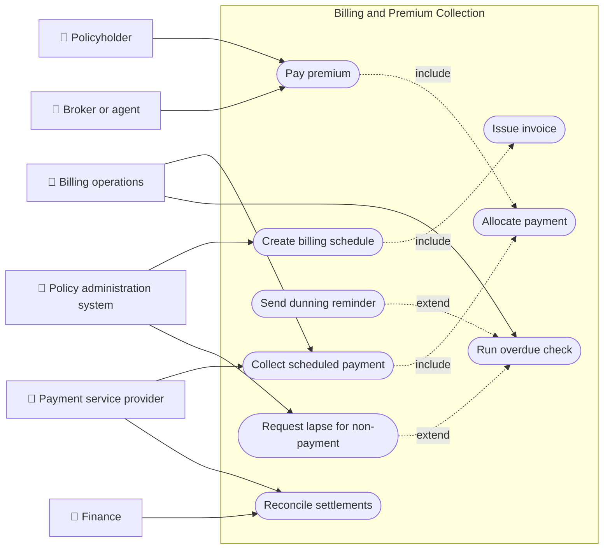
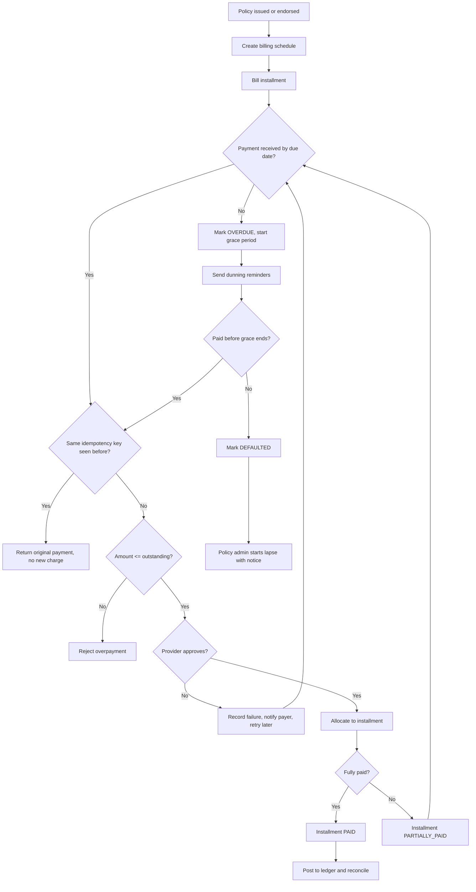
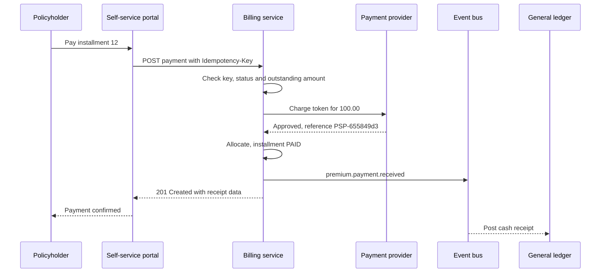
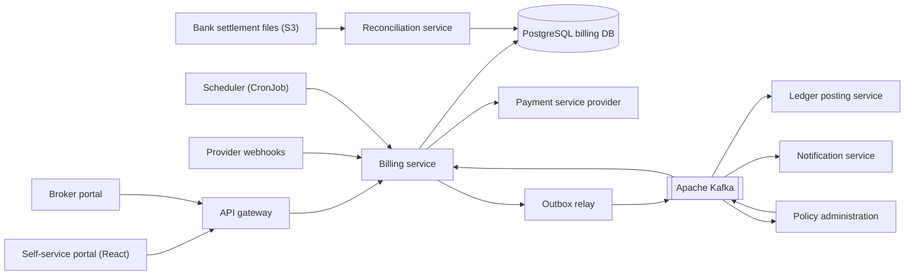
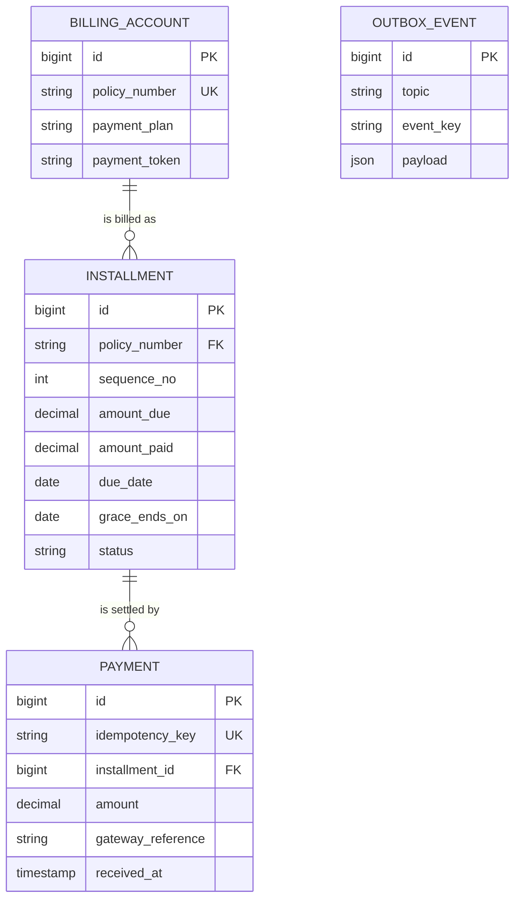
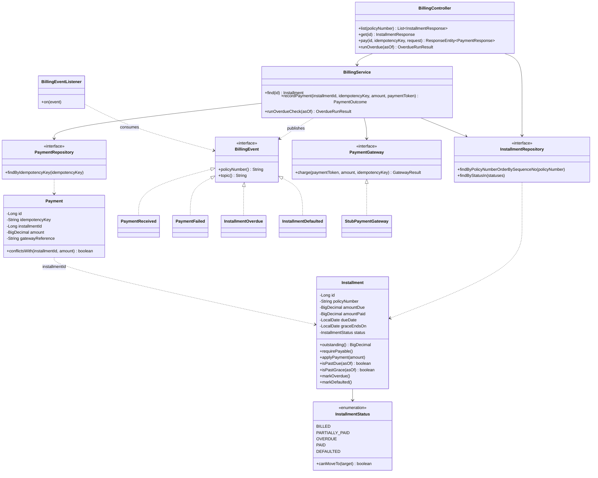
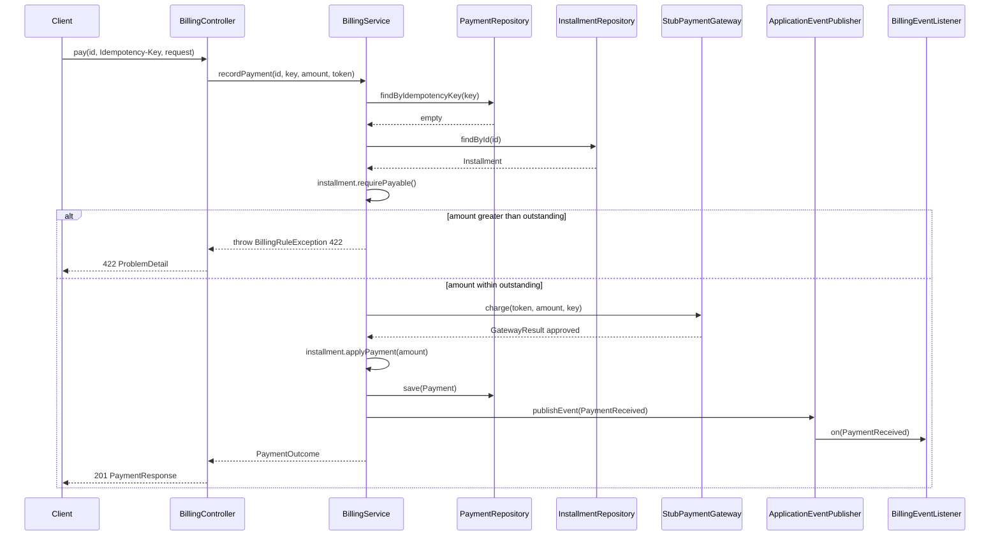
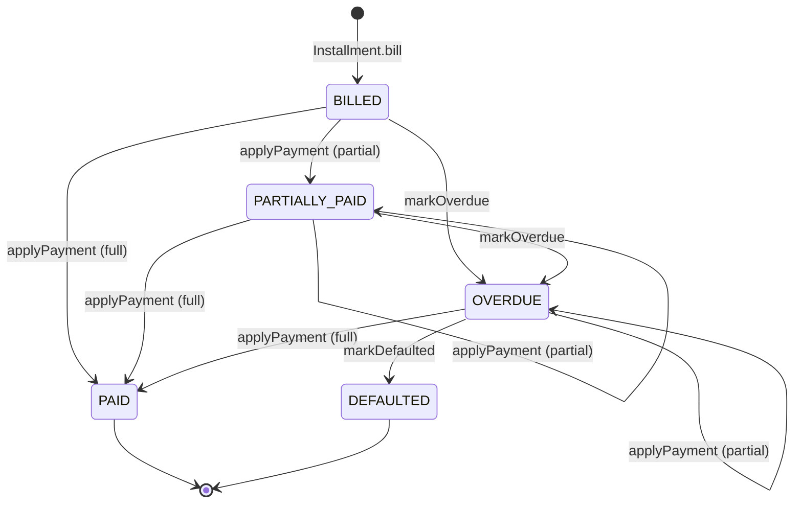
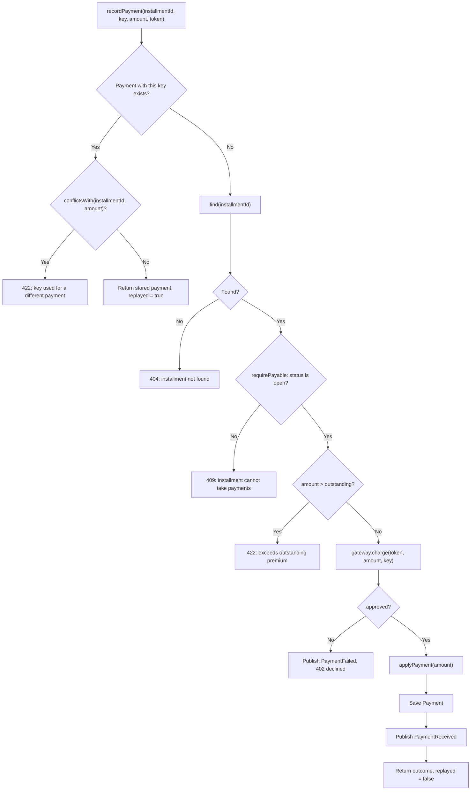

# Billing and Premium Collection

> **Domain:** Insurance · **Author:** [@naveenks720](https://github.com/naveenks720) · **Published:** November 25, 2026

> **Runnable code:** [`examples/insurance/billing-and-premium-collection`](https://github.com/dhulipalla599/domain-knowledge-engineering/tree/main/examples/insurance/billing-and-premium-collection)

## Explain It Like I'm Five

Imagine your family pays a neighbour a little bit of pocket money every month to keep an eye on your house while you are away. The neighbour writes down in a notebook how much you owe each month and ticks it off when you pay. If you forget, the neighbour gives you a few extra days and a friendly reminder. If you still do not pay, the neighbour politely stops watching the house. And if you accidentally hand over the same coins twice, a good neighbour gives them back instead of keeping them.

Insurance billing is that notebook: it works out what each policyholder owes and when, collects the money, gives a grace period when payments are late, and tells the rest of the company when cover must stop for non-payment.

## Business Overview

**Billing and premium collection** is the capability that turns a policy's premium into money in the bank. Once policy administration issues or changes a policy, billing:

- builds a **billing schedule** (annual, quarterly or monthly **installments**, sometimes with installment fees),
- issues **invoices** or direct-debit notices,
- **collects** payments through cards, bank transfers, direct debit mandates, agents or payroll deduction,
- **allocates** each payment to the right installment and policy, and **reconciles** with bank and payment-provider settlement files,
- chases **arrears** (dunning), applies the **grace period**, and triggers **lapse** or **cancellation for non-payment**,
- handles **refunds** of unearned premium after cancellations and returns of overpayments.

Why the business cares:

| Driver | Why it matters |
|---|---|
| Revenue and cash flow | Premium is the insurer's revenue. Uncollected premium is cash the insurer counted on for investment income and claims. |
| Risk | Insurers carry cover while premium is unpaid during grace. Lax collection means paying claims on policies that never paid. |
| Regulation | Many jurisdictions regulate grace periods, notice periods before cancellation for non-payment, refund timing and how premium financing is disclosed. Rules differ by country, state and line of business (life and health often have statutory grace periods; property and casualty rules vary by state or regulator). |
| Customer experience | Billing errors (double charges, surprise lapses) are among the most common causes of complaints and churn. |
| Accounting | Written versus earned premium, receivables and unearned premium reserves all depend on correct billing data. |

**Place in the value chain:** Product → Quote and Rating → Underwriting → Policy Administration → **Billing and Premium Collection** → Claims → Reinsurance and Finance. Billing listens to policy events (issued, endorsed, renewed, cancelled) and feeds finance (general ledger), claims (is the policy in force and paid?) and policy administration (lapse requests).

## Real-World Example

**Northbridge Mutual**, a fictional home insurer, issues policy **HM-2026-900001** to **Priya Nair** with an annual premium of 1,200.00 paid monthly by card. Billing creates twelve installments of 100.00, each due on the 1st, with a 30-day grace period (a company setting for this product and region).

1. **Billing schedule.** On issue, the billing system receives `policy.issued`, creates the schedule and stores Priya's card as a payment-provider token (never the raw card number).
2. **Invoice.** A few days before 1 December 2026, installment 12 moves to `BILLED` and Priya gets a notice: 100.00 due on 1 December.
3. **First attempt.** On 1 December the collection job charges 100.00 with idempotency key `7f3c9a10-pay-0001`. The provider's response is lost due to a network timeout.
4. **Safe retry.** The job retries with the same key. The billing service sees the key already recorded a captured payment and returns the original result. Priya is charged once.
5. **Allocation.** The 100.00 is allocated to installment 12, which becomes `PAID`. A `premium.payment.received` event lets the ledger post cash and the notification service send a receipt.
6. **A different customer misses a payment.** Motor policy **MT-2026-410022** (Tomasz Kowal) had 85.50 due on 15 October. The daily overdue run on 16 October marked it `OVERDUE`; Tomasz received reminders during the grace period.
7. **Grace ends.** On 15 November, the grace period expires with nothing paid. The overdue run marks the installment `DEFAULTED` and publishes `premium.installment.defaulted`. Policy administration starts the lapse process, which in Tomasz's jurisdiction requires a written notice period before cover actually ends.
8. **Overpayment attempt.** Before the lapse notice lands, Tomasz tries to pay 100.00 against the 85.50 balance from the self-service portal. The system rejects it with a clear message rather than holding an unexplained credit. (In this example the defaulted installment would reject any payment; real insurers usually route late payments into a **reinstatement** flow.)

## Stakeholders

| Stakeholder | What they need | What they fear |
|---|---|---|
| Policyholder | Clear bills, convenient payment methods, receipts, warning before cover stops | Double charges, silent lapse, losing cover when a claim happens |
| Broker or agent | Visibility of client arrears, commission paid on collected premium | Commission clawback, clients lapsing without warning |
| Billing operations team | Accurate schedules, exception queues, easy reconciliation | Unallocated cash, manual spreadsheets, month-end surprises |
| Finance and accounting | Correct receivables, cash postings and earned/unearned premium | Ledger not matching bank, audit findings |
| Collections / credit control | Prioritised arrears lists, dunning automation | Writing off premium that could have been collected |
| Compliance officer | Regulatory notice periods and refund rules applied consistently | Fines and remediation for unfair lapses |
| Policy administration system | Reliable signals for lapse, reinstatement and cancellation | Cancelling a policy that was actually paid |
| Payment service provider | Valid tokens, idempotent requests, correct mandate use | Chargebacks, PCI DSS scope violations |

## Use Case Diagram



| Use Case | Primary Actor | Goal | Main success outcome |
|---|---|---|---|
| Create billing schedule | Policy administration system | Split the premium into installments when a policy is issued or changed | Installments with amounts, due dates and grace dates exist |
| Issue invoice | Billing operations (automated) | Tell the payer what is due and when | Notice sent; installment `BILLED` |
| Pay premium | Policyholder or broker | Pay an installment through the portal or agent | Payment captured once and allocated |
| Collect scheduled payment | Billing operations (automated job) | Charge stored card or direct debit on the due date | Payment captured; retries are idempotent |
| Allocate payment | System | Apply cash to the right installment | Installment `PARTIALLY_PAID` or `PAID` |
| Run overdue check | Billing operations (daily job) | Age unpaid installments | `OVERDUE` or `DEFAULTED` set, events published |
| Send dunning reminder | System (extends overdue check) | Remind the payer during grace | Reminder sent and logged |
| Request lapse for non-payment | System (extends overdue check) | Tell policy administration cover must end | Lapse process started with legally required notice |
| Reconcile settlements | Finance | Match provider and bank settlements to captured payments | Ledger agrees with cash received |

## Key Terms

| Term | Plain-English meaning |
|---|---|
| Premium | The price of the insurance cover for a period. |
| Billing schedule / payment plan | How the premium is split: annual, quarterly, monthly, with due dates. |
| Installment | One scheduled slice of the premium with its own due date. |
| Grace period | Time after the due date during which cover continues even though payment is late. Length is set by law for some lines and by contract for others. |
| Arrears | Premium that is due but unpaid. |
| Dunning | The sequence of reminders sent to collect arrears. |
| Lapse | The policy ends because premium was not paid. |
| Cancellation for non-payment | Insurer-initiated cancellation after unpaid premium, usually requiring formal notice. |
| Reinstatement | Bringing a lapsed policy back into force, often requiring payment of arrears and sometimes new underwriting evidence. |
| Direct bill vs agency bill | Direct bill: the insurer bills the customer. Agency bill: the broker collects and remits premium, net of commission. |
| Written vs earned premium | Written: premium on policies sold. Earned: the portion that relates to cover already provided. |
| Suspense / unallocated cash | Money received that cannot yet be matched to a policy or installment. |

## Process Flow

The policy administration system issues a policy and billing builds the schedule. Before each due date the installment is billed and the payer notified. On the due date the scheduled collection charges the stored payment method, or the payer pays manually. A captured payment is allocated to the installment; a decline triggers a retry plan and a notice. A daily overdue run marks unpaid installments as overdue (grace starts, reminders go out) and, once grace ends, as defaulted, which asks policy administration to lapse or cancel the policy with the notice its jurisdiction requires. Finance reconciles captured payments with provider and bank settlements.





## Business Rules and Edge Cases

- **Idempotency on every money movement.** Timeouts and retries are normal. Every charge carries an idempotency key that is stored with a unique constraint and passed to the provider. A retry with the same key returns the original result; the same key with a different amount or installment is an error, not a new payment.
- **Never trust "no response" as "not charged".** When the provider call times out, the payment state is unknown. Query the provider by key or reconcile later; do not blindly charge again with a new key.
- **Money is decimal.** Use fixed-point decimals with an explicit scale and a documented rounding rule. When an annual premium does not divide evenly (for example 1,000.00 over 12), decide where the remainder goes (often the first or last installment) and make the schedule sum exactly to the premium.
- **Overpayments and underpayments.** Decide per product whether overpayments are rejected, held as credit, or refunded. Partial payments must not mark an installment paid. Small tolerances for write-off differ by insurer.
- **Grace periods and notice periods are jurisdiction- and product-specific.** Life and health products often have statutory grace periods; property and casualty products usually require written notice before cancellation for non-payment, with lengths that differ by state or country. Keep them as configuration, not code.
- **Time zones and business days.** "Due on the 1st" means the 1st in the policy's jurisdiction. Due dates that fall on bank holidays may shift. Run date-based jobs with an explicit "as of" date, never `now()` scattered through code.
- **Payment after default.** A payment that arrives after an installment defaulted (or after the policy lapsed) must not silently reactivate cover; it goes to reinstatement or refund handling.
- **Cancellations and refunds.** When a policy is cancelled, future installments are voided and unearned premium may be refunded (pro rata or short rate, depending on product and law). Refunds should go back to the original payment method where possible.
- **Chargebacks and returned direct debits.** A captured payment can be reversed days or weeks later. The installment must reopen and the dunning clock restart.
- **Concurrency.** A scheduled collection and a manual portal payment can hit the same installment at the same time. Use optimistic locking on the installment and the unique idempotency key to avoid double allocation.
- **Partial failure between database and broker.** Commit the payment and the outbound event together (transactional outbox) so the ledger never misses a receipt and never sees one that was rolled back.
- **PCI DSS scope.** Store provider tokens, never card numbers or CVV codes.

## From Business to System

| Business concept / step | System component | Data entity | Event |
|---|---|---|---|
| Policy issued or changed | Billing schedule consumer | `installment` | consumes `policy.issued`, `policy.endorsed`, `policy.cancelled` |
| Bill installment | Invoice job | `installment` (`BILLED`) | `premium.installment.billed` (production) |
| Pay premium / collect scheduled payment | Billing API + collection job | `payment` | `premium.payment.received` / `premium.payment.failed` |
| Idempotent retry | `BillingService.recordPayment` | `payment.idempotency_key` (unique) | none (replay returns stored result) |
| Allocate payment | `Installment.applyPayment` | `installment.amount_paid`, `status` | `premium.payment.received` |
| Grace period and dunning | Overdue run job + notification consumer | `installment` (`OVERDUE`) | `premium.installment.overdue` |
| Lapse for non-payment | Overdue run + policy admin consumer | `installment` (`DEFAULTED`) | `premium.installment.defaulted` |
| Reconciliation | Reconciliation service | `settlement_line` | `premium.settlement.reconciled` (production) |
| Reliable publication | Outbox relay | `outbox_event` | all of the above |

## Architecture



**Service boundaries.** The **billing service** owns installments and payments because both change together inside one transaction (allocation must update both atomically). **Policy administration** owns the policy and decides lapse or cancellation; billing only reports that premium defaulted, because the legal steps (notices, effective dates) belong to the policy lifecycle. The **ledger posting service** is separate because finance has its own chart of accounts, period close and audit trail. **Notifications** are separate so letters, emails and SMS templates can change without redeploying billing. **Reconciliation** is batch-oriented and file-driven, so it scales and fails independently of the online payment path. The payment provider sits behind an adapter so a provider change does not touch business rules.

## Data Model

```sql
CREATE TABLE billing_account (
    id               BIGSERIAL PRIMARY KEY,
    policy_number    VARCHAR(30)  NOT NULL UNIQUE,
    payer_name       VARCHAR(200) NOT NULL,
    payment_plan     VARCHAR(20)  NOT NULL CHECK (payment_plan IN ('ANNUAL','QUARTERLY','MONTHLY')),
    payment_token    VARCHAR(100),          -- provider token, never a card number
    currency         CHAR(3)      NOT NULL
);

CREATE TABLE installment (
    id               BIGSERIAL PRIMARY KEY,
    policy_number    VARCHAR(30)   NOT NULL REFERENCES billing_account (policy_number),
    sequence_no      INT           NOT NULL,
    amount_due       NUMERIC(12,2) NOT NULL CHECK (amount_due > 0),
    amount_paid      NUMERIC(12,2) NOT NULL DEFAULT 0 CHECK (amount_paid >= 0),
    due_date         DATE          NOT NULL,
    grace_ends_on    DATE          NOT NULL,
    status           VARCHAR(20)   NOT NULL
        CHECK (status IN ('BILLED','PARTIALLY_PAID','OVERDUE','PAID','DEFAULTED')),
    version          BIGINT        NOT NULL DEFAULT 0,
    UNIQUE (policy_number, sequence_no),
    CHECK (amount_paid <= amount_due)
);
CREATE INDEX installment_open_idx ON installment (status, due_date)
    WHERE status IN ('BILLED','PARTIALLY_PAID','OVERDUE');

CREATE TABLE payment (
    id                 BIGSERIAL PRIMARY KEY,
    idempotency_key    VARCHAR(100)  NOT NULL UNIQUE,
    installment_id     BIGINT        NOT NULL REFERENCES installment (id),
    amount             NUMERIC(12,2) NOT NULL CHECK (amount > 0),
    gateway_reference  VARCHAR(100)  NOT NULL,
    received_at        TIMESTAMPTZ   NOT NULL
);

CREATE TABLE outbox_event (
    id            BIGSERIAL PRIMARY KEY,
    topic         VARCHAR(100) NOT NULL,
    event_key     VARCHAR(100) NOT NULL,   -- policy number, keeps per-policy ordering
    payload       JSONB        NOT NULL,
    created_at    TIMESTAMPTZ  NOT NULL DEFAULT now(),
    published_at  TIMESTAMPTZ
);
```



## APIs

| Method | Path | Purpose |
|---|---|---|
| GET | `/api/installments?policyNumber={n}` | List a policy's installments and balances |
| GET | `/api/installments/{id}` | Get one installment |
| POST | `/api/installments/{id}/payments` | Pay an installment (requires `Idempotency-Key` header) |
| POST | `/api/billing-runs/overdue?asOf={date}` | Run the overdue and default check as of a date (scheduler only) |

**Request**

```http
POST /api/installments/1/payments
Idempotency-Key: 7f3c9a10-pay-0001
Content-Type: application/json

{"amount": 100.00, "paymentToken": "tok_visa"}
```

**Response** `201 Created` (a retry with the same key returns `200 OK` with `"replayed": true`)

```json
{
  "paymentId": 2,
  "installmentId": 1,
  "policyNumber": "HM-2026-900001",
  "amount": 100.00,
  "gatewayReference": "PSP-655849d3",
  "receivedAt": "2026-11-25T15:05:21.091187721Z",
  "installmentStatus": "PAID",
  "outstanding": 0.00,
  "replayed": false
}
```

Errors use RFC 9457 problem details: `400` missing key or invalid body, `402` declined, `404` unknown installment, `409` installment not payable, `422` overpayment or reused key.

## Events

| Event | Producer | Consumers | Key fields |
|---|---|---|---|
| `premium.payment.received` | Billing service | Ledger posting, notifications, commissions | policyNumber, installmentId, paymentId, amount, installmentStatus |
| `premium.payment.failed` | Billing service | Notifications, collections | policyNumber, installmentId, amount, reason |
| `premium.installment.overdue` | Billing service (overdue run) | Notifications (dunning), broker portal | policyNumber, installmentId, outstanding |
| `premium.installment.defaulted` | Billing service (overdue run) | Policy administration (lapse), collections | policyNumber, installmentId, outstanding |

**Ordering.** Key every message by policy number so all events for one policy land on the same partition and are consumed in order (for example, `payment.received` before a later `installment.overdue` for the next installment).

**Idempotency.** Delivery is at least once. Consumers de-duplicate on an event id (or `paymentId` / `installmentId` plus type) before acting; the ledger must never post the same receipt twice, and policy administration must ignore a `defaulted` event if a later payment already reinstated the policy.

**Atomicity.** Write events to an outbox table in the same transaction as the payment, then relay to Kafka, so an event is published if and only if the payment committed.

## Backend Implementation

> The Java tab is the exact code from the runnable example (Spring Boot 3). The Python tab uses FastAPI with SQLAlchemy and the Node.js tab uses Express with TypeScript.

Full source: [`examples/insurance/billing-and-premium-collection`](https://github.com/dhulipalla599/domain-knowledge-engineering/tree/main/examples/insurance/billing-and-premium-collection/src/main/java/com/dke/insurance/billing_and_premium_collection).

### The business rule: `BillingService.recordPayment`

=== "Java"

    ```java
    /**
     * Collects a premium payment against one installment.
     * Rules: same idempotency key never charges twice; installment must be open; no overpayment.
     */
    @Transactional
    public PaymentOutcome recordPayment(Long installmentId, String idempotencyKey, BigDecimal amount, String paymentToken) {
        var previous = payments.findByIdempotencyKey(idempotencyKey);
        if (previous.isPresent()) {
            if (previous.get().conflictsWith(installmentId, amount)) {
                throw new BillingRuleException(HttpStatus.UNPROCESSABLE_ENTITY,
                        "Idempotency key " + idempotencyKey + " was already used for a different payment");
            }
            return new PaymentOutcome(previous.get(), find(installmentId), true);
        }

        var installment = find(installmentId);
        installment.requirePayable();
        if (amount.compareTo(installment.outstanding()) > 0) {
            throw new BillingRuleException(HttpStatus.UNPROCESSABLE_ENTITY,
                    "Payment " + amount + " exceeds outstanding premium " + installment.outstanding());
        }

        var result = gateway.charge(paymentToken, amount, idempotencyKey);
        if (!result.approved()) {
            events.publishEvent(new BillingEvent.PaymentFailed(
                    installment.getPolicyNumber(), installmentId, amount, result.declineReason()));
            throw new BillingRuleException(HttpStatus.PAYMENT_REQUIRED, "Payment declined: " + result.declineReason());
        }

        installment.applyPayment(amount);
        var payment = payments.save(new Payment(idempotencyKey, installmentId, amount,
                result.reference(), Instant.now(clock)));
        events.publishEvent(new BillingEvent.PaymentReceived(installment.getPolicyNumber(), installmentId,
                payment.getId(), amount, installment.getStatus()));
        return new PaymentOutcome(payment, installment, false);
    }
    ```

=== "Python"

    ```python
    def record_payment(db: Session, installment_id: int, idempotency_key: str,
                       amount: Decimal, payment_token: str) -> PaymentOutcome:
        """Rules: same idempotency key never charges twice; installment must be open; no overpayment."""
        previous = db.scalar(select(Payment).where(Payment.idempotency_key == idempotency_key))
        if previous:
            if previous.conflicts_with(installment_id, amount):
                raise BillingRuleError(422, f"Idempotency key {idempotency_key} was already used for a different payment")
            return PaymentOutcome(previous, find(db, installment_id), replayed=True)

        installment = find(db, installment_id)
        installment.require_payable()
        if amount > installment.outstanding():
            raise BillingRuleError(422, f"Payment {amount} exceeds outstanding premium {installment.outstanding()}")

        result = gateway.charge(payment_token, amount, idempotency_key)
        if not result.approved:
            events.publish(PaymentFailed(installment.policy_number, installment_id, amount, result.decline_reason))
            raise BillingRuleError(402, f"Payment declined: {result.decline_reason}")

        installment.apply_payment(amount)
        payment = Payment(idempotency_key=idempotency_key, installment_id=installment_id, amount=amount,
                          gateway_reference=result.reference, received_at=datetime.now(timezone.utc))
        db.add(payment)
        db.flush()
        events.publish(PaymentReceived(installment.policy_number, installment_id, payment.id, amount, installment.status))
        return PaymentOutcome(payment, installment, replayed=False)
    ```

=== "Node.js"

    ```typescript
    /** Rules: same idempotency key never charges twice; installment must be open; no overpayment. */
    export async function recordPayment(tx: Tx, installmentId: number, idempotencyKey: string,
                                        amount: Decimal, paymentToken: string): Promise<PaymentOutcome> {
      const previous = await tx.payment.findUnique({ where: { idempotencyKey } });
      if (previous) {
        if (conflictsWith(previous, installmentId, amount)) {
          throw new BillingRuleError(422, `Idempotency key ${idempotencyKey} was already used for a different payment`);
        }
        return { payment: previous, installment: await find(tx, installmentId), replayed: true };
      }

      const installment = await find(tx, installmentId);
      requirePayable(installment);
      if (amount.gt(outstanding(installment))) {
        throw new BillingRuleError(422, `Payment ${amount} exceeds outstanding premium ${outstanding(installment)}`);
      }

      const result = await gateway.charge(paymentToken, amount, idempotencyKey);
      if (!result.approved) {
        events.publish({ type: "premium.payment.failed", policyNumber: installment.policyNumber,
                         installmentId, amount, reason: result.declineReason });
        throw new BillingRuleError(402, `Payment declined: ${result.declineReason}`);
      }

      const updated = applyPayment(installment, amount);
      await tx.installment.update({ where: { id: installmentId, version: installment.version }, data: updated });
      const payment = await tx.payment.create({ data: { idempotencyKey, installmentId, amount,
        gatewayReference: result.reference, receivedAt: new Date() } });
      events.publish({ type: "premium.payment.received", policyNumber: installment.policyNumber,
                       installmentId, paymentId: payment.id, amount, installmentStatus: updated.status });
      return { payment, installment: updated, replayed: false };
    }
    ```

### The controller endpoint: `BillingController.pay`

=== "Java"

    ```java
    /** 201 for a new payment, 200 when the Idempotency-Key replays an earlier one. */
    @PostMapping("/installments/{id}/payments")
    public ResponseEntity<PaymentResponse> pay(@PathVariable Long id,
                                               @RequestHeader("Idempotency-Key") String idempotencyKey,
                                               @Valid @RequestBody PaymentRequest request) {
        var outcome = billing.recordPayment(id, idempotencyKey, request.amount(), request.paymentToken());
        var status = outcome.replayed() ? HttpStatus.OK : HttpStatus.CREATED;
        return ResponseEntity.status(status).body(PaymentResponse.from(outcome));
    }
    ```

=== "Python"

    ```python
    @router.post("/installments/{id}/payments", response_model=PaymentResponse)
    def pay(id: int, request: PaymentRequest, response: Response,
            idempotency_key: str = Header(alias="Idempotency-Key"), db: Session = Depends(get_db)):
        """201 for a new payment, 200 when the Idempotency-Key replays an earlier one."""
        with db.begin():
            outcome = record_payment(db, id, idempotency_key, request.amount, request.payment_token)
        response.status_code = 200 if outcome.replayed else 201
        return PaymentResponse.from_outcome(outcome)
    ```

=== "Node.js"

    ```typescript
    /** 201 for a new payment, 200 when the Idempotency-Key replays an earlier one. */
    router.post("/installments/:id/payments", async (req, res) => {
      const idempotencyKey = req.header("Idempotency-Key");
      if (!idempotencyKey) return res.status(400).json(problem(400, "Header Idempotency-Key is required"));
      const body = PaymentRequest.parse(req.body); // zod schema: amount > 0, paymentToken non-empty
      const outcome = await prisma.$transaction((tx) =>
        recordPayment(tx, Number(req.params.id), idempotencyKey, new Decimal(body.amount), body.paymentToken));
      res.status(outcome.replayed ? 200 : 201).json(toPaymentResponse(outcome));
    });
    ```

## Frontend Screen

The policyholder's "Pay my premium" screen: it shows open installments and generates one idempotency key per payment attempt, so a double-click or network retry never charges twice.

```tsx
import { useEffect, useMemo, useState } from "react";

type Installment = {
  id: number; policyNumber: string; sequenceNo: number; amountDue: number;
  outstanding: number; dueDate: string; graceEndsOn: string;
  status: "BILLED" | "PARTIALLY_PAID" | "OVERDUE" | "PAID" | "DEFAULTED";
};

const money = new Intl.NumberFormat("en-GB", { style: "currency", currency: "GBP" });

export function PayPremium({ policyNumber, paymentToken }: { policyNumber: string; paymentToken: string }) {
  const [installments, setInstallments] = useState<Installment[]>([]);
  const [selected, setSelected] = useState<Installment | null>(null);
  const [message, setMessage] = useState<string>("");
  const [busy, setBusy] = useState(false);
  // One key per attempt on the selected installment; reused if the user retries after a timeout.
  const idempotencyKey = useMemo(() => crypto.randomUUID(), [selected?.id]);

  const load = () =>
    fetch(`/api/installments?policyNumber=${encodeURIComponent(policyNumber)}`)
      .then((r) => r.json()).then(setInstallments);
  useEffect(() => { load(); }, [policyNumber]);

  async function pay() {
    if (!selected) return;
    setBusy(true);
    setMessage("");
    try {
      const res = await fetch(`/api/installments/${selected.id}/payments`, {
        method: "POST",
        headers: { "Content-Type": "application/json", "Idempotency-Key": idempotencyKey },
        body: JSON.stringify({ amount: selected.outstanding, paymentToken }),
      });
      const body = await res.json();
      setMessage(res.ok ? `Paid. Reference ${body.gatewayReference}` : body.detail);
      if (res.ok) { setSelected(null); await load(); }
    } catch {
      setMessage("Network problem. Press Pay again: you will not be charged twice.");
    } finally {
      setBusy(false);
    }
  }

  const open = installments.filter((i) => ["BILLED", "PARTIALLY_PAID", "OVERDUE"].includes(i.status));
  return (
    <section aria-labelledby="pay-title">
      <h2 id="pay-title">Pay premium for {policyNumber}</h2>
      {open.length === 0 && <p>Nothing to pay. Thank you.</p>}
      <ul>
        {open.map((i) => (
          <li key={i.id}>
            <label>
              <input type="radio" name="installment" checked={selected?.id === i.id} onChange={() => setSelected(i)} />
              Installment {i.sequenceNo}: {money.format(i.outstanding)} due {i.dueDate}
              {i.status === "OVERDUE" && <strong> (overdue, pay by {i.graceEndsOn} to keep cover)</strong>}
            </label>
          </li>
        ))}
      </ul>
      <button onClick={pay} disabled={!selected || busy}>{busy ? "Paying..." : "Pay now"}</button>
      <p role="status">{message}</p>
    </section>
  );
}
```

## Cloud Deployment

**Managed services on AWS**

| Concern | Service |
|---|---|
| Compute | Amazon EKS: billing service as a Deployment; overdue run and invoice jobs as Kubernetes CronJobs |
| Database | Amazon Aurora PostgreSQL (Multi-AZ), automated backups and point-in-time recovery |
| Messaging | Amazon MSK (Apache Kafka) for `premium.*` topics |
| Files | Amazon S3 for bank and provider settlement files, with S3 event notifications to reconciliation |
| Secrets | AWS Secrets Manager (DB and provider API credentials), mounted via the Secrets Store CSI driver |
| Edge | Application Load Balancer behind AWS WAF; API gateway or ingress with OIDC authentication |
| Observability | OpenTelemetry Collector (ADOT) exporting traces and metrics to CloudWatch and X-Ray, logs to CloudWatch Logs |

**Terraform: the most important resource is the billing database.**

```hcl
resource "aws_rds_cluster" "billing" {
  cluster_identifier              = "billing-prod"
  engine                          = "aurora-postgresql"
  engine_version                  = "16.4"
  database_name                   = "billing"
  master_username                 = "billing_admin"
  manage_master_user_password     = true
  storage_encrypted               = true
  kms_key_id                      = aws_kms_key.billing.arn
  backup_retention_period         = 35
  preferred_backup_window         = "02:00-03:00"
  deletion_protection             = true
  iam_database_authentication_enabled = true
  db_subnet_group_name            = aws_db_subnet_group.private.name
  vpc_security_group_ids          = [aws_security_group.billing_db.id]
  enabled_cloudwatch_logs_exports = ["postgresql"]
}

resource "aws_rds_cluster_instance" "billing" {
  count              = 2
  identifier         = "billing-prod-${count.index}"
  cluster_identifier = aws_rds_cluster.billing.id
  instance_class     = "db.r6g.large"
  engine             = aws_rds_cluster.billing.engine
}
```

**Security.** Card data stays with the payment provider; the service stores tokens only, which keeps most of the platform out of PCI DSS cardholder-data scope. Pods use IAM Roles for Service Accounts (IRSA) with least-privilege access to Secrets Manager, S3 and MSK. Network policies allow egress only to the database, MSK and the provider's endpoints. Provider webhooks are verified by signature. Data is encrypted at rest with KMS and in transit with TLS.

**Scaling.** The API scales horizontally with a HorizontalPodAutoscaler on CPU and request rate. Collection jobs peak on common due dates (the 1st of the month), so they process installments in pages, respect provider rate limits, and can be sharded by policy-number hash. Kafka partitions are sized for the consumer parallelism of the ledger service.

**Observability.** Instrument with the OpenTelemetry Java agent; propagate trace context through Kafka headers so a payment can be followed from portal to ledger. Publish business metrics (payments captured, declines by reason, installments overdue, defaulted, unallocated cash) to CloudWatch and alarm on decline-rate spikes, outbox lag and overdue-run failures.

## Non-Functional Requirements

| Requirement | Expectation | How the design meets it |
|---|---|---|
| Availability | Payment API highly available, especially around common due dates | Multi-AZ EKS and Aurora; stateless pods; collection jobs can resume because every charge is idempotent |
| Latency | Interactive payment in a few seconds, dominated by the provider call | Single-row lookups by primary key and unique index; provider timeout with idempotent retry |
| Consistency | No double charge, no double allocation, events match committed state | Unique idempotency key, optimistic locking (`@Version`), transactional outbox |
| Correctness of money | Exact to the cent, schedules sum to the premium | `NUMERIC(12,2)` and `BigDecimal`, explicit rounding, database check constraints |
| Audit | Who paid what, when, through which provider reference, and why a status changed | Immutable `payment` rows, events retained in Kafka and archived, structured logs with trace ids |
| Compliance | Grace and notice periods per product and jurisdiction; PCI DSS; data protection laws on personal data | Grace days as configuration; lapse decided by policy administration with notice rules; tokens only; retention policies on personal data |
| Recoverability | Restore without losing captured payments | Aurora point-in-time recovery; provider settlement files allow re-reconciliation |

## Runnable Example

The example is a small Spring Boot 3 billing service. It stores premium installments and payments in H2, collects a payment through a stubbed payment gateway, enforces three rules (idempotent retries, no overpayment, only open installments accept payments), rejects declined cards, ages unpaid installments with an overdue run (`OVERDUE`, then `DEFAULTED` after grace), and publishes Spring application events named after the Kafka topics on this page.

Source: [`examples/insurance/billing-and-premium-collection`](https://github.com/dhulipalla599/domain-knowledge-engineering/tree/main/examples/insurance/billing-and-premium-collection)

```bash
cd examples/insurance/billing-and-premium-collection
mvn spring-boot:run          # starts on http://localhost:8080
mvn verify                   # runs unit and API tests
```

**Pay installment 1 in full** (repeat it with the same key to get `200` and `"replayed": true`):

```bash
curl -s -X POST localhost:8080/api/installments/1/payments \
  -H 'Content-Type: application/json' -H 'Idempotency-Key: 7f3c9a10-pay-0001' \
  -d '{"amount":100.00,"paymentToken":"tok_visa"}'
```

```json
{"paymentId":2,"installmentId":1,"policyNumber":"HM-2026-900001","amount":100.00,"gatewayReference":"PSP-655849d3","receivedAt":"2026-11-25T15:05:21.091187721Z","installmentStatus":"PAID","outstanding":0.00,"replayed":false}
```

**Overpay installment 2** (outstanding 85.50):

```bash
curl -s -X POST localhost:8080/api/installments/2/payments \
  -H 'Content-Type: application/json' -H 'Idempotency-Key: 7f3c9a10-pay-0002' \
  -d '{"amount":100.00,"paymentToken":"tok_visa"}'
```

```json
{"type":"about:blank","title":"Unprocessable Entity","status":422,"detail":"Payment 100.00 exceeds outstanding premium 85.50","instance":"/api/installments/2/payments"}
```

| Class | Package | Responsibility |
|---|---|---|
| `Installment` | `domain` | Entity with amount due and paid, due date, grace end; enforces legal status transitions |
| `InstallmentStatus` | `domain` | Lifecycle enum with `canMoveTo` rules |
| `Payment` | `domain` | Captured payment with a unique idempotency key |
| `BillingEvent` | `domain` | Sealed interface of domain events, one per Kafka topic |
| `IllegalTransitionException` | `domain` | Illegal lifecycle move, mapped to 409 |
| `InstallmentRepository` | `repository` | Spring Data JPA repository for installments |
| `PaymentRepository` | `repository` | Spring Data JPA repository, lookup by idempotency key |
| `BillingService` | `service` | `recordPayment` and `runOverdueCheck` business rules |
| `BillingRuleException` | `service` | Business-rule failure carrying an HTTP status |
| `BillingController` | `api` | REST endpoints |
| `PaymentRequest` / `PaymentResponse` / `InstallmentResponse` | `api` | Request and response records |
| `ApiExceptionHandler` | `api` | Maps exceptions to `ProblemDetail` |
| `PaymentGateway` / `StubPaymentGateway` | `integration` | Payment provider port and deterministic stub |
| `BillingEventListener` | `integration` | Stand-in for the Kafka consumers |

## UML Diagrams

### Class Diagram

The controller delegates to `BillingService`, which coordinates the two repositories, the `PaymentGateway` port and the event publisher. `Installment` owns its lifecycle rules through `InstallmentStatus.canMoveTo`.



### Sequence Diagram (control flow)

One `POST /api/installments/{id}/payments` call through the code. The `alt` block shows the overpayment rule rejecting the request before the gateway is ever called.



### State Diagram

The installment lifecycle exactly as `InstallmentStatus.canMoveTo` allows it. `PAID` and `DEFAULTED` are final.



### Activity Diagram

The decision logic inside `BillingService.recordPayment`.



## AI Opportunities

| Use case | Data it needs | Main risk or control |
|---|---|---|
| **Payment-failure prediction and smart retry timing.** Predict which installments are likely to fail and choose the best day and method to retry (for example after typical payday). | Payment history, decline codes, payment method, schedule, seasonality | Fairness: must not use protected characteristics or proxies to treat customers differently; retry rules must respect provider and card-scheme retry limits. |
| **Cash application for unallocated payments.** Match bank transfers with messy references to the right policy and installment. | Bank statement lines, remittance text, open installments, payer names | Accuracy: auto-allocate only above a confidence threshold, route the rest to a human queue, keep an audit trail of every match. |
| **Collections prioritisation.** Rank overdue accounts by likelihood to pay and value at risk so the team calls the right people first. | Arrears age, amount, contact history, product, prior lapses | Explainability and regulation: collectors must be able to explain prioritisation; vulnerable-customer handling rules apply in many markets. |
| **LLM assistant for billing queries.** Answer "why was I charged this?" from the schedule, endorsements and payment records. | Billing schedule, payments, endorsement history, policy wording | Hallucination and privacy: ground answers in retrieved records only, verify the caller's identity, never let the assistant change payment details without a deterministic flow. |
| **Anomaly detection in reconciliation.** Flag unusual settlement differences, refund patterns or possible internal fraud. | Settlement files, refunds, user actions, ledger postings | False positives and auditability: anomalies are alerts for review, not automatic actions. |

## Common Pitfalls

- **Using floating-point for money.** Use `BigDecimal` / `NUMERIC` with an explicit scale and rounding mode, and make schedules sum exactly to the premium.
- **No idempotency key, or one generated per retry.** Generate the key once per payment attempt (client or job) and reuse it on every retry, then pass it to the provider too.
- **Treating a timeout as a failure.** The charge may have succeeded. Query by key or wait for the webhook or settlement before retrying with a new key.
- **Hard-coding grace and notice periods.** They differ by product, line of business and jurisdiction. Put them in product configuration with effective dates.
- **Letting billing cancel policies directly.** Billing reports defaults; policy administration owns lapse and cancellation with the right notices and effective dates.
- **Publishing events outside the transaction.** Use an outbox, otherwise the ledger can post a payment that rolled back or miss one that committed.
- **Ignoring reversals.** Chargebacks and returned direct debits reopen installments; model them explicitly rather than editing the original payment.
- **Running date jobs on server time.** Pass an explicit "as of" date in the policy's time zone, which also makes jobs re-runnable and testable.
- **Storing card numbers.** Use provider tokens to stay out of PCI DSS cardholder-data scope.
- **Silent credits.** Overpayments that sit unexplained in suspense become complaints and audit findings. Decide reject, credit or refund per product and make it visible.

## Interview Questions

### Junior

**1. Why should premium amounts not be stored as `double`?**
Binary floating-point cannot represent most decimal fractions exactly, so sums drift by fractions of a cent. Use `BigDecimal` in Java and `NUMERIC` in PostgreSQL with an explicit scale and rounding mode.

**2. What is a grace period?**
The time after the due date when the premium is late but cover continues. If the payment arrives within it, nothing is lost; if not, the policy can lapse or be cancelled for non-payment. Its length depends on product and jurisdiction.

**3. What does an idempotency key do on a payment API?**
It identifies one logical payment attempt. If the client retries with the same key, the server returns the original result instead of charging again.

### Mid-Level

**1. A payment provider call times out. What do you do?**
Treat the outcome as unknown. Retry with the same idempotency key (the provider returns the original result) or query the provider's status by key. Never retry with a new key. Reconcile later with settlement files or webhooks.

**2. How do you prevent a scheduled collection and a manual payment from both settling the same installment?**
Optimistic locking (version column) on the installment so one transaction fails and re-reads; overpayment check against the fresh outstanding amount; unique idempotency keys per attempt. Optionally a short "collection in progress" state to stop the job charging while a manual payment is pending.

**3. How do you make sure the ledger sees every captured payment exactly once?**
Transactional outbox in the same database transaction as the payment, relayed to Kafka with at-least-once delivery, keyed by policy number. The ledger consumer de-duplicates on payment id before posting.

### Senior / Architect

**1. Design billing for a multi-country insurer with different grace periods, currencies and payment methods.**
Strong answers cover: product and jurisdiction configuration with effective dating; money with currency per account; payment-method adapters (cards, SEPA or ACH debits, agency bill); time-zone-aware due dates and business-day calendars; regulatory notice handled by policy administration; data residency; separate reconciliation per provider and bank; observability per market.

**2. Should billing and policy administration be one service or two?**
Trade-offs: separate lifecycles and teams, different scaling (billing peaks on due dates), different consistency needs; cost is eventual consistency between "policy changed" and "schedule updated". Strong answers describe events (`policy.endorsed` drives schedule recalculation, `premium.installment.defaulted` drives lapse), ordering per policy, idempotent consumers and how to handle a payment arriving while a lapse is in flight.

**3. How would you handle chargebacks and returned direct debits weeks after an installment was paid?**
Model a reversal as a new, immutable record linked to the original payment; reopen the installment (a `PAID` to reopened transition that the state machine must allow explicitly); recompute grace from the reversal date or per policy rules; publish an event for ledger reversal and collections; consider whether cover was in force for claims in between; reconcile reversal fees.

## Further Learning

- PCI DSS (Payment Card Industry Data Security Standard) and tokenisation
- ISO 20022 payment messages and SEPA Direct Debit / ACH rules
- ACORD data standards for insurance
- IFRS 17 and statutory accounting for premium recognition (written, earned and unearned premium)
- Transactional outbox and idempotent consumer patterns
- RFC 9457 Problem Details for HTTP APIs
- Idempotency keys in payment APIs (provider documentation on safe retries)
- Insurance regulator guidance on cancellation for non-payment in your target market

## Practitioner Notes

> _Reviewer: add real-world experience, corrections or gotchas here before approving._
