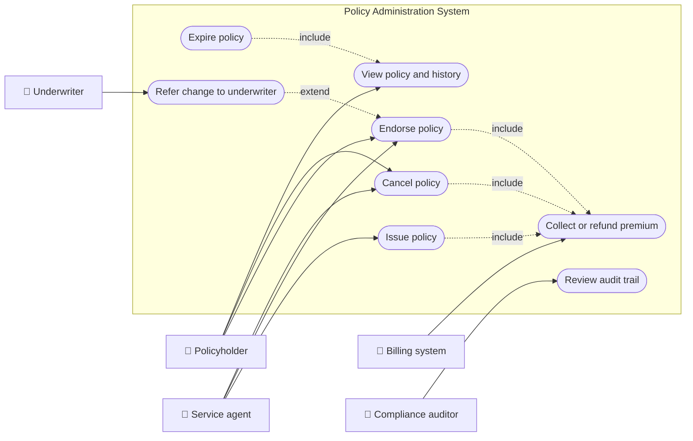
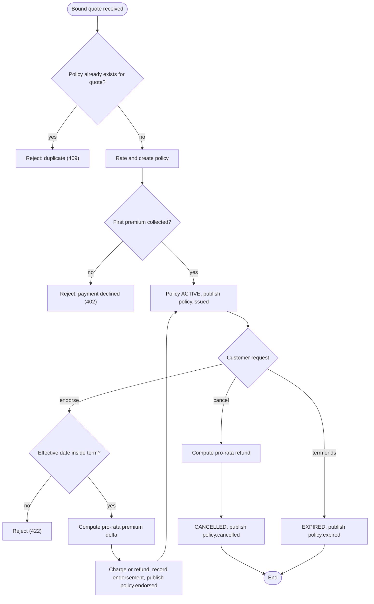
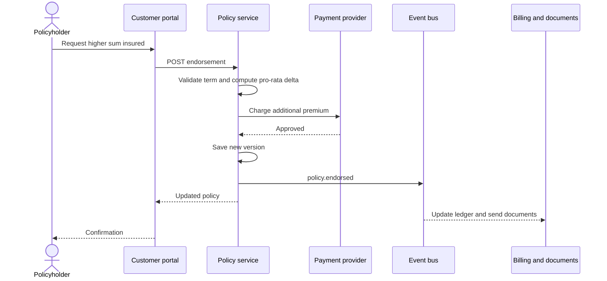
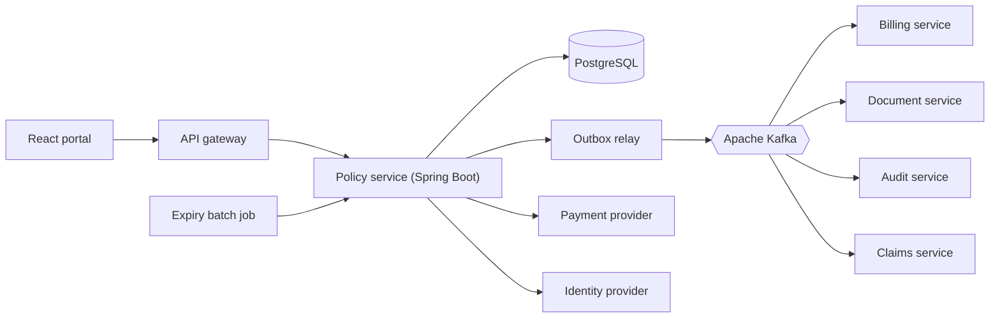
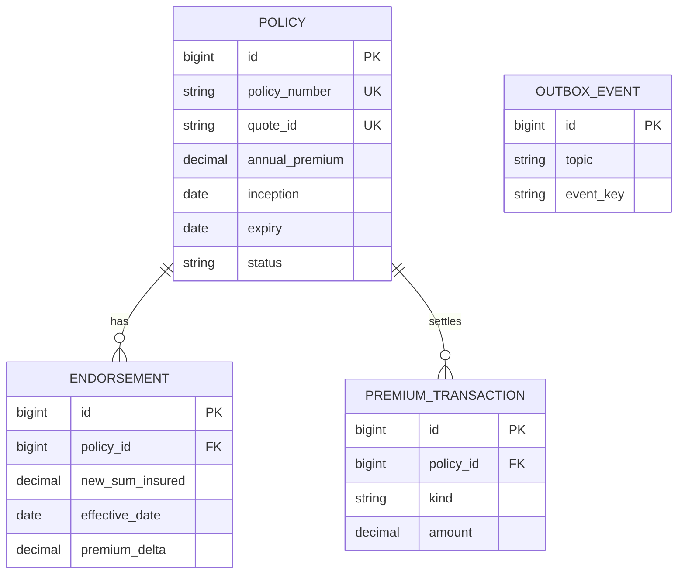
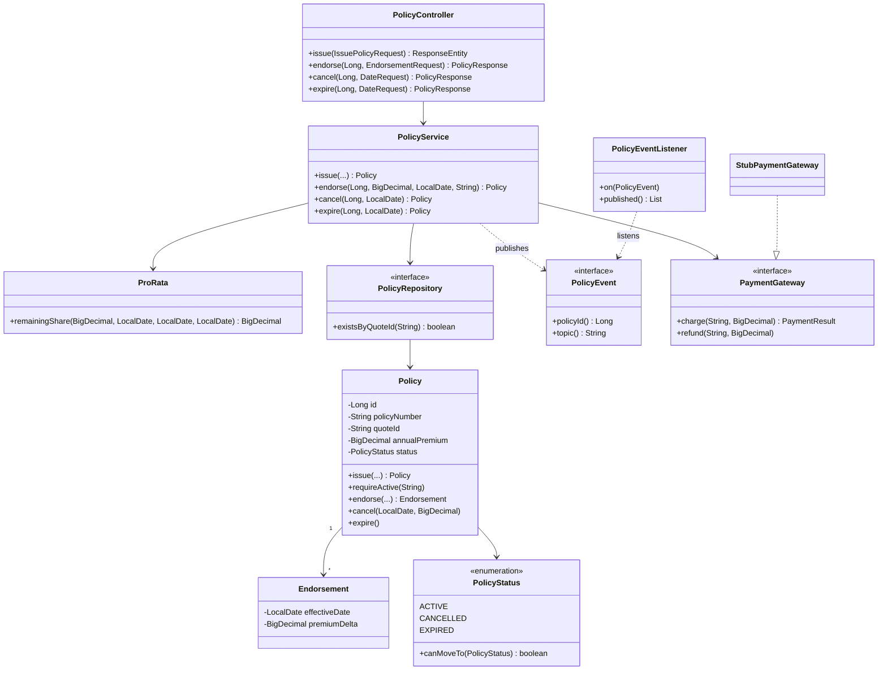
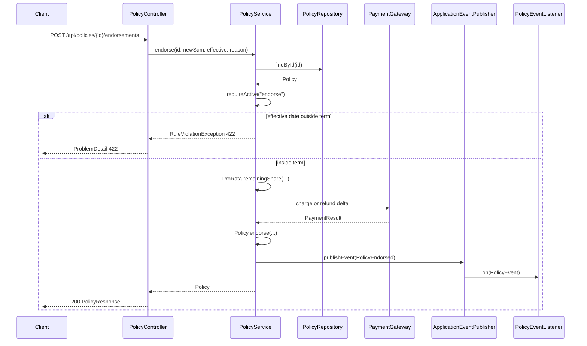
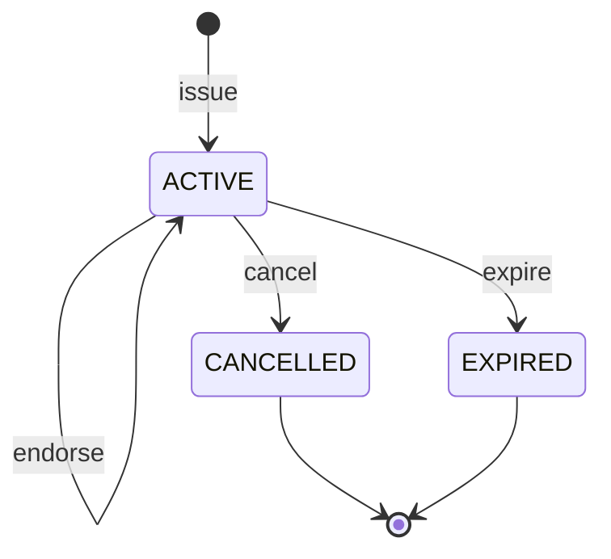
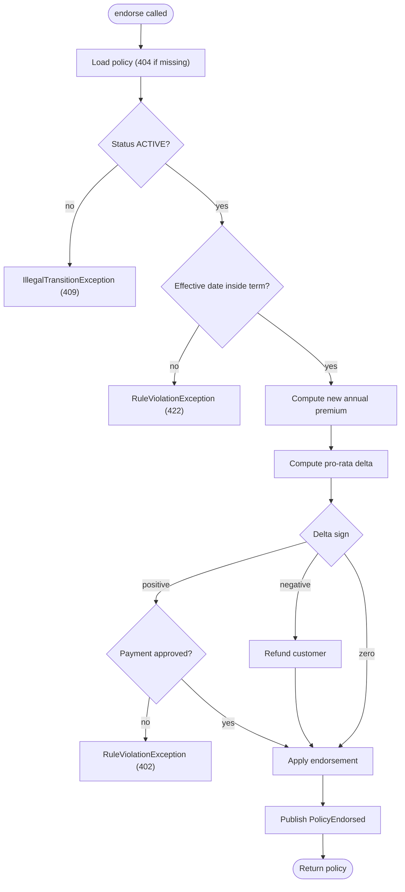

# Policy Administration

> **Domain:** Insurance · **Author:** [@dhulipalla599](https://github.com/dhulipalla599) · **Published:** November 10, 2026

> **Runnable code:** [`examples/insurance/policy-administration`](https://github.com/dhulipalla599/domain-knowledge-engineering/tree/main/examples/insurance/policy-administration)

## Explain It Like I'm Five

Imagine a library card. When you join, the librarian writes your name on a card, says which books you may borrow and until when, and keeps the card in a drawer. If you move house, the librarian fixes the address on the card. If you want to borrow more books, she changes the card and you pay a little extra for the time that is left. If you leave the library, she cancels the card and gives back the unused part of your fee. And when the year is over, the card runs out on its own.

Policy administration is that card drawer for an insurance company: it creates each customer's policy, keeps it correct while the customer's life changes, and ends it properly.

## Business Overview

Policy administration is the capability that turns an accepted quote into a legal insurance contract and manages that contract for its whole life. It covers issuing the policy, mid-term changes (called endorsements or mid-term adjustments), cancellation, reinstatement, expiry and renewal, plus the documents, premium adjustments and audit trail that go with each change. The system that does this is usually called the policy administration system (PAS).

Why the business cares:

- **Revenue:** the premium charged or refunded after every change must be right. Errors here leak money or cause complaints.
- **Risk:** the policy record is the source of truth for what is covered on a given day. A claim is paid against the terms in force on the date of loss, so the history of changes must be exact.
- **Regulation:** many jurisdictions regulate cancellation notice periods, refund methods, document delivery and record retention. These rules differ by country, state and line of business.
- **Customer experience:** customers expect to change their cover online and see the new price and documents immediately.

Where it sits in the Insurance value chain: product design → distribution and quote → underwriting (see [Underwriting](underwriting.md) and [Quote and Rating](quote-and-rating.md)) → **policy administration** → billing and collections → claims → renewal. It consumes the underwriting decision and quote, and it feeds billing, claims, reinsurance, finance and regulatory reporting.

## Real-World Example

Fictional insurer **Harborline Mutual** sells home insurance.

1. **Priya Nair** accepts a quote (`Q-1001`) for a 400,000 home at a rate of 0.30 percent. The annual premium is 1,200.00. Underwriting has already approved the risk.
2. Policy administration issues policy `HM-2026-900001` for the term 1 January 2026 to 1 January 2027. The first premium is collected and a `policy.issued` event tells billing and document generation to proceed.
3. On 1 July 2026 Priya extends the house and raises the sum insured to 500,000. The new annual premium is 1,500.00. Only 184 of the 365 days remain, so she is charged the difference pro rata: 300.00 × 184 / 365 = 151.23. The endorsement is recorded and a `policy.endorsed` event is published.
4. Later she sells the house and asks to cancel. Harborline refunds the unexpired share of the premium and publishes `policy.cancelled`. A second cancellation request for the same policy is rejected because the policy is already cancelled.
5. Had she done nothing, the policy would have expired on 1 January 2027 and renewal would have been offered before that date.

## Stakeholders

| Stakeholder | What they need | What they fear |
|---|---|---|
| Policyholder | Correct cover, a fair price for changes, quick documents | Being charged wrongly, finding a claim is not covered because a change was lost |
| Service agent / broker | Fast self-service changes and a clear history | Slow systems, having to re-key data, unclear rules |
| Underwriter | Material changes referred to them before they take effect | Risky changes slipping through automatically |
| Billing / finance team | Premium deltas and refunds that reconcile to the ledger | Mismatches between policy and billing |
| Claims handler | The exact terms in force on the date of loss | Missing or overlapping versions of a policy |
| Compliance / auditor | A complete, tamper-evident audit trail and correct notices | Backdated changes, missing evidence |
| Operations / platform engineer | Idempotent, observable, recoverable processes | Duplicate policies, stuck batches, lost events |

## Use Case Diagram



| Use Case | Primary Actor | Goal | Main success outcome |
|---|---|---|---|
| Issue policy | Service agent | Turn a bound quote into an active policy | Policy exists, first premium collected, `policy.issued` published |
| Endorse policy | Policyholder | Change cover mid-term | New terms apply from the effective date, pro-rata premium charged or refunded |
| Cancel policy | Policyholder | End cover early | Policy cancelled, unexpired premium refunded |
| Expire policy | Operations batch | End the policy when the term finishes | Status becomes expired, renewal process can start |
| View policy and history | Policyholder | See current terms and past changes | Accurate, dated list of versions |
| Collect or refund premium | Billing system | Settle the money side of a change | Payment captured or refund issued |
| Refer change to underwriter | Underwriter | Approve a risky change first | Change is approved or declined before it takes effect |
| Review audit trail | Compliance auditor | Prove who changed what and when | Complete, ordered history |

## Key Terms

| Term | Plain-English meaning |
|---|---|
| Policy administration system (PAS) | The core system that stores policies and manages their lifecycle |
| Bound quote | A quote the customer has accepted and the insurer agreed to cover |
| Inception date | The date cover starts |
| Expiry date | The date cover ends |
| Term | The period between inception and expiry, often 12 months |
| Endorsement | A mid-term change to a policy (also called a mid-term adjustment) |
| Effective date | The date a change starts to apply, which can differ from the day it is requested |
| Pro rata | Charging or refunding in proportion to the days remaining |
| Sum insured | The maximum amount the insurer will pay for the insured item |
| Premium | The price the customer pays for cover |
| Lapse | Cover ends because the premium was not paid |
| Reinstatement | Bringing a lapsed or cancelled policy back, sometimes with conditions |
| Renewal | Offering a new term when the current one ends |

## Process Flow

A policy is issued when a quote is bound and the first premium is collected. While it is active, changes arrive as endorsements. Each endorsement is checked (is the policy active, does the effective date fall inside the term, is underwriter referral needed), priced pro rata, settled with billing and recorded as a new version. The policy ends by cancellation or expiry, and each step publishes an event for downstream systems.





## Business Rules and Edge Cases

- **One policy per quote (idempotency):** a retried "issue" call must not create two policies. Enforce it with a unique key on the quote id, not only with a check in code.
- **Effective date must be inside the term:** a change effective after expiry or before inception is meaningless. Whether insurers allow backdated changes (and how far) is a company and regulatory choice.
- **Pro-rata arithmetic:** day counts, rounding mode and leap years change the amount. Pick one convention (for example daily, half-up to two decimals) and use it everywhere. Some products use short-rate cancellation (a penalty) instead of pro rata; this varies by country and product.
- **Money type:** use exact decimals, never floating point.
- **Status transitions:** only active policies can be endorsed or cancelled. Cancelled and expired are final in this model (reinstatement is a separate, controlled process).
- **Cancellation timing and notice:** many places require notice periods or restrict cancellation by the insurer. Rules differ by jurisdiction, so keep them configurable per product.
- **Partial failure:** if payment fails, the policy change must not be saved. If the event cannot be published after the commit, the change must still reach downstream systems, which is why production uses a transactional outbox.
- **Concurrency:** two simultaneous endorsements on one policy must not both apply to the same version. Use optimistic locking or a version column.
- **Audit:** every change keeps who, when and why. Never overwrite history; append versions.

## From Business to System

| Business concept / step | System component | Data entity | Event |
|---|---|---|---|
| Issue policy from bound quote | Policy service (`issue`) | `policy` | `policy.issued` |
| Collect first premium | Payment adapter | `premium_transaction` | none (internal call) |
| Endorse mid-term | Policy service (`endorse`) | `endorsement`, `policy` | `policy.endorsed` |
| Cancel and refund | Policy service (`cancel`) | `policy`, `premium_transaction` | `policy.cancelled` |
| Expire at end of term | Expiry batch job | `policy` | `policy.expired` |
| Audit trail | Audit consumer | `audit_log` | consumes all `policy.*` |
| Documents and billing | Billing and document services | external ledger | consume `policy.*` |

## Architecture



The policy service owns policy data and the lifecycle rules, so it is the only writer of the `policy` and `endorsement` tables. Billing, documents, audit and claims are separate services because they change at a different pace, have different availability needs and scale differently; they learn about changes through Kafka events instead of sharing the database. Payment is behind an adapter because providers differ by country and must be replaceable. The expiry job calls the same service API so that rules live in one place.

## Data Model

```sql
CREATE TABLE policy (
    id              BIGSERIAL PRIMARY KEY,
    policy_number   VARCHAR(20)   NOT NULL UNIQUE,
    quote_id        VARCHAR(40)   NOT NULL UNIQUE,
    holder_name     VARCHAR(120)  NOT NULL,
    sum_insured     NUMERIC(19,2) NOT NULL,
    rate            NUMERIC(7,4)  NOT NULL,
    annual_premium  NUMERIC(19,2) NOT NULL,
    inception       DATE          NOT NULL,
    expiry          DATE          NOT NULL,
    status          VARCHAR(20)   NOT NULL CHECK (status IN ('ACTIVE','CANCELLED','EXPIRED')),
    cancelled_on    DATE,
    refund_due      NUMERIC(19,2),
    version         BIGINT        NOT NULL DEFAULT 0
);

CREATE TABLE endorsement (
    id                   BIGSERIAL PRIMARY KEY,
    policy_id            BIGINT        NOT NULL REFERENCES policy(id),
    previous_sum_insured NUMERIC(19,2) NOT NULL,
    new_sum_insured      NUMERIC(19,2) NOT NULL,
    effective_date       DATE          NOT NULL,
    premium_delta        NUMERIC(19,2) NOT NULL,
    reason               VARCHAR(200)  NOT NULL,
    created_at           TIMESTAMPTZ   NOT NULL DEFAULT now()
);

CREATE TABLE premium_transaction (
    id          BIGSERIAL PRIMARY KEY,
    policy_id   BIGINT        NOT NULL REFERENCES policy(id),
    kind        VARCHAR(10)   NOT NULL CHECK (kind IN ('CHARGE','REFUND')),
    amount      NUMERIC(19,2) NOT NULL,
    created_at  TIMESTAMPTZ   NOT NULL DEFAULT now()
);

CREATE TABLE outbox_event (
    id           BIGSERIAL PRIMARY KEY,
    topic        VARCHAR(60) NOT NULL,
    event_key    VARCHAR(40) NOT NULL,
    payload      JSONB       NOT NULL,
    published_at TIMESTAMPTZ
);
```

The runnable example implements `policy` and `endorsement`; `premium_transaction` and `outbox_event` show what production adds.



## APIs

| Method | Path | Purpose |
|---|---|---|
| POST | `/api/policies` | Issue a policy from a bound quote |
| GET | `/api/policies` | List policies |
| GET | `/api/policies/{id}` | Get a policy with its endorsements |
| POST | `/api/policies/{id}/endorsements` | Change the sum insured mid-term |
| POST | `/api/policies/{id}/cancellation` | Cancel with pro-rata refund |
| POST | `/api/policies/{id}/expiry` | Expire at or after the expiry date |

Example: endorse policy 1.

```json
POST /api/policies/1/endorsements
{
  "newSumInsured": 500000,
  "effectiveDate": "2026-07-01",
  "reason": "Home extension"
}
```

```json
200 OK
{
  "id": 1,
  "policyNumber": "HM-2026-900001",
  "quoteId": "Q-1001",
  "holderName": "Priya Nair",
  "sumInsured": 500000,
  "annualPremium": 1500.00,
  "inception": "2026-01-01",
  "expiry": "2027-01-01",
  "status": "ACTIVE",
  "refundDue": null,
  "endorsements": [
    { "effectiveDate": "2026-07-01", "newSumInsured": 500000, "premiumDelta": 151.23, "reason": "Home extension" }
  ]
}
```

Rule violations return RFC 9457 `ProblemDetail` bodies: 409 for a duplicate quote or illegal transition, 422 for a date outside the term, 402 for a declined payment, 404 for an unknown policy.

## Events

| Event | Producer | Consumers | Key fields |
|---|---|---|---|
| `policy.issued` | Policy service | Billing, documents, audit, claims | `policyId`, `policyNumber`, `annualPremium` |
| `policy.endorsed` | Policy service | Billing, documents, audit, claims | `policyId`, `effectiveDate`, `premiumDelta` |
| `policy.cancelled` | Policy service | Billing, documents, audit, claims | `policyId`, `effectiveDate`, `refundDue` |
| `policy.expired` | Policy service | Renewal, audit, claims | `policyId` |

Use the policy id as the Kafka message key so all events of one policy land in one partition and keep their order. Consumers must be idempotent, because delivery is at least once: store the last processed event id or version per policy and ignore repeats. Publish through a transactional outbox so an event is sent if and only if the database change committed.

## Backend Implementation

> The Java tab is the exact code from the runnable example (Spring Boot 3). The Python tab uses FastAPI with SQLAlchemy and the Node.js tab uses Express with TypeScript.

Full source: [`examples/insurance/policy-administration`](https://github.com/dhulipalla599/domain-knowledge-engineering/tree/main/examples/insurance/policy-administration/src/main/java/com/dke/insurance/policy_administration).

### The business rule: `PolicyService.endorse`

=== "Java"

    ```java
    /** Rule: an endorsement must take effect inside the term and is charged or refunded pro rata. */
    @Transactional
    public Policy endorse(Long id, BigDecimal newSumInsured, LocalDate effective, String reason) {
        var policy = find(id);
        policy.requireActive("endorse");
        if (effective.isBefore(policy.getInception()) || !effective.isBefore(policy.getExpiry())) {
            throw new RuleViolationException(HttpStatus.UNPROCESSABLE_ENTITY,
                    "Effective date " + effective + " is outside the policy term "
                            + policy.getInception() + " to " + policy.getExpiry());
        }
        BigDecimal newAnnual = Policy.premiumFor(newSumInsured, policy.getRate());
        BigDecimal delta = ProRata.remainingShare(newAnnual.subtract(policy.getAnnualPremium()),
                policy.getInception(), policy.getExpiry(), effective);
        if (delta.signum() > 0) {
            var result = payments.charge(policy.getPolicyNumber(), delta);
            if (!result.approved()) {
                throw new RuleViolationException(HttpStatus.PAYMENT_REQUIRED,
                        "Additional premium declined: " + result.message());
            }
        } else if (delta.signum() < 0) {
            payments.refund(policy.getPolicyNumber(), delta.negate());
        }
        policy.endorse(newSumInsured, newAnnual, effective, delta, reason);
        events.publishEvent(new PolicyEndorsed(id, effective, delta));
        return policy;
    }
    ```

=== "Python"

    ```python
    def endorse(db: Session, policy_id: int, new_sum_insured: Decimal,
                effective: date, reason: str) -> Policy:
        policy = find(db, policy_id)
        policy.require_active("endorse")                      # IllegalTransition -> 409
        if effective < policy.inception or effective >= policy.expiry:
            raise RuleViolation(422, f"Effective date {effective} is outside the policy term "
                                     f"{policy.inception} to {policy.expiry}")
        new_annual = premium_for(new_sum_insured, policy.rate)
        delta = ProRata.remaining_share(new_annual - policy.annual_premium,
                                        policy.inception, policy.expiry, effective)
        if delta > 0:
            result = payments.charge(policy.policy_number, delta)
            if not result.approved:
                raise RuleViolation(402, f"Additional premium declined: {result.message}")
        elif delta < 0:
            payments.refund(policy.policy_number, -delta)
        policy.endorse(new_sum_insured, new_annual, effective, delta, reason)
        db.commit()
        publish(PolicyEndorsed(policy_id, effective, delta))
        return policy
    ```

=== "Node.js"

    ```typescript
    export async function endorse(
      id: number, newSumInsured: Decimal, effective: Date, reason: string,
    ): Promise<Policy> {
      const policy = await find(id);
      policy.requireActive("endorse"); // throws IllegalTransition -> 409
      if (effective < policy.inception || effective >= policy.expiry) {
        throw new RuleViolation(422,
          `Effective date ${isoDate(effective)} is outside the policy term ` +
            `${isoDate(policy.inception)} to ${isoDate(policy.expiry)}`);
      }
      const newAnnual = premiumFor(newSumInsured, policy.rate);
      const delta = remainingShare(newAnnual.minus(policy.annualPremium),
        policy.inception, policy.expiry, effective);
      if (delta.gt(0)) {
        const result = await payments.charge(policy.policyNumber, delta);
        if (!result.approved) throw new RuleViolation(402, `Additional premium declined: ${result.message}`);
      } else if (delta.lt(0)) {
        await payments.refund(policy.policyNumber, delta.neg());
      }
      policy.endorse(newSumInsured, newAnnual, effective, delta, reason);
      await repo.save(policy);
      publish({ topic: "policy.endorsed", policyId: id, effectiveDate: effective, premiumDelta: delta });
      return policy;
    }
    ```

### The controller endpoint

=== "Java"

    ```java
    @PostMapping("/{id}/endorsements")
    public PolicyResponse endorse(@PathVariable Long id, @Valid @RequestBody EndorsementRequest request) {
        return PolicyResponse.of(service.endorse(id, request.newSumInsured(), request.effectiveDate(), request.reason()));
    }
    ```

=== "Python"

    ```python
    @router.post("/api/policies/{policy_id}/endorsements", response_model=PolicyResponse)
    def endorse_policy(policy_id: int, body: EndorsementRequest, db: Session = Depends(get_db)):
        policy = service.endorse(db, policy_id, body.new_sum_insured, body.effective_date, body.reason)
        return PolicyResponse.from_orm(policy)
    ```

=== "Node.js"

    ```typescript
    router.post("/api/policies/:id/endorsements", async (req, res, next) => {
      try {
        const body = endorsementSchema.parse(req.body); // zod validation -> 400
        const policy = await service.endorse(
          Number(req.params.id), new Decimal(body.newSumInsured),
          new Date(body.effectiveDate), body.reason);
        res.json(toResponse(policy));
      } catch (e) { next(e); } // error middleware maps to application/problem+json
    });
    ```

## Frontend Screen

```tsx
import { useState } from "react";

type Policy = { id: number; policyNumber: string; sumInsured: number; annualPremium: number; status: string; expiry: string };

export function EndorsePolicy({ policy, onChanged }: { policy: Policy; onChanged: (p: Policy) => void }) {
  const [sum, setSum] = useState(policy.sumInsured);
  const [date, setDate] = useState("");
  const [error, setError] = useState<string | null>(null);
  const [busy, setBusy] = useState(false);

  async function submit(e: React.FormEvent) {
    e.preventDefault();
    setBusy(true);
    setError(null);
    const res = await fetch(`/api/policies/${policy.id}/endorsements`, {
      method: "POST",
      headers: { "Content-Type": "application/json" },
      body: JSON.stringify({ newSumInsured: sum, effectiveDate: date, reason: "Customer request" }),
    });
    setBusy(false);
    if (res.ok) onChanged(await res.json());
    else setError((await res.json()).detail ?? "Request failed");
  }

  return (
    <form onSubmit={submit} aria-labelledby="endorse-title">
      <h2 id="endorse-title">Change cover on {policy.policyNumber}</h2>
      <p>Current premium {policy.annualPremium.toFixed(2)} · status {policy.status} · ends {policy.expiry}</p>
      <label>New sum insured
        <input type="number" min={1} value={sum} onChange={(e) => setSum(Number(e.target.value))} required />
      </label>
      <label>Effective date
        <input type="date" value={date} max={policy.expiry} onChange={(e) => setDate(e.target.value)} required />
      </label>
      <button disabled={busy || policy.status !== "ACTIVE"}>{busy ? "Saving…" : "Apply change"}</button>
      {error && <p role="alert">{error}</p>}
    </form>
  );
}
```

## Cloud Deployment

The policy service runs as a Deployment on Amazon EKS behind an Application Load Balancer. Main managed services:

- **Amazon RDS for PostgreSQL** (Multi-AZ) for policy data, **Amazon MSK** for Apache Kafka, **AWS Secrets Manager** for credentials, **Amazon ECR** for images, **Amazon Cognito** or another OIDC provider for identity.
- **Amazon CloudWatch** and **AWS X-Ray or an OpenTelemetry backend** for telemetry.

```hcl
resource "aws_db_instance" "policy" {
  identifier                  = "policy-admin"
  engine                      = "postgres"
  engine_version              = "16"
  instance_class              = "db.m6g.large"
  allocated_storage           = 100
  multi_az                    = true
  storage_encrypted           = true
  backup_retention_period     = 14
  deletion_protection         = true
  manage_master_user_password = true
  db_subnet_group_name        = aws_db_subnet_group.private.name
  vpc_security_group_ids      = [aws_security_group.policy_db.id]
}
```

- **Security:** private subnets, security groups that allow the database only from the service's pods, encryption at rest and in transit, IAM roles for service accounts, least-privilege Kafka ACLs. Policyholder data is personal data, so apply the data-protection rules of the countries you operate in.
- **Scaling:** scale pods with a Horizontal Pod Autoscaler on CPU and request rate; scale consumers by Kafka partition count. Run the expiry batch as a Kubernetes CronJob.
- **Observability:** the OpenTelemetry Java agent emits traces and metrics through an OpenTelemetry Collector to CloudWatch; log JSON with the policy number and trace id; alert on payment decline rate, endorsement latency and outbox lag.

## Non-Functional Requirements

| Concern | Expectation | How the design meets it |
|---|---|---|
| Availability | Customers can view and change policies at any time; targets are set per insurer, for example a high-availability tier for self-service | Stateless pods across zones, Multi-AZ database, retries with idempotency keys |
| Latency | Interactive endorsements feel instant | Single-aggregate transaction; slow work (documents, emails) is asynchronous via events |
| Consistency | Policy and money must agree | One transaction per change; transactional outbox; reconciliation job against billing |
| Audit | Who changed what, when and why, retained per local regulation | Append-only endorsement history, `audit` consumer of all `policy.*` events |
| Compliance | Notice periods, refund method, privacy | Rules configured per product and jurisdiction; encryption and access control |
| Recoverability | No lost changes after a failure | Database backups with point-in-time recovery, replayable Kafka topics |

## Runnable Example

The example implements the core flow of this page with Java 21, Spring Boot 3 and an in-memory H2 database: issue a policy, endorse it with a pro-rata premium delta, cancel it with a pro-rata refund, and expire it. It enforces the rules for duplicate quotes, dates outside the term, declined payment and illegal status transitions, and publishes `policy.*` events with Spring's `ApplicationEventPublisher`. No external service is needed; payments sit behind a stub.

Source: [`examples/insurance/policy-administration`](https://github.com/dhulipalla599/domain-knowledge-engineering/tree/main/examples/insurance/policy-administration)

```bash
cd examples/insurance/policy-administration
mvn spring-boot:run      # http://localhost:8080
mvn verify               # build and run tests
```

Endorse the seeded policy:

```bash
curl -s -X POST localhost:8080/api/policies/1/endorsements -H 'Content-Type: application/json' \
  -d '{"newSumInsured":500000,"effectiveDate":"2026-07-01","reason":"Home extension"}'
```

```json
{"id":1,"policyNumber":"HM-2026-900001","quoteId":"Q-1001","holderName":"Priya Nair","sumInsured":500000,"annualPremium":1500.00,"inception":"2026-01-01","expiry":"2027-01-01","status":"ACTIVE","refundDue":null,"endorsements":[{"effectiveDate":"2026-07-01","newSumInsured":500000,"premiumDelta":151.23,"reason":"Home extension"}]}
```

Trigger a rule violation (date after the term):

```bash
curl -s -X POST localhost:8080/api/policies/1/endorsements -H 'Content-Type: application/json' \
  -d '{"newSumInsured":500000,"effectiveDate":"2028-01-01","reason":"Late"}'
```

```json
{"type":"about:blank","title":"Unprocessable Entity","status":422,"detail":"Effective date 2028-01-01 is outside the policy term 2026-01-01 to 2027-01-01","instance":"/api/policies/1/endorsements"}
```

| Class | Package | Responsibility |
|---|---|---|
| `PolicyAdministrationApplication` | root | Spring Boot entry point |
| `Policy` | `domain` | Aggregate; enforces lifecycle transitions |
| `PolicyStatus` | `domain` | Lifecycle enum and allowed moves |
| `Endorsement` | `domain` | Mid-term change record |
| `PolicyEvent` | `domain` | Sealed domain events, each with its topic name |
| `IllegalTransitionException` | `domain` | Illegal state change (409) |
| `PolicyRepository` | `repository` | Spring Data JPA repository |
| `PolicyService` | `service` | Business rules |
| `ProRata` | `service` | Pro-rata amount calculation |
| `RuleViolationException` | `service` | Rule failure with HTTP status |
| `PolicyController` | `api` | REST endpoints |
| `ApiExceptionHandler` | `api` | `ProblemDetail` mapping |
| Request and response records | `api` | `IssuePolicyRequest`, `EndorsementRequest`, `DateRequest`, `PolicyResponse` |
| `PaymentGateway`, `StubPaymentGateway` | `integration` | Payment port and deterministic stub |
| `PolicyEventListener` | `integration` | Stand-in for Kafka consumers |

## UML Diagrams

### Class Diagram

The controller calls the service, which uses the repository, the payment port and the event publisher. `Policy` owns its `Endorsement` list and its `PolicyStatus`.



### Sequence Diagram (control flow)

One endorsement request through the code. A date outside the term stops in the service before any payment or save.



### State Diagram

`PolicyStatus.canMoveTo` allows only these moves; anything else raises `IllegalTransitionException` (HTTP 409).



### Activity Diagram

Decision logic inside `PolicyService.endorse`.



## AI Opportunities

1. **Document extraction for change requests:** an LLM reads emailed or scanned change forms and pre-fills the endorsement. Data: the form, the current policy and product rules. Risk: wrong extraction; keep a human confirmation step and validate every field with the normal API rules.
2. **Cancellation and lapse prediction:** a model scores policies likely to cancel so retention teams can act early. Data: payment history, claims, contact history, price changes. Risk: bias and unfair treatment; avoid protected attributes and proxies, monitor outcomes by group, and follow local rules on automated decisions.
3. **Service-agent copilot:** an LLM summarises a policy's history and drafts answers using only retrieved policy data. Data: policy versions, endorsements, product wording. Risk: made-up coverage statements; ground answers in retrieved text with citations and never let the model change a policy directly.
4. **Anomaly detection on endorsements:** flag unusual patterns such as a sum insured raised shortly before a claim or many backdated changes. Data: endorsement history and claim dates. Risk: false positives and explainability; route flags to human review and record the reason for each alert.
5. **Renewal pricing support:** a model proposes renewal adjustments within filed rate limits. Data: claims, exposure and market data. Risk: regulatory limits on pricing factors and explainability requirements, which differ by jurisdiction; keep the model within approved rating rules and log inputs and outputs.

## Common Pitfalls

- **Overwriting instead of versioning:** updating the policy row in place loses the history needed for claims and audit. Append endorsements and keep the effective date.
- **Floating-point money:** use exact decimals with an explicit rounding mode.
- **Confusing request date and effective date:** price and cover depend on the effective date.
- **No idempotency:** retries create duplicate policies or double charges. Use unique keys and idempotency keys with the payment provider.
- **Publishing events outside the transaction:** an event may be sent for a change that rolled back, or lost after a commit. Use an outbox.
- **Hard-coded cancellation rules:** notice periods and refund methods differ by product and region; make them configuration.
- **Ignoring concurrency:** two edits at once can overwrite each other. Use optimistic locking.
- **Time zones:** expiry is a calendar date in the policy's jurisdiction, not a timestamp in your server's zone.

## Interview Questions

### Junior

1. **What is an endorsement?** A mid-term change to a policy, such as raising the sum insured or changing an address. It has an effective date and may change the premium.
2. **Why is the premium delta pro rata?** The customer should pay only for the days the new cover applies. The change is applied to the remaining share of the term.
3. **Why use `BigDecimal` for premiums?** Binary floating point cannot represent many decimal amounts exactly, which causes rounding errors in money.

### Mid-Level

1. **How do you prevent two policies being issued for the same quote?** A unique constraint on the quote id in the database, plus a clear 409 response and idempotent retries. A check in code alone is not enough under concurrency.
2. **How do you make sure events are published only when the change committed?** Write the event to an outbox table in the same transaction, and have a relay publish it to Kafka. Consumers handle duplicates with idempotent processing.
3. **A cancelled policy receives a second cancellation request. What happens?** The domain rejects the transition (ACTIVE is the only state that can move to CANCELLED) and the API returns 409. This keeps refunds from being paid twice.

### Senior / Architect

1. **Design the policy store to answer "what cover was in force on date X?"** Key points: bitemporal or effective-dated versions (valid time and recorded time), append-only endorsements, queries by date, how backdated changes are handled and audited, snapshotting for performance.
2. **Build versus buy a policy administration system, and how do you migrate legacy policies?** Key points: core vendor platforms versus custom, product configurability, strangler-style migration by line of business, data reconciliation, parallel running, regulatory continuity, rollback plan.
3. **How do you keep policy, billing and claims consistent across services?** Key points: single writer per aggregate, outbox plus Kafka with key by policy id, idempotent consumers, reconciliation jobs, saga or compensation for payment failures, monitoring of lag and mismatches.

## Further Learning

- ACORD data standards for insurance
- Bitemporal data modelling
- Event sourcing and the transactional outbox pattern
- Pro-rata versus short-rate cancellation conventions
- Product configuration and rating engines
- Insurance regulation on cancellation and consumer protection in your markets
- Idempotency keys in payment APIs
- Guidewire, Duck Creek and other core insurance platforms (public product documentation)

## Practitioner Notes

> _Reviewer: add real-world experience, corrections or gotchas here before approving._
