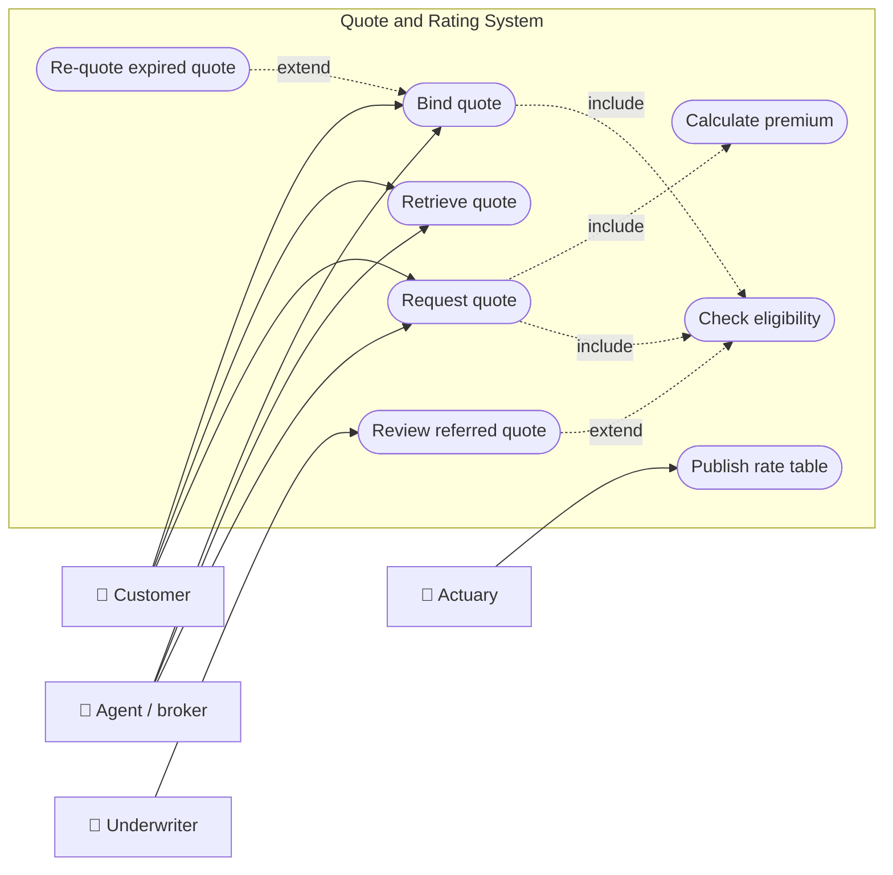
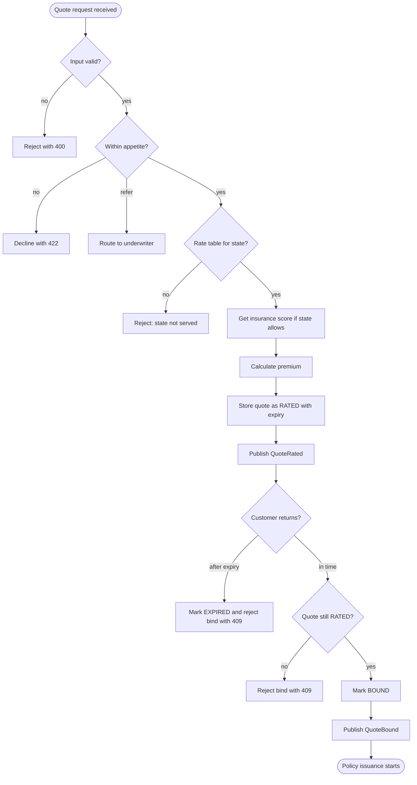
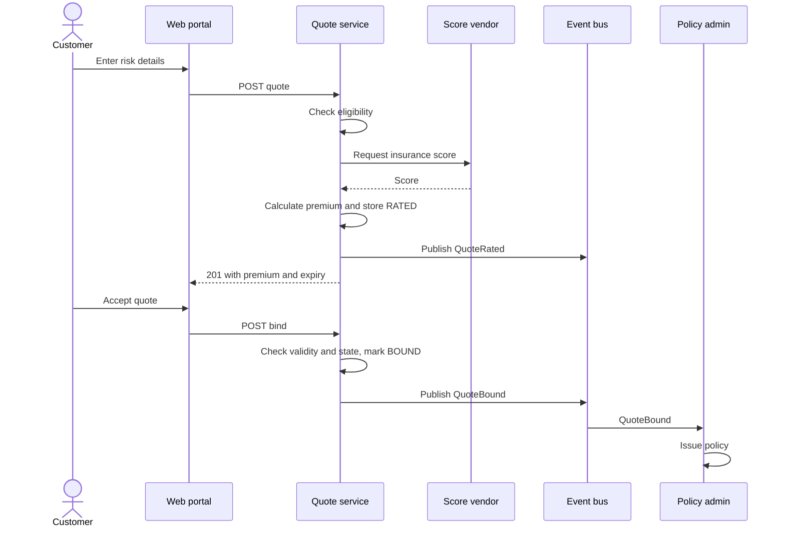
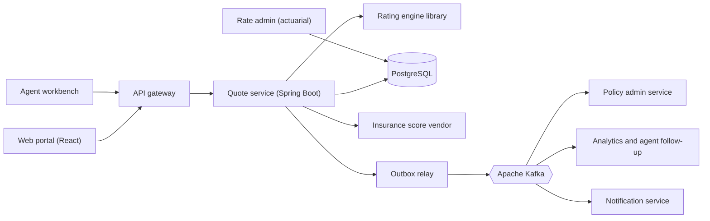
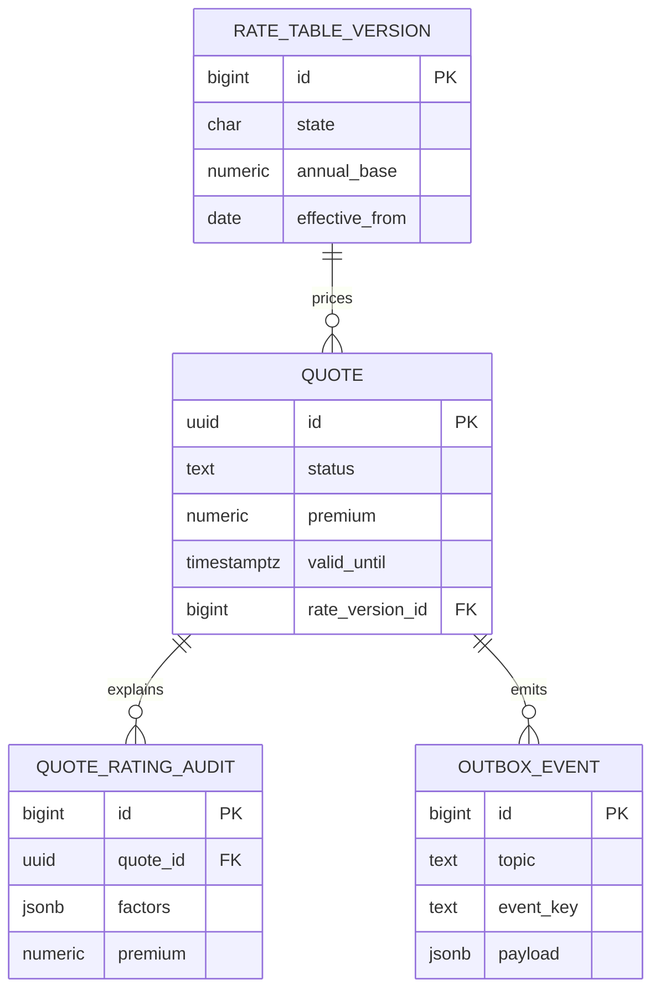
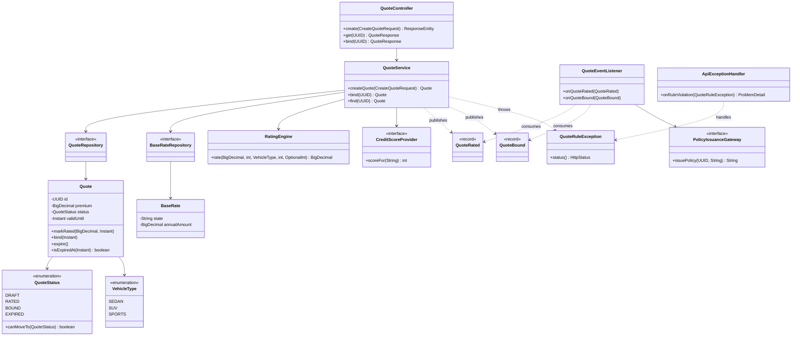
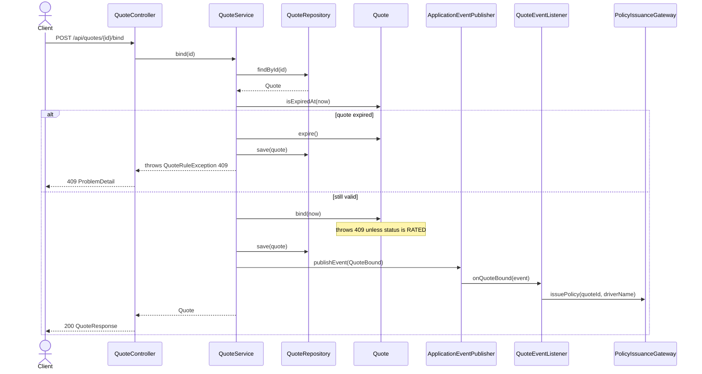
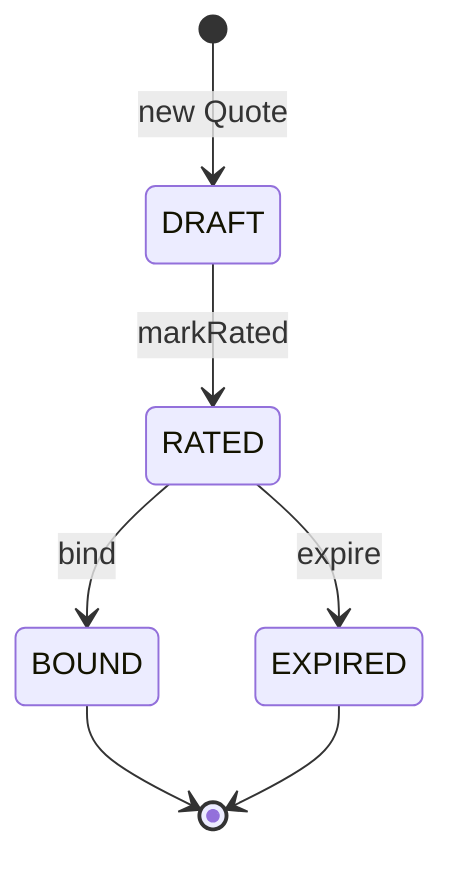
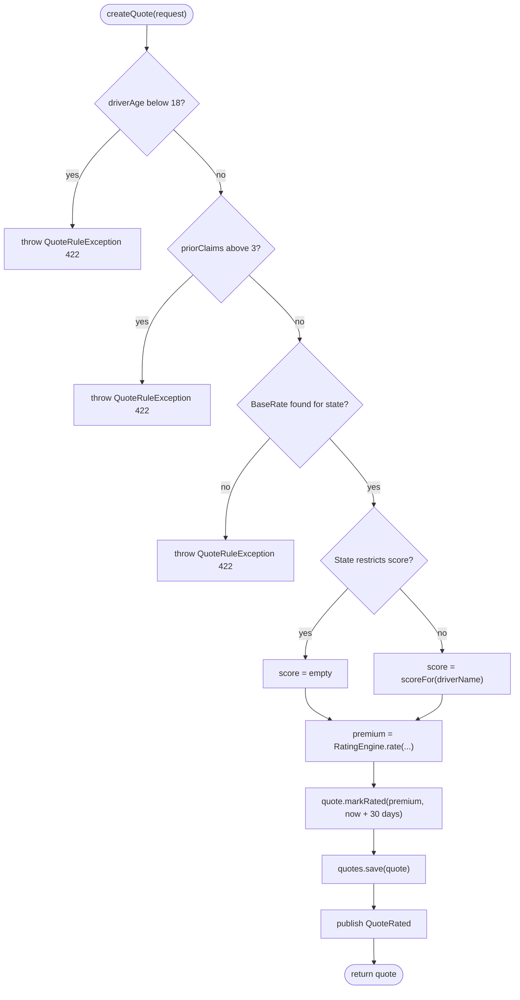

# Quote and Rating

> **Domain:** Insurance · **Author:** [@dhulipalla599](https://github.com/dhulipalla599) · **Published:** October 13, 2026

> **Runnable code:** [`examples/insurance/quote-and-rating`](https://github.com/dhulipalla599/domain-knowledge-engineering/tree/main/examples/insurance/quote-and-rating)

## Explain It Like I'm Five

Imagine you want to join the school bus club, where every kid chips in a few coins so the club can fix a flat tire if one ever happens. The club leader asks a few questions: how old are you, how far do you ride, and have you had lots of flat tires before? Kids who ride far or have had many flat tires pay a few more coins, because the club is more likely to need to help them. The leader writes the price on a card and says, "This price is good for one month." If you come back in time and say yes, the card becomes your membership. If you wait too long, the leader has to ask the questions again.

In insurance, **rating** is working out the fair price from the questions, and the **quote** is the price card that the customer can accept before it runs out.

## Business Overview

A **quote** is a priced offer to insure a specific risk (a driver and a car, a home, a shop) on stated terms. **Rating** is the calculation that produces the price: it takes the risk's characteristics, applies the insurer's approved rate tables and rules, and returns a premium. Quoting wraps rating with intake, eligibility (underwriting appetite), validity, and the step where an accepted quote is **bound** into coverage.

Why the business cares:

- **Revenue:** quoting is the top of the sales funnel. Slow or inconsistent quotes lose customers to competitors, especially on comparison sites and agent portals where many carriers are quoted at once.
- **Risk and profitability:** the premium must reflect the expected cost of claims plus expenses and margin. Under-pricing a segment attracts losses; over-pricing it loses good risks. Rating is where actuarial work becomes executable code.
- **Regulation:** in many markets rates and rating variables must be filed with or approved by a regulator, and some variables are restricted or prohibited. In the US this is largely state by state; the EU and other regions have their own rules (for example, gender-based pricing is not allowed in the EU). Systems must therefore be configurable by jurisdiction and keep an audit trail of exactly how each price was produced.
- **Customer experience:** customers expect an answer in seconds with a price that does not change at checkout.

In the Insurance value chain, quote and rating sit after product design and distribution and before underwriting referral, policy issuance, billing and claims. The bound quote becomes the policy; the rate and rating inputs recorded here are what renewals, endorsements, audits and claims disputes later refer back to.

## Real-World Example

Priya Nair, 29, wants car insurance in Texas for her sedan. She visits the website of the fictional **Lonestar Mutual**.

1. Priya enters her name, age, state, vehicle type and the number of at-fault claims in the past few years (none).
2. The quote service checks eligibility: she is over the minimum age and under the claims limit.
3. It loads the current Texas base rate, asks a (fictional) scoring vendor for a credit-based insurance score, and applies factors for age, vehicle type, claims and score. Where a state restricts that score, the score step is skipped.
4. The result, an annual premium rounded to cents, is stored as a `RATED` quote valid for 30 days, and a `QuoteRated` event is published for analytics and for the agent's follow-up queue.
5. Priya compares it with other carriers and returns on day 12. She clicks Buy. The service checks the quote is still valid and still `RATED`, marks it `BOUND`, and publishes `QuoteBound`.
6. The policy administration system consumes `QuoteBound` and issues policy `POL-...`, and billing starts.

If Priya had returned on day 40, binding would fail: the quote is expired, so she must get a new quote at whatever rates are current. If her friend Tim, 17, had applied, the service would have declined him before computing any price.

## Stakeholders

| Stakeholder | What they need | What they fear |
|---|---|---|
| Customer | A fast, clear price that does not change at checkout | A surprise higher price, a confusing quote, a rejected application after paying |
| Agent / broker | Quick quotes across products, easy retrieval of saved quotes | Slow systems, prices that differ between portal and agent screen, lost commission from errors |
| Underwriter | Risky or unusual cases routed to them with the rating inputs shown | Auto-quoting risks outside appetite, silent overrides with no record |
| Actuary / pricing analyst | To release new rate tables safely and measure their effect | A wrong factor going live, no way to reproduce an old price |
| Compliance / regulator | Only filed rates and permitted variables used, full audit trail | Prohibited variables in pricing, unexplainable prices, missing records |

## Use Case Diagram



| Use Case | Primary Actor | Goal | Main success outcome |
|---|---|---|---|
| Request quote | Customer / agent | Get a price for a risk | Quote stored as `RATED` with premium and expiry |
| Check eligibility | System (for customer/agent) | Stay within underwriting appetite | Risk accepted, declined, or referred |
| Calculate premium | System (for customer/agent) | Price the risk reproducibly | Premium in cents with rate version recorded |
| Retrieve quote | Customer / agent | Come back to a saved price | Quote returned with its status and expiry |
| Bind quote | Customer / agent | Turn the price into coverage | Quote `BOUND` and `QuoteBound` published |
| Review referred quote | Underwriter | Decide on a case outside auto-rules | Approved, amended or declined with a reason |
| Publish rate table | Actuary | Release approved rates | New effective-dated version available to rating |
| Re-quote expired quote | Customer / agent | Replace a stale price | New quote at current rates |

## Key Terms

| Term | Plain-English meaning |
|---|---|
| Premium | The price the customer pays for the coverage period |
| Rating / rating engine | The calculation (and the code that runs it) that turns risk inputs into a premium |
| Base rate | Starting price for a standard risk in a territory or class before adjustments |
| Rating factor | A multiplier or adjustment for a risk characteristic such as age or vehicle type |
| Rate table / rate filing | The approved set of rates and factors; in many markets filed with the regulator |
| Underwriting | Deciding whether to accept a risk, and on what terms |
| Appetite | The kinds of risk the insurer is willing to write |
| Referral | Sending a case to a human underwriter instead of auto-deciding |
| Bind | Make coverage take effect, accepting the quote's terms |
| Quote validity | How long the quoted price is honoured (30 days in the example) |
| Effective date | The date a rate table version, or a policy, starts to apply |
| Loss history / prior claims | Past claims used as a predictor of future ones |
| Insurance score | A vendor-supplied risk score based on credit data; restricted in some jurisdictions |

## Process Flow

The customer or agent submits risk details. The system validates the input, checks eligibility, picks the rate table version effective for the quote date, calculates the premium and stores the quote with its inputs and rate version so the price can be reproduced later. The quote stays open until it is bound or its validity ends. On a bind request the system re-checks validity and state, marks the quote bound, and announces it so policy issuance, billing and document generation can start.





## Business Rules and Edge Cases

- **Money is exact and rounding is defined.** Use decimal types, never floating point. Fix the rounding mode and the point at which rounding happens (the example rounds once, half-up, at the end). Different carriers round at different steps; whichever you pick must be documented and reproducible.
- **Eligibility comes before pricing.** Out-of-appetite risks are declined (or referred) before a price exists, so no one can accidentally bind a price that should never have been offered.
- **A price has an expiry.** Rates change. A quote is honoured until its validity ends; after that it cannot be bound and must be re-rated. Compare against an injected clock, not the system clock, so this is testable.
- **Rate table versions are effective-dated.** Record which version priced each quote. Selecting "latest" at bind time instead of the version used at quote time makes prices change silently.
- **Jurisdiction changes the rules.** Permitted rating variables, minimum ages, mandatory coverages and rounding all vary by country and by US state. Keep them as configuration per jurisdiction, not scattered `if` statements. The example's rule that skips the insurance score for a restricted state illustrates the idea, but confirm real restrictions with compliance.
- **Lifecycle transitions are guarded.** Only `RATED` can become `BOUND` or `EXPIRED`. A second bind must not issue a second policy; reject it or return the same result.
- **Idempotency and retries.** Customers double-click and gateways retry. Binding must be safe to repeat, and event consumers must de-duplicate on quote id.
- **Partial failure.** If the database commit succeeds but the event is not published (or the reverse), downstream systems disagree. Use a transactional outbox rather than publishing inline.
- **External dependencies fail.** If the score vendor times out, decide in advance: use a neutral factor, refer the quote, or fail. Never silently invent a value, and record which path was taken.
- **Explainability.** Store inputs, factors, rate version and result so any price can be reproduced for a complaint, an audit or a regulator.

## From Business to System

| Business concept / step | System component | Data entity | Event |
|---|---|---|---|
| Submit risk details | Quote API (`QuoteController`) | `quote` | none |
| Check eligibility | Quote service rules | `quote` (inputs) | none (decline returns an error) |
| Select rates | Rate table lookup | `rate_table_version` | none |
| Insurance score | Score adapter (`CreditScoreProvider`) | `quote_rating_audit` | none |
| Calculate premium | `RatingEngine` | `quote.premium`, `quote_rating_audit` | `insurance.quote.rated` |
| Quote validity | `Quote.valid_until` and clock | `quote` | none |
| Bind | `QuoteService.bind` | `quote.status`, `bound_at` | `insurance.quote.bound` |
| Reliable publishing | Transactional outbox | `outbox_event` | both topics |
| Issue policy | Policy admin consumer | owned by policy service | consumes `insurance.quote.bound` |
| Publish new rates | Rate admin (actuarial) | `rate_table_version` | `insurance.rates.published` (outside the example) |

## Architecture



The **quote service** owns quotes and their lifecycle; the **rating engine** is a pure library inside it, so it can be unit-tested, replayed against historical inputs, and shared with batch re-rating jobs. Rate tables are written by an admin tool but read by the quote service, so rate changes never need a quote-service deployment. The service boundary stops at `BOUND`: policy issuance, billing and documents belong to other services and react to the `insurance.quote.bound` event rather than being called synchronously, so the customer does not wait for them and an outage there cannot block binding. The score vendor sits behind an interface because it is slow, costs money per call, and is the most likely dependency to fail.

## Data Model

```sql
CREATE TABLE rate_table_version (
    id             BIGSERIAL PRIMARY KEY,
    state          CHAR(2)        NOT NULL,
    annual_base    NUMERIC(12,2)  NOT NULL,
    effective_from DATE           NOT NULL,
    effective_to   DATE,
    UNIQUE (state, effective_from)
);

CREATE TABLE quote (
    id              UUID PRIMARY KEY,
    driver_name     TEXT           NOT NULL,
    driver_age      INT            NOT NULL CHECK (driver_age >= 0),
    state           CHAR(2)        NOT NULL,
    vehicle_type    TEXT           NOT NULL,
    prior_claims    INT            NOT NULL CHECK (prior_claims >= 0),
    premium         NUMERIC(12,2),
    status          TEXT           NOT NULL CHECK (status IN ('DRAFT','RATED','BOUND','EXPIRED')),
    rate_version_id BIGINT         REFERENCES rate_table_version(id),
    valid_until     TIMESTAMPTZ,
    bound_at        TIMESTAMPTZ,
    created_at      TIMESTAMPTZ    NOT NULL DEFAULT now()
);

CREATE TABLE quote_rating_audit (
    id          BIGSERIAL PRIMARY KEY,
    quote_id    UUID          NOT NULL REFERENCES quote(id),
    factors     JSONB         NOT NULL,   -- age, vehicle, claims, score factor, score reference
    premium     NUMERIC(12,2) NOT NULL,
    rated_at    TIMESTAMPTZ   NOT NULL DEFAULT now()
);

CREATE TABLE outbox_event (
    id           BIGSERIAL PRIMARY KEY,
    topic        TEXT        NOT NULL,
    event_key    TEXT        NOT NULL,   -- quote id: keeps one quote's events ordered
    payload      JSONB       NOT NULL,
    created_at   TIMESTAMPTZ NOT NULL DEFAULT now(),
    published_at TIMESTAMPTZ
);
```

The runnable example uses a simplified subset (`quote` and a `base_rate` table keyed by state) on H2.



## APIs

| Method | Path | Purpose |
|---|---|---|
| POST | `/api/quotes` | Validate, rate and store a new quote (returns `201`) |
| GET | `/api/quotes/{id}` | Retrieve a quote with status and expiry |
| POST | `/api/quotes/{id}/bind` | Bind a `RATED`, unexpired quote |

Errors use RFC 9457 problem responses: `400` malformed input, `404` unknown quote, `409` illegal state or expired quote, `422` risk declined or state not served.

Request, `POST /api/quotes`:

```json
{
  "driverName": "Priya Nair",
  "driverAge": 29,
  "state": "TX",
  "vehicleType": "SEDAN",
  "priorClaims": 0
}
```

Response, `201 Created`:

```json
{
  "id": "565d6596-924d-4b52-861f-c6a1b66fd308",
  "driverName": "Priya Nair",
  "state": "TX",
  "status": "RATED",
  "premium": 1320.00,
  "validUntil": "2026-11-12T15:08:34.818685256Z",
  "boundAt": null
}
```

## Events

| Event | Producer | Consumers | Key fields |
|---|---|---|---|
| `insurance.quote.rated` | Quote service | Analytics, agent follow-up, notification | `quoteId`, `premium`, `validUntil` |
| `insurance.quote.bound` | Quote service | Policy admin, billing, document service | `quoteId`, `driverName`, `premium`, `boundAt` |

- **Ordering:** key messages by `quoteId` so all events of one quote land on the same partition and are consumed in order. There is no ordering guarantee across quotes, and consumers must not assume one.
- **At-least-once delivery:** Kafka consumers will see duplicates after retries or rebalances. Consumers de-duplicate on `quoteId` (the example's policy gateway returns the same policy number for the same quote).
- **Publishing atomically:** write the event to `outbox_event` in the same database transaction as the status change, and let a relay publish it. Publishing inside the request risks a committed bind with a lost event.
- **Schema evolution:** version event payloads (for example with a schema registry) and only add optional fields. Avoid putting unnecessary personal data in events.

## Backend Implementation

> The Java tab is the exact code from the runnable example (Spring Boot 3). The Python tab uses FastAPI with SQLAlchemy and the Node.js tab uses Express with TypeScript, written to the same logic, names and rules.

### Bind rule: validity and lifecycle

=== "Java"

    ```java
    /** Rule 2: a price is only honoured until validUntil; an expired quote must be re-rated, never bound. */
    @Transactional(noRollbackFor = QuoteRuleException.class)
    public Quote bind(UUID id) {
        Quote quote = find(id);
        Instant now = clock.instant();
        if (quote.isExpiredAt(now)) {
            quote.expire();
            quotes.save(quote);
            throw new QuoteRuleException(HttpStatus.CONFLICT, "Quote " + id + " expired; request a new quote");
        }
        quote.bind(now);
        quotes.save(quote);
        events.publishEvent(new QuoteBound(quote.getId(), quote.getDriverName(), quote.getPremium(), now));
        return quote;
    }
    ```

=== "Python"

    ```python
    class QuoteRuleError(Exception):
        def __init__(self, status: int, message: str):
            super().__init__(message)
            self.status = status

    ALLOWED_NEXT = {
        "DRAFT": {"RATED"},
        "RATED": {"BOUND", "EXPIRED"},
        "BOUND": set(),
        "EXPIRED": set(),
    }

    def move_to(quote: Quote, nxt: str) -> None:
        if nxt not in ALLOWED_NEXT[quote.status]:
            raise QuoteRuleError(409, f"Quote {quote.id} is {quote.status}; cannot move to {nxt}")
        quote.status = nxt

    def bind(session: Session, clock: Callable[[], datetime], quote_id: UUID) -> Quote:
        quote = session.get(Quote, quote_id)
        if quote is None:
            raise QuoteRuleError(404, f"Quote not found: {quote_id}")
        now = clock()
        if quote.valid_until is not None and now > quote.valid_until:
            move_to(quote, "EXPIRED")
            session.commit()  # keep the EXPIRED status even though we reject the request
            raise QuoteRuleError(409, f"Quote {quote_id} expired; request a new quote")
        move_to(quote, "BOUND")
        quote.bound_at = now
        session.add(OutboxEvent(topic="insurance.quote.bound", key=str(quote.id),
                                payload={"quoteId": str(quote.id), "premium": str(quote.premium)}))
        session.commit()
        return quote
    ```

=== "Node.js"

    ```typescript
    const ALLOWED_NEXT: Record<Status, Status[]> = {
      DRAFT: ["RATED"],
      RATED: ["BOUND", "EXPIRED"],
      BOUND: [],
      EXPIRED: [],
    };

    export class QuoteRuleError extends Error {
      constructor(readonly status: number, message: string) {
        super(message);
      }
    }

    function moveTo(quote: Quote, next: Status): void {
      if (!ALLOWED_NEXT[quote.status].includes(next)) {
        throw new QuoteRuleError(409, `Quote ${quote.id} is ${quote.status}; cannot move to ${next}`);
      }
      quote.status = next;
    }

    export async function bind(repo: QuoteRepository, clock: () => Date, id: string): Promise<Quote> {
      const quote = await repo.findById(id);
      if (!quote) throw new QuoteRuleError(404, `Quote not found: ${id}`);
      const now = clock();
      if (quote.validUntil && now > quote.validUntil) {
        moveTo(quote, "EXPIRED");
        await repo.save(quote); // keep EXPIRED even though the request is rejected
        throw new QuoteRuleError(409, `Quote ${id} expired; request a new quote`);
      }
      moveTo(quote, "BOUND");
      quote.boundAt = now;
      await repo.saveWithOutbox(quote, "insurance.quote.bound");
      return quote;
    }
    ```

### Lifecycle guard in the domain class

=== "Java"

    ```java
    public void markRated(BigDecimal premium, Instant validUntil) {
        moveTo(QuoteStatus.RATED);
        this.premium = premium;
        this.validUntil = validUntil;
    }

    public void bind(Instant now) {
        moveTo(QuoteStatus.BOUND);
        this.boundAt = now;
    }

    private void moveTo(QuoteStatus next) {
        if (!status.canMoveTo(next)) {
            throw new QuoteRuleException(HttpStatus.CONFLICT,
                    "Quote " + id + " is " + status + "; cannot move to " + next);
        }
        this.status = next;
    }
    ```

=== "Python"

    ```python
    def mark_rated(quote: Quote, premium: Decimal, valid_until: datetime) -> None:
        move_to(quote, "RATED")
        quote.premium = premium
        quote.valid_until = valid_until
    ```

=== "Node.js"

    ```typescript
    export function markRated(quote: Quote, premium: string, validUntil: Date): void {
      moveTo(quote, "RATED");
      quote.premium = premium;
      quote.validUntil = validUntil;
    }
    ```

### Controller endpoints

=== "Java"

    ```java
    @PostMapping
    public ResponseEntity<QuoteResponse> create(@Valid @RequestBody CreateQuoteRequest request) {
        QuoteResponse body = QuoteResponse.from(service.createQuote(request));
        return ResponseEntity.created(URI.create("/api/quotes/" + body.id())).body(body);
    }

    @PostMapping("/{id}/bind")
    public QuoteResponse bind(@PathVariable UUID id) {
        return QuoteResponse.from(service.bind(id));
    }
    ```

=== "Python"

    ```python
    @app.post("/api/quotes", status_code=201)
    def create(request: CreateQuoteRequest, response: Response, session: Session = Depends(get_session)):
        quote = quote_service.create_quote(session, request)
        response.headers["Location"] = f"/api/quotes/{quote.id}"
        return QuoteResponse.from_quote(quote)

    @app.post("/api/quotes/{quote_id}/bind")
    def bind_quote(quote_id: UUID, session: Session = Depends(get_session)):
        return QuoteResponse.from_quote(quote_service.bind(session, utc_now, quote_id))

    @app.exception_handler(QuoteRuleError)
    def on_rule_error(_, exc: QuoteRuleError):
        return JSONResponse(status_code=exc.status, content={"status": exc.status, "detail": str(exc)})
    ```

=== "Node.js"

    ```typescript
    router.post("/api/quotes", async (req, res) => {
      const quote = await createQuote(repo, req.body as CreateQuoteRequest);
      res.status(201).location(`/api/quotes/${quote.id}`).json(toResponse(quote));
    });

    router.post("/api/quotes/:id/bind", async (req, res) => {
      res.json(toResponse(await bind(repo, () => new Date(), req.params.id)));
    });

    router.use((err: unknown, _req: Request, res: Response, _next: NextFunction) => {
      if (err instanceof QuoteRuleError) {
        return res.status(err.status).json({ status: err.status, detail: err.message });
      }
      res.status(500).json({ status: 500, detail: "Unexpected error" });
    });
    ```

Full source: [`examples/insurance/quote-and-rating`](https://github.com/dhulipalla599/domain-knowledge-engineering/tree/main/examples/insurance/quote-and-rating/src/main/java/com/dke/insurance/quote_and_rating).

## Frontend Screen

A quote form that shows the premium and lets the customer accept it.

```tsx
import { useState } from "react";

type VehicleType = "SEDAN" | "SUV" | "SPORTS";
interface Quote { id: string; status: string; premium: number; validUntil: string }
interface Problem { detail: string }

export function QuoteScreen() {
  const [form, setForm] = useState({ driverName: "", driverAge: 30, state: "TX", vehicleType: "SEDAN" as VehicleType, priorClaims: 0 });
  const [quote, setQuote] = useState<Quote | null>(null);
  const [error, setError] = useState<string | null>(null);

  async function call(url: string, body?: unknown) {
    const res = await fetch(url, {
      method: "POST",
      headers: { "Content-Type": "application/json" },
      body: body ? JSON.stringify(body) : undefined,
    });
    if (!res.ok) {
      setError(((await res.json()) as Problem).detail);
      return null;
    }
    setError(null);
    return (await res.json()) as Quote;
  }

  const getQuote = async () => setQuote(await call("/api/quotes", form));
  const accept = async () => quote && setQuote((await call(`/api/quotes/${quote.id}/bind`)) ?? quote);

  return (
    <main>
      <h1>Car insurance quote</h1>
      <input aria-label="Name" value={form.driverName} onChange={e => setForm({ ...form, driverName: e.target.value })} />
      <input aria-label="Age" type="number" value={form.driverAge} onChange={e => setForm({ ...form, driverAge: +e.target.value })} />
      <input aria-label="State" maxLength={2} value={form.state} onChange={e => setForm({ ...form, state: e.target.value.toUpperCase() })} />
      <select aria-label="Vehicle" value={form.vehicleType} onChange={e => setForm({ ...form, vehicleType: e.target.value as VehicleType })}>
        <option>SEDAN</option><option>SUV</option><option>SPORTS</option>
      </select>
      <input aria-label="Prior claims" type="number" min={0} value={form.priorClaims} onChange={e => setForm({ ...form, priorClaims: +e.target.value })} />
      <button onClick={getQuote}>Get quote</button>

      {error && <p role="alert">{error}</p>}
      {quote && (
        <section aria-live="polite">
          <p>Annual premium: <strong>${quote.premium.toFixed(2)}</strong> ({quote.status})</p>
          <p>Price valid until {new Date(quote.validUntil).toLocaleDateString()}</p>
          {quote.status === "RATED" && <button onClick={accept}>Buy now</button>}
          {quote.status === "BOUND" && <p>Coverage confirmed. Your policy documents are on the way.</p>}
        </section>
      )}
    </main>
  );
}
```

## Cloud Deployment

The quote service runs as a Deployment on **Amazon EKS** behind an Application Load Balancer and an API gateway. Managed services: **Amazon RDS for PostgreSQL** (or Aurora) for data, **Amazon MSK** for Apache Kafka, **AWS Secrets Manager** for vendor credentials and database passwords, **Amazon ECR** for images, and **CloudWatch** for logs, metrics and alarms.

```hcl
resource "aws_db_instance" "quote" {
  identifier                  = "quote-and-rating"
  engine                      = "postgres"
  engine_version              = "16"
  instance_class              = "db.m6g.large"
  allocated_storage           = 100
  multi_az                    = true
  storage_encrypted           = true
  kms_key_id                  = aws_kms_key.quote.arn
  backup_retention_period     = 14
  deletion_protection         = true
  db_subnet_group_name        = aws_db_subnet_group.private.name
  vpc_security_group_ids      = [aws_security_group.quote_db.id]
  manage_master_user_password = true
}
```

- **Security:** private subnets for pods and database; security groups allow only the cluster to reach RDS and MSK; IAM Roles for Service Accounts (IRSA) give pods least-privilege access; TLS in transit and KMS encryption at rest; personal data (names, ages) is minimised in logs and events.
- **Scaling:** the quote service is stateless, so a Horizontal Pod Autoscaler scales on CPU and request rate. Quote traffic is spiky (campaigns, comparison sites), so set sensible minimum replicas and pool limits for the database. The score vendor call needs a timeout, retry budget and circuit breaker, and its capacity limits may be the real bottleneck.
- **Observability:** instrument with OpenTelemetry (traces across API, vendor call and database; metrics for quote latency, decline rate, expiry rate and premium distribution) and export to CloudWatch through the ADOT collector. Correlate logs by `quoteId`. Alarm on error rate, p95 latency, outbox lag and consumer lag.

## Non-Functional Requirements

| Concern | Expectation | How the design meets it |
|---|---|---|
| Availability | Quoting is revenue-critical; targets are typically in the high 99s percent (agree the number with the business) | Stateless pods across availability zones, Multi-AZ database, graceful degradation if the score vendor is down |
| Latency | A price in about a second or two for the customer; comparison channels may impose their own timeouts | Pure in-process rating, cached rate tables, vendor timeout with a defined fallback |
| Consistency | A bound quote is bound exactly once; a price never changes after it is quoted | Guarded state transitions, database transaction, optimistic locking, stored rate version |
| Reproducibility and audit | Any price can be explained later | `quote_rating_audit` with inputs, factors and rate version; immutable event history |
| Compliance | Only filed rates and permitted variables; records retained for the period the regulator requires | Effective-dated rate tables, per-jurisdiction configuration, retention policy set with compliance |
| Privacy | Personal and score data protected | Encryption, access control, minimal data in events and logs |
| Resilience of integration | No lost or duplicated downstream actions | Transactional outbox, idempotent consumers keyed by `quoteId` |

## Runnable Example

The example is a Spring Boot 3 service (Java 21, H2) that implements the core flow: create and rate a quote, then bind it. It enforces two business rules, eligibility (`422`) and price validity plus lifecycle (`409`), models the lifecycle as the `QuoteStatus` enum with guarded transitions, and publishes `QuoteRated` and `QuoteBound` events with `ApplicationEventPublisher`, consumed by `@EventListener` methods that stand in for Kafka consumers. The score vendor and the policy system sit behind interfaces with deterministic stubs. Source: [`examples/insurance/quote-and-rating`](https://github.com/dhulipalla599/domain-knowledge-engineering/tree/main/examples/insurance/quote-and-rating).

```bash
cd examples/insurance/quote-and-rating
mvn spring-boot:run     # http://localhost:8080
mvn verify              # unit and API tests
```

Rate a quote (the id and dates vary; the premium depends on the stub score for the name):

```bash
curl -s -X POST localhost:8080/api/quotes -H 'Content-Type: application/json' \
  -d '{"driverName":"Priya Nair","driverAge":29,"state":"TX","vehicleType":"SEDAN","priorClaims":0}'
# 201 {"id":"565d6596-924d-4b52-861f-c6a1b66fd308","driverName":"Priya Nair","state":"TX","status":"RATED","premium":1320.00,"validUntil":"2026-11-12T15:08:34.818685256Z","boundAt":null}
```

Trigger the eligibility rule:

```bash
curl -s -X POST localhost:8080/api/quotes -H 'Content-Type: application/json' \
  -d '{"driverName":"Tim Young","driverAge":17,"state":"TX","vehicleType":"SEDAN","priorClaims":0}'
# 422 {"type":"about:blank","title":"Unprocessable Entity","status":422,"detail":"Driver must be at least 18 years old","instance":"/api/quotes"}
```

| Class | Package | Responsibility |
|---|---|---|
| `QuoteAndRatingApplication` | root | Spring Boot entry point |
| `Quote` | `domain` | Aggregate with guarded lifecycle transitions |
| `QuoteStatus` | `domain` | `DRAFT`, `RATED`, `BOUND`, `EXPIRED` and allowed moves |
| `VehicleType` | `domain` | Vehicle class and rating factor |
| `BaseRate` | `domain` | State base premium (rate table stand-in) |
| `QuoteEvents` | `domain` | `QuoteRated` and `QuoteBound` events |
| `QuoteRuleException` | `domain` | Rule violation carrying an HTTP status |
| `QuoteRepository`, `BaseRateRepository` | `repository` | Spring Data JPA persistence |
| `RatingEngine` | `service` | Pure premium calculation |
| `QuoteService` | `service` | Eligibility, validity and bind rules, event publishing |
| `ClockConfig` | `service` | Injectable `Clock` for testable expiry |
| `QuoteController`, `CreateQuoteRequest`, `QuoteResponse` | `api` | REST endpoints and DTO records |
| `ApiExceptionHandler` | `api` | Maps exceptions to `ProblemDetail` |
| `CreditScoreProvider`, `StubCreditScoreProvider` | `integration` | Score vendor port and stub |
| `PolicyIssuanceGateway`, `InMemoryPolicyIssuanceGateway` | `integration` | Policy system port and idempotent stub |
| `QuoteEventListener` | `integration` | Consumes the events (Kafka stand-in) |

## UML Diagrams

### Class Diagram

The controller delegates to the service, which uses repositories, the rating engine and the score port, and publishes events that the listener consumes.



### Sequence Diagram (control flow)

One bind request through the code, including the expiry branch.



### State Diagram

The `QuoteStatus` enum and the transitions allowed by `canMoveTo`.



### Activity Diagram

The decision logic of `QuoteService.createQuote`.



## AI Opportunities

1. **Risk segmentation and pricing models.** Gradient-boosted or generalised linear models can refine factors from historical policy and claims data. Data: policy, exposure and claims history, plus permitted external data. Risk: bias and proxy discrimination, regulatory filing requirements, and explainability. Control: use only permitted variables, test for disparate impact, keep a human-approved, versioned rate plan, and log the model version used for each quote.
2. **Application data pre-fill and validation.** An LLM or document-extraction model can read a prior policy or registration document and pre-fill the form, cutting abandonment. Data: uploaded documents and prior-policy records. Risk: misreads that change the price. Control: show extracted values for the customer to confirm and never write them to the rating inputs without confirmation.
3. **Underwriting referral triage.** A model can rank referred quotes and summarise the reason, so underwriters spend time on the hardest cases. Data: quote inputs, referral reasons, past underwriter decisions. Risk: automating declines unfairly. Control: the model only prioritises and suggests; a human decides, and overrides are recorded.
4. **Quote conversion and abandonment prediction.** Predicting who is likely to buy helps agents prioritise follow-up and tune channel experience. Data: quote events, channel, time to return. Risk: using the prediction to change the price for individuals may be unlawful or unfair in many places. Control: use it for service prioritisation only, and review with compliance before any pricing use.
5. **Agent assistant.** An LLM agent can answer an agent's questions about quote status and coverage options by calling the quote API. Data: quote API, product documentation. Risk: hallucinated coverage statements. Control: answer only from retrieved product text, show sources, and keep binding behind a confirmed human action.

## Common Pitfalls

- **Floating-point money.** Use `BigDecimal` / `NUMERIC`, define rounding, and test boundary cases.
- **Re-rating at bind time with whatever rates are current.** Store the rate version and inputs with the quote, and bind at the quoted price or reject.
- **No expiry, or expiry checked with the system clock.** Inject a clock and test both sides of the boundary.
- **Hard-coding rating factors.** They change often and by jurisdiction. Put them in effective-dated tables with an approval process.
- **Treating decline as an error to hide.** Declines, referrals and their reasons are business data; record them and return clear messages.
- **Non-idempotent bind.** Double clicks and retries must not issue two policies.
- **Publishing events outside the transaction.** Use an outbox; otherwise the database and the topic drift apart.
- **Letting vendor calls block the whole flow.** Use timeouts, a fallback decision and a record of which path was taken.
- **Logging personal data and scores.** Keep sensitive inputs out of logs and events.
- **Assuming one country's rules apply everywhere.** Confirm permitted rating variables, minimum ages and filing rules with compliance for each market.

## Interview Questions

### Junior

**1. What is the difference between a quote and a policy?**
A quote is an offer with a price and an expiry; no coverage exists yet. Binding the quote creates coverage, and the policy is then issued from it.

**2. Why use `BigDecimal` for premiums?**
Binary floating point cannot represent many decimal values exactly, so sums and products drift. `BigDecimal` with an explicit scale and rounding mode gives exact, reproducible cents.

**3. Why does a quote have an expiry?**
Rates, risk information and market conditions change. The insurer only commits to a price for a limited time, and after that the risk must be re-rated at current rates.

### Mid-Level

**1. How would you make binding safe against double clicks and retries?**
Guard the lifecycle so only `RATED` can move to `BOUND`; a second call then fails or returns the same result. Use optimistic locking or a unique constraint, and make downstream consumers idempotent on the quote id. An idempotency key on the request is a further option.

**2. How do you handle a score vendor timeout?**
Set a short timeout and a retry budget, then follow a decision agreed with underwriting: use a neutral factor, refer to a human, or fail the quote. Record which path was used so the price can be explained, and never silently invent a score.

**3. How would you test the rating engine?**
Keep it a pure function and unit-test factor combinations, rounding boundaries and missing inputs. Add golden-file tests of historical quotes against stored rate versions to catch accidental changes when rates are updated.

### Senior / Architect

**1. Design rate table management so actuaries can release rates without a code deployment, while regulators can audit every price.**
Key points: effective-dated, immutable rate table versions with approval workflow and filing metadata; the quote records the version used; separation of rate data from the rating algorithm; ability to replay historical quotes against a version; testing in a staging environment on sample portfolios before activation; handling of in-flight quotes at the switch-over date; per-jurisdiction configuration.

**2. A comparison site sends thousands of quote requests per second during a campaign. How do you keep latency and cost under control?**
Key points: stateless horizontal scaling and autoscaling; cached rate tables; in-process rating; vendor calls are the bottleneck, so cache or cap them, apply a bulkhead, circuit breaker and fallback; asynchronous persistence of non-critical records via the outbox; rate limiting and prioritisation by channel; load tests; decide whether to persist every comparison quote or only those that return.

**3. Should rating be a shared library, a separate microservice, or a rules engine?**
Key points: a library is fast and simple and gives easy replay and batch re-rating, but needs coordinated releases; a service gives one deployment and central control but adds latency and a failure point; a rules engine suits frequently changing rules but adds tooling and testing complexity. Consider the rate of change, team ownership, audit needs, latency budget and need for batch re-rating. Whichever is chosen, version the logic with the rate tables and keep determinism.

## Further Learning

- Property and casualty insurance fundamentals (policy lifecycle, underwriting, claims)
- Actuarial ratemaking basics: pure premium, loss ratio, rate indications
- Generalised linear models for insurance pricing
- State rate and form filing processes in the US (file-and-use versus prior-approval regimes)
- ACORD data standards and messaging
- Solvency II and the EU Insurance Distribution Directive
- Fairness and explainability in insurance pricing models
- Transactional outbox and idempotent consumer patterns with Apache Kafka

## Practitioner Notes

> _Reviewer: add real-world experience, corrections or gotchas here before approving._
