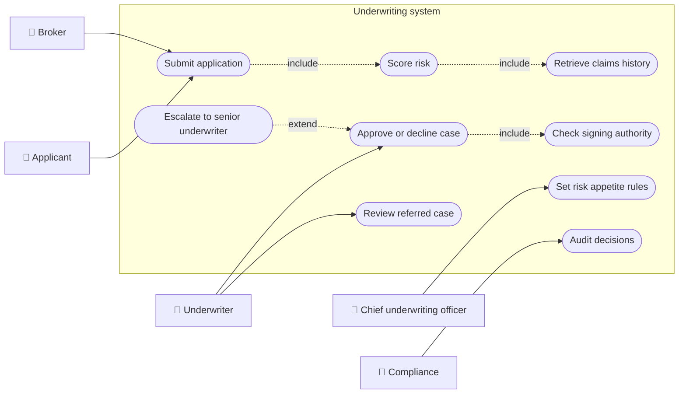
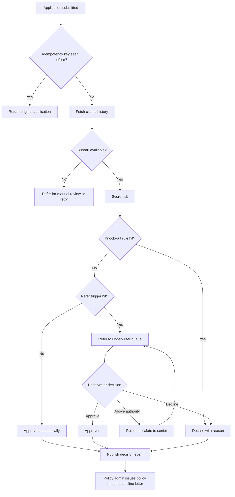
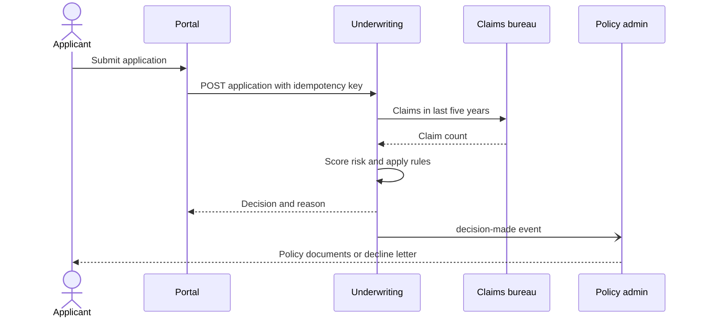
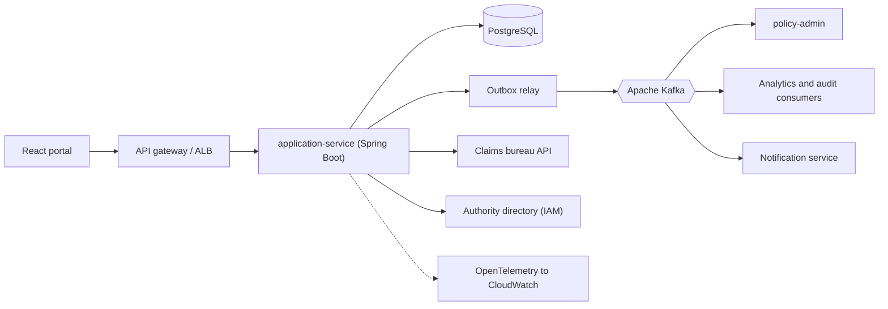
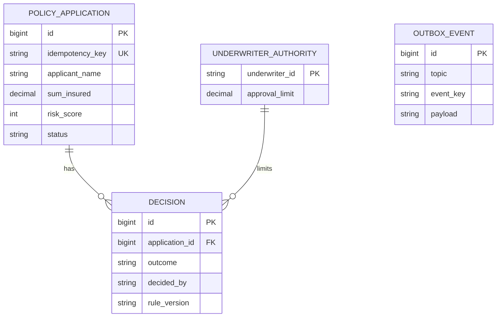
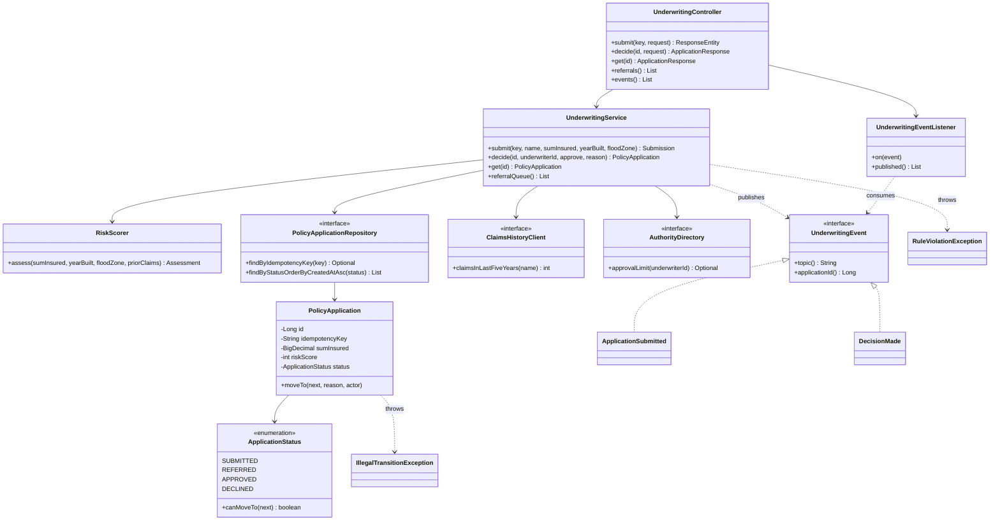
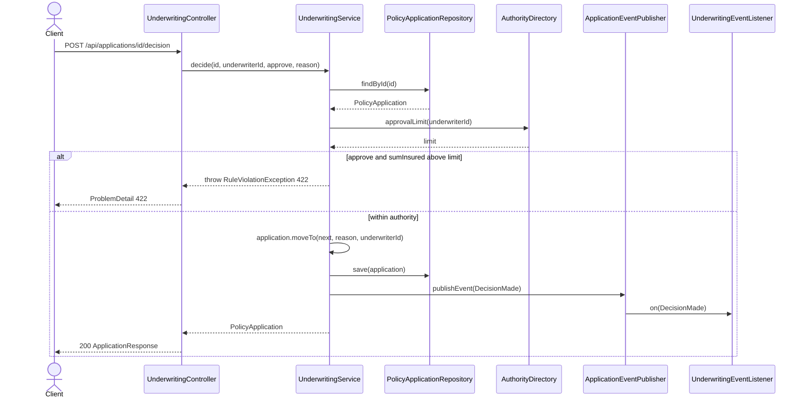
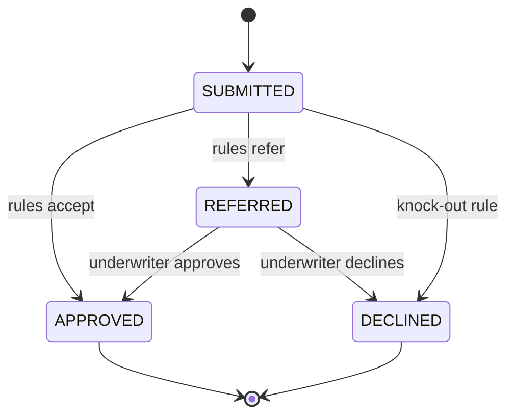
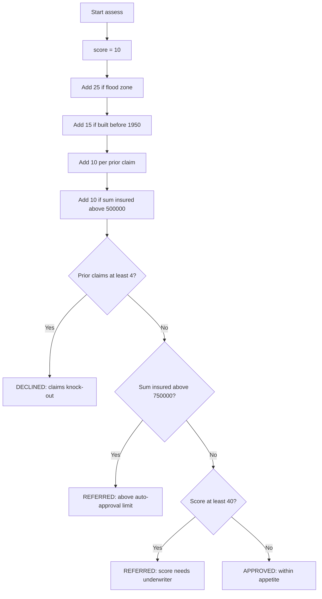

# Underwriting

> **Domain:** Insurance · **Author:** [@dhulipalla599](https://github.com/dhulipalla599) · **Published:** October 27, 2026

> **Runnable code:** [`examples/insurance/underwriting`](https://github.com/dhulipalla599/domain-knowledge-engineering/tree/main/examples/insurance/underwriting)

## Explain It Like I'm Five

Imagine you run a clubhouse where every kid chips in a few coins, and if someone's toy breaks, the club pays to fix it. A new kid wants to join and has a very old toy that has broken four times already. You would ask a few questions first: how old is the toy, where do they keep it, how often has it broken? If it looks safe, you say "come on in". If it looks risky, you might ask a grown-up to decide, or ask for more coins, or say "sorry, not this time". You do this so the coin jar does not run empty for everyone else.

Underwriting is that careful look-before-you-promise step: an insurer decides whether to accept a risk, and on what terms, before it signs a policy.

## Business Overview

Underwriting is the decision to accept, modify or decline a risk, and to set the terms (price, limits, deductibles, exclusions) on which it is accepted. In personal lines such as home or motor insurance most cases are decided automatically by rules and models. In commercial and high-value lines a human underwriter reviews the cases the rules cannot settle.

Why the business cares:

- **Profit and solvency:** the insurer's results depend on charging a price that matches the risk. Accepting too many bad risks (adverse selection) produces losses; declining too many good ones loses market share.
- **Regulation:** insurers must follow rules on fair treatment, data protection and discrimination. Which rating factors are allowed varies by country and, in some places, by state or line of business. Decisions must be explainable and auditable.
- **Customer experience:** customers expect an instant answer. Straight-through processing (STP) of clean cases is a competitive edge.
- **Capital and reinsurance:** reinsurance treaties and internal risk appetite statements limit what each underwriter may accept.

Where it sits in the Insurance value chain: product design → distribution and quote → **underwriting** → policy issuance and billing → servicing → claims → renewal (where underwriting happens again). Underwriting consumes the quote and rating output (see [Quote and Rating](quote-and-rating.md)) and its decision triggers policy issuance.

## Real-World Example

Fictional insurer **Harborline Mutual** sells home insurance online.

1. **Priya Nair** applies to insure her 1936 house in a flood-prone postcode for 900,000. She answers the questionnaire and submits.
2. The platform asks a claims-history bureau about Priya: one claim in the last five years.
3. The rules engine scores the risk: flood zone, an old building, one prior claim and a high sum insured. The sum insured is above the automatic-approval limit, so the case is **referred**.
4. The case lands in the referral queue. **Tomas Reyes**, a junior underwriter whose signing authority is 500,000, opens it. He cannot approve a 900,000 risk; the system blocks him and suggests escalation.
5. **Ingrid Larsen**, a senior underwriter (authority 2,000,000), reviews the survey photos, adds a flood-resilience condition and approves.
6. A decision event is published. Policy administration issues the policy, billing sets up the premium, and Priya receives her documents.
7. The same night a different applicant with four claims in five years is declined automatically with a documented reason.

## Stakeholders

| Stakeholder | What they need | What they fear |
|---|---|---|
| Applicant (customer) | A fast, fair decision and clear reasons if declined | Being declined unfairly, repeated questions, slow answers |
| Broker / agent | Predictable appetite and quick referrals | Deals lost to slow turnaround |
| Underwriter | A focused queue with full risk context and clear authority limits | Approving beyond authority, missing a hidden risk, audit findings |
| Chief underwriting officer | Portfolio that stays within risk appetite | Concentration of risk (for example too many flood-zone homes) |
| Actuary / pricing team | Clean decision data to refine models | Biased or incomplete data feeding the models |
| Compliance / regulator | Auditable, non-discriminatory decisions | Unexplained or unlawful rating factors |
| Reinsurer | Accepted risks that follow treaty terms | Surprise exposures outside treaty |
| Policy administration | Reliable "approved" signals to issue policies | Duplicate or missing decisions |

## Use Case Diagram



| Use Case | Primary Actor | Goal | Main success outcome |
|---|---|---|---|
| Submit application | Applicant / Broker | Ask for cover | Application stored once, even if the request is retried |
| Score risk | System | Measure the risk | Score plus accept / refer / decline outcome with a reason |
| Retrieve claims history | System | Get prior-loss facts | Claims count for the last five years |
| Review referred case | Underwriter | Examine a case the rules could not settle | Case opened with all risk data |
| Approve or decline case | Underwriter | Make the final call | Status changes and a decision event is published |
| Check signing authority | System | Stop approvals above someone's limit | Approval allowed only within the limit |
| Escalate to senior underwriter | Underwriter | Hand over a case beyond own authority | Senior underwriter takes the decision |
| Audit decisions | Compliance | Prove decisions were fair and traceable | Complete decision trail with reasons |
| Set risk appetite rules | Chief underwriting officer | Change what the company accepts | New thresholds take effect and are versioned |

## Key Terms

| Term | Plain-English meaning |
|---|---|
| Risk appetite | How much and what kind of risk the insurer is willing to take |
| Sum insured | The maximum amount the insurer would pay for the insured property |
| Referral | A case the automatic rules cannot decide, sent to a human |
| Straight-through processing (STP) | A case decided end to end with no human touch |
| Authority limit | The largest risk a given underwriter may approve alone |
| Knock-out rule | A hard rule that declines immediately, for example too many recent claims |
| Adverse selection | The tendency of higher-risk people to seek insurance most eagerly |
| Loading | An extra amount added to the premium for a worse-than-average risk |
| Exclusion | A situation the policy will not cover |
| Bind | To make cover effective; the policy is now in force |
| Facultative / treaty reinsurance | Reinsurance bought per risk (facultative) or for a whole book (treaty) |
| Loss ratio | Claims paid divided by premium earned |

## Process Flow

The applicant (or broker) submits an application. The system retrieves external data such as claims history, scores the risk, and applies the rule outcomes in order: knock-outs first (decline), then referral triggers (large sum insured, high score), otherwise automatic acceptance. Referred cases wait in a queue for an underwriter. The underwriter's approval is checked against their signing authority. Every decision publishes an event so policy administration, billing and analytics can react. Retries must not create duplicate applications, and a decided case is final.





## Business Rules and Edge Cases

- **Idempotent submission.** Portals and brokers retry on timeouts. The same submission must return the same application, not create a second one that might be decided differently.
- **Knock-out before scoring.** Some rules (for example too many recent claims) decline regardless of score. Order matters and must be documented.
- **Authority limits.** An underwriter may approve only up to their limit. Declining is normally always allowed. Limits come from a system of record, not from the request.
- **Decided is final.** An approved or declined case must not be silently flipped. Changes happen through a new transaction (for example an endorsement or a re-quote) with its own audit record.
- **Money precision.** Sums insured and premiums are decimals in a specified currency, never floating point. Rounding rules vary by insurer and jurisdiction.
- **External data failures.** If the claims bureau is down, do not guess: retry, refer to a human, or fail the request visibly. Never default to "no claims".
- **Explainability.** Store the reason for every automatic decision. Many jurisdictions require insurers to be able to explain adverse decisions; the exact requirement differs by country.
- **Protected characteristics.** Which factors may be used in rating differs by country and line of business. Treat the allowed-factor list as configuration owned by compliance, not as a developer choice.
- **Partial failure.** The decision and its event must succeed or fail together; otherwise policy admin never hears about an approval (see the outbox pattern in Events).
- **Time of decision.** Rules and rates change. Record which rule version made the decision so it can be reproduced later.

## From Business to System

| Business concept / step | System component | Data entity | Event |
|---|---|---|---|
| Application intake | `application-service` (REST API) | `policy_application` | `underwriting.application-submitted` |
| Retry-safe submission | `application-service` | `policy_application.idempotency_key` (unique) | none |
| Risk scoring and appetite rules | `rules-engine` module (`RiskScorer`) | `risk_assessment` | none (result stored) |
| Claims history lookup | `claims-history` adapter | `risk_assessment.prior_claims` | none |
| Referral queue | `application-service` query by status | `policy_application.status = REFERRED` | none |
| Underwriter decision | `application-service` | `decision` | `underwriting.decision-made` |
| Signing authority | `authority-directory` adapter (IAM / HR) | `underwriter_authority` | none |
| Audit trail | Append-only `decision` rows plus Kafka log | `decision` | `underwriting.decision-made` |
| Policy issuance | `policy-admin` (separate system) | `policy` (not in this service) | consumes `underwriting.decision-made` |

## Architecture



Service boundaries follow ownership of the decision. `application-service` owns the application lifecycle and the decision record, because those must change together in one transaction. The rules engine is a pure module inside it: it is stateless, deterministic and easy to version, and splitting it into a network service would add latency and failure modes without a different owner. The claims bureau and authority directory are external systems behind interfaces, so outages and vendor changes stay at the edge. Policy administration, billing and notifications are downstream consumers: they react to events and never call back into the underwriting transaction.

## Data Model

```sql
CREATE TABLE policy_application (
    id               BIGSERIAL PRIMARY KEY,
    idempotency_key  VARCHAR(100) NOT NULL UNIQUE,
    applicant_name   VARCHAR(200) NOT NULL,
    sum_insured      NUMERIC(14,2) NOT NULL CHECK (sum_insured > 0),
    year_built       INT NOT NULL,
    flood_zone       BOOLEAN NOT NULL,
    prior_claims     INT NOT NULL DEFAULT 0,
    risk_score       INT NOT NULL,
    status           VARCHAR(20) NOT NULL
        CHECK (status IN ('SUBMITTED','REFERRED','APPROVED','DECLINED')),
    decision_reason  TEXT,
    decided_by       VARCHAR(100),
    created_at       TIMESTAMPTZ NOT NULL DEFAULT now()
);

CREATE TABLE decision (
    id               BIGSERIAL PRIMARY KEY,
    application_id   BIGINT NOT NULL REFERENCES policy_application(id),
    outcome          VARCHAR(20) NOT NULL,
    decided_by       VARCHAR(100) NOT NULL,
    reason           TEXT NOT NULL,
    rule_version     VARCHAR(20) NOT NULL,
    decided_at       TIMESTAMPTZ NOT NULL DEFAULT now()
);

CREATE TABLE underwriter_authority (
    underwriter_id   VARCHAR(100) PRIMARY KEY,
    approval_limit   NUMERIC(14,2) NOT NULL
);

CREATE TABLE outbox_event (
    id               BIGSERIAL PRIMARY KEY,
    topic            VARCHAR(100) NOT NULL,
    event_key        VARCHAR(100) NOT NULL,
    payload          JSONB NOT NULL,
    created_at       TIMESTAMPTZ NOT NULL DEFAULT now(),
    published_at     TIMESTAMPTZ
);
```

The runnable example keeps only `policy_application` (with the latest decision fields on the row). The `decision`, `underwriter_authority` and `outbox_event` tables show how production separates history from current state.



## APIs

| Method | Path | Purpose |
|---|---|---|
| POST | `/api/applications` | Submit an application (requires `Idempotency-Key` header) |
| GET | `/api/applications/{id}` | Fetch one application |
| GET | `/api/applications/referrals` | List referred cases awaiting an underwriter |
| POST | `/api/applications/{id}/decision` | Approve or decline a referred case |
| GET | `/api/applications/events` | Demo only: events published by the in-process broker |

Example: a junior underwriter tries to approve above their limit.

```json
// POST /api/applications/2/decision
{ "underwriterId": "uw-junior", "approve": true, "reason": "ok" }
```

```json
// 422 Unprocessable Entity (application/problem+json)
{
  "type": "about:blank",
  "title": "Unprocessable Entity",
  "status": 422,
  "detail": "Sum insured 900000.00 exceeds authority limit 500000 of uw-junior; escalate to a senior underwriter",
  "instance": "/api/applications/2/decision"
}
```

Other errors: 400 for invalid input, 403 for an unknown underwriter, 404 for an unknown application, 409 for an illegal state change.

## Events

| Event (Kafka topic) | Producer | Consumers | Key fields |
|---|---|---|---|
| `underwriting.application-submitted` | application-service | analytics, fraud screening | `applicationId`, `riskScore` |
| `underwriting.decision-made` | application-service | policy-admin, notification, audit | `applicationId`, `status`, `decidedBy`, `reason` |

- **Ordering:** key every message by `applicationId` so all events for one application land in one partition and stay ordered.
- **Atomicity:** write the event to an outbox table in the same database transaction as the decision, and relay it to Kafka. Publishing directly after commit can lose the event if the process dies in between.
- **Idempotency:** Kafka delivery is at-least-once. Consumers must tolerate duplicates, for example by recording processed `applicationId` plus status, so policy-admin never issues two policies.
- **Schema evolution:** version event schemas (for example with a schema registry) and add fields rather than change them.

## Backend Implementation

> The Java tab is the exact code from the runnable example (Spring Boot 3). The Python tab uses FastAPI with SQLAlchemy and the Node.js tab uses Express with TypeScript.

Full source: [`examples/insurance/underwriting`](https://github.com/dhulipalla599/domain-knowledge-engineering/tree/main/examples/insurance/underwriting/src/main/java/com/dke/insurance/underwriting).

### The business rule: `UnderwritingService.decide`

=== "Java"

    ```java
    /** A named underwriter decides a referred case; approvals are capped by their signing authority. */
    @Transactional
    public PolicyApplication decide(Long id, String underwriterId, boolean approve, String reason) {
        var application = repository.findById(id)
                .orElseThrow(() -> new RuleViolationException(HttpStatus.NOT_FOUND, "Application " + id + " not found"));
        BigDecimal limit = authorities.approvalLimit(underwriterId)
                .orElseThrow(() -> new RuleViolationException(HttpStatus.FORBIDDEN,
                        "Unknown underwriter " + underwriterId));
        if (approve && application.getSumInsured().compareTo(limit) > 0) {
            throw new RuleViolationException(HttpStatus.UNPROCESSABLE_ENTITY,
                    "Sum insured " + application.getSumInsured() + " exceeds authority limit " + limit
                            + " of " + underwriterId + "; escalate to a senior underwriter");
        }
        var next = approve ? ApplicationStatus.APPROVED : ApplicationStatus.DECLINED;
        application.moveTo(next, reason, underwriterId);
        repository.save(application);
        events.publishEvent(new DecisionMade(id, next, underwriterId, reason));
        return application;
    }
    ```

=== "Python"

    ```python
    def decide(db: Session, application_id: int, underwriter_id: str,
               approve: bool, reason: str) -> PolicyApplication:
        application = db.get(PolicyApplication, application_id)
        if application is None:
            raise RuleViolation(404, f"Application {application_id} not found")
        limit = authorities.approval_limit(underwriter_id)
        if limit is None:
            raise RuleViolation(403, f"Unknown underwriter {underwriter_id}")
        if approve and application.sum_insured > limit:
            raise RuleViolation(
                422,
                f"Sum insured {application.sum_insured} exceeds authority limit {limit} "
                f"of {underwriter_id}; escalate to a senior underwriter")
        nxt = Status.APPROVED if approve else Status.DECLINED
        application.move_to(nxt, reason, underwriter_id)  # raises IllegalTransition -> 409
        db.commit()
        publish(DecisionMade(application_id, nxt, underwriter_id, reason))
        return application
    ```

=== "Node.js"

    ```typescript
    export async function decide(
      id: number, underwriterId: string, approve: boolean, reason: string,
    ): Promise<PolicyApplication> {
      const application = await repo.findById(id);
      if (!application) throw new RuleViolation(404, `Application ${id} not found`);
      const limit = await authorities.approvalLimit(underwriterId);
      if (limit === undefined) throw new RuleViolation(403, `Unknown underwriter ${underwriterId}`);
      if (approve && application.sumInsured > limit) {
        throw new RuleViolation(
          422,
          `Sum insured ${application.sumInsured} exceeds authority limit ${limit} ` +
            `of ${underwriterId}; escalate to a senior underwriter`);
      }
      const next = approve ? Status.APPROVED : Status.DECLINED;
      application.moveTo(next, reason, underwriterId); // throws IllegalTransition -> 409
      await repo.save(application);
      publish({ type: "DecisionMade", id, status: next, decidedBy: underwriterId, reason });
      return application;
    }
    ```

### The controller endpoint

=== "Java"

    ```java
    @PostMapping
    public ResponseEntity<ApplicationResponse> submit(@RequestHeader("Idempotency-Key") String key,
                                                      @Valid @RequestBody SubmitApplicationRequest request) {
        var result = service.submit(key, request.applicantName(), request.sumInsured(),
                request.yearBuilt(), request.floodZone());
        var status = result.created() ? HttpStatus.CREATED : HttpStatus.OK;
        return ResponseEntity.status(status).body(ApplicationResponse.from(result.application()));
    }

    @PostMapping("/{id}/decision")
    public ApplicationResponse decide(@PathVariable Long id, @Valid @RequestBody DecisionRequest request) {
        return ApplicationResponse.from(
                service.decide(id, request.underwriterId(), request.approve(), request.reason()));
    }
    ```

=== "Python"

    ```python
    @router.post("/api/applications")
    def submit(body: SubmitRequest, response: Response,
               idempotency_key: str = Header(...), db: Session = Depends(get_db)):
        application, created = service.submit(
            db, idempotency_key, body.applicant_name, body.sum_insured,
            body.year_built, body.flood_zone)
        response.status_code = 201 if created else 200
        return ApplicationResponse.from_entity(application)

    @router.post("/api/applications/{application_id}/decision")
    def decide(application_id: int, body: DecisionRequest, db: Session = Depends(get_db)):
        application = service.decide(
            db, application_id, body.underwriter_id, body.approve, body.reason)
        return ApplicationResponse.from_entity(application)
    ```

=== "Node.js"

    ```typescript
    router.post("/api/applications", async (req, res) => {
      const key = req.header("Idempotency-Key");
      if (!key) throw new RuleViolation(400, "Idempotency-Key header is required");
      const body = submitSchema.parse(req.body);
      const { application, created } = await service.submit(
        key, body.applicantName, body.sumInsured, body.yearBuilt, body.floodZone);
      res.status(created ? 201 : 200).json(toResponse(application));
    });

    router.post("/api/applications/:id/decision", async (req, res) => {
      const body = decisionSchema.parse(req.body);
      const application = await service.decide(
        Number(req.params.id), body.underwriterId, body.approve, body.reason);
      res.json(toResponse(application));
    });
    ```

### The scoring rules: `RiskScorer.assess`

=== "Java"

    ```java
    public Assessment assess(BigDecimal sumInsured, int yearBuilt, boolean floodZone, int priorClaims) {
        int score = 10
                + (floodZone ? 25 : 0)
                + (yearBuilt < 1950 ? 15 : 0)
                + 10 * priorClaims
                + (sumInsured.compareTo(new BigDecimal("500000")) > 0 ? 10 : 0);

        if (priorClaims >= DECLINE_CLAIMS) {
            return new Assessment(score, ApplicationStatus.DECLINED,
                    priorClaims + " claims in 5 years exceeds the knock-out limit");
        }
        if (sumInsured.compareTo(REFER_ABOVE) > 0) {
            return new Assessment(score, ApplicationStatus.REFERRED, "Sum insured above auto-approval limit");
        }
        if (score >= REFER_SCORE) {
            return new Assessment(score, ApplicationStatus.REFERRED, "Risk score " + score + " needs an underwriter");
        }
        return new Assessment(score, ApplicationStatus.APPROVED, "Within automatic acceptance appetite");
    }
    ```

=== "Python"

    ```python
    def assess(sum_insured: Decimal, year_built: int, flood_zone: bool, prior_claims: int) -> Assessment:
        score = (10
                 + (25 if flood_zone else 0)
                 + (15 if year_built < 1950 else 0)
                 + 10 * prior_claims
                 + (10 if sum_insured > Decimal("500000") else 0))

        if prior_claims >= DECLINE_CLAIMS:
            return Assessment(score, Status.DECLINED,
                              f"{prior_claims} claims in 5 years exceeds the knock-out limit")
        if sum_insured > REFER_ABOVE:
            return Assessment(score, Status.REFERRED, "Sum insured above auto-approval limit")
        if score >= REFER_SCORE:
            return Assessment(score, Status.REFERRED, f"Risk score {score} needs an underwriter")
        return Assessment(score, Status.APPROVED, "Within automatic acceptance appetite")
    ```

=== "Node.js"

    ```typescript
    export function assess(sumInsured: number, yearBuilt: number, floodZone: boolean,
                           priorClaims: number): Assessment {
      const score = 10
        + (floodZone ? 25 : 0)
        + (yearBuilt < 1950 ? 15 : 0)
        + 10 * priorClaims
        + (sumInsured > 500_000 ? 10 : 0);

      if (priorClaims >= DECLINE_CLAIMS) {
        return { score, outcome: Status.DECLINED,
                 reason: `${priorClaims} claims in 5 years exceeds the knock-out limit` };
      }
      if (sumInsured > REFER_ABOVE) {
        return { score, outcome: Status.REFERRED, reason: "Sum insured above auto-approval limit" };
      }
      if (score >= REFER_SCORE) {
        return { score, outcome: Status.REFERRED, reason: `Risk score ${score} needs an underwriter` };
      }
      return { score, outcome: Status.APPROVED, reason: "Within automatic acceptance appetite" };
    }
    ```

The Node.js tab uses `number` for brevity; in production keep money in a decimal library or integer minor units.

## Frontend Screen

The referral queue is the underwriter's main screen: list referred cases and approve or decline each one, showing the server's rule messages (such as the authority-limit error) verbatim.

```tsx
import { useEffect, useState } from "react";

interface Application {
  id: number;
  applicantName: string;
  sumInsured: number;
  riskScore: number;
  decisionReason: string;
}

export function ReferralQueue({ underwriterId }: { underwriterId: string }) {
  const [cases, setCases] = useState<Application[]>([]);
  const [error, setError] = useState<string | null>(null);

  const load = () =>
    fetch("/api/applications/referrals").then((r) => r.json()).then(setCases);

  useEffect(() => { load(); }, []);

  async function decide(id: number, approve: boolean) {
    setError(null);
    const res = await fetch(`/api/applications/${id}/decision`, {
      method: "POST",
      headers: { "Content-Type": "application/json" },
      body: JSON.stringify({ underwriterId, approve, reason: approve ? "Approved after review" : "Declined after review" }),
    });
    if (!res.ok) {
      const problem = await res.json();
      setError(problem.detail);
      return;
    }
    load();
  }

  return (
    <section>
      <h2>Referral queue</h2>
      {error && <p role="alert">{error}</p>}
      <table>
        <thead>
          <tr><th>Applicant</th><th>Sum insured</th><th>Score</th><th>Why referred</th><th /></tr>
        </thead>
        <tbody>
          {cases.map((c) => (
            <tr key={c.id}>
              <td>{c.applicantName}</td>
              <td>{c.sumInsured.toLocaleString()}</td>
              <td>{c.riskScore}</td>
              <td>{c.decisionReason}</td>
              <td>
                <button onClick={() => decide(c.id, true)}>Approve</button>
                <button onClick={() => decide(c.id, false)}>Decline</button>
              </td>
            </tr>
          ))}
        </tbody>
      </table>
    </section>
  );
}
```

In production the `underwriterId` comes from the signed-in user's token on the server side. The browser never decides who is approving.

## Cloud Deployment

Typical AWS layout: an Application Load Balancer in front of the services running on **Amazon EKS** across three Availability Zones; **Amazon RDS for PostgreSQL** (Multi-AZ) for the system of record; **Amazon MSK** for Apache Kafka; **AWS Secrets Manager** for bureau credentials; **Amazon ECR** for images; **Amazon Cognito** or the company's OIDC provider for sign-in; **CloudWatch** for logs, metrics and alarms.

```hcl
resource "aws_db_instance" "underwriting" {
  identifier              = "underwriting-pg"
  engine                  = "postgres"
  engine_version          = "16"
  instance_class          = "db.m6g.large"
  allocated_storage       = 100
  multi_az                = true
  storage_encrypted       = true
  backup_retention_period = 14
  deletion_protection     = true
  db_subnet_group_name    = aws_db_subnet_group.private.name
  vpc_security_group_ids  = [aws_security_group.db.id]
  username                = "underwriting_admin"
  manage_master_user_password = true
}
```

- **Security:** private subnets for pods and database; security groups allow only the pods to reach RDS and MSK; TLS everywhere; IAM roles for service accounts (IRSA) instead of static keys; encrypt data at rest with KMS. Applicant data is personal data, so apply the retention and access rules of each country you operate in.
- **Scaling:** `application-service` is stateless; scale pods with a Horizontal Pod Autoscaler on CPU or request rate. Scale the Kafka consumers up to the partition count. Scale RDS vertically and add read replicas for the referral-queue reads.
- **Observability:** instrument with OpenTelemetry (traces across API, bureau call and database), export to CloudWatch (for example through the AWS Distro for OpenTelemetry collector). Alarm on decision latency, referral queue age, bureau error rate and consumer lag. Log the decision id and rule version, never raw personal data.

## Non-Functional Requirements

| Concern | Expectation | How the design meets it |
|---|---|---|
| Availability | Quotes and submissions should survive a zone failure | Multi-AZ RDS, multiple pods across zones, stateless services |
| Latency | Automatic decisions feel instant to the applicant; the bureau call dominates | Short bureau timeout, circuit breaker, pure in-memory scoring |
| Consistency | A decision and its event never disagree | Single transaction plus outbox; unique idempotency key |
| Audit | Every decision reproducible and attributable | Append-only decision history with actor, reason and rule version |
| Compliance | Explainable, non-discriminatory, retained for the required period | Reason stored on each decision; allowed rating factors configured by compliance; retention set per jurisdiction |
| Security | Only authorised underwriters decide, within limits | Identity from token, authority from IAM, checks on the server |
| Recoverability | Restore after data loss | Automated backups, point-in-time recovery, tested restores |

## Runnable Example

The example implements the core flow described above for home insurance: submit an application, score it, auto-approve or decline clear cases, refer the rest, and let an underwriter decide within their authority. It enforces an idempotent submission, a legal-transition state machine and the authority-limit rule, and publishes events named after the Kafka topics. It runs with only Java and Maven: H2 replaces PostgreSQL, Spring events replace Kafka, and the claims bureau and authority directory are stubs.

Source: [`examples/insurance/underwriting`](https://github.com/dhulipalla599/domain-knowledge-engineering/tree/main/examples/insurance/underwriting)

```bash
cd examples/insurance/underwriting
mvn spring-boot:run     # http://localhost:8080
mvn -B -ntp verify      # build and run the tests
```

Happy path: a clean, modest risk is approved automatically.

```bash
curl -s -XPOST localhost:8080/api/applications -H 'Idempotency-Key: demo-1' \
  -H 'Content-Type: application/json' \
  -d '{"applicantName":"Jo Park","sumInsured":250000,"yearBuilt":2012,"floodZone":false}'
```

```json
{"id":4,"applicantName":"Jo Park","sumInsured":250000,"riskScore":10,"status":"APPROVED","decisionReason":"Within automatic acceptance appetite","decidedBy":"auto-rules"}
```

Rule violation: a junior underwriter approves above their authority.

```bash
curl -s -XPOST localhost:8080/api/applications/2/decision -H 'Content-Type: application/json' \
  -d '{"underwriterId":"uw-junior","approve":true,"reason":"ok"}'
```

```json
{"type":"about:blank","title":"Unprocessable Entity","status":422,"detail":"Sum insured 900000.00 exceeds authority limit 500000 of uw-junior; escalate to a senior underwriter","instance":"/api/applications/2/decision"}
```

| Class | Package | Responsibility |
|---|---|---|
| `PolicyApplication` | `domain` | Entity; `moveTo` enforces legal status changes |
| `ApplicationStatus` | `domain` | Lifecycle enum and allowed transitions |
| `IllegalTransitionException` | `domain` | Signals an illegal move (HTTP 409) |
| `UnderwritingEvent` | `domain` | Sealed events: `ApplicationSubmitted`, `DecisionMade` |
| `PolicyApplicationRepository` | `repository` | Spring Data JPA access |
| `RiskScorer` | `service` | Pure scoring and accept / refer / decline rules |
| `UnderwritingService` | `service` | Submit, decide, authority check, event publishing |
| `RuleViolationException` | `service` | Business-rule failure with an HTTP status |
| `UnderwritingController` | `api` | REST endpoints |
| `ApiExceptionHandler` | `api` | Converts exceptions to `ProblemDetail` |
| `SubmitApplicationRequest`, `DecisionRequest`, `ApplicationResponse` | `api` | Request and response records |
| `ClaimsHistoryClient`, `StubClaimsHistoryClient` | `integration` | Claims bureau port and stub |
| `AuthorityDirectory`, `StubAuthorityDirectory` | `integration` | Authority limit port and stub |
| `UnderwritingEventListener` | `integration` | In-process stand-in for Kafka publishing |

## UML Diagrams

### Class Diagram

The controller calls the service, which uses the scorer, the repository, two ports and the event publisher. The listener consumes `UnderwritingEvent`s.



### Sequence Diagram (control flow)

One decision request: the service loads the case, checks the underwriter's authority, changes state and publishes the event. The `alt` branch is the authority-limit rule violation.



### State Diagram

The lifecycle matches `ApplicationStatus.canMoveTo`. Approved and declined are final.



### Activity Diagram

The decision logic inside `RiskScorer.assess`: the score is computed first, then the outcome rules are checked in a fixed order.



## AI Opportunities

- **Document and survey extraction.** Use an LLM or vision model to read property surveys, photos and broker emails and pre-fill risk fields. Needs: documents and a labelled validation set. Risk: extraction errors silently change the score, so show the source snippet to the underwriter and require confirmation for fields that affect the decision.
- **Risk scoring models.** Gradient-boosted or similar models can complement rules for hazards such as flood or subsidence. Needs: historical applications, claims outcomes and geospatial data. Risk: bias and proxy discrimination, drift, and explainability; keep the model advisory or bounded by the rules, document features with compliance, and monitor for drift and fairness.
- **Referral triage and summarisation.** An LLM summarises a referred case and ranks the queue by urgency and likely outcome. Needs: case data, underwriting guidelines and past decisions. Risk: hallucinated facts or leaked personal data; ground it on retrieved case data only and keep the human as the decision-maker.
- **Fraud and misrepresentation detection.** Anomaly detection flags applications whose answers contradict external data. Needs: application history and third-party data. Risk: false positives hurting honest customers; route to review rather than auto-decline.
- **Portfolio accumulation monitoring.** Models estimate concentration, for example how much exposure sits in one flood plain. Needs: policy locations and hazard maps. Risk: stale data; refresh regularly and feed results back into the appetite rules.

In every case, log inputs, model version and output with the decision, and check the regulator's position on automated decision-making in each country you operate in.

## Common Pitfalls

- **No idempotency on submit.** Retries create duplicate applications. Require a client-supplied key with a unique constraint.
- **Trusting the caller's identity or limit.** Reading the underwriter and their authority from the request body allows privilege escalation. Take identity from the token and limits from a system of record.
- **Floating point for money.** Use decimals or integer minor units.
- **Silent defaults on missing data.** Treating "bureau unavailable" as "zero claims" accepts risk blindly. Fail, retry or refer.
- **Mutable decisions.** Overwriting a decision loses history. Keep an append-only decision log and treat approved and declined as final.
- **Business rules scattered across the UI, the API and SQL.** Keep them in one testable place and version them.
- **Publishing events outside the transaction.** The database commits but the event is lost, or the reverse. Use an outbox.
- **No reason stored.** An automatic decline without a recorded reason cannot be explained to the customer or the regulator.
- **Hard-coding thresholds.** Appetite changes often; make thresholds configuration with an audit trail, and record the version used.

## Interview Questions

### Junior

**1. What is underwriting, in one sentence?**
Deciding whether to accept an insurance risk and on what terms (price, limits, conditions) before the policy is issued.

**2. Why does a retried submission need an idempotency key?**
Networks and clients retry. Without a key the same application could be created twice and decided differently. A unique key lets the server return the original result.

**3. Why do we store the reason for an automatic decline?**
For customer communication, internal review and regulators, who may require adverse decisions to be explainable.

### Mid-Level

**1. A claims bureau call times out. What should the system do?**
Not assume "no claims". Retry with a bounded timeout, then either fail the request visibly or refer the case to a human. Use a circuit breaker so a slow bureau does not exhaust threads, and record the failure in metrics.

**2. How would you enforce underwriter authority limits?**
Resolve the underwriter from the authenticated token, look up the limit in a system of record, and check it on the server inside the decision transaction. Do not accept the limit from the client. Declining may be unrestricted while approving is capped.

**3. Why use an outbox instead of publishing to Kafka directly after saving?**
A crash between commit and publish loses the event. The outbox writes the event in the same database transaction, and a relay publishes it later, giving at-least-once delivery; consumers then deduplicate.

### Senior / Architect

**1. Design the move from rules-only underwriting to rules plus an ML risk model.** Key points: keep rules as guardrails (knock-outs and limits) with the model advisory at first; shadow-run the model and compare outcomes; version model and rules and store both versions on each decision; explainability and fairness testing with compliance; drift monitoring and a safe fallback to rules; clear ownership of who may change thresholds.

**2. How do you keep rule changes safe and reproducible across a multi-region insurer?** Key points: rules as versioned configuration with review and approval; effective dating; decision records store rule version and inputs so any decision can be replayed; regional differences (allowed rating factors, mandatory disclosures) modelled explicitly rather than forked code; automated regression suites with golden cases; staged rollout.

**3. Referral volume doubled and underwriters are overloaded. What do you change?** Key points: measure first (why cases are referred, queue age, override rates); tune thresholds only with actuarial sign-off; add triage and prioritisation by value and deadline; give pre-filled summaries and surfaced evidence; route by skill and authority with automatic escalation; capacity alarms on queue age; make sure speed does not erode the quality of decisions or the audit trail.

## Further Learning

- Insurance value chain and policy lifecycle (quote, bind, endorse, renew)
- Risk selection and adverse selection concepts
- Actuarial pricing basics and loss ratios
- Reinsurance (treaty and facultative)
- ACORD data standards for insurance messages
- Transactional outbox and idempotent consumer patterns
- Model risk management and explainable AI in regulated decisions
- Data protection and fair-treatment rules in the countries you operate in (for example GDPR in the EU)

## Practitioner Notes

> _Reviewer: add real-world experience, corrections or gotchas here before approving._
