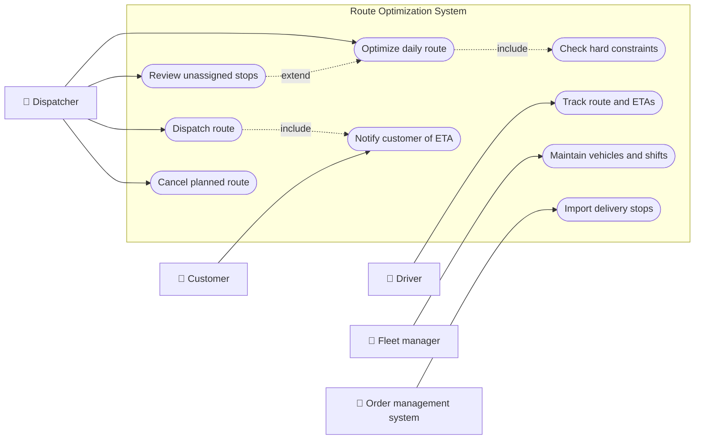
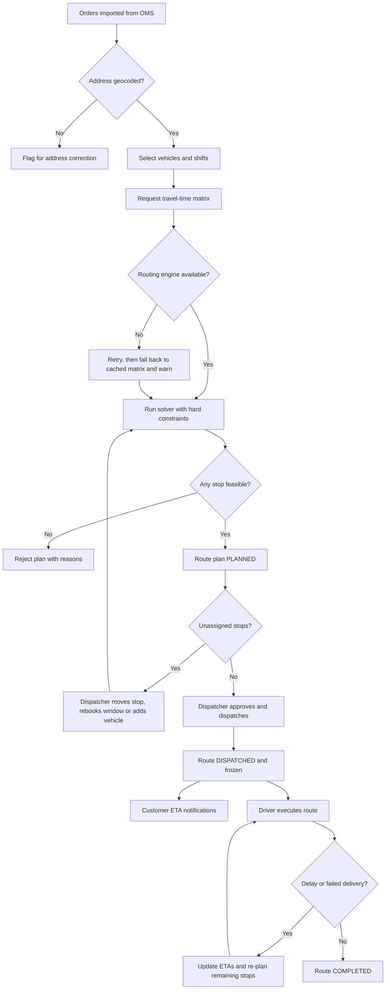
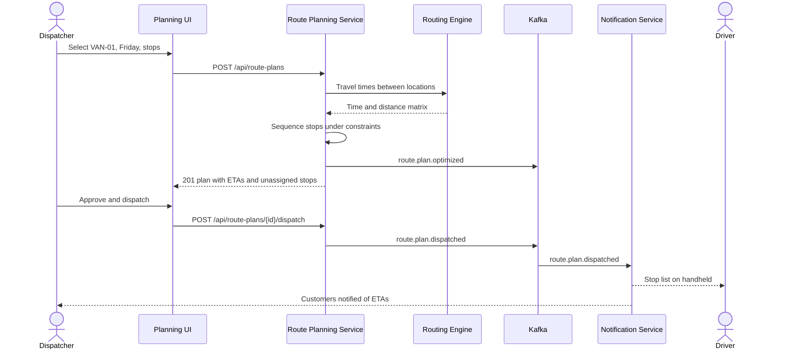
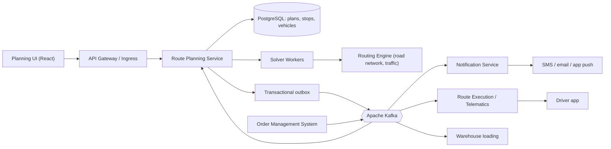
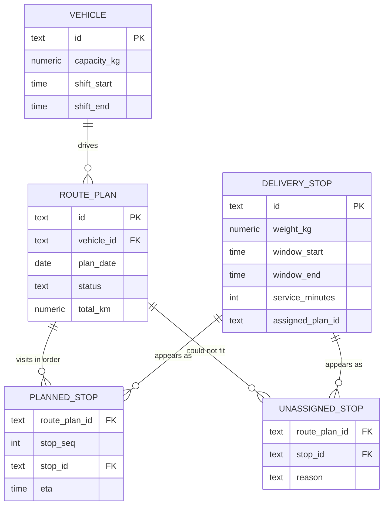
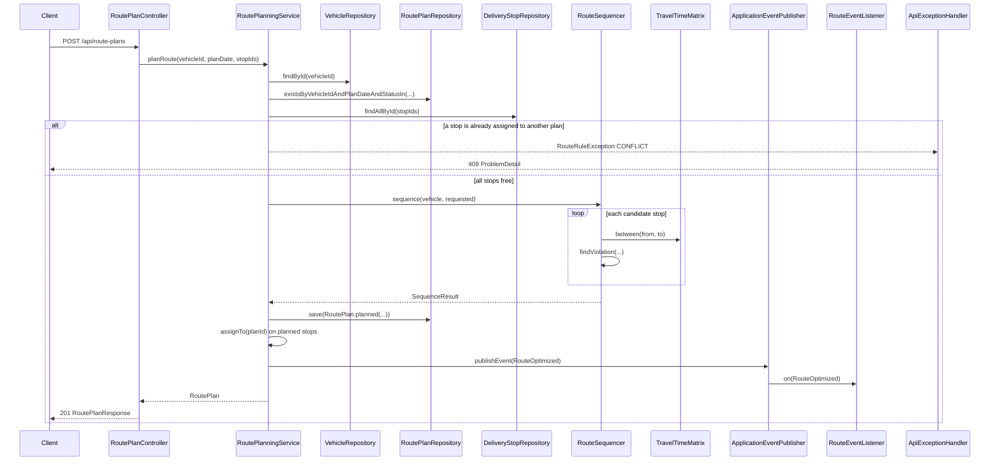
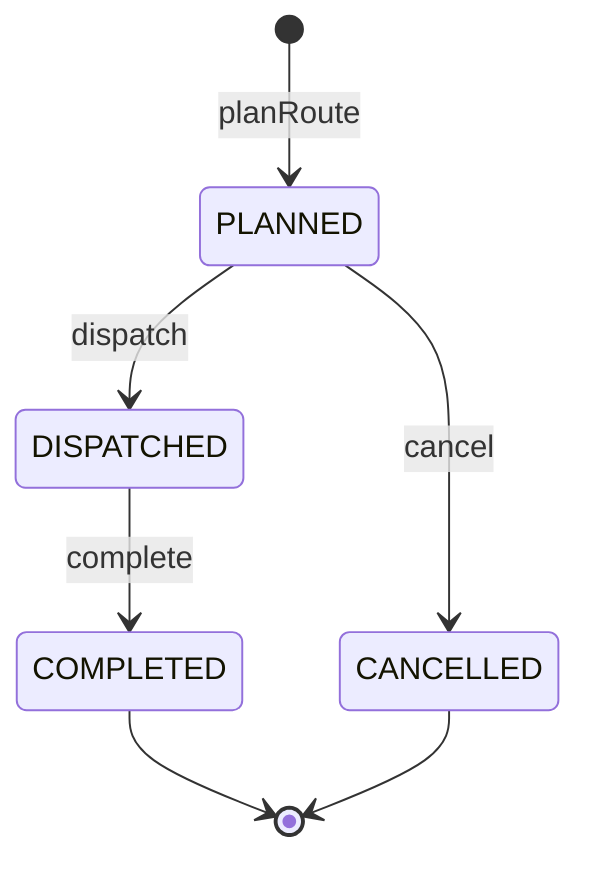
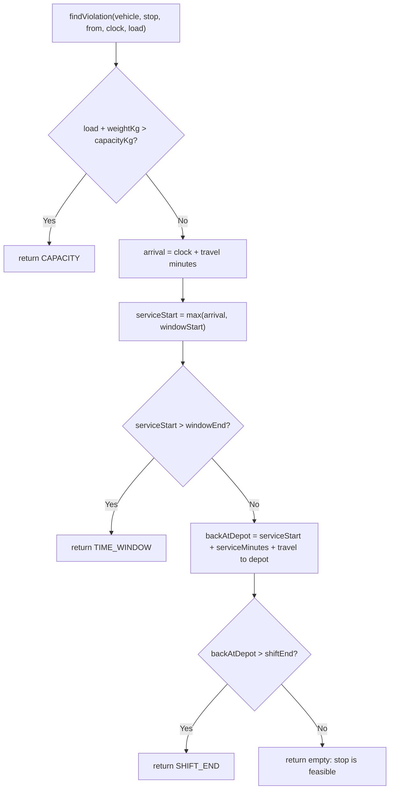

# Route Optimization

> **Domain:** Logistics · **Author:** [@naveenks720](https://github.com/naveenks720) · **Published:** November 13, 2026

> **Runnable code:** [`examples/logistics/route-optimization`](https://github.com/dhulipalla599/domain-knowledge-engineering/tree/main/examples/logistics/route-optimization)

## Explain It Like I'm Five

Imagine you have to bring birthday party invitations to eight friends on your bike before lunch. Your basket only holds so many, some friends are only home in the morning, and you must be back home when Mum calls you for lunch. If you ride to friends in the order you wrote their names, you zig-zag across town and miss some of them. So you sit down with a map and plan a loop that visits close friends one after another, reaches the "morning only" friends early, and gets you home on time. If a friend lives too far away, you tell Mum before you leave, instead of finding out halfway.

Route optimization does the same thing for delivery vans: it decides which van visits which customers, in which order and at what time, so every promise is kept at the lowest cost.

## Business Overview

Route optimization (often called route planning or the vehicle routing problem, VRP) takes a set of stops for a day, a fleet of vehicles and a list of constraints, and produces one ordered route per vehicle with an estimated time of arrival (ETA) at each stop. It is used by parcel carriers, grocery and retail home delivery, field service companies, waste collection and B2B distributors.

Why the business cares:

- **Cost.** Fuel or energy, driver hours, vehicle count and overtime are driven by kilometres and minutes. Routing is one of the few levers that cuts all of them at once.
- **Customer experience.** Customers book delivery windows. Missing a window means a failed delivery, a redelivery, a complaint and sometimes a refund.
- **Risk and compliance.** Routes must respect driver working-time and rest rules, vehicle weight limits, low-emission zones and access restrictions. These rules differ by country, city and vehicle class, so they are configuration, not code.
- **Capacity.** A good plan serves more stops with the same fleet, which decides how many orders sales can accept for tomorrow.

Where it sits in the logistics value chain: after **order capture and booking** (which promised the customer a window), after **warehouse picking and wave planning** (which must load vans in reverse stop order), and before **dispatch, execution and proof of delivery**. Last-mile routing is the most common form; line-haul and multi-drop pallet distribution use the same ideas with longer legs and different rules.

## Real-World Example

**Brightlane Parcel** (fictional) runs a depot in Rotterdam with a fleet of electric vans. On Thursday evening, dispatcher **Anouk Visser** opens the planning screen for Friday.

1. **Orders arrive.** The order management system has 6 stops for van `VAN-01`: a coffee roaster, a bike repair shop, a florist, a dental clinic, an office-supplies shop and a bakery. Each stop has an address (already geocoded to latitude/longitude), a parcel weight, a delivery window and a service time (how long the drop takes).
2. **Constraints load.** `VAN-01` carries 800 kg. Driver **Tomás Okafor** works 08:00 to 12:00 and must start and end at the depot.
3. **Optimization runs.** The planner asks the routing engine for travel times between every pair of locations, then builds a sequence: coffee roaster 08:30, bike shop 09:00, florist 09:17, dental clinic 10:00 (the van waits because the clinic only accepts parcels from 10:00), back at the depot 10:17.
4. **Two stops are left out, with reasons.** The office-supplies order (300 kg) would push the load to 860 kg, above the 800 kg limit: reason `CAPACITY`. The bakery wants delivery between 08:00 and 08:10 but is too far to reach in time: reason `TIME_WINDOW`.
5. **The dispatcher decides.** Anouk moves the office-supplies order to `VAN-02`, which still has room, and calls the bakery to rebook the window. She approves the plan.
6. **Dispatch.** On Friday at 07:45 Anouk dispatches the route. It is now frozen: the warehouse loads parcels in reverse order, Tomás's handheld receives the stop list, and each customer gets an ETA notification.
7. **Execution.** During the day, telematics updates ETAs. The route is completed when Tomás returns to the depot and the last proof of delivery is uploaded.

## Stakeholders

| Stakeholder | What they need | What they fear |
|---|---|---|
| Dispatcher / route planner | Feasible routes fast, clear reasons for every unplanned stop, easy manual overrides | A plan that looks good on screen but cannot be driven |
| Driver | A realistic sequence, enough time per stop, legal breaks, safe access | Impossible ETAs, overtime, U-turns and illegal stops |
| Customer (recipient) | Delivery inside the booked window, an accurate ETA | Waiting at home all day for a missed delivery |
| Fleet manager | Right vehicle count, shifts and capacities, lower cost per stop | Overloaded vans, idle vans, unpaid overtime |
| Customer service agent | Live ETA and route status to answer calls | Promising something the plan cannot deliver |
| Warehouse / loading team | The stop sequence early enough to load in reverse order | Last-minute route changes after loading |
| Order management system | A plan result per order (planned, unassigned with reason) | Silent drops of orders |
| Compliance / health and safety | Working-time, weight and access rules respected and auditable | Fines and accidents traced to plans that ignored the rules |

## Use Case Diagram



| Use Case | Primary Actor | Goal | Main success outcome |
|---|---|---|---|
| Import delivery stops | Order management system | Get tomorrow's orders into planning | Stops exist with location, weight, window and service time |
| Optimize daily route | Dispatcher | Turn stops and vehicles into a drivable route | Route plan in `PLANNED` with ordered stops and ETAs |
| Check hard constraints | (included) | Never plan an infeasible stop | Every planned stop fits capacity, window and shift |
| Review unassigned stops | Dispatcher | Handle what could not be planned | Each unassigned stop has a reason and a follow-up action |
| Dispatch route | Dispatcher | Release the route to the driver and warehouse | Route is `DISPATCHED` and frozen |
| Cancel planned route | Dispatcher | Undo a plan before dispatch | Route is `CANCELLED`, its stops return to the pool |
| Track route and ETAs | Driver | Follow the sequence and report progress | ETAs update; route ends `COMPLETED` |
| Notify customer of ETA | Customer | Know when to be available | Customer receives the ETA for their stop |
| Maintain vehicles and shifts | Fleet manager | Keep planning inputs correct | Capacities, shifts and depots are current |

## Key Terms

| Term | Plain-English meaning |
|---|---|
| VRP (vehicle routing problem) | The maths problem of assigning stops to vehicles and ordering them at minimum cost; it is NP-hard, so large instances are solved with heuristics |
| CVRP / VRPTW | VRP variants with vehicle capacity (C) and with customer time windows (TW); real problems combine many such variants |
| Depot | The place a route starts and ends, usually a warehouse or hub |
| Time window | The period in which the customer accepts delivery; arriving early means waiting, arriving late means a failure |
| Service time | Minutes spent at the stop: parking, walking, handover, signature |
| Distance / time matrix | Travel distance and time between every pair of locations, from a road-network routing engine |
| Hard constraint | A rule a plan must never break (capacity, legal working time) |
| Soft constraint | A preference with a penalty if broken (driver familiarity, slightly late is better than missed) |
| Unassigned (dropped) stop | A stop the optimizer could not fit; it needs a reason and a human or automated follow-up |
| Dispatch / route freeze | The moment the plan is released to driver and warehouse and stops being freely re-optimized |
| Dynamic re-optimization | Re-planning during the day when traffic, new orders or failures change the situation |
| Geocoding | Converting an address into coordinates; bad geocodes are the most common cause of bad routes |

## Process Flow

Planning usually happens the evening before or early in the morning. Orders with geocoded addresses arrive from order management; the planner selects vehicles and shifts; the system requests a travel-time matrix and runs the solver. The solver returns routes plus unassigned stops with reasons. The dispatcher reviews, adjusts and approves. At dispatch the route freezes, customers are notified and the driver executes it. During execution, delays trigger ETA updates and, in more advanced operations, re-optimization of the remaining stops.





## Business Rules and Edge Cases

- **Capacity is multi-dimensional.** Weight is the minimum; real fleets also limit volume, pallet count, temperature zones and axle weights. A van can be under its weight limit and still physically full.
- **Time windows have a precise meaning.** Decide whether the window end is the latest *arrival* or the latest *completion* of service, and use it consistently. The example treats it as the latest service start. Arriving early means waiting, which still consumes driver time.
- **Shift and working-time rules.** The route must return to the depot before the shift ends, and long routes need breaks. Driving-time rules differ by jurisdiction and vehicle class (for example EU Regulation (EC) No 561/2006 for heavier goods vehicles in the EU, FMCSA hours-of-service in the US); light vans are treated differently in many places. Model them as configurable constraints.
- **No double assignment.** A stop must belong to at most one active route. Two dispatchers planning in parallel will otherwise both claim it. Use optimistic locking or a unique constraint, not just a read-then-write check.
- **One active route per vehicle and day.** Unless your operation runs multiple trips per shift, in which case the rule becomes "trips must not overlap in time".
- **Dispatched routes are frozen.** After loading starts, changing the sequence breaks the reverse-order loading. Changes after dispatch are explicit operations (reassign, skip, insert) with their own audit trail, not a silent re-optimization.
- **Never silently drop a stop.** Every requested stop ends either planned or unassigned with a reason; order management must know which.
- **Travel times depend on the clock.** 08:00 and 11:00 traffic differ. A matrix without time-of-day effects produces optimistic morning ETAs.
- **Determinism and reproducibility.** Heuristic solvers can return different routes for the same input. Store the input snapshot and solver version with each plan so a complaint can be investigated.
- **Partial failure.** If the routing engine is down, either fail clearly or use a cached matrix and mark ETAs as low confidence; do not plan on straight-line distances unknowingly.
- **Idempotent dispatch.** Retrying "dispatch" after a timeout must not send the route to the driver twice or notify customers twice.

## From Business to System

| Business concept / step | System component | Data entity | Event |
|---|---|---|---|
| Import delivery stops | Order integration (consumer of OMS events) | `delivery_stop` | consumes `order.ready-for-planning` (production) |
| Vehicles, capacity, shifts | Fleet master data | `vehicle` | none (reference data) |
| Travel times | Routing engine adapter | cached matrix (not persisted in the example) | none |
| Optimize daily route | Route Planning Service + solver | `route_plan`, `planned_stop` | `route.plan.optimized` |
| Unassigned stops with reasons | Route Planning Service | `unassigned_stop` | part of `route.plan.optimized` payload |
| Dispatch route | Route Planning Service | `route_plan.status = DISPATCHED` | `route.plan.dispatched` |
| Customer ETA notification | Notification Service | notification log | consumes `route.plan.dispatched` |
| Cancel route | Route Planning Service | `route_plan.status = CANCELLED`, stops released | `route.plan.cancelled` |
| Track and complete route | Execution / telematics service | `route_plan.status = COMPLETED` | `stop.eta.updated` (production) |

## Architecture



**Why these boundaries.**

- **Route Planning Service** owns the plan aggregate and its lifecycle: who may change a plan, and when. It is transactional and lives on PostgreSQL.
- **Solver Workers** are separated because optimization is CPU-heavy and slow (seconds to minutes for a fleet). They scale on queue depth, can be killed and retried, and never write the plan directly; they return a result the planning service validates and persists.
- **Routing Engine** is behind an adapter because companies switch providers, run their own OSRM/Valhalla cluster, or combine providers per country.
- **Execution / Telematics** is a different bounded context: it deals with GPS pings and proof of delivery at high volume, and must keep working if planning is down.
- **Notification Service** is shared across the company and only reacts to events.

## Data Model

```sql
CREATE TABLE vehicle (
    id            TEXT PRIMARY KEY,
    depot_id      TEXT        NOT NULL,
    capacity_kg   NUMERIC(8,2) NOT NULL CHECK (capacity_kg > 0),
    shift_start   TIME        NOT NULL,
    shift_end     TIME        NOT NULL CHECK (shift_end > shift_start),
    depot_lat     DOUBLE PRECISION NOT NULL,
    depot_lon     DOUBLE PRECISION NOT NULL
);

CREATE TABLE delivery_stop (
    id                TEXT PRIMARY KEY,
    order_id          TEXT        NOT NULL UNIQUE,
    customer_name     TEXT        NOT NULL,
    lat               DOUBLE PRECISION NOT NULL,
    lon               DOUBLE PRECISION NOT NULL,
    weight_kg         NUMERIC(8,2) NOT NULL CHECK (weight_kg > 0),
    window_start      TIME        NOT NULL,
    window_end        TIME        NOT NULL CHECK (window_end >= window_start),
    service_minutes   INT         NOT NULL CHECK (service_minutes >= 0),
    assigned_plan_id  TEXT,
    version           BIGINT      NOT NULL DEFAULT 0
);

CREATE TABLE route_plan (
    id               TEXT PRIMARY KEY,
    vehicle_id       TEXT        NOT NULL REFERENCES vehicle(id),
    plan_date        DATE        NOT NULL,
    status           TEXT        NOT NULL CHECK (status IN ('PLANNED','DISPATCHED','COMPLETED','CANCELLED')),
    total_km         NUMERIC(8,2) NOT NULL,
    return_to_depot  TIME        NOT NULL,
    solver_version   TEXT,
    created_at       TIMESTAMPTZ NOT NULL DEFAULT now()
);
-- At most one active route per vehicle and day, enforced by the database, not only by the service.
CREATE UNIQUE INDEX ux_route_plan_active
    ON route_plan (vehicle_id, plan_date) WHERE status IN ('PLANNED','DISPATCHED');

ALTER TABLE delivery_stop
    ADD CONSTRAINT fk_stop_plan FOREIGN KEY (assigned_plan_id) REFERENCES route_plan(id);

CREATE TABLE planned_stop (
    route_plan_id  TEXT NOT NULL REFERENCES route_plan(id),
    stop_seq       INT  NOT NULL,
    stop_id        TEXT NOT NULL REFERENCES delivery_stop(id),
    eta            TIME NOT NULL,
    departure      TIME NOT NULL,
    leg_km         NUMERIC(8,2) NOT NULL,
    PRIMARY KEY (route_plan_id, stop_seq)
);

CREATE TABLE unassigned_stop (
    route_plan_id  TEXT NOT NULL REFERENCES route_plan(id),
    idx            INT  NOT NULL,
    stop_id        TEXT NOT NULL REFERENCES delivery_stop(id),
    reason         TEXT NOT NULL CHECK (reason IN ('CAPACITY','TIME_WINDOW','SHIFT_END')),
    PRIMARY KEY (route_plan_id, idx)
);
```

Times are local depot time here for readability. If depots span time zones, store `TIMESTAMPTZ` and convert at the edges.



## APIs

| Method | Path | Purpose |
|---|---|---|
| POST | `/api/route-plans` | Optimize a route for one vehicle and day from a list of stops |
| GET | `/api/route-plans/{id}` | Read a plan with its sequence, ETAs and unassigned stops |
| POST | `/api/route-plans/{id}/dispatch` | Freeze the plan and release it to driver and warehouse |
| POST | `/api/route-plans/{id}/complete` | Mark the route finished |
| POST | `/api/route-plans/{id}/cancel` | Cancel a plan that is not yet dispatched and release its stops |

In production, fleet-wide optimization is usually asynchronous: `POST` returns `202 Accepted` with a job id and the result arrives by polling or by event. The example plans one vehicle synchronously to keep the flow readable.

`POST /api/route-plans`

```json
{
  "vehicleId": "VAN-01",
  "planDate": "2026-11-20",
  "stopIds": ["S-101", "S-102", "S-103", "S-104", "S-105", "S-106"]
}
```

`201 Created`, `Location: /api/route-plans/RP-17CBB4EE`

```json
{
  "id": "RP-17CBB4EE",
  "vehicleId": "VAN-01",
  "planDate": "2026-11-20",
  "status": "PLANNED",
  "totalKm": 14.4,
  "returnToDepot": "10:17:00",
  "stops": [
    {"sequence": 1, "stopId": "S-101", "eta": "08:30:00", "departure": "08:40:00", "legKm": 2.27},
    {"sequence": 2, "stopId": "S-102", "eta": "09:00:00", "departure": "09:10:00", "legKm": 2.48},
    {"sequence": 3, "stopId": "S-103", "eta": "09:17:00", "departure": "09:32:00", "legKm": 3.04},
    {"sequence": 4, "stopId": "S-104", "eta": "10:00:00", "departure": "10:10:00", "legKm": 3.57}
  ],
  "unassigned": [
    {"stopId": "S-105", "reason": "CAPACITY"},
    {"stopId": "S-106", "reason": "TIME_WINDOW"}
  ]
}
```

## Events

| Event (Kafka topic) | Producer | Consumers | Key fields |
|---|---|---|---|
| `route.plan.optimized` | Route Planning Service | Order management (planned / unassigned status), customer service dashboard | `planId`, `vehicleId`, `planDate`, `stopCount`, `totalKm` |
| `route.plan.dispatched` | Route Planning Service | Driver app, notification service (ETAs), warehouse loading | `planId`, `vehicleId`, `stopIds` in sequence |
| `route.plan.cancelled` | Route Planning Service | Order management (stops back to the pool), warehouse | `planId`, `releasedStopIds` |
| `stop.eta.updated` (production only) | Route Execution / Telematics | Notification service, customer service | `planId`, `stopId`, `eta`, `confidence` |

**Ordering:** key every route event by `planId` so a plan's `optimized`, `dispatched` and `cancelled` events land on the same partition in order. **Idempotency:** consumers must deduplicate on an event id (or `planId` + type), because outbox relays and Kafka producers can deliver at least once; a customer must not receive the same ETA SMS twice. **Atomicity:** write the event to an outbox table in the same transaction as the status change, so a crash cannot publish `dispatched` for a plan that was never saved. The example's in-process `@EventListener` runs inside the transaction, which is fine for a demo but not a production guarantee.

## Backend Implementation

> The Java tab is the exact code from the runnable example (Spring Boot 3). The Python tab uses FastAPI with SQLAlchemy and the Node.js tab uses Express with TypeScript; both mirror the same names and rules.

Full source: [`examples/logistics/route-optimization`](https://github.com/dhulipalla599/domain-knowledge-engineering/tree/main/examples/logistics/route-optimization/src/main/java/com/dke/logistics/route_optimization).

### Hard-constraint check used by the solver

`RouteSequencer.findViolation` decides whether a stop may be visited next. The sequencer only picks stops that return no violation, and reports the violation for every stop it could not place.

=== "Java"

    ```java
    /** The hard constraints for visiting {@code stop} next, from {@code from} at minute {@code clock}. */
    Optional<Reason> findViolation(Vehicle vehicle, DeliveryStop stop, GeoPoint from, int clock, double load) {
        if (load + stop.getWeightKg() > vehicle.getCapacityKg()) {
            return Optional.of(Reason.CAPACITY);
        }
        int arrival = clock + matrix.between(from, stop.location()).minutes();
        int serviceStart = Math.max(arrival, minuteOfDay(stop.getWindowStart())); // early: driver waits
        if (serviceStart > minuteOfDay(stop.getWindowEnd())) {
            return Optional.of(Reason.TIME_WINDOW);
        }
        int backAtDepot = serviceStart + stop.getServiceMinutes()
                + matrix.between(stop.location(), vehicle.depot()).minutes();
        if (backAtDepot > minuteOfDay(vehicle.getShiftEnd())) {
            return Optional.of(Reason.SHIFT_END);
        }
        return Optional.empty();
    }
    ```

=== "Python"

    ```python
    def find_violation(self, vehicle: Vehicle, stop: DeliveryStop, origin: GeoPoint,
                       clock: int, load: float) -> Reason | None:
        """The hard constraints for visiting `stop` next, from `origin` at minute `clock`."""
        if load + stop.weight_kg > vehicle.capacity_kg:
            return Reason.CAPACITY
        arrival = clock + self.matrix.between(origin, stop.location()).minutes
        service_start = max(arrival, minute_of_day(stop.window_start))  # early: driver waits
        if service_start > minute_of_day(stop.window_end):
            return Reason.TIME_WINDOW
        back_at_depot = (service_start + stop.service_minutes
                         + self.matrix.between(stop.location(), vehicle.depot()).minutes)
        if back_at_depot > minute_of_day(vehicle.shift_end):
            return Reason.SHIFT_END
        return None
    ```

=== "Node.js"

    ```typescript
    /** The hard constraints for visiting `stop` next, from `from` at minute `clock`. */
    findViolation(vehicle: Vehicle, stop: DeliveryStop, from: GeoPoint, clock: number, load: number): Reason | null {
      if (load + stop.weightKg > vehicle.capacityKg) {
        return "CAPACITY";
      }
      const arrival = clock + this.matrix.between(from, location(stop)).minutes;
      const serviceStart = Math.max(arrival, minuteOfDay(stop.windowStart)); // early: driver waits
      if (serviceStart > minuteOfDay(stop.windowEnd)) {
        return "TIME_WINDOW";
      }
      const backAtDepot = serviceStart + stop.serviceMinutes
        + this.matrix.between(location(stop), depot(vehicle)).minutes;
      if (backAtDepot > minuteOfDay(vehicle.shiftEnd)) {
        return "SHIFT_END";
      }
      return null;
    }
    ```

### Service method enforcing the planning rules

=== "Java"

    ```java
    @Transactional
    public RoutePlan planRoute(String vehicleId, LocalDate planDate, List<String> stopIds) {
        Vehicle vehicle = vehicles.findById(vehicleId).orElseThrow(() ->
                new RouteRuleException(HttpStatus.NOT_FOUND, "Vehicle " + vehicleId + " not found"));
        if (plans.existsByVehicleIdAndPlanDateAndStatusIn(vehicleId, planDate, RouteStatus.ACTIVE)) {
            throw new RouteRuleException(HttpStatus.CONFLICT,
                    "Vehicle " + vehicleId + " already has an active route on " + planDate);
        }
        List<DeliveryStop> requested = loadStops(stopIds);
        List<String> taken = requested.stream().filter(DeliveryStop::isAssigned)
                .map(s -> s.getId() + " (in " + s.getAssignedPlanId() + ")").toList();
        if (!taken.isEmpty()) {
            throw new RouteRuleException(HttpStatus.CONFLICT, "Stops already planned on another route: " + taken);
        }

        SequenceResult result = sequencer.sequence(vehicle, requested);
        if (result.stops().isEmpty()) {
            throw new RouteRuleException(HttpStatus.UNPROCESSABLE_ENTITY,
                    "No requested stop can be served by " + vehicleId + ": " + result.unassigned().stream()
                            .map(u -> u.getStopId() + "=" + u.getReason()).toList());
        }
        RoutePlan plan = plans.save(RoutePlan.planned(vehicleId, planDate, result.stops(), result.unassigned(),
                result.totalKm(), result.returnToDepot()));
        Map<String, DeliveryStop> byId = requested.stream()
                .collect(Collectors.toMap(DeliveryStop::getId, Function.identity()));
        result.stops().forEach(p -> byId.get(p.getStopId()).assignTo(plan.getId())); // @Version guards races
        events.publishEvent(new RouteEvent.RouteOptimized(plan.getId(), vehicleId, planDate,
                result.stops().size(), result.totalKm()));
        return plan;
    }
    ```

=== "Python"

    ```python
    def plan_route(db: Session, sequencer: RouteSequencer, publish, vehicle_id: str,
                   plan_date: date, stop_ids: list[str]) -> RoutePlan:
        vehicle = db.get(Vehicle, vehicle_id)
        if vehicle is None:
            raise RouteRuleError(404, f"Vehicle {vehicle_id} not found")
        active = db.scalar(select(func.count()).select_from(RoutePlan).where(
            RoutePlan.vehicle_id == vehicle_id, RoutePlan.plan_date == plan_date,
            RoutePlan.status.in_(ACTIVE_STATUSES)))
        if active:
            raise RouteRuleError(409, f"Vehicle {vehicle_id} already has an active route on {plan_date}")
        requested = load_stops(db, stop_ids)
        taken = [f"{s.id} (in {s.assigned_plan_id})" for s in requested if s.assigned_plan_id]
        if taken:
            raise RouteRuleError(409, f"Stops already planned on another route: {taken}")

        result = sequencer.sequence(vehicle, requested)
        if not result.stops:
            reasons = [f"{u.stop_id}={u.reason}" for u in result.unassigned]
            raise RouteRuleError(422, f"No requested stop can be served by {vehicle_id}: {reasons}")
        plan = RoutePlan.planned(vehicle_id, plan_date, result.stops, result.unassigned,
                                 result.total_km, result.return_to_depot)
        db.add(plan)
        by_id = {s.id: s for s in requested}
        for p in result.stops:
            by_id[p.stop_id].assigned_plan_id = plan.id  # version_id_col guards races
        db.commit()
        publish(RouteOptimized(plan.id, vehicle_id, plan_date, len(result.stops), result.total_km))
        return plan
    ```

=== "Node.js"

    ```typescript
    async planRoute(vehicleId: string, planDate: string, stopIds: string[]): Promise<RoutePlan> {
      return this.db.transaction(async (tx) => {
        const vehicle = await tx.vehicles.findById(vehicleId);
        if (!vehicle) throw new RouteRuleError(404, `Vehicle ${vehicleId} not found`);
        if (await tx.plans.existsActive(vehicleId, planDate)) {
          throw new RouteRuleError(409, `Vehicle ${vehicleId} already has an active route on ${planDate}`);
        }
        const requested = await this.loadStops(tx, stopIds);
        const taken = requested.filter((s) => s.assignedPlanId).map((s) => `${s.id} (in ${s.assignedPlanId})`);
        if (taken.length) throw new RouteRuleError(409, `Stops already planned on another route: ${taken}`);

        const result = this.sequencer.sequence(vehicle, requested);
        if (result.stops.length === 0) {
          const reasons = result.unassigned.map((u) => `${u.stopId}=${u.reason}`);
          throw new RouteRuleError(422, `No requested stop can be served by ${vehicleId}: ${reasons}`);
        }
        const plan = await tx.plans.save(RoutePlan.planned(vehicleId, planDate, result.stops,
          result.unassigned, result.totalKm, result.returnToDepot));
        for (const p of result.stops) {
          await tx.stops.assign(p.stopId, plan.id); // UPDATE ... WHERE version = $n guards races
        }
        this.events.emit("route.plan.optimized", { planId: plan.id, vehicleId, planDate,
          stopCount: result.stops.length, totalKm: result.totalKm });
        return plan;
      });
    }
    ```

### Controller endpoint

=== "Java"

    ```java
    @PostMapping
    public ResponseEntity<RoutePlanResponse> plan(@Valid @RequestBody PlanRouteRequest request) {
        var plan = service.planRoute(request.vehicleId(), request.planDate(), request.stopIds());
        return ResponseEntity.created(URI.create("/api/route-plans/" + plan.getId()))
                .body(RoutePlanResponse.from(plan));
    }
    ```

=== "Python"

    ```python
    @router.post("/api/route-plans", status_code=201, response_model=RoutePlanResponse)
    def plan(request: PlanRouteRequest, response: Response, db: Session = Depends(get_db)):
        plan = plan_route(db, sequencer, publish, request.vehicle_id, request.plan_date, request.stop_ids)
        response.headers["Location"] = f"/api/route-plans/{plan.id}"
        return RoutePlanResponse.from_plan(plan)
    ```

=== "Node.js"

    ```typescript
    router.post("/api/route-plans", async (req, res, next) => {
      try {
        const { vehicleId, planDate, stopIds } = PlanRouteRequest.parse(req.body); // zod schema
        const plan = await service.planRoute(vehicleId, planDate, stopIds);
        res.status(201).location(`/api/route-plans/${plan.id}`).json(RoutePlanResponse.from(plan));
      } catch (err) {
        next(err); // error middleware maps RouteRuleError to application/problem+json
      }
    });
    ```

## Frontend Screen

The dispatcher's planning screen: choose a vehicle, date and stops, see the optimized sequence with ETAs, see every unassigned stop with its reason, and dispatch.

```tsx
import { useState } from "react";

type Stop = { sequence: number; stopId: string; eta: string; departure: string; legKm: number };
type Unassigned = { stopId: string; reason: "CAPACITY" | "TIME_WINDOW" | "SHIFT_END" };
type RoutePlan = {
  id: string; vehicleId: string; planDate: string; status: string;
  totalKm: number; returnToDepot: string; stops: Stop[]; unassigned: Unassigned[];
};

const REASON_TEXT: Record<Unassigned["reason"], string> = {
  CAPACITY: "Van would be over its weight limit",
  TIME_WINDOW: "Cannot arrive inside the delivery window",
  SHIFT_END: "Van cannot be back at the depot before the shift ends",
};

export function RoutePlanScreen() {
  const [vehicleId, setVehicleId] = useState("VAN-01");
  const [planDate, setPlanDate] = useState("2026-11-20");
  const [stopIds, setStopIds] = useState("S-101, S-102, S-103, S-104, S-105, S-106");
  const [plan, setPlan] = useState<RoutePlan | null>(null);
  const [error, setError] = useState<string | null>(null);
  const [busy, setBusy] = useState(false);

  async function call(url: string, body?: unknown) {
    setBusy(true);
    setError(null);
    try {
      const res = await fetch(url, {
        method: "POST",
        headers: { "Content-Type": "application/json" },
        body: body ? JSON.stringify(body) : undefined,
      });
      const json = await res.json();
      if (!res.ok) throw new Error(json.detail ?? res.statusText);
      setPlan(json);
    } catch (e) {
      setError((e as Error).message);
    } finally {
      setBusy(false);
    }
  }

  const optimize = () =>
    call("/api/route-plans", {
      vehicleId,
      planDate,
      stopIds: stopIds.split(",").map((s) => s.trim()).filter(Boolean),
    });

  return (
    <main>
      <h1>Route planning</h1>
      <form onSubmit={(e) => { e.preventDefault(); optimize(); }}>
        <label>Vehicle <input value={vehicleId} onChange={(e) => setVehicleId(e.target.value)} /></label>
        <label>Date <input type="date" value={planDate} onChange={(e) => setPlanDate(e.target.value)} /></label>
        <label>Stops <input value={stopIds} onChange={(e) => setStopIds(e.target.value)} /></label>
        <button disabled={busy}>Optimize</button>
      </form>

      {error && <p role="alert">{error}</p>}

      {plan && (
        <section aria-label="Route plan">
          <h2>{plan.id} · {plan.status} · {plan.totalKm} km · back at depot {plan.returnToDepot}</h2>
          <table>
            <thead><tr><th>#</th><th>Stop</th><th>ETA</th><th>Departs</th><th>Leg km</th></tr></thead>
            <tbody>
              {plan.stops.map((s) => (
                <tr key={s.stopId}>
                  <td>{s.sequence}</td><td>{s.stopId}</td><td>{s.eta}</td><td>{s.departure}</td><td>{s.legKm}</td>
                </tr>
              ))}
            </tbody>
          </table>
          {plan.unassigned.length > 0 && (
            <>
              <h3>Needs attention</h3>
              <ul>
                {plan.unassigned.map((u) => <li key={u.stopId}>{u.stopId}: {REASON_TEXT[u.reason]}</li>)}
              </ul>
            </>
          )}
          {plan.status === "PLANNED" && (
            <button disabled={busy} onClick={() => call(`/api/route-plans/${plan.id}/dispatch`)}>
              Dispatch to driver
            </button>
          )}
        </section>
      )}
    </main>
  );
}
```

## Cloud Deployment

**Main managed services on AWS:**

- **Amazon EKS** runs the Route Planning Service, the solver workers and the notification consumers. Solver workers get their own node group on compute-optimized instances so a large optimization cannot starve the API pods.
- **Amazon RDS for PostgreSQL** (Multi-AZ) stores plans, stops and vehicles; PostGIS can be enabled for spatial queries such as "stops within this zone".
- **Amazon MSK** hosts the Kafka topics; the outbox relay publishes from PostgreSQL to MSK.
- **Amazon Location Service** (route matrix) or a self-hosted OSRM/Valhalla deployment on EKS provides travel times; matrices are cached in **Amazon ElastiCache** keyed by region and departure-time bucket.
- **AWS Secrets Manager** for database and provider credentials, exposed to pods through IAM roles for service accounts (IRSA) or EKS Pod Identity.

```hcl
resource "aws_db_instance" "route_planning" {
  identifier                   = "route-planning-prod"
  engine                       = "postgres"
  engine_version               = "16"
  instance_class               = "db.r6g.large"
  allocated_storage            = 100
  storage_encrypted            = true
  multi_az                     = true
  db_name                      = "route_planning"
  username                     = "route_admin"
  manage_master_user_password  = true
  db_subnet_group_name         = aws_db_subnet_group.private.name
  vpc_security_group_ids       = [aws_security_group.route_planning_db.id]
  backup_retention_period      = 14
  deletion_protection          = true
  performance_insights_enabled = true
}
```

**Security:** the database and MSK live in private subnets; only the planning service's security group may reach PostgreSQL. Customer addresses and phone numbers are personal data, so encrypt at rest, restrict who can export routes, and keep only coordinates and stop ids in event payloads, not names and phone numbers.

**Scaling:** the API scales with a Horizontal Pod Autoscaler on CPU and request rate. Solver workers scale on queue depth or Kafka consumer lag (for example with KEDA), and each job has a time budget so a single huge problem cannot block the queue.

**Observability:** instrument services with OpenTelemetry (traces, metrics, logs) and export to CloudWatch through the AWS Distro for OpenTelemetry collector. Track solver duration, unassigned-stop rate by reason, planned versus actual arrival time per stop, routing-engine latency and error rate, and outbox lag. Alarm when the unassigned rate or ETA error jumps, because that usually signals bad input data (geocodes, capacities) rather than a code bug.

## Non-Functional Requirements

| Concern | Expectation for route optimization | How the design meets it |
|---|---|---|
| Availability | Planning must be available in the planning window (evening and early morning); execution must keep working if planning is down | Planning and execution are separate services; dispatched routes are already on the driver's device; Multi-AZ database |
| Latency | Single-vehicle plans in seconds; fleet-wide plans within an agreed time budget (often minutes) | Async solver jobs with time limits; cached travel-time matrices; the API never blocks on a full fleet solve |
| Consistency | A stop on at most one active route; one active route per vehicle and day; dispatched routes immutable | Optimistic locking (`@Version`), a partial unique index, state machine in `RoutePlan.moveTo` |
| Correctness of ETAs | ETAs good enough to promise to customers | Time-of-day travel times from a real routing engine; planned versus actual tracked and fed back |
| Audit | Explain any plan after the fact | Persist input snapshot, solver version, unassigned reasons and every status change with user and timestamp |
| Compliance | Working-time, vehicle weight and access rules respected; personal data protected | Rules modelled as configurable hard constraints per country and vehicle class; minimal personal data in events; access control and retention policies |
| Reliability of events | No lost or duplicated driver or customer messages | Transactional outbox, keyed topics, idempotent consumers |

## Runnable Example

The example implements one vehicle's daily route planning end to end: a nearest-feasible-neighbour sequencer that enforces vehicle capacity, customer time windows and the driver's shift end; planning rules that reject stops already on another route (`409`), a second active route for the same vehicle and day (`409`) and a plan with no feasible stop (`422`); a `RoutePlan` lifecycle `PLANNED -> DISPATCHED -> COMPLETED` with `CANCELLED` only before dispatch; and domain events named after the Kafka topics above. Travel times come from a deterministic offline stand-in behind the `TravelTimeMatrix` interface. It runs on H2 with no external services.

Source: [`examples/logistics/route-optimization`](https://github.com/dhulipalla599/domain-knowledge-engineering/tree/main/examples/logistics/route-optimization)

```bash
cd examples/logistics/route-optimization
mvn spring-boot:run          # starts on http://localhost:8080
mvn verify                   # unit + API tests
```

Plan `VAN-01`'s route (the plan id is random):

```bash
curl -s -X POST localhost:8080/api/route-plans -H 'Content-Type: application/json' \
  -d '{"vehicleId":"VAN-01","planDate":"2026-11-20","stopIds":["S-101","S-102","S-103","S-104","S-105","S-106"]}'
```

```json
{"id":"RP-17CBB4EE","vehicleId":"VAN-01","planDate":"2026-11-20","status":"PLANNED","totalKm":14.4,"returnToDepot":"10:17:00","stops":[{"sequence":1,"stopId":"S-101","eta":"08:30:00","departure":"08:40:00","legKm":2.27},{"sequence":2,"stopId":"S-102","eta":"09:00:00","departure":"09:10:00","legKm":2.48},{"sequence":3,"stopId":"S-103","eta":"09:17:00","departure":"09:32:00","legKm":3.04},{"sequence":4,"stopId":"S-104","eta":"10:00:00","departure":"10:10:00","legKm":3.57}],"unassigned":[{"stopId":"S-105","reason":"CAPACITY"},{"stopId":"S-106","reason":"TIME_WINDOW"}]}
```

Try to plan a stop that is already on the dispatched seed route `RP-SEED01`:

```bash
curl -s -X POST localhost:8080/api/route-plans -H 'Content-Type: application/json' \
  -d '{"vehicleId":"VAN-01","planDate":"2026-11-21","stopIds":["S-107","S-108"]}'
```

```json
{"type":"about:blank","title":"Conflict","status":409,"detail":"Stops already planned on another route: [S-107 (in RP-SEED01)]","instance":"/api/route-plans"}
```

| Class | Package | Responsibility |
|---|---|---|
| `RouteOptimizationApplication` | root | Spring Boot entry point |
| `RoutePlan` | `domain` | Aggregate with ordered and unassigned stops; enforces status transitions |
| `RouteStatus` | `domain` | Lifecycle enum and allowed transitions |
| `Vehicle` | `domain` | Capacity, shift and depot |
| `DeliveryStop` | `domain` | Location, weight, time window, service time, assigned plan, version |
| `PlannedStop`, `UnassignedStop` | `domain` | Embeddables for a visit with ETA and a rejected stop with its `Reason` |
| `GeoPoint` | `domain` | Latitude/longitude value |
| `RouteEvent` | `domain` | Sealed events `RouteOptimized`, `RouteDispatched`, `RouteCancelled` |
| `RoutePlanRepository`, `VehicleRepository`, `DeliveryStopRepository` | `repository` | Spring Data JPA repositories |
| `RouteSequencer` | `service` | Heuristic sequencing and the hard-constraint check `findViolation` |
| `RoutePlanningService` | `service` | Planning rules, lifecycle commands, event publishing |
| `RouteRuleException` | `service` | Rule violation with HTTP status |
| `RoutePlanController`, `PlanRouteRequest`, `RoutePlanResponse` | `api` | REST endpoints and DTO records |
| `ApiExceptionHandler` | `api` | Maps errors to `ProblemDetail` |
| `TravelTimeMatrix`, `HaversineTravelTimeMatrix` | `integration` | Routing-engine port and offline stub |
| `RouteEventListener` | `integration` | `@EventListener` standing in for Kafka consumers |

## UML Diagrams

### Class Diagram

The controller delegates to `RoutePlanningService`, which applies the planning rules and uses `RouteSequencer` for the hard constraints; `RoutePlan` owns its stops and guards its own status transitions.

```mermaid
classDiagram
    class RoutePlanController {
        +plan(PlanRouteRequest) ResponseEntity
        +get(String id) RoutePlanResponse
        +dispatch(String id) RoutePlanResponse
        +complete(String id) RoutePlanResponse
        +cancel(String id) RoutePlanResponse
    }
    class RoutePlanningService {
        +planRoute(String vehicleId, LocalDate planDate, List~String~ stopIds) RoutePlan
        +dispatch(String planId) RoutePlan
        +complete(String planId) RoutePlan
        +cancel(String planId) RoutePlan
        +find(String planId) RoutePlan
    }
    class RouteSequencer {
        +sequence(Vehicle vehicle, List~DeliveryStop~ candidates) SequenceResult
        ~findViolation(Vehicle, DeliveryStop, GeoPoint, int, double) Optional~Reason~
    }
    class TravelTimeMatrix {
        <<interface>>
        +between(GeoPoint from, GeoPoint to) Leg
    }
    class HaversineTravelTimeMatrix
    class RoutePlanRepository {
        <<interface>>
        +existsByVehicleIdAndPlanDateAndStatusIn() boolean
    }
    class VehicleRepository {
        <<interface>>
    }
    class DeliveryStopRepository {
        <<interface>>
    }
    class RoutePlan {
        -String id
        -String vehicleId
        -LocalDate planDate
        -RouteStatus status
        -double totalKm
        -LocalTime returnToDepot
        +planned(...)$ RoutePlan
        +moveTo(RouteStatus next)
    }
    class RouteStatus {
        <<enumeration>>
        PLANNED
        DISPATCHED
        COMPLETED
        CANCELLED
        +canMoveTo(RouteStatus next) boolean
    }
    class Vehicle {
        -String id
        -double capacityKg
        -LocalTime shiftStart
        -LocalTime shiftEnd
        +depot() GeoPoint
    }
    class DeliveryStop {
        -String id
        -double weightKg
        -LocalTime windowStart
        -LocalTime windowEnd
        -int serviceMinutes
        -String assignedPlanId
        -long version
        +assignTo(String planId)
        +release()
    }
    class PlannedStop {
        -String stopId
        -LocalTime eta
        -LocalTime departure
        -double legKm
    }
    class UnassignedStop {
        -String stopId
        -Reason reason
    }
    class Reason {
        <<enumeration>>
        CAPACITY
        TIME_WINDOW
        SHIFT_END
    }
    class RouteEvent {
        <<interface>>
        +planId() String
        +topic() String
    }
    class RouteOptimized
    class RouteDispatched
    class RouteCancelled
    class RouteEventListener {
        +on(RouteEvent event)
    }

    RoutePlanController --> RoutePlanningService
    RoutePlanningService --> RouteSequencer
    RoutePlanningService --> RoutePlanRepository
    RoutePlanningService --> VehicleRepository
    RoutePlanningService --> DeliveryStopRepository
    RoutePlanningService ..> RouteEvent : publishes
    RouteSequencer --> TravelTimeMatrix
    HaversineTravelTimeMatrix ..|> TravelTimeMatrix
    RoutePlan "1" *-- "many" PlannedStop
    RoutePlan "1" *-- "many" UnassignedStop
    RoutePlan --> RouteStatus
    UnassignedStop --> Reason
    RouteOptimized ..|> RouteEvent
    RouteDispatched ..|> RouteEvent
    RouteCancelled ..|> RouteEvent
    RouteEventListener ..> RouteEvent : consumes
```



### Sequence Diagram (control flow)

One `POST /api/route-plans` request through the code, with the double-assignment rule as the main rejection branch.



### State Diagram

`RouteStatus.canMoveTo` allows exactly these transitions; any other call to `RoutePlan.moveTo` throws and the API answers `409`.



### Activity Diagram

The decision logic inside `RouteSequencer.findViolation`. The order of the checks decides which reason is reported when several rules fail.



## AI Opportunities

1. **Learned travel and service times.**
   *Use case:* predict real driving time per road segment and time of day, and real service time per address (stairs, reception desks, parking), to replace static estimates.
   *Data:* GPS traces, planned versus actual arrival and departure per stop, address attributes.
   *Risk / control:* biased data from a few drivers or seasons; validate per region and keep a fallback to the routing engine. Telematics data is personal data about drivers, so check worker-monitoring and privacy rules in each country.
2. **Delivery success prediction.**
   *Use case:* estimate the probability that a customer is home in a window, to suggest better windows or alternative pickup points.
   *Data:* delivery history, window choices, failed-delivery reasons.
   *Risk / control:* must not penalise neighbourhoods or customer groups unfairly; review features for proxies of protected attributes and explain recommendations to customer service.
3. **Address and geocode quality.**
   *Use case:* ML or LLM-based address normalisation and detection of suspicious geocodes (a pin in a river, wrong side of a motorway) before planning.
   *Data:* raw addresses, geocoder confidence, past correction history, drivers' actual stop coordinates.
   *Risk / control:* confident wrong corrections; keep the original address, show the change and require human confirmation for low confidence.
4. **LLM dispatcher assistant.**
   *Use case:* explain in plain language why stops are unassigned and propose actions ("move S-105 to VAN-02, which has 340 kg spare") by calling the planning API as tools.
   *Data:* plan results, vehicle availability, the constraint catalogue.
   *Risk / control:* the LLM must never bypass hard constraints; every suggestion is re-validated by the solver and applied only after dispatcher approval, with an audit log.
5. **Demand forecasting for fleet sizing.**
   *Use case:* forecast tomorrow's stops per zone to decide shifts and vans before orders close.
   *Data:* order history, promotions, seasonality, weather.
   *Risk / control:* forecast error leads to over- or under-staffing; publish prediction intervals, not single numbers.

## Common Pitfalls

- **Using straight-line distance in production.** It ignores rivers, one-way streets and motorway access. Use a road-network routing engine with time-of-day travel times.
- **Treating the solver as a black box that never fails.** Always handle "no feasible solution" and partial solutions, and return reasons for every unassigned stop.
- **Ignoring service time and waiting time.** A route with short drives can still overrun the shift because of long drops and early arrivals.
- **Re-optimizing a dispatched route automatically.** It breaks warehouse loading and confuses drivers. Freeze at dispatch and model later changes as explicit operations.
- **Check-then-act race conditions.** "Is this stop free? Then assign" without locking lets two plans claim the same stop. Use `@Version` or a database constraint.
- **Hard-coding one country's rules.** Working-time limits, vehicle access rules and low-emission zones vary by country and city; make them configuration.
- **Optimizing only kilometres.** The business cost function usually mixes vehicle count, driver hours, overtime, lateness penalties and sometimes emissions. Agree it with operations before tuning.
- **Not storing the plan's inputs.** Without the input snapshot and solver version you cannot explain or reproduce yesterday's plan.
- **Mixing time zones.** Windows, shifts and ETAs must use one clear convention, especially for depots in different zones or on daylight saving changes.

## Interview Questions

### Junior

1. **What is a time window and what happens if the van arrives early?**
   The period in which the customer accepts delivery. If the van arrives early it waits until the window opens (or the business allows early delivery by agreement); the waiting time still counts against the driver's shift.
2. **Why should every unassigned stop have a reason?**
   So the dispatcher can act (move it, rebook the window, add a vehicle) and order management can tell the customer. Silent drops become failed deliveries.
3. **What does freezing a route at dispatch mean?**
   After dispatch the sequence is no longer freely re-optimized, because the warehouse loads in reverse stop order and the driver has the list. Changes become explicit operations with an audit trail.

### Mid-Level

1. **How do you prevent the same stop being planned on two routes at once?**
   Optimistic locking on the stop (version column) so the second transaction fails, or a unique constraint; plus a clear `409` to the client. A read-then-write check alone is not enough under concurrency.
2. **How would you publish route events reliably to Kafka?**
   Transactional outbox: write the status change and the event in the same database transaction, relay to Kafka keyed by `planId`, and make consumers idempotent on an event id.
3. **Why is fleet-wide optimization often an asynchronous API?**
   Solving takes seconds to minutes and is CPU-heavy. Return `202` with a job id, run solvers as separately scaled workers with time budgets, and deliver the result by polling or event.

### Senior / Architect

1. **Design route optimization for 2,000 vans across several countries.**
   Partition by depot or region; async solver workers with time budgets; regional routing engines and cached matrices; constraint catalogue per country and vehicle class; input snapshot and solver version per plan; outbox to Kafka; separate execution service; metrics on unassigned rate and ETA error.
2. **Build versus buy: own solver (OR-Tools, Timefold) or a SaaS routing API?**
   Cover constraint coverage for your operation, data residency and personal data, cost per solve at peak volume, latency, explainability of results, vendor lock-in, team skills to tune a solver, and keeping the domain model and constraint checks yours either way.
3. **How would you add dynamic re-optimization during the day?**
   Trigger on events (delay, new urgent order, failed delivery); re-plan only the not-yet-loaded or not-yet-started stops; respect what is physically on the van; limit how often a driver's sequence may change; notify affected customers; measure whether re-planning actually improved outcomes.

## Further Learning

- The Vehicle Routing Problem and its variants (CVRP, VRPTW, pickup and delivery)
- Toth and Vigo, *Vehicle Routing: Problems, Methods, and Applications*
- Solomon's VRPTW benchmark instances
- Google OR-Tools routing library
- Timefold Solver (formerly OptaPlanner)
- OpenStreetMap with OSRM or Valhalla routing engines
- Metaheuristics for routing: local search, simulated annealing, adaptive large neighbourhood search
- The transactional outbox pattern

## Practitioner Notes

> _Reviewer: add real-world experience, corrections or gotchas here before approving._
