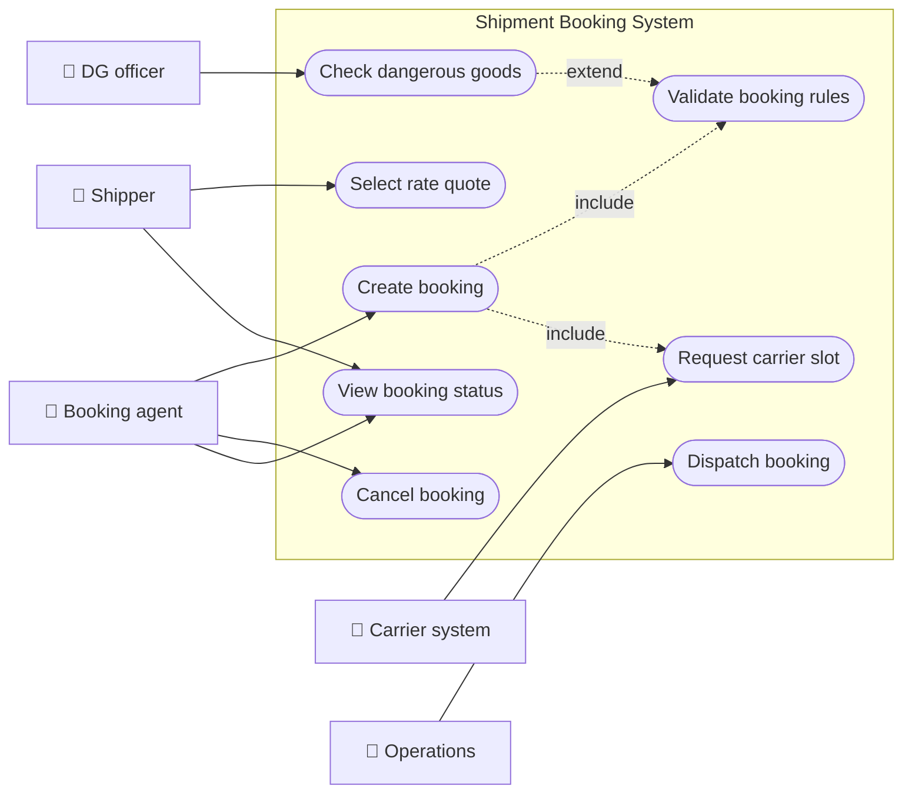
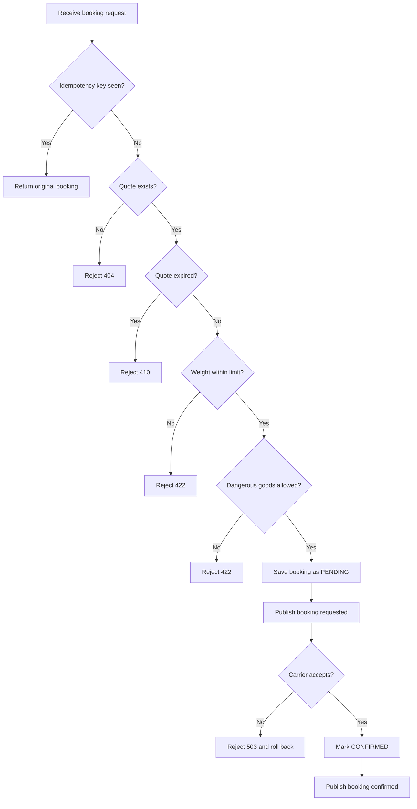
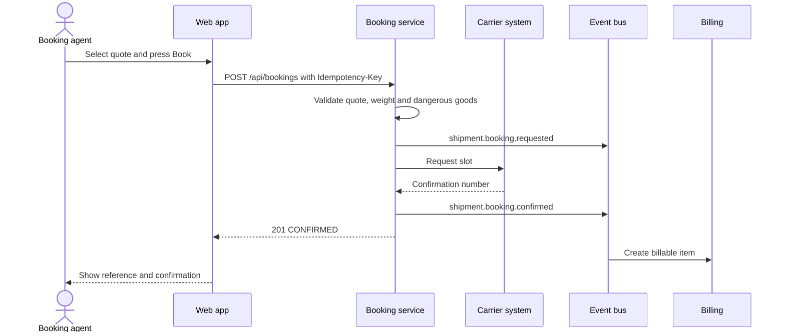
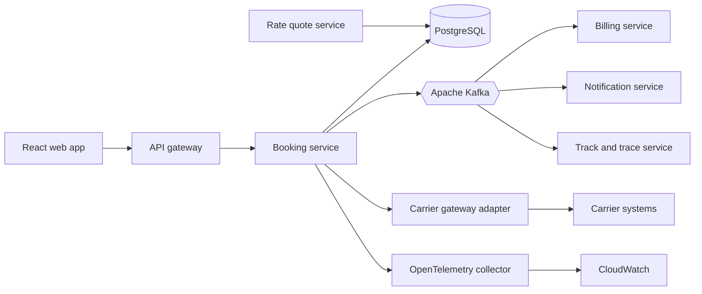
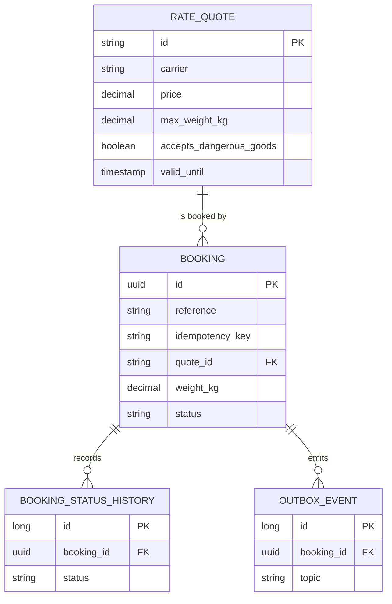
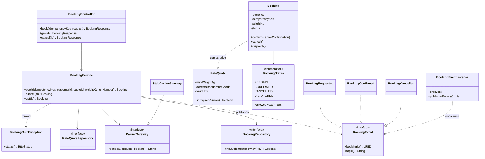
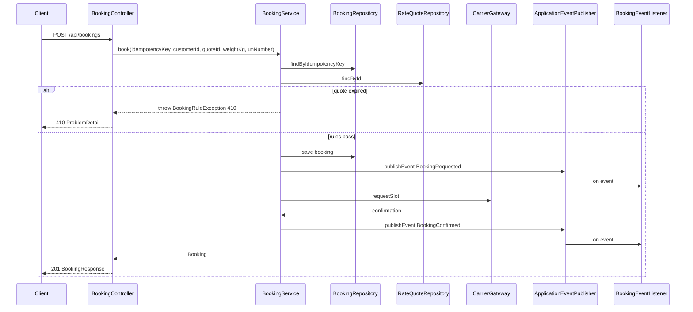
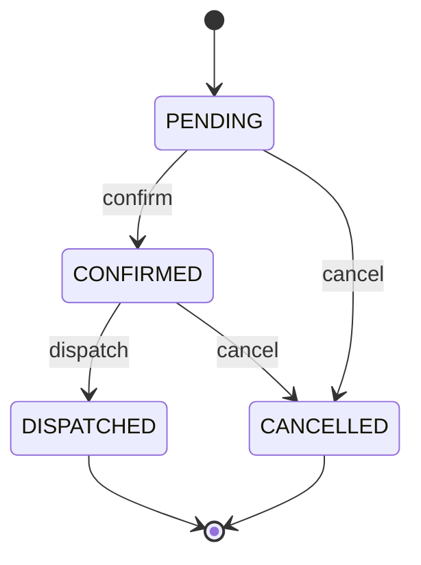
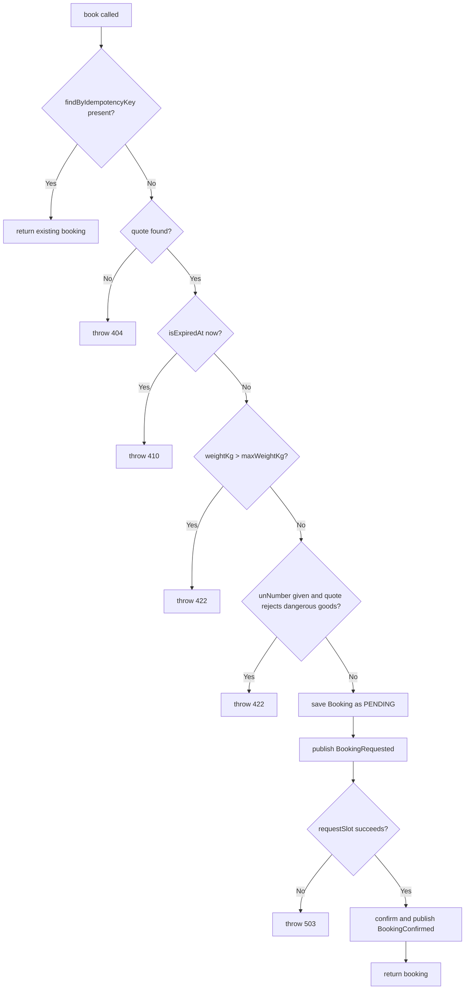

# Shipment Booking

> **Domain:** Logistics · **Author:** [@naveenks720](https://github.com/naveenks720) · **Published:** October 16, 2026

> **Runnable code:** [`examples/logistics/shipment-booking`](https://github.com/dhulipalla599/domain-knowledge-engineering/tree/main/examples/logistics/shipment-booking)

## Explain It Like I'm Five

Imagine you want to mail a big box of toys to your cousin who lives far away. You go to the post desk and the helper shows you a price card: "This truck can take your box for ten coins, and the offer is good until lunchtime." You say "yes, please," and the helper writes your name on a ticket and phones the truck driver to save a spot. If you press the button twice because you are excited, a good helper still saves only one spot. If the box is too heavy for that truck, the helper tells you right away instead of letting you find out at the loading dock.

In logistics, shipment booking is the moment a customer turns a price offer into a confirmed reservation of space with a carrier.

## Business Overview

**Shipment booking** is the step where a shipper (the company with goods to move) commits to a specific carrier, lane, service level and price, and the carrier agrees to carry the cargo. It sits between *quoting* (finding rates and capacity) and *execution* (pickup, linehaul, customs, delivery, invoicing).

The business cares because:

- **Revenue:** an accepted booking is the contract that later becomes an invoice. Lost or duplicated bookings are direct revenue leakage or cost.
- **Risk:** bookings fix commitments such as weight, hazardous-goods declarations and cut-off times. Errors surface later as rolled cargo, fines or damage.
- **Regulation:** dangerous goods are governed by modal rules (for example IMDG for sea, IATA DGR for air, ADR for European road). Which rules and documents apply differs by mode and country.
- **Customer experience:** shippers expect an instant, reliable answer and a booking reference they can track.

In the wider value chain: `Rate quoting -> Shipment booking -> Documentation and customs -> Pickup and linehaul -> Track and trace -> Freight audit and invoicing`.

## Real-World Example

Fictional shipper **Brightwater Outdoor Gear** needs to move 12,000 kg of camping equipment from Rotterdam to Chicago. Booking agent **Priya Raman** works for the fictional freight forwarder **Meridian Freight Partners**.

1. Priya requests quotes. Meridian's rate engine returns quote `Q-1001` from carrier **Northwind Freight**: 20-foot container, USD 2,450, up to 18,000 kg, valid until a stated time.
2. Priya opens the booking screen, enters the customer, the quote id and the weight, and presses **Book**. The browser sends an `Idempotency-Key`.
3. The system checks that the quote has not expired, the weight fits and there are no dangerous goods, then saves a `PENDING` booking and publishes `shipment.booking.requested`.
4. The system asks Northwind for a slot. Northwind answers with confirmation `NOR-BK-F7DAB0C0`. The booking becomes `CONFIRMED` and `shipment.booking.confirmed` is published.
5. Priya's browser loses connection and retries. The same idempotency key returns the same booking; no second slot is requested.
6. The next day Brightwater changes plans and Priya cancels. The booking becomes `CANCELLED`, and `shipment.booking.cancelled` tells billing and the carrier to release the slot.

## Stakeholders

| Stakeholder | What they need | What they fear |
|---|---|---|
| Shipper (customer) | Fast, firm confirmation at the quoted price | Rolled cargo, price changes after booking |
| Booking agent / customer service | One screen, clear error messages, safe retries | Double bookings, unexplained rejections |
| Carrier | Accurate cargo data, no phantom reservations | No-shows, undeclared hazardous goods |
| Pricing / rate management | Quotes honoured only while valid | Stale quotes sold below cost |
| Compliance / dangerous goods officer | Hazardous cargo only on approved services | Fines, accidents, audit failures |
| Finance / billing | Every confirmed booking becomes exactly one billable item | Disputes, unbilled cancellations |
| Operations / dispatch | Reliable status to plan pickups | Surprise changes after dispatch |

## Use Case Diagram



| Use Case | Primary Actor | Goal | Main success outcome |
|---|---|---|---|
| Select rate quote | Shipper | Pick an offer to book | A valid quote id is chosen |
| Create booking | Booking agent | Reserve capacity on the quote | Booking `CONFIRMED` with a reference |
| Validate booking rules | Booking agent (via system) | Reject unsafe or invalid requests early | Only rule-compliant requests continue |
| Check dangerous goods | DG officer | Ensure hazardous cargo is allowed | Request passes or is rejected with a reason |
| Request carrier slot | Carrier system | Obtain the carrier's commitment | Carrier confirmation number stored |
| Cancel booking | Booking agent | Release capacity | Booking `CANCELLED`, event published |
| View booking status | Shipper | Know where the booking stands | Current status and confirmation shown |
| Dispatch booking | Operations | Hand the booking to execution | Booking `DISPATCHED` |

## Key Terms

| Term | Plain-English meaning |
|---|---|
| Shipper | The party that owns the goods and wants them moved |
| Carrier | The company that physically moves the goods (ocean line, trucker, airline) |
| Freight forwarder | An intermediary that arranges transport on the shipper's behalf |
| Rate quote | A priced offer for a lane and service level, valid for a limited time |
| Lane | An origin-destination pair, such as Rotterdam to Chicago |
| Service level | The product sold, for example full container load (FCL), less than container load (LCL), express |
| Booking | A reservation of capacity with a carrier for specific cargo |
| Booking confirmation | The carrier's acknowledgement, usually with its own reference number |
| Dangerous goods (DG) | Cargo regulated as hazardous, identified by a UN number such as UN1203 |
| Rolled cargo | Cargo left behind because space was not available at departure |
| Cut-off | Latest time cargo or documents may be delivered for a given departure |
| Idempotency key | A client-supplied token that makes a retried request safe |

## Process Flow

The agent selects a valid quote and submits a booking. The system first checks for a replayed idempotency key, then validates the quote (exists, not expired), the cargo (weight within limit) and compliance (dangerous goods allowed). A valid request is stored as `PENDING`, announced, and sent to the carrier. If the carrier accepts, the booking is `CONFIRMED`. Failures at each stage return a specific error instead of a generic one. Cancellation is allowed until the booking is dispatched.





## Business Rules and Edge Cases

- **Quote validity:** a quote is honoured only until its expiry instant. Compare against a server clock in UTC, never the browser's. A request exactly at expiry is treated as expired. Answer with a clear "expired, please re-quote" error.
- **Capacity limits:** cargo weight (and in real systems volume, container type, axle limits) must fit the quote. Carriers' limits differ; do not hard-code one global maximum.
- **Dangerous goods:** hazardous cargo needs a declared UN number and a service that accepts it. The documents and classes required vary by transport mode and country; treat the rule set as data owned by compliance, not as code constants.
- **Idempotency:** networks retry. The same key must return the original booking and must not create a second reservation or publish duplicate events. Enforce this with a unique database constraint, not only an application check, to survive concurrent retries.
- **Money:** keep the price and currency on the booking at the moment of booking (a snapshot), using decimal types. Later rate changes must not alter it.
- **Partial failure:** the carrier call can time out after the carrier actually accepted. Real systems need an outbox, a reconciliation job, or a way to query the carrier by your reference. The example shows the simple case: carrier unavailable, so reject and roll back.
- **Lifecycle:** only legal transitions are allowed (for example a cancelled booking cannot be confirmed). Cancelling after dispatch may be impossible or chargeable, depending on the contract.
- **Cut-offs and time zones:** departure cut-offs are local to the port or terminal. Store instants in UTC and the zone separately.
- **Overbooking:** some carriers deliberately overbook; a confirmation may later be "rolled". Model that as a separate event rather than mutating history.

## From Business to System

| Business concept / step | System component | Data entity | Event |
|---|---|---|---|
| Choose a quote | Quote service (rate API client) | `rate_quote` | none |
| Create booking | Booking service (`POST /api/bookings`) | `booking` | `shipment.booking.requested` |
| Retry safety | Booking service idempotency check | `booking.idempotency_key` | none |
| Rule validation | `BookingService.book` | `rate_quote`, `booking` | none (rejection returns an HTTP error) |
| Carrier confirmation | Carrier gateway adapter | `booking.carrier_confirmation` | `shipment.booking.confirmed` |
| Cancellation | Booking service (`POST /api/bookings/{id}/cancel`) | `booking.status` | `shipment.booking.cancelled` |
| Dispatch | Operations service | `booking.status` | `shipment.booking.dispatched` (production only) |
| Billing and notifications | Billing and notification consumers | `billable_item`, `outbox_event` | consume the events above |

## Architecture



**Service boundaries.** The Booking service owns the booking aggregate, its lifecycle and the idempotency guarantee, so one service is the only writer of booking state. The Rate quote service is separate because pricing changes on a different cadence and is read-heavy; Booking reads the quote it needs and copies price and currency onto the booking. The carrier gateway is an adapter inside or beside Booking so that slow or flaky carrier APIs are isolated behind timeouts and a circuit breaker. Billing, notifications and tracking are downstream consumers that react to events and never call back into Booking synchronously, which keeps a billing outage from blocking bookings.

## Data Model

```sql
CREATE TABLE rate_quote (
    id                      VARCHAR(32) PRIMARY KEY,
    carrier                 VARCHAR(100) NOT NULL,
    origin                  VARCHAR(100) NOT NULL,
    destination             VARCHAR(100) NOT NULL,
    service_level           VARCHAR(30)  NOT NULL,
    price                   NUMERIC(12,2) NOT NULL,
    currency                CHAR(3)      NOT NULL,
    max_weight_kg           NUMERIC(10,2) NOT NULL,
    accepts_dangerous_goods BOOLEAN      NOT NULL DEFAULT FALSE,
    valid_until             TIMESTAMPTZ  NOT NULL
);

CREATE TABLE booking (
    id                   UUID PRIMARY KEY,
    reference            VARCHAR(20)  NOT NULL UNIQUE,
    customer_id          VARCHAR(50)  NOT NULL,
    quote_id             VARCHAR(32)  NOT NULL REFERENCES rate_quote(id),
    idempotency_key      VARCHAR(100) NOT NULL UNIQUE,
    weight_kg            NUMERIC(10,2) NOT NULL CHECK (weight_kg > 0),
    un_number            VARCHAR(10),
    price                NUMERIC(12,2) NOT NULL,
    currency             CHAR(3)      NOT NULL,
    carrier_confirmation VARCHAR(60),
    status               VARCHAR(20)  NOT NULL,
    created_at           TIMESTAMPTZ  NOT NULL
);

CREATE TABLE booking_status_history (
    id          BIGSERIAL PRIMARY KEY,
    booking_id  UUID NOT NULL REFERENCES booking(id),
    status      VARCHAR(20) NOT NULL,
    changed_at  TIMESTAMPTZ NOT NULL DEFAULT now(),
    changed_by  VARCHAR(100)
);

CREATE TABLE outbox_event (
    id           BIGSERIAL PRIMARY KEY,
    booking_id   UUID NOT NULL REFERENCES booking(id),
    topic        VARCHAR(100) NOT NULL,
    payload      JSONB NOT NULL,
    created_at   TIMESTAMPTZ NOT NULL DEFAULT now(),
    published_at TIMESTAMPTZ
);
```



The runnable example implements `rate_quote` and `booking` only; history and outbox are the production additions.

## APIs

| Method | Path | Purpose |
|---|---|---|
| POST | `/api/bookings` | Create a booking (requires `Idempotency-Key` header) |
| GET | `/api/bookings/{id}` | Fetch a booking |
| POST | `/api/bookings/{id}/cancel` | Cancel a booking |

Error responses use RFC 7807 `ProblemDetail`: `404` unknown quote or booking, `410` expired quote, `422` weight or dangerous-goods violation, `409` illegal state change, `503` carrier unavailable.

Request `POST /api/bookings` with header `Idempotency-Key: demo-1`:

```json
{
  "customerId": "C-77",
  "quoteId": "Q-1001",
  "weightKg": 12000
}
```

Response `201 Created`:

```json
{
  "id": "b83cc043-17ad-4481-8335-43793d6405c1",
  "reference": "BK-F7DAB0C0",
  "status": "CONFIRMED",
  "quoteId": "Q-1001",
  "weightKg": 12000.0,
  "price": 2450.00,
  "currency": "USD",
  "carrierConfirmation": "NOR-BK-F7DAB0C0"
}
```

## Events

| Event (topic) | Producer | Consumers | Key fields |
|---|---|---|---|
| `shipment.booking.requested` | Booking service | Notification, analytics | `bookingId`, `reference`, `customerId` |
| `shipment.booking.confirmed` | Booking service | Billing, notification, track and trace | `bookingId`, `reference`, `carrierConfirmation` |
| `shipment.booking.cancelled` | Booking service | Billing, carrier gateway, notification | `bookingId`, `reference` |

- **Ordering:** key every message by `bookingId` so all events for one booking land in one partition and stay ordered. Ordering across bookings is not guaranteed and should not be assumed.
- **At-least-once delivery:** consumers will see duplicates. Make them idempotent, for example by recording processed event ids or by upserting on `bookingId`.
- **Atomicity:** write the event to the `outbox_event` table in the same transaction as the booking change and publish from there. Publishing directly after commit can lose events if the process dies in between.
- **Schema evolution:** version event payloads and only add optional fields to keep older consumers working.

## Backend Implementation

> The Java tab is the exact code from the runnable example (Spring Boot 3). The Python tab uses FastAPI with SQLAlchemy and the Node.js tab uses Express with TypeScript; both mirror the same names and rules.

Full source: [`examples/logistics/shipment-booking`](https://github.com/dhulipalla599/domain-knowledge-engineering/tree/main/examples/logistics/shipment-booking/src/main/java/com/dke/logistics/shipment_booking).

### Service method enforcing the business rules

=== "Java"

    ```java
    @Transactional
    public Booking book(String idempotencyKey, String customerId, String quoteId, double weightKg, String unNumber) {
        var existing = bookings.findByIdempotencyKey(idempotencyKey);
        if (existing.isPresent()) {
            return existing.get();
        }
        RateQuote quote = quotes.findById(quoteId)
                .orElseThrow(() -> new BookingRuleException(HttpStatus.NOT_FOUND, "Unknown quote " + quoteId));
        Instant now = clock.instant();
        if (quote.isExpiredAt(now)) {
            throw new BookingRuleException(HttpStatus.GONE, "Quote " + quoteId + " expired at " + quote.getValidUntil());
        }
        if (weightKg > quote.getMaxWeightKg()) {
            throw new BookingRuleException(HttpStatus.UNPROCESSABLE_ENTITY,
                    "Weight " + weightKg + " kg exceeds the quote limit of " + quote.getMaxWeightKg() + " kg");
        }
        boolean dangerous = unNumber != null && !unNumber.isBlank();
        if (dangerous && !quote.isAcceptsDangerousGoods()) {
            throw new BookingRuleException(HttpStatus.UNPROCESSABLE_ENTITY,
                    "Carrier " + quote.getCarrier() + " does not accept dangerous goods (" + unNumber + ")");
        }

        var booking = new Booking("BK-" + UUID.randomUUID().toString().substring(0, 8).toUpperCase(),
                customerId, quote, idempotencyKey, weightKg, dangerous ? unNumber : null, now);
        bookings.save(booking);
        events.publishEvent(new BookingEvent.BookingRequested(booking.getId(), booking.getReference(), customerId));
        try {
            booking.confirm(carrier.requestSlot(quote, booking));
            events.publishEvent(new BookingEvent.BookingConfirmed(
                    booking.getId(), booking.getReference(), booking.getCarrierConfirmation()));
        } catch (CarrierUnavailableException e) {
            throw new BookingRuleException(HttpStatus.SERVICE_UNAVAILABLE, e.getMessage());
        }
        return booking;
    }
    ```

=== "Python"

    ```python
    def book(db: Session, carrier: CarrierGateway, publish, idempotency_key: str,
             customer_id: str, quote_id: str, weight_kg: float, un_number: str | None) -> Booking:
        existing = db.scalar(select(Booking).where(Booking.idempotency_key == idempotency_key))
        if existing:
            return existing
        quote = db.get(RateQuote, quote_id)
        if quote is None:
            raise BookingRuleError(404, f"Unknown quote {quote_id}")
        now = datetime.now(timezone.utc)
        if quote.is_expired_at(now):
            raise BookingRuleError(410, f"Quote {quote_id} expired at {quote.valid_until.isoformat()}")
        if weight_kg > quote.max_weight_kg:
            raise BookingRuleError(
                422, f"Weight {weight_kg} kg exceeds the quote limit of {quote.max_weight_kg} kg")
        dangerous = bool(un_number and un_number.strip())
        if dangerous and not quote.accepts_dangerous_goods:
            raise BookingRuleError(
                422, f"Carrier {quote.carrier} does not accept dangerous goods ({un_number})")

        booking = Booking.create(quote, customer_id, idempotency_key, weight_kg,
                                 un_number if dangerous else None, now)
        db.add(booking)
        db.flush()
        publish(BookingRequested(booking.id, booking.reference, customer_id))
        try:
            booking.confirm(carrier.request_slot(quote, booking))
            publish(BookingConfirmed(booking.id, booking.reference, booking.carrier_confirmation))
        except CarrierUnavailableError as e:
            db.rollback()
            raise BookingRuleError(503, str(e))
        db.commit()
        return booking
    ```

=== "Node.js"

    ```typescript
    export async function book(
      deps: Deps, idempotencyKey: string, customerId: string,
      quoteId: string, weightKg: number, unNumber?: string,
    ): Promise<Booking> {
      const existing = await deps.bookings.findByIdempotencyKey(idempotencyKey);
      if (existing) return existing;
      const quote = await deps.quotes.findById(quoteId);
      if (!quote) throw new BookingRuleError(404, `Unknown quote ${quoteId}`);
      const now = deps.clock.now();
      if (quote.isExpiredAt(now)) {
        throw new BookingRuleError(410, `Quote ${quoteId} expired at ${quote.validUntil.toISOString()}`);
      }
      if (weightKg > quote.maxWeightKg) {
        throw new BookingRuleError(
          422, `Weight ${weightKg} kg exceeds the quote limit of ${quote.maxWeightKg} kg`);
      }
      const dangerous = !!unNumber && unNumber.trim() !== "";
      if (dangerous && !quote.acceptsDangerousGoods) {
        throw new BookingRuleError(
          422, `Carrier ${quote.carrier} does not accept dangerous goods (${unNumber})`);
      }

      return deps.tx(async () => {
        const booking = Booking.create(quote, customerId, idempotencyKey, weightKg,
          dangerous ? unNumber : undefined, now);
        await deps.bookings.save(booking);
        deps.publish(new BookingRequested(booking.id, booking.reference, customerId));
        try {
          booking.confirm(await deps.carrier.requestSlot(quote, booking));
        } catch (e) {
          if (e instanceof CarrierUnavailableError) throw new BookingRuleError(503, e.message);
          throw e;
        }
        await deps.bookings.save(booking);
        deps.publish(new BookingConfirmed(booking.id, booking.reference, booking.carrierConfirmation!));
        return booking;
      });
    }
    ```

### Controller endpoint

=== "Java"

    ```java
    @PostMapping
    @ResponseStatus(HttpStatus.CREATED)
    public BookingResponse book(@RequestHeader("Idempotency-Key") String idempotencyKey,
                                @Valid @RequestBody BookingRequest request) {
        return BookingResponse.from(service.book(idempotencyKey, request.customerId(), request.quoteId(),
                request.weightKg(), request.unNumber()));
    }
    ```

=== "Python"

    ```python
    @router.post("/api/bookings", status_code=201, response_model=BookingResponse)
    def create_booking(request: BookingRequest,
                       idempotency_key: str = Header(alias="Idempotency-Key"),
                       db: Session = Depends(get_db)):
        booking = book(db, carrier_gateway, publish, idempotency_key,
                       request.customer_id, request.quote_id, request.weight_kg, request.un_number)
        return BookingResponse.from_booking(booking)
    ```

=== "Node.js"

    ```typescript
    router.post("/api/bookings", async (req, res, next) => {
      try {
        const key = req.header("Idempotency-Key");
        if (!key) return res.status(400).json({ detail: "Idempotency-Key header is required" });
        const { customerId, quoteId, weightKg, unNumber } = req.body;
        const booking = await book(deps, key, customerId, quoteId, weightKg, unNumber);
        res.status(201).json(BookingResponse.from(booking));
      } catch (e) {
        next(e);
      }
    });
    ```

## Frontend Screen

```tsx
import { useState } from "react";

type Booking = { reference: string; status: string; carrierConfirmation?: string; price: number; currency: string };

export function BookShipment({ quoteId }: { quoteId: string }) {
  const [customerId, setCustomerId] = useState("");
  const [weightKg, setWeightKg] = useState(0);
  const [unNumber, setUnNumber] = useState("");
  const [idempotencyKey] = useState(() => crypto.randomUUID()); // one key per attempt, reused on retry
  const [booking, setBooking] = useState<Booking | null>(null);
  const [error, setError] = useState<string | null>(null);
  const [busy, setBusy] = useState(false);

  async function submit(e: React.FormEvent) {
    e.preventDefault();
    setBusy(true);
    setError(null);
    try {
      const res = await fetch("/api/bookings", {
        method: "POST",
        headers: { "Content-Type": "application/json", "Idempotency-Key": idempotencyKey },
        body: JSON.stringify({ customerId, quoteId, weightKg, unNumber: unNumber || null }),
      });
      const body = await res.json();
      if (!res.ok) setError(body.detail ?? "Booking failed");
      else setBooking(body);
    } catch {
      setError("Network problem. You can press Book again safely.");
    } finally {
      setBusy(false);
    }
  }

  if (booking) {
    return (
      <p role="status">
        Booked {booking.reference} ({booking.status}). Carrier confirmation: {booking.carrierConfirmation}.
        Price: {booking.price} {booking.currency}.
      </p>
    );
  }

  return (
    <form onSubmit={submit}>
      <h2>Book shipment on quote {quoteId}</h2>
      <label>Customer <input value={customerId} onChange={(e) => setCustomerId(e.target.value)} required /></label>
      <label>Weight (kg) <input type="number" min={1} value={weightKg}
        onChange={(e) => setWeightKg(Number(e.target.value))} required /></label>
      <label>UN number (dangerous goods) <input value={unNumber} onChange={(e) => setUnNumber(e.target.value)} /></label>
      {error && <p role="alert">{error}</p>}
      <button disabled={busy}>{busy ? "Booking..." : "Book"}</button>
    </form>
  );
}
```

## Cloud Deployment

The Booking service runs as a Kubernetes Deployment on **Amazon EKS** behind an Application Load Balancer (AWS Load Balancer Controller) and Amazon API Gateway or CloudFront for the web tier. Managed services: **Amazon RDS for PostgreSQL** (Multi-AZ) for state, **Amazon MSK** for Apache Kafka, **AWS Secrets Manager** for carrier credentials, **Amazon ECR** for images, and **Amazon S3** for the React build and shipping documents.

```hcl
resource "aws_db_instance" "booking" {
  identifier              = "booking-db"
  engine                  = "postgres"
  engine_version          = "16"
  instance_class          = "db.m6g.large"
  allocated_storage       = 100
  storage_encrypted       = true
  multi_az                = true
  db_name                 = "booking"
  username                = "booking_admin"
  manage_master_user_password = true   # stored in Secrets Manager
  backup_retention_period = 14
  deletion_protection     = true
  vpc_security_group_ids  = [aws_security_group.booking_db.id]
  db_subnet_group_name    = aws_db_subnet_group.private.name
}
```

- **Security:** private subnets for pods, database and brokers; security groups allow only the service to reach RDS and MSK; IAM Roles for Service Accounts (IRSA) instead of static keys; TLS in transit; KMS encryption at rest; carrier API credentials only in Secrets Manager.
- **Scaling:** Horizontal Pod Autoscaler on CPU and request rate; Kafka consumer groups scale by partition count; RDS read replicas for status queries if reads dominate.
- **Observability:** the OpenTelemetry Java agent exports traces and metrics through an OTel collector to CloudWatch (for example via AWS Distro for OpenTelemetry). Track booking latency, rule-rejection counts by reason, carrier error rate and outbox lag. Propagate the booking reference as a trace attribute and log field.

## Non-Functional Requirements

| Concern | Expectation | How the design meets it |
|---|---|---|
| Availability | Booking is revenue-critical; targets are set by the business (often 99.9% or higher) | Multi-AZ RDS and EKS nodes, stateless pods, carrier circuit breaker |
| Latency | Interactive: the user waits for the answer | Rules are local checks; only the carrier call is remote, with a strict timeout |
| Consistency | No double bookings, no lost events | Unique idempotency key in the database, transactional outbox |
| Audit | Who booked, changed or cancelled what, and when | `booking_status_history`, immutable event log, trace ids in logs |
| Compliance | Dangerous-goods and sanctions rules differ by mode and country | Rules held as reviewed data with versioning; rejections logged with reason |
| Data protection | Customer and consignee data may be personal data | Encryption, least-privilege access, retention limits per local law |
| Resilience | Carriers go down | Timeouts, retries with backoff, clear 503 to the client, safe replays through idempotency |

## Runnable Example

The example is a Spring Boot 3 application (Java 21, H2 in memory, no external services) that implements the booking flow above: idempotent booking, quote-expiry, weight and dangerous-goods rules, a stubbed carrier gateway, a lifecycle enum with enforced transitions, and domain events published through Spring's `ApplicationEventPublisher` and consumed by an `@EventListener` as stand-ins for Kafka topics.

Source: [`examples/logistics/shipment-booking`](https://github.com/dhulipalla599/domain-knowledge-engineering/tree/main/examples/logistics/shipment-booking)

```bash
cd examples/logistics/shipment-booking
mvn spring-boot:run     # http://localhost:8080
mvn verify              # build and run the tests
```

Happy path:

```bash
curl -s -X POST localhost:8080/api/bookings \
  -H 'Idempotency-Key: demo-1' -H 'Content-Type: application/json' \
  -d '{"customerId":"C-77","quoteId":"Q-1001","weightKg":12000}'
```

```json
{"id":"b83cc043-17ad-4481-8335-43793d6405c1","reference":"BK-F7DAB0C0","status":"CONFIRMED","quoteId":"Q-1001","weightKg":12000.0,"price":2450.00,"currency":"USD","carrierConfirmation":"NOR-BK-F7DAB0C0"}
```

Rule violation (expired quote):

```bash
curl -s -X POST localhost:8080/api/bookings \
  -H 'Idempotency-Key: demo-2' -H 'Content-Type: application/json' \
  -d '{"customerId":"C-77","quoteId":"Q-1003","weightKg":1000}'
```

```json
{"type":"about:blank","title":"Gone","status":410,"detail":"Quote Q-1003 expired at 2020-01-01T00:00:00Z","instance":"/api/bookings"}
```

(The booking id and reference differ on every run.)

| Class | Package | Responsibility |
|---|---|---|
| `ShipmentBookingApplication` | `com.dke.logistics.shipment_booking` | Application entry point |
| `Booking` | `domain` | Booking aggregate; `confirm`, `cancel`, `dispatch` with legal-transition checks |
| `BookingStatus` | `domain` | Lifecycle enum with `allowedNext()` |
| `RateQuote` | `domain` | Carrier offer; `isExpiredAt` |
| `BookingEvent` | `domain` | Sealed interface with `BookingRequested`, `BookingConfirmed`, `BookingCancelled` records |
| `BookingRepository` | `repository` | JPA access; `findByIdempotencyKey` |
| `RateQuoteRepository` | `repository` | JPA access to quotes |
| `BookingService` | `service` | Business rules, idempotency, carrier call, event publishing |
| `BookingRuleException` | `service` | Rule violation carrying an HTTP status |
| `ClockConfig` | `service` | Provides the injectable `Clock` |
| `BookingController` | `api` | REST endpoints |
| `BookingRequest`, `BookingResponse` | `api` | Request and response records |
| `ApiExceptionHandler` | `api` | Converts exceptions to `ProblemDetail` |
| `CarrierGateway` | `integration` | Port to the carrier system |
| `StubCarrierGateway` | `integration` | Deterministic stub; carrier `OFFLINE-LINES` simulates an outage |
| `CarrierUnavailableException` | `integration` | Signals carrier failure |
| `BookingEventListener` | `integration` | `@EventListener` consumer standing in for Kafka consumers |

## UML Diagrams

### Class Diagram

The controller delegates to the service, which uses two repositories, the carrier port and the event publisher. `Booking` owns its lifecycle rules.



### Sequence Diagram (control flow)

One `POST /api/bookings` request through the code. The `alt` shows the expired-quote rejection, which `ApiExceptionHandler` turns into a `410` response.



### State Diagram

Matches `BookingStatus.allowedNext()`. `DISPATCHED` and `CANCELLED` are terminal.



### Activity Diagram

Decision logic inside `BookingService.book`.



## AI Opportunities

| Use case | Data needed | Main risk or control |
|---|---|---|
| **Carrier and rate recommendation:** suggest the quote most likely to be confirmed on time and within budget | Historical bookings, rolled-cargo and delay history, lane and season, quotes | Bias toward incumbent carriers; keep the human choice and log why a recommendation was made (explainability) |
| **Dangerous-goods pre-screening:** read a safety data sheet and flag missing or inconsistent UN numbers | Safety data sheets, DG classification tables, past rejections | Misses are safety-critical; use AI only as an assist, with a mandatory human compliance check and regulatory rules kept as deterministic code or data |
| **Rollover and no-show prediction:** warn when a booking is likely to be rolled or cargo will miss cut-off | Carrier performance, vessel schedules, port congestion, booking lead time | Model drift and false alarms; monitor accuracy and use it to prompt review, not to auto-cancel |
| **Booking intake from email or documents:** an LLM agent extracts booking fields from a customer email and drafts the request | Customer emails, past bookings, master data | Hallucinated weights or consignees; require human confirmation before submit, validate every field with the same rules as the API, protect personal data |
| **Duplicate and anomaly detection:** flag suspicious near-duplicate bookings or unusual volumes | Booking history, customer profiles | False positives block real customers; route to review queues with explanations |

## Common Pitfalls

- **Trusting the client clock or ignoring time zones for expiry.** Use a server-side UTC clock and inject it so tests are deterministic.
- **Idempotency by "check then insert" only.** Two concurrent retries can both pass the check. Add a unique constraint and handle the violation by returning the existing row.
- **Publishing events outside the transaction.** A crash between commit and publish loses the event. Use an outbox.
- **Treating the carrier call as reliable.** Timeouts do not tell you whether the carrier accepted. Design for reconciliation and query by your reference.
- **Recomputing price later from the current rate table.** Snapshot price and currency on the booking.
- **Hard-coding one weight limit or one dangerous-goods rule.** Limits and regulations differ by carrier, mode and country; keep them as data.
- **Allowing any status change.** Enforce transitions in the domain object, not in controllers.
- **Using floating point for money.** Use decimal types. (The example's `double` weight is acceptable for teaching; production often uses decimal for weights too.)
- **Returning generic 500 errors.** Distinct, documented errors for expired, overweight, not-allowed and carrier-down help agents act.

## Interview Questions

### Junior

1. **What is an idempotency key and why does booking need one?**
   It is a client-generated token sent with a request so the server can recognise a retry. Networks drop responses, so clients retry; without the key a retry could create a second booking and reserve capacity twice.
2. **Why do rate quotes have an expiry?**
   Carrier prices and capacity change, so a quote is only a promise for a limited time. Checking expiry prevents selling at stale prices.
3. **Why model booking status as an enum with allowed transitions?**
   It makes the lifecycle explicit and stops illegal moves, such as confirming a cancelled booking. Keeping the rule in the domain class means every caller gets it.

### Mid-Level

1. **The carrier call times out. What do you do?**
   You do not know whether the carrier accepted. Reject or mark the booking pending-confirmation, use the idempotency key or your reference when retrying, query the carrier for the booking, and run a reconciliation job. Avoid silently retrying with a new reference.
2. **How do you publish a Kafka event reliably when you also write to PostgreSQL?**
   Use the transactional outbox: insert the event row in the same transaction as the booking, then a relay publishes it and marks it sent. Consumers must tolerate duplicates because delivery is at least once.
3. **How would you test the quote-expiry rule?**
   Inject a `Clock`, fix it in a unit test, and check the boundary (exactly at expiry is expired). Add an HTTP-level test that asserts the `410` problem response.

### Senior / Architect

1. **Design booking for a carrier that confirms asynchronously, hours later.**
   Key points: `PENDING` state is real and visible; send the request through an outbox; handle the carrier's callback or polling idempotently; timeouts and escalation for unanswered requests; events for confirmed and rejected outcomes; customer notification; compensation if the quote expires while pending.
2. **How do you prevent overselling capacity when many agents book the same sailing?**
   Key points: where the source of truth for capacity lives (carrier vs your own allocation); optimistic locking or atomic decrements on an allocation table; reservation with timeout; reconciliation with carrier data; accept that carriers may overbook and model rolled cargo explicitly.
3. **How do you let compliance change dangerous-goods rules without redeploying?**
   Key points: rules as versioned data or a rules engine with review and audit; effective dates; per-mode and per-country rule sets; testing against historical bookings; fail closed on missing data; store the rule version used on each booking for audit.

## Further Learning

- Incoterms (ICC) and who books and pays for which leg
- Bill of lading, booking confirmation and shipping instruction documents
- IMDG Code, IATA Dangerous Goods Regulations and ADR for dangerous goods
- EDI standards used in freight (UN/EDIFACT, ANSI X12) and the DCSA booking and track-and-trace standards for container shipping
- Container types, TEU and load planning basics
- Transport Management Systems (TMS) and carrier integration patterns
- Transactional outbox and idempotent consumer patterns
- Customs and export documentation (for example the EU Union Customs Code)

## Practitioner Notes

> _Reviewer: add real-world experience, corrections or gotchas here before approving._
