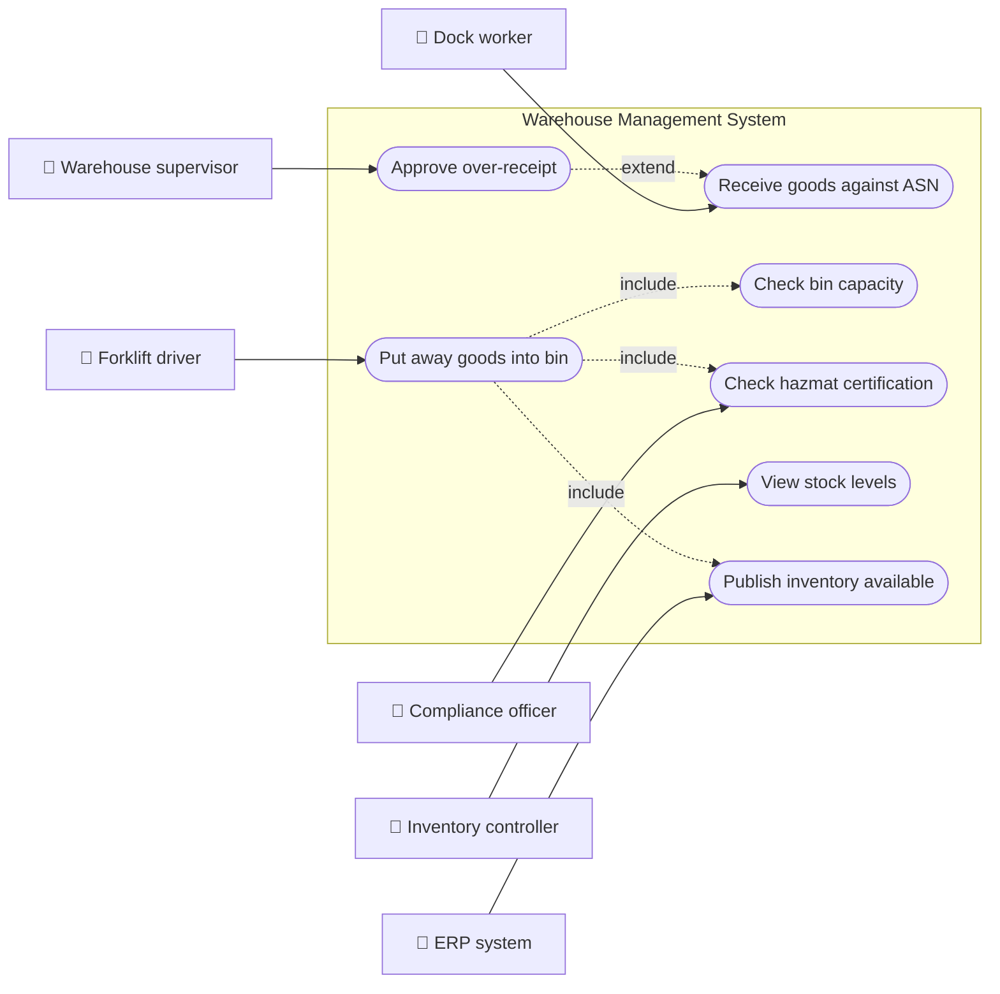
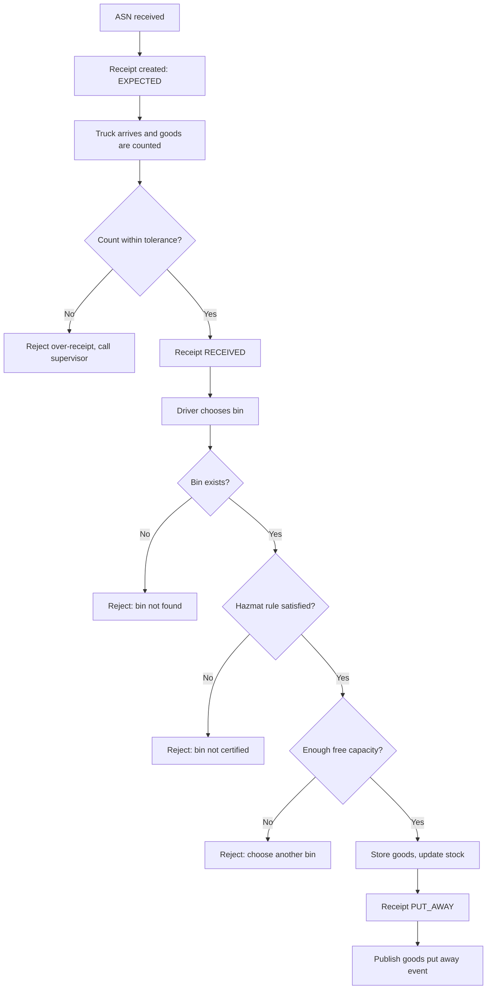
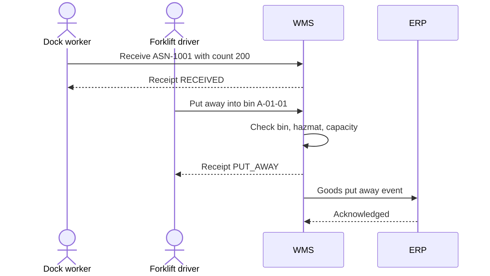
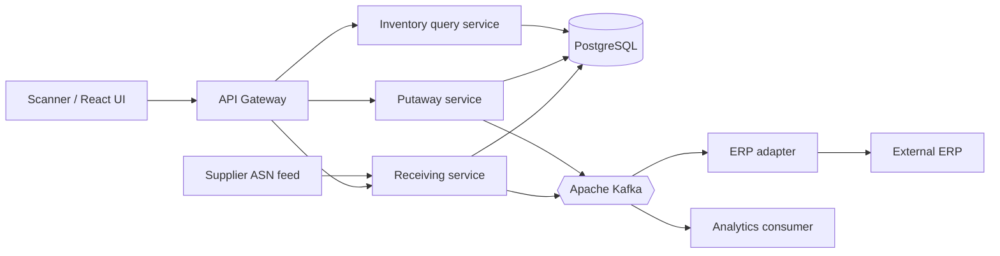
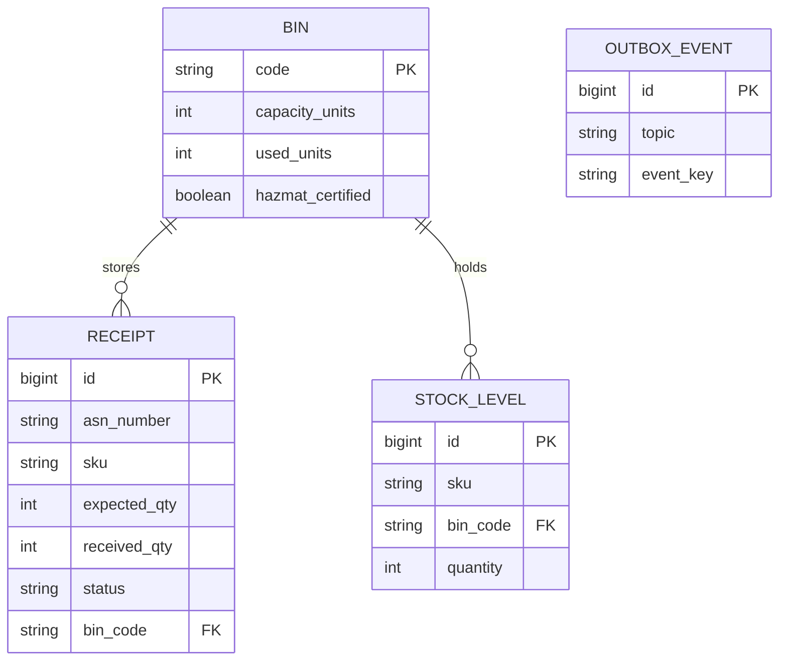
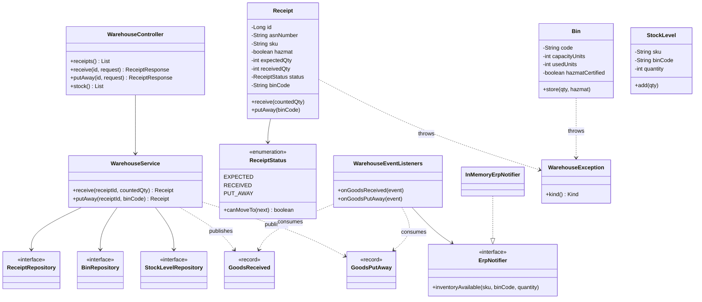
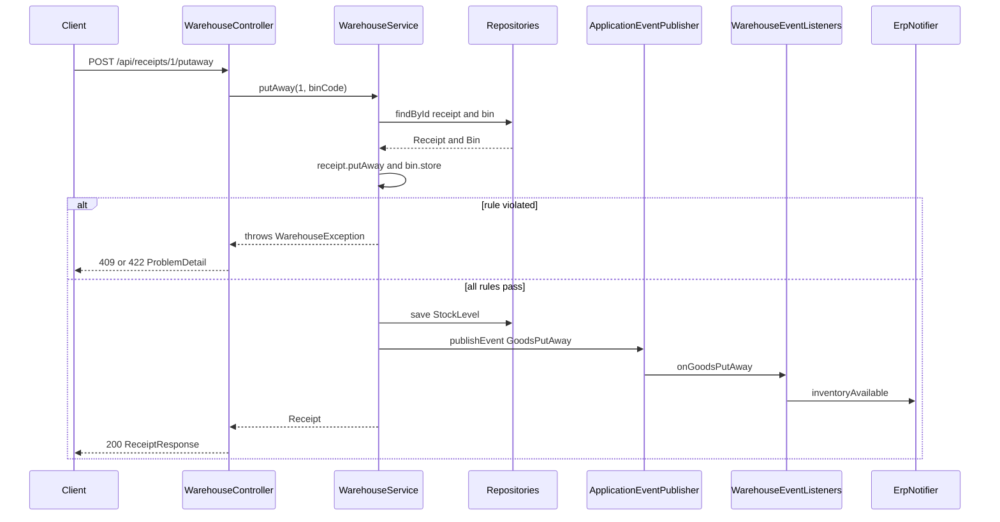
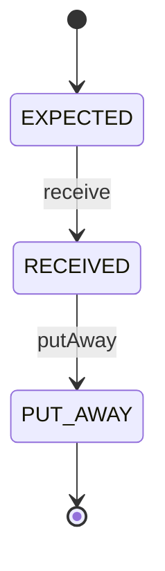
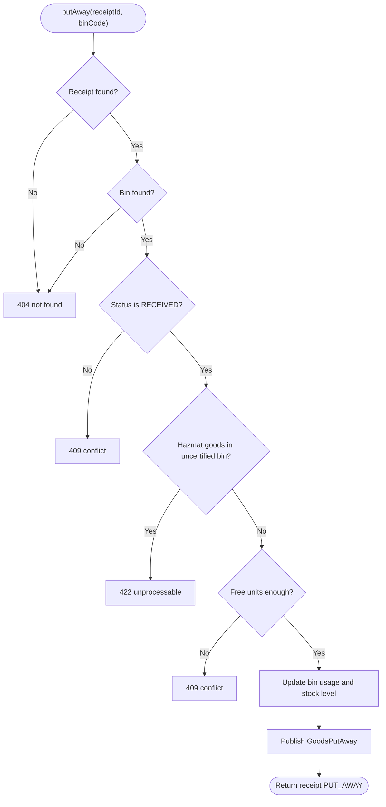

# Warehouse Management

> **Domain:** Logistics · **Author:** [@naveenks720](https://github.com/naveenks720) · **Published:** October 30, 2026

> **Runnable code:** [`examples/logistics/warehouse-management`](https://github.com/dhulipalla599/domain-knowledge-engineering/tree/main/examples/logistics/warehouse-management)

## Explain It Like I'm Five

Imagine your family just came home from a huge toy shop with bags of new toys. Before anyone plays, you count the toys to make sure nobody forgot one. Then you decide where each toy lives: big blocks go in the big box, tiny cars go in the small drawer, and the pointy scissors go in the high cupboard where little hands cannot reach. You also keep a list on the fridge that says what is in each box, so when a friend asks for a red car, you know exactly where to look. If the drawer is already full, you do not squash more cars in; you pick another place.

A warehouse management system is that fridge list plus the rules for counting and tidying, but for a building full of products and many people working at once.

## Business Overview

**Warehouse management** is the capability that tells a distribution centre what stock it has, where each unit is stored, and what each worker or machine should do next: receive, put away, replenish, pick, pack and ship. The system that supports it is usually called a **WMS** (warehouse management system).

Why the business cares:

- **Revenue:** stock that exists but cannot be found, or is promised twice, becomes lost or late orders.
- **Cost:** labour and space are the biggest warehouse costs; good slotting and short travel paths reduce both.
- **Risk and compliance:** hazardous goods, food with expiry dates and high-value items have storage rules that differ by country and by company policy.
- **Customer experience:** accurate inventory feeds the online shop's "in stock" promise and delivery dates.

In the wider Logistics value chain the WMS sits between **procurement and inbound transport** (suppliers, carriers, advance shipping notices) and **outbound fulfilment and transport** (order management, shipment booking, last-mile delivery). It exchanges data with the ERP (financial inventory), the transport management system and e-commerce channels. This page focuses on the **inbound** half: receiving and putaway.

## Real-World Example

Fictional retailer **Northwind Outfitters** runs a distribution centre in Rotterdam. Its supplier **Brightline Audio** sends an advance shipping notice, **ASN-1001**, announcing 200 pairs of headphones.

1. The ASN arrives and the WMS creates a receipt in status `EXPECTED`.
2. The truck reaches dock 4. Dock worker **Priya** scans the pallets and counts 200 pairs. The WMS moves the receipt to `RECEIVED`.
3. A second ASN from **Voltcell Ltd** announces 100 lithium battery packs, which are hazardous goods. Priya counts them and the WMS only offers bins certified for hazardous goods.
4. For the headphones, forklift driver **Tomás** is directed to bin `A-01-01`, which has 380 free units. He scans the bin and the receipt becomes `PUT_AWAY`.
5. Stock for `SKU-HEADPHONES` in `A-01-01` rises by 200, and the ERP is told the stock is now available to sell.
6. Later, a third ASN announces 50 cables but the truck contains 80. The WMS rejects the over-receipt beyond the agreed tolerance, and a supervisor decides whether to refuse the excess or amend the purchase order.

## Stakeholders

| Stakeholder | What they need | What they fear |
|---|---|---|
| Dock worker | Clear, fast scan-and-count flow | Blocked by a screen that rejects a correct count |
| Forklift driver | A valid bin to put goods in, with a short route | Driving to a full or wrong bin |
| Warehouse supervisor | Visibility of exceptions (over/short receipts) | Discrepancies discovered days later |
| Inventory controller | Stock that matches physical reality | Phantom stock and unexplained adjustments |
| Safety and compliance officer | Hazardous goods stored only in certified locations | Audit findings, incidents, fines |
| Supplier / carrier | Quick unloading and accurate receipt confirmation | Detention charges and disputed deliveries |
| ERP / finance | Reliable inventory valuation events | Duplicate or missing postings |

## Use Case Diagram



| Use Case | Primary Actor | Goal | Main success outcome |
|---|---|---|---|
| Receive goods against ASN | Dock worker | Record what physically arrived | Receipt is `RECEIVED` with the counted quantity |
| Put away goods into bin | Forklift driver | Store counted goods in a location | Receipt is `PUT_AWAY`, stock and bin usage updated |
| Check bin capacity | Forklift driver | Make sure the bin has room | Put-away accepted or refused with the free units |
| Check hazmat certification | Compliance officer | Keep hazardous goods in certified bins | Non-certified bins are refused |
| Approve over-receipt | Warehouse supervisor | Decide on quantities above tolerance | Excess accepted or refused (extends receiving) |
| View stock levels | Inventory controller | See on-hand quantity per bin | Accurate stock list |
| Publish inventory available | ERP system | Learn that stock can be sold | ERP receives a put-away event |

## Key Terms

| Term | Plain-English meaning |
|---|---|
| WMS | Warehouse management system: the software that directs and records warehouse work |
| ASN | Advance shipping notice: the supplier's message saying what is on its way |
| Receipt | The record of goods arriving against an ASN or purchase order |
| Putaway | Moving received goods from the dock to a storage location |
| Bin / location | A specific addressable storage spot, for example `A-01-01` (aisle, rack, level) |
| SKU | Stock keeping unit: the identifier of a distinct product |
| Slotting | Choosing the best location for a SKU based on size, velocity and rules |
| Over-receipt | Receiving more than the order quantity, often allowed within a tolerance |
| Cycle count | Counting a few locations regularly instead of the whole building at once |
| Hazmat | Hazardous materials, subject to special storage and handling rules |
| Wave / pick | Grouping orders and instructing workers to collect items for shipping |
| 3PL | Third-party logistics provider that runs warehouses for other companies |

## Process Flow

Goods arrive with an ASN, the dock counts them and the system compares the count to what was announced. Small differences inside the agreed tolerance are accepted; larger ones need a supervisor. Counted goods are then put away: the system checks that the chosen bin exists, is certified if the goods are hazardous, and has enough free capacity. When all checks pass, stock is updated and an event tells downstream systems, such as the ERP, that the goods are available.





## Business Rules and Edge Cases

- **Over-receipt tolerance:** many companies accept a small percentage above the order quantity; the percentage is a business or contract setting, not a universal rule. The example uses 10%.
- **Under-receipt:** receiving less than expected is normal; the system records the real count and raises a shortage rather than blocking.
- **Order of steps:** goods cannot be put away before they are counted, and cannot be counted twice. Illegal state changes must be refused.
- **Capacity is a shared resource:** two drivers putting away into the same bin at the same time can both pass a naive check. Use row locks or optimistic locking on the bin.
- **Hazardous goods:** storage rules depend on the jurisdiction and the product's classification. The system should hold a certification flag or class per bin and refuse mismatches.
- **Idempotency:** scanners retry on weak Wi-Fi. A repeated put-away must not add stock twice; the state machine and a request key give that protection.
- **Partial failure:** stock update and event publication must succeed together. Use a transactional outbox rather than publishing to the broker inside the database transaction.
- **Unit of measure:** a supplier may count in cartons while the warehouse stores each. Convert explicitly and record both.
- **Expiry and lots:** food and pharma need lot and expiry tracking; this example omits them for brevity.

## From Business to System

| Business concept / step | System component | Data entity | Event |
|---|---|---|---|
| Announce incoming goods (ASN) | Receiving service | `receipt` (status `EXPECTED`) | `warehouse.asn-created` (not in example) |
| Count goods at dock | Receiving service | `receipt.received_qty` | `warehouse.goods-received` |
| Choose storage location | Putaway service | `bin` | none |
| Enforce capacity and hazmat | Putaway service (`Bin.store`) | `bin.used_units`, `bin.hazmat_certified` | none |
| Store goods | Putaway service | `receipt`, `stock_level` | `warehouse.goods-put-away` |
| Tell finance stock is available | ERP integration adapter | none | consumes `warehouse.goods-put-away` |
| View inventory | Inventory query service | `stock_level` | none |

## Architecture



Receiving and putaway own the write side: they change receipts, bins and stock inside one PostgreSQL transaction, then publish events. The inventory query service is read-only and can scale and cache independently, because many scanners and dashboards read stock far more often than it changes. The ERP adapter is a separate consumer so that a slow or unavailable ERP never blocks the dock; it catches up from Kafka. In a small team the receiving and putaway services can start as one deployable (as the example does) and split later along the same package boundaries.

## Data Model

```sql
CREATE TABLE bin (
    code              VARCHAR(20) PRIMARY KEY,
    capacity_units    INT NOT NULL CHECK (capacity_units > 0),
    used_units        INT NOT NULL DEFAULT 0 CHECK (used_units >= 0),
    hazmat_certified  BOOLEAN NOT NULL DEFAULT FALSE,
    version           BIGINT NOT NULL DEFAULT 0,
    CHECK (used_units <= capacity_units)
);

CREATE TABLE receipt (
    id            BIGSERIAL PRIMARY KEY,
    asn_number    VARCHAR(40) NOT NULL UNIQUE,
    sku           VARCHAR(40) NOT NULL,
    hazmat        BOOLEAN NOT NULL DEFAULT FALSE,
    expected_qty  INT NOT NULL CHECK (expected_qty > 0),
    received_qty  INT NOT NULL DEFAULT 0,
    status        VARCHAR(20) NOT NULL CHECK (status IN ('EXPECTED','RECEIVED','PUT_AWAY')),
    bin_code      VARCHAR(20) REFERENCES bin(code)
);

CREATE TABLE stock_level (
    id        BIGSERIAL PRIMARY KEY,
    sku       VARCHAR(40) NOT NULL,
    bin_code  VARCHAR(20) NOT NULL REFERENCES bin(code),
    quantity  INT NOT NULL CHECK (quantity >= 0),
    UNIQUE (sku, bin_code)
);

CREATE TABLE outbox_event (
    id          BIGSERIAL PRIMARY KEY,
    topic       VARCHAR(80) NOT NULL,
    event_key   VARCHAR(80) NOT NULL,
    payload     JSONB NOT NULL,
    created_at  TIMESTAMPTZ NOT NULL DEFAULT now(),
    sent_at     TIMESTAMPTZ
);
```



The example uses only the first three tables; the outbox table is what production adds for reliable publishing.

## APIs

| Method | Path | Purpose |
|---|---|---|
| GET | `/api/receipts` | List receipts and their status |
| POST | `/api/receipts/{id}/receive` | Record the counted quantity at the dock |
| POST | `/api/receipts/{id}/putaway` | Store received goods in a bin |
| GET | `/api/stock` | List on-hand stock per SKU and bin |

Request `POST /api/receipts/1/putaway`:

```json
{ "binCode": "A-01-01" }
```

Response `200 OK`:

```json
{
  "id": 1,
  "asnNumber": "ASN-1001",
  "sku": "SKU-HEADPHONES",
  "expectedQty": 200,
  "receivedQty": 200,
  "status": "PUT_AWAY",
  "binCode": "A-01-01"
}
```

Rule violations return RFC 9457 `ProblemDetail` bodies: `409` for a full bin or an illegal state change, `422` for over-receipt or hazmat mismatch, `404` for unknown receipt or bin.

## Events

| Event | Producer | Consumers | Key fields |
|---|---|---|---|
| `warehouse.goods-received` | Receiving service | Analytics, supplier scorecard | `receiptId`, `asnNumber`, `sku`, `quantity` |
| `warehouse.goods-put-away` | Putaway service | ERP adapter, inventory projections | `receiptId`, `sku`, `binCode`, `quantity` |

- **Ordering:** key messages by `receiptId` (or `sku` for stock projections) so that all events for one key land on one partition and stay ordered.
- **Idempotency:** Kafka delivers at least once. Consumers must deduplicate, for example by storing the `receiptId` already processed, so an ERP never posts the same receipt twice.
- **Reliability:** publish through a transactional outbox so a committed put-away always results in an event.

## Backend Implementation

> The Java tab is the exact code from the runnable example (Spring Boot). The Python tab uses FastAPI with SQLAlchemy and the Node.js tab uses Express with TypeScript.

Full source: [`examples/logistics/warehouse-management`](https://github.com/dhulipalla599/domain-knowledge-engineering/tree/main/examples/logistics/warehouse-management/src/main/java/com/dke/logistics/warehouse_management).

### Business rule: put-away

=== "Java"

    ```java
    @Transactional
    public Receipt putAway(Long receiptId, String binCode) {
        Receipt receipt = findReceipt(receiptId);
        Bin bin = bins.findById(binCode)
                .orElseThrow(() -> new WarehouseException(Kind.NOT_FOUND, "Bin %s not found".formatted(binCode)));
        receipt.putAway(binCode);
        bin.store(receipt.getReceivedQty(), receipt.isHazmat());
        stock.findBySkuAndBinCode(receipt.getSku(), binCode)
                .ifPresentOrElse(level -> level.add(receipt.getReceivedQty()),
                        () -> stock.save(new StockLevel(receipt.getSku(), binCode, receipt.getReceivedQty())));
        events.publishEvent(new GoodsPutAway(receipt.getId(), receipt.getSku(), binCode, receipt.getReceivedQty()));
        return receipt;
    }
    ```

=== "Python"

    ```python
    def put_away(db: Session, receipt_id: int, bin_code: str) -> Receipt:
        receipt = db.get(Receipt, receipt_id) or _fail("NOT_FOUND", f"Receipt {receipt_id} not found")
        bin_ = db.get(Bin, bin_code) or _fail("NOT_FOUND", f"Bin {bin_code} not found")
        receipt.put_away(bin_code)
        bin_.store(receipt.received_qty, receipt.hazmat)
        level = db.scalar(select(StockLevel).filter_by(sku=receipt.sku, bin_code=bin_code))
        if level:
            level.quantity += receipt.received_qty
        else:
            db.add(StockLevel(sku=receipt.sku, bin_code=bin_code, quantity=receipt.received_qty))
        publish(GoodsPutAway(receipt.id, receipt.sku, bin_code, receipt.received_qty))
        db.commit()
        return receipt
    ```

=== "Node.js"

    ```typescript
    export async function putAway(receiptId: number, binCode: string): Promise<Receipt> {
      return db.transaction(async (tx) => {
        const receipt = await tx.receipts.find(receiptId) ?? fail("NOT_FOUND", `Receipt ${receiptId} not found`);
        const bin = await tx.bins.find(binCode) ?? fail("NOT_FOUND", `Bin ${binCode} not found`);
        receipt.putAway(binCode);
        bin.store(receipt.receivedQty, receipt.hazmat);
        await tx.stock.add(receipt.sku, binCode, receipt.receivedQty);
        events.emit("warehouse.goods-put-away", { receiptId: receipt.id, sku: receipt.sku, binCode, quantity: receipt.receivedQty });
        return receipt;
      });
    }
    ```

### Business rule: bin capacity and hazmat

=== "Java"

    ```java
    public void store(int qty, boolean hazmat) {
        if (hazmat && !hazmatCertified) {
            throw new WarehouseException(WarehouseException.Kind.UNPROCESSABLE,
                    "Bin %s is not certified for hazardous goods".formatted(code));
        }
        if (usedUnits + qty > capacityUnits) {
            throw new WarehouseException(WarehouseException.Kind.CONFLICT,
                    "Bin %s has %d free units but %d are needed".formatted(code, capacityUnits - usedUnits, qty));
        }
        usedUnits += qty;
    }
    ```

=== "Python"

    ```python
    def store(self, qty: int, hazmat: bool) -> None:
        if hazmat and not self.hazmat_certified:
            raise WarehouseError("UNPROCESSABLE", f"Bin {self.code} is not certified for hazardous goods")
        if self.used_units + qty > self.capacity_units:
            free = self.capacity_units - self.used_units
            raise WarehouseError("CONFLICT", f"Bin {self.code} has {free} free units but {qty} are needed")
        self.used_units += qty
    ```

=== "Node.js"

    ```typescript
    store(qty: number, hazmat: boolean): void {
      if (hazmat && !this.hazmatCertified) {
        throw new WarehouseError("UNPROCESSABLE", `Bin ${this.code} is not certified for hazardous goods`);
      }
      if (this.usedUnits + qty > this.capacityUnits) {
        const free = this.capacityUnits - this.usedUnits;
        throw new WarehouseError("CONFLICT", `Bin ${this.code} has ${free} free units but ${qty} are needed`);
      }
      this.usedUnits += qty;
    }
    ```

### Controller endpoint

=== "Java"

    ```java
    @PostMapping("/receipts/{id}/putaway")
    public ReceiptResponse putAway(@PathVariable Long id, @Valid @RequestBody PutAwayRequest request) {
        return ReceiptResponse.from(service.putAway(id, request.binCode()));
    }
    ```

=== "Python"

    ```python
    @router.post("/receipts/{receipt_id}/putaway", response_model=ReceiptResponse)
    def put_away_endpoint(receipt_id: int, body: PutAwayRequest, db: Session = Depends(get_db)):
        return ReceiptResponse.model_validate(put_away(db, receipt_id, body.bin_code), from_attributes=True)
    ```

=== "Node.js"

    ```typescript
    router.post("/receipts/:id/putaway", async (req, res) => {
      const body = putAwayRequest.parse(req.body);
      res.json(toResponse(await putAway(Number(req.params.id), body.binCode)));
    });
    ```

## Frontend Screen

```tsx
import { useEffect, useState } from "react";

type Receipt = { id: number; asnNumber: string; sku: string; expectedQty: number; receivedQty: number; status: string; binCode: string | null };

export function ReceivingScreen() {
  const [receipts, setReceipts] = useState<Receipt[]>([]);
  const [error, setError] = useState<string | null>(null);

  const load = () => fetch("/api/receipts").then((r) => r.json()).then(setReceipts);
  useEffect(() => { load(); }, []);

  async function act(id: number, action: "receive" | "putaway", body: object) {
    const res = await fetch(`/api/receipts/${id}/${action}`, {
      method: "POST",
      headers: { "Content-Type": "application/json" },
      body: JSON.stringify(body),
    });
    setError(res.ok ? null : (await res.json()).detail);
    load();
  }

  return (
    <main>
      <h1>Inbound receipts</h1>
      {error && <p role="alert">{error}</p>}
      <table>
        <thead><tr><th>ASN</th><th>SKU</th><th>Expected</th><th>Received</th><th>Status</th><th /></tr></thead>
        <tbody>
          {receipts.map((r) => (
            <tr key={r.id}>
              <td>{r.asnNumber}</td><td>{r.sku}</td><td>{r.expectedQty}</td><td>{r.receivedQty}</td><td>{r.status}</td>
              <td>
                {r.status === "EXPECTED" && (
                  <button onClick={() => act(r.id, "receive", { countedQty: r.expectedQty })}>Receive full count</button>
                )}
                {r.status === "RECEIVED" && (
                  <button onClick={() => { const binCode = prompt("Scan bin code"); if (binCode) act(r.id, "putaway", { binCode }); }}>
                    Put away
                  </button>
                )}
              </td>
            </tr>
          ))}
        </tbody>
      </table>
    </main>
  );
}
```

## Cloud Deployment

The services run as Deployments on **Amazon EKS** behind an Application Load Balancer. Typical managed services: **Amazon RDS for PostgreSQL** (Multi-AZ) for the system of record, **Amazon MSK** for Apache Kafka, **Amazon ECR** for images, **AWS Secrets Manager** for credentials, and **Amazon CloudFront / S3** for the React build.

```hcl
resource "aws_db_instance" "wms" {
  identifier                 = "wms-postgres"
  engine                     = "postgres"
  engine_version             = "16"
  instance_class             = "db.m6g.large"
  allocated_storage          = 100
  multi_az                   = true
  storage_encrypted          = true
  backup_retention_period    = 14
  deletion_protection        = true
  db_subnet_group_name       = aws_db_subnet_group.private.name
  vpc_security_group_ids     = [aws_security_group.db.id]
  manage_master_user_password = true
}
```

- **Security:** private subnets for pods and database, security groups that allow the database only from the EKS node group, IAM roles for service accounts (IRSA), TLS everywhere, encryption at rest.
- **Scaling:** Horizontal Pod Autoscaler on CPU and request rate; scale Kafka consumers up to the partition count; scanner traffic peaks during shift starts and truck arrivals.
- **Observability:** OpenTelemetry SDK or the Java agent exports traces and metrics through the AWS Distro for OpenTelemetry collector to CloudWatch (and X-Ray for traces). Alert on put-away rejection rate, consumer lag and database connections.

## Non-Functional Requirements

| Concern | Expectation | How the design meets it |
|---|---|---|
| Availability | Docks stop when the WMS is down; aim for a high target agreed with the business, with an offline fallback for scanners | Multi-AZ database, several pods per service, ERP decoupled through Kafka |
| Latency | Scan actions feel instant, typically well under a second | Small transactions, indexed lookups by primary key, no synchronous ERP call |
| Consistency | Stock and bin usage must never disagree | One database transaction updates bin, stock and receipt; `CHECK (used_units <= capacity_units)` as a last line of defence |
| Concurrency | No overbooked bins | Optimistic locking (`version`) or `SELECT ... FOR UPDATE` on the bin |
| Audit | Who moved what, when | Append-only movement history and the event stream; keep per local record-retention rules |
| Compliance | Hazardous-goods storage rules | Certification flag on bins enforced in the domain, reviewed with the compliance officer |

## Runnable Example

The example implements the inbound flow end to end: a seeded ASN receipt is counted at the dock (`receive`) and then stored in a bin (`putaway`). It enforces the over-receipt tolerance, the receipt state machine, bin capacity and hazmat certification, and rejects violations with `ProblemDetail` responses. Domain events go through Spring's `ApplicationEventPublisher` as stand-ins for the Kafka topics `warehouse.goods-received` and `warehouse.goods-put-away`; an in-memory `ErpNotifier` replaces the real ERP. It runs on H2 with no external services.

Source: [`examples/logistics/warehouse-management`](https://github.com/dhulipalla599/domain-knowledge-engineering/tree/main/examples/logistics/warehouse-management)

```bash
cd examples/logistics/warehouse-management
mvn spring-boot:run      # http://localhost:8080
mvn -B -ntp verify       # build and run the tests
```

Happy path:

```bash
curl -s -X POST localhost:8080/api/receipts/1/receive -H 'Content-Type: application/json' -d '{"countedQty":200}'
```

```json
{"id":1,"asnNumber":"ASN-1001","sku":"SKU-HEADPHONES","expectedQty":200,"receivedQty":200,"status":"RECEIVED","binCode":null}
```

Rule violation (over-receipt):

```bash
curl -s -X POST localhost:8080/api/receipts/3/receive -H 'Content-Type: application/json' -d '{"countedQty":80}'
```

```json
{"type":"about:blank","title":"Unprocessable Entity","status":422,"detail":"Over-receipt: counted 80 but at most 55 accepted for ASN ASN-1003","instance":"/api/receipts/3/receive"}
```

| Class | Package | Responsibility |
|---|---|---|
| `Receipt` | `domain` | Entity, state transitions, over-receipt rule |
| `ReceiptStatus` | `domain` | Lifecycle enum with `canMoveTo` |
| `Bin` | `domain` | Capacity and hazmat rule in `store` |
| `StockLevel` | `domain` | On-hand quantity per SKU and bin |
| `WarehouseEvents` | `domain` | `GoodsReceived` and `GoodsPutAway` records |
| `WarehouseException` | `domain` | Rule violation carrying a `Kind` |
| `ReceiptRepository`, `BinRepository`, `StockLevelRepository` | `repository` | Spring Data JPA persistence |
| `WarehouseService` | `service` | `receive` and `putAway` use cases, event publishing |
| `WarehouseController` | `api` | REST endpoints |
| `ReceiveRequest`, `PutAwayRequest`, `ReceiptResponse` | `api` | Request and response records |
| `ApiExceptionHandler` | `api` | Maps exceptions to `ProblemDetail` |
| `ErpNotifier`, `InMemoryErpNotifier` | `integration` | ERP port and deterministic stub |
| `WarehouseEventListeners` | `integration` | `@EventListener` consumers of the domain events |

## UML Diagrams

### Class Diagram

The classes below are those in the example. The service orchestrates the repositories and the event publisher, while the business rules live in the entities.



### Sequence Diagram (control flow)

A put-away request travels from the controller to the service, which loads the entities, applies the rules and publishes an event that the listener turns into an ERP call. A rule violation throws `WarehouseException`, which the exception handler converts to an HTTP error.



### State Diagram

The `ReceiptStatus` enum allows exactly two forward transitions; everything else is refused with a conflict.



### Activity Diagram

The decision logic of `WarehouseService.putAway`, including the checks inside `Receipt.putAway` and `Bin.store`.



## AI Opportunities

- **Slotting optimisation:** suggest bins by demand, size and pick frequency, using order history, SKU dimensions and the location map. Risk: a poor suggestion raises travel time; keep the hard rules (capacity, hazmat) in code and let the model rank only among legal bins, and measure picks per hour against a baseline.
- **Demand-based replenishment forecasting:** predict which SKUs will need stock moved to pick faces. Data: sales history, promotions, seasonality. Risk: forecast error and drift; monitor accuracy per SKU class and keep human override.
- **Computer-vision receiving:** count cartons or read damaged-label photos at the dock. Data: labelled dock images. Risk: miscounts change inventory, so use the result as a suggestion that the worker confirms, and log disagreements.
- **LLM assistant for exception handling:** summarise over-receipt or shortage cases and draft supplier emails from ASN and receipt data. Risk: hallucinated facts; ground it in the records, show sources, and require a supervisor to approve anything sent externally.
- **Anomaly detection on stock adjustments:** flag unusual write-offs or counts that could indicate theft or process errors. Data: movement history. Risk: false positives and bias towards particular shifts or workers; explain each alert and treat it as a prompt for review, not a verdict.

## Common Pitfalls

- **Trusting the ASN as truth:** the delivery can differ. Always record the physical count and handle shortages and over-receipts.
- **Free-text states and unchecked transitions:** use an enum and enforce legal transitions in the domain class.
- **Check-then-act on capacity:** two concurrent put-aways overbook a bin. Use locking and a database `CHECK` constraint.
- **Double posting on retries:** scanners and brokers resend. Make operations and consumers idempotent.
- **Publishing events outside the transaction:** a crash between commit and publish loses events. Use an outbox.
- **Ignoring units of measure:** cartons versus eaches silently corrupt stock. Model units explicitly.
- **Blocking the dock on the ERP:** integrate asynchronously so warehouse work continues when the ERP is slow.
- **Hard-coding rules that vary:** tolerances, hazmat classes and slotting rules differ by customer, site and country; make them configuration.

## Interview Questions

### Junior

1. **What is the difference between receiving and putaway?** Receiving records what physically arrived against an ASN or order; putaway moves those counted goods to a storage location and updates stock there.
2. **Why do we keep a status field on a receipt?** It records the lifecycle (`EXPECTED`, `RECEIVED`, `PUT_AWAY`) so the system can refuse impossible actions such as putting away uncounted goods.
3. **Why use HTTP 409 versus 422 in the example?** 409 means the request conflicts with the current state (full bin, wrong status); 422 means the request is understood but breaks a business rule that no retry would fix (over-receipt, uncertified bin).

### Mid-Level

1. **How do you stop two drivers overbooking one bin?** Use optimistic locking with a version column, or `SELECT ... FOR UPDATE`, plus a `CHECK (used_units <= capacity_units)` constraint; retry or reject on conflict.
2. **A scanner sends the same put-away twice. What happens?** The second call finds the receipt already `PUT_AWAY` and returns a conflict, so stock is not doubled; for stricter handling, accept an idempotency key and return the original response.
3. **How do you make sure the ERP learns about every put-away?** Write an outbox row in the same transaction as the stock update, relay it to Kafka, key by receipt id, and make the ERP adapter idempotent.

### Senior / Architect

1. **Design the WMS for several warehouses with different rules.** Cover per-site configuration of tolerances and hazmat classes, tenant or site partitioning of data, a rules engine or strategy interfaces, Kafka topic keys, data residency by country, and how to roll out changes site by site.
2. **Should stock be stored as a balance or derived from movements?** Cover event-sourced ledger versus mutable balance: auditability, replay and reconciliation versus read performance, snapshots or projections, and how cycle counts adjust either model.
3. **How do you handle warehouse operations when the cloud connection drops?** Cover offline-capable scanners with local queues, idempotent replay, conflict resolution, edge deployment for critical flows, and the recovery objectives agreed with operations.

## Further Learning

- Inventory accuracy and cycle counting practices
- GS1 standards (GTIN, SSCC, GS1-128 barcodes) and EPCIS for traceability
- Slotting and pick-path optimisation
- Warehouse automation (AS/RS, AMRs) and warehouse control systems (WCS)
- Transactional outbox and idempotent consumer patterns
- Domain-driven design aggregates and invariants
- Transport management systems and cross-docking
- Dangerous goods regulations (ADR, IATA DGR, IMDG) at an overview level

## Practitioner Notes

> _Reviewer: add real-world experience, corrections or gotchas here before approving._
