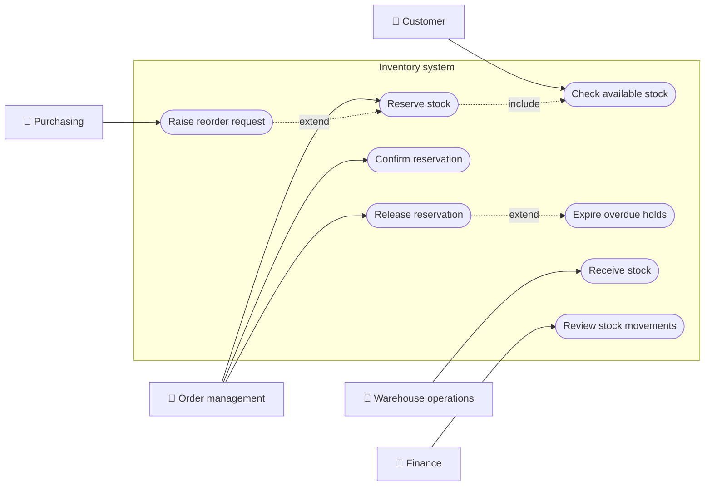
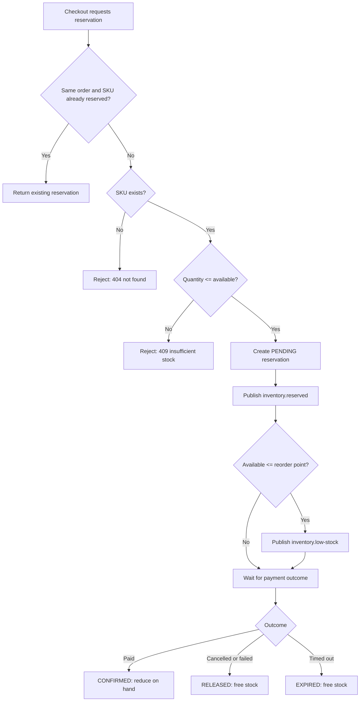
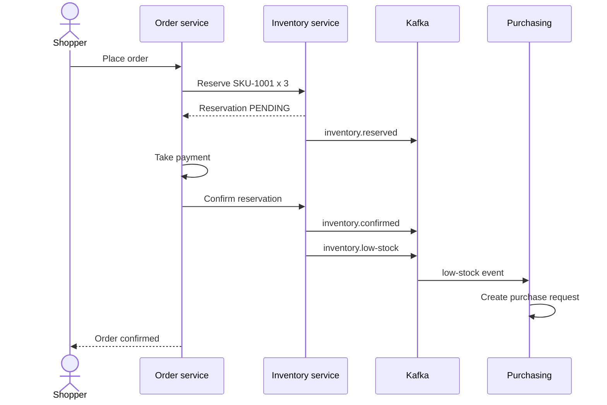
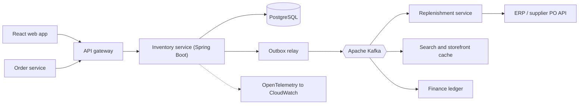
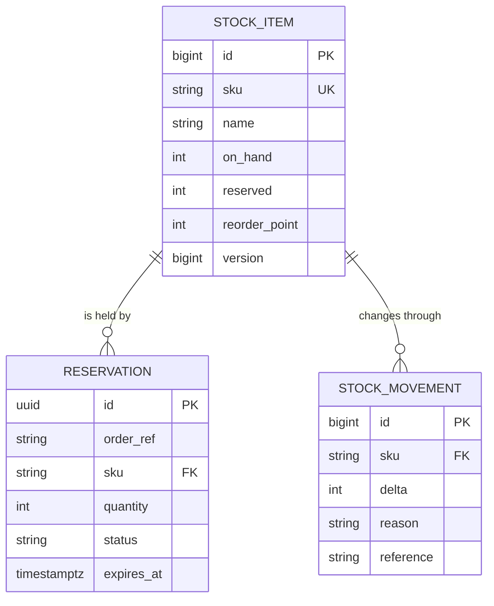
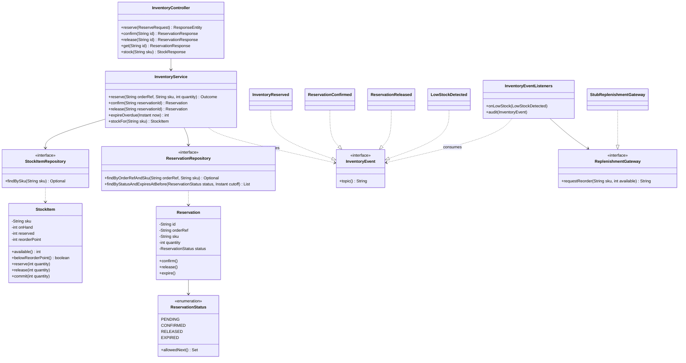
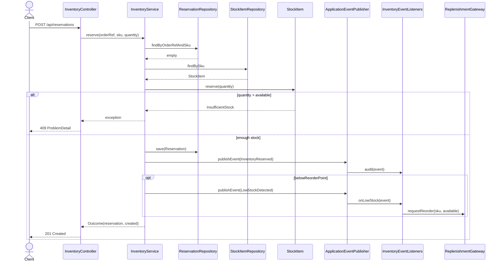
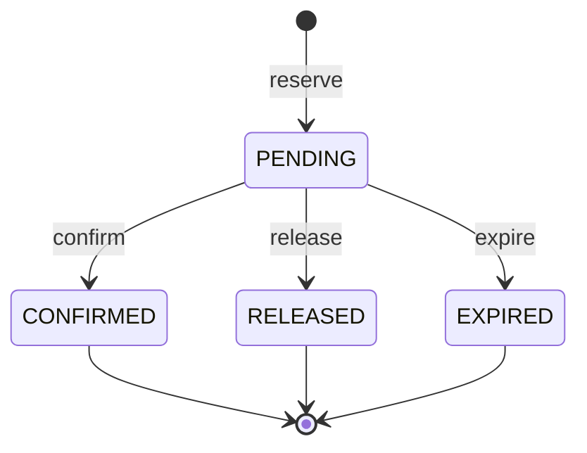
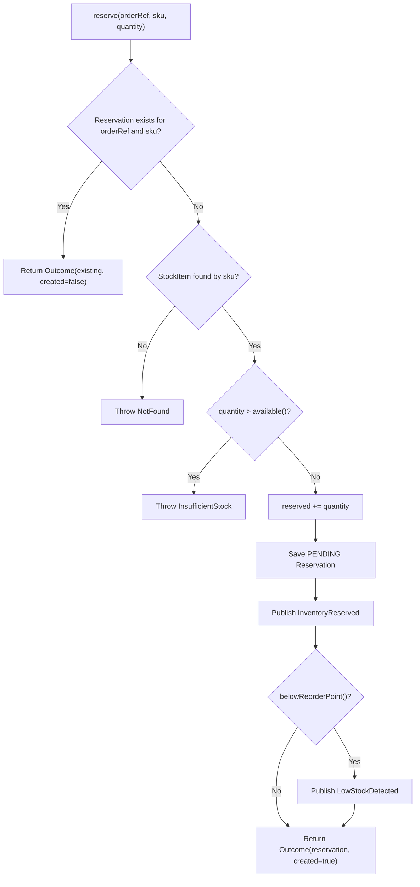

# Inventory Management

> **Domain:** Retail · **Author:** [@dhulipalla599](https://github.com/dhulipalla599) · **Published:** October 29, 2026

> **Runnable code:** [`examples/retail/inventory-management`](https://github.com/dhulipalla599/domain-knowledge-engineering/tree/main/examples/retail/inventory-management)

## Explain It Like I'm Five

Imagine a class bake sale with 12 cupcakes on the table. A friend says, "Save me three for after recess." You put a sticky note on three cupcakes. They are still on the table, but you must not sell them to anyone else. If your friend comes back, the cupcakes leave with them. If your friend forgets, you peel off the note and the cupcakes can be sold again. You also keep an eye on the count, and when only a few unreserved cupcakes remain, you tell the baker to make more.

Inventory management is the same job for a retailer: knowing how many of each item exist, which ones are already promised to someone, and when to order more.

## Business Overview

**Inventory management** is how a retailer tracks what it owns, where it is (warehouse, store, in transit), and how much of it can still be promised to customers. The key idea is that "how many do we have?" has several answers:

- **On hand:** units physically present.
- **Reserved (allocated):** units promised to orders that have not yet left.
- **Available to promise:** on hand minus reserved (some companies also add inbound supply or subtract safety stock; definitions vary by company).

Why the business cares:

- **Revenue:** a stock-out loses the sale; overselling creates cancellations and angry customers.
- **Working capital:** excess stock ties up cash and risks markdowns or write-offs.
- **Customer experience:** "in stock" on the website must match reality, especially during peaks.
- **Accuracy and audit:** shrinkage (loss, damage, theft) and cycle counts must be reconciled, and finance relies on stock valuation. Accounting treatment differs by country and company.

In the Retail value chain, inventory sits between **sourcing and replenishment** (purchase orders, suppliers) and **selling and fulfilment** (e-commerce, stores, order management, shipping). It feeds pricing, promotions, demand forecasting and finance.

## Real-World Example

Northwind Outfitters (fictional) sells outdoor gear online and in 40 stores. Priya Nair buys "Trail Running Shoes, size 42" (SKU-1001) online.

1. The warehouse system shows 12 on hand, 0 reserved, so 12 are available. The reorder point for this SKU is 5.
2. At checkout, the order service asks inventory to reserve 3 units for order ORD-1001. Available drops to 9. A reservation (valid for 15 minutes) is created in `PENDING` state, and an `inventory.reserved` event is published.
3. Priya's payment succeeds. The order service confirms the reservation. On hand drops from 12 to 9, reserved returns to 0, and `inventory.confirmed` is published. The picking team ships the pair.
4. Meanwhile another shopper tries to reserve 10 units of the same SKU for a team order. Only 9 are available, so the request is **rejected** with a clear "insufficient stock" message instead of overselling.
5. Later, more reservations push available stock to 5, which is the reorder point. `inventory.low-stock` is published, and the purchasing system raises a purchase order to the supplier.
6. A different shopper abandons checkout. After 15 minutes the reservation expires, the held units become available again, and `inventory.released` is published.

## Stakeholders

| Stakeholder | What they need | What they fear |
|---|---|---|
| Customer | Accurate "in stock" and orders that ship as promised | Order cancelled after payment |
| E-commerce / order management | A fast, reliable reserve call at checkout | Overselling; slow reservation calls hurting conversion |
| Warehouse / store operations | Correct counts for picking and receiving | Walking to an empty shelf; unexplained count differences |
| Merchandising / buyers | Early signal of low stock and slow movers | Stock-outs on best sellers; dead stock |
| Purchasing / replenishment | Reliable reorder triggers and supplier lead times | Duplicate or late purchase orders |
| Finance | Auditable stock movements and valuation | Unexplained shrinkage; write-offs |
| Supplier / logistics partners | Clear purchase orders and delivery windows | Ambiguous quantities and short-notice changes |

## Use Case Diagram



| Use Case | Primary Actor | Goal | Main success outcome |
|---|---|---|---|
| Check available stock | Customer | See whether an item can be bought | Available quantity is shown |
| Reserve stock | Order management | Hold units for an order line | Reservation created in `PENDING`; available stock reduced |
| Confirm reservation | Order management | Commit the hold once payment succeeds | Stock leaves on-hand; reservation `CONFIRMED` |
| Release reservation | Order management | Give back units for a cancelled order | Units available again; reservation `RELEASED` |
| Expire overdue holds | System scheduler | Free holds from abandoned checkouts | Reservation `EXPIRED`; units available again |
| Receive stock | Warehouse operations | Record goods arriving from a supplier | On-hand increased |
| Raise reorder request | Purchasing | Replenish a SKU below its reorder point | Purchase request created |
| Review stock movements | Finance | Audit how counts changed | Trail of movements and events |

## Key Terms

| Term | Plain-English meaning |
|---|---|
| SKU | Stock keeping unit: the unique code for one sellable variant (for example one shoe in one size) |
| On hand | Units physically in the location right now |
| Reserved / allocated | Units promised to an order but not yet shipped |
| Available to promise (ATP) | What can still be sold; here on hand minus reserved |
| Reorder point | Stock level that triggers replenishment |
| Safety stock | Extra buffer held to absorb demand or supply surprises |
| Lead time | Days between ordering from a supplier and receiving the goods |
| Oversell | Promising more units than exist |
| Shrinkage | Stock lost to theft, damage, or errors |
| Cycle count | Counting a small part of the stock regularly instead of a full annual count |
| Backorder | Accepting an order for stock that is not yet available |
| Stock movement | A recorded change in quantity: receipt, sale, transfer, adjustment |

## Process Flow

A shopper starts checkout and the order service asks inventory to reserve the lines. If every line has enough available stock, a time-limited hold is created and events are published. When payment succeeds the order service confirms the hold, which decrements on-hand stock. If payment fails, the shopper cancels, or the hold times out, the hold is released and the stock becomes sellable again. After each reservation, the system compares available stock with the reorder point and asks purchasing to replenish if needed.





## Business Rules and Edge Cases

- **Never oversell:** a reservation larger than available stock is rejected. Under concurrency, two requests for the last unit must not both succeed, so the check and the update must be atomic (a row lock, an optimistic version check, or a conditional update).
- **Idempotency:** networks retry. Reserving the same order line twice must not hold stock twice. A natural key such as order reference plus SKU makes retries safe.
- **Holds expire:** abandoned checkouts must not lock stock forever. The hold time is a business decision and differs per company and per channel.
- **Legal state changes only:** a confirmed reservation cannot be released as if nothing happened; returns are a separate flow.
- **Reserved is not shipped:** physical stock only decreases on confirmation or shipping, otherwise cycle counts will never match.
- **Partial failure:** a multi-line order may have one line short. Decide whether to reject the whole order, split it, or backorder, and make that explicit.
- **Eventual consistency:** other channels (stores, marketplaces) see stock via events and may lag. Many retailers add safety stock or per-channel buffers for fast-moving items.
- **Multiple locations:** the same SKU may exist in several warehouses and stores; sourcing rules decide which one to reserve from. This page models one location per SKU for clarity.
- **Adjustments and shrinkage:** counts change for reasons other than sales. Every change needs a reason and an audit record.
- **Event ordering:** consumers must cope with duplicate and out-of-order events.

## From Business to System

| Business concept / step | System component | Data entity | Event |
|---|---|---|---|
| Know what can be sold | Stock service | `stock_item` | none (read API) |
| Reserve stock for an order line | Reservation service | `reservation`, `stock_item` | `inventory.reserved` |
| Confirm after payment | Reservation service | `reservation`, `stock_item`, `stock_movement` | `inventory.confirmed` |
| Cancel or time out | Reservation service, scheduler | `reservation`, `stock_item` | `inventory.released` |
| Replenish below reorder point | Replenishment consumer, purchasing system | `stock_item.reorder_point` | `inventory.low-stock` |
| Audit stock changes | Movement ledger | `stock_movement` | all of the above (consumed by finance) |
| Prevent duplicate holds | Unique key on order and SKU | `reservation` | none |

## Architecture



The **inventory service** owns stock counts and reservations; nobody else writes them. That single owner is what makes "never oversell" enforceable with a database transaction. The **order service** only calls the reserve, confirm and release API. **Replenishment** is a separate consumer because purchasing logic and its ERP integration change at a different pace and must not slow down checkout. Search, storefront and finance consume events instead of querying the inventory database, so reads scale independently. Events are written to an outbox table in the same transaction as the stock change and relayed to Kafka, so a stock change is never published without being saved (and vice versa).

## Data Model

```sql
CREATE TABLE stock_item (
    id            BIGSERIAL PRIMARY KEY,
    sku           VARCHAR(40) NOT NULL UNIQUE,
    name          VARCHAR(200) NOT NULL,
    on_hand       INT NOT NULL CHECK (on_hand >= 0),
    reserved      INT NOT NULL CHECK (reserved >= 0),
    reorder_point INT NOT NULL,
    version       BIGINT NOT NULL DEFAULT 0,
    CHECK (reserved <= on_hand)
);

CREATE TABLE reservation (
    id          UUID PRIMARY KEY,
    order_ref   VARCHAR(40) NOT NULL,
    sku         VARCHAR(40) NOT NULL REFERENCES stock_item (sku),
    quantity    INT NOT NULL CHECK (quantity > 0),
    status      VARCHAR(12) NOT NULL,
    expires_at  TIMESTAMPTZ NOT NULL,
    UNIQUE (order_ref, sku)
);

CREATE TABLE stock_movement (
    id         BIGSERIAL PRIMARY KEY,
    sku        VARCHAR(40) NOT NULL REFERENCES stock_item (sku),
    delta      INT NOT NULL,
    reason     VARCHAR(30) NOT NULL,
    reference  VARCHAR(60),
    created_at TIMESTAMPTZ NOT NULL DEFAULT now()
);

CREATE TABLE outbox_event (
    id         BIGSERIAL PRIMARY KEY,
    topic      VARCHAR(60) NOT NULL,
    event_key  VARCHAR(60) NOT NULL,
    payload    JSONB NOT NULL,
    created_at TIMESTAMPTZ NOT NULL DEFAULT now(),
    sent_at    TIMESTAMPTZ
);
```

The runnable example implements `stock_item` and `reservation`; `stock_movement` and `outbox_event` are the production additions described above.



## APIs

| Method | Path | Purpose |
|---|---|---|
| POST | `/api/reservations` | Reserve stock for an order line (idempotent on `orderRef` + `sku`) |
| POST | `/api/reservations/{id}/confirm` | Commit the hold after payment |
| POST | `/api/reservations/{id}/release` | Cancel the hold |
| GET | `/api/reservations/{id}` | Read a reservation |
| GET | `/api/stock/{sku}` | Read on-hand, reserved and available quantities |

Request to `POST /api/reservations`:

```json
{ "orderRef": "ORD-1001", "sku": "SKU-1001", "quantity": 3 }
```

Response `201 Created` (a repeat of the same request returns `200 OK` with the same body; too little stock returns `409` with `application/problem+json`):

```json
{
  "id": "4bff2a8b-07d5-4730-a7cd-467e7fb98612",
  "orderRef": "ORD-1001",
  "sku": "SKU-1001",
  "quantity": 3,
  "status": "PENDING",
  "expiresAt": "2026-10-29T15:29:15.953111239Z"
}
```

## Events

| Event (topic) | Producer | Consumers | Key fields |
|---|---|---|---|
| `inventory.reserved` | Inventory service | Order service, analytics | `reservationId`, `orderRef`, `sku`, `quantity` |
| `inventory.confirmed` | Inventory service | Storefront cache, finance ledger | `reservationId`, `sku`, `quantity` |
| `inventory.released` | Inventory service | Storefront cache, order service | `reservationId`, `sku`, `quantity`, `reason` (`RELEASED` or `EXPIRED`) |
| `inventory.low-stock` | Inventory service | Replenishment service | `sku`, `available`, `reorderPoint` |

Use the **SKU as the Kafka message key** so all events for one SKU land in the same partition and keep their order. Delivery is at least once, so consumers must be idempotent: deduplicate on `reservationId` plus event type, or make handlers naturally repeatable (for example "set storefront stock to N" rather than "subtract 3"). Put a version or timestamp in events so a consumer can ignore a stale one.

## Backend Implementation

> The Java tab is the exact code from the runnable example (Spring Boot 3). The Python tab uses FastAPI + SQLAlchemy and the Node.js tab uses Express with TypeScript and a generic `db` transaction helper. Full source: [`examples/retail/inventory-management`](https://github.com/dhulipalla599/domain-knowledge-engineering/tree/main/examples/retail/inventory-management/src/main/java/com/dke/retail/inventory_management).

The key business rule: never reserve more than is available (`StockItem.reserve`), applied inside the idempotent `InventoryService.reserve`.

=== "Java"

    ```java
    // domain/StockItem.java
    public int available() {
        return onHand - reserved;
    }

    public void reserve(int quantity) {
        if (quantity > available()) {
            throw new DomainException.InsufficientStock(sku, quantity, available());
        }
        reserved += quantity;
    }

    // service/InventoryService.java
    @Transactional
    public Outcome reserve(String orderRef, String sku, int quantity) {
        var existing = reservations.findByOrderRefAndSku(orderRef, sku);
        if (existing.isPresent()) {
            return new Outcome(existing.get(), false); // idempotent replay: no second hold
        }
        StockItem item = stock.findBySku(sku).orElseThrow(() -> new DomainException.NotFound("SKU", sku));
        item.reserve(quantity); // throws InsufficientStock when quantity > onHand - reserved

        Reservation reservation = reservations.save(new Reservation(orderRef, sku, quantity, Instant.now().plus(HOLD)));
        events.publishEvent(new InventoryEvent.InventoryReserved(reservation.getId(), orderRef, sku, quantity));
        if (item.belowReorderPoint()) {
            events.publishEvent(new InventoryEvent.LowStockDetected(sku, item.available(), item.getReorderPoint()));
        }
        return new Outcome(reservation, true);
    }
    ```

=== "Python"

    ```python
    # domain/stock_item.py
    class StockItem(Base):
        __tablename__ = "stock_item"
        id = mapped_column(Integer, primary_key=True)
        sku = mapped_column(String, unique=True)
        on_hand = mapped_column(Integer)
        reserved = mapped_column(Integer, default=0)
        reorder_point = mapped_column(Integer)
        version = mapped_column(Integer, default=0)
        __mapper_args__ = {"version_id_col": version}  # optimistic lock

        def available(self) -> int:
            return self.on_hand - self.reserved

        def reserve(self, quantity: int) -> None:
            if quantity > self.available():
                raise InsufficientStock(self.sku, quantity, self.available())
            self.reserved += quantity

    # service/inventory_service.py
    def reserve(db: Session, events: EventPublisher, order_ref: str, sku: str, quantity: int):
        existing = db.scalar(select(Reservation).where(
            Reservation.order_ref == order_ref, Reservation.sku == sku))
        if existing:
            return existing, False  # idempotent replay: no second hold
        item = db.scalar(select(StockItem).where(StockItem.sku == sku))
        if item is None:
            raise NotFound("SKU", sku)
        item.reserve(quantity)  # raises InsufficientStock when quantity > on_hand - reserved

        reservation = Reservation(order_ref=order_ref, sku=sku, quantity=quantity,
                                  expires_at=datetime.now(UTC) + HOLD)
        db.add(reservation)
        db.flush()
        events.publish(InventoryReserved(reservation.id, order_ref, sku, quantity))
        if item.available() <= item.reorder_point:
            events.publish(LowStockDetected(sku, item.available(), item.reorder_point))
        return reservation, True
    ```

=== "Node.js"

    ```typescript
    // domain/stockItem.ts
    export class StockItem {
      constructor(public sku: string, public onHand: number,
                  public reserved: number, public reorderPoint: number) {}

      available(): number {
        return this.onHand - this.reserved;
      }

      reserve(quantity: number): void {
        if (quantity > this.available()) {
          throw new InsufficientStock(this.sku, quantity, this.available());
        }
        this.reserved += quantity;
      }
    }

    // service/inventoryService.ts
    export async function reserve(orderRef: string, sku: string, quantity: number) {
      return db.transaction(async (tx) => {
        const existing = await tx.reservations.findByOrderRefAndSku(orderRef, sku);
        if (existing) return { reservation: existing, created: false }; // idempotent replay

        const item = await tx.stock.findBySku(sku);
        if (!item) throw new NotFound("SKU", sku);
        item.reserve(quantity); // throws InsufficientStock when quantity > onHand - reserved

        const reservation = await tx.reservations.save(
          new Reservation(orderRef, sku, quantity, new Date(Date.now() + HOLD_MS)));
        events.publish(new InventoryReserved(reservation.id, orderRef, sku, quantity));
        if (item.available() <= item.reorderPoint) {
          events.publish(new LowStockDetected(sku, item.available(), item.reorderPoint));
        }
        return { reservation, created: true };
      });
    }
    ```

The controller endpoint that calls it:

=== "Java"

    ```java
    // api/InventoryController.java
    @PostMapping("/reservations")
    public ResponseEntity<ReservationResponse> reserve(@Valid @RequestBody ReserveRequest request) {
        var outcome = service.reserve(request.orderRef(), request.sku(), request.quantity());
        // 201 for a new hold, 200 when an idempotent retry returns the existing one
        HttpStatus status = outcome.created() ? HttpStatus.CREATED : HttpStatus.OK;
        return ResponseEntity.status(status).body(ReservationResponse.from(outcome.reservation()));
    }
    ```

=== "Python"

    ```python
    # api/routes.py
    @router.post("/api/reservations")
    def reserve(body: ReserveRequest, response: Response, db: Session = Depends(get_db)):
        reservation, created = inventory_service.reserve(
            db, events, body.order_ref, body.sku, body.quantity)
        # 201 for a new hold, 200 when an idempotent retry returns the existing one
        response.status_code = 201 if created else 200
        return ReservationResponse.from_entity(reservation)
    ```

=== "Node.js"

    ```typescript
    // api/routes.ts
    router.post("/api/reservations", async (req, res) => {
      const { orderRef, sku, quantity } = ReserveRequest.parse(req.body);
      const { reservation, created } = await reserve(orderRef, sku, quantity);
      // 201 for a new hold, 200 when an idempotent retry returns the existing one
      res.status(created ? 201 : 200).json(toResponse(reservation));
    });
    ```

## Frontend Screen

A stock lookup and reserve panel for a customer-service agent or an internal order tool.

```tsx
import { useState } from "react";

interface Stock { sku: string; name: string; onHand: number; reserved: number; available: number; }

export function ReserveStockPanel() {
  const [sku, setSku] = useState("SKU-1001");
  const [quantity, setQuantity] = useState(1);
  const [stock, setStock] = useState<Stock | null>(null);
  const [message, setMessage] = useState("");

  const lookup = async () => {
    const res = await fetch(`/api/stock/${sku}`);
    setStock(res.ok ? await res.json() : null);
    setMessage(res.ok ? "" : "SKU not found");
  };

  const reserve = async () => {
    const res = await fetch("/api/reservations", {
      method: "POST",
      headers: { "Content-Type": "application/json" },
      body: JSON.stringify({ orderRef: `ORD-${Date.now()}`, sku, quantity }),
    });
    const body = await res.json();
    setMessage(res.ok ? `Reserved (${body.status}), expires ${body.expiresAt}` : body.detail);
    await lookup();
  };

  return (
    <section>
      <h2>Stock</h2>
      <input value={sku} onChange={(e) => setSku(e.target.value)} aria-label="SKU" />
      <button onClick={lookup}>Check</button>
      {stock && (
        <p>{stock.name}: {stock.available} available ({stock.onHand} on hand, {stock.reserved} reserved)</p>
      )}
      <input type="number" min={1} value={quantity}
             onChange={(e) => setQuantity(Number(e.target.value))} aria-label="Quantity" />
      <button onClick={reserve} disabled={!stock}>Reserve</button>
      {message && <p role="status">{message}</p>}
    </section>
  );
}
```

## Cloud Deployment

The inventory service runs as a Deployment on **Amazon EKS**, behind an Application Load Balancer and an API gateway. State lives in **Amazon RDS for PostgreSQL** (Multi-AZ), events go through **Amazon MSK** (managed Kafka), and secrets come from **AWS Secrets Manager**. Container images are stored in **Amazon ECR**.

```hcl
resource "aws_db_instance" "inventory" {
  identifier              = "retail-inventory"
  engine                  = "postgres"
  engine_version          = "16"
  instance_class          = "db.r6g.large"
  allocated_storage       = 100
  multi_az                = true
  storage_encrypted       = true
  backup_retention_period = 14
  deletion_protection     = true
  db_subnet_group_name    = aws_db_subnet_group.private.name
  vpc_security_group_ids  = [aws_security_group.inventory_db.id]
  username                = "inventory_app"
  manage_master_user_password = true
}
```

- **Security:** private subnets only; the database security group admits only the EKS node group; IAM Roles for Service Accounts (IRSA) give pods least-privilege access; TLS in transit and encryption at rest; OIDC/JWT validated at the gateway.
- **Scaling:** scale pods with a Horizontal Pod Autoscaler on CPU and request rate. The database is the real bottleneck for hot SKUs, so keep transactions short, use a connection pooler, and consider read replicas for stock reads. Partition Kafka topics by SKU.
- **Observability:** instrument with OpenTelemetry (traces across order, inventory and Kafka; metrics for reserve latency and rejection rate) exported to CloudWatch via the ADOT collector. Alert on reservation error rate, outbox lag, consumer lag, and oversell invariants (`reserved > on_hand` should never happen).

## Non-Functional Requirements

| Concern | Expectation | How the design meets it |
|---|---|---|
| Availability | Checkout must keep working if the inventory service has a bad moment; target values are set per business | Multi-AZ database, several pods, timeouts and a documented fallback policy (fail closed or allow with a buffer) |
| Latency | The reserve call sits in the checkout path, so it must be fast (single-digit to low tens of milliseconds at the service is typical) | One short transaction, indexed lookups, no synchronous calls to other services |
| Consistency | Strong for reserve and confirm; eventual for read caches in other channels | Database constraints and optimistic locking for the write path; events with SKU keys for the rest |
| Idempotency | Retries are normal | Unique (`order_ref`, `sku`) key; idempotent consumers |
| Audit | Every count change is explainable | Movement ledger and event history; no direct edits to counts |
| Compliance | Retention and access rules vary by country and company | Encrypted storage, role-based access, retention set with legal and finance |
| Data integrity | Stock never negative | `CHECK` constraints plus domain rule |

## Runnable Example

The example implements the reservation core: reserve with a no-oversell rule, idempotent retries, a lifecycle (`PENDING` to `CONFIRMED`, `RELEASED` or `EXPIRED`), low-stock detection, and events published through Spring's `ApplicationEventPublisher` as stand-ins for Kafka topics. It runs on H2 with seeded data and no external services; the replenishment system is behind an interface with an in-memory stub.

Source: [`examples/retail/inventory-management`](https://github.com/dhulipalla599/domain-knowledge-engineering/tree/main/examples/retail/inventory-management)

```bash
cd examples/retail/inventory-management
mvn spring-boot:run   # http://localhost:8080
mvn verify            # unit and API tests
```

Reserve 3 pairs of shoes:

```bash
curl -i -X POST localhost:8080/api/reservations -H 'Content-Type: application/json' \
  -d '{"orderRef":"ORD-1001","sku":"SKU-1001","quantity":3}'
# HTTP/1.1 201
# {"id":"4bff2a8b-07d5-4730-a7cd-467e7fb98612","orderRef":"ORD-1001","sku":"SKU-1001","quantity":3,"status":"PENDING","expiresAt":"2026-10-29T15:29:15.953111239Z"}
```

Try to reserve more than exists:

```bash
curl -i -X POST localhost:8080/api/reservations -H 'Content-Type: application/json' \
  -d '{"orderRef":"ORD-1002","sku":"SKU-1003","quantity":9}'
# HTTP/1.1 409
# {"type":"about:blank","title":"Conflict","status":409,"detail":"Cannot reserve 9 of SKU-1003: only 3 available","instance":"/api/reservations"}
```

| Class | Package | Responsibility |
|---|---|---|
| `StockItem` | `domain` | Stock per SKU; `reserve`, `release`, `commit` enforce the no-oversell rule |
| `Reservation` | `domain` | A hold on stock; enforces legal state transitions |
| `ReservationStatus` | `domain` | Lifecycle enum with allowed next states |
| `InventoryEvent` | `domain` | Sealed event records named after Kafka topics |
| `DomainException` | `domain` | `NotFound`, `InsufficientStock`, `InvalidTransition` |
| `StockItemRepository` | `repository` | Spring Data access to stock |
| `ReservationRepository` | `repository` | Spring Data access to reservations, lookup by order and SKU |
| `InventoryService` | `service` | Reserve, confirm, release and expire use cases; publishes events |
| `InventoryController` | `api` | REST endpoints |
| `InventoryDtos` | `api` | Request and response records |
| `ApiExceptionHandler` | `api` | Maps rule violations to `ProblemDetail` |
| `InventoryEventListeners` | `integration` | `@EventListener` stand-ins for Kafka consumers |
| `ReplenishmentGateway` / `StubReplenishmentGateway` | `integration` | Purchasing port and its in-memory stub |

## UML Diagrams

### Class Diagram

The controller delegates to the service, which uses two repositories and publishes `InventoryEvent` records. `StockItem` and `Reservation` hold the business rules.



### Sequence Diagram (control flow)

One reserve request through the code. A request for more than the available quantity ends in `InsufficientStock`, which the exception handler turns into a 409.



### State Diagram

A reservation starts `PENDING`. Only `PENDING` has outgoing transitions; the other three states are final (`ReservationStatus.allowedNext`).



### Activity Diagram

The decision logic inside `InventoryService.reserve`.



## AI Opportunities

1. **Demand forecasting for reorder points.** Use sales history, seasonality, promotions and weather to set reorder points and safety stock per SKU and location. Data: sales, stock history, supplier lead times, calendar. Risk: forecast error causes stock-outs or overstock; keep a human-set floor and ceiling, and monitor forecast accuracy by category.
2. **Anomaly detection on stock movements.** Flag unusual adjustments or shrinkage patterns (for example, repeated write-offs at one store). Data: movement ledger, shift and user data. Risk: false accusations; treat output as a lead for review, never as a verdict, and respect labour and privacy rules that vary by country.
3. **Stock transfer and sourcing optimisation.** Recommend which warehouse should fulfil an order, or move stock between stores. Data: location stock, shipping costs, delivery promises. Risk: opaque optimisation harming service levels; log the inputs and reasoning and keep business-rule constraints outside the model.
4. **LLM assistant for planners.** Answer questions such as "why did SKU-1003 stock out last week?" by reading movements and events. Data: ledger, event history, purchase orders. Risk: hallucinated explanations; ground answers in retrieved records, show the sources, and give read-only access.
5. **Computer vision for shelf counts.** Detect empty shelves or miscounts from store cameras. Data: shelf images, planograms. Risk: accuracy in poor lighting and privacy of customers and staff; blur people and verify with cycle counts.

## Common Pitfalls

- **Treating one number as "stock".** Keep on hand, reserved and available separate, and define available the same way everywhere.
- **Check-then-update races.** Reading available stock and writing later without a lock or version check lets two buyers take the last unit. Use constraints, optimistic locking or conditional updates.
- **Non-idempotent reserve.** A retry after a timeout doubles the hold. Use a natural idempotency key.
- **Holds that never expire.** Abandoned carts quietly drain sellable stock. Always give holds an expiry and a sweeper.
- **Decrementing on reserve.** Reducing on-hand at reservation time breaks cycle counts and returns. Reduce it on confirmation or shipment.
- **Publishing events outside the transaction.** A crash between commit and publish loses events. Use a transactional outbox.
- **Ignoring event order and duplicates.** Key by SKU and make consumers idempotent.
- **One global lock or hot row.** A very popular SKU can serialise checkout. Measure, then consider bucketed stock or queued allocation.
- **Assuming one warehouse.** Real retailers have many locations, in-transit stock and channel buffers.
- **No audit trail.** Overwriting counts makes shrinkage impossible to explain. Record every movement with a reason.

## Interview Questions

### Junior

**1. What is the difference between on-hand and available stock?**
On hand is what is physically there. Available is what can still be promised, which here is on hand minus reserved (some companies also subtract safety stock or add inbound supply).

**2. Why do we reserve stock at checkout instead of just reducing it?**
A reservation holds units for a short time without claiming they have left the building. If payment fails or the shopper leaves, the hold is released and counts stay correct.

**3. What does an idempotent reserve endpoint mean?**
Calling it twice with the same order reference and SKU does not hold stock twice; the second call returns the original reservation.

### Mid-Level

**1. Two shoppers click "buy" on the last unit at the same instant. How do you prevent overselling?**
Make the check and update atomic: optimistic locking with a version column and retry, `SELECT ... FOR UPDATE`, or a conditional `UPDATE ... WHERE on_hand - reserved >= :qty`. Add `CHECK` constraints as a last line of defence, and return a clear `409` to the loser.

**2. How do you publish reservation events reliably to Kafka?**
Write the event to an outbox table in the same transaction as the stock change and have a relay publish it. Delivery is at least once, so consumers deduplicate. Key by SKU for per-SKU ordering.

**3. How would you handle holds from abandoned checkouts?**
Store an expiry on each reservation and run a scheduled job that moves overdue `PENDING` reservations to `EXPIRED`, returns the units, and publishes `inventory.released`. Guard against the race where payment confirms just as the hold expires by relying on the legal state transitions.

### Senior / Architect

**1. Design inventory for 40 stores plus e-commerce, with a flash sale on one SKU.** A strong answer covers: stock per location and a sourcing rule for which location to reserve from; a hot-row strategy (bucketed counters, queueing or a dedicated allocation path for flash SKUs); safety buffers per channel; eventual consistency for storefront caches; load tests and backpressure; and a degraded mode if inventory is slow.

**2. Strong consistency in the reserve path versus eventual consistency across channels: where do you draw the line?** Key points: a single writer and database transaction per SKU for reserve and confirm; events and caches for reads; accept brief staleness with buffers; define which channel may oversell and how it recovers (cancel, backorder, substitute); monitor invariants and reconciliation jobs.

**3. How do you migrate from a monolith's `stock` table to a dedicated inventory service without double-counting?** Key points: pick a single source of truth and cut over per SKU or location; dual-write or change-data-capture with reconciliation; idempotent backfill; shadow reads to compare results; feature flags and rollback; keep the audit ledger continuous across the cutover.

## Further Learning

- Reorder point, safety stock and economic order quantity (EOQ)
- Demand forecasting basics and forecast accuracy metrics
- Warehouse management systems (WMS) and order management systems (OMS)
- GS1 standards: GTIN barcodes, EPC/RFID and EDI messages
- Cycle counting and inventory accuracy practices
- Transactional outbox and idempotent consumers in Kafka
- Optimistic versus pessimistic locking in PostgreSQL
- Omnichannel fulfilment: ship-from-store and buy online, pick up in store

## Practitioner Notes

> _Reviewer: add real-world experience, corrections or gotchas here before approving._
