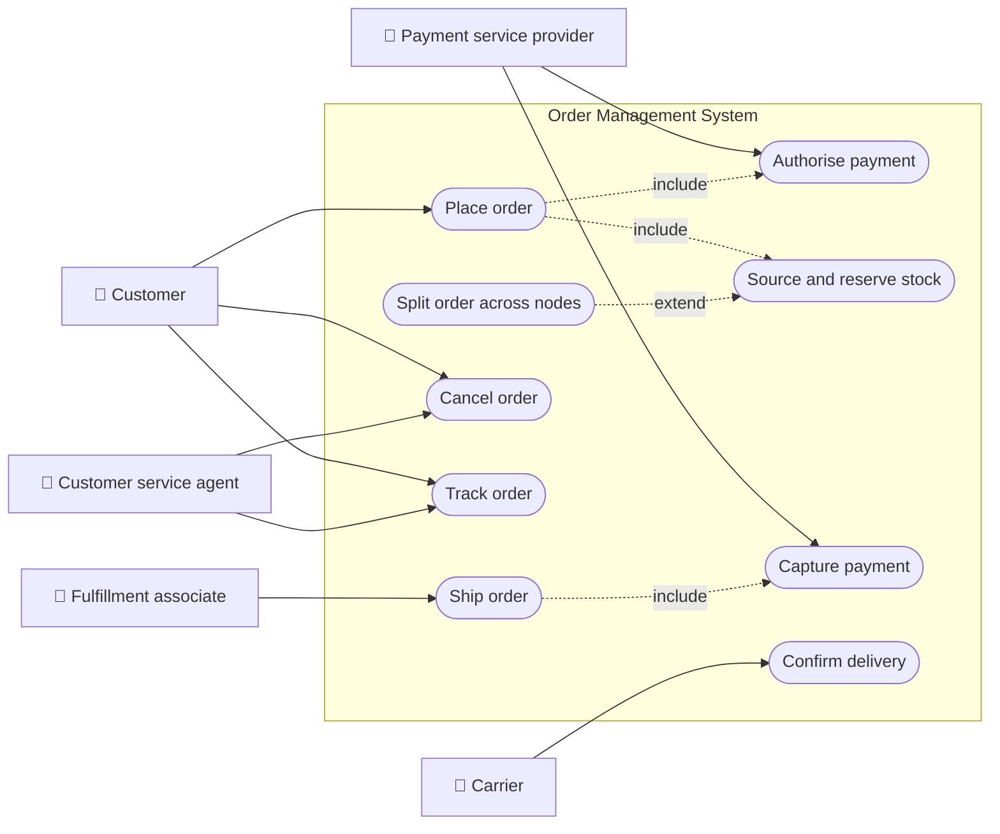
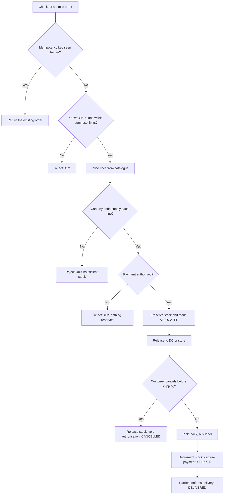
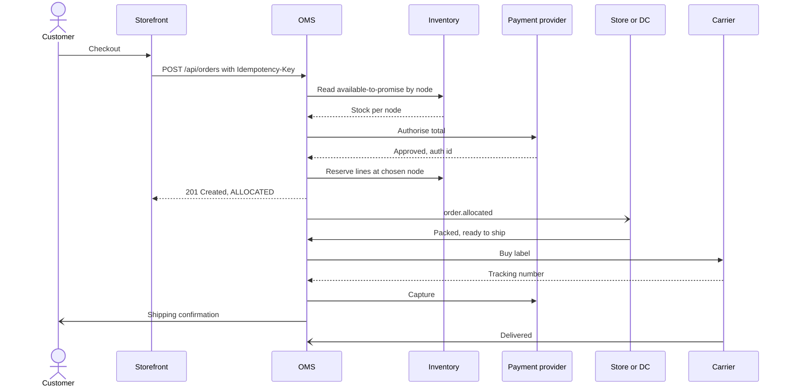
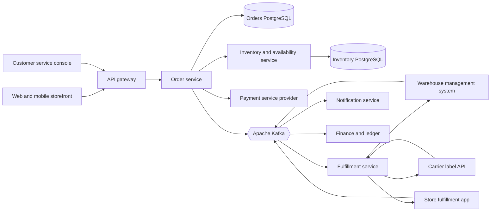
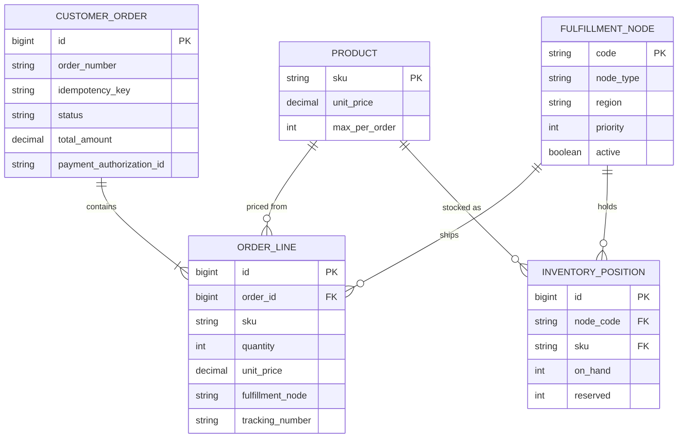
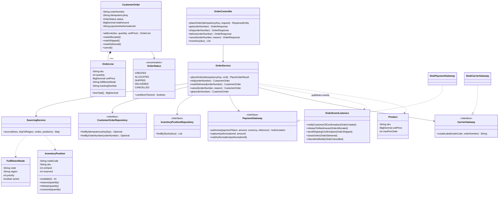
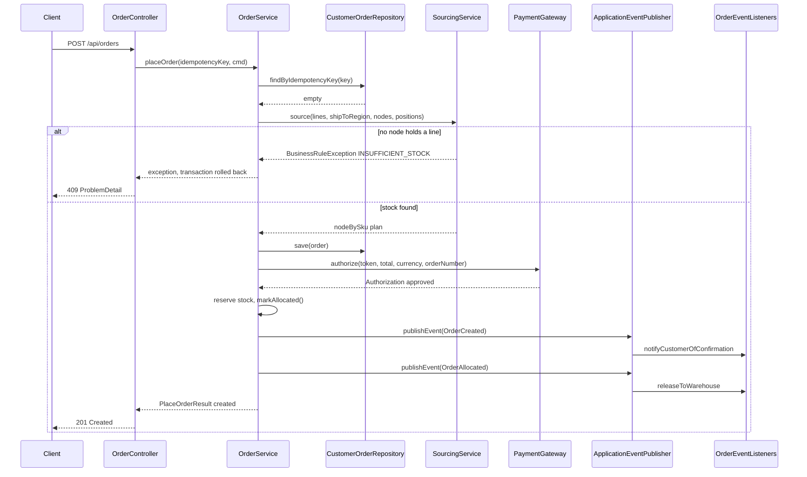
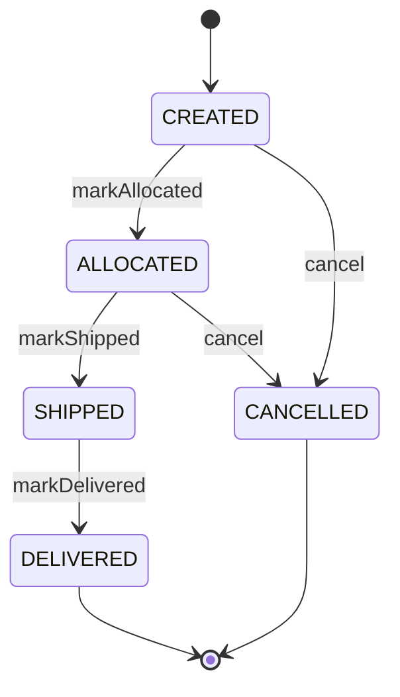
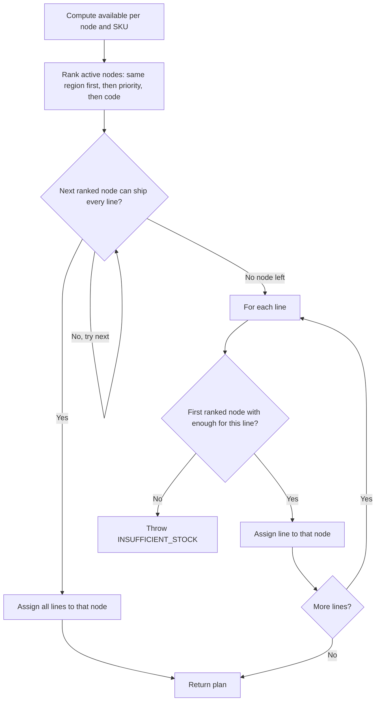

# Order Management and Fulfillment

> **Domain:** Retail · **Author:** [@dhulipalla599](https://github.com/dhulipalla599) · **Published:** November 12, 2026

> **Runnable code:** [`examples/retail/order-management-and-fulfillment`](https://github.com/dhulipalla599/domain-knowledge-engineering/tree/main/examples/retail/order-management-and-fulfillment)

## Explain It Like I'm Five

Imagine you write a letter to your grandma asking for three cookies and a toy car. Grandma reads it, checks her cupboard, and sees she has the cookies but the toy car is at Auntie's house. She asks Auntie to send the car, packs the cookies herself, and writes down which box went where so nothing gets lost. When both boxes arrive at your door, she ticks your letter off as "done". If you change your mind before she posts anything, she just puts everything back on the shelf.

Order management is grandma's notebook and decisions: it takes the customer's order, decides which warehouse or store sends each item, keeps track of every box, and handles changes until the order is delivered.

## Business Overview

An **Order Management System (OMS)** is the system of record for a customer order from the moment checkout succeeds until the goods are delivered, returned or cancelled. It sits between the selling channels (web, app, marketplace, call centre, store point of sale) and the execution systems (warehouse management, store fulfillment apps, carriers, payments, finance).

Its core jobs are:

- **Order capture**: accept the order exactly once, with prices, taxes, promotions and payment authorisation as they were at checkout.
- **Sourcing (also called allocation or order routing)**: decide which fulfillment node ships each line, using available-to-promise stock, distance, cost and node capacity.
- **Orchestration**: release work to the warehouse or store, buy shipping labels, capture payment, and send customer notifications.
- **Order changes**: cancellations, address changes, backorders, substitutions, splits, returns and refunds.
- **Visibility**: one answer to "where is my order?" for customers, customer service and finance.

Why the business cares:

- **Revenue**: every order rejected because stock was "somewhere else" is a lost sale. Good sourcing lets one inventory pool (DCs plus stores) serve every channel.
- **Margin**: split shipments, long-zone shipping and expedited upgrades eat margin. Sourcing rules are one of the biggest controllable cost levers in e-commerce.
- **Customer experience**: accurate delivery promises, fast confirmation, and no "sorry, we oversold" emails.
- **Risk and compliance**: payments must be authorised, captured and refunded correctly; card scheme rules, consumer protection and distance-selling laws differ by country, so cancellation and refund windows vary by market.

In the retail value chain it sits after merchandising, pricing and the storefront, and before warehouse execution, last-mile delivery, returns and financial reconciliation.

## Real-World Example

**Larkspur Home** is a fictional homeware retailer with two distribution centres (Harrisburg in the east, Reno in the west) and stores that can ship online orders.

1. **Checkout.** Priya Raman in New York orders two electric kettles (KTL-200, $39.99 each) and one cast-iron skillet (FRY-28, $54.00). The storefront sends the cart to the OMS with an idempotency key `chk-7f3a` and a payment token.
2. **Validation.** The OMS re-prices the lines from the catalogue (it never trusts the price in the request) and checks purchase limits. Total: $133.98.
3. **Sourcing.** The Harrisburg DC has plenty of kettles but no skillets. The Brooklyn store (STORE-114) has 3 kettles and 2 skillets. Shipping everything from Brooklyn means one parcel, so the OMS picks the store over a split shipment from two nodes.
4. **Payment.** The OMS asks the payment provider to authorise $133.98. It is approved; no money moves yet.
5. **Reservation.** Two kettles and one skillet at STORE-114 are reserved so no other order can promise them. Order R100002 moves to `ALLOCATED`, and `order.created` and `order.allocated` events are published.
6. **Pick, pack, ship.** A Brooklyn associate picks the items on a handheld, packs them, and the OMS buys a label. The order moves to `SHIPPED`, stock is decremented, the payment is captured, and Priya gets a shipping email with the tracking number.
7. **Delivery.** The carrier's tracking webhook reports delivery; the order moves to `DELIVERED`.
8. **The twist.** Priya's browser timed out on step 1 and resent the request. Because the second call carried the same idempotency key, she got the same order back, not a second charge.

## Stakeholders

| Stakeholder | What they need | What they fear |
|---|---|---|
| Customer | Accurate delivery promise, confirmation, tracking, easy cancellation | Being charged twice, an "out of stock" email after paying |
| E-commerce / digital team | High conversion, fast checkout, reliable order API | Checkout outages on peak days |
| Customer service agent | One view of the order, ability to cancel or change it | Telling a customer something the warehouse contradicts |
| Fulfillment operations (DC and store) | A steady, well-formed flow of picks within capacity | Being flooded with orders they cannot ship on time |
| Store manager | Ship-from-store volume that does not starve walk-in shoppers | Online orders draining shelf stock |
| Finance | Correct capture, refunds and revenue recognition | Captured money for goods never shipped, unreconciled refunds |
| Payment service provider | Valid authorisation, capture and void calls | Chargebacks and expired authorisations |
| Carrier | Correct labels and parcel data | Bad addresses and unannounced volume spikes |

## Use Case Diagram



| Use Case | Primary Actor | Goal | Main success outcome |
|---|---|---|---|
| Place order | Customer | Buy items in the cart | Order created, priced, paid (authorised) and allocated |
| Authorise payment | Payment service provider | Hold funds for the order total | Authorisation id stored on the order |
| Source and reserve stock | OMS (on behalf of the customer) | Pick the node(s) that ship each line | Stock reserved at the chosen node(s) |
| Split order across nodes | OMS | Fulfil when no single node has everything | Each line assigned to a node; order ships in several parcels |
| Ship order | Fulfillment associate | Hand the parcel to the carrier | Label bought, stock decremented, order `SHIPPED` |
| Capture payment | Payment service provider | Collect the money once goods ship | Authorised amount captured |
| Cancel order | Customer or agent | Stop an order before it ships | Reservation released, authorisation voided, order `CANCELLED` |
| Track order | Customer or agent | Know where the order is | Status and tracking numbers shown |
| Confirm delivery | Carrier | Close the order | Order `DELIVERED` |

## Key Terms

| Term | Plain-English meaning |
|---|---|
| OMS | Order Management System: the system of record for orders after checkout |
| Fulfillment node | Any place that can ship an order: distribution centre (DC), store, dropship vendor |
| ATP (available-to-promise) | Stock you can still sell: on hand minus reserved minus safety stock |
| Sourcing / allocation | Choosing which node ships each line, and reserving the stock there |
| Reservation | A hold on stock for an order that has not shipped yet |
| Split shipment | One order shipped in several parcels from different nodes |
| Ship-from-store (SFS) | A store picks and ships an online order from its shelves |
| BOPIS | Buy online, pick up in store (also "click and collect") |
| Authorisation / capture | Card hold on funds at order time / actually taking the money, usually at shipment |
| Backorder | An order line accepted without stock, to be fulfilled when stock arrives |
| WMS | Warehouse Management System: runs pick, pack and ship inside a DC |
| Order release | Handing an allocated order to a node so work can start |

## Process Flow

The customer checks out; the OMS validates and prices the order, finds node(s) that can ship it, authorises payment and reserves stock. The order is released to the chosen node, which picks, packs and ships it. On shipment the OMS captures payment and notifies the customer; the carrier's tracking data later marks the order delivered. Cancellation is possible until the parcel leaves the building; after that, the customer has to return it.





## Business Rules and Edge Cases

- **Idempotent order capture.** Browsers, mobile apps and API gateways retry. Without an idempotency key the retry creates a duplicate order and a second authorisation. Store the key with a unique constraint and return the original order on a repeat.
- **Never trust client prices.** The cart may have stale or tampered prices. Re-price on the server and store the price as charged on the order line; later catalogue changes must not alter an existing order.
- **Purchase limits** on promotional or scarce items are checked per order (and in many retailers per customer or per household over a period, which needs more data than one order).
- **Available-to-promise, not on-hand.** Stock already reserved for other orders is not sellable. Many retailers also hold back safety stock at stores because shelf counts are less accurate than DC counts.
- **Reservation races.** Two checkouts can read the same last unit. Use optimistic locking or an atomic conditional update so only one reservation wins; the loser gets a clear "out of stock" response.
- **Authorise before reserving, or release on failure.** A declined card must not hold stock. If reservation fails after authorisation, void the authorisation.
- **Capture on shipment.** Card scheme rules and consumer law in many countries expect you to charge when goods ship, not when ordered. Authorisations expire (often in about a week for cards, varying by scheme, issuer and merchant category), so long backorders need re-authorisation.
- **Split shipments.** One order may ship in several parcels on different days. Capture per shipment (partial capture) or at the end, depending on your provider and policy.
- **Cancellation window.** Cancelling is only safe before the node has shipped. Once picking has started, a cancel may need to be a "request" the node can refuse. After shipment it becomes a return.
- **Partial failure in a distributed flow.** Payment succeeded but the database write failed, or the warehouse acknowledged but the event was lost. Use an outbox for events, idempotent consumers, and reconciliation jobs between OMS, PSP and WMS.
- **Money.** Use decimal types, store currency with every amount, and compute totals from line amounts with a defined rounding rule. Tax and shipping rules differ by country and state; keep them in a dedicated engine.
- **Time.** Store instants in UTC. "Order by 2pm for next-day delivery" cut-offs are in the node's local time zone.

## From Business to System

| Business concept / step | System component | Data entity | Event |
|---|---|---|---|
| Customer checks out | Order API (`OrderController`) | `customer_order`, `order_line` | `order.created` |
| Retry of the same checkout | Idempotency check in `OrderService` | `customer_order.idempotency_key` | none |
| Price and purchase limits | `OrderService` with catalogue | `product` | none |
| Choose fulfillment node | `SourcingService` | `fulfillment_node`, `inventory_position` | `order.allocated` |
| Authorise payment | `PaymentGateway` adapter | `customer_order.payment_authorization_id` | none (PSP has its own records) |
| Reserve stock | `InventoryPosition.reserve` | `inventory_position.reserved` | `order.allocated` |
| Ship and capture | `OrderService.ship`, `CarrierGateway`, `PaymentGateway` | `order_line.tracking_number` | `order.shipped` |
| Delivery confirmed | Carrier webhook to `OrderService.markDelivered` | `customer_order.status` | `order.delivered` |
| Cancel | `OrderService.cancel` | `customer_order.status`, `inventory_position.reserved` | `order.cancelled` |

## Architecture



- **Order service** owns the order aggregate and its lifecycle. It is the only writer of order status, which keeps "where is my order" consistent.
- **Inventory and availability service** owns stock per node and reservations. It is separate because many systems (storefront availability badges, store systems, replenishment) read and write stock at a much higher rate than orders are placed.
- **Fulfillment service** translates allocated orders into work for each node type (WMS for DCs, a handheld app for stores) and talks to carriers. Node integrations change often and differ per node type, so they are kept out of the order core.
- **Notifications and finance** consume events only; they never call back synchronously into checkout.
- Synchronous calls are kept to what checkout must know before answering the customer (availability, payment). Everything after allocation is event-driven.

## Data Model

```sql
CREATE TABLE product (
    sku            VARCHAR(40)   PRIMARY KEY,
    name           VARCHAR(200)  NOT NULL,
    unit_price     NUMERIC(12,2) NOT NULL,
    max_per_order  INT           NOT NULL
);

CREATE TABLE fulfillment_node (
    code       VARCHAR(20)  PRIMARY KEY,
    name       VARCHAR(200) NOT NULL,
    node_type  VARCHAR(10)  NOT NULL,          -- DC, STORE
    region     VARCHAR(20)  NOT NULL,
    priority   INT          NOT NULL,          -- lower is preferred
    active     BOOLEAN      NOT NULL
);

CREATE TABLE inventory_position (
    id         BIGSERIAL PRIMARY KEY,
    node_code  VARCHAR(20) NOT NULL REFERENCES fulfillment_node(code),
    sku        VARCHAR(40) NOT NULL REFERENCES product(sku),
    on_hand    INT    NOT NULL CHECK (on_hand >= 0),
    reserved   INT    NOT NULL CHECK (reserved >= 0),
    version    BIGINT NOT NULL,
    UNIQUE (node_code, sku),
    CHECK (reserved <= on_hand)
);

CREATE TABLE customer_order (
    id                        BIGSERIAL PRIMARY KEY,
    order_number              VARCHAR(20)  UNIQUE,
    idempotency_key           VARCHAR(100) NOT NULL UNIQUE,
    customer_id               VARCHAR(40)  NOT NULL,
    ship_to_region            VARCHAR(20)  NOT NULL,
    status                    VARCHAR(20)  NOT NULL,
    total_amount              NUMERIC(12,2) NOT NULL,
    currency                  CHAR(3)      NOT NULL,
    payment_authorization_id  VARCHAR(100),
    placed_at                 TIMESTAMPTZ  NOT NULL,
    version                   BIGINT       NOT NULL
);

CREATE TABLE order_line (
    id                BIGSERIAL PRIMARY KEY,
    order_id          BIGINT NOT NULL REFERENCES customer_order(id),
    sku               VARCHAR(40)   NOT NULL,
    quantity          INT           NOT NULL CHECK (quantity > 0),
    unit_price        NUMERIC(12,2) NOT NULL,
    fulfillment_node  VARCHAR(20),
    tracking_number   VARCHAR(60)
);
```



## APIs

| Method | Path | Purpose |
|---|---|---|
| POST | `/api/orders` | Place an order (requires `Idempotency-Key` header) |
| GET | `/api/orders/{orderNumber}` | Get order status, lines, nodes and tracking |
| POST | `/api/orders/{orderNumber}/ship` | Node confirms shipment: buy label, capture, decrement stock |
| POST | `/api/orders/{orderNumber}/deliver` | Carrier confirms delivery |
| POST | `/api/orders/{orderNumber}/cancel` | Cancel before shipment |
| GET | `/api/inventory/{sku}` | Stock, reservations and availability per node |

Request:

```http
POST /api/orders
Idempotency-Key: chk-7f3a
Content-Type: application/json
```

```json
{
  "customerId": "CUST-4410",
  "shipToRegion": "EAST",
  "paymentToken": "tok_visa",
  "lines": [
    { "sku": "KTL-200", "quantity": 2 },
    { "sku": "FRY-28", "quantity": 1 }
  ]
}
```

Response `201 Created`, `Location: /api/orders/R100002`:

```json
{
  "orderNumber": "R100002",
  "status": "ALLOCATED",
  "customerId": "CUST-4410",
  "totalAmount": 133.98,
  "currency": "USD",
  "lines": [
    { "sku": "KTL-200", "quantity": 2, "unitPrice": 39.99, "fulfillmentNode": "STORE-114", "trackingNumber": null },
    { "sku": "FRY-28", "quantity": 1, "unitPrice": 54.00, "fulfillmentNode": "STORE-114", "trackingNumber": null }
  ]
}
```

## Events

| Event | Producer | Consumers | Key fields |
|---|---|---|---|
| `order.created` | Order service | Notification (confirmation email), analytics, fraud review | orderNumber, customerId, totalAmount, currency |
| `order.allocated` | Order service | Fulfillment service (release to node), inventory projections | orderNumber, nodeBySku |
| `order.shipped` | Order service | Notification (shipping email), finance (revenue), customer service view | orderNumber, trackingNumbers |
| `order.delivered` | Order service | Notification, returns (starts return window), analytics | orderNumber |
| `order.cancelled` | Order service | Fulfillment (stop picking), finance (refund or void), notification | orderNumber, reason |

- **Ordering**: key every event by `orderNumber` so all events for one order land on the same partition and are consumed in order. A consumer must still tolerate seeing `order.shipped` for an order whose `order.allocated` it has not processed yet (for example after a replay), by checking order status rather than assuming sequence.
- **Idempotency**: Kafka delivers at least once. Give every event an id and have consumers store processed ids, or make handlers naturally idempotent (setting status to `SHIPPED` twice is harmless; sending the shipping email twice is not).
- **Atomicity**: write the event to an outbox table in the same transaction as the order change, and relay it to Kafka, so an order is never `SHIPPED` without the event (or the other way round).

## Backend Implementation

> The Java tab is the runnable example's code; the Python tab uses FastAPI with SQLAlchemy and the Node.js tab uses Express with TypeScript.

The key business rule is sourcing: nodes in the customer's region first, then by priority; one node that ships the whole order beats a split; a line is never split; inactive nodes are ignored ([`SourcingService.java`](https://github.com/dhulipalla599/domain-knowledge-engineering/tree/main/examples/retail/order-management-and-fulfillment/src/main/java/com/dke/retail/order_management_and_fulfillment/service/SourcingService.java)):

=== "Java"

    ```java
    /**
     * Returns SKU -> node code. Nodes in the ship-to region come first, then by priority.
     * One node that can ship the whole order wins (one parcel, one shipping cost); otherwise
     * each line goes to the best node that holds all of it. A line is never split across nodes.
     */
    public Map<String, String> source(List<LineRequest> lines, String shipToRegion,
                                      List<FulfillmentNode> nodes, List<InventoryPosition> positions) {
        Map<String, Integer> available = new HashMap<>();
        positions.forEach(p -> available.merge(p.getNodeCode() + "|" + p.getSku(), p.available(), Integer::sum));

        List<FulfillmentNode> ranked = nodes.stream()
                .filter(FulfillmentNode::isActive)
                .sorted(Comparator.comparing((FulfillmentNode n) -> !n.getRegion().equals(shipToRegion))
                        .thenComparingInt(FulfillmentNode::getPriority)
                        .thenComparing(FulfillmentNode::getCode))
                .toList();

        for (FulfillmentNode node : ranked) {
            boolean shipsEverything = lines.stream()
                    .allMatch(l -> available.getOrDefault(node.getCode() + "|" + l.sku(), 0) >= l.quantity());
            if (shipsEverything) {
                Map<String, String> plan = new LinkedHashMap<>();
                lines.forEach(l -> plan.put(l.sku(), node.getCode()));
                return plan;
            }
        }

        Map<String, String> plan = new LinkedHashMap<>();
        for (LineRequest line : lines) {
            String nodeCode = ranked.stream()
                    .filter(n -> available.getOrDefault(n.getCode() + "|" + line.sku(), 0) >= line.quantity())
                    .map(FulfillmentNode::getCode)
                    .findFirst()
                    .orElseThrow(() -> new BusinessRuleException("INSUFFICIENT_STOCK",
                            "No fulfillment node can supply %d x %s".formatted(line.quantity(), line.sku()),
                            HttpStatus.CONFLICT));
            plan.put(line.sku(), nodeCode);
        }
        return plan;
    }
    ```

=== "Python"

    ```python
    from dataclasses import dataclass


    @dataclass(frozen=True)
    class LineRequest:
        sku: str
        quantity: int


    class BusinessRuleError(Exception):
        def __init__(self, rule: str, message: str, status: int):
            super().__init__(message)
            self.rule, self.status = rule, status


    def source(lines: list[LineRequest], ship_to_region: str,
               nodes: list[FulfillmentNode], positions: list[InventoryPosition]) -> dict[str, str]:
        """Returns SKU -> node code. Same region first, then priority; one node beats a split."""
        available: dict[tuple[str, str], int] = {}
        for p in positions:
            key = (p.node_code, p.sku)
            available[key] = available.get(key, 0) + (p.on_hand - p.reserved)

        ranked = sorted((n for n in nodes if n.active),
                        key=lambda n: (n.region != ship_to_region, n.priority, n.code))

        for node in ranked:
            if all(available.get((node.code, l.sku), 0) >= l.quantity for l in lines):
                return {l.sku: node.code for l in lines}

        plan: dict[str, str] = {}
        for line in lines:
            node_code = next((n.code for n in ranked
                              if available.get((n.code, line.sku), 0) >= line.quantity), None)
            if node_code is None:
                raise BusinessRuleError("INSUFFICIENT_STOCK",
                                        f"No fulfillment node can supply {line.quantity} x {line.sku}", 409)
            plan[line.sku] = node_code
        return plan
    ```

=== "Node.js"

    ```typescript
    export interface LineRequest { sku: string; quantity: number; }

    export class BusinessRuleError extends Error {
      constructor(public rule: string, message: string, public status: number) { super(message); }
    }

    /** Returns SKU -> node code. Same region first, then priority; one node beats a split. */
    export function source(lines: LineRequest[], shipToRegion: string,
                           nodes: FulfillmentNode[], positions: InventoryPosition[]): Map<string, string> {
      const available = new Map<string, number>();
      for (const p of positions) {
        const key = `${p.nodeCode}|${p.sku}`;
        available.set(key, (available.get(key) ?? 0) + (p.onHand - p.reserved));
      }
      const atp = (node: string, sku: string) => available.get(`${node}|${sku}`) ?? 0;

      const ranked = nodes
        .filter((n) => n.active)
        .sort((a, b) =>
          Number(a.region !== shipToRegion) - Number(b.region !== shipToRegion)
          || a.priority - b.priority
          || a.code.localeCompare(b.code));

      for (const node of ranked) {
        if (lines.every((l) => atp(node.code, l.sku) >= l.quantity)) {
          return new Map(lines.map((l) => [l.sku, node.code]));
        }
      }

      const plan = new Map<string, string>();
      for (const line of lines) {
        const node = ranked.find((n) => atp(n.code, line.sku) >= line.quantity);
        if (!node) {
          throw new BusinessRuleError("INSUFFICIENT_STOCK",
            `No fulfillment node can supply ${line.quantity} x ${line.sku}`, 409);
        }
        plan.set(line.sku, node.code);
      }
      return plan;
    }
    ```

The controller endpoint that places the order. `OrderService.placeOrder` runs the idempotency check, purchase limits, sourcing, payment authorisation and reservation in one transaction ([`OrderController.java`](https://github.com/dhulipalla599/domain-knowledge-engineering/tree/main/examples/retail/order-management-and-fulfillment/src/main/java/com/dke/retail/order_management_and_fulfillment/api/OrderController.java), [`OrderService.java`](https://github.com/dhulipalla599/domain-knowledge-engineering/tree/main/examples/retail/order-management-and-fulfillment/src/main/java/com/dke/retail/order_management_and_fulfillment/service/OrderService.java)):

=== "Java"

    ```java
    /** Checkout calls this once per order; retries must reuse the same Idempotency-Key. */
    @PostMapping("/orders")
    public ResponseEntity<OrderResponse> placeOrder(@RequestHeader("Idempotency-Key") String idempotencyKey,
                                                    @Valid @RequestBody PlaceOrderRequest request) {
        OrderService.PlaceOrderResult result = orders.placeOrder(idempotencyKey, request.toCommand());
        OrderResponse body = OrderResponse.from(result.order());
        return result.created()
                ? ResponseEntity.created(URI.create("/api/orders/" + body.orderNumber())).body(body)
                : ResponseEntity.ok(body);
    }
    ```

=== "Python"

    ```python
    @router.post("/api/orders", response_model=OrderResponse)
    def place_order(request: PlaceOrderRequest, response: Response,
                    idempotency_key: str = Header(alias="Idempotency-Key"),
                    orders: OrderService = Depends(get_order_service)) -> OrderResponse:
        """Checkout calls this once per order; retries must reuse the same Idempotency-Key."""
        result = orders.place_order(idempotency_key, request.to_command())
        body = OrderResponse.from_order(result.order)
        if result.created:
            response.status_code = 201
            response.headers["Location"] = f"/api/orders/{body.order_number}"
        return body
    ```

=== "Node.js"

    ```typescript
    /** Checkout calls this once per order; retries must reuse the same Idempotency-Key. */
    router.post("/api/orders", validate(placeOrderSchema), async (req, res, next) => {
      try {
        const idempotencyKey = req.header("Idempotency-Key");
        if (!idempotencyKey) return res.status(400).json({ title: "Idempotency-Key header is required" });
        const result = await orders.placeOrder(idempotencyKey, toCommand(req.body));
        const body = OrderResponse.from(result.order);
        if (result.created) {
          return res.status(201).location(`/api/orders/${body.orderNumber}`).json(body);
        }
        return res.status(200).json(body);
      } catch (err) {
        next(err); // maps BusinessRuleError to an RFC 9457 problem response
      }
    });
    ```

## Frontend Screen

The order status page used by customers and customer service agents:

```tsx
import { useEffect, useState } from "react";

type Line = { sku: string; quantity: number; unitPrice: number; fulfillmentNode: string | null; trackingNumber: string | null };
type Order = { orderNumber: string; status: string; totalAmount: number; currency: string; lines: Line[] };

const STEPS = ["ALLOCATED", "SHIPPED", "DELIVERED"] as const;

export function OrderStatusPage({ orderNumber }: { orderNumber: string }) {
  const [order, setOrder] = useState<Order | null>(null);
  const [error, setError] = useState<string | null>(null);
  const [busy, setBusy] = useState(false);

  async function load() {
    const res = await fetch(`/api/orders/${encodeURIComponent(orderNumber)}`);
    if (!res.ok) { setError((await res.json()).detail ?? "Order not found"); return; }
    setOrder(await res.json());
  }

  useEffect(() => { void load(); }, [orderNumber]);

  async function cancel() {
    setBusy(true);
    const res = await fetch(`/api/orders/${encodeURIComponent(orderNumber)}/cancel`, { method: "POST" });
    setBusy(false);
    if (!res.ok) { setError((await res.json()).detail); return; }
    setOrder(await res.json());
  }

  if (error) return <p role="alert">{error}</p>;
  if (!order) return <p>Loading…</p>;

  const money = new Intl.NumberFormat(undefined, { style: "currency", currency: order.currency });
  const tracking = [...new Set(order.lines.map((l) => l.trackingNumber).filter(Boolean))];
  const reached = STEPS.indexOf(order.status as (typeof STEPS)[number]);

  return (
    <section aria-labelledby="order-title">
      <h1 id="order-title">Order {order.orderNumber}</h1>
      {order.status === "CANCELLED" ? (
        <p><strong>Cancelled.</strong> Your payment hold has been released.</p>
      ) : (
        <ol className="steps">
          {STEPS.map((s, i) => (
            <li key={s} aria-current={i === reached ? "step" : undefined} className={i <= reached ? "done" : ""}>
              {s.charAt(0) + s.slice(1).toLowerCase()}
            </li>
          ))}
        </ol>
      )}
      <table>
        <thead><tr><th>Item</th><th>Qty</th><th>Price</th><th>Ships from</th></tr></thead>
        <tbody>
          {order.lines.map((l) => (
            <tr key={l.sku}>
              <td>{l.sku}</td><td>{l.quantity}</td><td>{money.format(l.unitPrice)}</td><td>{l.fulfillmentNode ?? "—"}</td>
            </tr>
          ))}
        </tbody>
      </table>
      <p>Total: {money.format(order.totalAmount)}</p>
      {tracking.length > 0 && <p>Tracking: {tracking.join(", ")}</p>}
      {order.status === "ALLOCATED" && (
        <button onClick={cancel} disabled={busy}>{busy ? "Cancelling…" : "Cancel order"}</button>
      )}
    </section>
  );
}
```

## Cloud Deployment

Main AWS services:

- **Amazon EKS** runs the order, inventory, fulfillment and notification services as separate deployments, with Horizontal Pod Autoscalers driven by CPU and request rate.
- **Amazon Aurora PostgreSQL** (or RDS for PostgreSQL), one cluster or schema per service, Multi-AZ, with read replicas for order-history queries.
- **Amazon MSK** for Kafka topics `order.created`, `order.allocated`, `order.shipped`, `order.delivered`, `order.cancelled`, partitioned by order number.
- **API Gateway or an Application Load Balancer** with AWS WAF in front of the order API; carrier and PSP webhooks enter through a separate, signature-verified endpoint.
- **AWS Secrets Manager** for PSP and carrier credentials, mounted into pods via the Secrets Store CSI driver and IAM Roles for Service Accounts (IRSA).
- **Amazon SQS** (optional) as a dead-letter destination for consumer messages that fail repeatedly.

Terraform for the most important resource, the Kafka cluster that carries every order event:

```hcl
resource "aws_msk_cluster" "orders" {
  cluster_name           = "oms-orders"
  kafka_version          = "3.6.0"
  number_of_broker_nodes = 3

  broker_node_group_info {
    instance_type   = "kafka.m7g.large"
    client_subnets  = module.vpc.private_subnets
    security_groups = [aws_security_group.msk.id]
    storage_info {
      ebs_storage_info { volume_size = 500 }
    }
  }

  encryption_info {
    encryption_in_transit {
      client_broker = "TLS"
      in_cluster    = true
    }
  }

  client_authentication {
    sasl { iam = true }
  }

  logging_info {
    broker_logs {
      cloudwatch_logs {
        enabled   = true
        log_group = aws_cloudwatch_log_group.msk.name
      }
    }
  }
}
```

Notes:

- **Security**: payment card data never touches the OMS; the storefront tokenises cards with the PSP so the OMS only sees tokens, which keeps it out of most PCI DSS scope. Customer addresses and emails are personal data: encrypt at rest with KMS, restrict who can query them, and apply retention rules per country.
- **Scaling**: peak days (holiday sales, product drops) can be many times normal volume. Load-test checkout and sourcing to peak, pre-scale node groups, and protect stores with per-node capacity limits so ship-from-store does not collapse.
- **Observability**: the OpenTelemetry Java agent instruments Spring, JDBC and Kafka clients; the OpenTelemetry Collector (or AWS Distro for OpenTelemetry) exports traces to AWS X-Ray and metrics to CloudWatch. Propagate trace context in Kafka headers so one trace follows an order from checkout to shipment. Business metrics to alarm on: orders per minute, sourcing failures by reason, payment decline rate, allocated-but-not-shipped age, and event consumer lag.

## Non-Functional Requirements

| Concern | Expectation | How the design meets it |
|---|---|---|
| Availability | Order capture is revenue-critical; target is commonly 99.9% or higher, stricter on peak days | Multi-AZ EKS and Aurora; checkout depends synchronously only on order, inventory and PSP; everything else is async |
| Latency | Order placement within the checkout budget (typically a few hundred milliseconds of OMS time) | Sourcing is in-memory over a small candidate set; reads use indexed lookups by SKU; PSP call has a timeout and a clear failure path |
| Consistency | No overselling, no duplicate orders, no capture without shipment | Idempotency key with unique constraint; optimistic locking on stock; status machine in the domain; outbox for events |
| Audit | Every status change and money movement is traceable | Immutable event stream per order; PSP references stored on the order; event history retained per finance policy |
| Compliance | PCI DSS scope minimised; consumer rights on cancellation and refunds per market; privacy laws for personal data | Tokenised payments; country-specific cancellation and refund policies kept as configuration; encryption and retention controls |
| Recoverability | Replays must not double-ship or double-refund | Idempotent consumers keyed by event id and order status checks |

## Runnable Example

The example implements Larkspur Home's order flow as a single Spring Boot service: order capture with an idempotency key, server-side pricing and purchase limits, sourcing across DCs and ship-from-store nodes, payment authorisation before stock reservation, shipment with label purchase and payment capture, delivery, and cancellation that releases stock and voids the authorisation. The `OrderStatus` enum enforces the lifecycle, and Spring application events named after the Kafka topics stand in for the event bus. Payment and carrier calls are deterministic stubs behind interfaces, and the H2 database is seeded with products, nodes, stock and one shipped order.

Source: [`examples/retail/order-management-and-fulfillment`](https://github.com/dhulipalla599/domain-knowledge-engineering/tree/main/examples/retail/order-management-and-fulfillment)

```bash
cd examples/retail/order-management-and-fulfillment
mvn spring-boot:run          # http://localhost:8080
mvn verify                   # unit + API tests
```

Place an order (fresh start, so the first new order is `R100002`):

```bash
curl -s -X POST localhost:8080/api/orders \
  -H 'Content-Type: application/json' -H 'Idempotency-Key: chk-7f3a' \
  -d '{"customerId":"CUST-4410","shipToRegion":"EAST","paymentToken":"tok_visa",
       "lines":[{"sku":"KTL-200","quantity":2},{"sku":"FRY-28","quantity":1}]}'
```

```json
{"orderNumber":"R100002","status":"ALLOCATED","customerId":"CUST-4410","totalAmount":133.98,"currency":"USD",
 "lines":[{"sku":"KTL-200","quantity":2,"unitPrice":39.99,"fulfillmentNode":"STORE-114","trackingNumber":null},
          {"sku":"FRY-28","quantity":1,"unitPrice":54.00,"fulfillmentNode":"STORE-114","trackingNumber":null}]}
```

Break the purchase limit on the promotional toaster:

```bash
curl -s -X POST localhost:8080/api/orders \
  -H 'Content-Type: application/json' -H 'Idempotency-Key: chk-7f3b' \
  -d '{"customerId":"CUST-4411","shipToRegion":"EAST","paymentToken":"tok_visa",
       "lines":[{"sku":"TOAST-2","quantity":3}]}'
```

```json
{"type":"about:blank","title":"Order rejected","status":422,"detail":"At most 2 x TOAST-2 per order",
 "instance":"/api/orders","rule":"PURCHASE_LIMIT"}
```

| Class | Package | Responsibility |
|---|---|---|
| `OrderController` | `api` | REST endpoints for place, get, ship, deliver, cancel, inventory |
| `OrderDtos` | `api` | Request/response records with bean validation |
| `ApiExceptionHandler` | `api` | Maps rule violations to `ProblemDetail` responses |
| `CustomerOrder` | `domain` | Order aggregate; lifecycle transitions |
| `OrderLine` | `domain` | Priced line with fulfillment node and tracking number |
| `OrderStatus` | `domain` | Lifecycle enum with `canMoveTo` |
| `Product` | `domain` | Catalogue price and purchase limit |
| `FulfillmentNode` | `domain` | DC or store, region, priority, active flag |
| `InventoryPosition` | `domain` | Stock per node and SKU: reserve, release, consume |
| `OrderEvents` | `domain` | Event records named after Kafka topics |
| `CustomerOrderRepository`, `InventoryPositionRepository`, `ProductRepository`, `FulfillmentNodeRepository` | `repository` | Spring Data JPA access |
| `OrderService` | `service` | Idempotency, limits, payment, reservation, ship, deliver, cancel |
| `SourcingService` | `service` | Chooses the node for each line |
| `BusinessRuleException` | `service` | Rule code and HTTP status for a rejection |
| `PaymentGateway`, `StubPaymentGateway` | `integration` | Authorise, capture, void |
| `CarrierGateway`, `StubCarrierGateway` | `integration` | Buy a label, return a tracking number |
| `OrderEventListeners` | `integration` | Stand-ins for Kafka consumers, with an audit trail |

## UML Diagrams

### Class Diagram

The controller delegates to `OrderService`, which uses `SourcingService` for the node decision, repositories for state and two gateway interfaces for the outside world. `CustomerOrder` owns its `OrderLine`s and guards its own `OrderStatus` transitions.



### Sequence Diagram (control flow)

One `POST /api/orders` through the code. Rule violations surface as `BusinessRuleException` and the transaction rolls back, so nothing is saved or reserved.



### State Diagram

The `OrderStatus` lifecycle exactly as `canMoveTo` allows it. Any other move throws `IllegalStateException`, which the API returns as 409.



### Activity Diagram

The decision logic inside `SourcingService.source`.



## AI Opportunities

| Use case | Data it needs | Main risk or control |
|---|---|---|
| **Delivery-date prediction** at checkout, replacing static "3-5 days" promises | Historical node processing times, carrier scan events, cut-off times, weather and peak calendars | Over-promising hurts trust: calibrate predictions, show ranges, and monitor promise accuracy per carrier and region |
| **Cost-aware sourcing optimisation** that weighs shipping cost, split risk, store capacity and markdown risk | Rate cards, node capacity, inventory ages, historical cancellations from stores | Must remain explainable to operations; keep hard rules (inactive nodes, limits) outside the model and log why each node was chosen |
| **Store inventory accuracy scoring** to adjust safety stock per SKU and store | Cycle counts, short-pick and cancel history, shrink data | A wrong score either oversells or hides sellable stock; review thresholds with store operations |
| **Customer service agent copilot (LLM)** that answers "where is my order" and drafts responses | Order status, events, tracking, policy documents | Must ground answers in live order data and policy; never let it promise refunds or delivery dates beyond policy; human approval for money-moving actions |
| **Fraud and abuse screening** before release (resellers breaking limits, account takeover) | Order history, device and payment signals, address patterns | False positives block good customers; apply fairness reviews, explainable reasons, and a manual review queue |

## Common Pitfalls

- **Treating the order as a single status field.** Real orders have line-level and shipment-level states (one line shipped, another backordered). Model lines and shipments, and derive the order status from them.
- **Trusting the cart.** Prices, discounts and quantities from the client must be recomputed and validated on the server.
- **Reserving from on-hand instead of available-to-promise**, or forgetting to release reservations on cancel and expire them on abandoned flows. Stock leaks slowly until the site shows everything out of stock.
- **Capturing payment at order time** "to keep it simple". It makes cancellations into refunds, and many card scheme rules and consumer laws expect charging at shipment.
- **No idempotency on the create endpoint or on event consumers.** Duplicate orders and duplicate emails are the most common OMS defects in production.
- **Publishing events outside the transaction.** The order commits but the event is lost (or the reverse). Use an outbox.
- **Hard-coding sourcing rules.** Merchants change them every season (store capacity, peak cut-offs, which stores ship). Keep rule parameters in configuration with an audit trail.
- **Ignoring time zones and cut-offs.** "Ships today" depends on the node's local time and carrier pickup schedule.
- **Assuming one country's rules.** Cancellation rights, return windows, tax and invoicing differ by market; keep them configurable per market.

## Interview Questions

### Junior

**1. What is the difference between on-hand stock and available-to-promise?**
On-hand is what is physically at a node. Available-to-promise subtracts units already reserved for open orders (and usually safety stock), so it is what you can still sell.

**2. Why do we authorise a card at checkout but capture at shipment?**
Authorisation reserves the funds and confirms the card is good. Capturing at shipment avoids charging for goods that may never ship (cancelled or out of stock) and matches what card schemes and consumer rules commonly expect.

**3. What should the API do if the same order request arrives twice?**
Use an idempotency key: the first request creates the order; any repeat with the same key returns the original order without creating or charging anything again.

### Mid-Level

**1. Two customers try to buy the last unit at the same time. How do you prevent overselling?**
Make the reservation atomic: optimistic locking with a version column and retry, or a conditional `UPDATE ... SET reserved = reserved + n WHERE on_hand - reserved >= n` and check the affected row count. The loser gets an out-of-stock response.

**2. How would you design the order status model for split shipments?**
Track status per line and per shipment; each shipment has its own tracking number and may be captured separately. The order-level status is derived (for example "partially shipped") rather than stored independently.

**3. Payment was authorised but the reservation failed. What happens?**
The order must not be confirmed, and the authorisation should be voided (or allowed to expire if voids are not supported). Doing payment and reservation in a defined order, with compensation for the second step, avoids holding funds or stock for an order that does not exist.

### Senior / Architect

**1. Design sourcing for 1,000 stores and 5 DCs at peak volume.**
Key points: precompute candidate nodes by region and SKU; use ATP with store-specific safety stock; per-node daily capacity and cut-offs; cost model (shipping zone, split penalty, labour); keep the decision fast and deterministic, with an explanation log; fall back to DCs when store data is stale; batch re-optimisation for orders not yet released.

**2. How do you keep OMS, inventory, WMS and payments consistent without distributed transactions?**
Key points: each service owns its data; transactional outbox and idempotent consumers; sagas with explicit compensations (void, release, refund); reconciliation jobs comparing OMS against PSP settlement and WMS shipments; alerting on orders stuck in a state beyond an SLA.

**3. Build vs buy: when would you use a packaged OMS instead of building one?**
Key points: packaged OMS products cover common flows (sourcing, BOPIS, returns) and integrations quickly, but customisation and upgrade cost can be high; build where order logic is a competitive differentiator or the channel mix is unusual; many retailers combine a packaged core with custom services around it. Consider team skills, total cost, peak-scale evidence and data ownership.

## Further Learning

- Distributed order management (DOM) and omnichannel fulfillment patterns (BOPIS, ship-from-store, curbside)
- Transactional outbox, saga and event sourcing patterns
- PCI DSS and payment tokenisation
- Card payment lifecycle: authorisation, capture, void, refund, chargeback
- RFC 9457 Problem Details for HTTP APIs
- Idempotency keys for HTTP APIs (IETF HTTP API working group draft)
- Warehouse management concepts: wave and batch picking, pick-pack-ship
- GS1 standards for product identification (GTIN) and shipping labels (SSCC)

## Practitioner Notes

> _Reviewer: add real-world experience, corrections or gotchas here before approving._
