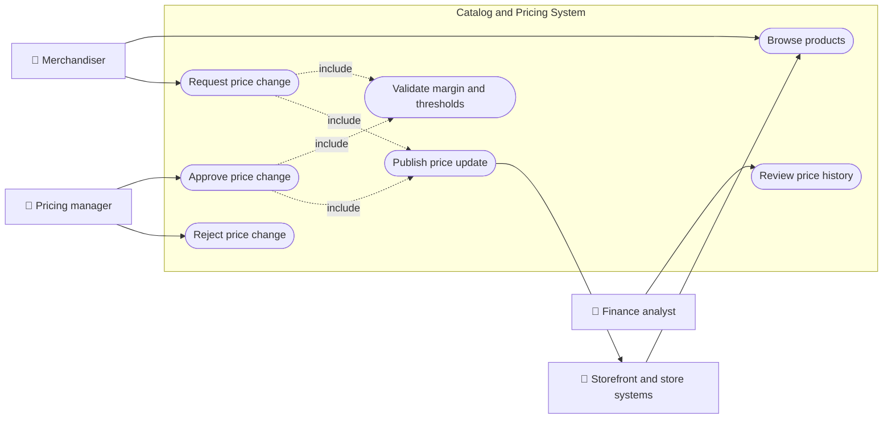
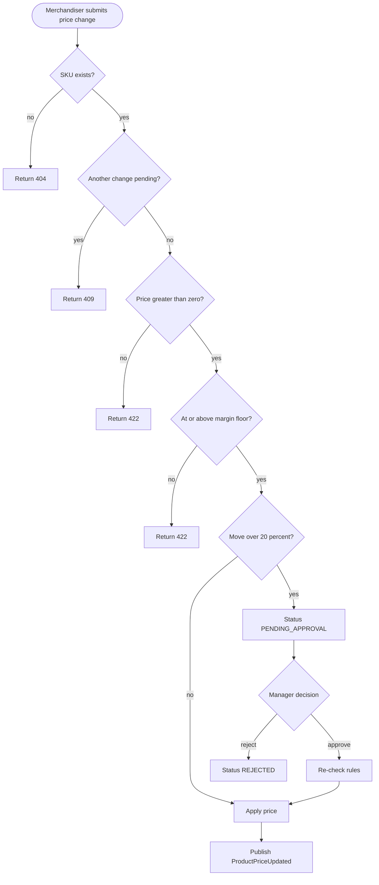
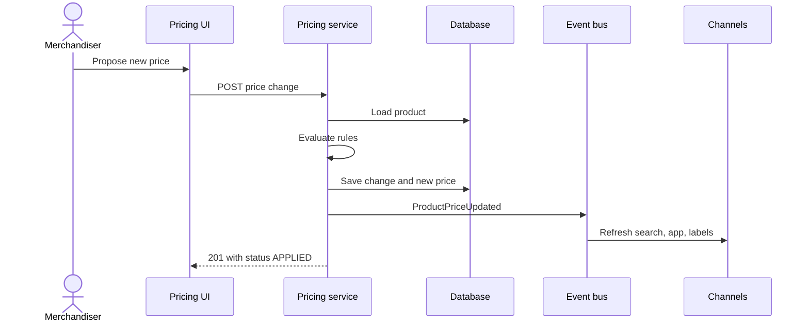
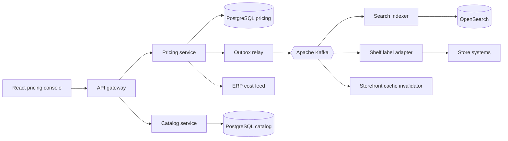
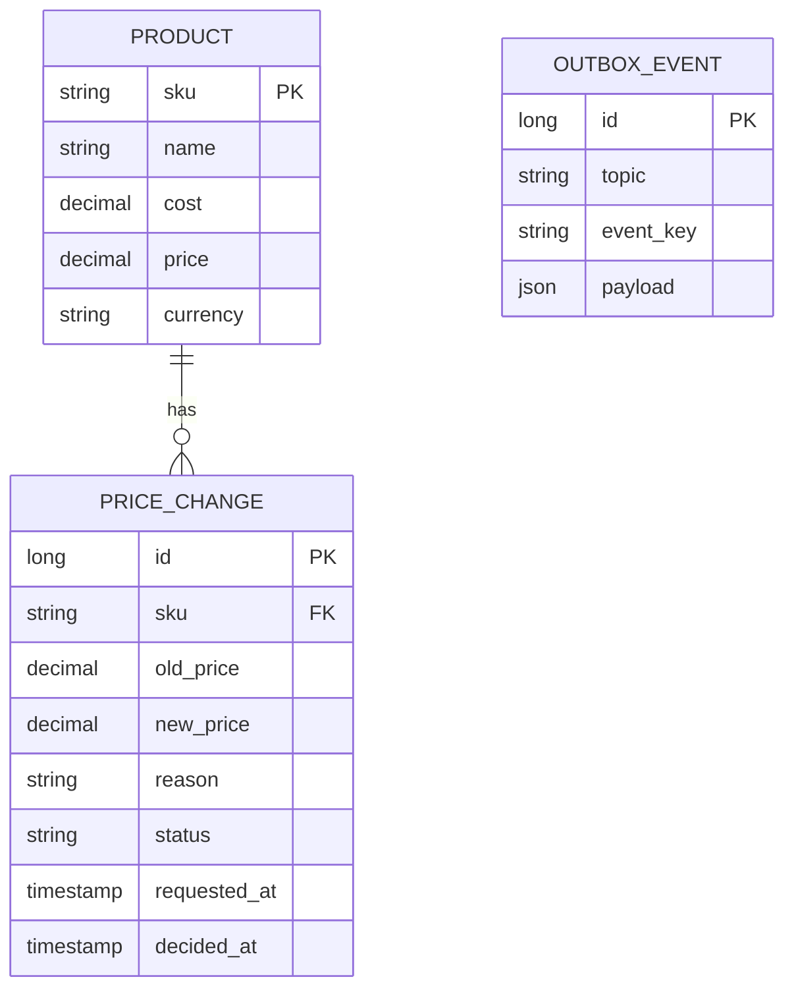
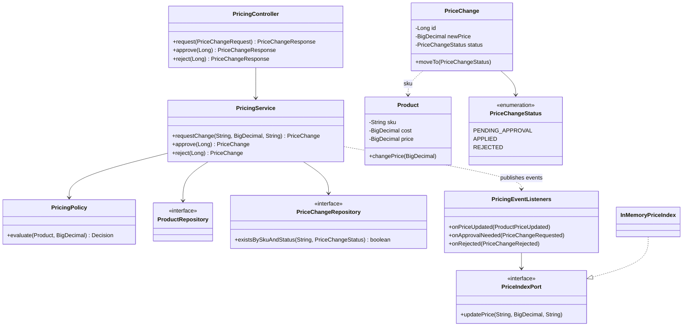
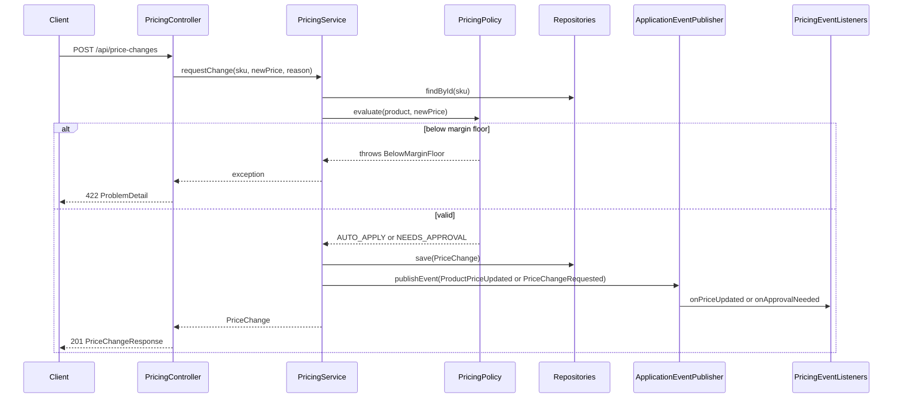
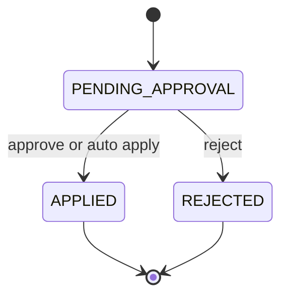
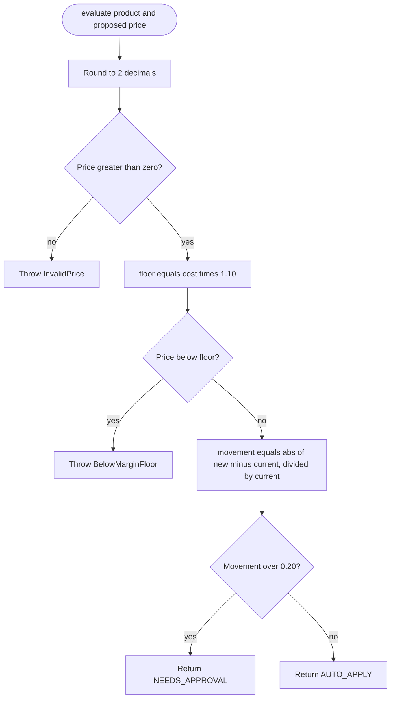

# Product Catalog and Pricing

> **Domain:** Retail · **Author:** [@dhulipalla599](https://github.com/dhulipalla599) · **Published:** October 15, 2026

> **Runnable code:** [`examples/retail/product-catalog-and-pricing`](https://github.com/dhulipalla599/domain-knowledge-engineering/tree/main/examples/retail/product-catalog-and-pricing)

## Explain It Like I'm Five

Imagine a lemonade stand with a big board that lists every drink and its price. Before you change a price on the board, you check two things: "Will I still make a little money on this cup?" and "Is this a big jump that my big sister should look at first?" Small changes you make yourself. Big changes wait until she says yes. Once the board is updated, you tell everyone walking by so nobody pays the old price by mistake.

A retailer does the same thing with thousands of products: the catalog is the board, pricing is the careful rule-following for changing it, and everyone (website, stores, apps) must see the same price.

## Business Overview

The **product catalog** is the master record of what a retailer sells: identifiers (SKU), names, descriptions, categories, images, attributes, and the relationships between them (variants, bundles). **Pricing** decides how much each item costs a customer, when, and where: base price, promotions, channel or store-specific prices, and the rules that keep prices sensible.

Why the business cares:

- **Revenue and margin:** a price that is too low gives away margin; too high loses sales. A single typo (for example 9.99 entered as 0.99) can sell thousands of units at a loss within minutes.
- **Customer experience:** the shelf, website and app must agree. Mismatched prices create complaints and abandoned baskets.
- **Regulation and risk:** many jurisdictions have rules on price display, "was/now" reference prices, unit pricing and tax-inclusive display. The details differ by country and region, so confirm them with your legal team rather than assuming one universal rule.
- **Speed:** merchandisers want to react to supplier cost changes and competitors quickly, but with control.

In the Retail value chain, the catalog and pricing sit between **sourcing/merchandising** (which decides what to sell and at what cost) and the **selling channels** (e-commerce, stores, marketplaces), and feed **checkout, promotions, inventory and analytics**.

## Real-World Example

Northwind Outfitters (fictional) sells outdoor gear online and in 40 stores. Maya Okafor, a merchandiser, sees that the supplier cost of the "Camping Headlamp" (SKU-1004) is 9.80 USD and it sells for 29.99 USD.

1. Maya wants a clearance price of 10.00 USD. She submits the change in the pricing tool.
2. The system checks the margin rule: the company requires at least 10% margin over cost, so the floor is 10.78 USD. The request is **rejected** with a clear message.
3. Maya revises to 22.00 USD. That is a drop of about 27%, above the 20% threshold, so the change goes to **Pending approval**.
4. Tom Brennan, the pricing manager, reviews it, confirms it is for a planned clearance, and approves.
5. The price is applied, and a "product price updated" event goes out. The website search index, store shelf-label system and mobile app cache all update.
6. A day later, Maya asks for a 5% bump on another item. That is under the threshold, so it applies immediately with no manager involved.

## Stakeholders

| Stakeholder | What they need | What they fear |
|---|---|---|
| Merchandiser | Fast, safe price changes and a clear reason when one is refused | Waiting days for approval; losing a sale window |
| Pricing manager | Visibility and control over large or risky changes | Margin leakage; unreviewed mistakes going live |
| Finance / margin owner | Prices that protect margin and audit history | Selling below cost; unexplained price movements |
| Store operations | Shelf labels that match the system on time | Customers arguing at the till over a stale label |
| E-commerce / channel teams | One consistent price across web, app and marketplaces | Cache or index showing an old price |
| Customer | A correct, consistent price | Being charged more than the advertised price |
| Compliance / legal | Accurate price display and reference-price history | Fines or complaints about misleading prices |

## Use Case Diagram



| Use Case | Primary Actor | Goal | Main success outcome |
|---|---|---|---|
| Browse products | Merchandiser | Find a SKU and see its cost and price | Product details returned |
| Request price change | Merchandiser | Propose a new price with a reason | Change applied or queued for approval |
| Validate margin and thresholds | System (included) | Protect margin and flag big moves | Decision: auto-apply, needs approval, or rejected |
| Approve price change | Pricing manager | Release a flagged change | Price applied and change marked APPLIED |
| Reject price change | Pricing manager | Stop an unwanted change | Change marked REJECTED, price unchanged |
| Publish price update | System | Tell channels about the new price | `ProductPriceUpdated` event emitted |
| Review price history | Finance analyst | Audit who changed what and why | Ordered list of changes with status |

## Key Terms

| Term | Plain-English meaning |
|---|---|
| SKU | Stock keeping unit: the unique ID of a sellable item (often a specific size and color) |
| Base price | The regular selling price before promotions |
| Cost | What the retailer pays the supplier (landed cost may add freight and duties) |
| Margin | Selling price minus cost, often shown as a percentage |
| Markdown | A permanent or planned price reduction |
| Promotion | A time-limited discount or offer layered on the base price |
| Price list | A set of prices for a context, such as a channel, region or customer group |
| MAP / MSRP | Minimum advertised price / manufacturer's suggested retail price, set or suggested by a brand |
| Price floor | The lowest price the business allows, here derived from cost plus minimum margin |
| Effective date | When a price takes effect (not covered in the example, which applies immediately) |
| Reference price | The "was" price shown next to a sale price; often regulated |
| Catalog sync | Distributing product and price data to search, storefront and stores |

## Process Flow

A merchandiser submits a price change for a SKU. The system loads the current product, checks that no other change is already pending, and runs the rules: the price must be positive, must respect the margin floor, and, if the move is larger than the approval threshold, must be approved by a pricing manager. Small valid changes are applied straight away. Large ones wait. When a change is applied, a price-updated event lets every channel refresh.





## Business Rules and Edge Cases

- **Money is decimal, never floating point.** Use `BigDecimal` (Java) or `NUMERIC` in the database, and round explicitly (the example uses two decimals, half-up). Currency-specific minor units differ (for example JPY has none).
- **Margin floor:** price must be at least cost times (1 + minimum margin). The percentage is a company policy, not a law.
- **Approval threshold:** large moves, in either direction, need review. Increases matter too (price gouging concerns, customer trust).
- **One pending change per SKU:** otherwise two reviewers can approve conflicting prices. Concurrent submissions should be handled with a database constraint or optimistic locking, not only an application check.
- **Re-validate on approval:** costs can change while a request waits, so the floor is checked again when the manager approves.
- **Idempotency and replays:** approving an already-applied change must not apply it twice. The example returns 409 for illegal state transitions.
- **Partial failure:** the database update and the event must not drift apart. In production use a transactional outbox so a price is never saved without its event (or published without being saved).
- **Timing and scale:** scheduled prices, promotions overlapping base price changes, time zones for store opening, and bulk imports of thousands of rows are common sources of bugs. They are outside the small example but matter in real systems.
- **Compliance:** rules for reference prices, tax-inclusive display and unit pricing vary by country. Keep an audit trail of every change.

## From Business to System

| Business concept / step | System component | Data entity | Event |
|---|---|---|---|
| Product in the catalog | Catalog service | `product` | `retail.product.created` (outside the example) |
| Request a price change | Pricing service (`PricingService.requestChange`) | `price_change` | `retail.price-change.requested` |
| Margin and threshold checks | `PricingPolicy` | `product.cost`, `product.price` | none |
| Approval by pricing manager | Pricing service (`approve`, `reject`) | `price_change.status` | `retail.price-change.rejected` on rejection |
| Apply the new price | Pricing service | `product.price`, `price_change` | `retail.product-price.updated` |
| Update storefront search | Search indexer consumer | search index document | consumes `retail.product-price.updated` |
| Audit price history | Pricing service read API | `price_change`, `price_audit` | none |

## Architecture



**Service boundaries.** The *catalog* service owns descriptive product data (names, images, attributes), which changes often and is read-heavy. The *pricing* service owns costs, prices and the approval workflow, which have stricter audit and consistency needs and different access (only pricing roles can change prices). Downstream consumers (search, labels, caches) are decoupled through Kafka so a slow store system never blocks a price change. The ERP supplies cost data; the pricing service never trusts the UI for cost.

## Data Model

```sql
CREATE TABLE product (
    sku        VARCHAR(40) PRIMARY KEY,
    name       VARCHAR(200) NOT NULL,
    cost       NUMERIC(12,2) NOT NULL CHECK (cost >= 0),
    price      NUMERIC(12,2) NOT NULL CHECK (price > 0),
    currency   CHAR(3) NOT NULL,
    version    BIGINT NOT NULL DEFAULT 0
);

CREATE TABLE price_change (
    id           BIGSERIAL PRIMARY KEY,
    sku          VARCHAR(40) NOT NULL REFERENCES product(sku),
    old_price    NUMERIC(12,2) NOT NULL,
    new_price    NUMERIC(12,2) NOT NULL CHECK (new_price > 0),
    reason       VARCHAR(500) NOT NULL,
    status       VARCHAR(20) NOT NULL CHECK (status IN ('PENDING_APPROVAL','APPLIED','REJECTED')),
    requested_by VARCHAR(100),
    requested_at TIMESTAMPTZ NOT NULL DEFAULT now(),
    decided_at   TIMESTAMPTZ
);

-- At most one pending change per SKU, enforced by the database.
CREATE UNIQUE INDEX one_pending_per_sku ON price_change (sku) WHERE status = 'PENDING_APPROVAL';

CREATE TABLE outbox_event (
    id         BIGSERIAL PRIMARY KEY,
    topic      VARCHAR(100) NOT NULL,
    event_key  VARCHAR(100) NOT NULL,
    payload    JSONB NOT NULL,
    created_at TIMESTAMPTZ NOT NULL DEFAULT now(),
    sent_at    TIMESTAMPTZ
);
```



The example project creates only `product` and `price_change` (via JPA on H2). The outbox and the partial unique index are the production additions.

## APIs

| Method | Path | Purpose |
|---|---|---|
| GET | `/api/products` | List products |
| GET | `/api/products/{sku}` | Get one product with cost and price |
| POST | `/api/price-changes` | Request a price change |
| POST | `/api/price-changes/{id}/approve` | Approve a pending change |
| POST | `/api/price-changes/{id}/reject` | Reject a pending change |
| GET | `/api/price-changes` | List price changes |

Request `POST /api/price-changes`:

```json
{ "sku": "SKU-1002", "newPrice": 12.00, "reason": "Promo" }
```

Response `201 Created`:

```json
{ "id": 2, "sku": "SKU-1002", "oldPrice": 18.00, "newPrice": 12.00, "status": "PENDING_APPROVAL", "reason": "Promo" }
```

Rule violations return RFC 9457 `ProblemDetail` bodies: 404 unknown SKU, 422 invalid price or below margin floor, 409 pending change exists or illegal state transition.

## Events

| Event (Kafka topic) | Producer | Consumers | Key fields |
|---|---|---|---|
| `retail.price-change.requested` | Pricing service | Notification service (alerts the pricing manager) | `changeId`, `sku`, `oldPrice`, `newPrice` |
| `retail.price-change.rejected` | Pricing service | Notification service, analytics | `changeId`, `sku` |
| `retail.product-price.updated` | Pricing service | Search indexer, shelf labels, storefront cache, analytics | `sku`, `oldPrice`, `newPrice`, `currency` |

**Ordering:** use the `sku` as the Kafka message key so all events for one SKU land in one partition and stay in order. **Idempotency:** consumers should set state ("price is X") rather than apply deltas, and ignore events older than what they already hold (compare a version or timestamp). Producers should use a transactional outbox so the database change and the event cannot diverge. Delivery is at-least-once, so duplicates will happen.

## Backend Implementation

> The Java tab is the exact code from the runnable example (Spring Boot 3). The Python tab uses FastAPI with SQLAlchemy and the Node.js tab uses Express with TypeScript.

Full source: [`examples/retail/product-catalog-and-pricing`](https://github.com/dhulipalla599/domain-knowledge-engineering/tree/main/examples/retail/product-catalog-and-pricing/src/main/java/com/dke/retail/product_catalog_and_pricing).

### The business rule: margin floor and approval threshold

=== "Java"

    ```java
    public Decision evaluate(Product product, BigDecimal proposed) {
        BigDecimal newPrice = proposed.setScale(2, RoundingMode.HALF_UP);
        if (newPrice.signum() <= 0) {
            throw new PricingException.InvalidPrice("Price must be greater than zero");
        }
        BigDecimal floor = product.getCost().multiply(BigDecimal.ONE.add(MIN_MARGIN)).setScale(2, RoundingMode.HALF_UP);
        if (newPrice.compareTo(floor) < 0) {
            throw new PricingException.BelowMarginFloor(
                    "Price " + newPrice + " is below the margin floor " + floor + " for " + product.getSku());
        }
        BigDecimal movement = newPrice.subtract(product.getPrice()).abs()
                .divide(product.getPrice(), 4, RoundingMode.HALF_UP);
        return movement.compareTo(APPROVAL_THRESHOLD) > 0 ? Decision.NEEDS_APPROVAL : Decision.AUTO_APPLY;
    }
    ```

=== "Python"

    ```python
    from decimal import Decimal, ROUND_HALF_UP

    MIN_MARGIN = Decimal("0.10")
    APPROVAL_THRESHOLD = Decimal("0.20")
    TWO = Decimal("0.01")

    def evaluate(product, proposed: Decimal) -> str:
        new_price = proposed.quantize(TWO, ROUND_HALF_UP)
        if new_price <= 0:
            raise InvalidPrice("Price must be greater than zero")
        floor = (product.cost * (1 + MIN_MARGIN)).quantize(TWO, ROUND_HALF_UP)
        if new_price < floor:
            raise BelowMarginFloor(f"Price {new_price} is below the margin floor {floor} for {product.sku}")
        movement = (abs(new_price - product.price) / product.price).quantize(Decimal("0.0001"), ROUND_HALF_UP)
        return "NEEDS_APPROVAL" if movement > APPROVAL_THRESHOLD else "AUTO_APPLY"
    ```

=== "Node.js"

    ```typescript
    import Decimal from "decimal.js";

    const MIN_MARGIN = new Decimal("0.10");
    const APPROVAL_THRESHOLD = new Decimal("0.20");

    export function evaluate(product: Product, proposed: Decimal): "AUTO_APPLY" | "NEEDS_APPROVAL" {
      const newPrice = proposed.toDecimalPlaces(2, Decimal.ROUND_HALF_UP);
      if (newPrice.lte(0)) throw new InvalidPrice("Price must be greater than zero");
      const floor = product.cost.mul(MIN_MARGIN.plus(1)).toDecimalPlaces(2, Decimal.ROUND_HALF_UP);
      if (newPrice.lt(floor)) {
        throw new BelowMarginFloor(`Price ${newPrice} is below the margin floor ${floor} for ${product.sku}`);
      }
      const movement = newPrice.minus(product.price).abs().div(product.price).toDecimalPlaces(4, Decimal.ROUND_HALF_UP);
      return movement.gt(APPROVAL_THRESHOLD) ? "NEEDS_APPROVAL" : "AUTO_APPLY";
    }
    ```

### The controller endpoint

=== "Java"

    ```java
    @PostMapping("/price-changes")
    @ResponseStatus(HttpStatus.CREATED)
    public PriceChangeResponse request(@Valid @RequestBody PriceChangeRequest request) {
        return PriceChangeResponse.from(service.requestChange(request.sku(), request.newPrice(), request.reason()));
    }
    ```

=== "Python"

    ```python
    @router.post("/api/price-changes", status_code=201)
    def request_change(body: PriceChangeRequest, service: PricingService = Depends(get_service)):
        return PriceChangeResponse.from_entity(service.request_change(body.sku, body.new_price, body.reason))
    ```

=== "Node.js"

    ```typescript
    router.post("/api/price-changes", async (req, res) => {
      const body = PriceChangeRequest.parse(req.body);
      const change = await service.requestChange(body.sku, new Decimal(body.newPrice), body.reason);
      res.status(201).json(toResponse(change));
    });
    ```

## Frontend Screen

```tsx
import { useEffect, useState } from "react";

type PriceChange = { id: number; sku: string; oldPrice: number; newPrice: number; status: string; reason: string };

export function PriceChangeConsole() {
  const [changes, setChanges] = useState<PriceChange[]>([]);
  const [sku, setSku] = useState("");
  const [newPrice, setNewPrice] = useState("");
  const [reason, setReason] = useState("");
  const [error, setError] = useState<string | null>(null);

  const load = () => fetch("/api/price-changes").then(r => r.json()).then(setChanges);
  useEffect(() => { load(); }, []);

  async function submit(e: React.FormEvent) {
    e.preventDefault();
    setError(null);
    const res = await fetch("/api/price-changes", {
      method: "POST",
      headers: { "Content-Type": "application/json" },
      body: JSON.stringify({ sku, newPrice: Number(newPrice), reason }),
    });
    if (!res.ok) setError((await res.json()).detail ?? "Request failed");
    else load();
  }

  async function decide(id: number, action: "approve" | "reject") {
    await fetch(`/api/price-changes/${id}/${action}`, { method: "POST" });
    load();
  }

  return (
    <section>
      <h2>Price changes</h2>
      <form onSubmit={submit}>
        <input value={sku} onChange={e => setSku(e.target.value)} placeholder="SKU" required />
        <input value={newPrice} onChange={e => setNewPrice(e.target.value)} placeholder="New price" type="number" step="0.01" required />
        <input value={reason} onChange={e => setReason(e.target.value)} placeholder="Reason" required />
        <button type="submit">Request change</button>
      </form>
      {error && <p role="alert">{error}</p>}
      <table>
        <thead><tr><th>SKU</th><th>Old</th><th>New</th><th>Status</th><th /></tr></thead>
        <tbody>
          {changes.map(c => (
            <tr key={c.id}>
              <td>{c.sku}</td><td>{c.oldPrice}</td><td>{c.newPrice}</td><td>{c.status}</td>
              <td>
                {c.status === "PENDING_APPROVAL" && (
                  <>
                    <button onClick={() => decide(c.id, "approve")}>Approve</button>
                    <button onClick={() => decide(c.id, "reject")}>Reject</button>
                  </>
                )}
              </td>
            </tr>
          ))}
        </tbody>
      </table>
    </section>
  );
}
```

In a real console, the approve and reject buttons only appear for users with the pricing-manager role, and the server enforces that too.

## Cloud Deployment

Services run as containers on **Amazon EKS**, fronted by an Application Load Balancer. Typical managed services: **Amazon RDS for PostgreSQL** (pricing and catalog databases), **Amazon MSK** (Kafka), **Amazon OpenSearch Service** (storefront search), **AWS Secrets Manager** (credentials), **Amazon ECR** (images), and **Amazon Cognito** or the company IdP for sign-in.

```hcl
resource "aws_db_instance" "pricing" {
  identifier                  = "pricing-db"
  engine                      = "postgres"
  engine_version              = "16"
  instance_class              = "db.m6g.large"
  allocated_storage           = 100
  multi_az                    = true
  storage_encrypted           = true
  backup_retention_period     = 14
  manage_master_user_password = true
  db_subnet_group_name        = aws_db_subnet_group.data.name
  vpc_security_group_ids      = [aws_security_group.pricing_db.id]
  deletion_protection         = true
}
```

- **Security:** private subnets for pods and databases, security groups that allow the database only from the pricing service, IAM roles for service accounts (IRSA), TLS everywhere, encryption at rest, and role-based access so only pricing managers can approve.
- **Scaling:** horizontal pod autoscaling on CPU or request rate for the read-heavy catalog API; the pricing service is write-light. Kafka consumers scale up to the partition count.
- **Observability:** instrument with OpenTelemetry (traces across API, database and Kafka), export to CloudWatch (via the AWS Distro for OpenTelemetry collector), and alarm on error rate, outbox lag and consumer lag.

## Non-Functional Requirements

| Area | Expectation | How the design meets it |
|---|---|---|
| Availability | Reads (browse, checkout price lookup) should stay up even if the pricing console is down | Separate read paths; multi-AZ database; channels hold their own price copy fed by events |
| Latency | Price lookups at checkout in tens of milliseconds | Prices cached in search/storefront stores, not fetched from the pricing database per request |
| Consistency | A price change is atomic; channels converge quickly | Single database transaction plus outbox; idempotent consumers; eventual consistency measured as event lag |
| Audit | Who changed what, when, why | Immutable `price_change` rows with requester, decision time and reason |
| Compliance | Support price-display and reference-price rules in each market | Keep history, make rules configurable per market, involve legal for local requirements |
| Security | Only authorized roles change prices | Role checks on the API, separation between requester and approver |

## Runnable Example

The example implements the core flow: a merchandiser requests a price change; the service enforces the margin floor and the 20% approval threshold; small changes apply immediately, large ones wait for approval; each outcome publishes an event consumed by an in-memory search index stub. It runs on H2 with seeded products and needs no external services.

Source: [`examples/retail/product-catalog-and-pricing`](https://github.com/dhulipalla599/domain-knowledge-engineering/tree/main/examples/retail/product-catalog-and-pricing)

```bash
cd examples/retail/product-catalog-and-pricing
mvn spring-boot:run     # http://localhost:8080
mvn verify              # build and run tests
```

Apply a small change:

```bash
curl -s -XPOST localhost:8080/api/price-changes -H 'Content-Type: application/json' \
  -d '{"sku":"SKU-1001","newPrice":84.00,"reason":"Seasonal adjustment"}'
# {"id":1,"sku":"SKU-1001","oldPrice":79.99,"newPrice":84.00,"status":"APPLIED","reason":"Seasonal adjustment"}
```

Violate the margin rule:

```bash
curl -s -XPOST localhost:8080/api/price-changes -H 'Content-Type: application/json' \
  -d '{"sku":"SKU-1004","newPrice":10.00,"reason":"Clearance"}'
# {"type":"about:blank","title":"Unprocessable Entity","status":422,"detail":"Price 10.00 is below the margin floor 10.78 for SKU-1004","instance":"/api/price-changes"}
```

| Class | Package | Responsibility |
|---|---|---|
| `ProductCatalogAndPricingApplication` | root | Spring Boot entry point |
| `Product` | domain | Entity with cost and current price |
| `PriceChange` | domain | Entity; `moveTo` enforces legal transitions |
| `PriceChangeStatus` | domain | Lifecycle enum with `allowedNext` |
| `PricingEvents` | domain | Event records named after Kafka topics |
| `ProductRepository` | repository | JPA access to products |
| `PriceChangeRepository` | repository | JPA access to changes; pending check |
| `PricingPolicy` | service | Margin floor and approval threshold rules |
| `PricingService` | service | Orchestrates request, approve, reject; publishes events |
| `PricingException` | service | Business-rule error types |
| `PricingController` | api | REST endpoints |
| `ApiExceptionHandler` | api | Maps errors to `ProblemDetail` |
| `PriceChangeRequest`, `PriceChangeResponse`, `ProductResponse` | api | Request and response records |
| `PricingEventListeners` | integration | `@EventListener` consumers (Kafka stand-ins) |
| `PriceIndexPort`, `InMemoryPriceIndex` | integration | Search index port and stub adapter |

## UML Diagrams

### Class Diagram

The controller calls the service, which uses the policy, repositories and the event publisher. Listeners react to events and call the index port.



### Sequence Diagram (control flow)

One `POST /api/price-changes` request through the code. A rule violation throws and the exception handler turns it into a 422.



### State Diagram

A change starts as `PENDING_APPROVAL`. `moveTo` allows only `APPLIED` or `REJECTED` from there; both are terminal. In the code, an automatically applied change is saved as pending and moved to `APPLIED` within the same transaction.



### Activity Diagram

Decision logic inside `PricingPolicy.evaluate`.



## AI Opportunities

1. **Demand-based price recommendations.** Use history of sales, seasonality, inventory and competitor prices to suggest prices. Risk: optimizing blindly can erode trust or create unfair or discriminatory pricing; keep humans approving, log the inputs behind each suggestion, and review against company and local fair-pricing rules.
2. **Anomaly detection on price changes.** Flag changes that look like typos (for example a 90% drop) or deviate from similar SKUs before they go live. Data: price-change history and category norms. Risk: false positives slow merchandisers; false negatives miss mistakes. Treat it as an extra check on top of the hard rules, never a replacement.
3. **LLM-assisted catalog enrichment.** Generate or clean product titles, descriptions and attributes from supplier data and images. Risk: hallucinated specifications (for example wrong size or material); require human review for sensitive categories and validate against supplier data.
4. **Product matching for competitor monitoring.** Match your SKUs to competitor listings using embeddings. Data: titles, images, identifiers such as GTIN. Risk: wrong matches lead to wrong price moves; use confidence thresholds and sampling reviews. Check legal rules on collecting competitor data.
5. **Natural-language search over price history.** Let finance ask "which items dropped over 20% last quarter and why?" Risk: wrong answers in an audit setting; generate queries against the audited tables and show the underlying rows.

## Common Pitfalls

- **Using `double` for money.** Use decimal types and explicit rounding.
- **Checking only in the UI.** Validate margin and approvals on the server; the UI is not a security boundary.
- **Checking "one pending change" only in code.** Races let two through. Back it with a unique partial index.
- **Skipping re-validation on approval.** Costs or rules may have changed while the request waited.
- **Saving the price and publishing the event separately.** Use a transactional outbox, or channels drift from the source of truth.
- **Treating events as exactly-once.** Make consumers idempotent and key by SKU for ordering.
- **Mixing catalog and price ownership.** Descriptive data and prices have different owners, change rates and audit needs.
- **Ignoring currencies and locales.** Minor units, tax-inclusive display and rounding differ by market.
- **Overwriting history.** Keep every change for audit and for reference-price rules.

## Interview Questions

### Junior

1. **Why should money never be stored as a floating-point number?**
   Binary floating point cannot represent many decimal fractions exactly (0.1 for instance), so sums and comparisons drift. Use `BigDecimal` or `NUMERIC` with an explicit scale and rounding mode.
2. **What is a SKU and how does it differ from a product?**
   A SKU is the unique ID of a specific sellable variant (for example shoe model X, size 42, blue). A "product" can be a family of several SKUs sharing a description.
3. **Why does the example reject a price below cost plus 10%?**
   It is a margin floor policy to stop accidental or reckless underpricing. The percentage is a business choice and is configurable in real systems.

### Mid-Level

1. **How would you stop two concurrent requests from creating two pending changes for one SKU?**
   Enforce it in the database with a partial unique index on `sku` where status is pending, plus optimistic locking on the product row. Handle the constraint violation as a 409. An in-code check alone has a race.
2. **Why re-run the rules when a manager approves?**
   Cost or policy may have changed since the request; approving a stale change could break the margin floor.
3. **How do you keep the database and Kafka consistent when a price is applied?**
   Write the event to an outbox table in the same transaction, and have a relay publish it to Kafka and mark it sent. Consumers must be idempotent because delivery is at-least-once.

### Senior / Architect

1. **Design the system so thousands of stores and channels see a new price within seconds, even when some are offline.** Key points: event-driven fan-out with SKU keys for ordering; each channel keeps a local copy and a version; replay/backfill from a snapshot after outages; monitor lag per consumer; define what "price at the moment of sale" means for in-flight baskets.
2. **How would you support scheduled prices, promotions and per-market prices without making the rules unmanageable?** Key points: separate base price, price lists and promotions with clear precedence; effective-dated records; deterministic resolution function that is testable and explainable; store the resolved price on the order line; per-market rule configuration; audit trail.
3. **Trade-offs between a central pricing service that channels call at checkout and pushing prices out through events?** Key points: latency and availability (central call adds a dependency), consistency (push is eventually consistent), cache invalidation and reconciliation, blast radius of a bad price, cost of a hot path, and the option of a hybrid where checkout verifies against a local read model with a fallback.

## Further Learning

- GS1 standards (GTIN, GDSN) for product identification and data sharing
- Schema.org `Product` and `Offer` for structured product data
- Retail pricing strategies: cost-plus, competitive, dynamic and promotional pricing
- Product Information Management (PIM) systems and master data management
- Transactional outbox and change data capture patterns
- Apache Kafka partitioning, ordering and exactly-once semantics
- Local price display and consumer protection rules in your target markets
- Optimistic locking and idempotency keys in REST APIs

## Practitioner Notes

> _Reviewer: add real-world experience, corrections or gotchas here before approving._
