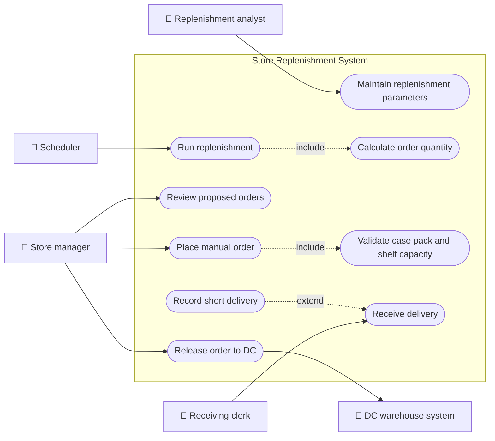
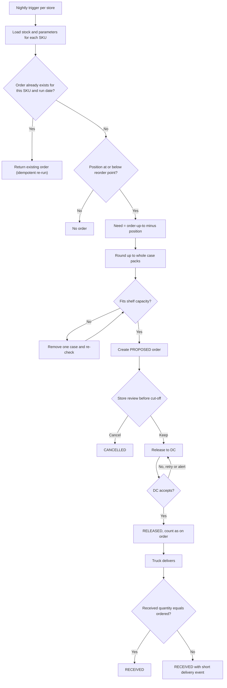
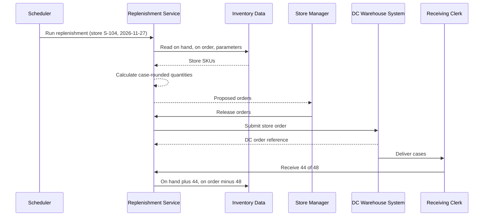
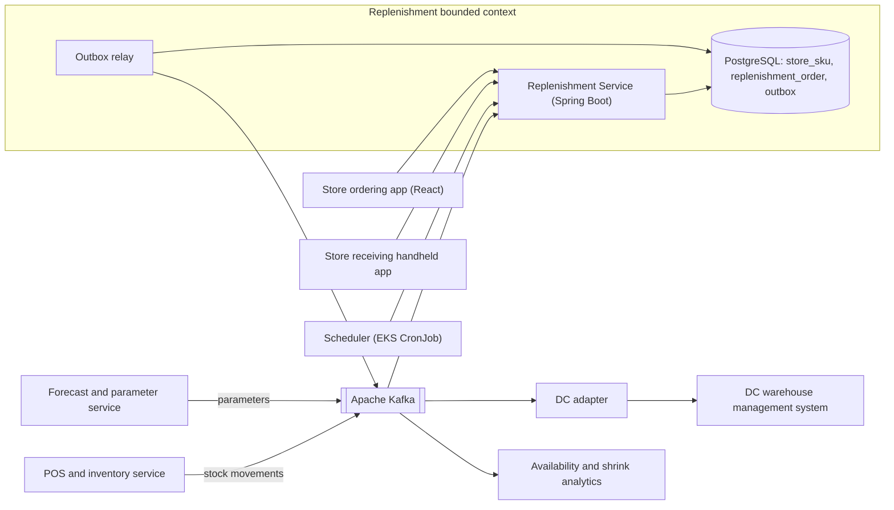
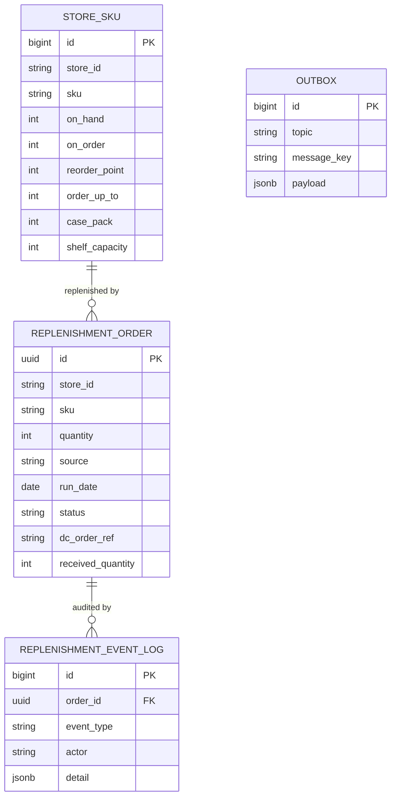
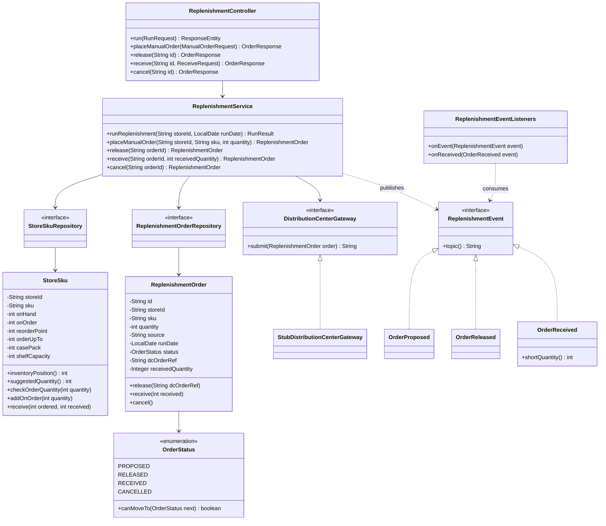
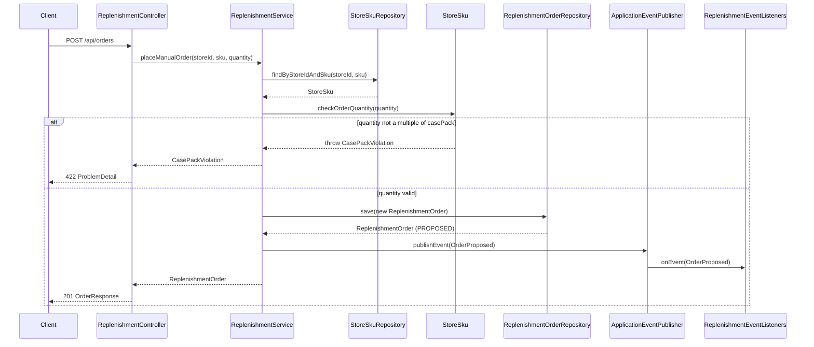
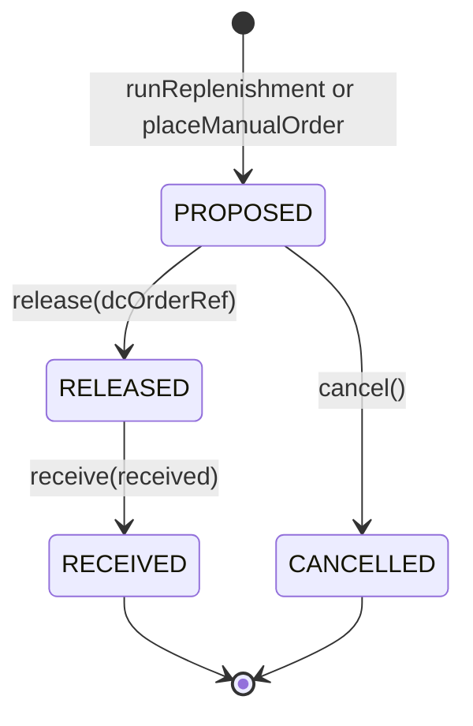
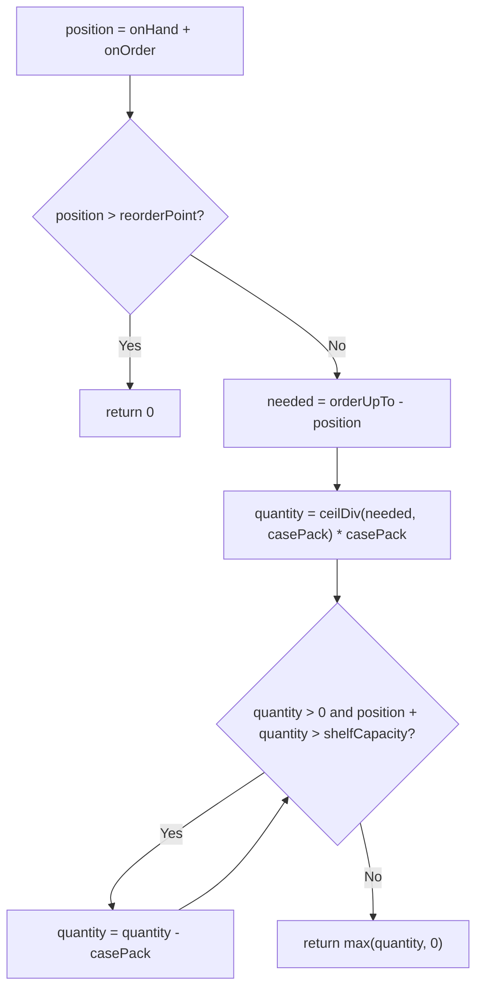

# Store Replenishment

> **Domain:** Retail · **Author:** [@naveenks720](https://github.com/naveenks720) · **Published:** November 27, 2026

> **Runnable code:** [`examples/retail/store-replenishment`](https://github.com/dhulipalla599/domain-knowledge-engineering/tree/main/examples/retail/store-replenishment)

## Explain It Like I'm Five

Think about the fruit bowl in your kitchen. Every evening a grown-up looks at it and thinks, "There are only two apples left, and we eat about four a day." So they write "apples" on the shopping list, but not 37 apples, because the bowl only holds ten and the shop sells them in bags of six. Tomorrow the bag arrives, the bowl fills up, and nobody has to go without a snack. If they forget to check, the bowl is empty at breakfast; if they buy too much, the apples go brown before anyone eats them.

Store replenishment is that evening check, done every day for tens of thousands of products in hundreds of shops, deciding how much each shop needs from the warehouse so the shelves are full but not overflowing.

## Business Overview

**Store replenishment** is the process that decides, for every product (SKU) in every store, *whether* to send more stock from a distribution center (DC) or supplier, *how much*, and *when*, then follows the order until it is received at the store.

Most retailers run it as a nightly or intra-day batch:

1. Take the store's **inventory position**: stock on hand plus stock already on its way (on order). Some retailers also subtract allocated or damaged stock.
2. Compare it with replenishment parameters such as a **reorder point** (when to order) and an **order-up-to level** or presentation stock (how full the shelf should be). These are often set from a demand forecast, the lead time from the DC and a target service level.
3. Round the need to the **pack size** the DC ships (case, inner pack or each), respect **shelf capacity** and delivery schedules, and create a **store order**.
4. Release the orders to the DC before its **order cut-off**, pick, ship, and receive at the store.

Why the business cares:

- **Revenue and customer experience:** an empty shelf (out-of-stock) is a lost sale and a reason to shop elsewhere. On-shelf availability is one of the most watched store metrics.
- **Working capital and waste:** too much stock ties up cash, clogs the backroom and, for fresh food, ends up as markdowns or waste.
- **Labour:** every case delivered must be unloaded and put on a shelf. Over-ordering creates backroom overflow and extra handling; uneven orders make DC and store labour hard to plan.
- **Transport cost:** orders are consolidated into scheduled truck deliveries, so quantities and timing affect truck fill.

Where it sits in the Retail value chain: **demand forecasting** and **assortment/space planning** feed it parameters; **inventory management** gives it the current stock; it produces **store orders** for the **DC (warehouse management system)**, which in turn drives **supplier purchase orders** and **transport planning**. Store receiving closes the loop and updates stock. Some retailers use direct store delivery (DSD) from suppliers for categories such as bread, drinks or snacks instead of the DC; the decision logic is similar, the fulfilment partner is different.

## Real-World Example

**Harbourline Markets** (fictional) runs 140 grocery stores supplied by two distribution centers. Store **S-104 Maple Grove** gets a truck from **DC East** every morning; DC East's order cut-off is 22:00 the night before.

1. **Monday 20:30 — snapshot.** Point-of-sale sales for the day have posted. The store has **18** cartons of 2-litre milk (`MILK-2L`) on the shelf and nothing on order. Its parameters, set by the replenishment analyst **Priya Natarajan**, are: reorder point **24**, order-up-to **60**, case pack **12**, shelf capacity **72**.
2. **20:45 — replenishment run.** The position (18) is at or below the reorder point (24), so the engine needs 60 − 18 = 42 cartons. The DC only ships whole cases of 12, so it rounds up to **48** (4 cases). 18 + 48 = 66 fits the 72-carton shelf, so the proposal stands. The same run finds eggs (`EGGS-12`) at 5 with a 15-dozen case: rounding up to 45 would push the position to 50, over the 40-dozen shelf, so it backs off to **30** (2 cases).
3. **21:00 — store review.** Store manager **Tomás Reyes** sees the proposals on the order screen. He knows the local school has a bake sale on Wednesday and tries to add 20 extra dozen eggs. The system rejects it: eggs ship in cases of 15. He changes it to 15.
4. **21:30 — release.** The orders are released to DC East's warehouse management system, which returns reference `DC-EAST-1001`. Milk on order is now 48, so tomorrow's run will not order milk again.
5. **Tuesday 06:10 — delivery and receiving.** The truck arrives. The receiving clerk scans **44** cartons: one case was damaged in transit. The order is closed with a short delivery of 4; on hand becomes 62, on order 0. The shortage event goes to the DC's claims team and to the forecasting team so it does not look like demand.
6. **Tuesday 20:45 — next run.** Milk sits at 62 minus the day's sales. If it is still above 24 nothing is ordered; the cycle repeats daily.

## Stakeholders

| Stakeholder | What they need | What they fear |
|---|---|---|
| Store manager | Full shelves, orders that fit the backroom and the delivery slot, the ability to override for local events | Empty shelves at peak, backroom piled with cases nobody can put away |
| Replenishment analyst | Correct parameters per store and SKU, clear exception lists, explainable order quantities | A bad parameter silently over-ordering across 140 stores |
| DC operations (warehouse) | Store orders before cut-off, in whole packs, predictable volumes for labour planning | Late or duplicated orders, orders for items not in stock at the DC |
| Store receiving clerk | Accurate delivery notes, fast check-in, a simple way to record shorts and damages | Stock booked as received that never arrived, which breaks the next run |
| Category manager / merchandising | Availability during promotions and new launches | Lost promotion sales, markdowns from overstock |
| Finance | Inventory held within budget, accurate valuation and shrink figures | Excess stock and write-offs |
| Customer (indirect) | The product on the shelf when they visit | Out-of-stocks, poor freshness |

## Use Case Diagram



| Use Case | Primary Actor | Goal | Main success outcome |
|---|---|---|---|
| Maintain replenishment parameters | Replenishment analyst | Set reorder point, order-up-to, case pack and shelf capacity per store SKU | Next run uses the new parameters |
| Run replenishment | Scheduler | Propose orders for every SKU that needs stock | One proposed order per SKU needing stock, none duplicated |
| Calculate order quantity | (included) | Turn the gap to target into whole cases that fit the shelf | Quantity is a case multiple and the position stays within capacity |
| Review proposed orders | Store manager | Check proposals before cut-off | Proposals accepted or cancelled |
| Place manual order | Store manager | Add stock the forecast cannot foresee | Manual order proposed, or a clear rejection |
| Validate case pack and shelf capacity | (included) | Stop orders the DC cannot ship or the store cannot hold | Invalid quantities rejected with a reason |
| Release order to DC | Store manager / scheduler | Send orders to the DC before cut-off | DC order reference stored, stock counted as on order |
| Receive delivery | Receiving clerk | Book delivered stock into the store | On hand increased, on order cleared |
| Record short delivery | Receiving clerk | Capture missing or damaged units | Shortage visible to DC and forecasting |

## Key Terms

| Term | Plain-English meaning |
|---|---|
| SKU | Stock keeping unit: one sellable product variant, e.g. 2-litre semi-skimmed milk |
| On hand | Units physically in the store (shelf plus backroom), according to the system |
| On order (in transit) | Units already ordered from the DC or supplier but not yet received |
| Inventory position | On hand plus on order (some retailers also subtract backorders or allocations); the number replenishment decisions are based on |
| Reorder point (ROP, "s") | When the inventory position falls to this level, order more |
| Order-up-to level ("S") | The position you want after ordering; with ROP this is the classic min/max or (s, S) policy |
| Safety stock | Extra stock held to cover forecast error and lead-time variation |
| Case pack / pack size | The number of units in the smallest pack the DC ships; orders must be multiples of it |
| Presentation stock / shelf capacity | The minimum that makes a shelf look full / the most the shelf (and planogram) can hold |
| Lead time | Time from placing the order to the stock being sellable in the store |
| Order cut-off | Latest time the DC accepts orders for a given delivery |
| On-shelf availability (OSA) | Share of the time a product is actually available to the customer on the shelf |
| Phantom inventory | Stock the system believes is there but is not (theft, damage, mis-scans), which stops replenishment from ordering |

## Process Flow

Every evening, after the day's sales have posted, the scheduler starts a run per store. For each SKU the engine reads the inventory position and parameters, decides whether the position is at or below the reorder point, and if so calculates a case-rounded quantity that fits the shelf. Proposed orders can be reviewed and adjusted by the store until the DC cut-off; then they are released to the DC, which picks and ships them. When the delivery arrives the store receives it, recording any shortage, and on-order stock turns into on-hand stock ready for the next run.





## Business Rules and Edge Cases

- **Use the inventory position, not on-hand.** Ordering on on-hand alone re-orders the same gap every night until the truck arrives. Stock on order must be included, and must be removed from on-order on receipt even when the delivery is short.
- **Whole packs only.** DCs pick cases (sometimes inner packs). A quantity that is not a pack multiple is either rejected or rounded; decide which per interface and be explicit. Rounding up can overflow the shelf, so cap at shelf capacity and round down if needed. For slow sellers with large packs, rounding can mean one case lasts weeks; that is a parameter problem, not a code bug.
- **At or below, not below.** The trigger is typically "position ≤ reorder point". Off-by-one choices here change order volumes across thousands of SKUs.
- **Idempotent runs.** Schedulers retry, operators re-run. A second run for the same store and date must return the existing orders, not double them. A natural key such as (store, SKU, run date) with a unique constraint is the simplest guard.
- **One open proposal per SKU.** A manual order and an automatic proposal for the same SKU on the same day can double the stock if both are released. Decide which wins or merge them.
- **Cut-off times and time zones.** The DC's cut-off is in the DC's local time, stores may be in another zone, and daylight-saving changes move it. Orders released after cut-off go on the next truck; the lead time used in the calculation must reflect that.
- **Delivery schedules.** Many stores do not receive every SKU every day. The quantity must cover demand until the *next possible* delivery (review period plus lead time), not just until tomorrow.
- **Short, over and substituted deliveries.** Received quantity can be lower than ordered (shorts, damages) and, at some retailers, higher or a substitute SKU. Book what actually arrived, close the remainder, and raise an event rather than leaving phantom on-order stock.
- **Phantom inventory.** If the system says 10 on hand but the shelf is empty, no rule will order. Cycle counts, zero-sales alerts and gap scans are the operational fixes.
- **Promotions, new items and delistings.** New SKUs need an initial "fill" order to presentation stock; delisted SKUs must stop ordering even if stock is low. Promotional uplift usually comes from the forecast, not the static parameters.
- **Concurrent updates.** A receipt posting while the run is calculating can lead to a stale position. Use optimistic locking or run from a consistent snapshot.
- **Partial failure on release.** If the DC call succeeds but the local update fails (or the reverse), the order is either lost or sent twice. Use an idempotency key per order and an outbox.

## From Business to System

| Business concept / step | System component | Data entity | Event |
|---|---|---|---|
| Replenishment parameters (ROP, order-up-to, case pack, shelf capacity) | Replenishment service (maintained by planning tools) | `store_sku` | — |
| Nightly run per store | Scheduler → Replenishment service | `store_sku`, `replenishment_order` | `replenishment.order-proposed` |
| Order quantity calculation | `StoreSku.suggestedQuantity()` | `store_sku` | — |
| Manual store order | Replenishment API, `StoreSku.checkOrderQuantity()` | `replenishment_order` (source `MANUAL`) | `replenishment.order-proposed` |
| Release to DC | Replenishment service → DC gateway | `replenishment_order.dc_order_ref`, `store_sku.on_order` | `replenishment.order-released` |
| Store receiving and shorts | Replenishment API (called from store receiving app) | `replenishment_order.received_quantity`, `store_sku.on_hand` | `replenishment.order-received` |
| Audit of every decision | Event log / outbox | `replenishment_event_log` | all of the above |

## Architecture



**Why these boundaries:**

- **Replenishment** owns the decision (should we order, how much) and the store order lifecycle. It keeps its own copy of on-hand and on-order per store SKU, fed by stock-movement events, so the nightly run is not hammering the inventory service with millions of reads.
- **Forecasting and parameters** change at a different pace and are owned by planners and data scientists; they publish parameters rather than being called during the run.
- **The DC adapter** isolates the warehouse system's protocol (often EDI, file drops or a vendor API) and its availability from the replenishment core. Releasing an order writes an outbox row; the adapter consumes the event and submits to the WMS with retries. (The runnable example calls a gateway interface synchronously for simplicity.)
- **Analytics** consumes events and never sits on the critical path.

## Data Model

```sql
CREATE TABLE store_sku (
    id              BIGSERIAL PRIMARY KEY,
    store_id        VARCHAR(16)  NOT NULL,
    sku             VARCHAR(32)  NOT NULL,
    on_hand         INTEGER      NOT NULL,
    on_order        INTEGER      NOT NULL DEFAULT 0 CHECK (on_order >= 0),
    reorder_point   INTEGER      NOT NULL CHECK (reorder_point >= 0),
    order_up_to     INTEGER      NOT NULL,
    case_pack       INTEGER      NOT NULL CHECK (case_pack > 0),
    shelf_capacity  INTEGER      NOT NULL,
    version         BIGINT       NOT NULL DEFAULT 0,
    UNIQUE (store_id, sku),
    CHECK (order_up_to > reorder_point AND order_up_to <= shelf_capacity)
);

CREATE TABLE replenishment_order (
    id                 UUID         PRIMARY KEY,
    store_id           VARCHAR(16)  NOT NULL,
    sku                VARCHAR(32)  NOT NULL,
    quantity           INTEGER      NOT NULL CHECK (quantity > 0),
    source             VARCHAR(8)   NOT NULL CHECK (source IN ('AUTO', 'MANUAL')),
    run_date           DATE,
    status             VARCHAR(16)  NOT NULL CHECK (status IN ('PROPOSED','RELEASED','RECEIVED','CANCELLED')),
    dc_order_ref       VARCHAR(32),
    received_quantity  INTEGER      CHECK (received_quantity >= 0),
    created_at         TIMESTAMPTZ  NOT NULL DEFAULT now(),
    UNIQUE (store_id, sku, run_date),            -- one AUTO order per store, SKU and run date
    FOREIGN KEY (store_id, sku) REFERENCES store_sku (store_id, sku)
);

CREATE INDEX ix_order_store_status ON replenishment_order (store_id, status);

CREATE TABLE outbox (
    id            BIGSERIAL    PRIMARY KEY,
    topic         VARCHAR(64)  NOT NULL,
    message_key   VARCHAR(64)  NOT NULL,         -- store_id:sku keeps one shelf's events ordered
    payload       JSONB        NOT NULL,
    created_at    TIMESTAMPTZ  NOT NULL DEFAULT now(),
    published_at  TIMESTAMPTZ
);

CREATE TABLE replenishment_event_log (
    id          BIGSERIAL    PRIMARY KEY,
    order_id    UUID         NOT NULL REFERENCES replenishment_order (id),
    event_type  VARCHAR(32)  NOT NULL,
    actor       VARCHAR(64)  NOT NULL,           -- scheduler, user id or system
    detail      JSONB        NOT NULL,           -- inputs used: position, parameters, quantity
    occurred_at TIMESTAMPTZ  NOT NULL DEFAULT now()
);
```

PostgreSQL treats NULLs as distinct in a unique constraint, so manual orders (with a NULL `run_date`) are not limited by `UNIQUE (store_id, sku, run_date)`.



## APIs

| Method | Path | Purpose |
|---|---|---|
| POST | `/api/replenishment-runs` | Run replenishment for one store and run date (idempotent) |
| POST | `/api/orders` | Place a manual store order |
| POST | `/api/orders/{id}/release` | Release a proposed order to the DC |
| POST | `/api/orders/{id}/receive` | Record the received quantity |
| POST | `/api/orders/{id}/cancel` | Cancel a proposed order |
| GET | `/api/orders?storeId=` | List a store's orders |
| GET | `/api/stores/{storeId}/skus/{sku}` | Stock and parameters for one store SKU |

Example: `POST /api/replenishment-runs`

```json
{ "storeId": "S-104", "runDate": "2026-11-27" }
```

Response `201 Created` (`200 OK` with `"created": 0` on a re-run):

```json
{
  "storeId": "S-104",
  "runDate": "2026-11-27",
  "created": 2,
  "orders": [
    { "id": "441f28d6-ef2a-4eea-a452-7a0af24af1be", "storeId": "S-104", "sku": "EGGS-12", "quantity": 30,
      "source": "AUTO", "runDate": "2026-11-27", "status": "PROPOSED", "dcOrderRef": null, "receivedQuantity": null },
    { "id": "91678a86-a099-434b-a697-4aadb644f245", "storeId": "S-104", "sku": "MILK-2L", "quantity": 48,
      "source": "AUTO", "runDate": "2026-11-27", "status": "PROPOSED", "dcOrderRef": null, "receivedQuantity": null }
  ]
}
```

## Events

| Event | Producer | Consumers | Key fields |
|---|---|---|---|
| `replenishment.order-proposed` | Replenishment service | Store ordering app (notifications), analytics | `orderId`, `storeId`, `sku`, `quantity`, `source` |
| `replenishment.order-released` | Replenishment service | DC adapter (submits to WMS), DC labour planning, transport planning | `orderId`, `storeId`, `sku`, `quantity`, `dcOrderRef` |
| `replenishment.order-received` | Replenishment service | Inventory service, forecasting (to separate shorts from demand), DC claims, shrink analytics | `orderId`, `storeId`, `sku`, `ordered`, `received` |

**Ordering and idempotency:**

- Key messages by `storeId:sku` so all events for one shelf land on one partition and are consumed in order (proposed → released → received).
- Consumers must be idempotent: Kafka delivers at least once by default. Deduplicate on `orderId` plus event type; the DC adapter should pass `orderId` as the idempotency key to the WMS so a redelivered `order-released` does not create a second pick.
- Publish via a transactional outbox so the state change and the event commit together; never publish from inside the transaction directly to Kafka.

## Backend Implementation

> The Java tab is the runnable example's code; the Python tab uses FastAPI + SQLAlchemy and the Node.js tab uses Express with TypeScript.

The key business rules live on the `StoreSku` entity: the min/max calculation with case-pack rounding and shelf cap, and the validation of a manually keyed quantity. Full source: [`StoreSku.java`](https://github.com/dhulipalla599/domain-knowledge-engineering/tree/main/examples/retail/store-replenishment/src/main/java/com/dke/retail/store_replenishment/domain/StoreSku.java).

=== "Java"

    ```java
    /**
     * Min/max (s, S) rule: when the position is at or below the reorder point, order up to the target,
     * rounded up to whole cases, then back down one case if that would overflow the shelf.
     */
    public int suggestedQuantity() {
        int position = inventoryPosition();
        if (position > reorderPoint) {
            return 0;
        }
        int needed = orderUpTo - position;
        int quantity = Math.ceilDiv(needed, casePack) * casePack;
        while (quantity > 0 && position + quantity > shelfCapacity) {
            quantity -= casePack;
        }
        return Math.max(quantity, 0);
    }

    /** Rules for a quantity keyed by a person: whole cases only, and it must fit on the shelf. */
    public void checkOrderQuantity(int quantity) {
        if (quantity <= 0) {
            throw new DomainException.InvalidQuantity("Quantity must be positive, was " + quantity);
        }
        if (quantity % casePack != 0) {
            throw new DomainException.CasePackViolation(sku, quantity, casePack);
        }
        if (inventoryPosition() + quantity > shelfCapacity) {
            throw new DomainException.ShelfCapacityExceeded(sku, inventoryPosition(), quantity, shelfCapacity);
        }
    }
    ```

=== "Python"

    ```python
    class StoreSku(Base):
        __tablename__ = "store_sku"
        # ... columns: store_id, sku, on_hand, on_order, reorder_point, order_up_to, case_pack, shelf_capacity

        def inventory_position(self) -> int:
            return self.on_hand + self.on_order

        def suggested_quantity(self) -> int:
            position = self.inventory_position()
            if position > self.reorder_point:
                return 0
            needed = self.order_up_to - position
            quantity = -(-needed // self.case_pack) * self.case_pack  # ceiling division
            while quantity > 0 and position + quantity > self.shelf_capacity:
                quantity -= self.case_pack
            return max(quantity, 0)

        def check_order_quantity(self, quantity: int) -> None:
            if quantity <= 0:
                raise InvalidQuantity(f"Quantity must be positive, was {quantity}")
            if quantity % self.case_pack != 0:
                raise CasePackViolation(self.sku, quantity, self.case_pack)
            if self.inventory_position() + quantity > self.shelf_capacity:
                raise ShelfCapacityExceeded(self.sku, self.inventory_position(), quantity, self.shelf_capacity)
    ```

=== "Node.js"

    ```typescript
    export class StoreSku {
      constructor(
        readonly storeId: string, readonly sku: string,
        public onHand: number, public onOrder: number,
        readonly reorderPoint: number, readonly orderUpTo: number,
        readonly casePack: number, readonly shelfCapacity: number,
      ) {}

      inventoryPosition(): number {
        return this.onHand + this.onOrder;
      }

      suggestedQuantity(): number {
        const position = this.inventoryPosition();
        if (position > this.reorderPoint) return 0;
        const needed = this.orderUpTo - position;
        let quantity = Math.ceil(needed / this.casePack) * this.casePack;
        while (quantity > 0 && position + quantity > this.shelfCapacity) quantity -= this.casePack;
        return Math.max(quantity, 0);
      }

      checkOrderQuantity(quantity: number): void {
        if (quantity <= 0) throw new InvalidQuantity(`Quantity must be positive, was ${quantity}`);
        if (quantity % this.casePack !== 0) throw new CasePackViolation(this.sku, quantity, this.casePack);
        if (this.inventoryPosition() + quantity > this.shelfCapacity) {
          throw new ShelfCapacityExceeded(this.sku, this.inventoryPosition(), quantity, this.shelfCapacity);
        }
      }
    }
    ```

The controller endpoints that call these rules through `ReplenishmentService`. Full source: [`ReplenishmentController.java`](https://github.com/dhulipalla599/domain-knowledge-engineering/tree/main/examples/retail/store-replenishment/src/main/java/com/dke/retail/store_replenishment/api/ReplenishmentController.java).

=== "Java"

    ```java
    @PostMapping("/replenishment-runs")
    public ResponseEntity<RunResponse> run(@Valid @RequestBody RunRequest request) {
        var result = service.runReplenishment(request.storeId(), request.runDate());
        var status = result.created() > 0 ? HttpStatus.CREATED : HttpStatus.OK;
        return ResponseEntity.status(status).body(RunResponse.from(result));
    }

    @PostMapping("/orders")
    @ResponseStatus(HttpStatus.CREATED)
    public OrderResponse placeManualOrder(@Valid @RequestBody ManualOrderRequest request) {
        return OrderResponse.from(service.placeManualOrder(request.storeId(), request.sku(), request.quantity()));
    }
    ```

=== "Python"

    ```python
    @router.post("/replenishment-runs", response_model=RunResponse)
    def run(request: RunRequest, response: Response, service: ReplenishmentService = Depends(get_service)):
        result = service.run_replenishment(request.store_id, request.run_date)
        response.status_code = 201 if result.created > 0 else 200
        return RunResponse.from_result(result)


    @router.post("/orders", response_model=OrderResponse, status_code=201)
    def place_manual_order(request: ManualOrderRequest, service: ReplenishmentService = Depends(get_service)):
        return OrderResponse.from_order(
            service.place_manual_order(request.store_id, request.sku, request.quantity))
    ```

=== "Node.js"

    ```typescript
    router.post("/replenishment-runs", async (req, res) => {
      const { storeId, runDate } = RunRequest.parse(req.body); // zod schema
      const result = await service.runReplenishment(storeId, runDate);
      res.status(result.created > 0 ? 201 : 200).json(RunResponse.from(result));
    });

    router.post("/orders", async (req, res) => {
      const { storeId, sku, quantity } = ManualOrderRequest.parse(req.body);
      const order = await service.placeManualOrder(storeId, sku, quantity);
      res.status(201).json(OrderResponse.from(order));
    });
    ```

Rule violations are mapped to RFC 9457 problem details by `ApiExceptionHandler`: `CasePackViolation` and `InvalidQuantity` → 422, `ShelfCapacityExceeded` and `InvalidTransition` → 409, `NotFound` → 404.

## Frontend Screen

The store manager's order review screen: proposed orders for tonight, with the option to release or cancel before cut-off, and a manual order form that surfaces the server's rule messages.

```tsx
import { useEffect, useState, FormEvent } from "react";

type Order = {
  id: string; sku: string; quantity: number; source: "AUTO" | "MANUAL";
  status: "PROPOSED" | "RELEASED" | "RECEIVED" | "CANCELLED"; dcOrderRef: string | null;
};

async function call<T>(url: string, init?: RequestInit): Promise<T> {
  const res = await fetch(url, { headers: { "Content-Type": "application/json" }, ...init });
  const body = await res.json();
  if (!res.ok) throw new Error(body.detail ?? `Request failed (${res.status})`);
  return body as T;
}

export function OrderReview({ storeId }: { storeId: string }) {
  const [orders, setOrders] = useState<Order[]>([]);
  const [error, setError] = useState<string | null>(null);
  const [sku, setSku] = useState("");
  const [quantity, setQuantity] = useState(0);

  const load = () => call<Order[]>(`/api/orders?storeId=${encodeURIComponent(storeId)}`).then(setOrders);
  useEffect(() => { load().catch((e) => setError(e.message)); }, [storeId]);

  const act = async (id: string, action: "release" | "cancel") => {
    setError(null);
    try { await call(`/api/orders/${id}/${action}`, { method: "POST" }); await load(); }
    catch (e) { setError((e as Error).message); }
  };

  const addManual = async (e: FormEvent) => {
    e.preventDefault();
    setError(null);
    try {
      await call("/api/orders", { method: "POST", body: JSON.stringify({ storeId, sku, quantity }) });
      setSku(""); setQuantity(0); await load();
    } catch (err) { setError((err as Error).message); }
  };

  return (
    <section aria-labelledby="orders-title">
      <h2 id="orders-title">Store {storeId}: orders</h2>
      {error && <p role="alert">{error}</p>}
      <table>
        <thead><tr><th>SKU</th><th>Qty</th><th>Source</th><th>Status</th><th>DC ref</th><th /></tr></thead>
        <tbody>
          {orders.map((o) => (
            <tr key={o.id}>
              <td>{o.sku}</td><td>{o.quantity}</td><td>{o.source}</td><td>{o.status}</td><td>{o.dcOrderRef ?? "-"}</td>
              <td>
                {o.status === "PROPOSED" && (
                  <>
                    <button onClick={() => act(o.id, "release")}>Release</button>
                    <button onClick={() => act(o.id, "cancel")}>Cancel</button>
                  </>
                )}
              </td>
            </tr>
          ))}
        </tbody>
      </table>
      <form onSubmit={addManual}>
        <label>SKU <input value={sku} onChange={(e) => setSku(e.target.value)} required /></label>
        <label>Quantity <input type="number" min={1} value={quantity || ""}
          onChange={(e) => setQuantity(Number(e.target.value))} required /></label>
        <button type="submit">Add manual order</button>
      </form>
    </section>
  );
}
```

## Cloud Deployment

**Managed services on AWS:**

- **Amazon EKS** runs the replenishment service (Deployment) and the nightly runs (Kubernetes `CronJob`s, one per region or store group, staggered ahead of each DC's cut-off).
- **Amazon RDS for PostgreSQL** (or Aurora PostgreSQL) holds `store_sku`, orders and the outbox, Multi-AZ.
- **Amazon MSK** for Apache Kafka topics `replenishment.order-*`, plus inbound parameter and stock-movement topics.
- **AWS Secrets Manager** for database credentials (mounted via the Secrets Store CSI driver or fetched with IRSA / EKS Pod Identity).
- **Amazon ECR** for images; **AWS Load Balancer Controller** with an ALB for the store-facing API.

**Terraform for the most important resource, the database:**

```hcl
resource "aws_db_instance" "replenishment" {
  identifier                   = "replenishment-prod"
  engine                       = "postgres"
  engine_version               = "16"
  instance_class               = "db.r6g.large"
  allocated_storage            = 200
  storage_encrypted            = true
  multi_az                     = true
  db_name                      = "replenishment"
  username                     = "replenishment_admin"
  manage_master_user_password  = true          # password kept in Secrets Manager
  db_subnet_group_name         = aws_db_subnet_group.private.name
  vpc_security_group_ids       = [aws_security_group.replenishment_db.id]
  backup_retention_period      = 14
  deletion_protection          = true
  performance_insights_enabled = true
}
```

**Security:** private subnets only; the database security group admits traffic only from the EKS node or pod security group; IAM roles per service account; TLS to RDS and MSK; store users authenticate through the corporate identity provider, and the API checks that a manager can only order for their own store.

**Scaling:** the nightly run is the peak. Partition work by store (one job or Kafka message per store) so runs parallelise across pods, size the database connection pool to match, and use the Horizontal Pod Autoscaler for the API during the evening review window.

**Observability:** instrument with the OpenTelemetry Java agent; export traces and metrics through the AWS Distro for OpenTelemetry (ADOT) collector to **Amazon CloudWatch** (and X-Ray for traces). Useful metrics: run duration per store, orders created per run, runs not finished before cut-off, release failures to the DC, short-delivery rate. Alarm on "store run not completed N minutes before cut-off".

## Non-Functional Requirements

| Area | Expectation for store replenishment | How the design meets it |
|---|---|---|
| Availability | The nightly window is critical; a missed run means empty shelves the day after next. Daytime API can tolerate brief outages | Multi-AZ database, multiple pods, idempotent re-runnable jobs, alarm before cut-off with a fallback (e.g. re-use yesterday's proposals) |
| Throughput / latency | Runs over (stores × SKUs) must finish well before DC cut-off; interactive calls in well under a second | Per-store partitioning, local copy of stock and parameters, batch reads per store |
| Consistency | No double orders; on-order must reflect released orders exactly | Unique key on (store, SKU, run date), optimistic locking on `store_sku`, outbox for events |
| Audit | Analysts must explain any quantity ("why 48?") | Event log with inputs (position, parameters) for each decision; manual orders record the user |
| Compliance | Mostly internal controls; food-safety and labelling rules apply to the products, not the order logic. Retention of order records follows each company's finance policy | Configurable retention, immutable event log |
| Data quality | Bad parameters or phantom stock silently break replenishment | Database check constraints, exception reports (zero sales with stock, orders hitting shelf cap) |

## Runnable Example

The example implements the core flow for a single service: a min/max replenishment run per store with case-pack rounding and a shelf-capacity cap, idempotent by store, SKU and run date; manual store orders that are rejected when they are not whole cases (422) or would overflow the shelf (409); and the order lifecycle `PROPOSED → RELEASED → RECEIVED` (or `CANCELLED`), with a stub DC gateway and Spring application events standing in for Kafka topics. It runs on an in-memory H2 database with seed data for stores `S-104` and `S-207`.

Source: [`examples/retail/store-replenishment`](https://github.com/dhulipalla599/domain-knowledge-engineering/tree/main/examples/retail/store-replenishment)

```bash
cd examples/retail/store-replenishment
mvn spring-boot:run      # http://localhost:8080
mvn verify               # unit + API tests
```

Run tonight's replenishment for store S-104:

```bash
curl -s -X POST localhost:8080/api/replenishment-runs \
  -H 'Content-Type: application/json' \
  -d '{"storeId":"S-104","runDate":"2026-11-27"}'
```

```json
{"storeId":"S-104","runDate":"2026-11-27","created":2,"orders":[
  {"id":"<uuid>","storeId":"S-104","sku":"EGGS-12","quantity":30,"source":"AUTO","runDate":"2026-11-27","status":"PROPOSED","dcOrderRef":null,"receivedQuantity":null},
  {"id":"<uuid>","storeId":"S-104","sku":"MILK-2L","quantity":48,"source":"AUTO","runDate":"2026-11-27","status":"PROPOSED","dcOrderRef":null,"receivedQuantity":null}]}
```

A manual order that is not a whole number of cases:

```bash
curl -s -X POST localhost:8080/api/orders \
  -H 'Content-Type: application/json' \
  -d '{"storeId":"S-104","sku":"EGGS-12","quantity":20}'
```

```json
{"type":"about:blank","title":"Unprocessable Entity","status":422,"detail":"Quantity 20 of EGGS-12 is not a multiple of the case pack 15","instance":"/api/orders"}
```

| Class | Package | Responsibility |
|---|---|---|
| `StoreSku` | `domain` | Stock and parameters for one store SKU; `suggestedQuantity()` and `checkOrderQuantity()` |
| `ReplenishmentOrder` | `domain` | Store order entity; enforces lifecycle transitions and received quantity |
| `OrderStatus` | `domain` | Lifecycle enum with `canMoveTo()` |
| `ReplenishmentEvent` | `domain` | Sealed interface: `OrderProposed`, `OrderReleased`, `OrderReceived` |
| `DomainException` | `domain` | `NotFound`, `CasePackViolation`, `ShelfCapacityExceeded`, `InvalidQuantity`, `InvalidTransition` |
| `StoreSkuRepository` | `repository` | Store SKU lookups |
| `ReplenishmentOrderRepository` | `repository` | Order lookups, including the idempotency key |
| `ReplenishmentService` | `service` | Run, manual order, release, receive, cancel |
| `ReplenishmentController` | `api` | REST endpoints |
| `ReplenishmentDtos` | `api` | Request and response records |
| `ApiExceptionHandler` | `api` | Maps exceptions to `ProblemDetail` |
| `DistributionCenterGateway` | `integration` | Port to the DC warehouse system |
| `StubDistributionCenterGateway` | `integration` | Deterministic stub returning `DC-EAST-1001`, ... |
| `ReplenishmentEventListeners` | `integration` | `@EventListener` consumers standing in for Kafka; warns on short deliveries |

## UML Diagrams

### Class Diagram

The controller delegates to `ReplenishmentService`, which loads `StoreSku` and `ReplenishmentOrder` through two repositories, calls the DC gateway on release and publishes `ReplenishmentEvent` records that the listener consumes.



### Sequence Diagram (control flow)

A manual order request through the code. The `alt` branch shows the case-pack rule rejecting the quantity before anything is saved.



### State Diagram

The `OrderStatus` lifecycle as enforced by `canMoveTo()`; any other move throws `InvalidTransition` (HTTP 409).



### Activity Diagram

The decision logic inside `StoreSku.suggestedQuantity()`.



## AI Opportunities

1. **Demand forecasting to set parameters.** Machine-learning forecasts per store, SKU and day (using sales history, promotions, prices, holidays, weather and local events) feed the reorder point and order-up-to levels instead of static values. *Data:* POS sales, promotion calendar, price history, stock-outs (to correct censored demand). *Risk/control:* demand during stock-outs is unobserved, so naive models learn that empty shelves mean low demand; measure forecast error per segment and keep planner overrides.
2. **Phantom inventory detection.** Models flag store SKUs with stock on hand but unusually long periods of zero sales, prompting a shelf check or count. *Data:* sales velocity, on-hand, last count date, shrink history. *Risk/control:* false positives waste store labour; rank by expected lost sales and cap daily tasks per store.
3. **Order exception triage with an LLM assistant.** An assistant explains to a store manager why a quantity was proposed ("position 18 ≤ reorder point 24, rounded to 4 cases") and summarises tonight's exceptions. *Data:* the decision inputs in the event log. *Risk/control:* the explanation must be generated from logged inputs, not invented; the assistant must not change orders without the manager's confirmation.
4. **Parameter tuning and pack-size recommendations.** Optimisation suggests service-level targets, review periods or smaller pack sizes for slow sellers to balance availability, waste and handling cost. *Data:* sales, waste and markdowns, handling cost, DC pack options. *Risk/control:* changes affect many stores at once; roll out by test-and-control stores and review with category managers.
5. **Shelf image recognition for gaps.** Computer vision from shelf cameras or handheld scans detects empty facings and triggers checks. *Data:* images mapped to planograms. *Risk/control:* privacy rules for in-store cameras vary by country; avoid capturing shoppers and follow local regulation.

## Common Pitfalls

- **Ordering on on-hand instead of inventory position.** Leads to repeat orders every night until the truck arrives. Always include on-order.
- **Ignoring pack sizes.** The DC rounds anyway, so the store gets a different quantity than the system expected and on-order drifts from reality. Round in the replenishment system and store what was actually ordered.
- **Rounding without a capacity cap.** Large packs on small shelves fill the backroom. Cap against shelf capacity or presentation stock.
- **Non-idempotent jobs.** A retried scheduler run that doubles orders across hundreds of stores is a costly incident. Use a natural key and unique constraint.
- **Leaving short deliveries on order.** If the missing units stay on order, the store under-orders for days. Close the order on receipt and treat the shortfall as a separate event.
- **Treating time as a single zone.** Cut-offs, run dates and delivery days live in local time at the DC and the store; store dates explicitly and convert at the edges.
- **Hard-coding one policy.** Fresh, ambient, frozen, promotional and seasonal items often need different rules (shelf-life limits, presentation minimums, launch fills). Keep the policy pluggable per category.
- **Forgetting the humans.** A store manager who cannot see *why* a quantity was proposed will override it. Expose the inputs.

## Interview Questions

### Junior

1. **What is an inventory position and why use it instead of on-hand?**
   *Model answer:* On hand plus on order (sometimes minus backorders). Using it prevents re-ordering stock that is already on its way.
2. **A SKU has on-hand 18, nothing on order, reorder point 24, order-up-to 60 and case pack 12. How much do you order?**
   *Model answer:* 18 ≤ 24, so order up to 60: need 42, rounded up to whole cases is 48 (4 cases), as long as 66 fits the shelf.
3. **Why should a manual order quantity of 20 be rejected when the case pack is 12?**
   *Model answer:* The DC can only ship whole cases; accepting 20 means the store receives 12 or 24, and on-order no longer matches reality.

### Mid-Level

1. **How do you make the nightly run safe to retry?**
   *Model answer:* A natural key (store, SKU, run date) with a unique constraint; on re-run, return existing orders. Publish events through an outbox so retries do not double-publish, and make consumers deduplicate on order id.
2. **The delivery arrived with 44 of 48 units. What do you update and what do you publish?**
   *Model answer:* Mark the order received with 44, add 44 to on hand, remove the full 48 from on order, and publish an order-received event with ordered and received quantities so the DC can investigate and forecasting does not misread the shortfall as demand.
3. **How do you prevent a receipt and a replenishment run from overwriting each other's stock update?**
   *Model answer:* Optimistic locking (a version column) on the store SKU row, or running from a consistent snapshot and applying deltas; retry on conflict. Keep transactions short and per SKU or per store.

### Senior / Architect

1. **Design replenishment for 1,000 stores × 30,000 SKUs that must finish before a 22:00 cut-off.**
   *Key points:* partition by store/region and fan out via jobs or Kafka; keep a local read model of stock and parameters; batch database access; staggered schedules per DC cut-off; monitoring of run completion with alerts and a fallback; idempotent outputs; capacity planning for the evening peak.
2. **Store-level replenishment or central allocation: where should the decision live?**
   *Key points:* central systems give consistent parameters and DC-wide constraints (scarce stock allocation across stores, truck fill); store input captures local knowledge. Typical answer: central calculation with bounded store overrides, audited. Discuss how scarce DC stock is shared when total demand exceeds supply.
3. **How would you introduce ML forecasting into an existing min/max system without risking availability?**
   *Key points:* forecasts drive parameters rather than replacing the order logic; shadow mode comparing recommended versus actual; test-and-control stores; guardrails (max change per day, capacity caps); handling censored demand from stock-outs; explainability for analysts; rollback.

## Further Learning

- Inventory control policies: (s, S), (R, S) periodic review, economic order quantity
- Safety stock and service-level calculations (cycle service level vs fill rate)
- Demand forecasting for retail, including intermittent demand methods such as Croston's method
- GS1 standards: GTIN for product identification and the Despatch Advice / Advance Ship Notice for deliveries
- EDI messages used between retailers, DCs and suppliers (EDIFACT ORDERS and DESADV, ANSI X12 850 and 856)
- Collaborative Planning, Forecasting and Replenishment (CPFR) and vendor-managed inventory (VMI)
- Transactional outbox and idempotent consumer patterns for event-driven systems
- Planograms and space planning as inputs to shelf capacity

## Practitioner Notes

> _Reviewer: add real-world experience, corrections or gotchas here before approving._
