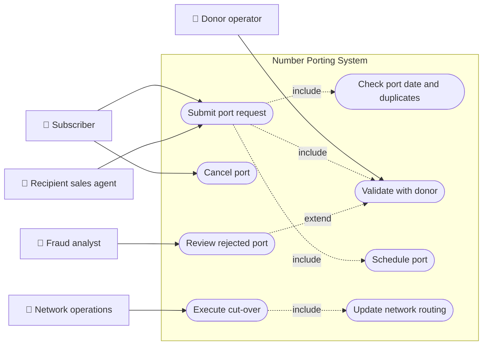
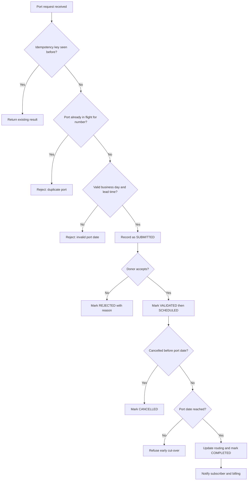
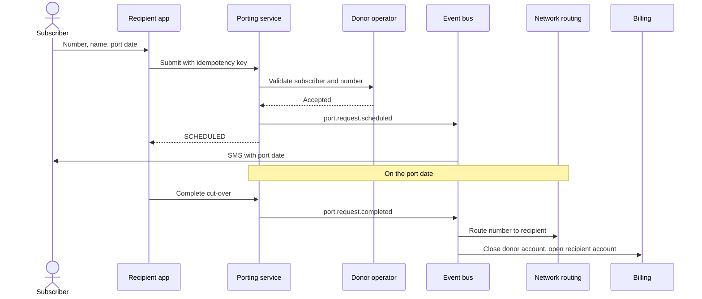
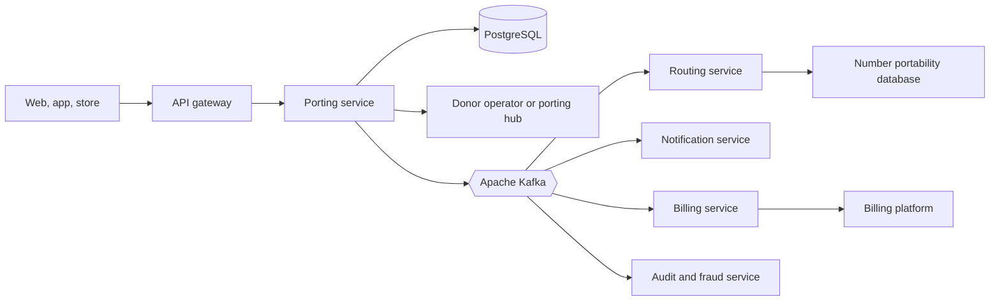
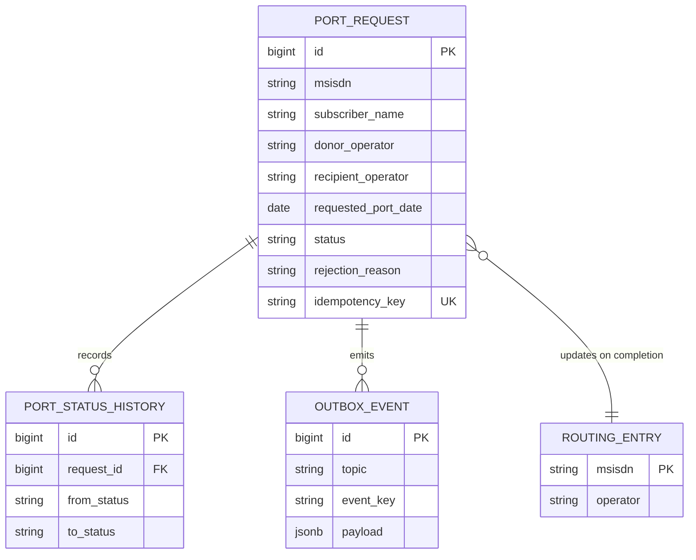
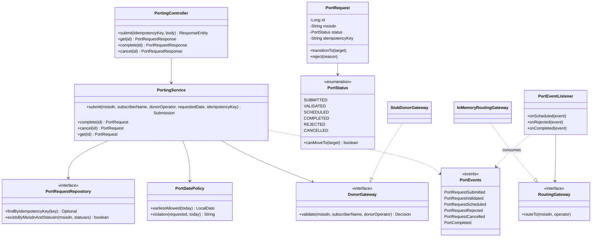
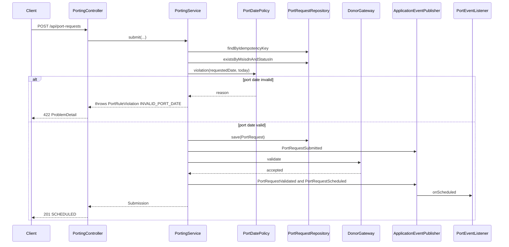
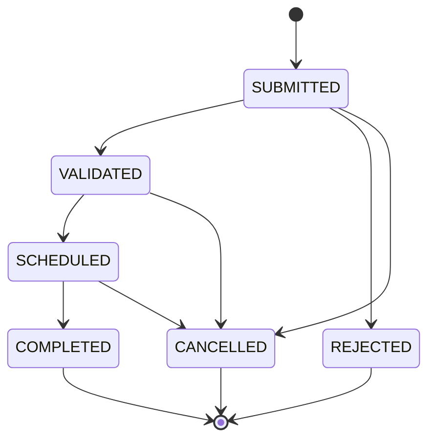
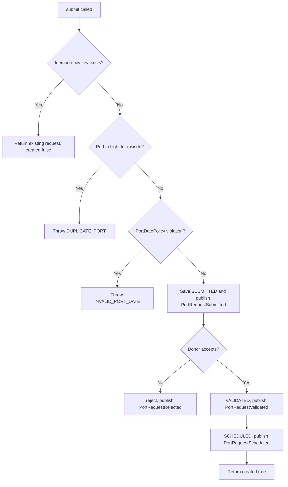

# Number Porting

> **Domain:** Telecom · **Author:** [@dhulipalla599](https://github.com/dhulipalla599) · **Published:** November 02, 2026

> **Runnable code:** [`examples/telecom/number-porting`](https://github.com/dhulipalla599/domain-knowledge-engineering/tree/main/examples/telecom/number-porting)

## Explain It Like I'm Five

Imagine you live in a house with a special street number, and all your friends know to send you letters there. Now you want to move to a new neighbourhood, but you do not want to tell every friend a new address. So you ask the two post offices to talk to each other. The old post office says "yes, that is really your house, and you owe us nothing". Then, on an agreed morning, both post offices switch over at the same moment so every letter addressed to your old number arrives at your new home.

In a phone company, number porting lets a customer keep their phone number while moving to a different operator, and the operators coordinate a precise switch-over so calls and texts follow the number.

## Business Overview

Number porting (also called mobile number portability, MNP) lets a subscriber keep their MSISDN, the phone number, when they change operator. The operator they leave is the **donor**; the operator they join is the **recipient**. The recipient collects the request, the donor validates that the person is entitled to move the number, and on the agreed date the network routing for that number is changed to point at the recipient.

Why the business cares:

- **Revenue:** the biggest reason people stay with an operator is that their number is hard to change. Where porting is easy, a smooth inbound port is the main acquisition path, and a slow or failing port drives customers back to the donor. Retention teams also compete to win customers back during the port.
- **Risk:** porting is a prime route for SIM-swap and account-takeover fraud, because whoever controls the number receives one-time passwords. Validation must be strong without being hostile to genuine customers.
- **Regulation:** in many countries porting is mandated by the regulator, with limits on how long it may take, what the donor may refuse and what fees apply. The rules, time windows and central infrastructure differ widely (some countries use a central clearing house, others bilateral operator links), so treat them as per-market configuration.
- **Customer experience:** a port is one of the few moments when a customer has no service-continuity safety net. Silent failures, double billing or a number that stops working for a day are very visible.

In the Telecom value chain, porting sits between sales (the channel that captures the request), customer care, the network (routing and number portability databases), billing and, in many markets, an industry porting hub.

## Real-World Example

Maria Santos has used the number `+15550109001` on (fictional) Contoso Telecom for six years and wants to move to Northwind Mobile.

1. In the Northwind app Maria enters her number, the name on the account and the date she wants to switch, Tuesday.
2. Northwind checks the request locally: the number format is valid, no other port for this number is already in flight and Tuesday is a business day far enough ahead.
3. Northwind asks Contoso, the donor, to validate. Contoso confirms the number exists, the name matches and no contract lock blocks the move.
4. The request becomes `SCHEDULED` and Maria gets an SMS with the switch date.
5. The app times out when Maria taps Submit and retries the call. Because the retry carries the same idempotency key, Maria still has exactly one request.
6. On Tuesday the cut-over runs. Routing for `+15550109001` is updated to Northwind, the request becomes `COMPLETED` and billing at Contoso is closed.
7. Had Maria's name not matched the donor's records, the request would have ended as `REJECTED` with a reason code, and Northwind would have told her what to correct.

## Stakeholders

| Stakeholder | What they need | What they fear |
|---|---|---|
| Subscriber | To keep their number with no gap in service and little effort | Losing service for days, being refused for unclear reasons |
| Recipient sales agent | A simple form that explains rejections | Customers abandoning at the counter |
| Donor operator (retention) | Accurate validation and a fair chance to retain the customer | Being accused of blocking ports unfairly |
| Fraud analyst | Signals that spot SIM-swap and hijacked ports | Account-takeover through a fraudulent port |
| Network operations | A precise, reliable cut-over with correct routing | Misrouted calls, orphaned numbers |
| Regulator | Ports completed within the mandated time, fair treatment | Operators delaying or obstructing ports |
| Billing / finance | A clear final bill at the donor and an opening account at the recipient | Double billing, revenue leakage |

## Use Case Diagram



| Use Case | Primary Actor | Goal | Main success outcome |
|---|---|---|---|
| Submit port request | Subscriber / Sales agent | Start moving the number | Request recorded, same outcome on retry |
| Check port date and duplicates | System | Refuse impossible requests early | No second in-flight port, valid business day |
| Validate with donor | Donor operator | Confirm the subscriber may port | Request becomes `VALIDATED` |
| Schedule port | System | Agree the switch date | Request `SCHEDULED`, subscriber notified |
| Cancel port | Subscriber | Stop a port before it happens | Request `CANCELLED` |
| Execute cut-over | Network operations | Switch the number on the date | Request `COMPLETED` |
| Review rejected port | Fraud analyst | Check whether a rejection hides fraud | Decision recorded |
| Update network routing | System | Make calls reach the new operator | Number routes to the recipient |

## Key Terms

| Term | Plain-English meaning |
|---|---|
| MSISDN | The phone number a person dials, in international format |
| MNP | Mobile number portability: keeping your number when changing operator |
| Donor operator | The operator the number is leaving |
| Recipient operator | The operator the number is joining |
| Port-in / port-out | Porting a number into your network, or out of it |
| Cut-over | The moment routing is switched from donor to recipient |
| Port window | The allowed time slot or date range in which the cut-over happens |
| NPDB / porting hub | The shared database or clearing house that records where each ported number now lives |
| Routing / number translation | How the network decides which operator receives a call to a number |
| Contract lock | A commitment that may block or add cost to leaving the donor |
| SIM swap | Moving a number to a new SIM; a common fraud vector |
| Idempotency key | A client-chosen token that makes a retried request safe |

## Process Flow

The subscriber or an agent submits the number, the name on the account and the preferred date. The recipient first runs cheap local checks: format, no other port already in flight for the number, a valid business day with enough lead time. It then asks the donor to validate. If the donor accepts, the port is scheduled and the subscriber is told the date. On the date the cut-over updates routing and the port completes. A port can be cancelled until it completes, and a rejection is final for that request, so the subscriber must submit a corrected one.





## Business Rules and Edge Cases

- **Idempotency:** retries are normal on mobile networks. A repeated idempotency key must return the original outcome and never create a second request.
- **One port in flight per number:** two simultaneous requests for the same number would race at cut-over. Enforce this in the data layer too, not only in application code, so two concurrent submits cannot both succeed.
- **Business days and lead time:** most markets only cut over on business days with a minimum notice. The exact lead time, working hours and holiday calendar differ by country, so make them configuration. The example uses "next business day or later, never a weekend".
- **Donor validation reasons:** typical rejections are number unknown, name or account mismatch and a contract lock. Some regulators restrict which reasons a donor may use; do not treat the list as universal.
- **Legal state changes:** a `REJECTED`, `CANCELLED` or `COMPLETED` request can never move again. Keep transitions in the domain model, not scattered `if` statements.
- **No early cut-over:** switching before the agreed date breaks the subscriber's expectation and the donor's billing. Check the date at cut-over time against an injectable clock, so it is testable.
- **Partial failure:** if routing is updated but the event to billing is lost, billing and network disagree. Publish events from a transactional outbox and make consumers idempotent. If routing fails, the port must stay retryable and alert, not silently become `COMPLETED`.
- **Time zones:** "the port date" is a local date in the market, while servers run in UTC. Decide which zone defines the day, and store it explicitly.
- **Fraud controls:** a port can be a SIM-swap attack. Notify the current subscriber on the donor side, and consider extra checks after recent SIM or credential changes. The required controls depend on country and operator.
- **Personal data:** names and numbers are personal data. Limit who can read port requests and keep retention to what local law requires.

## From Business to System

| Business concept / step | System component | Data entity | Event |
|---|---|---|---|
| Port request received | `PortingController`, `PortingService.submit` | `port_request` | `port.request.submitted` |
| Retry-safe submission | `PortingService` (idempotency lookup) | `port_request.idempotency_key` | none |
| One port in flight | `PortingService`, partial unique index | `port_request` | none |
| Port date rule | `PortDatePolicy` | `port_request.requested_port_date` | none |
| Donor validation | `DonorGateway` adapter | `port_request.status` | `port.request.validated` or `port.request.rejected` |
| Scheduling | `PortRequest.transitionTo` | `port_request` | `port.request.scheduled` |
| Cancellation | `PortingService.cancel` | `port_request` | `port.request.cancelled` |
| Cut-over | `PortingService.complete` | `port_request` | `port.request.completed` |
| Routing update | `RoutingGateway` via `PortEventListener` | `routing_entry` | consumes `port.request.completed` |
| Subscriber notification | Notification service | none | consumes `port.request.scheduled`, `port.request.rejected` |

## Architecture



The **porting service** owns the request lifecycle and the rules, and is the only writer of `port_request`. Donor communication sits behind an adapter because every market has a different hub or bilateral protocol. Routing, notification, billing and fraud are separate consumers because they have different owners, failure modes and scaling needs, and none of them should be able to block a subscriber's request. Kafka decouples them, with the port request id or MSISDN as the key so events for one number stay ordered.

## Data Model

```sql
CREATE TABLE port_request (
    id                  BIGSERIAL PRIMARY KEY,
    msisdn              VARCHAR(16)  NOT NULL,
    subscriber_name     VARCHAR(255) NOT NULL,
    donor_operator      VARCHAR(255) NOT NULL,
    recipient_operator  VARCHAR(255) NOT NULL,
    requested_port_date DATE         NOT NULL,
    status              VARCHAR(16)  NOT NULL
        CHECK (status IN ('SUBMITTED','VALIDATED','SCHEDULED','COMPLETED','REJECTED','CANCELLED')),
    rejection_reason    VARCHAR(255),
    idempotency_key     VARCHAR(255) NOT NULL UNIQUE,
    created_at          TIMESTAMPTZ  NOT NULL DEFAULT now()
);

-- At most one in-flight port per number, enforced by the database.
CREATE UNIQUE INDEX uq_port_in_flight ON port_request (msisdn)
    WHERE status IN ('SUBMITTED','VALIDATED','SCHEDULED');

CREATE TABLE port_status_history (
    id           BIGSERIAL PRIMARY KEY,
    request_id   BIGINT      NOT NULL REFERENCES port_request(id),
    from_status  VARCHAR(16),
    to_status    VARCHAR(16) NOT NULL,
    changed_at   TIMESTAMPTZ NOT NULL DEFAULT now()
);

CREATE TABLE routing_entry (
    msisdn     VARCHAR(16) PRIMARY KEY,
    operator   VARCHAR(255) NOT NULL,
    updated_at TIMESTAMPTZ  NOT NULL DEFAULT now()
);

CREATE TABLE outbox_event (
    id          BIGSERIAL PRIMARY KEY,
    topic       VARCHAR(128) NOT NULL,
    event_key   VARCHAR(64)  NOT NULL,
    payload     JSONB        NOT NULL,
    created_at  TIMESTAMPTZ  NOT NULL DEFAULT now(),
    published_at TIMESTAMPTZ
);
```



The example project uses only `port_request` (via JPA on H2); the other tables show what production adds.

## APIs

| Method | Path | Purpose |
|---|---|---|
| POST | `/api/port-requests` | Submit a port request (requires `Idempotency-Key` header) |
| GET | `/api/port-requests` | List requests |
| GET | `/api/port-requests/{id}` | Read one request |
| POST | `/api/port-requests/{id}/complete` | Run the cut-over on or after the port date |
| POST | `/api/port-requests/{id}/cancel` | Cancel before completion |

Request to `POST /api/port-requests` with header `Idempotency-Key: demo-1`:

```json
{
  "msisdn": "+15550101001",
  "subscriberName": "Ada Lovelace",
  "donorOperator": "Contoso Telecom",
  "requestedPortDate": "2026-11-03"
}
```

Response `201 Created` (a repeat with the same key returns `200 OK` and the same body):

```json
{
  "id": 4,
  "msisdn": "+15550101001",
  "subscriberName": "Ada Lovelace",
  "donorOperator": "Contoso Telecom",
  "recipientOperator": "Northwind Mobile",
  "requestedPortDate": "2026-11-03",
  "status": "SCHEDULED",
  "rejectionReason": null
}
```

Rule violations return an RFC 9457 problem document: `422 INVALID_PORT_DATE`, `409 DUPLICATE_PORT`, `409 TOO_EARLY` and `409 ILLEGAL_STATE_TRANSITION`.

## Events

| Event (Kafka topic) | Producer | Consumers | Key fields |
|---|---|---|---|
| `port.request.submitted` | Porting service | Audit and fraud | `requestId`, `msisdn`, `portDate` |
| `port.request.validated` | Porting service | Audit | `requestId`, `msisdn` |
| `port.request.scheduled` | Porting service | Notification, billing | `requestId`, `msisdn`, `portDate` |
| `port.request.rejected` | Porting service | Notification, fraud | `requestId`, `msisdn`, `reason` |
| `port.request.cancelled` | Porting service | Notification, billing | `requestId`, `msisdn` |
| `port.request.completed` | Porting service | Routing, billing, notification | `requestId`, `msisdn`, `newOperator` |

- **Ordering:** key by MSISDN so all events for a number land on one partition and arrive in order. A consumer must not apply `completed` before `scheduled`.
- **Idempotency:** Kafka delivers at least once. Consumers record the `requestId` and event type they have handled, and routing updates are naturally idempotent because "route this number to operator X" can be repeated safely.
- **Atomicity:** write the event to an outbox table in the same transaction as the status change, and publish from there, so a crash cannot leave a state change without its event.

## Backend Implementation

> The Java tab is the exact code from the runnable example. The Python tab uses FastAPI with SQLAlchemy, and the Node.js tab uses Express with TypeScript.

Full source: [`examples/telecom/number-porting`](https://github.com/dhulipalla599/domain-knowledge-engineering/tree/main/examples/telecom/number-porting).

The key rule is `PortingService.submit`: idempotent, one port in flight, valid date, donor must accept.

=== "Java"

    ```java
    /** Core rules: idempotent submit, one in-flight port per number, valid port date, donor must accept. */
    @Transactional
    public Submission submit(String msisdn, String subscriberName, String donorOperator,
                             LocalDate requestedDate, String idempotencyKey) {
        var existing = repository.findByIdempotencyKey(idempotencyKey);
        if (existing.isPresent()) {
            return new Submission(existing.get(), false);
        }
        if (repository.existsByMsisdnAndStatusIn(msisdn, IN_FLIGHT)) {
            throw new PortRuleViolation("DUPLICATE_PORT", "A port request is already in flight for " + msisdn);
        }
        String dateProblem = datePolicy.violation(requestedDate, LocalDate.now(clock));
        if (dateProblem != null) {
            throw new PortRuleViolation("INVALID_PORT_DATE", dateProblem);
        }

        PortRequest request = repository.save(
                new PortRequest(msisdn, subscriberName, donorOperator, RECIPIENT, requestedDate, idempotencyKey));
        events.publishEvent(new PortRequestSubmitted(request.getId(), msisdn, requestedDate));

        var decision = donor.validate(msisdn, subscriberName, donorOperator);
        if (!decision.accepted()) {
            request.reject(decision.reason());
            events.publishEvent(new PortRequestRejected(request.getId(), msisdn, decision.reason()));
            return new Submission(request, true);
        }
        request.transitionTo(PortStatus.VALIDATED);
        events.publishEvent(new PortRequestValidated(request.getId(), msisdn));
        request.transitionTo(PortStatus.SCHEDULED);
        events.publishEvent(new PortRequestScheduled(request.getId(), msisdn, requestedDate));
        return new Submission(request, true);
    }
    ```

=== "Python"

    ```python
    IN_FLIGHT = ("SUBMITTED", "VALIDATED", "SCHEDULED")


    def submit(db: Session, msisdn, subscriber_name, donor_operator, requested_date, idempotency_key):
        existing = db.scalar(select(PortRequest).where(PortRequest.idempotency_key == idempotency_key))
        if existing:
            return existing, False
        if db.scalar(select(PortRequest.id).where(
                PortRequest.msisdn == msisdn, PortRequest.status.in_(IN_FLIGHT))):
            raise PortRuleViolation("DUPLICATE_PORT", f"A port request is already in flight for {msisdn}")
        problem = date_policy.violation(requested_date, date.today())
        if problem:
            raise PortRuleViolation("INVALID_PORT_DATE", problem)

        request = PortRequest(msisdn=msisdn, subscriber_name=subscriber_name, donor_operator=donor_operator,
                              recipient_operator=RECIPIENT, requested_port_date=requested_date,
                              idempotency_key=idempotency_key)
        db.add(request)
        db.flush()
        publish("port.request.submitted", request)

        decision = donor.validate(msisdn, subscriber_name, donor_operator)
        if not decision.accepted:
            request.reject(decision.reason)
            publish("port.request.rejected", request)
            return request, True
        request.transition_to("VALIDATED")
        publish("port.request.validated", request)
        request.transition_to("SCHEDULED")
        publish("port.request.scheduled", request)
        return request, True
    ```

=== "Node.js"

    ```typescript
    const IN_FLIGHT: PortStatus[] = ["SUBMITTED", "VALIDATED", "SCHEDULED"];

    export async function submit(
      msisdn: string, subscriberName: string, donorOperator: string,
      requestedDate: string, idempotencyKey: string,
    ): Promise<{ request: PortRequest; created: boolean }> {
      const existing = await repo.findByIdempotencyKey(idempotencyKey);
      if (existing) return { request: existing, created: false };
      if (await repo.existsByMsisdnAndStatusIn(msisdn, IN_FLIGHT)) {
        throw new PortRuleViolation("DUPLICATE_PORT", `A port request is already in flight for ${msisdn}`);
      }
      const problem = datePolicy.violation(requestedDate, today());
      if (problem) throw new PortRuleViolation("INVALID_PORT_DATE", problem);

      const request = await repo.save(
        new PortRequest(msisdn, subscriberName, donorOperator, RECIPIENT, requestedDate, idempotencyKey));
      publish("port.request.submitted", request);

      const decision = await donor.validate(msisdn, subscriberName, donorOperator);
      if (!decision.accepted) {
        request.reject(decision.reason);
        publish("port.request.rejected", request);
        return { request, created: true };
      }
      request.transitionTo("VALIDATED");
      publish("port.request.validated", request);
      request.transitionTo("SCHEDULED");
      publish("port.request.scheduled", request);
      return { request, created: true };
    }
    ```

The controller endpoint that calls it:

=== "Java"

    ```java
    @PostMapping
    public ResponseEntity<PortRequestResponse> submit(@RequestHeader("Idempotency-Key") String idempotencyKey,
                                                      @Valid @RequestBody SubmitPortRequest body) {
        var result = service.submit(body.msisdn(), body.subscriberName(), body.donorOperator(),
                body.requestedPortDate(), idempotencyKey);
        HttpStatus status = result.created() ? HttpStatus.CREATED : HttpStatus.OK;
        return ResponseEntity.status(status).body(PortRequestResponse.from(result.request()));
    }
    ```

=== "Python"

    ```python
    @router.post("/api/port-requests")
    def submit_endpoint(body: SubmitPortRequest, response: Response,
                        idempotency_key: str = Header(...), db: Session = Depends(get_db)):
        request, created = submit(db, body.msisdn, body.subscriber_name, body.donor_operator,
                                  body.requested_port_date, idempotency_key)
        response.status_code = 201 if created else 200
        return PortRequestResponse.from_entity(request)
    ```

=== "Node.js"

    ```typescript
    router.post("/api/port-requests", async (req, res) => {
      const idempotencyKey = req.header("Idempotency-Key");
      if (!idempotencyKey) return res.status(400).json({ title: "MISSING_IDEMPOTENCY_KEY" });
      const body = submitSchema.parse(req.body);
      const { request, created } = await submit(
        body.msisdn, body.subscriberName, body.donorOperator, body.requestedPortDate, idempotencyKey);
      res.status(created ? 201 : 200).json(toResponse(request));
    });
    ```

## Frontend Screen

```tsx
import { useState } from "react";

type PortResponse = { id: number; status: string; rejectionReason: string | null; detail?: string; title?: string };

export default function PortNumberForm() {
  const [msisdn, setMsisdn] = useState("");
  const [name, setName] = useState("");
  const [date, setDate] = useState("");
  const [key] = useState(() => crypto.randomUUID()); // one key per form, so a retry is safe
  const [result, setResult] = useState<PortResponse | null>(null);
  const [busy, setBusy] = useState(false);

  async function submit(e: React.FormEvent) {
    e.preventDefault();
    setBusy(true);
    try {
      const res = await fetch("/api/port-requests", {
        method: "POST",
        headers: { "Content-Type": "application/json", "Idempotency-Key": key },
        body: JSON.stringify({
          msisdn, subscriberName: name, donorOperator: "Contoso Telecom", requestedPortDate: date,
        }),
      });
      setResult(await res.json());
    } finally {
      setBusy(false);
    }
  }

  return (
    <form onSubmit={submit}>
      <h2>Keep my number</h2>
      <label>Current number <input value={msisdn} onChange={(e) => setMsisdn(e.target.value)} placeholder="+15550101001" required /></label>
      <label>Name on account <input value={name} onChange={(e) => setName(e.target.value)} required /></label>
      <label>Switch date <input type="date" value={date} onChange={(e) => setDate(e.target.value)} required /></label>
      <button disabled={busy}>{busy ? "Submitting..." : "Request port"}</button>
      {result && (
        <p role="status">
          {result.status
            ? `Status: ${result.status}${result.rejectionReason ? " (" + result.rejectionReason + ")" : ""}`
            : `${result.title}: ${result.detail}`}
        </p>
      )}
    </form>
  );
}
```

## Cloud Deployment

On AWS the porting service runs as a Spring Boot deployment on **Amazon EKS** behind an Application Load Balancer and API gateway. Managed services: **Amazon RDS for PostgreSQL** (Multi-AZ) for requests, **Amazon MSK** for Kafka, **AWS Secrets Manager** for donor-hub credentials, **Amazon ECR** for images and **AWS WAF** at the edge. Donor and routing traffic leaves through private connectivity (VPN or Direct Connect) where the porting hub requires it.

```hcl
resource "aws_db_instance" "porting" {
  identifier              = "porting-db"
  engine                  = "postgres"
  engine_version          = "16"
  instance_class          = "db.m6g.large"
  allocated_storage       = 100
  multi_az                = true
  storage_encrypted       = true
  backup_retention_period = 14
  db_subnet_group_name    = aws_db_subnet_group.private.name
  vpc_security_group_ids  = [aws_security_group.porting_db.id]
  username                = "porting"
  manage_master_user_password = true
  deletion_protection     = true
}
```

- **Security:** private subnets, encryption at rest and in transit, IAM roles for service accounts (IRSA) instead of static keys, and least-privilege access to port data. Mask MSISDNs in logs.
- **Scaling:** scale pods on CPU and request rate with the Horizontal Pod Autoscaler. Consumers scale with Kafka partition count and lag. Cut-over days concentrate load, so test peaks around common port dates.
- **Observability:** OpenTelemetry traces across API, donor call and consumers, exported to CloudWatch (via the AWS Distro for OpenTelemetry collector). Alarm on donor-call latency, rejection rate by reason, consumer lag and ports past their window.

## Non-Functional Requirements

| Concern | Expectation | How the design meets it |
|---|---|---|
| Availability | Submissions available during business hours at least; cut-over must not be missed | Multi-AZ database, multiple pods, retries with idempotent consumers |
| Latency | Submission returns quickly even if the donor is slow | Timeouts and circuit breaker on the donor call; asynchronous follow-up where the market's protocol allows it |
| Consistency | A number routes to exactly one operator; one in-flight port per number | Partial unique index, enforced transitions, routing updates keyed by MSISDN |
| Audit | Who changed what and when must be provable | Status history table, events retained in Kafka and archived |
| Compliance | Port timelines and fair treatment as set by the regulator; personal data protection | Per-market configuration of windows and rejection reasons, alerting on ports near the deadline, retention rules |
| Security | Resist hijacked ports | Notification to the current subscriber, fraud review of rejections and recent SIM changes |

## Runnable Example

The example is a Spring Boot 3 service on Java 21 that implements submit, cancel and cut-over of port requests. It enforces idempotency, one port in flight per number, a business-day date rule, and donor validation behind an interface. Status transitions are enforced in the enum, and domain events are published with `ApplicationEventPublisher` and consumed with `@EventListener`. It uses H2 and needs no external service.

Source: [`examples/telecom/number-porting`](https://github.com/dhulipalla599/domain-knowledge-engineering/tree/main/examples/telecom/number-porting)

```bash
cd examples/telecom/number-porting
mvn spring-boot:run    # http://localhost:8080
mvn verify             # build and run the tests
```

Submit a port (the stub donor knows `+15550101001` / Ada Lovelace):

```bash
curl -s -X POST localhost:8080/api/port-requests -H 'Content-Type: application/json' -H 'Idempotency-Key: demo-1' \
  -d '{"msisdn":"+15550101001","subscriberName":"Ada Lovelace","donorOperator":"Contoso Telecom","requestedPortDate":"2026-11-03"}'
```

```json
{"id":4,"msisdn":"+15550101001","subscriberName":"Ada Lovelace","donorOperator":"Contoso Telecom","recipientOperator":"Northwind Mobile","requestedPortDate":"2026-11-03","status":"SCHEDULED","rejectionReason":null}
```

Try a weekend date (the date rule uses the real current date, so choose a future Saturday):

```bash
curl -s -X POST localhost:8080/api/port-requests -H 'Content-Type: application/json' -H 'Idempotency-Key: demo-2' \
  -d '{"msisdn":"+15550101002","subscriberName":"Grace Hopper","donorOperator":"Contoso Telecom","requestedPortDate":"2026-11-07"}'
```

```json
{"type":"about:blank","title":"INVALID_PORT_DATE","status":422,"detail":"Port date 2026-11-07 is not a business day","instance":"/api/port-requests"}
```

| Class | Package | Responsibility |
|---|---|---|
| `PortingController` | `api` | REST endpoints |
| `SubmitPortRequest`, `PortRequestResponse` | `api` | Request and response records |
| `ApiExceptionHandler` | `api` | Maps violations to `ProblemDetail` |
| `PortingService` | `service` | Submit, complete, cancel and enforce rules |
| `PortDatePolicy` | `service` | Business-day and lead-time rule |
| `PortRuleViolation`, `PortRequestNotFound`, `ClockConfig` | `service` | Errors and injectable clock |
| `PortRequest`, `PortStatus` | `domain` | Entity and lifecycle with legal transitions |
| `PortEvents`, `IllegalPortStateException` | `domain` | Event records and transition error |
| `PortRequestRepository` | `repository` | Spring Data JPA access |
| `DonorGateway`, `StubDonorGateway` | `integration` | Donor validation port and deterministic stub |
| `RoutingGateway`, `InMemoryRoutingGateway` | `integration` | Routing update port and stub |
| `PortEventListener` | `integration` | Consumers of the domain events |

## UML Diagrams

### Class Diagram

The controller calls the service, which uses the repository, the date policy, the donor gateway and the event publisher. `PortRequest` owns its `PortStatus` transitions and the listener reacts to events.



### Sequence Diagram (control flow)

One submit request goes through the controller and service. The `alt` branch is the main rule violation, a weekend or too-early port date, which becomes a `422` through the exception handler.



### State Diagram

These are the `PortStatus` values and the moves allowed by `canMoveTo`.



### Activity Diagram

The decision logic inside `PortingService.submit`, in the order the code evaluates it.



## AI Opportunities

1. **Port fraud scoring.** Score each request for SIM-swap or hijack risk. Data: request metadata, recent SIM and credential changes, device and channel signals, history of rejected ports. Risk: false positives block genuine customers and bias against groups or channels must be tested. Keep a human review path and explainable reasons, and respect privacy law on profiling.
2. **Rejection triage and next-best-action.** Classify donor rejection reasons and suggest the fix, such as a likely name spelling difference. Data: rejection codes and past resolutions. Risk: wrong advice causes repeat rejections, so the agent only suggests and a human or the subscriber confirms.
3. **Cut-over capacity forecasting.** Predict port volumes by date to staff care and size routing capacity. Data: historic port counts, campaigns and holidays. Risk: forecast error near campaigns; use it for planning, not for refusing requests.
4. **Customer-care assistant.** An LLM agent answers "where is my port?" from request status and event history. Data: the subscriber's own request and public policy text. Risk: leaking another person's data or promising dates. Restrict it to authenticated read-only tools and log every answer.
5. **Anomaly detection on routing consistency.** Compare the porting records with the routing database to find numbers that route to the wrong operator. Data: both datasets. Risk: noisy alerts; treat findings as tickets for operations, not automatic fixes.

## Common Pitfalls

- **Treating the port date as a timestamp.** It is a local business date in a market. Store the zone and test around midnight and daylight-saving changes.
- **Hard-coding one country's rules.** Lead times, working hours, rejection reasons and the central hub vary. Externalise them per market.
- **No idempotency.** Retries create duplicate requests or double events. Use an idempotency key and a unique constraint.
- **Checking "one in flight" only in code.** Two concurrent requests both pass the check. Add the partial unique index.
- **Scattering status changes.** Direct `status = ...` writes allow impossible transitions. Funnel them through one method.
- **Publishing events outside the transaction.** A crash leaves state and events inconsistent. Use an outbox.
- **Ignoring the donor being slow or down.** Add timeouts, retries and a clear pending state instead of blocking the user.
- **Weak validation that enables SIM-swap fraud.** Port-out is a security-sensitive action. Involve fraud and security early.
- **Logging full numbers and names.** Mask personal data in logs and traces.

## Interview Questions

### Junior

1. **What are the donor and recipient operators?** The donor is the operator the number is leaving and the recipient is the one it is joining. The recipient usually collects the request and the donor validates it.
2. **Why do we require an idempotency key on submit?** Clients retry on timeouts. The key lets the server return the original result instead of creating a second request.
3. **Why is a `COMPLETED` request not allowed to be cancelled?** The number is already routed to the recipient, so the lifecycle is terminal. Allowed transitions are enforced in the domain model so no caller can break it.

### Mid-Level

1. **How do you guarantee only one in-flight port per number?** Check in the service for a clear error, and back it with a partial unique index on the number for in-flight statuses so concurrent requests cannot both succeed.
2. **How do you make the cut-over reliable if the routing update fails?** Keep the request retryable, publish `port.request.completed` through an outbox, make the routing consumer idempotent, alert on failures and never mark success before routing is confirmed.
3. **How do you test the port-date rule without waiting for real dates?** Inject a `Clock`, pass it to the service and policy, and use a fixed clock in tests, as the example does.

### Senior / Architect

1. **Design porting for a market with a central clearing house and another with bilateral links.** Key points: a `DonorGateway` port with per-market adapters, per-market configuration for windows and reason codes, a canonical internal state machine mapped to each protocol's messages, retries, reconciliation jobs and contract tests per adapter.
2. **How would you detect and prevent port-based account takeover?** Key points: step-up verification, notifying the current subscriber, delays or holds after recent SIM or credential changes, fraud scoring with human review, audit trail, balancing friction against conversion and the regulator's limits on blocking ports.
3. **How do you keep billing, routing and notifications consistent with the port state?** Key points: transactional outbox, Kafka keyed by MSISDN for ordering, idempotent consumers, reconciliation between porting records and the routing database, dead-letter handling and replay.

## Further Learning

- Mobile number portability regimes in your target markets (regulator rules and timelines)
- Number plans and E.164 numbering
- SIM swap fraud and SIM-swap detection practices
- SS7 and Diameter basics, and how routing and signalling use number data
- Transactional outbox and change data capture patterns
- Idempotency and exactly-once effects in event-driven systems
- Domain-driven design aggregates and state machines
- RFC 9457 problem details for HTTP APIs

## Practitioner Notes

> _Reviewer: add real-world experience, corrections or gotchas here before approving._
