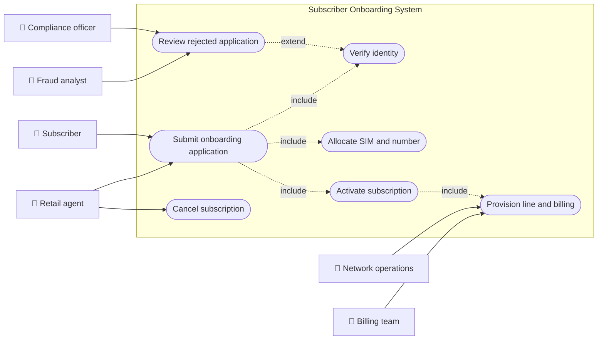
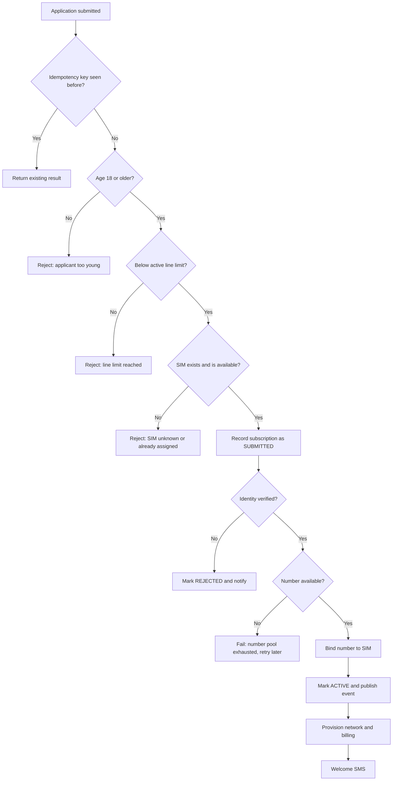
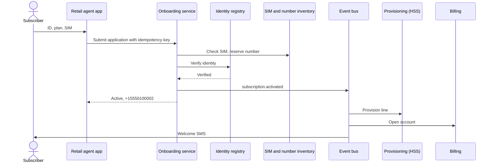
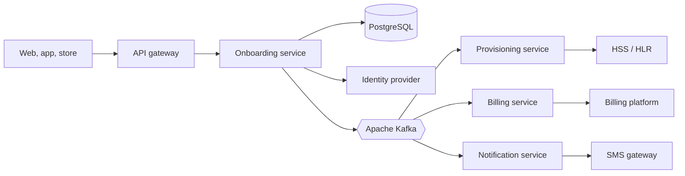
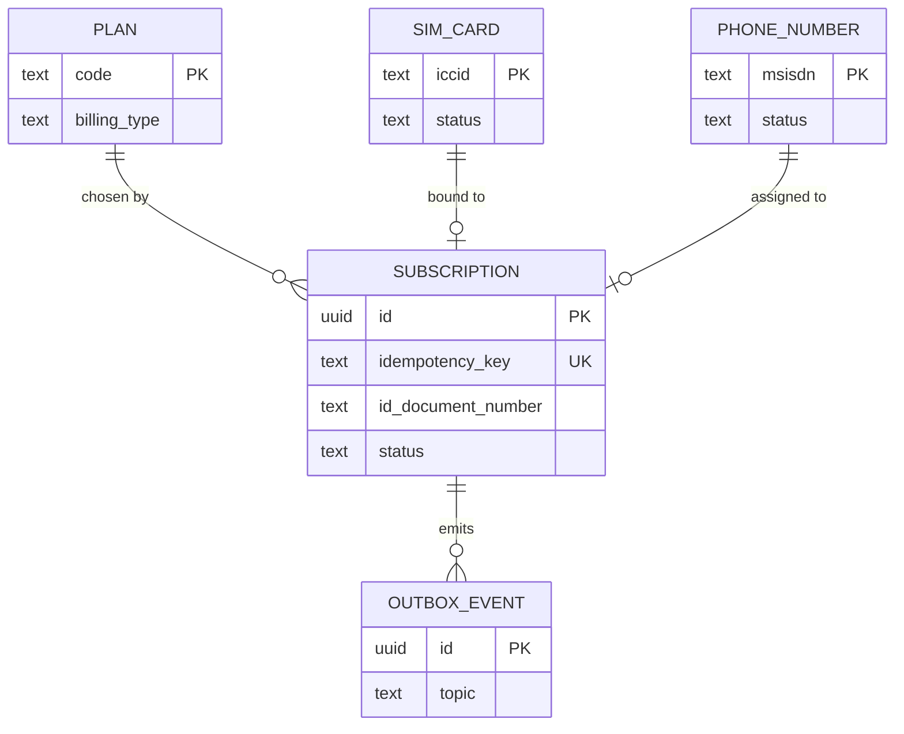
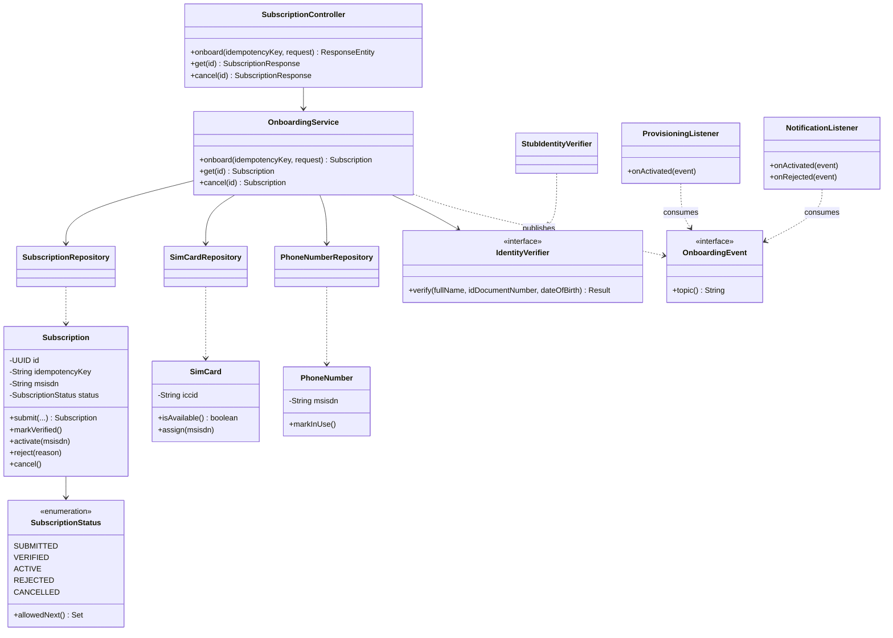
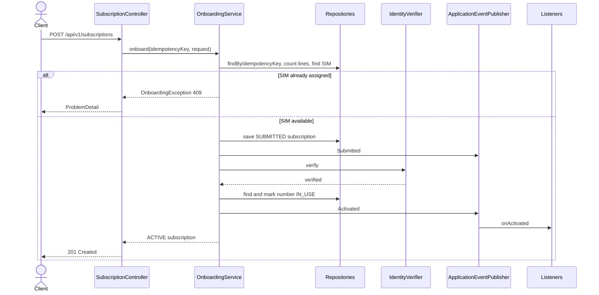
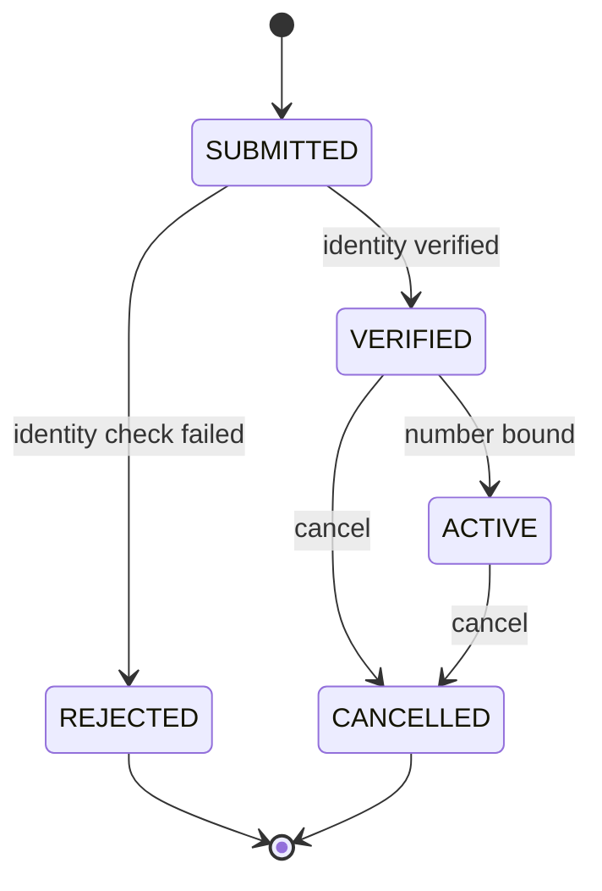
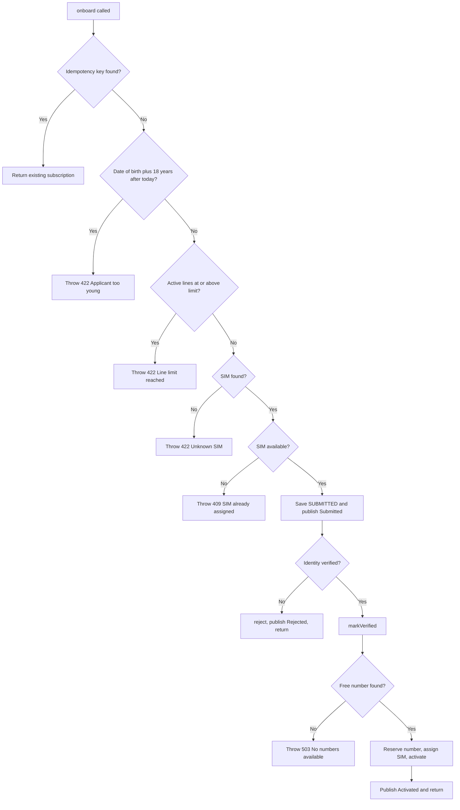

# Subscriber Onboarding

> **Domain:** Telecom · **Author:** [@dhulipalla599](https://github.com/dhulipalla599) · **Published:** October 19, 2026

> **Runnable code:** [`examples/telecom/subscriber-onboarding`](https://github.com/dhulipalla599/domain-knowledge-engineering/tree/main/examples/telecom/subscriber-onboarding)

## Explain It Like I'm Five

Imagine a new kid joins your school and wants a walkie-talkie to chat with friends. First the teacher checks the kid's name and age on a card. Then the kid picks a walkie-talkie from the box and gets a channel number that nobody else is using. The teacher writes the number down, switches the walkie-talkie on and tests it. Only after all of that can the kid start talking, and the teacher makes sure no kid grabs ten walkie-talkies or someone else's channel.

In a phone company, subscriber onboarding is checking who a new customer is, giving them a SIM card and a phone number nobody else has, and switching the line on so they can call and browse.

## Business Overview

Subscriber onboarding turns a person who wants a mobile line into an active, billable subscriber on the network. It covers capturing the application, verifying identity, choosing a plan, allocating a SIM (identified by its ICCID) and a phone number (the MSISDN), provisioning the line in the core network and opening a billing account.

Why the business cares:

- **Revenue:** every day of delay or abandoned application is lost recurring revenue. Activation speed and first-attempt success rate are watched closely.
- **Risk:** fraudulent or synthetic identities, SIM farms and unpaid postpaid contracts are costly. Credit checks (postpaid) and identity checks reduce losses.
- **Regulation:** many countries require SIM registration tied to a verified identity, and some cap the number of lines per person. Rules, retention periods and accepted documents differ by country, and sometimes by operator, so treat them as configuration rather than constants.
- **Customer experience:** onboarding is the first impression. Being asked to resubmit data or waiting hours for activation drives churn.

In the Telecom value chain it sits between sales channels (web, app, retail store, dealer) and the core: upstream are marketing and the product catalogue, downstream are network provisioning (HLR/HSS), billing and charging, and customer care.

## Real-World Example

Lena Park walks into a (fictional) Northwind Mobile store and wants a prepaid line.

1. The agent opens the onboarding app and enters Lena's name, date of birth, national ID number and the chosen plan, `PREPAID_BASIC`.
2. The agent scans the ICCID on the SIM Lena picked from the rack.
3. The system checks that Lena is an adult, holds fewer lines than the allowed maximum, and that the SIM is unused.
4. The identity registry confirms the ID details match.
5. The system reserves the next free number, `+15550100002`, binds it to the SIM and marks the subscription `ACTIVE`.
6. Network provisioning adds the line to the core network, billing opens a prepaid account and Lena receives a welcome SMS.
7. The store's connection drops just as the agent presses submit, so the app retries the request. Because it carries the same idempotency key, Lena still ends up with one line, not two.

If instead Lena's ID number were not found in the registry, the application would be recorded as `REJECTED`, the SIM and number would stay untouched, and Lena would be told how to appeal or resubmit.

## Stakeholders

| Stakeholder | What they need | What they fear |
|---|---|---|
| Subscriber (applicant) | A quick, error-free activation and a working number | Being asked for documents twice, a number that does not work, privacy leaks |
| Retail / dealer agent | A simple screen that guides them and explains rejections | Slow systems with a customer waiting at the counter |
| Compliance officer | Verified identity on every line, audit trail, retention rules met | Unregistered SIMs, regulator fines |
| Fraud analyst | Signals for identity theft and SIM farming | Bulk fraudulent activations going unnoticed |
| Network operations | Clean, consistent provisioning requests | Orphan lines in the network that are not billed, or billed lines that are not provisioned |
| Billing / finance | Every active line has a billing account and a plan | Revenue leakage, disputes over activation dates |
| Inventory manager | Accurate SIM and number stock | Duplicate allocation, number pool exhaustion |

## Use Case Diagram



| Use Case | Primary Actor | Goal | Main success outcome |
|---|---|---|---|
| Submit onboarding application | Subscriber / Retail agent | Get a new line | Application accepted with an idempotency key |
| Verify identity | System (for the Compliance officer) | Prove the applicant is who they claim | Subscription moves to `VERIFIED` |
| Allocate SIM and number | System | Bind a free SIM and number | SIM `ASSIGNED`, number `IN_USE` |
| Activate subscription | System | Make the line usable | Subscription is `ACTIVE`, `subscription.activated` published |
| Review rejected application | Compliance officer / Fraud analyst | Decide on appeal or confirm rejection | Decision recorded |
| Cancel subscription | Retail agent | Close a line | Subscription is `CANCELLED` |
| Provision line and billing | Network operations / Billing team | Make the line live and billable | Line in HSS and billing account opened |

## Key Terms

| Term | Plain-English meaning |
|---|---|
| MSISDN | The phone number a person dials, in international format |
| SIM / ICCID | The card in the phone and the unique serial number printed on it |
| IMSI | The identity the network uses internally for a SIM; separate from the phone number |
| HLR / HSS | The network database that knows which subscribers exist and what they may do (HLR in older networks, HSS in 4G/IMS) |
| eSIM | A SIM profile downloaded to the device instead of a physical card |
| KYC | "Know Your Customer": verifying the identity of the applicant |
| Prepaid / Postpaid | Pay before use with credit, or get billed after use under a contract |
| Number portability | A customer keeping their number when changing operators; an alternative to getting a new number |
| BSS / OSS | Business support systems (billing, CRM, catalogue) and operations support systems (network, inventory) |
| Provisioning | Configuring the network so a subscriber's line works |
| Churn | Customers leaving the operator |
| Idempotency key | A client-chosen token that makes a retried request safe |

## Process Flow

The applicant (directly or through an agent) submits their details, a plan and a SIM. The system first checks cheap, local rules (age, lines per ID, SIM availability), then calls the identity verification provider. When identity is confirmed, it reserves a number, binds it to the SIM and activates the subscription. Events then trigger network provisioning, billing and notifications. Failures at any step end in a clear rejection or a retryable error, and nothing is half-allocated.





## Business Rules and Edge Cases

- **Idempotency:** retries are normal on flaky retail connections. A repeated idempotency key must return the original outcome, never create a second subscription or consume a second number.
- **Identity before allocation:** do not hand out a number to an unverified person. Check cheap local rules before calling slow, possibly paid external services.
- **Minimum age:** most operators require adults for contracts; the age and the guardian rules vary by country and plan.
- **Lines per ID:** some regulators or operators cap active lines per identity. The cap here is 5 only for illustration; make it configurable per market.
- **One SIM, one subscription:** a SIM that is already assigned must be refused with a conflict, and two concurrent requests must not claim the same SIM or number (use optimistic or pessimistic locking).
- **Number pool exhaustion:** report a retryable error rather than activating a line without a number.
- **Partial failure:** if the number is reserved but activation fails, the reservation must roll back or expire. If provisioning in the network fails after activation, retry via events and alert, instead of silently leaving a billed but dead line.
- **Legal state changes:** a `REJECTED` or `CANCELLED` subscription can never become `ACTIVE`; transitions belong in the domain model, not scattered `if` statements.
- **Personal data:** ID numbers are sensitive. Mask them in logs and restrict access; retention periods are set by local law.
- **Number recycling:** released numbers are usually quarantined for a period before reuse, so a new owner does not receive the previous owner's messages. The length depends on the operator and country.

## From Business to System

| Business concept / step | System component | Data entity | Event |
|---|---|---|---|
| Application received | `SubscriptionController`, `OnboardingService` | `subscription` | `subscription.submitted` |
| Retry-safe submission | `OnboardingService` (idempotency lookup) | `subscription.idempotency_key` | none |
| Eligibility (age, line limit) | `OnboardingService` | `subscription` | none |
| Identity verification | `IdentityVerifier` adapter | `subscription.status` | `subscription.rejected` on failure |
| SIM allocation | `SimCardRepository` | `sim_card` | none |
| Number reservation | `PhoneNumberRepository` | `phone_number` | none |
| Activation | `Subscription.activate` | `subscription` | `subscription.activated` |
| Network provisioning and billing | `ProvisioningListener` (separate services in production) | `subscription` read model | consumes `subscription.activated` |
| Customer notification | `NotificationListener` | none | consumes `subscription.activated`, `subscription.rejected` |
| Cancellation | `OnboardingService.cancel` | `subscription` | `subscription.cancelled` (production) |

## Architecture



The **onboarding service** owns the application, the lifecycle and the allocation of SIMs and numbers, because those must change together in one database transaction. Identity verification is behind an interface because providers vary by country and are slow or unreliable, so they must be wrapped with timeouts. **Provisioning, billing and notification** consume events instead of being called inline: they scale independently, can be down briefly without blocking customers, and are owned by other teams. Inventory sits with onboarding in this design; at large operators it is often a separate inventory system, in which case the reservation becomes a remote call with its own failure handling.

## Data Model

```sql
CREATE TABLE plan (
    code           TEXT PRIMARY KEY,
    monthly_price  NUMERIC(10,2) NOT NULL,
    billing_type   TEXT NOT NULL CHECK (billing_type IN ('PREPAID','POSTPAID'))
);

CREATE TABLE sim_card (
    iccid    TEXT PRIMARY KEY,
    status   TEXT NOT NULL CHECK (status IN ('AVAILABLE','ASSIGNED')),
    msisdn   TEXT UNIQUE,
    version  BIGINT NOT NULL DEFAULT 0
);

CREATE TABLE phone_number (
    msisdn   TEXT PRIMARY KEY,
    status   TEXT NOT NULL CHECK (status IN ('AVAILABLE','IN_USE')),
    version  BIGINT NOT NULL DEFAULT 0
);

CREATE TABLE subscription (
    id                 UUID PRIMARY KEY,
    idempotency_key    TEXT NOT NULL UNIQUE,
    full_name          TEXT NOT NULL,
    date_of_birth      DATE NOT NULL,
    id_document_number TEXT NOT NULL,
    plan               TEXT NOT NULL REFERENCES plan(code),
    iccid              TEXT NOT NULL REFERENCES sim_card(iccid),
    msisdn             TEXT REFERENCES phone_number(msisdn),
    status             TEXT NOT NULL,
    rejection_reason   TEXT,
    created_at         TIMESTAMPTZ NOT NULL,
    activated_at       TIMESTAMPTZ
);
CREATE INDEX subscription_id_doc_status ON subscription (id_document_number, status);

CREATE TABLE outbox_event (
    id          UUID PRIMARY KEY,
    topic       TEXT NOT NULL,
    key         TEXT NOT NULL,
    payload     JSONB NOT NULL,
    created_at  TIMESTAMPTZ NOT NULL DEFAULT now(),
    sent_at     TIMESTAMPTZ
);
```

In the runnable example the plan is a Java enum and there is no outbox table; they are shown here as the production shape.



## APIs

| Method | Path | Purpose |
|---|---|---|
| POST | `/api/v1/subscriptions` | Submit an application (requires `Idempotency-Key` header) |
| GET | `/api/v1/subscriptions/{id}` | Read a subscription and its status |
| POST | `/api/v1/subscriptions/{id}/cancel` | Cancel a subscription |

`POST /api/v1/subscriptions` with header `Idempotency-Key: demo-1`:

```json
{
  "fullName": "Lena Park",
  "dateOfBirth": "1994-03-09",
  "idDocumentNumber": "ID-550123",
  "plan": "PREPAID_BASIC",
  "iccid": "8944000000000000001"
}
```

Response `201 Created`:

```json
{
  "id": "0b6f1c52-8f55-4c0e-9a57-6a3d1e0b7c11",
  "status": "ACTIVE",
  "plan": "PREPAID_BASIC",
  "iccid": "8944000000000000001",
  "msisdn": "+15550100002",
  "activatedAt": "2026-10-19T15:12:03.114Z"
}
```

Rule violations return `application/problem+json` with `409` (SIM already assigned), `422` (too young, line limit, identity check failed) or `503` (no numbers available).

## Events

| Event (Kafka topic) | Producer | Consumers | Key fields |
|---|---|---|---|
| `subscription.submitted` | Onboarding service | Fraud analytics | `subscriptionId`, `iccid` |
| `subscription.activated` | Onboarding service | Provisioning, Billing, Notification | `subscriptionId`, `msisdn`, `plan` |
| `subscription.rejected` | Onboarding service | Notification, Compliance case tool | `subscriptionId`, `reason` |

Use the subscription id as the message key so all events of one subscription land in the same partition and keep their order. Consumers must be idempotent, as Kafka delivers at least once: dedupe on `subscriptionId` plus event type. Publish through a transactional outbox so a committed activation is never lost and a rolled-back one is never announced. The example publishes in-process inside the transaction for simplicity.

## Backend Implementation

> The Java tab is the exact code from the runnable example (Spring Boot 3). The Python tab uses FastAPI with SQLAlchemy, and the Node.js tab uses Express with TypeScript; both implement the same rules and names. Full source: [`examples/telecom/subscriber-onboarding`](https://github.com/dhulipalla599/domain-knowledge-engineering/tree/main/examples/telecom/subscriber-onboarding/src/main/java/com/dke/telecom/subscriber_onboarding).

The method that enforces the key business rules (idempotency, age, line limit, SIM availability, identity, number allocation):

=== "Java"

    ```java
        @Transactional
        public Subscription onboard(String idempotencyKey, OnboardingRequest request) {
            var replay = subscriptions.findByIdempotencyKey(idempotencyKey);
            if (replay.isPresent()) {
                return replay.get();
            }
            if (request.dateOfBirth().plusYears(MIN_AGE).isAfter(LocalDate.now())) {
                throw new OnboardingException(HttpStatus.UNPROCESSABLE_ENTITY, "Applicant too young",
                        "Applicants must be at least " + MIN_AGE + " years old");
            }
            long activeLines = subscriptions.countByIdDocumentNumberAndStatus(
                    request.idDocumentNumber(), SubscriptionStatus.ACTIVE);
            if (activeLines >= MAX_ACTIVE_LINES_PER_ID) {
                throw new OnboardingException(HttpStatus.UNPROCESSABLE_ENTITY, "Line limit reached",
                        "This ID already has " + activeLines + " active lines");
            }
            SimCard sim = simCards.findById(request.iccid()).orElseThrow(() -> new OnboardingException(
                    HttpStatus.UNPROCESSABLE_ENTITY, "Unknown SIM", "No SIM with ICCID " + request.iccid()));
            if (!sim.isAvailable()) {
                throw new OnboardingException(HttpStatus.CONFLICT, "SIM already assigned",
                        "SIM " + sim.getIccid() + " is already in use");
            }

            Subscription subscription = subscriptions.save(Subscription.submit(idempotencyKey, request.fullName(),
                    request.dateOfBirth(), request.idDocumentNumber(), request.plan(), request.iccid()));
            events.publishEvent(new OnboardingEvent.Submitted(subscription.getId(), sim.getIccid()));

            var check = verifier.verify(request.fullName(), request.idDocumentNumber(), request.dateOfBirth());
            if (!check.verified()) {
                subscription.reject(check.reason());
                events.publishEvent(new OnboardingEvent.Rejected(subscription.getId(), check.reason()));
                return subscription;
            }
            subscription.markVerified();

            PhoneNumber number = numbers.findFirstByStatusOrderByMsisdn(PhoneNumber.Status.AVAILABLE)
                    .orElseThrow(() -> new OnboardingException(HttpStatus.SERVICE_UNAVAILABLE,
                            "No numbers available", "The number pool is exhausted; try again later"));
            number.markInUse();
            sim.assign(number.getMsisdn());
            subscription.activate(number.getMsisdn());
            events.publishEvent(new OnboardingEvent.Activated(subscription.getId(), number.getMsisdn(),
                    subscription.getPlan()));
            return subscription;
        }
    ```

=== "Python"

    ```python
    MIN_AGE = 18
    MAX_ACTIVE_LINES_PER_ID = 5


    def onboard(db: Session, idempotency_key: str, req: OnboardingRequest) -> Subscription:
        replay = db.scalar(select(Subscription).where(Subscription.idempotency_key == idempotency_key))
        if replay:
            return replay
        if req.date_of_birth > date.today().replace(year=date.today().year - MIN_AGE):
            raise OnboardingError(422, "Applicant too young", f"Applicants must be at least {MIN_AGE} years old")
        active_lines = db.scalar(select(func.count()).select_from(Subscription).where(
            Subscription.id_document_number == req.id_document_number,
            Subscription.status == Status.ACTIVE))
        if active_lines >= MAX_ACTIVE_LINES_PER_ID:
            raise OnboardingError(422, "Line limit reached", f"This ID already has {active_lines} active lines")
        sim = db.get(SimCard, req.iccid)
        if sim is None:
            raise OnboardingError(422, "Unknown SIM", f"No SIM with ICCID {req.iccid}")
        if not sim.is_available:
            raise OnboardingError(409, "SIM already assigned", f"SIM {sim.iccid} is already in use")

        sub = Subscription.submit(idempotency_key, req)
        db.add(sub)
        publish(Submitted(sub.id, sim.iccid))

        check = verifier.verify(req.full_name, req.id_document_number, req.date_of_birth)
        if not check.verified:
            sub.reject(check.reason)
            publish(Rejected(sub.id, check.reason))
            db.commit()
            return sub
        sub.mark_verified()

        number = db.scalars(select(PhoneNumber).where(PhoneNumber.status == "AVAILABLE")
                            .order_by(PhoneNumber.msisdn).limit(1).with_for_update(skip_locked=True)).first()
        if number is None:
            raise OnboardingError(503, "No numbers available", "The number pool is exhausted; try again later")
        number.mark_in_use()
        sim.assign(number.msisdn)
        sub.activate(number.msisdn)
        publish(Activated(sub.id, number.msisdn, sub.plan))
        db.commit()
        return sub
    ```

=== "Node.js"

    ```typescript
    const MIN_AGE = 18;
    const MAX_ACTIVE_LINES_PER_ID = 5;

    export async function onboard(idempotencyKey: string, req: OnboardingRequest): Promise<Subscription> {
      return db.transaction(async (tx) => {
        const replay = await tx.subscriptions.findByIdempotencyKey(idempotencyKey);
        if (replay) return replay;
        if (addYears(req.dateOfBirth, MIN_AGE) > new Date()) {
          throw new OnboardingError(422, "Applicant too young", `Applicants must be at least ${MIN_AGE} years old`);
        }
        const activeLines = await tx.subscriptions.countByIdDocumentAndStatus(req.idDocumentNumber, "ACTIVE");
        if (activeLines >= MAX_ACTIVE_LINES_PER_ID) {
          throw new OnboardingError(422, "Line limit reached", `This ID already has ${activeLines} active lines`);
        }
        const sim = await tx.simCards.findById(req.iccid);
        if (!sim) throw new OnboardingError(422, "Unknown SIM", `No SIM with ICCID ${req.iccid}`);
        if (!sim.isAvailable()) throw new OnboardingError(409, "SIM already assigned", `SIM ${sim.iccid} is already in use`);

        const sub = Subscription.submit(idempotencyKey, req);
        await tx.subscriptions.save(sub);
        events.publish({ type: "Submitted", subscriptionId: sub.id, iccid: sim.iccid });

        const check = await verifier.verify(req.fullName, req.idDocumentNumber, req.dateOfBirth);
        if (!check.verified) {
          sub.reject(check.reason);
          events.publish({ type: "Rejected", subscriptionId: sub.id, reason: check.reason });
          return sub;
        }
        sub.markVerified();

        const number = await tx.phoneNumbers.lockFirstAvailable();
        if (!number) throw new OnboardingError(503, "No numbers available", "The number pool is exhausted; try again later");
        number.markInUse();
        sim.assign(number.msisdn);
        sub.activate(number.msisdn);
        events.publish({ type: "Activated", subscriptionId: sub.id, msisdn: number.msisdn, plan: sub.plan });
        return sub;
      });
    }
    ```

The controller endpoint that calls it (a rejected identity check is persisted by the service, then reported as `422`):

=== "Java"

    ```java
        @PostMapping
        ResponseEntity<SubscriptionResponse> onboard(@RequestHeader("Idempotency-Key") String idempotencyKey,
                                                     @Valid @RequestBody OnboardingRequest request) {
            Subscription subscription = onboarding.onboard(idempotencyKey, request);
            if (subscription.getStatus() == SubscriptionStatus.REJECTED) {
                throw new OnboardingException(HttpStatus.UNPROCESSABLE_ENTITY, "Identity verification failed",
                        subscription.getRejectionReason());
            }
            return ResponseEntity.status(HttpStatus.CREATED).body(SubscriptionResponse.from(subscription));
        }
    ```

=== "Python"

    ```python
    @router.post("/api/v1/subscriptions", status_code=201, response_model=SubscriptionResponse)
    def onboard_endpoint(request: OnboardingRequest, idempotency_key: str = Header(...),
                         db: Session = Depends(get_db)):
        subscription = onboard(db, idempotency_key, request)
        if subscription.status == Status.REJECTED:
            raise OnboardingError(422, "Identity verification failed", subscription.rejection_reason)
        return SubscriptionResponse.from_orm(subscription)
    ```

=== "Node.js"

    ```typescript
    router.post("/api/v1/subscriptions", async (req, res) => {
      const key = req.header("Idempotency-Key");
      if (!key) throw new OnboardingError(400, "Missing header", "Idempotency-Key is required");
      const subscription = await onboard(key, OnboardingRequestSchema.parse(req.body));
      if (subscription.status === "REJECTED") {
        throw new OnboardingError(422, "Identity verification failed", subscription.rejectionReason!);
      }
      res.status(201).json(toResponse(subscription));
    });
    ```

## Frontend Screen

```tsx
import { useState } from "react";

type Plan = "PREPAID_BASIC" | "POSTPAID_UNLIMITED";
interface Subscription { id: string; status: string; msisdn?: string }
interface Problem { title: string; detail: string }

export function OnboardingForm() {
  const [form, setForm] = useState({
    fullName: "", dateOfBirth: "", idDocumentNumber: "", iccid: "", plan: "PREPAID_BASIC" as Plan,
  });
  // One key per form submission attempt, reused on retry so a double click cannot create two lines.
  const [key] = useState(() => crypto.randomUUID());
  const [result, setResult] = useState<Subscription | null>(null);
  const [error, setError] = useState<Problem | null>(null);
  const [busy, setBusy] = useState(false);

  const set = (field: string) => (e: React.ChangeEvent<HTMLInputElement | HTMLSelectElement>) =>
    setForm({ ...form, [field]: e.target.value });

  async function submit(e: React.FormEvent) {
    e.preventDefault();
    setBusy(true);
    setError(null);
    const res = await fetch("/api/v1/subscriptions", {
      method: "POST",
      headers: { "Content-Type": "application/json", "Idempotency-Key": key },
      body: JSON.stringify(form),
    });
    if (res.ok) setResult(await res.json());
    else setError(await res.json());
    setBusy(false);
  }

  if (result) return <p role="status">Line {result.msisdn} is {result.status}.</p>;

  return (
    <form onSubmit={submit}>
      <input placeholder="Full name" value={form.fullName} onChange={set("fullName")} required />
      <input type="date" value={form.dateOfBirth} onChange={set("dateOfBirth")} required />
      <input placeholder="ID document number" value={form.idDocumentNumber} onChange={set("idDocumentNumber")} required />
      <input placeholder="SIM ICCID" value={form.iccid} onChange={set("iccid")} required />
      <select value={form.plan} onChange={set("plan")}>
        <option value="PREPAID_BASIC">Prepaid basic</option>
        <option value="POSTPAID_UNLIMITED">Postpaid unlimited</option>
      </select>
      <button disabled={busy}>{busy ? "Activating..." : "Activate line"}</button>
      {error && <p role="alert">{error.title}: {error.detail}</p>}
    </form>
  );
}
```

## Cloud Deployment

On AWS the onboarding service runs as a Deployment on **Amazon EKS** behind an Application Load Balancer and API gateway. Typical managed services:

- **Amazon RDS for PostgreSQL** (or Aurora PostgreSQL) in private subnets, Multi-AZ.
- **Amazon MSK** for Apache Kafka topics.
- **AWS Secrets Manager** for identity provider credentials, injected through IAM Roles for Service Accounts (IRSA).
- **Amazon ECR** for images, **AWS WAF** in front of the public edge.

```hcl
resource "aws_db_instance" "onboarding" {
  identifier                  = "onboarding-pg"
  engine                      = "postgres"
  engine_version              = "16"
  instance_class              = "db.m6g.large"
  allocated_storage           = 100
  multi_az                    = true
  storage_encrypted           = true
  db_subnet_group_name        = aws_db_subnet_group.private.name
  vpc_security_group_ids      = [aws_security_group.db.id]
  manage_master_user_password = true
  backup_retention_period     = 14
  deletion_protection         = true
}
```

- **Security:** TLS everywhere, encryption at rest with KMS, least-privilege IAM, network policies so only the onboarding pods reach the database, and ID numbers masked in logs.
- **Scaling:** a Horizontal Pod Autoscaler on CPU and request rate; retail peaks are predictable (weekends, device launches). Scale Kafka consumers by partition count.
- **Observability:** the OpenTelemetry SDK and collector export traces, metrics and logs to CloudWatch. Track activation success rate, time to activate, identity-provider latency and errors, number pool size and consumer lag, and alarm on each.

## Non-Functional Requirements

| Concern | Expectation | How the design meets it |
|---|---|---|
| Availability | Onboarding is revenue-critical during store hours; targets are set by the operator | Multi-AZ database, multiple pods, graceful degradation when downstream consumers are slow because they are event-driven |
| Latency | Activation should feel instant to the agent; the identity check usually dominates | Cheap checks first, timeouts and a fallback to manual review for the identity provider |
| Consistency | A SIM and a number must never be assigned twice | Transactional allocation, `@Version` optimistic locking, unique constraints |
| Idempotency | Retries are safe | Unique `idempotency_key` and replay of the stored result |
| Audit | Who verified whom, when and with what outcome | Append-only history of status changes and events with timestamps |
| Compliance | Registration, retention and access rules per country | Configurable rules, restricted access to personal data, retention jobs |
| Delivery | Provisioning and billing eventually reflect activation | Transactional outbox, idempotent consumers, reconciliation job comparing the subscription table with the HSS and billing |

## Runnable Example

The example implements the activation flow above with an in-memory H2 database: idempotent submission, age and line-limit rules, SIM and number allocation with optimistic locking, a stubbed identity registry, a lifecycle enum with enforced transitions and in-process events named after the Kafka topics. Source: [`examples/telecom/subscriber-onboarding`](https://github.com/dhulipalla599/domain-knowledge-engineering/tree/main/examples/telecom/subscriber-onboarding).

```bash
cd examples/telecom/subscriber-onboarding
mvn spring-boot:run     # http://localhost:8080
mvn -B -ntp verify      # build and run the tests
```

Activate a line with the seeded available SIM:

```bash
curl -s -X POST localhost:8080/api/v1/subscriptions \
  -H 'Content-Type: application/json' -H 'Idempotency-Key: demo-1' \
  -d '{"fullName":"Lena Park","dateOfBirth":"1994-03-09","idDocumentNumber":"ID-550123","plan":"PREPAID_BASIC","iccid":"8944000000000000001"}'
```

```json
{"id":"0b6f1c52-8f55-4c0e-9a57-6a3d1e0b7c11","status":"ACTIVE","plan":"PREPAID_BASIC","iccid":"8944000000000000001","msisdn":"+15550100002","activatedAt":"2026-10-19T15:12:03.114Z"}
```

Try a SIM that is already assigned (rule violation):

```bash
curl -s -X POST localhost:8080/api/v1/subscriptions \
  -H 'Content-Type: application/json' -H 'Idempotency-Key: demo-2' \
  -d '{"fullName":"Lena Park","dateOfBirth":"1994-03-09","idDocumentNumber":"ID-550123","plan":"PREPAID_BASIC","iccid":"8944000000000000099"}'
```

```json
{"type":"about:blank","title":"SIM already assigned","status":409,"detail":"SIM 8944000000000000099 is already in use","instance":"/api/v1/subscriptions"}
```

| Class | Package | Responsibility |
|---|---|---|
| `SubscriptionController` | `api` | REST endpoints for onboarding, reading and cancelling |
| `OnboardingRequest`, `SubscriptionResponse` | `api` | Request and response records |
| `OnboardingExceptionHandler`, `OnboardingException` | `api` | Turn rule violations into `ProblemDetail` responses |
| `OnboardingService` | `service` | Business rules and orchestration |
| `Subscription`, `SubscriptionStatus` | `domain` | Entity and lifecycle with legal transitions |
| `SimCard`, `PhoneNumber`, `Plan` | `domain` | Inventory entities and plan enum |
| `OnboardingEvent` | `domain` | Sealed events named after Kafka topics |
| `SubscriptionRepository`, `SimCardRepository`, `PhoneNumberRepository` | `repository` | Spring Data JPA access |
| `IdentityVerifier`, `StubIdentityVerifier` | `integration` | KYC port and deterministic stub |
| `ProvisioningListener`, `NotificationListener` | `integration` | Event consumers standing in for provisioning, billing and SMS |

## UML Diagrams

### Class Diagram

The service coordinates three repositories, the verifier port and the event publisher; the `Subscription` entity owns its lifecycle rules.



### Sequence Diagram (control flow)

One request through the code: the SIM check can reject early, and a successful request ends in the activated event reaching both listeners.



### State Diagram

The legal transitions are exactly those returned by `SubscriptionStatus.allowedNext()`; `Subscription` throws `IllegalTransitionException` for anything else.



### Activity Diagram

The decision logic inside `OnboardingService.onboard`.



## AI Opportunities

- **Document and selfie verification:** a vision model reads ID documents and compares the selfie with the photo. It needs images, document templates and liveness signals. Risks: accuracy differences across demographic groups, spoofing with deepfakes and privacy law; keep a human review path and measure error rates per group.
- **Fraud scoring at activation:** a model scores applications for SIM farming and synthetic identities using device, channel, velocity of activations and past behaviour. Risks: false positives that block genuine customers and explainability when declining; use it to route to manual review, not as the sole reason to refuse.
- **Agent assistant:** an LLM guides store agents through the correct documents and explains rejection reasons in plain language, using the policy handbook and the application status. Risks: wrong policy advice and leaking personal data; ground answers in approved policy text and never pass raw ID numbers into prompts.
- **Number and plan recommendation:** a model suggests a plan using the customer's declared needs and, with consent, usage of similar customers. Risks: mis-selling and consent for data use; log recommendations and honour opt-outs.
- **Anomaly detection on the pipeline:** models flag unusual drops in activation success or spikes of rejections by channel or region. Needs the event stream and metrics. Risk: alert fatigue; combine with thresholds and review.

## Common Pitfalls

- **Treating the phone number as the customer's identity.** Numbers are recycled and ported; use your own subscriber id.
- **Skipping idempotency.** Retail connections drop and mobile apps retry, so duplicates and wasted numbers follow.
- **Allocating before verifying**, which strands numbers and SIMs when verification fails.
- **Race conditions on inventory.** Two requests picking the same "first available" number need locking or constraints, not a read-then-write.
- **Hard-coding rules.** Age, document types and line limits depend on the country; keep them configurable.
- **Calling slow providers without timeouts**, which ties up threads during store peaks.
- **Announcing events outside the transaction**, so the network provisions a line the database later rolled back. Use an outbox.
- **No reconciliation.** Provisioning and billing drift from the subscription table; schedule comparisons.
- **Logging full ID numbers** and other personal data.

## Interview Questions

### Junior

1. **What is the difference between an MSISDN and an ICCID?** The MSISDN is the phone number people dial; the ICCID is the serial number of the SIM card. A number can move to another SIM, and the SIM carries the network identity (IMSI).
2. **Why does the onboarding API take an `Idempotency-Key`?** Clients retry after timeouts. With the key, the server returns the original result instead of creating another subscription or using another number.
3. **Why use an enum for the subscription status?** It makes the possible states explicit, and the domain class can refuse illegal moves such as activating a rejected subscription.

### Mid-Level

1. **How do you stop two requests from taking the same number?** Lock or version the row (`@Version`, or `SELECT ... FOR UPDATE SKIP LOCKED`), add unique constraints, and treat a lost race as a retryable conflict.
2. **Where should identity verification sit in the flow, and what if the provider is down?** After cheap local checks and before allocation. Use timeouts and retries with backoff; if still unavailable, either return a retryable error or park the application as pending manual review, depending on policy.
3. **Why publish events rather than call billing and provisioning directly?** It decouples availability and scaling, lets other teams subscribe independently and keeps onboarding fast. The cost is eventual consistency, handled with an outbox, idempotent consumers and reconciliation.

### Senior / Architect

1. **Design onboarding for several countries with different regulations.** Strong answers cover: rules as versioned configuration per market; pluggable identity providers behind one port; data residency and per-country retention; a common core model with market-specific extensions; and audit evidence for each decision.
2. **How would you add eSIM onboarding?** Key points: a profile-download step with an activation code from a profile-management platform; asynchronous states (pending download, installed); device eligibility checks; longer-lived reservations with expiry; and stronger fraud controls, since there is no physical handover.
3. **How do you guarantee that the database, the network and billing agree on which lines exist?** Key points: the transactional outbox, idempotent provisioning commands, a state machine that includes provisioning states, dead-letter queues with alerting, and a periodic reconciliation job with a repair workflow.

## Further Learning

- 3GPP specifications for subscriber data and identities (IMSI, HSS)
- GSMA guidelines for eSIM (Remote SIM Provisioning)
- ITU-T E.164 numbering plan
- TM Forum Open APIs and the eTOM process framework
- Number portability regimes in your target markets
- SIM registration and KYC regulations of your target countries
- Transactional outbox and idempotent consumer patterns
- Apache Kafka delivery semantics and partitioning

## Practitioner Notes

> _Reviewer: add real-world experience, corrections or gotchas here before approving._
