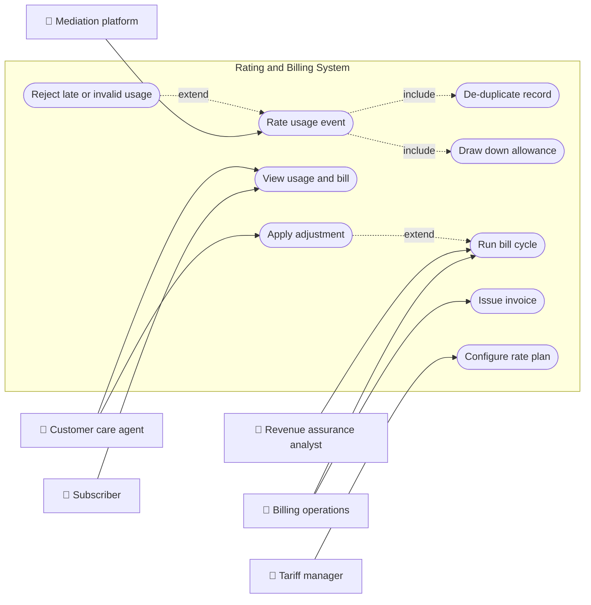
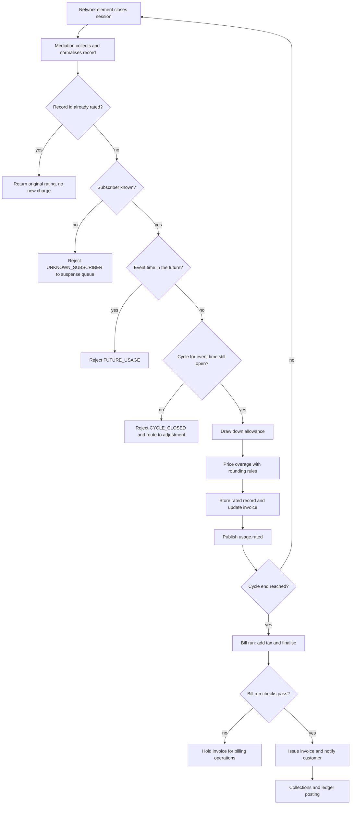
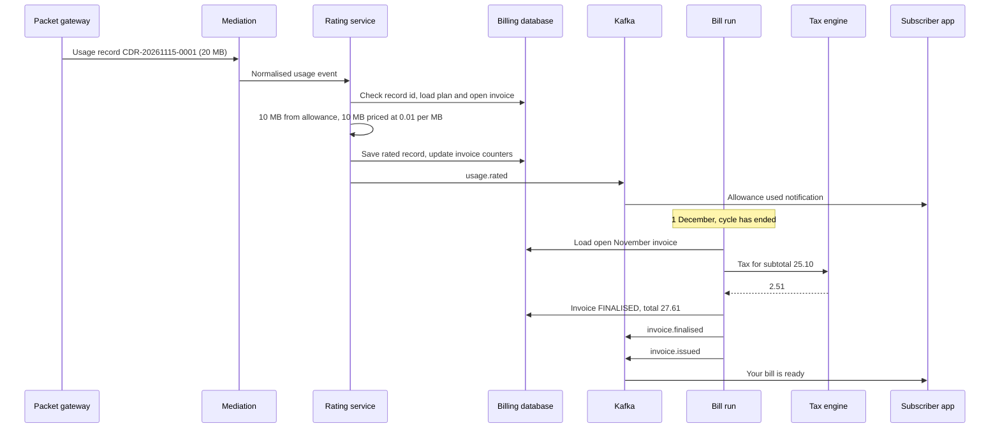
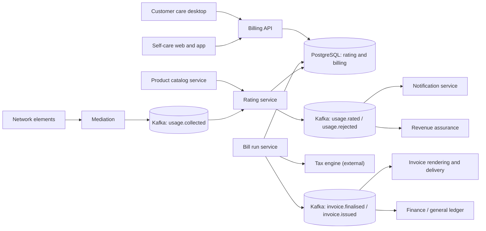
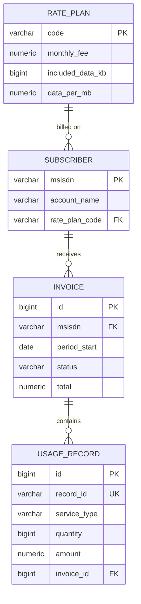
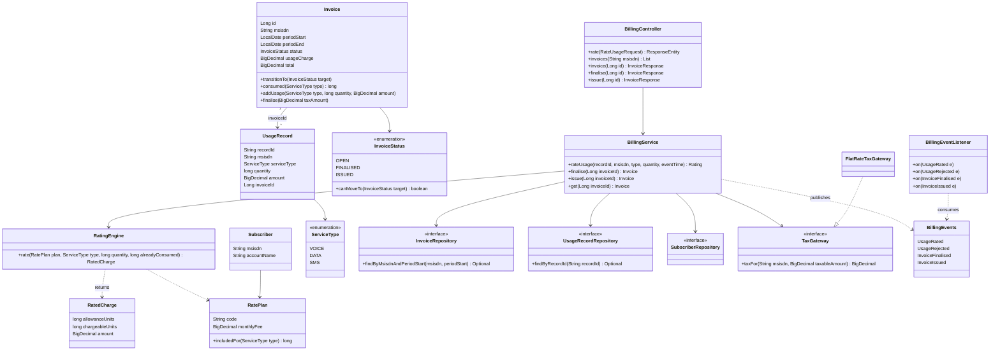
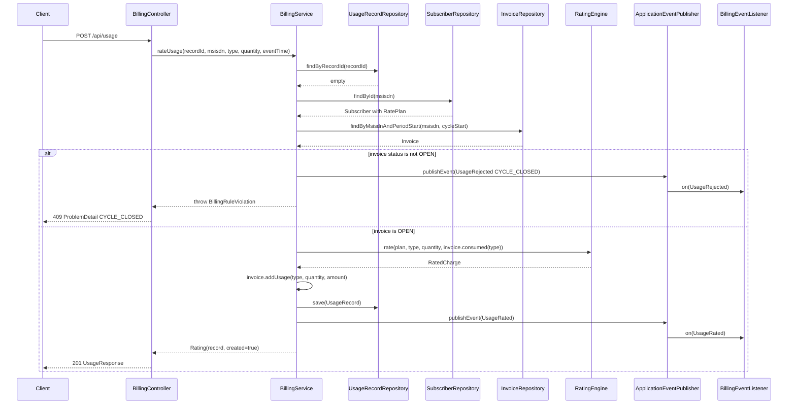
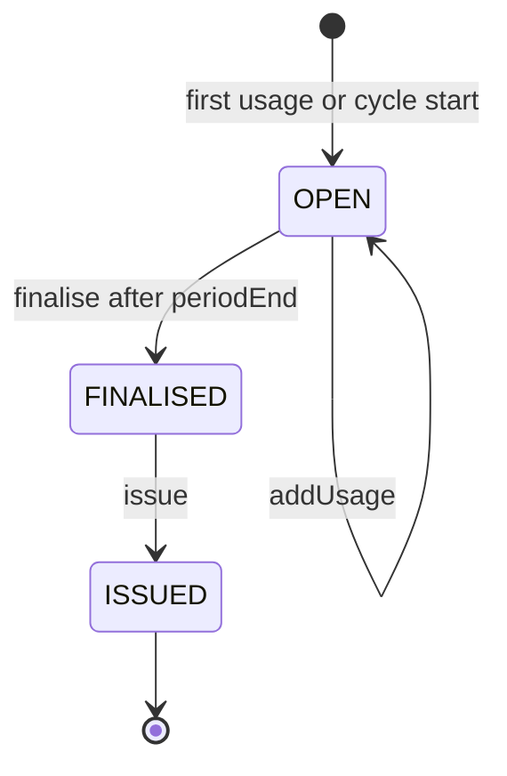
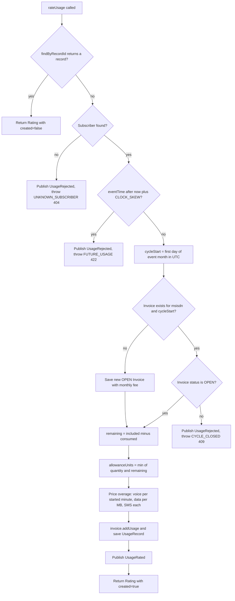

# Usage Rating and Billing

> **Domain:** Telecom · **Author:** [@dhulipalla599](https://github.com/dhulipalla599) · **Published:** November 16, 2026

> **Runnable code:** [`examples/telecom/usage-rating-and-billing`](https://github.com/dhulipalla599/domain-knowledge-engineering/tree/main/examples/telecom/usage-rating-and-billing)

## Explain It Like I'm Five

Imagine your parents give you a jar with 100 sweets at the start of every month, and the sweets are already paid for. Every time you take a sweet, someone writes it down in a little notebook. When the jar is empty and you still want sweets, each extra one costs a coin from your pocket money. At the end of the month, someone adds up the notebook, counts the extra sweets and writes a note saying how many coins you owe. Then a new month starts with a fresh, full jar.

A phone company does the same thing: every call, text and megabyte is written down, taken from the customer's monthly allowance first, priced only when the allowance runs out, and added up into a bill at the end of the billing cycle.

## Business Overview

**Usage rating** turns raw network usage records into money. **Billing** collects those rated charges, plus recurring fees, discounts and taxes, into an invoice for one billing cycle. Together they sit in the operator's BSS (Business Support Systems), between the network that produces usage and the finance systems that collect and account for revenue.

Why the business cares:

- **Revenue**: for postpaid mobile, every unrated or wrongly rated record is either lost revenue or an overcharge. Revenue assurance teams exist to find this "leakage".
- **Customer experience**: billing errors are a leading cause of complaints and churn. Customers expect to see usage almost in real time in the app and to understand every line on the bill.
- **Regulation**: many regulators set rules on bill accuracy, usage notifications (for example data roaming alerts in some regions), invoice content, dispute handling and record retention. The details differ by country, so treat them as configuration, not code.
- **Finance and tax**: an issued invoice is a legal and accounting document. Telecom taxes and surcharges vary by country, state and even service type.

Where it sits in the Telecom value chain:

1. **Network** (voice switches, packet gateways, SMS centres) produces usage records, often called CDRs (Call Detail Records) even for data.
2. **Mediation** collects, decodes, de-duplicates and normalises records from many network elements.
3. **Charging and rating** prices each event against the customer's tariff. Prepaid uses *online charging* (credit is checked before and during the session). Postpaid mostly uses *offline charging* (records are rated after the fact).
4. **Billing** runs once per cycle: closes the period, applies recurring charges, discounts and tax, and produces the invoice.
5. **Collections, payments and finance** take the money and post it to the general ledger.

This page focuses on postpaid offline rating and the monthly bill run, which is where most full stack engineers first meet the domain.

## Real-World Example

**Northwind Mobile** (a fictional operator) sells the **Smart 25** plan: 25.00 a month including 300 minutes, 5 GB of data and 100 SMS. Out of bundle, voice is 0.10 per started minute, data 0.01 per MB and SMS 0.05 each.

1. **1 November**: Priya Raman's November billing cycle opens. Her invoice starts with the 25.00 monthly fee.
2. **15 November, 18:30 UTC**: Priya streams a video. She has 10 MB of her 5 GB left, and the session uses 20 MB.
3. The packet gateway closes the session and writes a usage record with a unique record id `CDR-20261115-0001`.
4. **Mediation** picks it up, checks it is not a duplicate, converts it to Northwind's internal format and publishes it.
5. **Rating** looks up Priya's plan, finds 10 MB left in the allowance, takes those 10 MB from the bucket and prices the other 10 MB at 0.01 per MB, giving **0.10**. It stores the rated record and adds it to her open November invoice.
6. Her app shows "Data allowance used, you are now paying per MB". In some markets a notification like this is required by regulation; at Northwind it is a product decision.
7. **16 November**: a record from 31 October (a 2-minute call that ended just before midnight) arrives late from a remote switch. October's bill was already finalised on 1 November, so rating refuses to add it to October. The billing operations team decides whether to post it as an adjustment on the next bill or write it off, according to Northwind's policy.
8. **1 December**: the **bill run** finalises Priya's November invoice: 25.00 recurring + 0.10 usage = 25.10, plus tax (10% in this simplified example) = **27.61**. The invoice is frozen.
9. The invoice is **issued**: rendered as a PDF, sent by email and shown in the app. Her direct debit collects the amount on the due date.

## Stakeholders

| Stakeholder | What they need | What they fear |
|---|---|---|
| Subscriber | A correct, understandable bill and real-time view of usage | Bill shock, being charged twice, charges they cannot explain |
| Product / Tariff manager | Launch new plans and bundles quickly without code changes | A tariff that rates wrongly in production for a whole cycle |
| Billing operations | A bill run that finishes on time, with clear exception queues | Stuck bill runs, late records, mass re-billing |
| Revenue assurance analyst | Every network record reconciled to a rated, billed charge | Silent leakage: records dropped between network and invoice |
| Finance / Tax | Accurate totals, correct tax per jurisdiction, ledger postings | Invoices that change after issue, audit findings |
| Customer care agent | Line-by-line view of usage and charges, ability to adjust | Being unable to explain a charge to an angry customer |
| Mediation platform (system) | A stable contract for delivering usage events | Back-pressure or rejections it cannot replay |
| Regulator | Accurate billing, required notifications, dispute handling | Systemic overcharging of consumers |

## Use Case Diagram



| Use Case | Primary Actor | Goal | Main success outcome |
|---|---|---|---|
| Rate usage event | Mediation platform | Turn one network record into a priced charge | Rated record stored on the open invoice, `usage.rated` published |
| De-duplicate record | Mediation platform | Never charge the same record twice | A replayed record returns the original rating |
| Draw down allowance | Mediation platform | Use included units before charging | Allowance counters updated, only overage priced |
| Reject late or invalid usage | Mediation platform | Keep closed bills and bad data out | Record refused with a reason code, `usage.rejected` published |
| Run bill cycle | Billing operations | Close the period and freeze totals | Invoice `FINALISED` with tax and total |
| Issue invoice | Billing operations | Send the legal bill to the customer | Invoice `ISSUED`, customer notified |
| View usage and bill | Subscriber | Understand consumption and charges | Usage, allowance and charges shown |
| Configure rate plan | Tariff manager | Launch or change a tariff | New plan version effective from a date |
| Apply adjustment | Customer care agent | Correct a charge on a later bill | Credit or debit line on the next invoice |

## Key Terms

| Term | Plain-English meaning |
|---|---|
| CDR / UDR | Call (or Usage) Detail Record: the network's record of one call, session or message |
| Mediation | Collects records from network elements, decodes, de-duplicates and normalises them |
| Rating | Applying the tariff to a usage record to compute a price |
| Charging (online / offline) | Online: credit checked before and during the session (prepaid). Offline: records rated afterwards (postpaid) |
| Rate plan / tariff | The product's price rules: fees, included allowances, unit prices |
| Allowance / bucket | Included units (minutes, MB, SMS) consumed before out-of-bundle prices apply |
| Overage / out-of-bundle | Usage beyond the allowance, charged per unit |
| Rounding increment | How usage is rounded before pricing, for example per started minute or per second |
| Billing cycle | The period an invoice covers; can start on any "bill cycle day", not only the 1st |
| Bill run | The batch job that closes a cycle and produces invoices |
| Proration | Charging part of a monthly fee when a plan starts, ends or changes mid-cycle |
| Adjustment | A credit or debit applied to a later bill to correct an earlier one |
| Revenue assurance | Reconciling network usage to billed revenue to find leakage |

## Process Flow

Usage flows continuously during the cycle and billing happens in bursts at cycle end. Mediation delivers each record once or more (retries happen), rating de-duplicates it, finds the subscriber and the cycle it belongs to, takes units from the allowance and prices the rest. Records for a cycle that is already closed are not added to it; they go to an adjustment process. At cycle end the bill run freezes each invoice, adds tax and issues it.





## Business Rules and Edge Cases

- **Duplicates are normal, double charges are not.** Mediation and networks retry. The network record id (or a hash of its key fields) must be a unique key, and a replay must return the original result rather than an error that triggers more retries.
- **Allowance before overage, and split events.** A single event can cross the allowance boundary: part free, part charged. Rating each event against the counters as they stand *now* means the order of processing matters; process records per subscriber in event order where possible, and accept small ordering differences in the design.
- **Concurrent draw-down.** Two raters updating the same allowance at once will lose an update without locking. Use optimistic locking with retry, or partition the stream by subscriber so one consumer owns one line.
- **Rounding is a product decision.** Voice may be rounded per second, per started minute or with a minimum first block. Data may be rounded per KB, per 10 KB or per session. Apply rounding to quantities as the tariff says, keep money at more decimals per event, and round to currency once on the invoice. Never use floating point for money.
- **Late records and closed cycles.** Records can arrive days late (offline switches, roaming partners). Once an invoice is finalised it must not change. Late usage goes to the next bill as an adjustment, or is written off below a threshold, according to company policy and local rules.
- **Time zones and cycle boundaries.** Decide whether the cycle boundary is in UTC or the customer's local time, and which timestamp counts (session start or end). A session spanning midnight on cycle end is a classic source of disputes. Practices differ by operator.
- **Future and garbage timestamps.** Network clocks drift. Allow a small skew, reject the rest to a suspense queue for investigation.
- **Bill run only after the cycle ends,** and only after a grace period for late records if the operator uses one. Finalising early silently loses usage.
- **Issued invoices are immutable.** Corrections are credit notes or adjustments, never edits. Many tax regimes require this.
- **Plan changes mid-cycle** need proration of recurring fees and a decision on how allowances are split. This is one of the most complex areas; model it explicitly.
- **Partial failure in the bill run.** A bill run over millions of accounts must be restartable per account, never "all or nothing", and must not issue the same invoice twice.

## From Business to System

| Business concept / step | System component | Data entity | Event |
|---|---|---|---|
| Network usage record | Mediation (external) | `UsageRecord` (input) | `usage.collected` (upstream, outside this service) |
| De-duplicate record | `BillingService.rateUsage` | `usage_record.record_id` unique key | none (replay returns original) |
| Tariff and allowance | `RatingEngine`, `RatePlan` | `rate_plan` | none |
| Draw down allowance and price overage | `RatingEngine.rate` | `invoice` counters, `usage_record` | `usage.rated` |
| Reject invalid or late usage | `BillingService.rateUsage` | none stored | `usage.rejected` |
| Billing cycle | `Invoice` with `periodStart` / `periodEnd` | `invoice` | none |
| Bill run | `BillingService.finalise` | `invoice.status = FINALISED` | `invoice.finalised` |
| Tax | `TaxGateway` | `invoice.tax` | none |
| Issue invoice | `BillingService.issue` | `invoice.status = ISSUED` | `invoice.issued` |
| Customer views bill | `BillingController`, React screen | `invoice`, `usage_record` | none |

## Architecture



Boundaries:

- **Mediation** is separate because it speaks network formats (ASN.1, vendor CSVs, Diameter) and its job is collection and normalisation, not pricing.
- **Rating** owns the per-event hot path. It must scale with traffic, so it is a stateless consumer group partitioned by subscriber (MSISDN) to keep each line's events ordered and avoid allowance races.
- **Bill run** is a batch workload with very different load (bursty, at cycle end) and failure handling (restartable per account). It reads what rating wrote but owns the invoice lifecycle after `OPEN`.
- **Product catalog** owns tariffs and versions them by effective date, so product teams can launch plans without touching rating code.
- Downstream consumers (notifications, revenue assurance, documents, finance) subscribe to events instead of calling billing, so a slow PDF renderer cannot slow down rating.

In the runnable example, rating and the bill run live in one Spring Boot service for readability.

## Data Model

```sql
CREATE TABLE rate_plan (
    code                    varchar(32) PRIMARY KEY,
    name                    varchar(255) NOT NULL,
    monthly_fee             numeric(12,2) NOT NULL,
    included_voice_seconds  bigint NOT NULL DEFAULT 0,
    included_data_kb        bigint NOT NULL DEFAULT 0,
    included_sms            bigint NOT NULL DEFAULT 0,
    voice_per_minute        numeric(12,4) NOT NULL,
    data_per_mb             numeric(12,4) NOT NULL,
    sms_each                numeric(12,4) NOT NULL
);

CREATE TABLE subscriber (
    msisdn          varchar(16) PRIMARY KEY,
    account_name    varchar(255) NOT NULL,
    rate_plan_code  varchar(32) NOT NULL REFERENCES rate_plan(code)
);

CREATE TABLE invoice (
    id                  bigserial PRIMARY KEY,
    version             bigint NOT NULL DEFAULT 0,
    msisdn              varchar(16) NOT NULL REFERENCES subscriber(msisdn),
    period_start        date NOT NULL,
    period_end          date NOT NULL,
    status              varchar(16) NOT NULL CHECK (status IN ('OPEN','FINALISED','ISSUED')),
    recurring_charge    numeric(12,2) NOT NULL,
    usage_charge        numeric(14,4) NOT NULL DEFAULT 0,
    tax                 numeric(12,2),
    total               numeric(12,2),
    used_voice_seconds  bigint NOT NULL DEFAULT 0,
    used_data_kb        bigint NOT NULL DEFAULT 0,
    used_sms            bigint NOT NULL DEFAULT 0,
    UNIQUE (msisdn, period_start)
);

CREATE TABLE usage_record (
    id                bigserial PRIMARY KEY,
    record_id         varchar(64) NOT NULL UNIQUE,
    msisdn            varchar(16) NOT NULL,
    service_type      varchar(8) NOT NULL CHECK (service_type IN ('VOICE','DATA','SMS')),
    quantity          bigint NOT NULL CHECK (quantity > 0),
    allowance_units   bigint NOT NULL,
    chargeable_units  bigint NOT NULL,
    amount            numeric(14,4) NOT NULL,
    event_time        timestamptz NOT NULL,
    invoice_id        bigint NOT NULL REFERENCES invoice(id),
    rated_at          timestamptz NOT NULL
);
CREATE INDEX usage_record_invoice_idx ON usage_record (invoice_id, event_time);
```

At production volumes `usage_record` is partitioned by month (PostgreSQL declarative partitioning) and old partitions are archived according to the retention rules of each country. Allowance counters usually live in a separate balance table with one row per bucket, rather than on the invoice.



## APIs

| Method | Path | Purpose |
|---|---|---|
| POST | `/api/usage` | Rate one usage event (201 new, 200 replay) |
| GET | `/api/invoices?msisdn=` | List a subscriber's invoices, newest first |
| GET | `/api/invoices/{id}` | One invoice with allowance counters and totals |
| GET | `/api/invoices/{id}/usage` | Rated usage records on an invoice |
| POST | `/api/invoices/{id}/finalise` | Bill run for one invoice: tax, total, freeze |
| POST | `/api/invoices/{id}/issue` | Issue a finalised invoice to the customer |

In production, usage arrives over Kafka rather than REST; the REST endpoint is useful for replays, testing and low-volume partners. TM Forum's Open APIs (Usage Management and Customer Bill Management) are a common reference for these resource shapes.

`POST /api/usage`

```json
{
  "recordId": "CDR-20261115-0001",
  "msisdn": "+15550201001",
  "serviceType": "DATA",
  "quantity": 20480,
  "eventTime": "2026-11-15T18:30:00Z"
}
```

Response `201 Created`:

```json
{
  "recordId": "CDR-20261115-0001",
  "msisdn": "+15550201001",
  "serviceType": "DATA",
  "quantity": 20480,
  "allowanceUnits": 10240,
  "chargeableUnits": 10240,
  "amount": 0.1000,
  "eventTime": "2026-11-15T18:30:00Z",
  "invoiceId": 2
}
```

Quantity units are seconds for `VOICE`, kilobytes for `DATA` and messages for `SMS`.

## Events

| Event | Producer | Consumers | Key fields |
|---|---|---|---|
| `usage.rated` | Rating service | Notifications (allowance alerts), revenue assurance, analytics | `recordId`, `msisdn`, `serviceType`, `chargeableUnits`, `amount`, `invoiceId` |
| `usage.rejected` | Rating service | Suspense / error queue handling, revenue assurance | `recordId`, `msisdn`, `reason` |
| `invoice.finalised` | Bill run | Invoice rendering, finance | `invoiceId`, `msisdn`, `total` |
| `invoice.issued` | Bill run | Notifications, collections, general ledger | `invoiceId`, `msisdn`, `total` |

Ordering and idempotency:

- Key `usage.*` topics by **MSISDN** so all events of one line land on one partition in order; allowance alerts then fire in the right sequence.
- Consumers must be idempotent: Kafka delivers at least once. Use `recordId` and `invoiceId` as de-duplication keys downstream.
- Publish through a **transactional outbox** (write the event row in the same database transaction as the rating, then relay it to Kafka) so a crash cannot produce a charge without an event or an event without a charge.
- `usage.rejected` must never be dropped: revenue assurance reconciles collected, rated and rejected counts per day.

## Backend Implementation

> The Java tab is the runnable example's code. The Python tab uses FastAPI with SQLAlchemy, and the Node.js tab uses Express with TypeScript and Prisma.

Full source: [`examples/telecom/usage-rating-and-billing`](https://github.com/dhulipalla599/domain-knowledge-engineering/tree/main/examples/telecom/usage-rating-and-billing).

The key rule is `BillingService.rateUsage`: de-duplicate, known line, no future usage, no usage into a closed cycle, allowance first.

=== "Java"

    ```java
    /** Network clocks drift; anything further ahead than this is treated as bad data. */
    static final Duration CLOCK_SKEW = Duration.ofMinutes(5);

    /** Core rules: de-duplicate, known line, no future usage, no usage into a closed cycle, allowance first. */
    @Transactional
    public Rating rateUsage(String recordId, String msisdn, ServiceType type, long quantity, Instant eventTime) {
        var duplicate = usage.findByRecordId(recordId);
        if (duplicate.isPresent()) {
            return new Rating(duplicate.get(), false);
        }
        Subscriber subscriber = subscribers.findById(msisdn)
                .orElseThrow(() -> reject(recordId, msisdn, "UNKNOWN_SUBSCRIBER", HttpStatus.NOT_FOUND,
                        "No active subscriber " + msisdn));
        Instant now = clock.instant();
        if (eventTime.isAfter(now.plus(CLOCK_SKEW))) {
            throw reject(recordId, msisdn, "FUTURE_USAGE", HttpStatus.UNPROCESSABLE_ENTITY,
                    "Event time " + eventTime + " is in the future");
        }

        LocalDate cycleStart = LocalDate.ofInstant(eventTime, ZoneOffset.UTC).withDayOfMonth(1);
        Invoice invoice = invoices.findByMsisdnAndPeriodStart(msisdn, cycleStart)
                .orElseGet(() -> invoices.save(
                        new Invoice(msisdn, cycleStart, subscriber.getRatePlan().getMonthlyFee())));
        if (invoice.getStatus() != InvoiceStatus.OPEN) {
            throw reject(recordId, msisdn, "CYCLE_CLOSED", HttpStatus.CONFLICT,
                    "Billing cycle " + cycleStart + " is " + invoice.getStatus() + "; raise an adjustment instead");
        }

        var charge = engine.rate(subscriber.getRatePlan(), type, quantity, invoice.consumed(type));
        invoice.addUsage(type, quantity, charge.amount());
        UsageRecord record = usage.save(new UsageRecord(recordId, msisdn, type, quantity,
                charge.allowanceUnits(), charge.chargeableUnits(), charge.amount(), eventTime, invoice.getId(), now));
        events.publishEvent(new UsageRated(recordId, msisdn, type, charge.chargeableUnits(), charge.amount(), invoice.getId()));
        return new Rating(record, true);
    }
    ```

=== "Python"

    ```python
    CLOCK_SKEW = timedelta(minutes=5)

    def rate_usage(db: Session, record_id: str, msisdn: str, service_type: ServiceType,
                   quantity: int, event_time: datetime) -> tuple[UsageRecord, bool]:
        """Core rules: de-duplicate, known line, no future usage, no usage into a closed cycle, allowance first."""
        duplicate = db.scalar(select(UsageRecord).where(UsageRecord.record_id == record_id))
        if duplicate:
            return duplicate, False
        subscriber = db.get(Subscriber, msisdn)
        if subscriber is None:
            raise reject(record_id, msisdn, "UNKNOWN_SUBSCRIBER", 404, f"No active subscriber {msisdn}")
        now = clock.now()
        if event_time > now + CLOCK_SKEW:
            raise reject(record_id, msisdn, "FUTURE_USAGE", 422, f"Event time {event_time} is in the future")

        cycle_start = event_time.astimezone(timezone.utc).date().replace(day=1)
        invoice = db.scalar(select(Invoice).where(Invoice.msisdn == msisdn, Invoice.period_start == cycle_start))
        if invoice is None:
            invoice = Invoice.open(msisdn, cycle_start, subscriber.rate_plan.monthly_fee)
            db.add(invoice)
            db.flush()
        if invoice.status != InvoiceStatus.OPEN:
            raise reject(record_id, msisdn, "CYCLE_CLOSED", 409,
                         f"Billing cycle {cycle_start} is {invoice.status}; raise an adjustment instead")

        charge = rating_engine.rate(subscriber.rate_plan, service_type, quantity, invoice.consumed(service_type))
        invoice.add_usage(service_type, quantity, charge.amount)
        record = UsageRecord(record_id=record_id, msisdn=msisdn, service_type=service_type, quantity=quantity,
                             allowance_units=charge.allowance_units, chargeable_units=charge.chargeable_units,
                             amount=charge.amount, event_time=event_time, invoice_id=invoice.id, rated_at=now)
        db.add(record)
        events.publish("usage.rated", UsageRated(record_id, msisdn, service_type, charge.chargeable_units,
                                                 charge.amount, invoice.id))
        return record, True
    ```

=== "Node.js"

    ```typescript
    const CLOCK_SKEW_MS = 5 * 60 * 1000;

    /** Core rules: de-duplicate, known line, no future usage, no usage into a closed cycle, allowance first. */
    export async function rateUsage(recordId: string, msisdn: string, serviceType: ServiceType,
                                    quantity: number, eventTime: Date): Promise<{ record: UsageRecord; created: boolean }> {
      return prisma.$transaction(async (tx) => {
        const duplicate = await tx.usageRecord.findUnique({ where: { recordId } });
        if (duplicate) return { record: duplicate, created: false };

        const subscriber = await tx.subscriber.findUnique({ where: { msisdn }, include: { ratePlan: true } });
        if (!subscriber) throw reject(recordId, msisdn, "UNKNOWN_SUBSCRIBER", 404, `No active subscriber ${msisdn}`);
        const now = clock.now();
        if (eventTime.getTime() > now.getTime() + CLOCK_SKEW_MS) {
          throw reject(recordId, msisdn, "FUTURE_USAGE", 422, `Event time ${eventTime.toISOString()} is in the future`);
        }

        const cycleStart = new Date(Date.UTC(eventTime.getUTCFullYear(), eventTime.getUTCMonth(), 1));
        const invoice = await tx.invoice.upsert({
          where: { msisdn_periodStart: { msisdn, periodStart: cycleStart } },
          create: openInvoice(msisdn, cycleStart, subscriber.ratePlan.monthlyFee),
          update: {},
        });
        if (invoice.status !== "OPEN") {
          throw reject(recordId, msisdn, "CYCLE_CLOSED", 409,
            `Billing cycle ${cycleStart.toISOString().slice(0, 10)} is ${invoice.status}; raise an adjustment instead`);
        }

        const charge = ratingEngine.rate(subscriber.ratePlan, serviceType, quantity, consumed(invoice, serviceType));
        await tx.invoice.update({   // optimistic lock: fails if another rater changed the invoice
          where: { id: invoice.id, version: invoice.version },
          data: { ...addUsage(invoice, serviceType, quantity, charge.amount), version: { increment: 1 } },
        });
        const record = await tx.usageRecord.create({
          data: { recordId, msisdn, serviceType, quantity, allowanceUnits: charge.allowanceUnits,
                  chargeableUnits: charge.chargeableUnits, amount: charge.amount, eventTime,
                  invoiceId: invoice.id, ratedAt: now },
        });
        await events.publish("usage.rated", { recordId, msisdn, serviceType,
          chargeableUnits: charge.chargeableUnits, amount: charge.amount.toString(), invoiceId: invoice.id });
        return { record, created: true };
      });
    }
    ```

The controller endpoint returns `201` for a new rating and `200` for a replay:

=== "Java"

    ```java
    /** 201 when rated now, 200 when this recordId was already rated (safe replay). */
    @PostMapping("/usage")
    public ResponseEntity<UsageResponse> rate(@Valid @RequestBody RateUsageRequest req) {
        var result = billing.rateUsage(req.recordId(), req.msisdn(), req.serviceType(), req.quantity(), req.eventTime());
        return ResponseEntity.status(result.created() ? HttpStatus.CREATED : HttpStatus.OK)
                .body(UsageResponse.from(result.record()));
    }
    ```

=== "Python"

    ```python
    @router.post("/api/usage", response_model=UsageResponse)
    def rate(req: RateUsageRequest, response: Response, db: Session = Depends(get_db)) -> UsageResponse:
        """201 when rated now, 200 when this recordId was already rated (safe replay)."""
        record, created = rate_usage(db, req.record_id, req.msisdn, req.service_type, req.quantity, req.event_time)
        db.commit()
        response.status_code = 201 if created else 200
        return UsageResponse.model_validate(record)
    ```

=== "Node.js"

    ```typescript
    /** 201 when rated now, 200 when this recordId was already rated (safe replay). */
    router.post("/api/usage", validate(rateUsageRequest), async (req, res, next) => {
      try {
        const { recordId, msisdn, serviceType, quantity, eventTime } = req.body as RateUsageRequest;
        const { record, created } = await rateUsage(recordId, msisdn, serviceType, quantity, new Date(eventTime));
        res.status(created ? 201 : 200).json(toUsageResponse(record));
      } catch (err) {
        next(err);   // error middleware maps rule violations to RFC 9457 problem+json
      }
    });
    ```

Pricing itself lives in `RatingEngine.rate`, a pure function with no database or clock, so it can be unit tested and used to re-rate history after a tariff fix.

## Frontend Screen

The subscriber's "My bill" screen: allowance left, out-of-bundle charges so far, and the rated records behind them.

```tsx
import { useEffect, useState } from "react";

type Invoice = {
  id: number; periodStart: string; periodEnd: string; status: "OPEN" | "FINALISED" | "ISSUED";
  recurringCharge: number; usageCharge: number; tax: number | null; total: number | null;
  usedVoiceSeconds: number; usedDataKb: number; usedSms: number;
};
type Usage = { recordId: string; serviceType: "VOICE" | "DATA" | "SMS"; quantity: number;
  chargeableUnits: number; amount: number; eventTime: string };

const ALLOWANCE = { voiceSeconds: 18000, dataKb: 5242880, sms: 100 }; // from the plan API in a real app
const money = new Intl.NumberFormat(undefined, { style: "currency", currency: "USD" });

function Meter({ label, used, included, unit }: { label: string; used: number; included: number; unit: string }) {
  const pct = Math.min(100, Math.round((used / included) * 100));
  return (
    <div>
      <label>{label}: {Math.max(0, included - used).toLocaleString()} {unit} left</label>
      <progress value={pct} max={100} aria-label={`${label} ${pct}% used`} />
    </div>
  );
}

export function MyBill({ msisdn }: { msisdn: string }) {
  const [invoice, setInvoice] = useState<Invoice | null>(null);
  const [usage, setUsage] = useState<Usage[]>([]);
  const [error, setError] = useState<string | null>(null);

  useEffect(() => {
    (async () => {
      try {
        const list: Invoice[] = await fetch(`/api/invoices?msisdn=${encodeURIComponent(msisdn)}`).then((r) => r.json());
        const current = list[0];
        if (!current) return;
        setInvoice(current);
        setUsage(await fetch(`/api/invoices/${current.id}/usage`).then((r) => r.json()));
      } catch {
        setError("We could not load your bill. Please try again.");
      }
    })();
  }, [msisdn]);

  if (error) return <p role="alert">{error}</p>;
  if (!invoice) return <p>Loading…</p>;

  return (
    <section>
      <h2>Bill {invoice.periodStart} to {invoice.periodEnd} ({invoice.status.toLowerCase()})</h2>
      <Meter label="Data" used={invoice.usedDataKb / 1024} included={ALLOWANCE.dataKb / 1024} unit="MB" />
      <Meter label="Minutes" used={invoice.usedVoiceSeconds / 60} included={ALLOWANCE.voiceSeconds / 60} unit="min" />
      <Meter label="Texts" used={invoice.usedSms} included={ALLOWANCE.sms} unit="SMS" />
      <dl>
        <dt>Monthly fee</dt><dd>{money.format(invoice.recurringCharge)}</dd>
        <dt>Out-of-bundle so far</dt><dd>{money.format(invoice.usageCharge)}</dd>
        {invoice.total !== null && (<><dt>Total incl. tax</dt><dd>{money.format(invoice.total)}</dd></>)}
      </dl>
      <table>
        <thead><tr><th>When</th><th>Type</th><th>Charged units</th><th>Amount</th></tr></thead>
        <tbody>
          {usage.filter((u) => u.chargeableUnits > 0).map((u) => (
            <tr key={u.recordId}>
              <td>{new Date(u.eventTime).toLocaleString()}</td>
              <td>{u.serviceType}</td>
              <td>{u.chargeableUnits}</td>
              <td>{money.format(u.amount)}</td>
            </tr>
          ))}
        </tbody>
      </table>
      {invoice.status === "OPEN" && <small>Charges are estimates until the bill is finalised.</small>}
    </section>
  );
}
```

## Cloud Deployment

Main AWS services:

- **Amazon EKS** runs the rating service (a Kafka consumer group, scaled on consumer lag), the billing API and the bill run (Kubernetes `Job`s or a scheduler per cycle).
- **Amazon MSK** hosts the Kafka topics, keyed by MSISDN.
- **Amazon RDS for PostgreSQL** or **Aurora PostgreSQL** stores rating and billing data, Multi-AZ, with monthly partitions for usage.
- **Amazon S3** holds raw CDR files from mediation and rendered invoice PDFs, with Object Lock where retention rules require immutability.
- **AWS KMS** encrypts data at rest; **Secrets Manager** holds database credentials, read by pods through IAM Roles for Service Accounts (IRSA).

Terraform for the event backbone, the resource every other part depends on:

```hcl
resource "aws_msk_cluster" "billing" {
  cluster_name           = "northwind-billing"
  kafka_version          = "3.6.0"
  number_of_broker_nodes = 3

  broker_node_group_info {
    instance_type   = "kafka.m5.large"
    client_subnets  = var.private_subnet_ids
    security_groups = [aws_security_group.msk.id]
    storage_info {
      ebs_storage_info {
        volume_size = 1000
      }
    }
  }

  encryption_info {
    encryption_at_rest_kms_key_arn = aws_kms_key.billing.arn
    encryption_in_transit {
      client_broker = "TLS"
      in_cluster    = true
    }
  }

  logging_info {
    broker_logs {
      cloudwatch_logs {
        enabled   = true
        log_group = aws_cloudwatch_log_group.msk.name
      }
    }
  }
}
```

Security: billing data includes personal data and call patterns, so restrict access by namespace and IAM role, encrypt in transit and at rest, mask MSISDNs in logs, and keep an audit trail of every adjustment and status change.

Scaling: rating scales horizontally up to the number of topic partitions; size partitions for peak hour, not average. The bill run is bursty: use a separate node group (or Karpenter provisioning) so it does not starve rating, and spread bill cycle days across the month if volumes are large.

Observability: instrument services with the **OpenTelemetry** Java agent and export traces and metrics through the OpenTelemetry Collector (or AWS Distro for OpenTelemetry) to **CloudWatch**. Key metrics: consumer lag per partition, records rated / rejected per minute by reason, rating latency, invoices finalised per bill run hour, and a daily reconciliation of collected vs rated vs rejected counts. Alarm on lag growth and on any sudden spike in `usage.rejected`.

## Non-Functional Requirements

| Requirement | Expectation | How the design meets it |
|---|---|---|
| Availability | Rating can pause briefly without loss; usage must never be lost | Kafka retains records, consumers resume from committed offsets; Multi-AZ database and brokers |
| Latency | Postpaid offline rating within minutes so apps show near real-time usage. Prepaid online charging is much stricter and handled by a separate charging function | Stateless consumers scaled on lag; pure `RatingEngine` with no remote calls |
| Throughput | Peak-hour volume, many times the average | Partitioning by MSISDN, horizontal scaling, batched commits |
| Consistency | No double charge, no lost charge, invoice equals the sum of its rated records | Unique `record_id`, invoice row updated in the same transaction as the record, optimistic locking (`@Version`), outbox for events |
| Accuracy | Exact money arithmetic | `numeric` / `BigDecimal`, 4 decimals per event, one rounding step on the invoice |
| Audit | Every charge traceable from network record to invoice line | `record_id` kept end to end, immutable issued invoices, adjustments as new records |
| Compliance | Data retention, privacy, tax and billing rules per country | Retention via partition archiving, encryption, tax behind a jurisdiction-aware `TaxGateway`; specific rules configured per market |
| Re-rating | Ability to recompute charges after a tariff error | Raw usage retained; rating is a pure function of record and plan version |

## Runnable Example

The example is a single Spring Boot 3 service that rates usage events against a rate plan's allowance and out-of-bundle prices, keeps a per-cycle invoice with allowance counters, and runs the invoice lifecycle `OPEN -> FINALISED -> ISSUED`. It enforces de-duplication by `recordId`, rejects future usage (`422 FUTURE_USAGE`), usage for a closed cycle (`409 CYCLE_CLOSED`), finalising a cycle before it ends (`409 CYCLE_NOT_ENDED`) and illegal transitions (`409 ILLEGAL_STATE_TRANSITION`), and publishes `usage.rated`, `usage.rejected`, `invoice.finalised` and `invoice.issued` as Spring application events. Tax sits behind a `TaxGateway` with a flat 10% stub. It runs on H2 with seed data and needs no external services.

Source: [`examples/telecom/usage-rating-and-billing`](https://github.com/dhulipalla599/domain-knowledge-engineering/tree/main/examples/telecom/usage-rating-and-billing)

```bash
cd examples/telecom/usage-rating-and-billing
mvn spring-boot:run          # http://localhost:8080
mvn verify                   # unit + API tests
```

Rate a 20 MB session that crosses the remaining 10 MB of allowance:

```bash
curl -s -X POST localhost:8080/api/usage -H 'Content-Type: application/json' \
  -d '{"recordId":"CDR-20261115-0001","msisdn":"+15550201001","serviceType":"DATA","quantity":20480,"eventTime":"2026-11-15T18:30:00Z"}'
```

```json
{"recordId":"CDR-20261115-0001","msisdn":"+15550201001","serviceType":"DATA","quantity":20480,"allowanceUnits":10240,"chargeableUnits":10240,"amount":0.1000,"eventTime":"2026-11-15T18:30:00Z","invoiceId":2}
```

A late record for October, whose invoice is already finalised:

```bash
curl -s -X POST localhost:8080/api/usage -H 'Content-Type: application/json' \
  -d '{"recordId":"CDR-20261031-0042","msisdn":"+15550201001","serviceType":"VOICE","quantity":120,"eventTime":"2026-10-31T23:58:00Z"}'
```

```json
{"type":"about:blank","title":"CYCLE_CLOSED","status":409,"detail":"Billing cycle 2026-10-01 is FINALISED; raise an adjustment instead","instance":"/api/usage"}
```

| Class | Package | Responsibility |
|---|---|---|
| `RatePlan` | `domain` | Tariff: monthly fee, included allowances, unit prices |
| `Subscriber` | `domain` | Mobile line and its rate plan |
| `UsageRecord` | `domain` | One rated usage event, unique by `recordId` |
| `Invoice` | `domain` | Cycle bill, allowance counters, `transitionTo`, `addUsage`, `finalise` |
| `InvoiceStatus` | `domain` | Lifecycle enum with `canMoveTo` |
| `ServiceType` | `domain` | `VOICE`, `DATA`, `SMS` |
| `BillingEvents` | `domain` | `UsageRated`, `UsageRejected`, `InvoiceFinalised`, `InvoiceIssued` |
| `IllegalInvoiceTransition` | `domain` | Thrown on an illegal lifecycle move |
| `SubscriberRepository`, `UsageRecordRepository`, `InvoiceRepository` | `repository` | Spring Data JPA access |
| `RatingEngine` | `service` | Pure allowance draw-down and overage pricing |
| `BillingService` | `service` | Rating rules, bill run, issue, event publishing |
| `BillingRuleViolation` | `service` | Rule failure with code and HTTP status |
| `BillingController` | `api` | REST endpoints |
| `ApiExceptionHandler` | `api` | Maps exceptions to `ProblemDetail` |
| `TaxGateway`, `FlatRateTaxGateway` | `integration` | Tax port and deterministic stub |
| `BillingEventListener` | `integration` | Consumes the events (Kafka stand-in) |

## UML Diagrams

### Class Diagram

The controller delegates to `BillingService`, which uses the pure `RatingEngine` for prices, the repositories for state, `TaxGateway` for tax and `ApplicationEventPublisher` for events. `Invoice` owns its lifecycle through `InvoiceStatus`.



### Sequence Diagram (control flow)

One `POST /api/usage` through the code. The `alt` shows the main rule violation: the event's cycle is no longer `OPEN`.



### State Diagram

`Invoice` lifecycle as enforced by `InvoiceStatus.canMoveTo` and `Invoice.transitionTo`. Usage can only be added while `OPEN`, and `ISSUED` is terminal.



### Activity Diagram

Decision logic inside `BillingService.rateUsage`, including the call into `RatingEngine.rate`.



## AI Opportunities

1. **Revenue assurance anomaly detection.** Spot leakage or misconfiguration (for example a new tariff that rates a service at zero, a switch whose record volume drops suddenly). Data: daily counts and sums of collected, rated and rejected records by network element, tariff and service. Risk: false positives flood analysts; keep a human in the loop and explain each alert with the underlying counts.
2. **Bill explanation assistant.** An LLM answers "why is my bill higher this month?" in the app or for care agents, citing the actual invoice lines and usage records. Data: invoice, rated usage, plan details, recent adjustments. Risk: hallucinated or wrong explanations; ground answers only in retrieved records, never let the model compute or change amounts, and log every answer for audit.
3. **Bill shock prediction.** Forecast which customers will exceed their allowance and proactively suggest an add-on or plan change. Data: usage trend within the cycle, history, plan. Risk: perceived upselling and fairness concerns; follow local consumer protection rules and make offers transparent.
4. **Tariff configuration review.** An LLM agent reviews a new rate plan configuration against the product specification and generates test usage scenarios with expected charges. Data: plan definitions, product documents. Risk: the agent misses an edge case; its output is a test suite reviewed by people, not an approval.
5. **Dispute triage.** Classify billing disputes by likely root cause (late record, roaming, rounding, fraud) and route them. Data: dispute text, related records. Risk: biased routing or wrong outcomes for customers; decisions on refunds stay with people and are explainable.

## Common Pitfalls

- **Using `double` for money.** Use `BigDecimal` / `numeric`, and decide explicitly where and how rounding happens.
- **Rounding every event to cents.** Thousands of tiny data events each rounded up or down add visible errors. Keep more decimals per event and round once on the invoice, unless the tariff explicitly says otherwise.
- **Treating duplicates as errors.** Retries are normal. A duplicate must be a successful no-op that returns the original result.
- **Updating allowance counters without concurrency control.** Lost updates give away free usage or double count it. Use optimistic locking or single-writer partitioning.
- **Editing finalised or issued invoices.** Corrections are adjustments on a later bill or credit notes.
- **Ignoring time zones and cycle days.** "This month" is not always the calendar month in UTC.
- **Hard-coding tariffs.** Prices and allowances change every few months; they belong in a versioned catalog with effective dates, so historical records can be re-rated with the right version.
- **Dropping rejected records.** Every rejected record is potential revenue and must land somewhere visible and reconcilable.
- **One giant bill run transaction.** Make the bill run restartable per account and idempotent per invoice.
- **Testing only the happy path.** Build test packs of real-looking usage covering allowance boundaries, rounding, midnight sessions, late records and plan changes.

## Interview Questions

### Junior

1. **What is the difference between rating and billing?**
   Rating prices individual usage events against a tariff. Billing collects rated charges, recurring fees, discounts and tax for a period into an invoice.
2. **Why should you not store money as a floating-point number?**
   Binary floating point cannot represent most decimal fractions exactly, so sums drift. Use a decimal type such as `BigDecimal` or PostgreSQL `numeric`.
3. **What is an allowance and how does it affect rating?**
   Included units in the plan. Rating takes usage from the remaining allowance first and charges only the overage; one event can be partly free and partly charged.

### Mid-Level

1. **How do you make usage ingestion idempotent?**
   Use the network record id (or a hash of key fields) as a unique key; on a duplicate, return the stored result. Enforce it with a database unique constraint, not only a lookup, so races are caught too.
2. **A record for last month arrives after the bill was issued. What do you do?**
   Do not change the issued invoice. Reject it from the closed cycle and route it to an adjustment process (charge on the next bill or write off according to policy and thresholds). Track it for revenue assurance.
3. **Two consumers rate events for the same subscriber at once. What can go wrong and how do you prevent it?**
   Lost updates to allowance counters. Partition the stream by MSISDN so one consumer owns a line, and use optimistic locking (version column) with retry as a safety net.

### Senior / Architect

1. **Design a rating and billing platform for 20 million postpaid subscribers.**
   Key points: mediation to Kafka, rating as a partitioned consumer group keyed by subscriber, pure rating function with versioned tariffs, balance store with concurrency control, transactional outbox, partitioned usage storage, restartable per-account bill run spread across cycle days, reconciliation and revenue assurance, observability on lag and reject rates, retention and privacy per country.
2. **How would you support re-rating a whole month after a tariff configuration error?**
   Key points: keep raw usage immutable, make rating a deterministic function of record plus plan version, re-rate into a shadow result, compare and approve differences, apply them as adjustments rather than editing issued invoices, communicate with customers, and protect live rating capacity while re-rating runs.
3. **Where do you draw the line between online charging and offline rating, and how do they stay consistent?**
   Key points: prepaid and real-time spending limits need online charging (credit reservation during the session, standardised by 3GPP), postpaid can use offline rating. Many operators converge both on one charging system for consistent tariffs. Discuss reservation and reconciliation of final usage, latency budgets, failure modes when the charging system is unreachable (allow or block, by policy) and the single source of truth for balances.

## Further Learning

- 3GPP TS 32.240: Charging architecture and principles
- 3GPP 5G Converged Charging System (CHF and the Nchf service, TS 32.290 and TS 32.291)
- IETF RFC 4006 and RFC 8506: Diameter Credit-Control Application
- TM Forum Open APIs: Usage Management (TMF635) and Customer Bill Management (TMF678)
- TM Forum Information Framework (SID) and Business Process Framework (eTOM)
- GSMA TAP3 for roaming usage exchange
- Transactional outbox and Kafka idempotent consumers
- IETF RFC 9457: Problem Details for HTTP APIs

## Practitioner Notes

> _Reviewer: add real-world experience, corrections or gotchas here before approving._
